# TP Frugal AI

## Partie 1 — Multiplier deux matrices

### Q1–2 · Machine et puissance au repos

Le poste de la salle est un **i7-12700** avec 8 cœurs P à deux threads et 4 cœurs E à un thread, soit **12 cœurs et 20 threads**. Il dispose de 15 Gio de RAM utilisable, d’AVX2 et de FMA. En FP32, un registre AVX2 contient huit nombres. Le L1 totalise 512 Kio de données et 512 Kio d’instructions. Les 12 Mio de L2 se répartissent en huit caches privés de 1,25 Mio et un cache de 2 Mio partagé par les quatre cœurs E. Les 25 Mio de L3 sont partagés.

| Situation | Veille | Repos écran éteint | Repos écran allumé | VS Code + Firefox | Ouverture d’un PDF | YouTube sans / avec accélération |
|---|---:|---:|---:|---:|---:|---:|
| Puissance à la prise | 1,7 W | 8 W | 16 W | 20 W | pic à 30 W | 28 / 27 W |

Au repos, la puissance passe de 8 à 16 W quand l’écran s’allume. Pendant la lecture de la vidéo YouTube, l’accélération matérielle réduit la puissance mesurée de **28 à 27 W** (environ 4 %). Le décodage vidéo dédié peut décharger le CPU, ce qui est cohérent avec la baisse observée.

### Q3–8 · Python, Numba et NumPy

Les quatre versions calculent le même produit de matrices FP32 de taille **512 × 512**.

| Q3–5 | Trois boucles Python | Produit et somme NumPy dans la boucle | Trois boucles avec Numba | Produit et somme NumPy avec Numba |
|---|---:|---:|---:|---:|
| Temps | 27,510 s | 0,480 s | **0,062 s** | 0,130 s |

Déplacer la boucle interne dans NumPy donne un gain de **57×**. Numba accélère les trois boucles de **445×**, et la version avec somme NumPy de **3,69×**. Une fois compilée, la boucle simple évite de construire un vecteur intermédiaire pour chaque case de C.

**Q6–7.** Les deux figures comparent les mêmes opérations sur deux grilles de tailles. Le débit est exprimé en milliards de produits-accumulations par seconde selon la convention N³ du TP. Plus la courbe est haute, plus le calcul est rapide à taille égale.

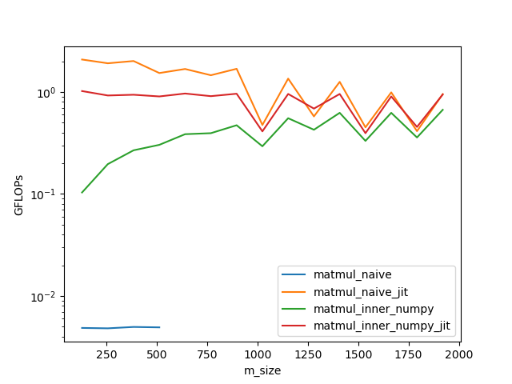

Les trois versions rapides chutent aux mêmes tailles, notamment à 1 024. Changer la façon de calculer la somme conserve le même parcours en colonne de B. Cela explique que les creux se retrouvent sur plusieurs courbes.

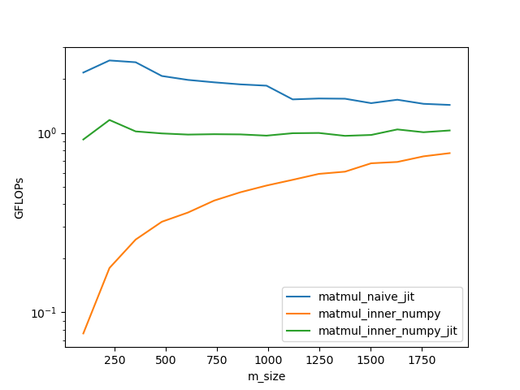

Avec des tailles de 96, 224, 352, etc., les creux périodiques s’atténuent. Le pas entre deux lignes de B change avec N. Ce décalage réduit les conflits de cache, même si le produit matriciel reste le même.

**Q8.** Les courbes de `@`, `np.matmul` et `np.dot` se rejoignent autour de 70 GFLOP/s sur les grandes matrices. Les trois utilisent une multiplication matricielle optimisée pour ces tableaux FP32. Les figures Python et C séquentiel comptent **N³** opérations. Les figures OpenMP et GPU comptent **2N³** (une multiplication et une addition). Les temps restent directement comparables.

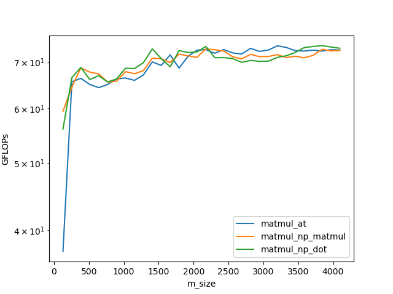

Les écarts entre les trois appels sont surtout visibles sur les petites matrices, où le coût de l’appel pèse davantage. Les courbes finissent sur le même plateau, ce qui est cohérent avec un calcul assuré par les mêmes routines optimisées.

### Q9–20 · C, accès mémoire et vectorisation

Temps moyens à **N = 1 920**, en secondes. La dernière colonne utilise `-O3 -march=native -funroll-loops -ffast-math`. Les pourcentages ci-dessous comparent chaque version à OpenBLAS mesuré dans le même essai.

| Version | Sans option | -O1 | -O2 | -O3 | Toutes les options |
|---|---:|---:|---:|---:|---:|
| v1 · trois boucles | 18,386 | 12,243 | **5,394** | 5,459 | — |
| v2 · accumulateur | 12,948 | **4,791** | 4,923 | 5,257 | — |
| v3 · transposition de A | 12,093 | 2,958 | 2,887 | 2,936 | **0,477** |
| v4 · vecteurs de 8 floats | 11,893 | 1,754 | 1,677 | 1,723 | **0,473** |

**Q9–11.** Sans option, v1 atteint seulement **0,55 %** du débit d’OpenBLAS dans la série répétée. Passer à `-O2` divise le temps par 3,4. `-O3` apporte peu ici. À la même taille, Numba prend **8,508 s** en moyenne sur trois passages hors compilation. Le code machine produit par Numba devance le C sans option (18,386 s). Activer les optimisations de GCC inverse le classement (5,394 s avec `-O2`).

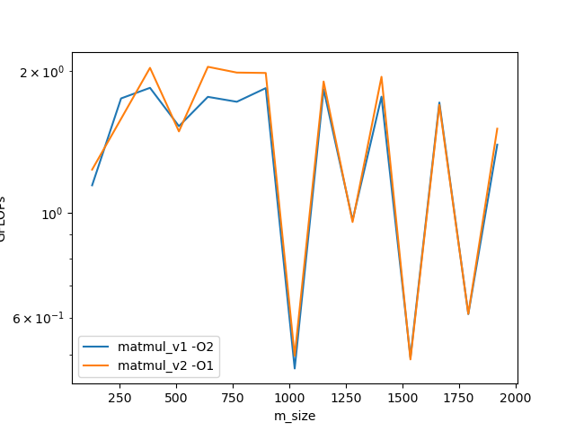

Si les écritures dans C expliquaient les creux, la courbe de v2 devrait être plus lisse. Or v1 et v2 plongent ensemble à 1 024 et à 1 536. L’accumulateur améliore légèrement le débit moyen, mais laisse intact le grand pas entre deux lectures de A.

**Q12–13.** v2 accumule chaque produit dans une variable locale et écrit C une seule fois en fin de boucle. Le gain est surtout visible sans optimisation. Avec les meilleurs réglages, le temps passe de 5,39 à 4,79 s. L’accès à une colonne avec un grand pas mémoire reste coûteux.

**Q14–15.** Le code C stocke les matrices colonne par colonne. Transposer A permet de lire à la suite les valeurs de A et B nécessaires au produit scalaire. Avec `-O2`, le temps passe de 4,92 à 2,89 s, transposition comprise.

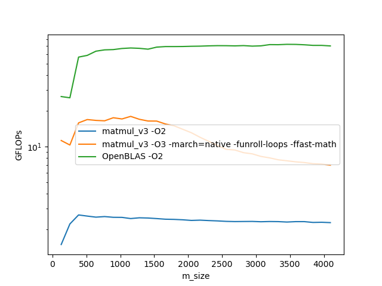

La transposition rend les lectures contiguës dans les deux versions de v3. Les options de vectorisation font surtout la différence aux tailles intermédiaires. La version optimisée atteint 17,9 à N = 1 152, puis descend à 7,0 à N = 4 096. OpenBLAS reste proche de 70 sur les grandes tailles grâce à une meilleure réutilisation des données.

**Q16–17.** À 1 920, ajouter uniquement `-march=native` ou `-funroll-loops` à `-O3` laisse v3 près de 2,9 s. Avec `-ffast-math`, le compilateur peut réassocier la somme et le temps descend à **0,794 s**. Les trois options ensemble donnent **0,477 s**, soit **21 % d’OpenBLAS**. À 4 096, la courbe optimisée tombe à **7,0** contre **70,3** pour OpenBLAS. Les deux vecteurs sont contigus, mais chaque case de C exige une nouvelle lecture des deux vecteurs.

**Q18–20.** v4 charge huit floats de A transposée et huit de B, multiplie les huit paires puis accumule dans huit sommes partielles. À la fin, on additionne ces huit sommes pour obtenir une case de C. Avec `-O2`, v4 prend 1,68 s contre 2,89 s pour v3. Avec toutes les options, **0,473 et 0,477 s** sont pratiquement identiques. La vectorisation manuelle apporte peu quand le compilateur vectorise déjà bien la boucle.

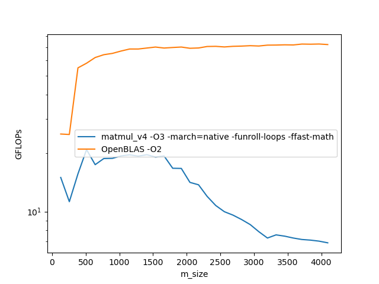

Le débit de v4 culmine à 20,8 à N = 512, puis tombe à 6,9 à N = 4 096. Les vecteurs de huit floats accélèrent les multiplications, mais les lignes et colonnes nécessaires à chaque case de C occupent de plus en plus de cache. L’écart avec OpenBLAS grandit.

### Q21–27 · Réutiliser les données dans les registres et les caches

**Q21–23.** v5 calcule une tuile de C. Un vecteur de A sert à plusieurs colonnes, et un scalaire de B à plusieurs lignes. Les sommes partielles restent dans des registres pendant le parcours de K. À 1 920, v5 prend **10,58 / 3,61 / 5,22 / 4,76 s** sans option puis avec `-O1/-O2/-O3`. Avec toutes les options, elle descend à **0,249 s**, soit **41 % d’OpenBLAS**. À 3 840, elle atteint seulement **10,1** contre **73,6** pour OpenBLAS. La tuile améliore la réutilisation locale, mais les accès aux grandes matrices restent coûteux.

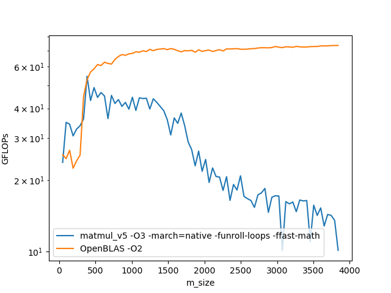

v5 s’approche d’OpenBLAS sur les petites matrices, puis les courbes s’écartent. Réutiliser les valeurs dans une tuile de C suffit tant que les blocs de A et B restent facilement accessibles en cache. À grande taille, leur relecture d’une tuile à la suivante limite le débit.

**Q24.** Une tuile de hauteur H et de largeur W demande `(H/8) × W` accumulateurs vectoriels, auxquels s’ajoutent les registres des opérandes.

| Tuile | Accumulateurs | N = 240 | N = 1 920 |
|---|---:|---:|---:|
| 8 × 6 | 6 | 0,551 ms | 310 ms |
| 16 × 6 | 12 | 0,527 ms | **242 ms** |
| 16 × 8 | 16 | 0,605 ms | 251 ms |

À 240, les écarts sont petits devant la dispersion. À 1 920, la tuile **16 × 6** donne le meilleur temps moyen. Agrandir encore la tuile augmente la pression sur les registres.

**Q25–27.** v6 découpe aussi M, N et K en blocs. Plusieurs appels au kernel réutilisent alors les mêmes données en cache. Dans la même série à 1 920, v4 prend **466 ms**, v5 **228 ms**, v6 **136 ms**. Parmi les dix découpages testés, **64/120/480** donne la meilleure moyenne, **133,4 ± 4,9 ms**, soit **77 % d’OpenBLAS**. Le découpage 64/120/240 est proche à 134,9 ms. À 3 840, v6 conserve **51,4** contre **73,9** pour OpenBLAS, alors que v5 est à **10,0**.

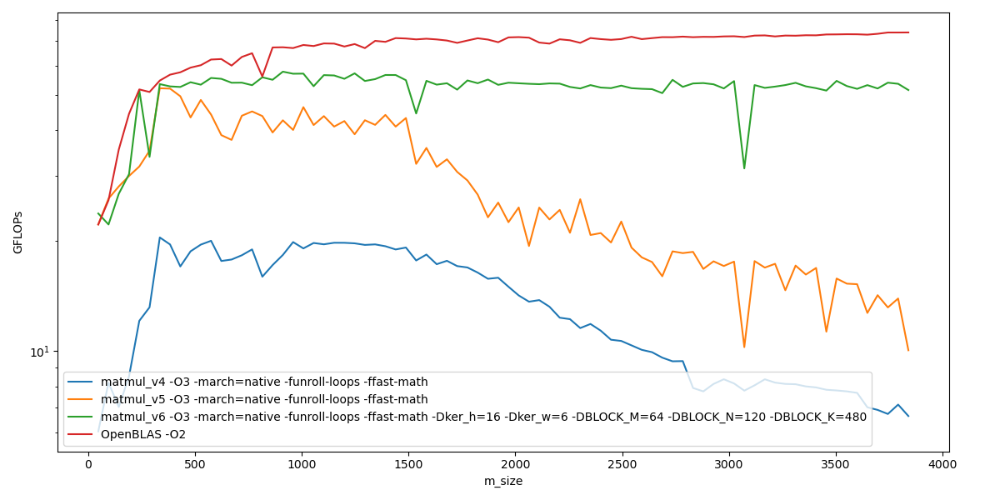

La différence apparaît surtout à droite du graphique. À N = 3 840, v6 atteint encore 51,4 contre 10,0 pour v5. Le découpage de K permet de multiplier plusieurs tuiles avec les mêmes blocs de A et B avant de passer aux suivants. C’est ce qui permet à v6 de rester proche d’un plateau.

### Q28–34 · OpenMP et énergie

**Q28–29.** Chaque thread reçoit des blocs distincts de C et garde toutes leurs contributions sur K. Deux threads qui feraient `C[i,j] += …` en même temps pourraient perdre une contribution. Dans la campagne des figures, à deux threads, l’axe M donne **73,4 ms** contre **77,3 ms** sur N. Sur M, `static,1` donne **66,5 ms**, `guided,2` **67,1 ms** et `dynamic,1` **69,1 ms**. Le travail est assez régulier pour une répartition statique. Une autre campagne favorise N avec `static,4`. Le classement varie donc entre les deux séries.

**Q30–32.** Avec M, `static,1` et les blocs 64/120/480, le débit passe de **109 GFLOP/s à 1 thread** à **444 à 8**, puis **600 à 20**. À 24 threads il retombe à **476**. Les deux courbes de speedup se superposent presque parce que les références sont très proches **(130,54 ms sans OpenMP et 129,96 ms avec un thread)**. À 20 threads, les gains correspondants sont **5,53× et 5,51×**.

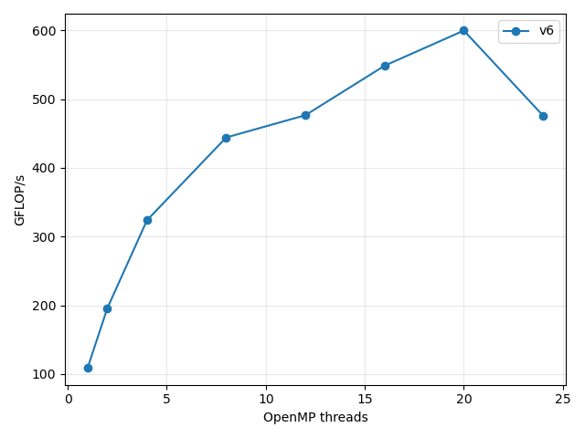

De 1 à 8 threads, quatre fois plus de produits sont calculés par seconde. Entre 8 et 20 threads, le gain est plus faible. Les cœurs P et E ont des débits différents, et deux threads d’un même cœur P partagent ses unités de calcul. À 24 threads, le débit recule alors que les 20 threads matériels sont déjà occupés.

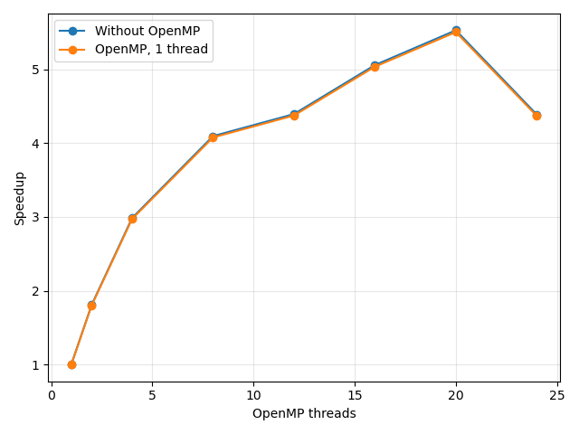

Un doublement idéal du débit à chaque doublement du nombre de threads donnerait une droite de pente 1. Ici, le gain atteint environ 4× à 8 threads, puis 5,5× à 20. Les deux courbes ont la même forme parce que seul le temps de référence change.

**Q33.** Si la puissance double, `E(12)/E(1) = 2 × t(12)/t(1)`. Dans la campagne consignée dans les notes, ce rapport vaut **0,645 pour v6** et **0,647 pour OpenBLAS**. Cela représente une économie d’environ **35 % d’énergie** dans les deux cas. Le gain de temps compense le doublement supposé de la puissance. La campagne de la figure Q30, avec d’autres réglages, donne **0,457 pour v6**.

**Q34.** À **N = 9 600**, le wattmètre donne 20 W au repos. En charge, les relevés sont les suivants.

| Threads | 1 | 2 | 4 | 8 | 12 | 16 | 20 | 24 |
|---|---:|---:|---:|---:|---:|---:|---:|---:|
| Puissance (W) | 63 | 86 | 136 | 171 | 170 | 162 | 157 | 166 |
| Temps v6 (s) | 19,77 | 10,13 | 6,77 | 5,05 | 4,99 | 4,99 | **4,70** | 5,08 |
| GFLOP/J à la prise | 1,42 | 2,03 | 1,92 | 2,05 | 2,09 | 2,19 | **2,40** | 2,10 |

**20 threads donnent à la fois le meilleur temps et le meilleur rendement.** À 8 threads le poste consomme davantage (171 W contre 157 W) pour un calcul plus lent. Après soustraction des 20 W au repos, le maximum reste à 20 threads, avec **2,75 GFLOP/J**. Ce calcul associe deux passages à 9 600 sur le même poste et suppose que les watts stabilisés ont été relevés pendant v6.

### Q35–40 · CPU contre T4

**Q35.** À N = 4 096, voici le temps moyen de trois multiplications. Sur le T4, les matrices sont déjà en mémoire GPU et le chronométrage exclut les transferts.

| Version | Temps | GFLOP/s |
|---|---:|---:|
| OpenBLAS CPU, 1 thread | 971,4 ms | 141 |
| OpenBLAS CPU, 8 threads | 160,4 ms | 857 |
| cuBLAS T4, FP32 | **33,3 ms** | **4 128** |
| CUDA naïf | 3 052,1 ms | 45 |
| CUDA par tuiles | 64,8 ms | 2 121 |
| GemmEx, entrées FP16 et accumulation FP32 | **2,77 ms** | **49 574** |

**Q36.** À 4 096, cuBLAS FP32 est **29,2×** plus rapide qu’OpenBLAS à un thread et **4,8×** plus rapide qu’à huit threads. Le T4 est déjà devant à la première taille testée (1 024). La multiplication offre assez de cases indépendantes pour exploiter le parallélisme du GPU à cette taille. À 16 384, il atteint **4 080 GFLOP/s**, contre **684** sur CPU.

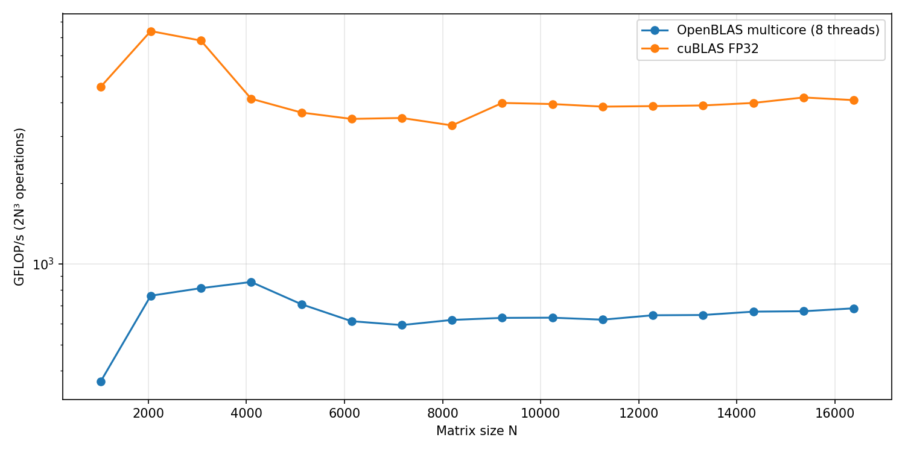

Le GPU atteint son pic à N = 2 048, le CPU à N = 4 096. Au-delà, les débits fluctuent puis se stabilisent à des niveaux distincts. Agrandir les matrices fournit d’abord plus de travail parallèle. Une fois les unités de calcul bien occupées, ajouter du travail augmente surtout le temps total.

**Q37.** Avec la puissance turbo maximale publiée par Intel pour le i7-12700 (**180 W**), le CPU atteint au mieux **857/180 = 4,76 GFLOP/J**, à 4 096. Avec les **70 W** du sujet, le T4 en FP32 atteint **7 377/70 = 105,4 GFLOP/J**, à 2 048. Le rapport estimé vaut **22×**. Ces chiffres utilisent une puissance constante sur toute la courbe.

**Q38.** Chaque thread du kernel naïf calcule une seule case de C et relit deux valeurs à chaque tour sur K. Son meilleur résultat relatif est **1,09 % de cuBLAS**, à 4 096. À cette taille, même OpenBLAS sur un seul thread le devance.

**Q39.** Le kernel par tuiles partage les données d’un bloc et conserve plusieurs sommes en registres. À 4 096, il est **47×** plus rapide que le naïf et atteint **51 % de cuBLAS**. Son meilleur rapport est **64 % à 1 024**. Son débit maximal arrive à 2 048, puis retombe de 3 192 à 1 636 GFLOP/s entre 2 048 et 16 384.

**Q40.** GemmEx atteint son meilleur débit à **5 120** (49,9 TFLOP/s), contre **2 048** pour cuBLAS FP32 (7,38 TFLOP/s). À 5 120, GemmEx est **13,6×** plus rapide que cuBLAS FP32. Ce chiffre dépasse le rapport théorique des pics (environ 8×) parce qu’à cette taille le FP32 mesuré est déjà loin de son pic. Le rapport entre les deux meilleurs débits mesurés vaut **6,8×**.

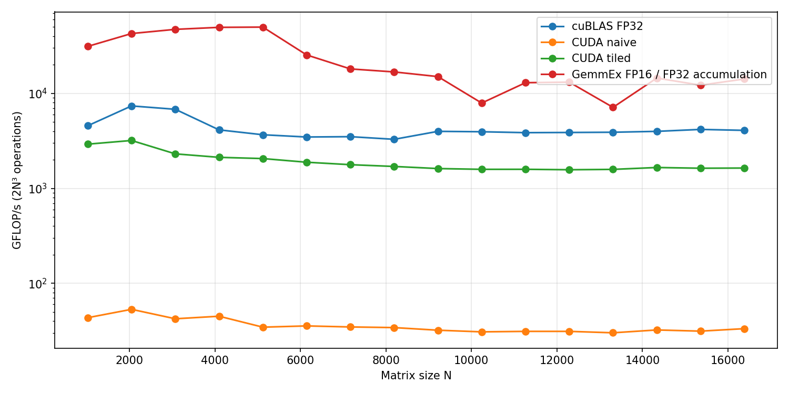

Les tuiles et les Tensor Cores apportent deux gains distincts. Les tuiles réduisent les relectures en mémoire globale et placent le kernel loin au-dessus du naïf. GemmEx accélère aussi le calcul matriciel en précision mixte. Sa courbe atteint son pic plus tard que cuBLAS FP32 (5 120 contre 2 048). Les mesures seules ne permettent pas d’attribuer chacun de ses creux à un mécanisme précis.

**Conclusion sur la multiplication matricielle.** Sur CPU, à 1 920, le découpage en blocs de cache ramène le temps de 228 à 136 ms entre v5 et v6. À 9 600, le meilleur compromis mesuré est de 20 threads, avec 4,70 s et 2,40 GFLOP/J à la prise. Sur T4, à 4 096, le passage du kernel naïf au kernel par tuiles réduit le temps de 3,05 s à 64,8 ms. Dans les deux cas, réutiliser les données améliore le débit.

## Partie 2 — Reconnaître les chats et les chiens

Tous les modèles utilisent le découpage ASIRRA du TP. L’évaluation porte sur les mêmes 2 048 images. L’objectif est d’obtenir la meilleure accuracy **en moins de 300 ms sur le T4**. Les essais CPU avaient un budget local de 5 s.

| Essai | Idée testée | Accuracy observée | Inférence |
|---|---|---:|---:|
| 1 · CPU (modèle du cours) | Images 64 × 64, deux convolutions puis trois couches denses | 83,89 % à 500 itérations | 0,70 s |
| 2 · CPU | Cinq convolutions, augmentations plus fortes et dropout réduit | **92,92 %** à 500 | 3,63 s |
| 3 · CPU | Plus de convolutions sur de petites cartes, moyenne globale et aucune couche dense | **90,48 % au checkpoint 100**, entraînement arrêté | 2,70 s |
| 4 · T4 | Images 96 × 96, première convolution de stride 2, entraînement et inférence en précision mixte | **89,70 % à 150** en validation, **50,00 % à 500** | **154,5 ms** au checkpoint 500 |
| 5 · T4 | Même architecture, entraînement FP32, inférence en précision mixte et sauvegarde du meilleur checkpoint | **94,29 %** au meilleur checkpoint (500), après **15,09 min** | **136,1 ms** |
| 6 · T4 | Images 128 × 128 au lieu de 96 × 96, architecture et entraînement de la config 5 | **95,56 %** au checkpoint 450 (500 itérations en **17,90 min**) | **244,9 ms** |

### Pourquoi ces configurations ?

1. **Config 1 — référence fournie par le cours.** Ce modèle sert de point de comparaison pour les essais suivants sur CPU. En fin d’entraînement, la perte continue de baisser sur les images d’entraînement alors que la précision en validation plafonne autour de 84 %. L’inférence prend seulement 0,70 s sur les 5 s disponibles. Il reste donc du temps pour extraire davantage de motifs dans les images.

2. **Config 2 — mieux exploiter les mêmes images.** Passer de deux à cinq convolutions permet de combiner des motifs simples en formes plus complexes. Les variations de couleur, d’angle et d’échelle visent à mieux reconnaître un animal quand la photo change. Le dropout des deux couches denses passe de 80 et 50 % à 50 et 30 % pour garder davantage de neurones actifs pendant l’apprentissage. L’ensemble fait gagner 9,03 points et tient en 3,63 s. Plusieurs réglages ayant changé ensemble, leur contribution individuelle reste inconnue.

3. **Config 3 — déplacer le calcul vers les petites cartes.** Dans la config 2, la deuxième convolution à pleine résolution représente environ 42 % du temps des couches. Avancer le premier pooling réduit le nombre de positions à traiter par les convolutions suivantes. En sortie, deux cartes donnent chacune un score par position, pour « chat » ou « chien ». La moyenne de chaque carte fournit le score de la classe sans couche dense. L’inférence descend à 2,70 s. Après 409 600 images vues, la config 3 atteint 90,48 % contre 87,21 % pour la 2. L’arrêt à l’itération 100 limite la comparaison à ce stade.

4. **Config 4 — garder plus de détails sur T4.** Le résultat intermédiaire de la config 3 justifie de conserver la moyenne globale. Le passage sur T4 permet de tester des images de 96 × 96. Pour viser 300 ms, la première convolution avance de deux pixels à la fois et produit directement des cartes de 48 × 48. Le calcul utilise la précision mixte. Le modèle atteint 89,70 % à l’itération 150, puis les pertes remontent aussi bien en entraînement qu’en validation. À 400, toutes les images sont classées « chat ». Cette chute sur les deux jeux suggère un problème de stabilité pendant l’apprentissage.

5. **Config 5 — tester la stabilité à architecture identique.** L’entraînement passe en FP32 pour réduire les erreurs d’arrondi. L’inférence garde la précision mixte pour rester rapide. Comparer les modèles tous les 50 tours et sauvegarder le meilleur permet aussi de récupérer les poids précédant une éventuelle chute. Cette fois, le meilleur score arrive à l’itération 500 avec 94,29 %. Le résultat est compatible avec un entraînement plus stable en FP32, même si la cause exacte de la chute précédente reste inconnue.

6. **Config 6 — utiliser la marge de temps pour augmenter la résolution.** À 136,1 ms, la config 5 dispose encore de 163,9 ms avant la limite. Passer de 96 × 96 à 128 × 128 conserve davantage de détails de l’image d’origine avec les mêmes couches et les mêmes réglages d’entraînement. La précision atteint 95,56 % à l’itération 450 puis 95,51 % à 500. Cela représente une seule image bien classée de moins sur 2 048. Le checkpoint 450 est donc retenu, mais cet écart donne peu d’indices de surapprentissage marqué.

**Pistes pour les configs 7 et 8.** Le journal intitulé « training 7 » reprend les mesures de la config 6. Deux essais permettraient d’isoler l’effet de chaque réglage en repartant de la config 6. Le premier appliquerait les rotations et changements d’échelle à 60 % des images d’entraînement au lieu de 30 %, pour tester la robustesse aux variations de cadrage. Le second garderait la probabilité de 30 % et diviserait le taux d’apprentissage maximal par deux, pour tester si des mises à jour plus petites améliorent la précision en 500 itérations.

**Conclusion sur le CNN.** Le modèle retenu est la **config 6 au checkpoint 450**. Passer de 96 × 96 à 128 × 128 donne un gain de **1,27 point** par rapport à la config 5 pour **108,8 ms** de plus. Ce checkpoint atteint **95,56 % de bonnes prédictions sur 2 048 images en 244,9 ms**, avec **55,1 ms de marge** sur le T4.
