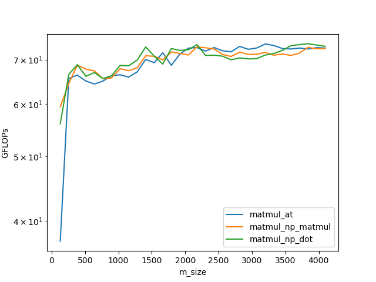

Q22 | size=1920 | no flags
matmul_v5: 10.578611 +/- 0.007924 s (sample SD, 3 runs) | 0.97% of OpenBLAS performance

Q22 | size=1920 | -O1
matmul_v5: 3.608332 +/- 0.028635 s (sample SD, 3 runs) | 2.75% of OpenBLAS performance

Q22 | size=1920 | -O2
matmul_v5: 5.219263 +/- 0.013610 s (sample SD, 3 runs) | 1.89% of OpenBLAS performance

Q22 | size=1920 | -O3
matmul_v5: 4.758115 +/- 0.066947 s (sample SD, 3 runs) | 2.10% of OpenBLAS performance

Q22 | size=1920 | -O3 -march=native -funroll-loops -ffast-math
matmul_v5: 0.249389 +/- 0.025036 s (sample SD, 3 runs) | 40.73% of OpenBLAS performance### 1
Architecture :                            x86_64
Mode(s) opératoire(s) des processeurs :   32-bit, 64-bit
Tailles des adresses:                     46 bits physical, 48 bits virtual
Boutisme :                                Little Endian
Processeur(s) :                           20
Liste de processeur(s) en ligne :         0-19
Identifiant constructeur :                GenuineIntel
Nom de modèle :                           12th Gen Intel(R) Core(TM) i7-12700
Famille de processeur :                   6
Modèle :                                  151
Thread(s) par cœur :                      2
Cœur(s) par socket :                      12
Socket(s) :                               1
Révision :                                2
multiplication des MHz du/des CPU(s) :    20%
Vitesse maximale du processeur en MHz :   4900,0000
Vitesse minimale du processeur en MHz :   800,0000
BogoMIPS :                                4224,00
Drapeaux :                                fpu vme de pse tsc msr pae mce cx8 apic sep mtrr pge mca cmov pat pse36 clflush dts acpi mmx fxsr sse sse2 ss ht tm pbe syscall nx pdpe1gb rdtscp lm constant_tsc art arch_perfmon pebs bts rep_good nopl xtopology nonstop_tsc cpuid aperfmperf tsc_known_freq pni pclmulqdq dtes64 monitor ds_cpl vmx smx est tm2 ssse3 sdbg fma cx16 xtpr pdcm pcid sse4_1 sse4_2 x2apic movbe popcnt tsc_deadline_timer aes xsave avx f16c rdrand lahf_lm abm 3dnowprefetch cpuid_fault epb ssbd ibrs ibpb stibp ibrs_enhanced tpr_shadow flexpriority ept vpid ept_ad fsgsbase tsc_adjust bmi1 avx2 smep bmi2 erms invpcid rdseed adx smap clflushopt clwb intel_pt sha_ni xsaveopt xsavec xgetbv1 xsaves split_lock_detect user_shstk avx_vnni dtherm ida arat pln pts hwp hwp_notify hwp_act_window hwp_epp hwp_pkg_req hfi vnmi umip pku ospke waitpkg gfni vaes vpclmulqdq tme rdpid movdiri movdir64b fsrm md_clear serialize pconfig arch_lbr ibt flush_l1d arch_capabilities ibpb_exit_to_user
Virtualisation :                          VT-x
Cache L1d :                               512 KiB (12 instances)
Cache L1i :                               512 KiB (12 instances)
Cache L2 :                                12 MiB (9 instances)
Cache L3 :                                25 MiB (1 instance)
Nœud(s) NUMA :                            1
Nœud NUMA 0 de processeur(s) :            0-19
Vulnérabilité Gather data sampling :      Not affected
Vulnérabilité Indirect target selection : Not affected
Vulnérabilité Itlb multihit :             Not affected
Vulnérabilité L1tf :                      Not affected
Vulnérabilité Mds :                       Not affected
Vulnérabilité Meltdown :                  Not affected
Vulnérabilité Mmio stale data :           Not affected
Vulnérabilité Reg file data sampling :    Mitigation; Clear Register File
Vulnérabilité Retbleed :                  Not affected
Vulnérabilité Spec rstack overflow :      Not affected
Vulnérabilité Spec store bypass :         Mitigation; Speculative Store Bypass disabled via prctl
Vulnérabilité Spectre v1 :                Mitigation; usercopy/swapgs barriers and __user pointer sanitization
Vulnérabilité Spectre v2 :                Mitigation; Enhanced / Automatic IBRS; IBPB conditional; PBRSB-eIBRS SW sequence; BHI BHI_DIS_S
Vulnérabilité Srbds :                     Not affected
Vulnérabilité Tsa :                       Not affected
Vulnérabilité Tsx async abort :           Not affected
Vulnérabilité Vmscape :                   Mitigation; IBPB before exit to userspace

Machine (15GB total)
  Package L#0
    NUMANode L#0 (P#0 15GB)
    L3 L#0 (25MB)
      L2 L#0 (1280KB) + L1d L#0 (48KB) + L1i L#0 (32KB) + Core L#0
        PU L#0 (P#0)
        PU L#1 (P#1)
      L2 L#1 (1280KB) + L1d L#1 (48KB) + L1i L#1 (32KB) + Core L#1
        PU L#2 (P#2)
        PU L#3 (P#3)
      L2 L#2 (1280KB) + L1d L#2 (48KB) + L1i L#2 (32KB) + Core L#2
        PU L#4 (P#4)
        PU L#5 (P#5)
      L2 L#3 (1280KB) + L1d L#3 (48KB) + L1i L#3 (32KB) + Core L#3
        PU L#6 (P#6)
        PU L#7 (P#7)
      L2 L#4 (1280KB) + L1d L#4 (48KB) + L1i L#4 (32KB) + Core L#4
        PU L#8 (P#8)
        PU L#9 (P#9)
      L2 L#5 (1280KB) + L1d L#5 (48KB) + L1i L#5 (32KB) + Core L#5
        PU L#10 (P#10)
        PU L#11 (P#11)
      L2 L#6 (1280KB) + L1d L#6 (48KB) + L1i L#6 (32KB) + Core L#6
        PU L#12 (P#12)
        PU L#13 (P#13)
      L2 L#7 (1280KB) + L1d L#7 (48KB) + L1i L#7 (32KB) + Core L#7
        PU L#14 (P#14)
        PU L#15 (P#15)
      L2 L#8 (2048KB)
        L1d L#8 (32KB) + L1i L#8 (64KB) + Core L#8 + PU L#16 (P#16)
        L1d L#9 (32KB) + L1i L#9 (64KB) + Core L#9 + PU L#17 (P#17)
        L1d L#10 (32KB) + L1i L#10 (64KB) + Core L#10 + PU L#18 (P#18)
        L1d L#11 (32KB) + L1i L#11 (64KB) + Core L#11 + PU L#19 (P#19)
  HostBridge
    PCI 00:02.0 (VGA)
    PCIBridge
      PCI 01:00.0 (NVMExp)
        Block(Disk) "nvme0n1"
    PCI 00:1f.6 (Ethernet)
      Net "eno1"

### 2
veille 1.7W
idle écran éteint 8W
idle écran allumé 16W
vscode + mozilla ouvert 20W 
ouvrir un pdf sur l'extension vscode monte pendant qlqs à 30 W 
video ytb sans accel 28W 
video ytb avec accel 27W
### 3 4 5
m_size = 512
baseline : 27.510066747665405
baseline with jit : 0.061835289001464844
inner_loop numpy : 0.48038816452026367
inner_loop numpy with jit : 0.13032007217407227

### 6 7 8

### 9
export OMP_NUM_THREADS=1
export OPENBLAS_NUM_THREADS=1
gcc matmul.c -o matmul -lopenblas -lm
v1
sans opti
Regular sgemm time: 0.029145 s
Custom sgemm time: 18.438492 s
avec O1
Regular sgemm time: 0.028130 s
Custom sgemm time: 12.548904 s
avec O2
Regular sgemm time: 0.029036 s
Custom sgemm time: 4.975965 s
avec 03
Regular sgemm time: 0.038430 s
Custom sgemm time: 5.002741 s
### 10
v2Q10 | size=1920 | no flags
matmul_v1: 18.386041 +/- 0.065395 s (sample SD, 3 runs) | 0.55% of OpenBLAS performance

Q10 | size=1920 | -O1
matmul_v1: 12.243066 +/- 0.092851 s (sample SD, 3 runs) | 0.82% of OpenBLAS performance

Q10 | size=1920 | -O2
matmul_v1: 5.393907 +/- 0.241968 s (sample SD, 3 runs) | 1.86% of OpenBLAS performance

Q10 | size=1920 | -O3
matmul_v1: 5.458942 +/- 0.088816 s (sample SD, 3 runs) | 1.86% of OpenBLAS performance

### 12
Q12 | size=1920 | no flags
matmul_v2: 12.948144 +/- 0.064434 s (sample SD, 3 runs) | 0.79% of OpenBLAS performance

Q12 | size=1920 | -O1
matmul_v2: 4.791312 +/- 0.088082 s (sample SD, 3 runs) | 2.12% of OpenBLAS performance

Q12 | size=1920 | -O2
matmul_v2: 4.922585 +/- 0.034357 s (sample SD, 3 runs) | 2.06% of OpenBLAS performance

Q12 | size=1920 | -O3
matmul_v2: 5.257009 +/- 0.005630 s (sample SD, 3 runs) | 1.90% of OpenBLAS performance
### 14
Q14 | size=1920 | no flags
matmul_v3: 12.092632 +/- 0.112505 s (sample SD, 3 runs) | 0.83% of OpenBLAS performance

Q14 | size=1920 | -O1
matmul_v3: 2.957555 +/- 0.073706 s (sample SD, 3 runs) | 3.53% of OpenBLAS performance

Q14 | size=1920 | -O2
matmul_v3: 2.887041 +/- 0.036149 s (sample SD, 3 runs) | 3.46% of OpenBLAS performance

Q14 | size=1920 | -O3
matmul_v3: 2.936007 +/- 0.075118 s (sample SD, 3 runs) | 3.39% of OpenBLAS performance
### 16

Q16 | size=1920 | -O3
matmul_v3: 2.914556 +/- 0.051842 s (sample SD, 3 runs) | 3.41% of OpenBLAS performance

Q16 | size=1920 | -O3 -march=native
matmul_v3: 2.897664 +/- 0.038998 s (sample SD, 3 runs) | 3.45% of OpenBLAS performance

Q16 | size=1920 | -O3 -funroll-loops
matmul_v3: 2.960590 +/- 0.081440 s (sample SD, 3 runs) | 3.33% of OpenBLAS performance

Q16 | size=1920 | -O3 -ffast-math
matmul_v3: 0.793544 +/- 0.076209 s (sample SD, 3 runs) | 13.29% of OpenBLAS performance

Q16 | size=1920 | -O3 -march=native -funroll-loops
matmul_v3: 2.938548 +/- 0.029292 s (sample SD, 3 runs) | 3.36% of OpenBLAS performance

Q16 | size=1920 | -O3 -march=native -ffast-math
matmul_v3: 0.585161 +/- 0.032646 s (sample SD, 3 runs) | 17.14% of OpenBLAS performance

Q16 | size=1920 | -O3 -funroll-loops -ffast-math
matmul_v3: 0.764746 +/- 0.032309 s (sample SD, 3 runs) | 13.29% of OpenBLAS performance

Q16 | size=1920 | -O3 -march=native -funroll-loops -ffast-math
matmul_v3: 0.476791 +/- 0.012910 s (sample SD, 3 runs) | 21.19% of OpenBLAS performance

### 19
Q19 | size=1920 | no flags
matmul_v4: 11.892922 +/- 0.107917 s (sample SD, 3 runs) | 0.85% of OpenBLAS performance

Q19 | size=1920 | -O1
matmul_v4: 1.754112 +/- 0.036285 s (sample SD, 3 runs) | 5.72% of OpenBLAS performance

Q19 | size=1920 | -O2
matmul_v4: 1.676744 +/- 0.035835 s (sample SD, 3 runs) | 5.99% of OpenBLAS performance

Q19 | size=1920 | -O3
matmul_v4: 1.723084 +/- 0.036393 s (sample SD, 3 runs) | 5.87% of OpenBLAS performance

Q19 | size=1920 | -O3 -march=native -funroll-loops -ffast-math
matmul_v4: 0.473009 +/- 0.026676 s (sample SD, 3 runs) | 21.43% of OpenBLAS performance

Q22 | size=1920 | no flags
matmul_v5: 10.578611 +/- 0.007924 s (sample SD, 3 runs) | 0.97% of OpenBLAS performance

Q22 | size=1920 | -O1
matmul_v5: 3.608332 +/- 0.028635 s (sample SD, 3 runs) | 2.75% of OpenBLAS performance

Q22 | size=1920 | -O2
matmul_v5: 5.219263 +/- 0.013610 s (sample SD, 3 runs) | 1.89% of OpenBLAS performance

Q22 | size=1920 | -O3
matmul_v5: 4.758115 +/- 0.066947 s (sample SD, 3 runs) | 2.10% of OpenBLAS performance

Q22 | size=1920 | -O3 -march=native -funroll-loops -ffast-math
matmul_v5: 0.249389 +/- 0.025036 s (sample SD, 3 runs) | 40.73% of OpenBLAS performance

Q24
Kernel 8x6: 6 vector accumulators
N=240: 0.000551 +/- 0.000193 s | 115.54% of OpenBLAS performance
N=1920: 0.310365 +/- 0.017137 s | 32.79% of OpenBLAS performance

Kernel 16x6: 12 vector accumulators
N=240: 0.000527 +/- 0.000226 s | 117.45% of OpenBLAS performance
N=1920: 0.241657 +/- 0.030667 s | 43.37% of OpenBLAS performance

Kernel 16x8: 16 vector accumulators
N=240: 0.000605 +/- 0.000214 s | 112.94% of OpenBLAS performance
N=1920: 0.250783 +/- 0.026412 s | 41.24% of OpenBLAS performance

Q25 | size=1920 | -O3 -march=native -funroll-loops -ffast-math
matmul_v4: 0.465589 +/- 0.048179 s (sample SD, 3 runs) | 21.86% of OpenBLAS performance
matmul_v5: 0.227894 +/- 0.028106 s (sample SD, 3 runs) | 44.99% of OpenBLAS performance
matmul_v6: 0.135524 +/- 0.007967 s (sample SD, 3 runs) | 74.89% of OpenBLAS performance

Q26 | blocks=32,60,120 | 0.144770 +/- 0.007762 s | 71.47% of OpenBLAS performance
Q26 | blocks=32,60,240 | 0.146265 +/- 0.001249 s | 70.16% of OpenBLAS performance
Q26 | blocks=32,60,480 | 0.140317 +/- 0.002994 s | 72.93% of OpenBLAS performance
Q26 | blocks=32,120,240 | 0.141768 +/- 0.002858 s | 72.68% of OpenBLAS performance
Q26 | blocks=32,120,480 | 0.136894 +/- 0.004808 s | 74.95% of OpenBLAS performance
Q26 | blocks=32,240,480 | 0.140979 +/- 0.003813 s | 72.69% of OpenBLAS performance
Q26 | blocks=64,120,240 | 0.134863 +/- 0.004309 s | 75.92% of OpenBLAS performance
Q26 | blocks=64,120,480 | 0.133425 +/- 0.004946 s | 77.04% of OpenBLAS performance
Q26 | blocks=64,240,480 | 0.140304 +/- 0.007788 s | 73.22% of OpenBLAS performance
Q26 | blocks=128,240,480 | 0.137659 +/- 0.008260 s | 74.12% of OpenBLAS performance
Best blocks: (64, 120, 480), mean time 0.133425 s
Q28 | M | static     | 0.076644 ± 0.006776 s
Q28 | N | static     | 0.069857 ± 0.003503 s
Q29 | N | static     | 0.073184 ± 0.005650 s
Q29 | N | static,1   | 0.070264 ± 0.002741 s
Q29 | N | static,2   | 0.071017 ± 0.002460 s
Q29 | N | static,4   | 0.068029 ± 0.000424 s
Q29 | N | dynamic,1  | 0.070609 ± 0.004770 s
Q29 | N | dynamic,2  | 0.075063 ± 0.001049 s
Q29 | N | dynamic,4  | 0.068684 ± 0.000634 s
Q29 | N | guided,1   | 0.070301 ± 0.001551 s
Q29 | N | guided,2   | 0.074795 ± 0.008931 s
Q29 | N | guided,4   | 0.080252 ± 0.006676 s
Q30 | axis=N, schedule=static,4, blocks=[64, 120, 240]
   1 threads | 0.135453 ± 0.007376 s | 104.51 GFLOP/s
   2 threads | 0.069027 ± 0.001829 s | 205.08 GFLOP/s
   4 threads | 0.046977 ± 0.005695 s | 301.34 GFLOP/s
   8 threads | 0.040691 ± 0.007244 s | 347.88 GFLOP/s
  12 threads | 0.043680 ± 0.007013 s | 324.08 GFLOP/s
  16 threads | 0.042521 ± 0.005078 s | 332.92 GFLOP/s
  20 threads | 0.040546 ± 0.004208 s | 349.13 GFLOP/s
  24 threads | 0.039243 ± 0.002465 s | 360.72 GFLOP/s
Q31 | without OpenMP 0.139329 ± 0.007278 s | OpenMP 1 thread 0.135453 ± 0.007376 s
Q33 | E(12) / E(1), assuming twice the power | v6=0.645 | OpenBLAS=0.647
Q34 | Supply wattmeter readings with --power-csv (columns: threads,watts).

gcc matmul.c -O3 -march=native -funroll-loops -ffast-math -fopenmp \
  -DV6_OMP_AXIS_N=0 -DBLOCK_M=64 -DBLOCK_N=120 -DBLOCK_K=480 \
  -o matmul_omp -lopenblas -lm

t=2
N=9600

OMP_NUM_THREADS="$t" OMP_DYNAMIC=FALSE OMP_SCHEDULE=static,1 \
OPENBLAS_NUM_THREADS=20 ./matmul_omp "$N" matmul_v6
repos 20 W
t=1 63w
t=2 86W
t=4 136W
t=8 171W
t=12 170W
t=16 162 w
t=20 157 W
t=24 166W

## part 2 
### training 1 (baseline)
#### training config
%%bash

python3 - <<EOF

from helper import *

raw_image_size = 64
image_size = 64
nb_images_per_iter = 4096 #Should likely be reduced if the image size is aumgented so examples can fit in RAM

load_iter = 0 #Used to reload a model at a given iteration

#See Albumentation documentation for a list of existing augmentations
train_transform = A.Compose([
  #A.Affine(scale=(...,...), keep_ratio=False, rotate=(...,...), interpolation=1),
  A.Resize(height=image_size, width=image_size, interpolation=1, p=1.0),
  A.ColorJitter(brightness=(0.9,1.1), contrast=(0.9,1.1), saturation=(0.9,1.1), hue=0.05, p=1.0),
  A.ToGray(p=0.02),
  A.HorizontalFlip(p=0.5),
])

val_transform = A.Compose([
    A.Resize(height=image_size, width=image_size, interpolation=1),
])

#This funtion allow to launch data augmentation on a separate thread.
#This way we can train on the GPU and generate new agumented examples in parallel.
def data_augm():
  input_data, targets = create_augmented_batch(train_transform)
  cnn.delete_dataset("TRAIN_buf", silent=1)
  cnn.create_dataset("TRAIN_buf", nb_images_per_iter, input_data[:,:], targets[:,:], silent=1)
  return

cnn.init(b_size=32, optimizer=cnn.rms_prop(momentum=0.9), wema=0, dynamic_load=1,
  comp_meth='C_BLAS', mixed_precision="FP32C_FP32A")

data_prep(nb_images_per_iter, raw_image_size, image_size)

input_val, targets_val = create_validation_set(val_transform)
cnn.create_dataset("VALID", 2048, input_val[:,:], targets_val[:,:])
cnn.create_dataset("TEST", 2048, input_val[:,:], targets_val[:,:])

#Create fist augmentation before parallelization
input_data, targets = create_augmented_batch(train_transform)
cnn.create_dataset("TRAIN", nb_images_per_iter, input_data[:,:], targets[:,:])

a_relu = cnn.relu(leaking=0.05, saturation=640000.0)

if(load_iter > 0):
  cnn.input(spatial_shape=[image_size,image_size,1], nb_features=3)
  cnn.load("net_save/net0_s%04d.dat"%load_iter, load_iter, nb_skip_layers=1, bin=1) #Reset optimizer state
  #cnn.load("optim_save/net_optim0_s%04d.dat"%load_iter, load_iter, bin=1) #Preserve optimizer state
else:
  #Network backbone architecture
  cnn.input(spatial_shape=[image_size,image_size,1], nb_features=3)

  cnn.conv(f_size=(3,3), nb_filters=8 , padding=(1,1), activation=a_relu)
  cnn.pool(p_size=(2,2), p_type="MAX")

  cnn.conv(f_size=(3,3), nb_filters=16, padding=(1,1), activation=a_relu)
  cnn.pool(p_size=(2,2), p_type="MAX")

  cnn.dense(nb_neurons=256, activation=a_relu, drop_rate=0.8)
  cnn.dense(nb_neurons=128, activation=a_relu, drop_rate=0.5)
  cnn.dense(nb_neurons=2 , strict_size=1, activation="SMAX")

warmup = 10
cycle_length = 500
nb_cycles = 1
#Cycle length and/or the number of cycle should be increased with the complexity of the network and task

l_r_max = 4e-4
l_r_min = 4e-6

#In case the creation of new augmented data is too long compared to training, you can
#increase the number of training iteration over a single augmentation
nb_iter_per_augm = 1
if(nb_iter_per_augm > 1):
  shuffle_frequency = 1
else:
  shuffle_frequency = 0

for i in range(load_iter, nb_cycles*cycle_length):

  if((i+1) % nb_iter_per_augm == 0):
    t = Thread(target=data_augm)
    t.start()

  if(i < warmup):
    l_r = l_r_min + (l_r_max - l_r_min) * min(i/warmup,1.0)
  else: # Cyclical cosin learning rate decay with warm restart
    cycle_id = i//cycle_length
    in_cycle_progress = (i%cycle_length)/cycle_length
    l_r = l_r_min + 0.5*(l_r_max*0.8**cycle_id - l_r_min)*(1 + np.cos(np.pi*in_cycle_progress))

  cnn.train(nb_iter=1, learning_rate=l_r, weight_decay=0.01, decoupled_wdecay=1,
    confmat=1, control_interv=50, save_every=100, save_optim_every=100, save_bin=1, TC_scale_factor=128.0, shuffle_every=shuffle_frequency)

  if(i == 0):
    cnn.perf_eval()

  if((i+1) % nb_iter_per_augm == 0):
    t.join()
    cnn.swap_data_buffers("TRAIN")

free_data_helper()

EOF

"
                  ..:^~!?JY5PB~                                                                                         
          J5PGB#&&&&&#BGP55YY#&#!                                                                                       
          &GGB##&&&@@@@@&#PJ?B#&B                                                                                       
         .&#&@@@@@@@@@@@@@@@B##&G                                                                                       
       ^G@@@@BJ^.   .~?P&@@@@@&&G                                                                                       
     &&@@@B^   :!???^^..:7&@@@@&G      .~~~         :~~:         ~~~^        ~~~    ~~~^        ~~~         ^~~.        
   .B@@@&^  !#@@@@@@@@&?^~J&@@@@B ^    !@@@.       :@@@@^       .@@@@G      .@@@:  .@@@@P      .@@@:       ~@@@@.       
  .&@@@#  .J@@@#GP55PB&@&JJ5@@@@B ^G   !@@@.       &@@@@@.      .@@@@@&:     @@@:  .@@@@@&:    .@@@.      :@@@@@&       
  &@@@@.  ?@@&Y?JJJJJJJP@5JY@@@@B ^@:  !@@@       #@@PY@@&      .@@@P@@@7    @@@:  .@@@P@@@7   .@@@.      &@@JG@@B      
 :@@@@#  .@@@YJJJJJJJJJJGY?#@@@@B 5@!  !@@@      P@@#  G@@B     .@@@.:&@@G   @@@:  .@@@.:&@@P  .@@@.     #@@P  &@@5     
 ~@Y&@#  .@@@P?JJJJJJJJJ?J#@@@@@G.@@~  !@@@     ?@@@:  .&@@5    .@@@.  G@@&. @@@:  .@@@.  G@@&. @@@.    P@@&.  :@@@7    
 .@:#@@.  B@@@P5JJJJJJJ5B@@@@@@&#&@&   !@@@    ~@@@@@@@@@@@@7   .@@@.   ?@@@J@@@:  .@@@.   ?@@@J@@@.   ?@@@@@@@@@@@@^   
  5^7@@#   G@@@&&&###&@@@@@@&&B@@@@^   !@@@   .@@@Y??????J@@@^  .@@@.    :&@@@@@:  .@@@.    :&@@@@@.  ~@@@J??????5@@@.  
   : B@@&~  ^B@@@@@@@@@@&GPYJ#@@@@^    !@@@. .@@@J        7@@@: .@@@:      G@@@@:  .@@@.      G@@@@: :@@@!        5@@&. 
      G@@@&?. .~5B&GJ7^:::7B@@@@&      .YJ?  ^YJ7          !JY~  ?JJ        !YJJ    JJJ        !YJJ  !YY!          ?JY^ 
       7&@@@@&G?~^^~!Y5G&@@@@@&&G                                                                                       
         ?@@@@@@@@@@@@@@@&#GY##&G                                                                                       
          &PB&@@@@&&##BGP5J??B#&B                                                                                       
          Y55PGB##&&&#BGPP55Y#&#!                                                                                       
                 ...:^~!?JY5PB~                                                                                         

#######################################################################
     CIANNA V-1.1.0.4 /!\ EXPERIMENTAL build /!\ (11/2026), by D.Cornu
#######################################################################

 WARNING: Number of OpenMP threads likely not set by user.
 OMP_MAX_THREADS set to 10  (half detected threads)
 We recommend investigating manual configuration through environment variables

 WARNING: Number of OpenBLAS threads likely not set by user.
 OPENBLAS_MAX_THREADS set to 10  (half detected threads)
 We recommend investigating manual configuration through environment variables

RMSprop optimizer set with alpha: 0.9900, momentum: 0.9000, eps: 1e-08, centered: 0
Network (id: 0) initialized with : 
Batch size: 32 
Using BLAS compute method 
Inference only: 0

Setting valid set

Setting test set

Setting train set

L:0 - CREATING INPUT LAYER ...
      Input branch: 0, Shape:64x64x1x3
L:1 - CREATING CONVOLUTIONAL LAYER ...
      Xavier Normal weight initialization
      Input: 64x64x1x3, Output: 64x64x1x8 
      Nb_groups: 1, Filters: 8f 3x3x1x3,
      Stride: 1:1:1, padding: 1:1:0, int_padding: 0:0:0,  
      Activation: RELU_S640000.00_L0.05, Bias: 0.10, dropout rate: 0.00
      Nb. weights: 224, Approx layer RAM/VRAM requirement: 60 MB
L:2 - CREATING POOL LAYER ...
      Input: 64x64x1x8, Output: 32x32x1x8
      P. size: 2x2x1, Stride: 2x2x1, padding: 0x0x0 
      Pool type: MAX, Global: 0, Activation: LIN, dropout rate: 0.00
      Approx layer RAM/VRAM requirement: 3 MB
L:3 - CREATING CONVOLUTIONAL LAYER ...
      Xavier Normal weight initialization
      Input: 32x32x1x8, Output: 32x32x1x16 
      Nb_groups: 1, Filters: 16f 3x3x1x8,
      Stride: 1:1:1, padding: 1:1:0, int_padding: 0:0:0,  
      Activation: RELU_S640000.00_L0.05, Bias: 0.10, dropout rate: 0.00
      Nb. weights: 1168, Approx layer RAM/VRAM requirement: 32 MB
L:4 - CREATING POOL LAYER ...
      Input: 32x32x1x16, Output: 16x16x1x16
      P. size: 2x2x1, Stride: 2x2x1, padding: 0x0x0 
      Pool type: MAX, Global: 0, Activation: LIN, dropout rate: 0.00
      Approx layer RAM/VRAM requirement: 1 MB
L:5 - CREATING DENSE LAYER ...
      Xavier Normal weight initialization
      Input: 4097, Nb. Neurons: 256
      Activation: RELU_S640000.00_L0.05, Bias: 0.10, dropout rate: 0.80
      Nb. weights: 1052929, Approx layer RAM/VRAM requirement: 11 MB
L:6 - CREATING DENSE LAYER ...
      Xavier Normal weight initialization
      Input: 257, Nb. Neurons: 128
      Activation: RELU_S640000.00_L0.05, Bias: 0.10, dropout rate: 0.50
      Nb. weights: 33153, Approx layer RAM/VRAM requirement: 0 MB
L:7 - CREATING DENSE LAYER ...
      Xavier Normal weight initialization
      Input: 129, Nb. Neurons: 2
      Activation: SMAX, Bias: 0.50, dropout rate: 0.00
      Nb. weights: 387, Approx layer RAM/VRAM requirement: 0 MB
#### training log
Iter:     1 [##############################]  128 /  128 | B.Loss: 6.69066e-01 | B.perf.: 1398.35 it/s [?25h[?25l6.86 it/s [?25h[?25l1.95 it/s [?25h[?25l3.85 it/s [?25h[?25l3.68 it/s [?25h[?25l2.38 it/s [?25h[?25l1.91 it/s [?25h[?25l2.08 it/s [?25h[?25l9.92 it/s [?25h[?25l4.47 it/s [?25h[?25l9.98 it/s [?25h[?25l4.69 it/s [?25h[?25l3.13 it/s [?25h[?25l6.69 it/s [?25h[?25l0.25 it/s [?25h[?25l1.96 it/s [?25h[?25l0.05 it/s [?25h[?25l1.34 it/s [?25h[?25l2.52 it/s [?25h[?25l9.67 it/s [?25h[?25l0.93 it/s [?25h[?25l4.36 it/s [?25h[?25l6.27 it/s [?25h[?25l8.97 it/s [?25h[?25l0.29 it/s [?25h[?25l6.83 it/s [?25h[?25l0.38 it/s [?25h[?25l1.13 it/s [?25h[?25l2.52 it/s [?25h
Total Net. nb weights: 1087861 
Total Network RAM/VRAM usage : 110 MB
(without datasets, and prop. to batch_size)

     Layer  Type       Forward             Backprop             Cumulated
       N     T      [µs]  /  [%]         [µs]  /  [%]         [µs]  /  [%]
  -------------------------------------------------------------------
       1     I        0.0 /  0.0           0.0 /  0.0           0.0 /  0.0
       2     C      169.1 / 47.1          98.5 / 21.6         267.7 / 32.8
       3     P       33.6 /  9.3          75.7 / 16.6         109.2 / 13.4
       4     C      109.5 / 30.5         186.4 / 40.8         295.9 / 36.3
       5     P       17.9 /  5.0          40.0 /  8.8          57.9 /  7.1
       6     D       23.9 /  6.7          52.4 / 11.5          76.3 /  9.3
       7     D        5.0 /  1.4           3.6 /  0.8           8.6 /  1.1
       8     D        0.0 /  0.0           0.4 /  0.1           0.4 /  0.1
  -------------------------------------------------------------------
   Total            359.0 µs             457.0 µs             816.0 µs       

Iter:     2 [##############################]  128 /  128 | B.Loss: 6.38220e-01 | B.perf.: 1258.48 it/s [?25h[?25l1.51 it/s [?25h[?25l4.51 it/s [?25h[?25l6.35 it/s [?25h[?25l9.05 it/s [?25h[?25l2.09 it/s [?25h[?25l6.72 it/s [?25h[?25l9.81 it/s [?25h[?25l0.79 it/s [?25h[?25l6.22 it/s [?25h[?25l8.57 it/s [?25h[?25l9.07 it/s [?25h[?25l5.54 it/s [?25h[?25l1.47 it/s [?25h[?25l3.62 it/s [?25h[?25l7.29 it/s [?25h[?25l4.71 it/s [?25h[?25l9.27 it/s [?25h[?25l1.38 it/s [?25h[?25l1.23 it/s [?25h[?25l4.60 it/s [?25h[?25l8.60 it/s [?25h[?25l5.86 it/s [?25h[?25l8.57 it/s [?25h[?25l1.99 it/s [?25h[?25l2.83 it/s [?25h[?25l8.46 it/s [?25h[?25l4.32 it/s [?25h[?25l6.13 it/s [?25h
Iter:     3 [##############################]  128 /  128 | B.Loss: 7.03513e-01 | B.perf.: 1443.48 it/s [?25h[?25l4.14 it/s [?25h[?25l2.30 it/s [?25h[?25l0.75 it/s [?25h[?25l4.61 it/s [?25h[?25l6.01 it/s [?25h[?25l6.17 it/s [?25h[?25l8.52 it/s [?25h[?25l2.61 it/s [?25h[?25l2.28 it/s [?25h[?25l9.14 it/s [?25h[?25l4.60 it/s [?25h[?25l8.61 it/s [?25h[?25l3.67 it/s [?25h[?25l7.29 it/s [?25h[?25l2.42 it/s [?25h[?25l2.45 it/s [?25h[?25l7.62 it/s [?25h[?25l6.63 it/s [?25h[?25l9.41 it/s [?25h[?25l0.72 it/s [?25h[?25l7.25 it/s [?25h[?25l2.34 it/s [?25h[?25l6.74 it/s [?25h[?25l1.98 it/s [?25h[?25l0.60 it/s [?25h[?25l5.27 it/s [?25h[?25l0.66 it/s [?25h[?25l5.48 it/s [?25h
Iter:     4 [##############################]  128 /  128 | B.Loss: 6.38129e-01 | B.perf.: 1394.05 it/s [?25h[?25l5.56 it/s [?25h[?25l6.69 it/s [?25h[?25lt/s [?25h[?25l5.92 it/s [?25h[?25l7.36 it/s [?25h[?25l4.76 it/s [?25h[?25l0.17 it/s [?25h[?25l3.24 it/s [?25h[?25l9.81 it/s [?25h[?25l0.70 it/s [?25h[?25l3.44 it/s [?25h[?25l7.91 it/s [?25h[?25l7.52 it/s [?25h[?25l7.13 it/s [?25h[?25l8.33 it/s [?25h[?25l8.93 it/s [?25h[?25l6.60 it/s [?25h[?25l0.43 it/s [?25h[?25l9.85 it/s [?25h[?25l2.03 it/s [?25h[?25l4.77 it/s [?25h[?25l7.47 it/s [?25h[?25l7.81 it/s [?25h[?25l1.95 it/s [?25h[?25l3.72 it/s [?25h[?25l3.57 it/s [?25h[?25l7.18 it/s [?25h[?25l1.97 it/s [?25h
Iter:     5 [##############################]  128 /  128 | B.Loss: 7.41030e-01 | B.perf.: 1141.50 it/s [?25h[?25l5.05 it/s [?25h[?25l0.45 it/s [?25h[?25l9.02 it/s [?25h[?25l8.99 it/s [?25h[?25l8.39 it/s [?25h[?25l3.64 it/s [?25h[?25l9.24 it/s [?25h[?25l1.13 it/s [?25h[?25l8.20 it/s [?25h[?25l5.93 it/s [?25h[?25l3.43 it/s [?25h[?25l0.19 it/s [?25h[?25l7.29 it/s [?25h[?25l7.51 it/s [?25h[?25l9.75 it/s [?25h[?25l1.08 it/s [?25h[?25l7.83 it/s [?25h[?25l9.24 it/s [?25h[?25l0.14 it/s [?25h[?25l6.02 it/s [?25h[?25l4.89 it/s [?25h[?25l8.02 it/s [?25h[?25l6.12 it/s [?25h[?25l1.81 it/s [?25h[?25l5.68 it/s [?25h[?25l6.23 it/s [?25h[?25l4.50 it/s [?25h[?25l6.83 it/s [?25h
Iter:     6 [##############################]  128 /  128 | B.Loss: 6.26373e-01 | B.perf.: 1297.30 it/s [?25h[?25l0.05 it/s [?25h[?25l8.17 it/s [?25h[?25l2.55 it/s [?25h[?25l1.00 it/s [?25h[?25l4.23 it/s [?25h[?25l1.50 it/s [?25h[?25l0.01 it/s [?25h[?25l7.47 it/s [?25h[?25l1.43 it/s [?25h[?25l7.87 it/s [?25h[?25l7.86 it/s [?25h[?25l3.87 it/s [?25h[?25l2.28 it/s [?25h[?25l0.50 it/s [?25h[?25l3.07 it/s [?25h[?25l6.53 it/s [?25h[?25l2.56 it/s [?25h[?25l5.03 it/s [?25h[?25l5.19 it/s [?25h[?25l1.29 it/s [?25h[?25l3.63 it/s [?25h[?25l8.76 it/s [?25h[?25l0.64 it/s [?25h[?25l8.82 it/s [?25h[?25l2.16 it/s [?25h[?25l2.12 it/s [?25h[?25l8.13 it/s [?25h[?25l2.35 it/s [?25h
Iter:     7 [##############################]  128 /  128 | B.Loss: 7.07716e-01 | B.perf.: 1074.95 it/s [?25h[?25l6.21 it/s [?25h[?25l2.64 it/s [?25h[?25l5.39 it/s [?25h[?25l1.07 it/s [?25h[?25l6.87 it/s [?25h[?25l0.64 it/s [?25h[?25l6.53 it/s [?25h[?25l5.75 it/s [?25h[?25l5.05 it/s [?25h[?25l8.70 it/s [?25h[?25l4.52 it/s [?25h[?25l6.75 it/s [?25h[?25l3.28 it/s [?25h[?25l4.93 it/s [?25h[?25l4.02 it/s [?25h[?25l8.44 it/s [?25h[?25l9.49 it/s [?25h[?25l4.16 it/s [?25h[?25l8.71 it/s [?25h[?25l5.73 it/s [?25h[?25l8.27 it/s [?25h[?25l0.38 it/s [?25h[?25l8.98 it/s [?25h[?25l1.29 it/s [?25h[?25l2.44 it/s [?25h[?25l3.68 it/s [?25h[?25l6.88 it/s [?25h[?25l0.48 it/s [?25h
Iter:     8 [##############################]  128 /  128 | B.Loss: 6.10985e-01 | B.perf.: 1133.67 it/s [?25h[?25l2.65 it/s [?25h[?25l1.91 it/s [?25h[?25l5.35 it/s [?25h[?25l3.61 it/s [?25h[?25l3.71 it/s [?25h[?25l7.60 it/s [?25h[?25l4.96 it/s [?25h[?25l2.34 it/s [?25h[?25l4.64 it/s [?25h[?25l3.33 it/s [?25h[?25l4.60 it/s [?25h[?25l2.75 it/s [?25h[?25l8.18 it/s [?25h[?25l9.22 it/s [?25h[?25l4.37 it/s [?25h[?25l9.33 it/s [?25h[?25l2.34 it/s [?25h[?25l9.09 it/s [?25h[?25l1.89 it/s [?25h[?25l2.51 it/s [?25h[?25l2.46 it/s [?25h[?25l4.15 it/s [?25h[?25l2.51 it/s [?25h[?25l1.86 it/s [?25h[?25l1.90 it/s [?25h[?25l3.64 it/s [?25h[?25l7.96 it/s [?25h[?25l5.68 it/s [?25h
Iter:     9 [##############################]  128 /  128 | B.Loss: 5.49551e-01 | B.perf.: 1171.58 it/s [?25h[?25l4.97 it/s [?25h[?25l1.73 it/s [?25h[?25l7.43 it/s [?25h[?25l8.86 it/s [?25h[?25l7.73 it/s [?25h[?25l1.59 it/s [?25h[?25l2.93 it/s [?25h[?25l2.61 it/s [?25h[?25l9.29 it/s [?25h[?25l8.06 it/s [?25h[?25l3.45 it/s [?25h[?25l3.48 it/s [?25h[?25l5.17 it/s [?25h[?25l5.04 it/s [?25h[?25l8.27 it/s [?25h[?25l5.41 it/s [?25h[?25l5.87 it/s [?25h[?25l7.51 it/s [?25h[?25l6.28 it/s [?25h[?25l6.95 it/s [?25h[?25l0.66 it/s [?25h[?25l.59 it/s [?25h[?25l9.74 it/s [?25h[?25l6.08 it/s [?25h[?25l9.35 it/s [?25h[?25l9.29 it/s [?25h[?25l4.42 it/s [?25h[?25l5.48 it/s [?25h
Iter:    10 [##############################]  128 /  128 | B.Loss: 4.97444e-01 | B.perf.: 1181.16 it/s [?25h[?25l1.34 it/s [?25h[?25l.79 it/s [?25h[?25l.07 it/s [?25h[?25l.72 it/s [?25h[?25l.41 it/s [?25h[?25l7.13 it/s [?25h[?25l9.39 it/s [?25h[?25l1.86 it/s [?25h[?25l8.84 it/s [?25h[?25l3.85 it/s [?25h[?25l9.55 it/s [?25h[?25l0.29 it/s [?25h[?25l2.72 it/s [?25h[?25l6.03 it/s [?25h[?25l4.57 it/s [?25h[?25l.32 it/s [?25h[?25l5.52 it/s [?25h[?25l7.32 it/s [?25h[?25l3.80 it/s [?25h[?25l1.67 it/s [?25h[?25l1.22 it/s [?25h[?25l5.02 it/s [?25h[?25l1.09 it/s [?25h[?25l5.60 it/s [?25h[?25l8.20 it/s [?25h[?25l9.74 it/s [?25h[?25l3.83 it/s [?25h[?25l6.46 it/s [?25h
Iter:    11 [##############################]  128 /  128 | B.Loss: 6.02536e-01 | B.perf.: 1103.22 it/s [?25h[?25l6.13 it/s [?25h[?25l7.40 it/s [?25h[?25l4.86 it/s [?25h[?25l.47 it/s [?25h[?25lt/s [?25h[?25l8.99 it/s [?25h[?25l0.88 it/s [?25h[?25l.08 it/s [?25h[?25l2.58 it/s [?25h[?25l4.12 it/s [?25h[?25l7.46 it/s [?25h[?25l9.17 it/s [?25h[?25l4.97 it/s [?25h[?25l7.71 it/s [?25h[?25l1.42 it/s [?25h[?25l9.54 it/s [?25h[?25l9.87 it/s [?25h[?25l6.75 it/s [?25h[?25l7.53 it/s [?25h[?25l8.02 it/s [?25h[?25l6.03 it/s [?25h[?25l1.18 it/s [?25h[?25l7.37 it/s [?25h[?25l2.76 it/s [?25h[?25l2.34 it/s [?25h[?25l6.48 it/s [?25h[?25l9.77 it/s [?25h[?25l7.73 it/s [?25h
Iter:    12 [##############################]  128 /  128 | B.Loss: 5.52451e-01 | B.perf.: 122.46 it/s [?25h[?25l0.79 it/s [?25h[?25l0.42 it/s [?25h[?25l7.30 it/s [?25h[?25l8.64 it/s [?25h[?25l9.79 it/s [?25h[?25l.96 it/s [?25h[?25l6.36 it/s [?25h[?25l7.29 it/s [?25h[?25l8.50 it/s [?25h[?25l1.26 it/s [?25h[?25l7.57 it/s [?25h[?25l2.47 it/s [?25h[?25l.11 it/s [?25h[?25l4.92 it/s [?25h[?25l3.27 it/s [?25h[?25l2.62 it/s [?25h[?25l6.67 it/s [?25h[?25l3.14 it/s [?25h[?25l5.91 it/s [?25h[?25l1.29 it/s [?25h[?25l4.60 it/s [?25h[?25l2.50 it/s [?25h[?25l8.22 it/s [?25h[?25l8.75 it/s [?25h[?25l3.32 it/s [?25h[?25l6.45 it/s [?25h[?25l.67 it/s [?25h[?25l2.12 it/s [?25h
Iter:    13 [##############################]  128 /  128 | B.Loss: 6.26536e-01 | B.perf.: 1104.64 it/s [?25h[?25l8.81 it/s [?25h[?25l2.95 it/s [?25h[?25l3.08 it/s [?25h[?25l.82 it/s [?25h[?25l.46 it/s [?25h[?25l4.27 it/s [?25h[?25l0.10 it/s [?25h[?25l1.37 it/s [?25h[?25l4.50 it/s [?25h[?25l3.49 it/s [?25h[?25l5.11 it/s [?25h[?25l8.45 it/s [?25h[?25l7.69 it/s [?25h[?25l1.69 it/s [?25h[?25l.07 it/s [?25h[?25l8.38 it/s [?25h[?25l7.21 it/s [?25h[?25l3.93 it/s [?25h[?25l2.53 it/s [?25h[?25l.28 it/s [?25h[?25l1.70 it/s [?25h[?25l2.54 it/s [?25h[?25l0.03 it/s [?25h[?25l.45 it/s [?25h[?25l5.45 it/s [?25h[?25l9.88 it/s [?25h[?25l7.73 it/s [?25h[?25l3.11 it/s [?25h
Iter:    14 [##############################]  128 /  128 | B.Loss: 5.15922e-01 | B.perf.: 1148.83 it/s [?25h[?25l1.70 it/s [?25h[?25l.81 it/s [?25h[?25l7.96 it/s [?25h[?25l2.40 it/s [?25h[?25l4.63 it/s [?25h[?25l5.85 it/s [?25h[?25l4.65 it/s [?25h[?25l6.74 it/s [?25h[?25l9.70 it/s [?25h[?25l.89 it/s [?25h[?25l5.00 it/s [?25h[?25l7.09 it/s [?25h[?25l5.31 it/s [?25h[?25l9.80 it/s [?25h[?25l1.70 it/s [?25h[?25l2.96 it/s [?25h[?25l3.49 it/s [?25h[?25l9.59 it/s [?25h[?25l1.77 it/s [?25h[?25l4.16 it/s [?25h[?25l5.22 it/s [?25h[?25l2.73 it/s [?25h[?25l6.94 it/s [?25h[?25l0.88 it/s [?25h[?25l2.92 it/s [?25h[?25l6.24 it/s [?25h[?25l0.79 it/s [?25h[?25l1.96 it/s [?25h
Iter:    15 [##############################]  128 /  128 | B.Loss: 4.77172e-01 | B.perf.: 1043.12 it/s [?25h[?25l8.53 it/s [?25h[?25l3.05 it/s [?25h[?25l4.31 it/s [?25h[?25l7.95 it/s [?25h[?25l9.51 it/s [?25h[?25l9.05 it/s [?25h[?25l4.75 it/s [?25h[?25l8.09 it/s [?25h[?25l3.06 it/s [?25h[?25l7.16 it/s [?25h[?25l0.61 it/s [?25h[?25l0.50 it/s [?25h[?25l8.96 it/s [?25h[?25l7.24 it/s [?25h[?25l1.06 it/s [?25h[?25l5.03 it/s [?25h[?25l1.51 it/s [?25h[?25l2.70 it/s [?25h[?25l5.33 it/s [?25h[?25l6.17 it/s [?25h[?25l8.08 it/s [?25h[?25l1.16 it/s [?25h[?25l3.56 it/s [?25h[?25l5.53 it/s [?25h[?25l5.81 it/s [?25h[?25l8.96 it/s [?25h[?25l.75 it/s [?25h[?25l1.29 it/s [?25h
Iter:    16 [##############################]  128 /  128 | B.Loss: 6.58718e-01 | B.perf.: 1047.70 it/s [?25h[?25l9.53 it/s [?25h[?25l9.49 it/s [?25h[?25l9.63 it/s [?25h[?25l5.70 it/s [?25h[?25l0.30 it/s [?25h[?25l.54 it/s [?25h[?25l9.30 it/s [?25h[?25l7.91 it/s [?25h[?25l9.50 it/s [?25h[?25l9.99 it/s [?25h[?25l1.22 it/s [?25h[?25l3.98 it/s [?25h[?25l5.80 it/s [?25h[?25l8.59 it/s [?25h[?25l1.27 it/s [?25h[?25l8.88 it/s [?25h[?25l7.05 it/s [?25h[?25l0.62 it/s [?25h[?25l5.53 it/s [?25h[?25l4.02 it/s [?25h[?25l9.27 it/s [?25h[?25l0.90 it/s [?25h[?25l5.47 it/s [?25h[?25l9.18 it/s [?25h[?25l7.77 it/s [?25h[?25l5.96 it/s [?25h[?25l2.06 it/s [?25h[?25l2.24 it/s [?25h
Iter:    17 [##############################]  128 /  128 | B.Loss: 5.18240e-01 | B.perf.: 104.89 itt/s [?25h[?25l6.54 it/s [?25h[?25l6.92 it/s [?25h[?25l1.16 it/s [?25h[?25l2.39 it/s [?25h[?25l3.17 it/s [?25h[?25l7.26 it/s [?25h[?25l4.43 it/s [?25h[?25l.67 it/s [?25h[?25l1.34 it/s [?25h[?25l3.18 it/s [?25h[?25l/s [?25h[?25l.26 it/s [?25h[?25l2.46 it/s [?25h[?25l2.74 it/s [?25h[?25l5.92 it/s [?25h[?25l8.39 it/s [?25h[?25l8.16 it/s [?25h[?25l4.70 it/s [?25h[?25l8.41 it/s [?25h[?25l9.58 it/s [?25h[?25l8.99 it/s [?25h[?25l8.52 it/s [?25h[?25l2.14 it/s [?25h[?25l1.06 it/s [?25h[?25l8.44 it/s [?25h[?25l6.17 it/s [?25h[?25l3.68 it/s [?25h[?25l6.88 it/s [?25h
Iter:    18 [##############################]  128 /  128 | B.Loss: 5.76018e-01 | B.perf.: 1216.30 it/s [?25h[?25l.91 it/s [?25h[?25l4.18 it/s [?25h[?25l.14 it/s [?25h[?25l0.98 it/s [?25h[?25l.50 it/s [?25h[?25l9.63 it/s [?25h[?25l.63 it/s [?25h[?25l4.90 it/s [?25h[?25l0.44 it/s [?25h[?25l6.57 it/s [?25h[?25l2.06 it/s [?25h[?25l0.26 it/s [?25h[?25l7.30 it/s [?25h[?25l2.28 it/s [?25h[?25l0.42 it/s [?25h[?25l9.25 it/s [?25h[?25l5.14 it/s [?25h[?25l5.84 it/s [?25h[?25l4.74 it/s [?25h[?25l5.03 it/s [?25h[?25l1.63 it/s [?25h[?25l2.92 it/s [?25h[?25l4.48 it/s [?25h[?25l6.14 it/s [?25h[?25l.42 it/s [?25h[?25l9.81 it/s [?25h[?25l5.11 it/s [?25h[?25l1.52 it/s [?25h
Iter:    19 [##############################]  128 /  128 | B.Loss: 6.42278e-01 | B.perf.: 1087.55 it/s [?25h[?25l7.41 it/s [?25h[?25l.52 it/s [?25h[?25l5.14 it/s [?25h[?25l8.01 it/s [?25h[?25l.41 it/s [?25h[?25l5.38 it/s [?25h[?25l.90 it/s [?25h[?25l0.78 it/s [?25h[?25l3.13 it/s [?25h[?25l.57 it/s [?25h[?25l6.48 it/s [?25h[?25l1.55 it/s [?25h[?25l.97 it/s [?25h[?25l6.31 it/s [?25h[?25l0.14 it/s [?25h[?25l6.25 it/s [?25h[?25l0.58 it/s [?25h[?25l9.96 it/s [?25h[?25l2.92 it/s [?25h[?25l7.82 it/s [?25h[?25l1.98 it/s [?25h[?25l5.03 it/s [?25h[?25l6.19 it/s [?25h[?25l.44 it/s [?25h[?25l6.18 it/s [?25h[?25l4.69 it/s [?25h[?25l6.79 it/s [?25h[?25l4.38 it/s [?25h
Iter:    20 [##############################]  128 /  128 | B.Loss: 6.60422e-01 | B.perf.: 1062.10 it/s [?25h[?25l0.08 it/s [?25h[?25l8.41 it/s [?25h[?25l2.52 it/s [?25h[?25lt/s [?25h[?25l9.80 it/s [?25h[?25l0.40 it/s [?25h[?25l1.99 it/s [?25h[?25l5.97 it/s [?25h[?25l.20 it/s [?25h[?25l.90 it/s [?25h[?25l6.26 it/s [?25h[?25l5.29 it/s [?25h[?25l5.78 it/s [?25h[?25l9.92 it/s [?25h[?25l7.25 it/s [?25h[?25l7.88 it/s [?25h[?25l1.98 it/s [?25h[?25l9.77 it/s [?25h[?25l.12 it/s [?25h[?25l7.09 it/s [?25h[?25l4.35 it/s [?25h[?25l9.97 it/s [?25h[?25l7.88 it/s [?25h[?25l.00 it/s [?25h[?25l.51 it/s [?25h[?25l.29 it/s [?25h[?25l.28 it/s [?25h[?25l9.09 it/s [?25h
Iter:    21 [##############################]  128 /  128 | B.Loss: 5.40964e-01 | B.perf.: 107.86 it/s [?25h[?25l.00 it/s [?25h[?25l.64 it/s [?25h[?25l.02 it/s [?25h[?25l.30 it/s [?25h[?25l.04 it/s [?25h[?25l.74 it/s [?25h[?25l.25 it/s [?25h[?25l9.95 it/s [?25h[?25l2.39 it/s [?25h[?25l.48 it/s [?25h[?25l.74 it/s [?25h[?25l4.07 it/s [?25h[?25l0.23 it/s [?25h[?25l6.93 it/s [?25h[?25l7.98 it/s [?25h[?25l7.57 it/s [?25h[?25l8.02 it/s [?25h[?25l7.51 it/s [?25h[?25l7.04 it/s [?25h[?25l.10 it/s [?25h[?25l.50 it/s [?25h[?25l5.89 it/s [?25h[?25l9.22 it/s [?25h[?25l4.03 it/s [?25h[?25l6.15 it/s [?25h[?25l2.77 it/s [?25h[?25l0.90 it/s [?25h[?25l1.85 it/s [?25h
Iter:    22 [##############################]  128 /  128 | B.Loss: 6.22554e-01 | B.perf.: 120.51 it/s [?25h[?25l.00 it/s [?25h[?25l.18 it/s [?25h[?25l4.65 it/s [?25h[?25l.39 it/s [?25h[?25l.02 it/s [?25h[?25l8.80 it/s [?25h[?25l4.17 it/s [?25h[?25l1.29 it/s [?25h[?25l.14 it/s [?25h[?25l4.27 it/s [?25h[?25l4.11 it/s [?25h[?25l.57 it/s [?25h[?25l3.91 it/s [?25h[?25l1.29 it/s [?25h[?25l4.21 it/s [?25h[?25l4.10 it/s [?25h[?25l.80 it/s [?25h[?25l.95 it/s [?25h[?25l.80 it/s [?25h[?25l6.36 it/s [?25h[?25l.57 it/s [?25h[?25l3.58 it/s [?25h[?25l8.21 it/s [?25h[?25l6.50 it/s [?25h[?25l7.84 it/s [?25h[?25l2.35 it/s [?25h[?25l6.20 it/s [?25h[?25l0.21 it/s [?25h
Iter:    23 [##############################]  128 /  128 | B.Loss: 5.33966e-01 | B.perf.: 106.71 it/s [?25h[?25l9.30 it/s [?25h[?25l6.35 it/s [?25h[?25l4.83 it/s [?25h[?25l.05 it/s [?25h[?25l2.76 it/s [?25h[?25l.05 it/s [?25h[?25l2.16 it/s [?25h[?25l1.22 it/s [?25h[?25l1.70 it/s [?25h[?25l.86 it/s [?25h[?25l3.16 it/s [?25h[?25l9.13 it/s [?25h[?25l7.62 it/s [?25h[?25l1.89 it/s [?25h[?25l2.42 it/s [?25h[?25l.78 it/s [?25h[?25l5.20 it/s [?25h[?25l6.31 it/s [?25h[?25l6.59 it/s [?25h[?25l9.13 it/s [?25h[?25l9.55 it/s [?25h[?25l8.80 it/s [?25h[?25l.97 it/s [?25h[?25l2.47 it/s [?25h[?25l8.15 it/s [?25h[?25l.81 it/s [?25h[?25l.93 it/s [?25h[?25l6.84 it/s [?25h
Iter:    24 [##############################]  128 /  128 | B.Loss: 5.65957e-01 | B.perf.: 109.87 itt/s [?25h[?25l/s [?25h[?25l6.03 it/s [?25h[?25l5.21 it/s [?25h[?25l.75 it/s [?25h[?25l.65 it/s [?25h[?25l3.06 it/s [?25h[?25l4.39 it/s [?25h[?25l.45 it/s [?25h[?25l8.03 it/s [?25h[?25l.20 it/s [?25h[?25l.19 it/s [?25h[?25l0.69 it/s [?25h[?25l.89 it/s [?25h[?25l0.61 it/s [?25h[?25l5.48 it/s [?25h[?25l1.69 it/s [?25h[?25l0.98 it/s [?25h[?25l6.71 it/s [?25h[?25l5.85 it/s [?25h[?25l7.21 it/s [?25h[?25l1.14 it/s [?25h[?25l2.56 it/s [?25h[?25l9.72 it/s [?25h[?25l4.39 it/s [?25h[?25l9.18 it/s [?25h[?25l2.00 it/s [?25h[?25l4.67 it/s [?25h[?25l3.27 it/s [?25h
Iter:    25 [##############################]  128 /  128 | B.Loss: 4.87029e-01 | B.perf.: 121.08 it/s [?25h[?25l2.54 it/s [?25h[?25l3.15 it/s [?25h[?25l4.40 it/s [?25h[?25l7.32 it/s [?25h[?25l8.94 it/s [?25h[?25l8.79 it/s [?25h[?25l4.71 it/s [?25h[?25l1.74 it/s [?25h[?25l6.57 it/s [?25h[?25l0.41 it/s [?25h[?25l1.78 it/s [?25h[?25l8.19 it/s [?25h[?25l7.58 it/s [?25h[?25l6.65 it/s [?25h[?25l.96 it/s [?25h[?25l9.30 it/s [?25h[?25l0.97 it/s [?25h[?25l2.54 it/s [?25h[?25l6.40 it/s [?25h[?25l0.84 it/s [?25h[?25l4.75 it/s [?25h[?25l8.55 it/s [?25h[?25l2.36 it/s [?25h[?25l8.10 it/s [?25h[?25l3.35 it/s [?25h[?25l5.61 it/s [?25h[?25l4.54 it/s [?25h[?25l2.81 it/s [?25h
Iter:    26 [##############################]  128 /  128 | B.Loss: 5.33924e-01 | B.perf.: 1059.88 it/s [?25h[?25l3.25 it/s [?25h[?25l5.64 it/s [?25h[?25l4.54 it/s [?25h[?25l7.78 it/s [?25h[?25l7.62 it/s [?25h[?25l5.73 it/s [?25h[?25l8.30 it/s [?25h[?25l3.14 it/s [?25h[?25l9.13 it/s [?25h[?25l8.19 it/s [?25h[?25l3.77 it/s [?25h[?25l4.58 it/s [?25h[?25l3.53 it/s [?25h[?25l.81 it/s [?25h[?25l7.43 it/s [?25h[?25l.82 it/s [?25h[?25l2.10 it/s [?25h[?25l6.99 it/s [?25h[?25l9.77 it/s [?25h[?25l0.68 it/s [?25h[?25l1.43 it/s [?25h[?25l5.59 it/s [?25h[?25l8.07 it/s [?25h[?25l2.15 it/s [?25h[?25l3.16 it/s [?25h[?25l9.04 it/s [?25h[?25l9.23 it/s [?25h[?25l9.36 it/s [?25h
Iter:    27 [##############################]  128 /  128 | B.Loss: 5.36880e-01 | B.perf.: 9429.94 it/s [?25h[?25l1.60 it/s [?25h[?25l.96 it/s [?25h[?25l4.19 it/s [?25h[?25l.19 it/s [?25h[?25l6.26 it/s [?25h[?25l.04 it/s [?25h[?25l9.60 it/s [?25h[?25l5.85 it/s [?25h[?25l8.46 it/s [?25h[?25l.02 it/s [?25h[?25l8.39 it/s [?25h[?25l0.33 it/s [?25h[?25l3.67 it/s [?25h[?25l4.61 it/s [?25h[?25l1.39 it/s [?25h[?25l4.82 it/s [?25h[?25l8.45 it/s [?25h[?25l9.61 it/s [?25h[?25l4.99 it/s [?25h[?25l5.85 it/s [?25h[?25l1.70 it/s [?25h[?25l9.23 it/s [?25h[?25l7.30 it/s [?25h[?25l5.68 it/s [?25h[?25l4.28 it/s [?25h[?25l7.94 it/s [?25h[?25l6.17 it/s [?25h[?25l.81 it/s [?25h
Iter:    28 [##############################]  128 /  128 | B.Loss: 4.97991e-01 | B.perf.: 1093.02 it/s [?25h[?25l]    9 /  128 | B.Loss: 4.62459e-01 | B.perf.: 1021.91 it/s [?25h[?25l5.89 it/s [?25h[?25l3.95 it/s [?25h[?25l2.57 it/s [?25h[?25l3.38 it/s [?25h[?25l2.20 it/s [?25h[?25l1.64 it/s [?25h[?25l8.86 it/s [?25h[?25l0.23 it/s [?25h[?25l3.50 it/s [?25h[?25l4.78 it/s [?25h[?25l1.79 it/s [?25h[?25l.59 it/s [?25h[?25l0.23 it/s [?25h[?25l1.63 it/s [?25h[?25l6.87 it/s [?25h[?25l5.37 it/s [?25h[?25l9.62 it/s [?25h[?25l2.57 it/s [?25h[?25l3.43 it/s [?25h[?25l1.62 it/s [?25h[?25l5.30 it/s [?25h[?25l9.66 it/s [?25h[?25l4.04 it/s [?25h[?25l1.39 it/s [?25h[?25l1.69 it/s [?25h[?25l2.41 it/s [?25h[?25l6.72 it/s [?25h
Iter:    29 [##############################]  128 /  128 | B.Loss: 5.91793e-01 | B.perf.: 111.47 it/s [?25h[?25l4.75 it/s [?25h[?25l6.79 it/s [?25h[?25l.21 it/s [?25h[?25l4.27 it/s [?25h[?25l3.90 it/s [?25h[?25l1.67 it/s [?25h[?25l0.18 it/s [?25h[?25l8.11 it/s [?25h[?25l7.75 it/s [?25h[?25l8.36 it/s [?25h[?25l3.51 it/s [?25h[?25l1.54 it/s [?25h[?25l9.07 it/s [?25h[?25l9.00 it/s [?25h[?25l6.16 it/s [?25h[?25l6.90 it/s [?25h[?25l9.80 it/s [?25h[?25l5.57 it/s [?25h[?25l9.08 it/s [?25h[?25l0.57 it/s [?25h[?25l6.91 it/s [?25h[?25l2.45 it/s [?25h[?25l3.86 it/s [?25h[?25l0.04 it/s [?25h[?25l4.55 it/s [?25h[?25l8.71 it/s [?25h[?25l4.59 it/s [?25h[?25l1.46 it/s [?25h
Iter:    30 [##############################]  128 /  128 | B.Loss: 4.43361e-01 | B.perf.: 1066.42 it/s [?25h[?25l.33 it/s [?25h[?25l.51 it/s [?25h[?25l.73 it/s [?25h[?25l.77 it/s [?25h[?25l.98 it/s [?25h[?25l.35 it/s [?25h[?25l.22 it/s [?25h[?25l3.88 it/s [?25h[?25l2.94 it/s [?25h[?25l9.26 it/s [?25h[?25l6.69 it/s [?25h[?25l9.36 it/s [?25h[?25l4.28 it/s [?25h[?25l8.59 it/s [?25h[?25l.42 it/s [?25h[?25l2.37 it/s [?25h[?25l1.77 it/s [?25h[?25l0.03 it/s [?25h[?25l8.28 it/s [?25h[?25l3.13 it/s [?25h[?25l5.93 it/s [?25h[?25l7.71 it/s [?25h[?25l.33 it/s [?25h[?25l0.94 it/s [?25h[?25l8.61 it/s [?25h[?25l1.59 it/s [?25h[?25l8.91 it/s [?25h[?25l9.45 it/s [?25h
Iter:    31 [##############################]  128 /  128 | B.Loss: 5.42091e-01 | B.perf.: 1177.99 i/s [?25h[?25l6.16 it/s [?25h[?25l0.84 it/s [?25h[?25lt/s [?25h[?25l6.40 it/s [?25h[?25l7.39 it/s [?25h[?25l.06 it/s [?25h[?25l9.88 it/s [?25h[?25l6.52 it/s [?25h[?25l6.88 it/s [?25h[?25l2.72 it/s [?25h[?25l4.53 it/s [?25h[?25l8.54 it/s [?25h[?25l6.63 it/s [?25h[?25l8.39 it/s [?25h[?25l0.41 it/s [?25h[?25l6.11 it/s [?25h[?25l7.13 it/s [?25h[?25l0.90 it/s [?25h[?25l7.28 it/s [?25h[?25l3.24 it/s [?25h[?25l5.00 it/s [?25h[?25l9.11 it/s [?25h[?25l5.74 it/s [?25h[?25l3.37 it/s [?25h[?25l7.66 it/s [?25h[?25l8.18 it/s [?25h[?25l7.78 it/s [?25h[?25l8.51 it/s [?25h
Iter:    32 [##############################]  128 /  128 | B.Loss: 7.45987e-01 | B.perf.: 1208.24 it/s [?25h[?25l5.61 it/s [?25h[?25l7.85 it/s [?25h[?25l.82 it/s [?25h[?25l8.95 it/s [?25h[?25l5.10 it/s [?25h[?25l7.69 it/s [?25h[?25l5.03 it/s [?25h[?25l.84 it/s [?25h[?25l2.95 it/s [?25h[?25l0.23 it/s [?25h[?25l1.04 it/s [?25h[?25l2.98 it/s [?25h[?25l6.69 it/s [?25h[?25l1.98 it/s [?25h[?25l5.72 it/s [?25h[?25l7.27 it/s [?25h[?25l1.80 it/s [?25h[?25l.81 it/s [?25h[?25l3.57 it/s [?25h[?25l4.53 it/s [?25h[?25l8.42 it/s [?25h[?25l3.44 it/s [?25h[?25l1.60 it/s [?25h[?25l.48 it/s [?25h[?25l1.18 it/s [?25h[?25l9.94 it/s [?25h[?25l2.61 it/s [?25h[?25l3.87 it/s [?25h
Iter:    33 [##############################]  128 /  128 | B.Loss: 3.89559e-01 | B.perf.: 1070.88 it/s [?25h[?25l1.94 it/s [?25h[?25l8.59 it/s [?25h[?25l2.67 it/s [?25h[?25l2.89 it/s [?25h[?25l.08 it/s [?25h[?25l8.18 it/s [?25h[?25l4.11 it/s [?25h[?25l.22 it/s [?25h[?25l5.25 it/s [?25h[?25l7.51 it/s [?25h[?25l6.61 it/s [?25h[?25l7.14 it/s [?25h[?25l7.04 it/s [?25h[?25l3.52 it/s [?25h[?25l6.45 it/s [?25h[?25l6.88 it/s [?25h[?25l3.82 it/s [?25h[?25l3.76 it/s [?25h[?25l.56 it/s [?25h[?25l0.90 it/s [?25h[?25l4.39 it/s [?25h[?25l0.35 it/s [?25h[?25l9.07 it/s [?25h[?25l0.94 it/s [?25h[?25l.99 it/s [?25h[?25l4.24 it/s [?25h[?25l3.64 it/s [?25h[?25l2.21 it/s [?25h
Iter:    34 [##############################]  128 /  128 | B.Loss: 4.86488e-01 | B.perf.: 114.29 itt/s [?25h[?25l1.46 it/s [?25h[?25l1.80 it/s [?25h[?25l1.14 it/s [?25h[?25l9.60 it/s [?25h[?25l0.66 it/s [?25h[?25l1.42 it/s [?25h[?25l/s [?25h[?25l4.99 it/s [?25h[?25l.13 it/s [?25h[?25l1.25 it/s [?25h[?25l2.19 it/s [?25h[?25l.65 it/s [?25h[?25l3.40 it/s [?25h[?25l1.52 it/s [?25h[?25l0.95 it/s [?25h[?25l1.31 it/s [?25h[?25l5.56 it/s [?25h[?25l.04 it/s [?25h[?25l5.67 it/s [?25h[?25l2.31 it/s [?25h[?25l8.26 it/s [?25h[?25l7.81 it/s [?25h[?25l1.01 it/s [?25h[?25l4.88 it/s [?25h[?25l0.80 it/s [?25h[?25l4.17 it/s [?25h[?25l9.88 it/s [?25h[?25l3.27 it/s [?25h
Iter:    35 [##############################]  128 /  128 | B.Loss: 4.48123e-01 | B.perf.: 1154.61 it/s [?25h[?25l2.29 it/s [?25h[?25l1.63 it/s [?25h[?25l2.53 it/s [?25h[?25l.83 it/s [?25h[?25l1.67 it/s [?25h[?25l1.78 it/s [?25h[?25l6.68 it/s [?25h[?25l.76 it/s [?25h[?25l6.64 it/s [?25h[?25l.01 it/s [?25h[?25l5.14 it/s [?25h[?25l9.35 it/s [?25h[?25l0.41 it/s [?25h[?25l2.26 it/s [?25h[?25l6.38 it/s [?25h[?25l9.38 it/s [?25h[?25l9.35 it/s [?25h[?25l7.08 it/s [?25h[?25l6.54 it/s [?25h[?25l3.99 it/s [?25h[?25l5.91 it/s [?25h[?25l8.75 it/s [?25h[?25l2.52 it/s [?25h[?25l5.76 it/s [?25h[?25l1.02 it/s [?25h[?25l5.88 it/s [?25h[?25l8.22 it/s [?25h[?25l9.21 it/s [?25h
Iter:    36 [##############################]  128 /  128 | B.Loss: 4.39491e-01 | B.perf.: 1154.28 it/s [?25h[?25l9.43 it/s [?25h[?25l5.14 it/s [?25h[?25l.65 it/s [?25h[?25l.40 it/s [?25h[?25l7.46 it/s [?25h[?25l2.20 it/s [?25h[?25l4.05 it/s [?25h[?25l3.78 it/s [?25h[?25l.72 it/s [?25h[?25l0.50 it/s [?25h[?25l1.50 it/s [?25h[?25l4.27 it/s [?25h[?25l.92 it/s [?25h[?25l4.06 it/s [?25h[?25l7.87 it/s [?25h[?25l7.50 it/s [?25h[?25l3.73 it/s [?25h[?25l0.80 it/s [?25h[?25l3.91 it/s [?25h[?25l0.77 it/s [?25h[?25l4.41 it/s [?25h[?25l7.73 it/s [?25h[?25l1.25 it/s [?25h[?25l7.91 it/s [?25h[?25l4.15 it/s [?25h[?25l8.39 it/s [?25h[?25l.34 it/s [?25h[?25l3.24 it/s [?25h
Iter:    37 [##############################]  128 /  128 | B.Loss: 5.75617e-01 | B.perf.: 113.44 itt/s [?25h[?25l.40 it/s [?25h[?25l0.02 it/s [?25h[?25l.39 it/s [?25h[?25l8.36 it/s [?25h[?25l.10 it/s [?25h[?25l.53 it/s [?25h[?25l0.75 it/s [?25h[?25l/s [?25h[?25l.46 it/s [?25h[?25l3.76 it/s [?25h[?25l.02 it/s [?25h[?25l0.42 it/s [?25h[?25l2.54 it/s [?25h[?25l7.07 it/s [?25h[?25l4.03 it/s [?25h[?25l8.98 it/s [?25h[?25l4.62 it/s [?25h[?25l9.63 it/s [?25h[?25l.10 it/s [?25h[?25l8.03 it/s [?25h[?25l8.56 it/s [?25h[?25l6.12 it/s [?25h[?25l4.57 it/s [?25h[?25l7.21 it/s [?25h[?25l3.34 it/s [?25h[?25l4.79 it/s [?25h[?25l6.25 it/s [?25h[?25l2.90 it/s [?25h
Iter:    38 [##############################]  128 /  128 | B.Loss: 5.14634e-01 | B.perf.: 1088.91 it/s [?25h[?25l9.73 it/s [?25h[?25l4.28 it/s [?25h[?25l4.84 it/s [?25h[?25l6.83 it/s [?25h[?25l0.41 it/s [?25h[?25l6.69 it/s [?25h[?25l5.60 it/s [?25h[?25l.75 it/s [?25h[?25l1.06 it/s [?25h[?25l7.50 it/s [?25h[?25l8.38 it/s [?25h[?25l.37 it/s [?25h[?25l0.84 it/s [?25h[?25l7.05 it/s [?25h[?25l8.03 it/s [?25h[?25l5.45 it/s [?25h[?25l7.59 it/s [?25h[?25l9.07 it/s [?25h[?25l6.86 it/s [?25h[?25l2.88 it/s [?25h[?25l8.97 it/s [?25h[?25l6.26 it/s [?25h[?25l2.28 it/s [?25h[?25l9.22 it/s [?25h[?25l2.65 it/s [?25h[?25l.15 it/s [?25h[?25l1.88 it/s [?25h[?25l8.77 it/s [?25h
Iter:    39 [##############################]  128 /  128 | B.Loss: 5.20179e-01 | B.perf.: 1133.73 it/s [?25h[?25l4.48 it/s [?25h[?25l6.03 it/s [?25h[?25l.14 it/s [?25h[?25l2.09 it/s [?25h[?25l2.90 it/s [?25h[?25l4.92 it/s [?25h[?25l.16 it/s [?25h[?25l2.10 it/s [?25h[?25lt/s [?25h[?25l6.92 it/s [?25h[?25l5.77 it/s [?25h[?25l2.11 it/s [?25h[?25l3.35 it/s [?25h[?25l4.33 it/s [?25h[?25l2.94 it/s [?25h[?25l9.05 it/s [?25h[?25l3.02 it/s [?25h[?25l1.96 it/s [?25h[?25l.97 it/s [?25h[?25l2.87 it/s [?25h[?25l0.93 it/s [?25h[?25l6.66 it/s [?25h[?25l7.82 it/s [?25h[?25l.45 it/s [?25h[?25l8.57 it/s [?25h[?25l6.32 it/s [?25h[?25l8.10 it/s [?25h[?25l5.07 it/s [?25h
Iter:    40 [##############################]  128 /  128 | B.Loss: 6.00392e-01 | B.perf.: 1143.57 it/s [?25h[?25l8.02 it/s [?25h[?25l.53 it/s [?25h[?25l0.94 it/s [?25h[?25l7.33 it/s [?25h[?25l2.65 it/s [?25h[?25l4.83 it/s [?25h[?25l4.40 it/s [?25h[?25l.19 it/s [?25h[?25l1.26 it/s [?25h[?25l9.87 it/s [?25h[?25l0.18 it/s [?25h[?25l.97 it/s [?25h[?25l.83 it/s [?25h[?25l9.60 it/s [?25h[?25l1.46 it/s [?25h[?25l1.52 it/s [?25h[?25l4.98 it/s [?25h[?25l.88 it/s [?25h[?25l9.86 it/s [?25h[?25l8.05 it/s [?25h[?25l9.04 it/s [?25h[?25l.81 it/s [?25h[?25l8.86 it/s [?25h[?25l7.21 it/s [?25h[?25l2.00 it/s [?25h[?25l1.22 it/s [?25h[?25l0.44 it/s [?25h[?25l9.63 it/s [?25h
Iter:    41 [##############################]  128 /  128 | B.Loss: 6.21509e-01 | B.perf.: 1053.29 it/s [?25h[?25l2.14 it/s [?25h[?25l2.78 it/s [?25h[?25l7.21 it/s [?25h[?25l.22 it/s [?25h[?25l3.63 it/s [?25h[?25l.43 it/s [?25h[?25l9.74 it/s [?25h[?25l9.98 it/s [?25h[?25l2.36 it/s [?25h[?25l9.44 it/s [?25h[?25l8.55 it/s [?25h[?25l2.95 it/s [?25h[?25l8.04 it/s [?25h[?25l7.32 it/s [?25h[?25l6.72 it/s [?25h[?25l2.38 it/s [?25h[?25l3.49 it/s [?25h[?25l1.42 it/s [?25h[?25l5.03 it/s [?25h[?25l.60 it/s [?25h[?25l4.98 it/s [?25h[?25l1.29 it/s [?25h[?25l3.09 it/s [?25h[?25l5.37 it/s [?25h[?25l6.85 it/s [?25h[?25l8.31 it/s [?25h[?25l4.09 it/s [?25h[?25l7.68 it/s [?25h
Iter:    42 [##############################]  128 /  128 | B.Loss: 4.26703e-01 | B.perf.: 124.89 itt/s [?25h[?25l0.33 it/s [?25h[?25l/s [?25h[?25l.64 it/s [?25h[?25l1.63 it/s [?25h[?25l0.04 it/s [?25h[?25l0.51 it/s [?25h[?25l5.89 it/s [?25h[?25l6.21 it/s [?25h[?25l.51 it/s [?25h[?25l.82 it/s [?25h[?25l.85 it/s [?25h[?25l9.67 it/s [?25h[?25l8.95 it/s [?25h[?25l6.45 it/s [?25h[?25l4.57 it/s [?25h[?25l0.90 it/s [?25h[?25l7.17 it/s [?25h[?25l3.97 it/s [?25h[?25l8.10 it/s [?25h[?25l5.94 it/s [?25h[?25l6.40 it/s [?25h[?25l0.94 it/s [?25h[?25l9.16 it/s [?25h[?25l.97 it/s [?25h[?25l7.25 it/s [?25h[?25l3.24 it/s [?25h[?25l2.79 it/s [?25h[?25l1.80 it/s [?25h
Iter:    43 [##############################]  128 /  128 | B.Loss: 4.84014e-01 | B.perf.: 1134.75 it/s [?25h[?25l9.13 it/s [?25h[?25l.42 it/s [?25h[?25l1.09 it/s [?25h[?25l6.08 it/s [?25h[?25l.58 it/s [?25h[?25l.41 it/s [?25h[?25l4.52 it/s [?25h[?25l9.12 it/s [?25h[?25l.97 it/s [?25h[?25l3.53 it/s [?25h[?25l.02 it/s [?25h[?25l7.14 it/s [?25h[?25l2.73 it/s [?25h[?25l1.37 it/s [?25h[?25l8.88 it/s [?25h[?25l5.65 it/s [?25h[?25l0.55 it/s [?25h[?25l7.68 it/s [?25h[?25l9.37 it/s [?25h[?25l5.43 it/s [?25h[?25l4.27 it/s [?25h[?25l4.98 it/s [?25h[?25l4.12 it/s [?25h[?25l3.73 it/s [?25h[?25l4.55 it/s [?25h[?25l3.61 it/s [?25h[?25l3.78 it/s [?25h[?25l2.74 it/s [?25h
Iter:    44 [##############################]  128 /  128 | B.Loss: 4.08098e-01 | B.perf.: 1100.06 it/s [?25h[?25l0.39 it/s [?25h[?25l2.66 it/s [?25h[?25l6.70 it/s [?25h[?25l3.36 it/s [?25h[?25l7.14 it/s [?25h[?25l.50 it/s [?25h[?25l1.18 it/s [?25h[?25l5.93 it/s [?25h[?25l8.63 it/s [?25h[?25l9.12 it/s [?25h[?25l.02 it/s [?25h[?25l4.35 it/s [?25h[?25l9.08 it/s [?25h[?25l5.37 it/s [?25h[?25l5.22 it/s [?25h[?25l2.18 it/s [?25h[?25l9.85 it/s [?25h[?25l6.31 it/s [?25h[?25l8.39 it/s [?25h[?25l5.81 it/s [?25h[?25l0.11 it/s [?25h[?25l1.08 it/s [?25h[?25l.97 it/s [?25h[?25l3.48 it/s [?25h[?25l9.01 it/s [?25h[?25l2.63 it/s [?25h[?25l2.45 it/s [?25h[?25l3.41 it/s [?25h
Iter:    45 [##############################]  128 /  128 | B.Loss: 6.17268e-01 | B.perf.: 1187.73 it/s [?25h[?25l7.08 it/s [?25h[?25l1.56 it/s [?25h[?25l1.65 it/s [?25h[?25l6.68 it/s [?25h[?25lt/s [?25h[?25l.76 it/s [?25h[?25l4.43 it/s [?25h[?25l1.09 it/s [?25h[?25l5.59 it/s [?25h[?25l4.97 it/s [?25h[?25l7.33 it/s [?25h[?25l9.57 it/s [?25h[?25l1.35 it/s [?25h[?25l5.56 it/s [?25h[?25l7.34 it/s [?25h[?25l5.03 it/s [?25h[?25l.84 it/s [?25h[?25l9.45 it/s [?25h[?25l6.49 it/s [?25h[?25l7.91 it/s [?25h[?25l9.64 it/s [?25h[?25l.01 it/s [?25h[?25l8.48 it/s [?25h[?25l4.99 it/s [?25h[?25l6.12 it/s [?25h[?25l4.17 it/s [?25h[?25l0.15 it/s [?25h[?25l7.78 it/s [?25h
Iter:    46 [##############################]  128 /  128 | B.Loss: 5.56389e-01 | B.perf.: 107.53 it/s [?25h[?25l8.06 it/s [?25h[?25l5.69 it/s [?25h[?25l8.03 it/s [?25h[?25l9.94 it/s [?25h[?25l0.01 it/s [?25h[?25l3.08 it/s [?25h[?25l8.76 it/s [?25h[?25l3.98 it/s [?25h[?25l.64 it/s [?25h[?25l8.61 it/s [?25h[?25l5.71 it/s [?25h[?25l9.43 it/s [?25h[?25l.13 it/s [?25h[?25l.17 it/s [?25h[?25l.97 it/s [?25h[?25l.16 it/s [?25h[?25l3.50 it/s [?25h[?25l5.40 it/s [?25h[?25l1.15 it/s [?25h[?25l1.54 it/s [?25h[?25l8.72 it/s [?25h[?25l.64 it/s [?25h[?25l.05 it/s [?25h[?25l3.78 it/s [?25h[?25l8.13 it/s [?25h[?25l1.03 it/s [?25h[?25l1.04 it/s [?25h[?25l3.93 it/s [?25h
Iter:    47 [##############################]  128 /  128 | B.Loss: 4.80464e-01 | B.perf.: 1196.04 it/s [?25h[?25l7.34 it/s [?25h[?25l7.43 it/s [?25h[?25l7.07 it/s [?25h[?25l9.84 it/s [?25h[?25l6.51 it/s [?25h[?25l2.63 it/s [?25h[?25l7.43 it/s [?25h[?25l3.12 it/s [?25h[?25l2.84 it/s [?25h[?25l6.10 it/s [?25h[?25l9.98 it/s [?25h[?25l.10 it/s [?25h[?25l3.68 it/s [?25h[?25l4.93 it/s [?25h[?25l0.68 it/s [?25h[?25l9.82 it/s [?25h[?25l8.84 it/s [?25h[?25l1.67 it/s [?25h[?25l9.81 it/s [?25h[?25l5.67 it/s [?25h[?25l5.36 it/s [?25h[?25l2.96 it/s [?25h[?25l7.28 it/s [?25h[?25l8.95 it/s [?25h[?25l1.27 it/s [?25h[?25l4.00 it/s [?25h[?25l6.60 it/s [?25h[?25l1.32 it/s [?25h
Iter:    48 [##############################]  128 /  128 | B.Loss: 5.32955e-01 | B.perf.: 9658.87 it/s [?25h[?25l9.77 it/s [?25h[?25l3.39 it/s [?25h[?25l6.64 it/s [?25h[?25l8.77 it/s [?25h[?25l9.29 it/s [?25h[?25l7.34 it/s [?25h[?25l.38 it/s [?25h[?25l5.41 it/s [?25h[?25l9.24 it/s [?25h[?25l0.96 it/s [?25h[?25l1.89 it/s [?25h[?25l2.07 it/s [?25h[?25l9.76 it/s [?25h[?25l7.95 it/s [?25h[?25l0.75 it/s [?25h[?25l2.53 it/s [?25h[?25l0.25 it/s [?25h[?25l7.91 it/s [?25h[?25l5.89 it/s [?25h[?25l2.33 it/s [?25h[?25l4.92 it/s [?25h[?25l4.82 it/s [?25h[?25l1.79 it/s [?25h[?25l5.74 it/s [?25h[?25l.85 it/s [?25h[?25l.81 it/s [?25h[?25l.60 it/s [?25h[?25l.98 it/s [?25h
Iter:    49 [##############################]  128 /  128 | B.Loss: 5.02832e-01 | B.perf.: 1034.75 it/s [?25h[?25l6.66 it/s [?25h[?25l.45 it/s [?25h[?25l.95 it/s [?25h[?25l.41 it/s [?25h[?25l5.25 it/s [?25h[?25l5.85 it/s [?25h[?25l.95 it/s [?25h[?25l7.57 it/s [?25h[?25l.37 it/s [?25h[?25l.97 it/s [?25h[?25l3.75 it/s [?25h[?25l2.08 it/s [?25h[?25l.34 it/s [?25h[?25l7.36 it/s [?25h[?25l1.66 it/s [?25h[?25l5.52 it/s [?25h[?25l4.92 it/s [?25h[?25l2.65 it/s [?25h[?25l.68 it/s [?25h[?25l3.31 it/s [?25h[?25l9.99 it/s [?25h[?25l8.71 it/s [?25h[?25l7.79 it/s [?25h[?25l3.87 it/s [?25h[?25l.26 it/s [?25h[?25l4.89 it/s [?25h[?25l0.26 it/s [?25h[?25l3.69 it/s [?25h
Iter:    50 [##############################]  128 /  128 | B.Loss: 4.53307e-01 | B.perf.: 1072.24 it/s [?25h[?25l.97 it/s [?25h[?25l.41 it/s [?25h[?25l3.46 it/s [?25h[?25l.07 it/s [?25h[?25l----------]   26 /  128 | B.Loss: 5.66764e-01 | B.perf.: 857.68 it/s [?25h[?25l.83 it/s [?25h[?25l0.56 it/s [?25h[?25l6.01 it/s [?25h[?25l6.02 it/s [?25h[?25l6.55 it/s [?25h[?25l2.34 it/s [?25h[?25l2.21 it/s [?25h[?25l9.50 it/s [?25h[?25l1.72 it/s [?25h[?25l8.33 it/s [?25h[?25l0.18 it/s [?25h[?25l8.32 it/s [?25h[?25l1.04 it/s [?25h[?25l0.63 it/s [?25h[?25l9.77 it/s [?25h[?25l2.22 it/s [?25h[?25l5.93 it/s [?25h[?25l1.22 it/s [?25h[?25l7.86 it/s [?25h[?25l2.49 it/s [?25h[?25l4.86 it/s [?25h[?25l8.81 it/s [?25h[?25l9.73 it/s [?25h
              Average Training perf.: 1047.14 it/s | Mean Loss: 4.95700e-01 | Learning rate: 3.90690e-04 | Weight decay: 0.01000
Fwd :    50 [##############################]   64 /   64 | B.Loss: 5.54806e-01 | B.perf.: 2499.97 it/s [?25h[?25l9.27 it/s [?25h[?25l4.10 it/s [?25h[?25l9.24 it/s [?25h[?25l4.14 it/s [?25h[?25l9.31 it/s [?25h[?25l3.18 it/s [?25h[?25l2.45 it/s [?25h[?25l8.05 it/s [?25h[?25l2.32 it/s [?25h[?25l6.09 it/s [?25h[?25l0.58 it/s [?25h[?25l8.23 it/s [?25h[?25l0.21 it/s [?25h[?25l1.78 it/s [?25h[?25l9.63 it/s [?25h[?25l3.79 it/s [?25h[?25l5.11 it/s [?25h[?25l9.83 it/s [?25h[?25l5.14 it/s [?25h[?25l4.56 it/s [?25h[?25l9.88 it/s [?25h[?25l4.36 it/s [?25h[?25l7.05 it/s [?25h[?25l9.23 it/s [?25h[?25l8.43 it/s [?25h[?25l3.67 it/s [?25h[?25l7.95 it/s [?25h[?25l6.10 it/s [?25h
              Average forward perf.: 2410.84 it/s | Mean Loss: 4.47480e-01

   *******  ConfMat  *******   Recall
          863 |     161 |      84.28%
          261 |     763 |      74.51%
Prec.   76.78%    82.58%  Acc  79.39%

Iter:    51 [##############################]  128 /  128 | B.Loss: 5.85118e-01 | B.perf.: 1110.90 it/s [?25h[?25l3.26 it/s [?25h[?25l.38 it/s [?25h[?25l6.92 it/s [?25h[?25l8.42 it/s [?25h[?25l2.19 it/s [?25h[?25l9.84 it/s [?25h[?25l5.49 it/s [?25h[?25l8.26 it/s [?25h[?25l0.44 it/s [?25h[?25l3.65 it/s [?25h[?25l.34 it/s [?25h[?25l5.24 it/s [?25h[?25l8.38 it/s [?25h[?25l3.74 it/s [?25h[?25l8.08 it/s [?25h[?25l2.58 it/s [?25h[?25l6.32 it/s [?25h[?25l3.94 it/s [?25h[?25l3.21 it/s [?25h[?25l2.21 it/s [?25h[?25l9.37 it/s [?25h[?25l0.42 it/s [?25h[?25l3.91 it/s [?25h[?25l9.52 it/s [?25h[?25l.18 it/s [?25h[?25l3.59 it/s [?25h[?25l4.44 it/s [?25h[?25l0.11 it/s [?25h
Iter:    52 [##############################]  128 /  128 | B.Loss: 4.48345e-01 | B.perf.: 1001.88 it/s [?25h[?25l4.04 it/s [?25h[?25l.28 it/s [?25h[?25l7.19 it/s [?25h[?25l4.82 it/s [?25h[?25l0.33 it/s [?25h[?25l9.03 it/s [?25h[?25l.64 it/s [?25h[?25l2.70 it/s [?25h[?25l1.42 it/s [?25h[?25l8.79 it/s [?25h[?25l7.51 it/s [?25h[?25l8.11 it/s [?25h[?25l1.34 it/s [?25h[?25l3.46 it/s [?25h[?25l5.88 it/s [?25h[?25l8.61 it/s [?25h[?25l5.81 it/s [?25h[?25l1.43 it/s [?25h[?25l1.53 it/s [?25h[?25l9.95 it/s [?25h[?25l0.28 it/s [?25h[?25l8.71 it/s [?25h[?25l3.12 it/s [?25h[?25l4.32 it/s [?25h[?25l1.88 it/s [?25h[?25l1.71 it/s [?25h[?25l2.76 it/s [?25h[?25l6.04 it/s [?25h
Iter:    53 [##############################]  128 /  128 | B.Loss: 5.19875e-01 | B.perf.: 9837.71 it/s [?25h[?25l.45 it/s [?25h[?25l.96 it/s [?25h[?25l.05 it/s [?25h[?25l.16 it/s [?25h[?25l.23 it/s [?25h[?25l.65 it/s [?25h[?25l9.18 it/s [?25h[?25l6.72 it/s [?25h[?25l3.90 it/s [?25h[?25l7.46 it/s [?25h[?25l7.53 it/s [?25h[?25l1.63 it/s [?25h[?25l7.33 it/s [?25h[?25l9.40 it/s [?25h[?25l.54 it/s [?25h[?25l.43 it/s [?25h[?25l.01 it/s [?25h[?25l4.24 it/s [?25h[?25l0.09 it/s [?25h[?25l2.46 it/s [?25h[?25l.21 it/s [?25h[?25l9.80 it/s [?25h[?25l4.52 it/s [?25h[?25l9.49 it/s [?25h[?25l0.50 it/s [?25h[?25l.42 it/s [?25h[?25l.61 it/s [?25h[?25l.41 it/s [?25h
Iter:    54 [##############################]  128 /  128 | B.Loss: 5.06921e-01 | B.perf.: 103.68 it/s [?25h[?25l.43 it/s [?25h[?25l.96 it/s [?25h[?25l.46 it/s [?25h[?25l.83 it/s [?25h[?25l2.06 it/s [?25h[?25l.16 it/s [?25h[?25l.14 it/s [?25h[?25l0.30 it/s [?25h[?25l2.72 it/s [?25h[?25l.87 it/s [?25h[?25l.62 it/s [?25h[?25l4.59 it/s [?25h[?25l.89 it/s [?25h[?25l/s [?25h[?25l1.25 it/s [?25h[?25l.70 it/s [?25h[?25l.41 it/s [?25h[?25l.07 it/s [?25h[?25l9.22 it/s [?25h[?25l2.75 it/s [?25h[?25l0.70 it/s [?25h[?25l.35 it/s [?25h[?25l9.47 it/s [?25h[?25l.29 it/s [?25h[?25l.92 it/s [?25h[?25l.43 it/s [?25h[?25l4.43 it/s [?25h[?25l1.29 it/s [?25h
Iter:    55 [##############################]  128 /  128 | B.Loss: 5.48604e-01 | B.perf.: 1143.03 it/s [?25h[?25l3.04 it/s [?25h[?25l.60 it/s [?25h[?25l5.77 it/s [?25h[?25l9.62 it/s [?25h[?25l.52 it/s [?25h[?25l1.51 it/s [?25h[?25l4.72 it/s [?25h[?25l5.87 it/s [?25h[?25l1.08 it/s [?25h[?25l6.91 it/s [?25h[?25l2.46 it/s [?25h[?25l.60 it/s [?25h[?25l9.66 it/s [?25h[?25l4.70 it/s [?25h[?25l.22 it/s [?25h[?25l7.33 it/s [?25h[?25l4.53 it/s [?25h[?25l5.10 it/s [?25h[?25l0.98 it/s [?25h[?25l2.60 it/s [?25h[?25l4.25 it/s [?25h[?25l0.70 it/s [?25h[?25l8.22 it/s [?25h[?25l1.95 it/s [?25h[?25l6.86 it/s [?25h[?25l6.46 it/s [?25h[?25l9.47 it/s [?25h[?25l7.94 it/s [?25h
Iter:    56 [##############################]  128 /  128 | B.Loss: 4.16238e-01 | B.perf.: 112.59 it/s [?25h[?25l9.01 it/s [?25h[?25l6.17 it/s [?25h[?25l4.66 it/s [?25h[?25l1.12 it/s [?25h[?25l9.29 it/s [?25h[?25l.48 it/s [?25h[?25l9.28 it/s [?25h[?25l.83 it/s [?25h[?25l.50 it/s [?25h[?25l.32 it/s [?25h[?25l7.11 it/s [?25h[?25l1.61 it/s [?25h[?25l1.46 it/s [?25h[?25l7.37 it/s [?25h[?25l2.78 it/s [?25h[?25l2.73 it/s [?25h[?25l2.25 it/s [?25h[?25l9.55 it/s [?25h[?25l.77 it/s [?25h[?25l.85 it/s [?25h[?25l4.74 it/s [?25h[?25l9.15 it/s [?25h[?25l4.39 it/s [?25h[?25l9.67 it/s [?25h[?25l2.11 it/s [?25h[?25l3.67 it/s [?25h[?25l6.53 it/s [?25h[?25l7.71 it/s [?25h
Iter:    57 [##############################]  128 /  128 | B.Loss: 3.40803e-01 | B.perf.: 9907.66 it/s [?25h[?25l5.83 it/s [?25h[?25l7.86 it/s [?25h[?25l5.03 it/s [?25h[?25l1.44 it/s [?25h[?25l4.65 it/s [?25h[?25l.85 it/s [?25h[?25l]   35 /  128 | B.Loss: 4.76661e-01 | B.perf.: 1093.72 it/s [?25h[?25l9.00 it/s [?25h[?25l7.80 it/s [?25h[?25l5.56 it/s [?25h[?25l0.21 it/s [?25h[?25l7.62 it/s [?25h[?25l0.96 it/s [?25h[?25l3.07 it/s [?25h[?25l8.41 it/s [?25h[?25l7.69 it/s [?25h[?25l.35 it/s [?25h[?25l7.58 it/s [?25h[?25l3.53 it/s [?25h[?25l.73 it/s [?25h[?25l.56 it/s [?25h[?25l6.00 it/s [?25h[?25l9.90 it/s [?25h[?25l6.73 it/s [?25h[?25l8.22 it/s [?25h[?25l.72 it/s [?25h[?25l0.83 it/s [?25h[?25l.93 it/s [?25h
Iter:    58 [##############################]  128 /  128 | B.Loss: 4.51075e-01 | B.perf.: 109.70 it/s [?25h[?25l7.80 it/s [?25h[?25l3.86 it/s [?25h[?25l0.74 it/s [?25h[?25l.32 it/s [?25h[?25l0.70 it/s [?25h[?25l7.61 it/s [?25h[?25l5.89 it/s [?25h[?25l.63 it/s [?25h[?25l5.38 it/s [?25h[?25l9.87 it/s [?25h[?25l3.35 it/s [?25h[?25l.04 it/s [?25h[?25l2.38 it/s [?25h[?25l1.62 it/s [?25h[?25l7.28 it/s [?25h[?25l.64 it/s [?25h[?25l.21 it/s [?25h[?25l5.48 it/s [?25h[?25l.53 it/s [?25h[?25l.31 it/s [?25h[?25l8.58 it/s [?25h[?25l8.47 it/s [?25h[?25l6.74 it/s [?25h[?25l3.94 it/s [?25h[?25l1.33 it/s [?25h[?25l4.40 it/s [?25h[?25l8.34 it/s [?25h[?25l6.94 it/s [?25h
Iter:    59 [##############################]  128 /  128 | B.Loss: 4.34749e-01 | B.perf.: 965.67 it/s [?25h[?25l9.59 it/s [?25h[?25l9.66 it/s [?25h[?25l.22 it/s [?25h[?25l9.18 it/s [?25h[?25l6.13 it/s [?25h[?25l2.27 it/s [?25h[?25l1.63 it/s [?25h[?25l5.64 it/s [?25h[?25l0.59 it/s [?25h[?25l9.28 it/s [?25h[?25l.79 it/s [?25h[?25l.99 it/s [?25h[?25l9.59 it/s [?25h[?25l.03 it/s [?25h[?25l.71 it/s [?25h[?25l.26 it/s [?25h[?25l3.29 it/s [?25h[?25l5.60 it/s [?25h[?25l.34 it/s [?25h[?25l4.08 it/s [?25h[?25l.62 it/s [?25h[?25l8.65 it/s [?25h[?25l1.94 it/s [?25h[?25l0.49 it/s [?25h[?25l7.52 it/s [?25h[?25l9.95 it/s [?25h[?25l.61 it/s [?25h[?25l.86 it/s [?25h
Iter:    60 [##############################]  128 /  128 | B.Loss: 6.00835e-01 | B.perf.: 998.67 it/s [?25h[?25l7.40 it/s [?25h[?25l1.79 it/s [?25h[?25l2.25 it/s [?25h[?25l7.98 it/s [?25h[?25l.04 it/s [?25h[?25l0.93 it/s [?25h[?25l9.81 it/s [?25h[?25l.81 it/s [?25h[?25l.53 it/s [?25h[?25l5.33 it/s [?25h[?25l9.79 it/s [?25h[?25l9.74 it/s [?25h[?25l8.88 it/s [?25h[?25l7.28 it/s [?25h[?25l9.51 it/s [?25h[?25l8.86 it/s [?25h[?25l2.47 it/s [?25h[?25l0.03 it/s [?25h[?25l7.53 it/s [?25h[?25l.83 it/s [?25h[?25l6.51 it/s [?25h[?25l.45 it/s [?25h[?25l0.73 it/s [?25h[?25l8.34 it/s [?25h[?25l6.03 it/s [?25h[?25l2.72 it/s [?25h[?25l0.38 it/s [?25h[?25l.10 it/s [?25h
Iter:    61 [##############################]  128 /  128 | B.Loss: 4.19748e-01 | B.perf.: 1054.67 it/s [?25h[?25l2.29 it/s [?25h[?25l7.91 it/s [?25h[?25l8.49 it/s [?25h[?25l7.78 it/s [?25h[?25l8.15 it/s [?25h[?25l9.01 it/s [?25h[?25l7.83 it/s [?25h[?25l0.94 it/s [?25h[?25l5.80 it/s [?25h[?25l9.96 it/s [?25h[?25l9.81 it/s [?25h[?25l1.47 it/s [?25h[?25l7.78 it/s [?25h[?25l8.20 it/s [?25h[?25l3.47 it/s [?25h[?25l5.01 it/s [?25h[?25l.25 it/s [?25h[?25l3.08 it/s [?25h[?25l.46 it/s [?25h[?25l8.95 it/s [?25h[?25l1.85 it/s [?25h[?25l2.62 it/s [?25h[?25l4.93 it/s [?25h[?25l7.54 it/s [?25h[?25l3.78 it/s [?25h[?25l6.33 it/s [?25h[?25l3.64 it/s [?25h[?25l3.74 it/s [?25h
Iter:    62 [##############################]  128 /  128 | B.Loss: 4.36010e-01 | B.perf.: 1155.18 it/s [?25h[?25l6.11 it/s [?25h[?25l5.77 it/s [?25h[?25l0.45 it/s [?25h[?25l5.09 it/s [?25h[?25l1.67 it/s [?25h[?25l4.23 it/s [?25h[?25l6.50 it/s [?25h[?25l5.25 it/s [?25h[?25l3.20 it/s [?25h[?25l0.96 it/s [?25h[?25l2.62 it/s [?25h[?25l6.81 it/s [?25h[?25l2.83 it/s [?25h[?25l5.01 it/s [?25h[?25l8.22 it/s [?25h[?25l4.83 it/s [?25h[?25l4.95 it/s [?25h[?25l2.38 it/s [?25h[?25l1.13 it/s [?25h[?25l6.04 it/s [?25h[?25l9.97 it/s [?25h[?25l8.22 it/s [?25h[?25l5.77 it/s [?25h[?25l0.92 it/s [?25h[?25l4.91 it/s [?25h[?25l9.16 it/s [?25h[?25l7.25 it/s [?25h[?25l9.38 it/s [?25h
Iter:    63 [##############################]  128 /  128 | B.Loss: 4.65093e-01 | B.perf.: 1129.30 it/s [?25h[?25l7.95 it/s [?25h[?25l4.49 it/s [?25h[?25l2.99 it/s [?25h[?25l5.48 it/s [?25h[?25l4.27 it/s [?25h[?25l4.94 it/s [?25h[?25l1.91 it/s [?25h[?25lt/s [?25h[?25l2.49 it/s [?25h[?25l0.82 it/s [?25h[?25l.34 it/s [?25h[?25l4.07 it/s [?25h[?25l1.14 it/s [?25h[?25l1.70 it/s [?25h[?25l2.12 it/s [?25h[?25l1.42 it/s [?25h[?25l7.25 it/s [?25h[?25l6.74 it/s [?25h[?25l7.16 it/s [?25h[?25l6.42 it/s [?25h[?25l4.36 it/s [?25h[?25l5.98 it/s [?25h[?25l1.45 it/s [?25h[?25l2.50 it/s [?25h[?25l6.56 it/s [?25h[?25l1.54 it/s [?25h[?25l1.94 it/s [?25h[?25l0.45 it/s [?25h
Iter:    64 [##############################]  128 /  128 | B.Loss: 4.00019e-01 | B.perf.: 1173.87 it/s [?25h[?25l0.86 it/s [?25h[?25l3.47 it/s [?25h[?25l3.63 it/s [?25h[?25l3.98 it/s [?25h[?25l8.75 it/s [?25h[?25l9.80 it/s [?25h[?25l2.35 it/s [?25h[?25l1.19 it/s [?25h[?25l3.95 it/s [?25h[?25l.10 it/s [?25h[?25l1.86 it/s [?25h[?25l0.26 it/s [?25h[?25l5.20 it/s [?25h[?25l9.63 it/s [?25h[?25l7.86 it/s [?25h[?25l5.76 it/s [?25h[?25l4.53 it/s [?25h[?25l6.15 it/s [?25h[?25l4.10 it/s [?25h[?25l0.43 it/s [?25h[?25l5.90 it/s [?25h[?25l1.78 it/s [?25h[?25l9.15 it/s [?25h[?25l2.86 it/s [?25h[?25l8.13 it/s [?25h[?25l5.78 it/s [?25h[?25l1.92 it/s [?25h[?25l4.18 it/s [?25h
Iter:    65 [##############################]  128 /  128 | B.Loss: 5.68248e-01 | B.perf.: 1154.44 it/s [?25h[?25l0.85 it/s [?25h[?25l7.03 it/s [?25h[?25l1.89 it/s [?25h[?25l8.27 it/s [?25h[?25l4.73 it/s [?25h[?25l9.93 it/s [?25h[?25l7.66 it/s [?25h[?25l9.70 it/s [?25h[?25l7.28 it/s [?25h[?25l2.92 it/s [?25h[?25l6.27 it/s [?25h[?25l9.86 it/s [?25h[?25l9.21 it/s [?25h[?25l2.40 it/s [?25h[?25l5.33 it/s [?25h[?25l5.18 it/s [?25h[?25l2.83 it/s [?25h[?25l8.20 it/s [?25h[?25l.34 it/s [?25h[?25l0.49 it/s [?25h[?25l2.08 it/s [?25h[?25l3.01 it/s [?25h[?25l5.66 it/s [?25h[?25l5.71 it/s [?25h[?25l2.51 it/s [?25h[?25l0.60 it/s [?25h[?25l8.39 it/s [?25h[?25l8.75 it/s [?25h
Iter:    66 [##############################]  128 /  128 | B.Loss: 4.01527e-01 | B.perf.: 1173.55 it/s [?25h[?25l6.03 it/s [?25h[?25l7.16 it/s [?25h[?25l7.47 it/s [?25h[?25l.38 it/s [?25h[?25l8.35 it/s [?25h[?25l0.12 it/s [?25h[?25l7.91 it/s [?25h[?25l1.37 it/s [?25h[?25l9.16 it/s [?25h[?25l2.52 it/s [?25h[?25l5.12 it/s [?25h[?25l9.13 it/s [?25h[?25l7.38 it/s [?25h[?25l3.02 it/s [?25h[?25l0.36 it/s [?25h[?25l9.47 it/s [?25h[?25l6.85 it/s [?25h[?25l8.14 it/s [?25h[?25l5.43 it/s [?25h[?25l7.51 it/s [?25h[?25l3.78 it/s [?25h[?25l1.41 it/s [?25h[?25l0.21 it/s [?25h[?25l5.36 it/s [?25h[?25l2.66 it/s [?25h[?25l8.98 it/s [?25h[?25l3.63 it/s [?25h[?25l8.77 it/s [?25h
Iter:    67 [##############################]  128 /  128 | B.Loss: 4.94394e-01 | B.perf.: 1178.08 it/s [?25h[?25l9.63 it/s [?25h[?25l4.14 it/s [?25h[?25l8.79 it/s [?25h[?25l9.99 it/s [?25h[?25l7.67 it/s [?25h[?25l5.31 it/s [?25h[?25l1.88 it/s [?25h[?25l5.26 it/s [?25h[?25l1.05 it/s [?25h[?25l7.01 it/s [?25h[?25l3.14 it/s [?25h[?25l6.16 it/s [?25h[?25l3.65 it/s [?25h[?25l9.77 it/s [?25h[?25l4.58 it/s [?25h[?25l0.61 it/s [?25h[?25l5.05 it/s [?25h[?25l0.38 it/s [?25h[?25l9.55 it/s [?25h[?25l5.93 it/s [?25h[?25l2.52 it/s [?25h[?25l9.55 it/s [?25h[?25l3.41 it/s [?25h[?25l2.07 it/s [?25h[?25l8.36 it/s [?25h[?25l8.79 it/s [?25h[?25l1.90 it/s [?25h[?25l0.53 it/s [?25h
Iter:    68 [##############################]  128 /  128 | B.Loss: 4.79318e-01 | B.perf.: 1192.02 it/s [?25h[?25l1.78 it/s [?25h[?25l2.15 it/s [?25h[?25l3.11 it/s [?25h[?25l7.32 it/s [?25h[?25l4.33 it/s [?25h[?25l2.85 it/s [?25h[?25l3.94 it/s [?25h[?25l1.68 it/s [?25h[?25l5.64 it/s [?25h[?25l1.99 it/s [?25h[?25l5.40 it/s [?25h[?25l.20 it/s [?25h[?25l6.27 it/s [?25h[?25l6.40 it/s [?25h[?25l8.62 it/s [?25h[?25l4.98 it/s [?25h[?25l3.45 it/s [?25h[?25l7.83 it/s [?25h[?25l8.31 it/s [?25h[?25l9.42 it/s [?25h[?25l4.48 it/s [?25h[?25l3.57 it/s [?25h[?25l2.45 it/s [?25h[?25l2.54 it/s [?25h[?25l0.39 it/s [?25h[?25l6.12 it/s [?25h[?25l3.41 it/s [?25h[?25l0.03 it/s [?25h
Iter:    69 [##############################]  128 /  128 | B.Loss: 7.98290e-01 | B.perf.: 1194.96 it/s [?25h[?25l8.06 it/s [?25h[?25l1.42 it/s [?25h[?25l1.06 it/s [?25h[?25l9.22 it/s [?25h[?25l9.04 it/s [?25h[?25l5.55 it/s [?25h[?25l2.80 it/s [?25h[?25l2.03 it/s [?25h[?25l4.39 it/s [?25h[?25l4.88 it/s [?25h[?25l0.01 it/s [?25h[?25l1.78 it/s [?25h[?25l3.83 it/s [?25h[?25l7.99 it/s [?25h[?25l3.43 it/s [?25h[?25l5.65 it/s [?25h[?25l3.53 it/s [?25h[?25l8.39 it/s [?25h[?25l3.32 it/s [?25h[?25l0.09 it/s [?25h[?25l6.52 it/s [?25h[?25l2.54 it/s [?25h[?25l9.07 it/s [?25h[?25l3.33 it/s [?25h[?25l8.99 it/s [?25h[?25l3.04 it/s [?25h[?25l4.24 it/s [?25h[?25l4.48 it/s [?25h
Iter:    70 [##############################]  128 /  128 | B.Loss: 5.86443e-01 | B.perf.: 1127.32 it/s [?25h[?25l5.19 it/s [?25h[?25l8.15 it/s [?25h[?25l2.72 it/s [?25h[?25l2.91 it/s [?25h[?25l2.24 it/s [?25h[?25l8.80 it/s [?25h[?25l7.28 it/s [?25h[?25l6.95 it/s [?25h[?25l.45 it/s [?25h[?25l7.70 it/s [?25h[?25l1.45 it/s [?25h[?25l2.83 it/s [?25h[?25l0.12 it/s [?25h[?25l4.18 it/s [?25h[?25l2.81 it/s [?25h[?25l0.66 it/s [?25h[?25l7.80 it/s [?25h[?25l3.21 it/s [?25h[?25l0.43 it/s [?25h[?25l4.87 it/s [?25h[?25l.96 it/s [?25h[?25l6.50 it/s [?25h[?25l2.90 it/s [?25h[?25l5.72 it/s [?25h[?25l.55 it/s [?25h[?25l0.97 it/s [?25h[?25l6.57 it/s [?25h[?25l2.37 it/s [?25h
Iter:    71 [##############################]  128 /  128 | B.Loss: 4.74408e-01 | B.perf.: 1083.94 it/s [?25h[?25l6.14 it/s [?25h[?25l2.67 it/s [?25h[?25l4.33 it/s [?25h[?25l.38 it/s [?25h[?25l3.71 it/s [?25h[?25l.67 it/s [?25h[?25l0.07 it/s [?25h[?25l5.84 it/s [?25h[?25l0.45 it/s [?25h[?25l9.83 it/s [?25h[?25l9.45 it/s [?25h[?25l1.67 it/s [?25h[?25l5.48 it/s [?25h[?25l8.27 it/s [?25h[?25l5.44 it/s [?25h[?25l1.08 it/s [?25h[?25l8.82 it/s [?25h[?25l5.95 it/s [?25h[?25l7.26 it/s [?25h[?25l2.67 it/s [?25h[?25l2.39 it/s [?25h[?25l5.33 it/s [?25h[?25l3.38 it/s [?25h[?25l2.14 it/s [?25h[?25l5.44 it/s [?25h[?25l1.60 it/s [?25h[?25l8.13 it/s [?25h[?25l7.22 it/s [?25h
Iter:    72 [##############################]  128 /  128 | B.Loss: 4.21390e-01 | B.perf.: 1119.88 i/s [?25h[?25l7.66 it/s [?25h[?25l.10 it/s [?25h[?25l1.47 it/s [?25h[?25l6.50 it/s [?25h[?25l.88 it/s [?25h[?25l8.13 it/s [?25h[?25l7.99 it/s [?25h[?25l.31 it/s [?25h[?25l9.04 it/s [?25h[?25l4.26 it/s [?25h[?25l8.22 it/s [?25h[?25l3.84 it/s [?25h[?25l0.53 it/s [?25h[?25l8.37 it/s [?25h[?25l3.06 it/s [?25h[?25l3.49 it/s [?25h[?25lt/s [?25h[?25l7.12 it/s [?25h[?25l4.38 it/s [?25h[?25l0.33 it/s [?25h[?25l4.39 it/s [?25h[?25l3.36 it/s [?25h[?25l9.30 it/s [?25h[?25l1.86 it/s [?25h[?25l7.34 it/s [?25h[?25l2.42 it/s [?25h[?25l7.06 it/s [?25h[?25l2.04 it/s [?25h
Iter:    73 [##############################]  128 /  128 | B.Loss: 4.25406e-01 | B.perf.: 1138.93 it/s [?25h[?25l7.49 it/s [?25h[?25l9.72 it/s [?25h[?25l4.82 it/s [?25h[?25l6.87 it/s [?25h[?25l2.01 it/s [?25h[?25l9.70 it/s [?25h[?25l6.46 it/s [?25h[?25l9.56 it/s [?25h[?25l8.50 it/s [?25h[?25l5.30 it/s [?25h[?25l8.98 it/s [?25h[?25l9.42 it/s [?25h[?25l0.77 it/s [?25h[?25l6.33 it/s [?25h[?25l7.36 it/s [?25h[?25l0.48 it/s [?25h[?25l.07 it/s [?25h[?25l4.52 it/s [?25h[?25l4.40 it/s [?25h[?25l8.79 it/s [?25h[?25l6.28 it/s [?25h[?25l0.95 it/s [?25h[?25l6.62 it/s [?25h[?25l6.31 it/s [?25h[?25l6.01 it/s [?25h[?25l3.37 it/s [?25h[?25l3.98 it/s [?25h[?25l9.07 it/s [?25h
Iter:    74 [##############################]  128 /  128 | B.Loss: 5.20701e-01 | B.perf.: 1083.51 it/s [?25h[?25l6.63 it/s [?25h[?25l1.35 it/s [?25h[?25l3.50 it/s [?25h[?25l2.37 it/s [?25h[?25l8.12 it/s [?25h[?25l1.36 it/s [?25h[?25l.34 it/s [?25h[?25l2.30 it/s [?25h[?25l4.01 it/s [?25h[?25l1.97 it/s [?25h[?25l2.40 it/s [?25h[?25l5.65 it/s [?25h[?25l2.02 it/s [?25h[?25l6.71 it/s [?25h[?25l9.66 it/s [?25h[?25l0.92 it/s [?25h[?25l8.31 it/s [?25h[?25l2.56 it/s [?25h[?25l2.35 it/s [?25h[?25l2.29 it/s [?25h[?25l3.11 it/s [?25h[?25l5.99 it/s [?25h[?25l.12 it/s [?25h[?25l9.38 it/s [?25h[?25l4.55 it/s [?25h[?25l4.87 it/s [?25h[?25l.76 it/s [?25h[?25l3.02 it/s [?25h
Iter:    75 [##############################]  128 /  128 | B.Loss: 4.27889e-01 | B.perf.: 9300.66 it/s [?25h[?25l.36 it/s [?25h[?25l.94 it/s [?25h[?25l.30 it/s [?25h[?25l7.27 it/s [?25h[?25l0.20 it/s [?25h[?25l0.50 it/s [?25h[?25l2.76 it/s [?25h[?25l.76 it/s [?25h[?25l1.29 it/s [?25h[?25l4.09 it/s [?25h[?25l7.33 it/s [?25h[?25l.88 it/s [?25h[?25l6.38 it/s [?25h[?25l8.92 it/s [?25h[?25l5.47 it/s [?25h[?25l6.54 it/s [?25h[?25l7.36 it/s [?25h[?25l6.13 it/s [?25h[?25l8.96 it/s [?25h[?25l6.00 it/s [?25h[?25l3.52 it/s [?25h[?25l4.70 it/s [?25h[?25l0.86 it/s [?25h[?25l9.94 it/s [?25h[?25l1.85 it/s [?25h[?25l9.72 it/s [?25h[?25l.53 it/s [?25h[?25l.91 it/s [?25h
Iter:    76 [##############################]  128 /  128 | B.Loss: 4.40388e-01 | B.perf.: 1103.96 it/s [?25h[?25l4.11 it/s [?25h[?25l8.99 it/s [?25h[?25l9.77 it/s [?25h[?25l7.33 it/s [?25h[?25l.71 it/s [?25h[?25l.17 it/s [?25h[?25l5.74 it/s [?25h[?25l3.67 it/s [?25h[?25l8.02 it/s [?25h[?25l8.67 it/s [?25h[?25l8.26 it/s [?25h[?25l6.25 it/s [?25h[?25l5.43 it/s [?25h[?25l0.21 it/s [?25h[?25l8.67 it/s [?25h[?25l4.44 it/s [?25h[?25l7.15 it/s [?25h[?25l9.64 it/s [?25h[?25l3.73 it/s [?25h[?25l8.14 it/s [?25h[?25l7.89 it/s [?25h[?25l6.64 it/s [?25h[?25l3.47 it/s [?25h[?25l2.37 it/s [?25h[?25l.45 it/s [?25h[?25l.63 it/s [?25h[?25lt/s [?25h[?25l5.09 it/s [?25h
Iter:    77 [##############################]  128 /  128 | B.Loss: 5.17744e-01 | B.perf.: 125.33 it/s [?25h[?25l8.38 it/s [?25h[?25l7.56 it/s [?25h[?25l6.74 it/s [?25h[?25l8.77 it/s [?25h[?25l0.86 it/s [?25h[?25l.97 it/s [?25h[?25l2.00 it/s [?25h[?25l9.80 it/s [?25h[?25l4.84 it/s [?25h[?25l0.83 it/s [?25h[?25l3.44 it/s [?25h[?25l3.02 it/s [?25h[?25l0.86 it/s [?25h[?25l7.41 it/s [?25h[?25l0.45 it/s [?25h[?25l6.34 it/s [?25h[?25l7.81 it/s [?25h[?25l6.60 it/s [?25h[?25l3.26 it/s [?25h[?25l1.66 it/s [?25h[?25l7.10 it/s [?25h[?25l9.27 it/s [?25h[?25l2.31 it/s [?25h[?25l4.66 it/s [?25h[?25l.67 it/s [?25h[?25l0.61 it/s [?25h[?25l5.64 it/s [?25h[?25l6.08 it/s [?25h
Iter:    78 [##############################]  128 /  128 | B.Loss: 4.84753e-01 | B.perf.: 109.76 it/s [?25h[?25l5.74 it/s [?25h[?25l6.14 it/s [?25h[?25l8.67 it/s [?25h[?25l8.30 it/s [?25h[?25l.95 it/s [?25h[?25l6.51 it/s [?25h[?25l6.04 it/s [?25h[?25l9.99 it/s [?25h[?25l.76 it/s [?25h[?25l1.95 it/s [?25h[?25l7.73 it/s [?25h[?25l5.33 it/s [?25h[?25l6.25 it/s [?25h[?25l3.09 it/s [?25h[?25l2.17 it/s [?25h[?25l0.30 it/s [?25h[?25l1.58 it/s [?25h[?25l5.58 it/s [?25h[?25l1.10 it/s [?25h[?25l4.82 it/s [?25h[?25l6.21 it/s [?25h[?25l.23 it/s [?25h[?25l0.07 it/s [?25h[?25l6.17 it/s [?25h[?25l2.70 it/s [?25h[?25l3.95 it/s [?25h[?25l2.27 it/s [?25h[?25l9.24 it/s [?25h
Iter:    79 [##############################]  128 /  128 | B.Loss: 4.30282e-01 | B.perf.: 9892.12 i/s [?25h[?25l.59 it/s [?25h[?25l5.28 it/s [?25h[?25l.86 it/s [?25h[?25l1.86 it/s [?25h[?25l0.95 it/s [?25h[?25l0.87 it/s [?25h[?25l3.80 it/s [?25h[?25l8.39 it/s [?25h[?25l7.11 it/s [?25h[?25l2.03 it/s [?25h[?25l2.50 it/s [?25h[?25l9.37 it/s [?25h[?25l7.36 it/s [?25h[?25l4.59 it/s [?25h[?25l4.63 it/s [?25h[?25l3.44 it/s [?25h[?25l0.37 it/s [?25h[?25l8.92 it/s [?25h[?25l9.49 it/s [?25h[?25l9.57 it/s [?25h[?25l.81 it/s [?25h[?25l8.77 it/s [?25h[?25l9.90 it/s [?25h[?25l1.46 it/s [?25h[?25l3.94 it/s [?25h[?25lt/s [?25h[?25l7.40 it/s [?25h[?25l.43 it/s [?25h
Iter:    80 [##############################]  128 /  128 | B.Loss: 4.62717e-01 | B.perf.: 1051.22 it/s [?25h[?25l.26 it/s [?25h[?25l1.84 it/s [?25h[?25l.79 it/s [?25h[?25l6.00 it/s [?25h[?25l4.14 it/s [?25h[?25l2.04 it/s [?25h[?25l9.16 it/s [?25h[?25l9.15 it/s [?25h[?25l8.49 it/s [?25h[?25l6.62 it/s [?25h[?25l4.73 it/s [?25h[?25l5.82 it/s [?25h[?25l5.88 it/s [?25h[?25l6.00 it/s [?25h[?25l6.17 it/s [?25h[?25l4.13 it/s [?25h[?25l5.03 it/s [?25h[?25l5.52 it/s [?25h[?25l3.87 it/s [?25h[?25l7.88 it/s [?25h[?25l.07 it/s [?25h[?25l9.03 it/s [?25h[?25l6.26 it/s [?25h[?25l6.12 it/s [?25h[?25l.07 it/s [?25h[?25l1.31 it/s [?25h[?25l2.65 it/s [?25h[?25l4.26 it/s [?25h
Iter:    81 [##############################]  128 /  128 | B.Loss: 4.18223e-01 | B.perf.: 1123.59 it/s [?25h[?25l.74 it/s [?25h[?25l6.16 it/s [?25h[?25l6.84 it/s [?25h[?25l.61 it/s [?25h[?25l.06 it/s [?25h[?25l9.44 it/s [?25h[?25l9.38 it/s [?25h[?25l2.29 it/s [?25h[?25l1.01 it/s [?25h[?25l7.86 it/s [?25h[?25l6.38 it/s [?25h[?25l0.34 it/s [?25h[?25l3.47 it/s [?25h[?25l1.33 it/s [?25h[?25l7.59 it/s [?25h[?25l1.26 it/s [?25h[?25l8.24 it/s [?25h[?25l9.95 it/s [?25h[?25l5.03 it/s [?25h[?25l8.88 it/s [?25h[?25l6.17 it/s [?25h[?25l4.83 it/s [?25h[?25l.69 it/s [?25h[?25l4.33 it/s [?25h[?25l6.52 it/s [?25h[?25l2.24 it/s [?25h[?25l8.57 it/s [?25h[?25l3.56 it/s [?25h
Iter:    82 [##############################]  128 /  128 | B.Loss: 5.18540e-01 | B.perf.: 1118.38 it/s [?25h[?25l2.37 it/s [?25h[?25l2.49 it/s [?25h[?25l4.73 it/s [?25h[?25l.44 it/s [?25h[?25l1.37 it/s [?25h[?25l.64 it/s [?25h[?25l7.22 it/s [?25h[?25l.03 it/s [?25h[?25l5.60 it/s [?25h[?25l7.39 it/s [?25h[?25l6.82 it/s [?25h[?25l1.55 it/s [?25h[?25l0.36 it/s [?25h[?25l0.46 it/s [?25h[?25l9.81 it/s [?25h[?25l3.97 it/s [?25h[?25l4.32 it/s [?25h[?25l7.12 it/s [?25h[?25l4.75 it/s [?25h[?25l.72 it/s [?25h[?25l9.97 it/s [?25h[?25l6.56 it/s [?25h[?25l9.31 it/s [?25h[?25l4.27 it/s [?25h[?25l9.47 it/s [?25h[?25l6.50 it/s [?25h[?25l4.86 it/s [?25h[?25l9.16 it/s [?25h
Iter:    83 [##############################]  128 /  128 | B.Loss: 5.05042e-01 | B.perf.: 1143.79 it/s [?25h[?25l2.99 it/s [?25h[?25l1.27 it/s [?25h[?25l3.67 it/s [?25h[?25l9.82 it/s [?25h[?25l6.59 it/s [?25h[?25l1.53 it/s [?25h[?25l3.83 it/s [?25h[?25l9.60 it/s [?25h[?25l6.32 it/s [?25h[?25l.48 it/s [?25h[?25l1.26 it/s [?25h[?25l.88 it/s [?25h[?25l3.59 it/s [?25h[?25l7.40 it/s [?25h[?25l6.72 it/s [?25h[?25l5.48 it/s [?25h[?25l.93 it/s [?25h[?25l2.30 it/s [?25h[?25l3.30 it/s [?25h[?25l2.53 it/s [?25h[?25l2.21 it/s [?25h[?25l3.55 it/s [?25h[?25l1.61 it/s [?25h[?25l4.43 it/s [?25h[?25l7.78 it/s [?25h[?25l0.79 it/s [?25h[?25l5.91 it/s [?25h[?25l4.41 it/s [?25h
Iter:    84 [##############################]  128 /  128 | B.Loss: 5.00566e-01 | B.perf.: 1120.83 it/s [?25h[?25l2.26 it/s [?25h[?25l4.46 it/s [?25h[?25l7.42 it/s [?25h[?25l0.03 it/s [?25h[?25l0.20 it/s [?25h[?25l8.57 it/s [?25h[?25l6.87 it/s [?25h[?25l6.00 it/s [?25h[?25l.50 it/s [?25h[?25l0.68 it/s [?25h[?25l4.40 it/s [?25h[?25l8.83 it/s [?25h[?25l3.72 it/s [?25h[?25l5.99 it/s [?25h[?25l6.69 it/s [?25h[?25l4.95 it/s [?25h[?25l7.75 it/s [?25h[?25l9.88 it/s [?25h[?25l9.24 it/s [?25h[?25l0.23 it/s [?25h[?25l7.78 it/s [?25h[?25l9.70 it/s [?25h[?25l7.91 it/s [?25h[?25l3.40 it/s [?25h[?25l4.19 it/s [?25h[?25l8.93 it/s [?25h[?25l3.31 it/s [?25h[?25l3.16 it/s [?25h
Iter:    85 [##############################]  128 /  128 | B.Loss: 4.90728e-01 | B.perf.: 1171.08 it/s [?25h[?25l2.24 it/s [?25h[?25l2.95 it/s [?25h[?25l2.93 it/s [?25h[?25l1.42 it/s [?25h[?25l.65 it/s [?25h[?25l.67 it/s [?25h[?25l3.30 it/s [?25h[?25l9.85 it/s [?25h[?25l.22 it/s [?25h[?25l6.11 it/s [?25h[?25l1.59 it/s [?25h[?25l1.89 it/s [?25h[?25l3.22 it/s [?25h[?25l4.23 it/s [?25h[?25l5.37 it/s [?25h[?25l1.63 it/s [?25h[?25l1.02 it/s [?25h[?25l9.91 it/s [?25h[?25l6.27 it/s [?25h[?25l.72 it/s [?25h[?25l1.81 it/s [?25h[?25l4.79 it/s [?25h[?25l4.87 it/s [?25h[?25l7.98 it/s [?25h[?25l9.67 it/s [?25h[?25l3.62 it/s [?25h[?25l6.55 it/s [?25h[?25l1.90 it/s [?25h
Iter:    86 [##############################]  128 /  128 | B.Loss: 4.44712e-01 | B.perf.: 954.53 itt/s [?25h[?25l8.40 it/s [?25h[?25l0.98 it/s [?25h[?25l5.64 it/s [?25h[?25l4.69 it/s [?25h[?25l.18 it/s [?25h[?25l4.41 it/s [?25h[?25l9.26 it/s [?25h[?25l3.61 it/s [?25h[?25l/s [?25h[?25l3.24 it/s [?25h[?25l9.71 it/s [?25h[?25l3.35 it/s [?25h[?25l8.81 it/s [?25h[?25l3.83 it/s [?25h[?25l5.06 it/s [?25h[?25l0.22 it/s [?25h[?25l.35 it/s [?25h[?25l5.52 it/s [?25h[?25l2.08 it/s [?25h[?25l6.17 it/s [?25h[?25l7.73 it/s [?25h[?25l7.16 it/s [?25h[?25l8.27 it/s [?25h[?25l9.42 it/s [?25h[?25l4.55 it/s [?25h[?25l4.12 it/s [?25h[?25l3.75 it/s [?25h[?25l.57 it/s [?25h
Iter:    87 [##############################]  128 /  128 | B.Loss: 6.04908e-01 | B.perf.: 104.59 it/s [?25h[?25l.16 it/s [?25h[?25l3.95 it/s [?25h[?25l.92 it/s [?25h[?25l.01 it/s [?25h[?25l.80 it/s [?25h[?25l8.05 it/s [?25h[?25l9.69 it/s [?25h[?25l2.97 it/s [?25h[?25l.11 it/s [?25h[?25l4.05 it/s [?25h[?25l0.72 it/s [?25h[?25l.60 it/s [?25h[?25l9.73 it/s [?25h[?25l0.56 it/s [?25h[?25l1.95 it/s [?25h[?25l6.45 it/s [?25h[?25l9.36 it/s [?25h[?25l5.07 it/s [?25h[?25l1.55 it/s [?25h[?25l.21 it/s [?25h[?25l9.17 it/s [?25h[?25l1.91 it/s [?25h[?25l8.75 it/s [?25h[?25l8.90 it/s [?25h[?25l0.32 it/s [?25h[?25l6.35 it/s [?25h[?25l2.81 it/s [?25h[?25l1.16 it/s [?25h
Iter:    88 [##############################]  128 /  128 | B.Loss: 4.27225e-01 | B.perf.: 1133.22 it/s [?25h[?25l1.29 it/s [?25h[?25l4.79 it/s [?25h[?25l2.69 it/s [?25h[?25l8.95 it/s [?25h[?25l.08 it/s [?25h[?25l.08 it/s [?25h[?25l1.25 it/s [?25h[?25l6.80 it/s [?25h[?25l7.41 it/s [?25h[?25l5.14 it/s [?25h[?25l3.21 it/s [?25h[?25l3.29 it/s [?25h[?25l3.88 it/s [?25h[?25l5.06 it/s [?25h[?25l7.24 it/s [?25h[?25l5.39 it/s [?25h[?25l2.07 it/s [?25h[?25l8.45 it/s [?25h[?25l1.27 it/s [?25h[?25l4.68 it/s [?25h[?25l1.52 it/s [?25h[?25l3.04 it/s [?25h[?25l0.96 it/s [?25h[?25l4.25 it/s [?25h[?25l7.76 it/s [?25h[?25l9.13 it/s [?25h[?25l0.06 it/s [?25h[?25l3.99 it/s [?25h
Iter:    89 [##############################]  128 /  128 | B.Loss: 6.32248e-01 | B.perf.: 1079.47 it/s [?25h[?25l8.51 it/s [?25h[?25l3.53 it/s [?25h[?25l3.97 it/s [?25h[?25l4.54 it/s [?25h[?25l.41 it/s [?25h[?25l3.89 it/s [?25h[?25l0.82 it/s [?25h[?25l4.98 it/s [?25h[?25l6.87 it/s [?25h[?25l1.37 it/s [?25h[?25l1.10 it/s [?25h[?25l1.70 it/s [?25h[?25l8.22 it/s [?25h[?25l0.74 it/s [?25h[?25l9.21 it/s [?25h[?25l0.81 it/s [?25h[?25l0.25 it/s [?25h[?25l1.95 it/s [?25h[?25l6.79 it/s [?25h[?25l2.50 it/s [?25h[?25l4.99 it/s [?25h[?25l2.57 it/s [?25h[?25l9.12 it/s [?25h[?25l5.44 it/s [?25h[?25l9.80 it/s [?25h[?25l3.19 it/s [?25h[?25l9.94 it/s [?25h[?25l3.97 it/s [?25h
Iter:    90 [##############################]  128 /  128 | B.Loss: 5.86222e-01 | B.perf.: 1167.30 it/s [?25h[?25l.32 it/s [?25h[?25l.90 it/s [?25h[?25l8.11 it/s [?25h[?25l.18 it/s [?25h[?25l.32 it/s [?25h[?25l5.56 it/s [?25h[?25l8.69 it/s [?25h[?25l8.55 it/s [?25h[?25l8.15 it/s [?25h[?25l4.65 it/s [?25h[?25l0.83 it/s [?25h[?25l7.43 it/s [?25h[?25l5.00 it/s [?25h[?25l0.22 it/s [?25h[?25l4.39 it/s [?25h[?25l2.58 it/s [?25h[?25l3.75 it/s [?25h[?25l7.51 it/s [?25h[?25l4.19 it/s [?25h[?25l.08 it/s [?25h[?25l9.89 it/s [?25h[?25l4.31 it/s [?25h[?25l0.32 it/s [?25h[?25l3.15 it/s [?25h[?25l3.36 it/s [?25h[?25l6.45 it/s [?25h[?25l0.05 it/s [?25h[?25l9.59 it/s [?25h
Iter:    91 [##############################]  128 /  128 | B.Loss: 4.70833e-01 | B.perf.: 9590.13 it/s [?25h[?25l2.08 it/s [?25h[?25l6.40 it/s [?25h[?25l0.32 it/s [?25h[?25l5.53 it/s [?25h[?25l2.45 it/s [?25h[?25l.76 it/s [?25h[?25l1.19 it/s [?25h[?25l4.41 it/s [?25h[?25l8.68 it/s [?25h[?25l6.12 it/s [?25h[?25l8.74 it/s [?25h[?25l8.63 it/s [?25h[?25l7.28 it/s [?25h[?25l7.43 it/s [?25h[?25l9.54 it/s [?25h[?25l0.41 it/s [?25h[?25l8.41 it/s [?25h[?25l.76 it/s [?25h[?25l6.45 it/s [?25h[?25l5.87 it/s [?25h[?25l6.25 it/s [?25h[?25l2.12 it/s [?25h[?25l0.00 it/s [?25h[?25l5.57 it/s [?25h[?25l6.04 it/s [?25h[?25l3.50 it/s [?25h[?25l6.95 it/s [?25h[?25l.55 it/s [?25h
Iter:    92 [##############################]  128 /  128 | B.Loss: 4.79230e-01 | B.perf.: 1155.45 it/s [?25h[?25l4.59 it/s [?25h[?25l0.45 it/s [?25h[?25l3.90 it/s [?25h[?25l5.40 it/s [?25h[?25l.93 it/s [?25h[?25l9.03 it/s [?25h[?25l.28 it/s [?25h[?25l8.83 it/s [?25h[?25l0.81 it/s [?25h[?25l.86 it/s [?25h[?25l1.80 it/s [?25h[?25l6.95 it/s [?25h[?25l7.65 it/s [?25h[?25l5.45 it/s [?25h[?25l8.05 it/s [?25h[?25l8.42 it/s [?25h[?25l1.37 it/s [?25h[?25l0.72 it/s [?25h[?25l2.61 it/s [?25h[?25l2.33 it/s [?25h[?25l1.14 it/s [?25h[?25l4.74 it/s [?25h[?25l5.76 it/s [?25h[?25l6.48 it/s [?25h[?25l8.11 it/s [?25h[?25l1.08 it/s [?25h[?25l7.34 it/s [?25h[?25l0.62 it/s [?25h
Iter:    93 [##############################]  128 /  128 | B.Loss: 4.76268e-01 | B.perf.: 9645.84 it/s [?25h[?25l.57 it/s [?25h[?25l2.49 it/s [?25h[?25l7.12 it/s [?25h[?25l1.74 it/s [?25h[?25l6.24 it/s [?25h[?25l7.91 it/s [?25h[?25l8.29 it/s [?25h[?25l6.70 it/s [?25h[?25l7.23 it/s [?25h[?25l.48 it/s [?25h[?25l5.23 it/s [?25h[?25l1.93 it/s [?25h[?25l1.50 it/s [?25h[?25l3.90 it/s [?25h[?25l1.34 it/s [?25h[?25l.36 it/s [?25h[?25l2.03 it/s [?25h[?25l5.29 it/s [?25h[?25l9.97 it/s [?25h[?25l1.80 it/s [?25h[?25l3.29 it/s [?25h[?25l6.30 it/s [?25h[?25l2.56 it/s [?25h[?25l1.04 it/s [?25h[?25l4.64 it/s [?25h[?25l7.81 it/s [?25h[?25l0.35 it/s [?25h[?25l.84 it/s [?25h
Iter:    94 [##############################]  128 /  128 | B.Loss: 5.50698e-01 | B.perf.: 1081.31 it/s [?25h[?25l0.58 it/s [?25h[?25l8.48 it/s [?25h[?25l9.00 it/s [?25h[?25l0.15 it/s [?25h[?25l.09 it/s [?25h[?25l.38 it/s [?25h[?25l8.89 it/s [?25h[?25l7.56 it/s [?25h[?25l2.69 it/s [?25h[?25l5.10 it/s [?25h[?25l8.61 it/s [?25h[?25l0.25 it/s [?25h[?25l9.78 it/s [?25h[?25l3.02 it/s [?25h[?25l0.96 it/s [?25h[?25l4.86 it/s [?25h[?25l9.98 it/s [?25h[?25l3.50 it/s [?25h[?25l1.31 it/s [?25h[?25l9.08 it/s [?25h[?25l.76 it/s [?25h[?25l0.96 it/s [?25h[?25l4.41 it/s [?25h[?25lt/s [?25h[?25l2.90 it/s [?25h[?25l3.26 it/s [?25h[?25l1.86 it/s [?25h[?25l6.59 it/s [?25h
Iter:    95 [##############################]  128 /  128 | B.Loss: 4.00143e-01 | B.perf.: 112.43 itt/s [?25h[?25l5.00 it/s [?25h[?25l7.34 it/s [?25h[?25l3.69 it/s [?25h[?25l1.10 it/s [?25h[?25l.89 it/s [?25h[?25l1.42 it/s [?25h[?25l.70 it/s [?25h[?25l7.41 it/s [?25h[?25l7.33 it/s [?25h[?25l4.16 it/s [?25h[?25l6.07 it/s [?25h[?25l4.39 it/s [?25h[?25l2.52 it/s [?25h[?25l/s [?25h[?25l.09 it/s [?25h[?25l0.12 it/s [?25h[?25l1.98 it/s [?25h[?25l1.59 it/s [?25h[?25l9.98 it/s [?25h[?25l4.62 it/s [?25h[?25l7.04 it/s [?25h[?25l3.97 it/s [?25h[?25l1.65 it/s [?25h[?25l7.62 it/s [?25h[?25l1.27 it/s [?25h[?25l5.48 it/s [?25h[?25l6.76 it/s [?25h[?25l0.02 it/s [?25h
Iter:    96 [##############################]  128 /  128 | B.Loss: 4.55505e-01 | B.perf.: 111.41 itt/s [?25h[?25l7.82 it/s [?25h[?25l4.27 it/s [?25h[?25l3.49 it/s [?25h[?25l.22 it/s [?25h[?25l.76 it/s [?25h[?25l4.99 it/s [?25h[?25l.43 it/s [?25h[?25l2.68 it/s [?25h[?25l5.46 it/s [?25h[?25l8.08 it/s [?25h[?25l.70 it/s [?25h[?25l4.03 it/s [?25h[?25l7.58 it/s [?25h[?25l5.25 it/s [?25h[?25l1.94 it/s [?25h[?25l7.71 it/s [?25h[?25l.99 it/s [?25h[?25l.67 it/s [?25h[?25l9.86 it/s [?25h[?25l7.24 it/s [?25h[?25l.18 it/s [?25h[?25l8.86 it/s [?25h[?25l2.22 it/s [?25h[?25l9.48 it/s [?25h[?25l.68 it/s [?25h[?25l.15 it/s [?25h[?25l/s [?25h[?25l2.31 it/s [?25h
Iter:    97 [##############################]  128 /  128 | B.Loss: 3.63234e-01 | B.perf.: 103.84 it/s [?25h[?25l.56 it/s [?25h[?25l1.15 it/s [?25h[?25l3.71 it/s [?25h[?25l1.01 it/s [?25h[?25l9.66 it/s [?25h[?25l1.47 it/s [?25h[?25l0.77 it/s [?25h[?25l2.26 it/s [?25h[?25l0.54 it/s [?25h[?25l5.45 it/s [?25h[?25l3.20 it/s [?25h[?25l7.71 it/s [?25h[?25l3.65 it/s [?25h[?25l4.68 it/s [?25h[?25l5.04 it/s [?25h[?25l5.44 it/s [?25h[?25l.03 it/s [?25h[?25l4.49 it/s [?25h[?25l2.85 it/s [?25h[?25l4.90 it/s [?25h[?25l3.20 it/s [?25h[?25l0.20 it/s [?25h[?25l0.49 it/s [?25h[?25l4.20 it/s [?25h[?25l5.45 it/s [?25h[?25l.00 it/s [?25h[?25l4.06 it/s [?25h[?25l1.53 it/s [?25h
Iter:    98 [##############################]  128 /  128 | B.Loss: 5.84740e-01 | B.perf.: 104.69 it/s [?25h[?25l3.61 it/s [?25h[?25l5.13 it/s [?25h[?25l.23 it/s [?25h[?25l.13 it/s [?25h[?25l.47 it/s [?25h[?25l8.57 it/s [?25h[?25l2.65 it/s [?25h[?25l1.85 it/s [?25h[?25l6.29 it/s [?25h[?25l2.53 it/s [?25h[?25l8.66 it/s [?25h[?25l6.43 it/s [?25h[?25l.62 it/s [?25h[?25l7.04 it/s [?25h[?25l1.90 it/s [?25h[?25l0.80 it/s [?25h[?25l.89 it/s [?25h[?25l.77 it/s [?25h[?25l6.59 it/s [?25h[?25l.40 it/s [?25h[?25l.59 it/s [?25h[?25l.38 it/s [?25h[?25l5.96 it/s [?25h[?25l.33 it/s [?25h[?25l6.39 it/s [?25h[?25l.16 it/s [?25h[?25l3.46 it/s [?25h[?25l4.18 it/s [?25h
Iter:    99 [##############################]  128 /  128 | B.Loss: 3.93696e-01 | B.perf.: 901.49 it/s [?25h[?25l.20 it/s [?25h[?25l/s [?25h[?25l1.73 it/s [?25h[?25l.15 it/s [?25h[?25l.43 it/s [?25h[?25l.38 it/s [?25h[?25l.92 it/s [?25h[?25l8.17 it/s [?25h[?25l4.68 it/s [?25h[?25l8.67 it/s [?25h[?25l9.03 it/s [?25h[?25l4.23 it/s [?25h[?25l2.52 it/s [?25h[?25l0.62 it/s [?25h[?25l6.90 it/s [?25h[?25l2.96 it/s [?25h[?25l3.93 it/s [?25h[?25l0.99 it/s [?25h[?25l6.17 it/s [?25h[?25l9.04 it/s [?25h[?25l.96 it/s [?25h[?25l.72 it/s [?25h[?25l.77 it/s [?25h[?25l6.76 it/s [?25h[?25l9.22 it/s [?25h[?25l4.37 it/s [?25h[?25l.92 it/s [?25h[?25l.48 it/s [?25h
Iter:   100 [##############################]  128 /  128 | B.Loss: 4.66588e-01 | B.perf.: 103.43 itt/s [?25h[?25l/s [?25h[?25l7.22 it/s [?25h[?25l5.68 it/s [?25h[?25l3.63 it/s [?25h[?25l2.18 it/s [?25h[?25l3.24 it/s [?25h[?25l8.55 it/s [?25h[?25l6.97 it/s [?25h[?25l4.19 it/s [?25h[?25l5.92 it/s [?25h[?25l6.07 it/s [?25h[?25l1.22 it/s [?25h[?25l3.87 it/s [?25h[?25l5.44 it/s [?25h[?25l5.67 it/s [?25h[?25l8.25 it/s [?25h[?25l6.53 it/s [?25h[?25l9.55 it/s [?25h[?25l8.65 it/s [?25h[?25l1.74 it/s [?25h[?25l1.88 it/s [?25h[?25l9.99 it/s [?25h[?25l5.49 it/s [?25h[?25l1.57 it/s [?25h[?25l0.77 it/s [?25h[?25l2.98 it/s [?25h[?25l.17 it/s [?25h[?25l4.06 it/s [?25h
              Average Training perf.: 1048.62 it/s | Mean Loss: 4.70874e-01 | Learning rate: 3.62913e-04 | Weight decay: 0.01000
Fwd :   100 [##############################]   64 /   64 | B.Loss: 6.79257e-01 | B.perf.: 2105.46 it/s [?25h[?25l2.32 it/s [?25h[?25l5.64 it/s [?25h[?25l3.11 it/s [?25h[?25l5.23 it/s [?25h[?25l1.84 it/s [?25h[?25l3.82 it/s [?25h[?25l1.21 it/s [?25h[?25l4.44 it/s [?25h[?25l2.00 it/s [?25h[?25l4.93 it/s [?25h[?25l8.02 it/s [?25h[?25l2.04 it/s [?25h[?25l3.96 it/s [?25h[?25l1.80 it/s [?25h[?25l6.92 it/s [?25h[?25l5.43 it/s [?25h[?25l7.43 it/s [?25h[?25l8.45 it/s [?25h[?25l0.11 it/s [?25h[?25l6.60 it/s [?25h[?25l5.09 it/s [?25h[?25l7.92 it/s [?25h[?25l9.64 it/s [?25h[?25l1.93 it/s [?25h[?25l8.40 it/s [?25h[?25l4.57 it/s [?25h[?25l5.70 it/s [?25h[?25l2.63 it/s [?25h
              Average forward perf.: 2313.64 it/s | Mean Loss: 4.52875e-01

   *******  ConfMat  *******   Recall
          939 |      85 |      91.70%
          367 |     657 |      64.16%
Prec.   71.90%    88.54%  Acc  77.93%
Saving network for iteration: 100 (mode: 1)
Saving optim state for iteration: 100 (mode: 1)

Iter:   101 [##############################]  128 /  128 | B.Loss: 4.15525e-01 | B.perf.: 1053.19 i/s [?25h[?25l.03 it/s [?25h[?25l7.84 it/s [?25h[?25l.06 it/s [?25h[?25l.43 it/s [?25h[?25l.83 it/s [?25h[?25l.50 it/s [?25h[?25l.94 it/s [?25h[?25l.49 it/s [?25h[?25lt/s [?25h[?25l4.66 it/s [?25h[?25l8.05 it/s [?25h[?25l7.73 it/s [?25h[?25l4.93 it/s [?25h[?25l1.67 it/s [?25h[?25l0.03 it/s [?25h[?25l.33 it/s [?25h[?25l0.77 it/s [?25h[?25l1.18 it/s [?25h[?25l4.61 it/s [?25h[?25l2.07 it/s [?25h[?25l3.99 it/s [?25h[?25l7.47 it/s [?25h[?25l9.71 it/s [?25h[?25l6.71 it/s [?25h[?25l2.12 it/s [?25h[?25l6.15 it/s [?25h[?25l0.56 it/s [?25h[?25l7.36 it/s [?25h
Iter:   102 [##############################]  128 /  128 | B.Loss: 5.60713e-01 | B.perf.: 1180.00 it/s [?25h[?25l6.25 it/s [?25h[?25l2.12 it/s [?25h[?25lt/s [?25h[?25l3.09 it/s [?25h[?25l.79 it/s [?25h[?25l8.80 it/s [?25h[?25l9.28 it/s [?25h[?25l1.85 it/s [?25h[?25l5.32 it/s [?25h[?25l1.85 it/s [?25h[?25l5.19 it/s [?25h[?25l3.26 it/s [?25h[?25l8.55 it/s [?25h[?25l3.61 it/s [?25h[?25l8.38 it/s [?25h[?25l2.85 it/s [?25h[?25l4.20 it/s [?25h[?25l4.55 it/s [?25h[?25l9.84 it/s [?25h[?25l5.89 it/s [?25h[?25l0.36 it/s [?25h[?25l4.95 it/s [?25h[?25l2.29 it/s [?25h[?25l4.96 it/s [?25h[?25l1.78 it/s [?25h[?25l2.56 it/s [?25h[?25l3.21 it/s [?25h[?25l7.87 it/s [?25h
Iter:   103 [##############################]  128 /  128 | B.Loss: 4.21045e-01 | B.perf.: 1150.36 it/s [?25h[?25l0.00 it/s [?25h[?25l7.99 it/s [?25h[?25l3.16 it/s [?25h[?25l1.63 it/s [?25h[?25l3.87 it/s [?25h[?25l8.38 it/s [?25h[?25l2.03 it/s [?25h[?25l6.02 it/s [?25h[?25l7.07 it/s [?25h[?25l7.03 it/s [?25h[?25l9.93 it/s [?25h[?25l4.85 it/s [?25h[?25l7.94 it/s [?25h[?25l1.44 it/s [?25h[?25l0.72 it/s [?25h[?25l.54 it/s [?25h[?25l4.86 it/s [?25h[?25l3.78 it/s [?25h[?25l.09 it/s [?25h[?25l4.87 it/s [?25h[?25l5.24 it/s [?25h[?25l4.33 it/s [?25h[?25l1.80 it/s [?25h[?25l2.81 it/s [?25h[?25l0.48 it/s [?25h[?25l8.70 it/s [?25h[?25l9.15 it/s [?25h[?25l9.50 it/s [?25h
Iter:   104 [##############################]  128 /  128 | B.Loss: 3.99641e-01 | B.perf.: 1031.29 it/s [?25h[?25l.71 it/s [?25h[?25l0.07 it/s [?25h[?25l6.25 it/s [?25h[?25l1.26 it/s [?25h[?25l2.73 it/s [?25h[?25l8.02 it/s [?25h[?25l.76 it/s [?25h[?25l3.18 it/s [?25h[?25l1.44 it/s [?25h[?25l4.52 it/s [?25h[?25l6.58 it/s [?25h[?25l1.85 it/s [?25h[?25l3.62 it/s [?25h[?25lt/s [?25h[?25l3.74 it/s [?25h[?25l8.27 it/s [?25h[?25l2.30 it/s [?25h[?25l8.60 it/s [?25h[?25l9.83 it/s [?25h[?25l4.57 it/s [?25h[?25l6.42 it/s [?25h[?25l0.07 it/s [?25h[?25l1.20 it/s [?25h[?25l5.19 it/s [?25h[?25l4.83 it/s [?25h[?25l.06 it/s [?25h[?25l5.64 it/s [?25h[?25l5.23 it/s [?25h
Iter:   105 [##############################]  128 /  128 | B.Loss: 5.75863e-01 | B.perf.: 1115.70 it/s [?25h[?25l2.96 it/s [?25h[?25l9.34 it/s [?25h[?25l4.77 it/s [?25h[?25l1.65 it/s [?25h[?25l7.88 it/s [?25h[?25l2.52 it/s [?25h[?25l5.22 it/s [?25h[?25l1.89 it/s [?25h[?25l1.54 it/s [?25h[?25l5.02 it/s [?25h[?25l9.56 it/s [?25h[?25l9.90 it/s [?25h[?25l5.69 it/s [?25h[?25l5.93 it/s [?25h[?25l7.80 it/s [?25h[?25l4.27 it/s [?25h[?25l4.93 it/s [?25h[?25l7.71 it/s [?25h[?25l7.78 it/s [?25h[?25l4.14 it/s [?25h[?25l8.75 it/s [?25h[?25l6.17 it/s [?25h[?25l7.45 it/s [?25h[?25l5.15 it/s [?25h[?25l2.17 it/s [?25h[?25l3.43 it/s [?25h[?25l5.10 it/s [?25h[?25l0.92 it/s [?25h
Iter:   106 [##############################]  128 /  128 | B.Loss: 4.74451e-01 | B.perf.: 8992.63 it/s [?25h[?25l4.44 it/s [?25h[?25l8.95 it/s [?25h[?25l9.47 it/s [?25h[?25l2.63 it/s [?25h[?25l6.62 it/s [?25h[?25l7.65 it/s [?25h[?25l5.19 it/s [?25h[?25l3.58 it/s [?25h[?25l2.71 it/s [?25h[?25l4.52 it/s [?25h[?25l9.05 it/s [?25h[?25l4.05 it/s [?25h[?25l3.55 it/s [?25h[?25l3.59 it/s [?25h[?25l1.42 it/s [?25h[?25l6.08 it/s [?25h[?25l6.01 it/s [?25h[?25l0.17 it/s [?25h[?25l7.83 it/s [?25h[?25l5.35 it/s [?25h[?25l2.88 it/s [?25h[?25l5.05 it/s [?25h[?25l#########-----]  107 /  128 | B.Loss: 7.48278e-01 | B.perf.: 1197.83 it/s [?25h[?25l9.01 it/s [?25h[?25l9.31 it/s [?25h[?25l0.62 it/s [?25h[?25l1.33 it/s [?25h[?25l.56 it/s [?25h
Iter:   107 [##############################]  128 /  128 | B.Loss: 4.68001e-01 | B.perf.: 114.49 itt/s [?25h[?25l4.39 it/s [?25h[?25l5.85 it/s [?25h[?25l4.07 it/s [?25h[?25l7.00 it/s [?25h[?25l1.96 it/s [?25h[?25l5.24 it/s [?25h[?25l4.39 it/s [?25h[?25l8.41 it/s [?25h[?25l7.46 it/s [?25h[?25l5.50 it/s [?25h[?25l8.31 it/s [?25h[?25l6.75 it/s [?25h[?25l4.23 it/s [?25h[?25l.82 it/s [?25h[?25l7.25 it/s [?25h[?25l.33 it/s [?25h[?25l.32 it/s [?25h[?25l.01 it/s [?25h[?25l5.47 it/s [?25h[?25l3.28 it/s [?25h[?25l6.86 it/s [?25h[?25l2.86 it/s [?25h[?25l9.72 it/s [?25h[?25l4.80 it/s [?25h[?25l8.27 it/s [?25h[?25l/s [?25h[?25l6.98 it/s [?25h[?25l5.27 it/s [?25h
Iter:   108 [##############################]  128 /  128 | B.Loss: 6.30176e-01 | B.perf.: 1118.54 it/s [?25h[?25l6.81 it/s [?25h[?25l5.25 it/s [?25h[?25l6.00 it/s [?25h[?25l2.61 it/s [?25h[?25l3.34 it/s [?25h[?25l0.26 it/s [?25h[?25l1.96 it/s [?25h[?25l3.91 it/s [?25h[?25l.16 it/s [?25h[?25l8.62 it/s [?25h[?25l8.59 it/s [?25h[?25l0.26 it/s [?25h[?25l1.62 it/s [?25h[?25l4.11 it/s [?25h[?25l1.86 it/s [?25h[?25l2.50 it/s [?25h[?25l8.31 it/s [?25h[?25l1.69 it/s [?25h[?25l0.87 it/s [?25h[?25l4.57 it/s [?25h[?25l5.50 it/s [?25h[?25l0.89 it/s [?25h[?25l0.63 it/s [?25h[?25l0.48 it/s [?25h[?25l5.64 it/s [?25h[?25l9.08 it/s [?25h[?25l9.13 it/s [?25h[?25l5.33 it/s [?25h
Iter:   109 [##############################]  128 /  128 | B.Loss: 4.29372e-01 | B.perf.: 1176.30 i/s [?25h[?25l1.25 it/s [?25h[?25l5.59 it/s [?25h[?25l0.96 it/s [?25h[?25l6.24 it/s [?25h[?25l1.70 it/s [?25h[?25l3.85 it/s [?25h[?25l.52 it/s [?25h[?25l5.65 it/s [?25h[?25l3.32 it/s [?25h[?25lt/s [?25h[?25l7.34 it/s [?25h[?25l9.46 it/s [?25h[?25l5.27 it/s [?25h[?25l8.39 it/s [?25h[?25l1.38 it/s [?25h[?25l3.08 it/s [?25h[?25l2.76 it/s [?25h[?25l9.01 it/s [?25h[?25l0.18 it/s [?25h[?25l3.32 it/s [?25h[?25l7.05 it/s [?25h[?25l1.03 it/s [?25h[?25l1.30 it/s [?25h[?25l.45 it/s [?25h[?25l5.78 it/s [?25h[?25l7.32 it/s [?25h[?25l0.93 it/s [?25h[?25l2.03 it/s [?25h
Iter:   110 [##############################]  128 /  128 | B.Loss: 4.41237e-01 | B.perf.: 1154.16 it/s [?25h[?25l7.25 it/s [?25h[?25l5.24 it/s [?25h[?25l9.77 it/s [?25h[?25l6.16 it/s [?25h[?25l8.73 it/s [?25h[?25l5.49 it/s [?25h[?25l3.81 it/s [?25h[?25l.36 it/s [?25h[?25l6.92 it/s [?25h[?25l4.62 it/s [?25h[?25l8.44 it/s [?25h[?25l4.50 it/s [?25h[?25l6.18 it/s [?25h[?25l8.13 it/s [?25h[?25l1.53 it/s [?25h[?25l3.45 it/s [?25h[?25l8.99 it/s [?25h[?25l6.77 it/s [?25h[?25l5.40 it/s [?25h[?25l8.69 it/s [?25h[?25l6.00 it/s [?25h[?25l6.54 it/s [?25h[?25l9.14 it/s [?25h[?25l9.58 it/s [?25h[?25l2.31 it/s [?25h[?25l2.89 it/s [?25h[?25lt/s [?25h[?25l6.95 it/s [?25h
Iter:   111 [##############################]  128 /  128 | B.Loss: 4.59646e-01 | B.perf.: 1121.02 it/s [?25h[?25l8.68 it/s [?25h[?25l6.39 it/s [?25h[?25l1.47 it/s [?25h[?25l.78 it/s [?25h[?25l.28 it/s [?25h[?25l9.04 it/s [?25h[?25l5.19 it/s [?25h[?25l.94 it/s [?25h[?25l4.01 it/s [?25h[?25l1.82 it/s [?25h[?25l7.08 it/s [?25h[?25l.30 it/s [?25h[?25l5.27 it/s [?25h[?25l3.04 it/s [?25h[?25l2.35 it/s [?25h[?25l9.30 it/s [?25h[?25l1.69 it/s [?25h[?25l4.67 it/s [?25h[?25l1.19 it/s [?25h[?25l5.37 it/s [?25h[?25l1.90 it/s [?25h[?25l6.62 it/s [?25h[?25l9.00 it/s [?25h[?25l8.79 it/s [?25h[?25l1.20 it/s [?25h[?25l8.59 it/s [?25h[?25l0.38 it/s [?25h[?25l3.40 it/s [?25h
Iter:   112 [##############################]  128 /  128 | B.Loss: 4.68291e-01 | B.perf.: 1146.04 it/s [?25h[?25l9.18 it/s [?25h[?25l8.23 it/s [?25h[?25l8.90 it/s [?25h[?25l.69 it/s [?25h[?25l8.88 it/s [?25h[?25l0.67 it/s [?25h[?25l7.24 it/s [?25h[?25l2.18 it/s [?25h[?25l8.99 it/s [?25h[?25l7.08 it/s [?25h[?25l8.15 it/s [?25h[?25l0.66 it/s [?25h[?25l7.82 it/s [?25h[?25l0.66 it/s [?25h[?25l1.63 it/s [?25h[?25l9.05 it/s [?25h[?25l1.96 it/s [?25h[?25l3.04 it/s [?25h[?25l0.33 it/s [?25h[?25l8.43 it/s [?25h[?25l2.65 it/s [?25h[?25l2.08 it/s [?25h[?25l1.59 it/s [?25h[?25l0.77 it/s [?25h[?25l0.00 it/s [?25h[?25l0.75 it/s [?25h[?25l3.01 it/s [?25h[?25l6.71 it/s [?25h
Iter:   113 [##############################]  128 /  128 | B.Loss: 4.19339e-01 | B.perf.: 1251.18 it/s [?25h[?25l7.54 it/s [?25h[?25l5.39 it/s [?25h[?25l7.77 it/s [?25h[?25l5.90 it/s [?25h[?25l9.76 it/s [?25h[?25l4.70 it/s [?25h[?25l3.47 it/s [?25h[?25l3.01 it/s [?25h[?25l.40 it/s [?25h[?25l0.01 it/s [?25h[?25l7.22 it/s [?25h[?25l8.91 it/s [?25h[?25l9.03 it/s [?25h[?25l.92 it/s [?25h[?25l.31 it/s [?25h[?25l9.10 it/s [?25h[?25l8.68 it/s [?25h[?25l7.75 it/s [?25h[?25l.61 it/s [?25h[?25l2.58 it/s [?25h[?25l.80 it/s [?25h[?25l3.43 it/s [?25h[?25l5.08 it/s [?25h[?25l0.71 it/s [?25h[?25l1.73 it/s [?25h[?25l9.86 it/s [?25h[?25l2.10 it/s [?25h[?25l2.99 it/s [?25h
Iter:   114 [##############################]  128 /  128 | B.Loss: 4.61610e-01 | B.perf.: 1042.73 it/s [?25h[?25l.20 it/s [?25h[?25l5.54 it/s [?25h[?25l6.98 it/s [?25h[?25l7.73 it/s [?25h[?25l7.37 it/s [?25h[?25l0.61 it/s [?25h[?25l8.55 it/s [?25h[?25l.88 it/s [?25h[?25l6.62 it/s [?25h[?25l0.66 it/s [?25h[?25l5.48 it/s [?25h[?25l5.95 it/s [?25h[?25l.94 it/s [?25h[?25l0.82 it/s [?25h[?25l4.62 it/s [?25h[?25l3.96 it/s [?25h[?25l5.72 it/s [?25h[?25l6.40 it/s [?25h[?25l5.36 it/s [?25h[?25l5.09 it/s [?25h[?25l2.57 it/s [?25h[?25l6.12 it/s [?25h[?25l8.34 it/s [?25h[?25l7.38 it/s [?25h[?25l7.16 it/s [?25h[?25l9.97 it/s [?25h[?25l5.84 it/s [?25h[?25l1.29 it/s [?25h
Iter:   115 [##############################]  128 /  128 | B.Loss: 4.64714e-01 | B.perf.: 1142.67 it/s [?25h[?25l8.92 it/s [?25h[?25l6.10 it/s [?25h[?25l8.83 it/s [?25h[?25l5.89 it/s [?25h[?25l4.48 it/s [?25h[?25l6.07 it/s [?25h[?25l8.18 it/s [?25h[?25l3.68 it/s [?25h[?25l2.12 it/s [?25h[?25l.15 it/s [?25h[?25l8.02 it/s [?25h[?25l8.91 it/s [?25h[?25l6.65 it/s [?25h[?25l2.35 it/s [?25h[?25l7.96 it/s [?25h[?25l9.74 it/s [?25h[?25l3.44 it/s [?25h[?25l3.91 it/s [?25h[?25l9.59 it/s [?25h[?25l5.52 it/s [?25h[?25l0.97 it/s [?25h[?25l0.68 it/s [?25h[?25l6.74 it/s [?25h[?25l4.08 it/s [?25h[?25l7.54 it/s [?25h[?25l.64 it/s [?25h[?25l4.91 it/s [?25h[?25l1.59 it/s [?25h
Iter:   116 [##############################]  128 /  128 | B.Loss: 5.05004e-01 | B.perf.: 9363.55 it/s [?25h[?25l7.15 it/s [?25h[?25l2.37 it/s [?25h[?25l3.10 it/s [?25h[?25l1.82 it/s [?25h[?25l3.13 it/s [?25h[?25l8.81 it/s [?25h[?25l9.99 it/s [?25h[?25l2.97 it/s [?25h[?25l7.15 it/s [?25h[?25l3.87 it/s [?25h[?25l8.07 it/s [?25h[?25l.52 it/s [?25h[?25l5.61 it/s [?25h[?25l2.68 it/s [?25h[?25l1.61 it/s [?25h[?25l7.05 it/s [?25h[?25l9.63 it/s [?25h[?25l7.81 it/s [?25h[?25l6.97 it/s [?25h[?25l5.53 it/s [?25h[?25l3.91 it/s [?25h[?25l8.55 it/s [?25h[?25l2.93 it/s [?25h[?25l9.48 it/s [?25h[?25l5.89 it/s [?25h[?25l.30 it/s [?25h[?25l6.77 it/s [?25h[?25l.96 it/s [?25h
Iter:   117 [##############################]  128 /  128 | B.Loss: 4.86756e-01 | B.perf.: 116.85 it/s [?25h[?25l0.84 it/s [?25h[?25l.91 it/s [?25h[?25l5.63 it/s [?25h[?25l4.83 it/s [?25h[?25l0.21 it/s [?25h[?25l4.90 it/s [?25h[?25l7.53 it/s [?25h[?25l1.10 it/s [?25h[?25l7.82 it/s [?25h[?25l0.14 it/s [?25h[?25l5.93 it/s [?25h[?25l4.40 it/s [?25h[?25l0.35 it/s [?25h[?25l3.88 it/s [?25h[?25l5.92 it/s [?25h[?25l8.90 it/s [?25h[?25l2.88 it/s [?25h[?25l1.82 it/s [?25h[?25l2.50 it/s [?25h[?25l.94 it/s [?25h[?25l7.43 it/s [?25h[?25l4.83 it/s [?25h[?25l6.34 it/s [?25h[?25l3.99 it/s [?25h[?25l4.06 it/s [?25h[?25l.53 it/s [?25h[?25l.85 it/s [?25h[?25l0.51 it/s [?25h
Iter:   118 [##############################]  128 /  128 | B.Loss: 5.70116e-01 | B.perf.: 1152.18 it/s [?25h[?25l3.67 it/s [?25h[?25l3.08 it/s [?25h[?25l1.89 it/s [?25h[?25l7.10 it/s [?25h[?25l0.83 it/s [?25h[?25l3.27 it/s [?25h[?25l.54 it/s [?25h[?25l7.52 it/s [?25h[?25l2.57 it/s [?25h[?25l5.77 it/s [?25h[?25l1.73 it/s [?25h[?25l2.41 it/s [?25h[?25l6.23 it/s [?25h[?25l4.99 it/s [?25h[?25l5.02 it/s [?25h[?25l3.02 it/s [?25h[?25l5.69 it/s [?25h[?25l0.25 it/s [?25h[?25l3.99 it/s [?25h[?25l0.80 it/s [?25h[?25l.17 it/s [?25h[?25l9.70 it/s [?25h[?25l5.33 it/s [?25h[?25l4.13 it/s [?25h[?25l.05 it/s [?25h[?25l3.21 it/s [?25h[?25l3.08 it/s [?25h[?25l0.17 it/s [?25h
Iter:   119 [##############################]  128 /  128 | B.Loss: 3.76054e-01 | B.perf.: 1108.74 it/s [?25h[?25l7.47 it/s [?25h[?25l3.86 it/s [?25h[?25l0.13 it/s [?25h[?25l8.84 it/s [?25h[?25l7.51 it/s [?25h[?25l.48 it/s [?25h[?25l5.84 it/s [?25h[?25l6.14 it/s [?25h[?25l5.23 it/s [?25h[?25l1.23 it/s [?25h[?25l5.08 it/s [?25h[?25l4.54 it/s [?25h[?25l0.69 it/s [?25h[?25l1.63 it/s [?25h[?25l8.44 it/s [?25h[?25l7.26 it/s [?25h[?25l.68 it/s [?25h[?25l3.82 it/s [?25h[?25l2.99 it/s [?25h[?25l9.88 it/s [?25h[?25l1.78 it/s [?25h[?25l3.63 it/s [?25h[?25l2.10 it/s [?25h[?25l8.12 it/s [?25h[?25l.34 it/s [?25h[?25l7.32 it/s [?25h[?25l8.34 it/s [?25h[?25l7.65 it/s [?25h
Iter:   120 [##############################]  128 /  128 | B.Loss: 4.61165e-01 | B.perf.: 1150.47 it/s [?25h[?25l0.59 it/s [?25h[?25l8.13 it/s [?25h[?25l1.59 it/s [?25h[?25l2.94 it/s [?25h[?25l6.58 it/s [?25h[?25l1.99 it/s [?25h[?25l8.07 it/s [?25h[?25l.84 it/s [?25h[?25l.46 it/s [?25h[?25l0.20 it/s [?25h[?25l3.94 it/s [?25h[?25l2.73 it/s [?25h[?25l6.74 it/s [?25h[?25l9.63 it/s [?25h[?25l4.15 it/s [?25h[?25l0.83 it/s [?25h[?25l.94 it/s [?25h[?25l5.90 it/s [?25h[?25l2.08 it/s [?25h[?25l6.12 it/s [?25h[?25l8.64 it/s [?25h[?25l3.89 it/s [?25h[?25l1.68 it/s [?25h[?25l7.78 it/s [?25h[?25l7.21 it/s [?25h[?25l3.14 it/s [?25h[?25l2.96 it/s [?25h[?25l0.09 it/s [?25h
Iter:   121 [##############################]  128 /  128 | B.Loss: 6.01433e-01 | B.perf.: 1050.21 it/s [?25h[?25l5.24 it/s [?25h[?25l8.88 it/s [?25h[?25l5.73 it/s [?25h[?25l5.06 it/s [?25h[?25l3.23 it/s [?25h[?25l9.44 it/s [?25h[?25l3.85 it/s [?25h[?25l2.08 it/s [?25h[?25l8.36 it/s [?25h[?25l0.33 it/s [?25h[?25l3.37 it/s [?25h[?25l0.03 it/s [?25h[?25l7.70 it/s [?25h[?25l3.42 it/s [?25h[?25l9.24 it/s [?25h[?25l1.18 it/s [?25h[?25l0.14 it/s [?25h[?25l2.38 it/s [?25h[?25l6.11 it/s [?25h[?25l.85 it/s [?25h[?25l5.09 it/s [?25h[?25l9.37 it/s [?25h[?25l4.35 it/s [?25h[?25l2.18 it/s [?25h[?25l4.98 it/s [?25h[?25l2.42 it/s [?25h[?25l4.23 it/s [?25h[?25l3.43 it/s [?25h
Iter:   122 [##############################]  128 /  128 | B.Loss: 5.01292e-01 | B.perf.: 1140.92 it/s [?25h[?25l7.29 it/s [?25h[?25l5.12 it/s [?25h[?25l4.88 it/s [?25h[?25l6.27 it/s [?25h[?25l5.40 it/s [?25h[?25l6.75 it/s [?25h[?25l5.74 it/s [?25h[?25l3.72 it/s [?25h[?25l2.65 it/s [?25h[?25l4.19 it/s [?25h[?25l8.46 it/s [?25h[?25l.37 it/s [?25h[?25l9.21 it/s [?25h[?25l7.37 it/s [?25h[?25l1.34 it/s [?25h[?25l8.55 it/s [?25h[?25l4.92 it/s [?25h[?25l6.37 it/s [?25h[?25l8.82 it/s [?25h[?25l8.22 it/s [?25h[?25l2.54 it/s [?25h[?25l7.87 it/s [?25h[?25l7.51 it/s [?25h[?25l8.63 it/s [?25h[?25l7.91 it/s [?25h[?25l2.37 it/s [?25h[?25l7.13 it/s [?25h[?25l3.39 it/s [?25h
Iter:   123 [##############################]  128 /  128 | B.Loss: 4.87815e-01 | B.perf.: 1115.29 it/s [?25h[?25l5.03 it/s [?25h[?25l3.64 it/s [?25h[?25l4.08 it/s [?25h[?25l4.51 it/s [?25h[?25l5.48 it/s [?25h[?25l.89 it/s [?25h[?25l6.42 it/s [?25h[?25l0.79 it/s [?25h[?25l7.58 it/s [?25h[?25l3.09 it/s [?25h[?25l7.25 it/s [?25h[?25l0.64 it/s [?25h[?25l7.10 it/s [?25h[?25l9.48 it/s [?25h[?25l4.32 it/s [?25h[?25l7.11 it/s [?25h[?25l7.86 it/s [?25h[?25l2.37 it/s [?25h[?25l4.26 it/s [?25h[?25l.90 it/s [?25h[?25l3.88 it/s [?25h[?25l4.88 it/s [?25h[?25l9.85 it/s [?25h[?25l0.92 it/s [?25h[?25l1.95 it/s [?25h[?25l6.27 it/s [?25h[?25l9.35 it/s [?25h[?25l4.63 it/s [?25h
Iter:   124 [##############################]  128 /  128 | B.Loss: 6.36815e-01 | B.perf.: 1094.13 it/s [?25h[?25l3.00 it/s [?25h[?25l4.17 it/s [?25h[?25l9.67 it/s [?25h[?25l8.53 it/s [?25h[?25l4.87 it/s [?25h[?25l.73 it/s [?25h[?25l7.88 it/s [?25h[?25l0.05 it/s [?25h[?25l9.29 it/s [?25h[?25l2.08 it/s [?25h[?25l6.58 it/s [?25h[?25l7.03 it/s [?25h[?25l7.85 it/s [?25h[?25l0.33 it/s [?25h[?25l8.67 it/s [?25h[?25l1.52 it/s [?25h[?25l0.67 it/s [?25h[?25l6.99 it/s [?25h[?25l5.71 it/s [?25h[?25l6.38 it/s [?25h[?25l0.22 it/s [?25h[?25l1.72 it/s [?25h[?25l2.46 it/s [?25h[?25l4.23 it/s [?25h[?25l5.40 it/s [?25h[?25l3.79 it/s [?25h[?25l7.47 it/s [?25h[?25l5.55 it/s [?25h
Iter:   125 [##############################]  128 /  128 | B.Loss: 3.65084e-01 | B.perf.: 1156.53 it/s [?25h[?25l5.33 it/s [?25h[?25l1.06 it/s [?25h[?25l2.07 it/s [?25h[?25l3.60 it/s [?25h[?25l9.73 it/s [?25h[?25l1.08 it/s [?25h[?25l7.33 it/s [?25h[?25l9.99 it/s [?25h[?25l7.95 it/s [?25h[?25l3.86 it/s [?25h[?25l1.74 it/s [?25h[?25l1.76 it/s [?25h[?25l6.68 it/s [?25h[?25l5.80 it/s [?25h[?25l9.21 it/s [?25h[?25l8.03 it/s [?25h[?25l4.66 it/s [?25h[?25l9.84 it/s [?25h[?25l5.91 it/s [?25h[?25l5.64 it/s [?25h[?25l0.72 it/s [?25h[?25l8.26 it/s [?25h[?25l3.08 it/s [?25h[?25l3.79 it/s [?25h[?25l5.97 it/s [?25h[?25l2.89 it/s [?25h[?25l6.84 it/s [?25h[?25l7.83 it/s [?25h
Iter:   126 [##############################]  128 /  128 | B.Loss: 4.32051e-01 | B.perf.: 1139.45 it/s [?25h[?25l3.32 it/s [?25h[?25l9.59 it/s [?25h[?25l2.38 it/s [?25h[?25l4.06 it/s [?25h[?25l1.99 it/s [?25h[?25l6.92 it/s [?25h[?25l0.40 it/s [?25h[?25l4.02 it/s [?25h[?25l9.48 it/s [?25h[?25l9.56 it/s [?25h[?25l4.65 it/s [?25h[?25l1.69 it/s [?25h[?25l1.97 it/s [?25h[?25l4.36 it/s [?25h[?25l6.34 it/s [?25h[?25l5.33 it/s [?25h[?25l1.66 it/s [?25h[?25l5.18 it/s [?25h[?25l1.39 it/s [?25h[?25l9.77 it/s [?25h[?25l7.05 it/s [?25h[?25l6.94 it/s [?25h[?25l5.49 it/s [?25h[?25l2.21 it/s [?25h[?25l7.45 it/s [?25h[?25l3.02 it/s [?25h[?25l7.55 it/s [?25h[?25l5.40 it/s [?25h
Iter:   127 [##############################]  128 /  128 | B.Loss: 4.11092e-01 | B.perf.: 1031.55 it/s [?25h[?25l7.66 it/s [?25h[?25l0.70 it/s [?25h[?25l5.54 it/s [?25h[?25l3.19 it/s [?25h[?25l.16 it/s [?25h[?25l1.52 it/s [?25h[?25l5.48 it/s [?25h[?25l7.98 it/s [?25h[?25l5.32 it/s [?25h[?25l6.47 it/s [?25h[?25l0.54 it/s [?25h[?25l2.50 it/s [?25h[?25l2.98 it/s [?25h[?25l6.97 it/s [?25h[?25l1.86 it/s [?25h[?25l7.50 it/s [?25h[?25l1.09 it/s [?25h[?25l9.88 it/s [?25h[?25l7.20 it/s [?25h[?25l7.15 it/s [?25h[?25l1.15 it/s [?25h[?25l8.14 it/s [?25h[?25l0.11 it/s [?25h[?25l8.75 it/s [?25h[?25l3.74 it/s [?25h[?25l4.33 it/s [?25h[?25l.69 it/s [?25h[?25l4.59 it/s [?25h
Iter:   128 [##############################]  128 /  128 | B.Loss: 3.10421e-01 | B.perf.: 1158.13 it/s [?25h[?25l6.62 it/s [?25h[?25l3.26 it/s [?25h[?25l6.38 it/s [?25h[?25l1.11 it/s [?25h[?25l5.67 it/s [?25h[?25l.79 it/s [?25h[?25l2.25 it/s [?25h[?25l7.11 it/s [?25h[?25l6.03 it/s [?25h[?25l7.37 it/s [?25h[?25l0.77 it/s [?25h[?25l7.70 it/s [?25h[?25l6.63 it/s [?25h[?25l1.73 it/s [?25h[?25l4.78 it/s [?25h[?25l5.34 it/s [?25h[?25l9.58 it/s [?25h[?25l0.18 it/s [?25h[?25l5.50 it/s [?25h[?25l6.64 it/s [?25h[?25l4.77 it/s [?25h[?25l5.32 it/s [?25h[?25l7.78 it/s [?25h[?25l8.57 it/s [?25h[?25l8.92 it/s [?25h[?25l7.86 it/s [?25h[?25l4.86 it/s [?25h[?25l0.38 it/s [?25h
Iter:   129 [##############################]  128 /  128 | B.Loss: 4.31581e-01 | B.perf.: 1123.16 it/s [?25h[?25l9.74 it/s [?25h[?25l7.44 it/s [?25h[?25l1.90 it/s [?25h[?25l8.86 it/s [?25h[?25l3.16 it/s [?25h[?25l9.15 it/s [?25h[?25l6.63 it/s [?25h[?25l.29 it/s [?25h[?25l.44 it/s [?25h[?25l0.82 it/s [?25h[?25l7.71 it/s [?25h[?25l5.97 it/s [?25h[?25l3.64 it/s [?25h[?25l7.36 it/s [?25h[?25l5.30 it/s [?25h[?25l2.35 it/s [?25h[?25l5.41 it/s [?25h[?25l3.18 it/s [?25h[?25l0.50 it/s [?25h[?25l5.74 it/s [?25h[?25l6.53 it/s [?25h[?25l4.07 it/s [?25h[?25l7.49 it/s [?25h[?25l8.68 it/s [?25h[?25l5.84 it/s [?25h[?25l7.28 it/s [?25h[?25l0.35 it/s [?25h[?25l0.33 it/s [?25h
Iter:   130 [##############################]  128 /  128 | B.Loss: 3.78501e-01 | B.perf.: 1110.62 it/s [?25h[?25l1.19 it/s [?25h[?25l3.25 it/s [?25h[?25l7.39 it/s [?25h[?25l7.65 it/s [?25h[?25l.94 it/s [?25h[?25l4.07 it/s [?25h[?25l2.24 it/s [?25h[?25l0.09 it/s [?25h[?25l9.26 it/s [?25h[?25l0.84 it/s [?25h[?25l7.83 it/s [?25h[?25l8.83 it/s [?25h[?25l8.73 it/s [?25h[?25l5.56 it/s [?25h[?25l5.20 it/s [?25h[?25l1.23 it/s [?25h[?25l3.79 it/s [?25h[?25l9.86 it/s [?25h[?25l2.04 it/s [?25h[?25l9.77 it/s [?25h[?25l3.76 it/s [?25h[?25l0.50 it/s [?25h[?25l7.13 it/s [?25h[?25l5.05 it/s [?25h[?25l3.06 it/s [?25h[?25l2.67 it/s [?25h[?25l9.08 it/s [?25h[?25l1.69 it/s [?25h
Iter:   131 [##############################]  128 /  128 | B.Loss: 4.24986e-01 | B.perf.: 9943.61 i/s [?25h[?25l.29 it/s [?25h[?25l.25 it/s [?25h[?25l2.03 it/s [?25h[?25l5.95 it/s [?25h[?25lt/s [?25h[?25l9.66 it/s [?25h[?25l6.38 it/s [?25h[?25l7.62 it/s [?25h[?25l7.24 it/s [?25h[?25l.45 it/s [?25h[?25l8.91 it/s [?25h[?25l3.24 it/s [?25h[?25l7.33 it/s [?25h[?25l7.91 it/s [?25h[?25l7.42 it/s [?25h[?25l4.12 it/s [?25h[?25l0.94 it/s [?25h[?25l5.72 it/s [?25h[?25l0.34 it/s [?25h[?25l9.18 it/s [?25h[?25l7.22 it/s [?25h[?25l6.00 it/s [?25h[?25l3.90 it/s [?25h[?25l4.65 it/s [?25h[?25l9.88 it/s [?25h[?25l0.34 it/s [?25h[?25l5.23 it/s [?25h[?25l.87 it/s [?25h
Iter:   132 [##############################]  128 /  128 | B.Loss: 3.82864e-01 | B.perf.: 981.05 itt/s [?25h[?25l0.53 it/s [?25h[?25l/s [?25h[?25l8.37 it/s [?25h[?25l1.44 it/s [?25h[?25l.41 it/s [?25h[?25l3.74 it/s [?25h[?25l3.92 it/s [?25h[?25l2.21 it/s [?25h[?25l2.34 it/s [?25h[?25l1.26 it/s [?25h[?25l.65 it/s [?25h[?25l9.04 it/s [?25h[?25l4.28 it/s [?25h[?25l9.78 it/s [?25h[?25l0.58 it/s [?25h[?25l4.55 it/s [?25h[?25l2.29 it/s [?25h[?25l7.93 it/s [?25h[?25l5.48 it/s [?25h[?25l.63 it/s [?25h[?25l0.25 it/s [?25h[?25l4.70 it/s [?25h[?25l.64 it/s [?25h[?25l7.24 it/s [?25h[?25l9.20 it/s [?25h[?25l7.35 it/s [?25h[?25l2.70 it/s [?25h[?25l.53 it/s [?25h
Iter:   133 [##############################]  128 /  128 | B.Loss: 3.95852e-01 | B.perf.: 117.38 itt/s [?25h[?25l5.73 it/s [?25h[?25l.22 it/s [?25h[?25l.14 it/s [?25h[?25l4.49 it/s [?25h[?25l.15 it/s [?25h[?25l.14 it/s [?25h[?25l6.85 it/s [?25h[?25l9.51 it/s [?25h[?25l7.19 it/s [?25h[?25l/s [?25h[?25l9.08 it/s [?25h[?25l1.89 it/s [?25h[?25l9.63 it/s [?25h[?25l.86 it/s [?25h[?25l1.33 it/s [?25h[?25l9.99 it/s [?25h[?25l4.43 it/s [?25h[?25l8.95 it/s [?25h[?25l5.25 it/s [?25h[?25l5.96 it/s [?25h[?25l7.32 it/s [?25h[?25l.26 it/s [?25h[?25l8.34 it/s [?25h[?25l7.25 it/s [?25h[?25l3.36 it/s [?25h[?25l2.24 it/s [?25h[?25l9.07 it/s [?25h[?25l3.49 it/s [?25h
Iter:   134 [##############################]  128 /  128 | B.Loss: 6.66337e-01 | B.perf.: 123.80 itt/s [?25h[?25l5.67 it/s [?25h[?25l8.44 it/s [?25h[?25l2.19 it/s [?25h[?25l6.42 it/s [?25h[?25l8.10 it/s [?25h[?25l.45 it/s [?25h[?25l0.06 it/s [?25h[?25l6.96 it/s [?25h[?25l5.89 it/s [?25h[?25l/s [?25h[?25l5.81 it/s [?25h[?25l2.08 it/s [?25h[?25l2.37 it/s [?25h[?25l6.05 it/s [?25h[?25l8.02 it/s [?25h[?25l1.84 it/s [?25h[?25l5.29 it/s [?25h[?25l7.91 it/s [?25h[?25l7.36 it/s [?25h[?25l5.00 it/s [?25h[?25l0.96 it/s [?25h[?25l9.45 it/s [?25h[?25l3.83 it/s [?25h[?25l5.48 it/s [?25h[?25l4.24 it/s [?25h[?25l6.48 it/s [?25h[?25l8.80 it/s [?25h[?25l4.52 it/s [?25h
Iter:   135 [##############################]  128 /  128 | B.Loss: 4.17209e-01 | B.perf.: 1196.62 it/s [?25h[?25lt/s [?25h[?25l4.32 it/s [?25h[?25l7.32 it/s [?25h[?25l2.38 it/s [?25h[?25l2.47 it/s [?25h[?25l7.61 it/s [?25h[?25l8.51 it/s [?25h[?25l5.94 it/s [?25h[?25l.72 it/s [?25h[?25l0.16 it/s [?25h[?25l4.69 it/s [?25h[?25l6.13 it/s [?25h[?25l3.16 it/s [?25h[?25l8.04 it/s [?25h[?25l1.17 it/s [?25h[?25l9.66 it/s [?25h[?25l6.98 it/s [?25h[?25l9.66 it/s [?25h[?25l7.62 it/s [?25h[?25l4.54 it/s [?25h[?25l.65 it/s [?25h[?25l0.54 it/s [?25h[?25l5.39 it/s [?25h[?25l5.48 it/s [?25h[?25l7.20 it/s [?25h[?25l8.83 it/s [?25h[?25l3.99 it/s [?25h[?25l5.73 it/s [?25h
Iter:   136 [##############################]  128 /  128 | B.Loss: 4.00067e-01 | B.perf.: 6852.82 it/s [?25h[?25l5.60 it/s [?25h[?25l1.33 it/s [?25h[?25l7.34 it/s [?25h[?25l9.93 it/s [?25h[?25l8.08 it/s [?25h[?25l6.85 it/s [?25h[?25l3.38 it/s [?25h[?25l8.10 it/s [?25h[?25l3.52 it/s [?25h[?25l1.63 it/s [?25h[?25l3.90 it/s [?25h[?25l8.86 it/s [?25h[?25l7.51 it/s [?25h[?25l7.84 it/s [?25h[?25l7.08 it/s [?25h[?25l6.72 it/s [?25h[?25l4.71 it/s [?25h[?25l4.64 it/s [?25h[?25l0.67 it/s [?25h[?25l8.21 it/s [?25h[?25l2.02 it/s [?25h[?25l4.23 it/s [?25h[?25l5.11 it/s [?25h[?25l1.30 it/s [?25h[?25l7.33 it/s [?25h[?25l6.54 it/s [?25h[?25l2.35 it/s [?25h[?25l.81 it/s [?25h
Iter:   137 [##############################]  128 /  128 | B.Loss: 5.03598e-01 | B.perf.: 1101.71 it/s [?25h[?25l0.10 it/s [?25h[?25l3.66 it/s [?25h[?25l6.04 it/s [?25h[?25l.46 it/s [?25h[?25l1.49 it/s [?25h[?25l0.60 it/s [?25h[?25l.75 it/s [?25h[?25l.49 it/s [?25h[?25l2.61 it/s [?25h[?25l9.68 it/s [?25h[?25l2.37 it/s [?25h[?25l1.90 it/s [?25h[?25l2.65 it/s [?25h[?25l1.48 it/s [?25h[?25l9.94 it/s [?25h[?25l2.26 it/s [?25h[?25l4.53 it/s [?25h[?25l4.36 it/s [?25h[?25l1.99 it/s [?25h[?25l5.60 it/s [?25h[?25l7.28 it/s [?25h[?25l5.25 it/s [?25h[?25l4.48 it/s [?25h[?25l2.10 it/s [?25h[?25l1.47 it/s [?25h[?25l7.39 it/s [?25h[?25l4.47 it/s [?25h[?25l4.63 it/s [?25h
Iter:   138 [##############################]  128 /  128 | B.Loss: 4.03196e-01 | B.perf.: 1165.03 it/s [?25h[?25l7.09 it/s [?25h[?25l6.10 it/s [?25h[?25l0.13 it/s [?25h[?25l1.08 it/s [?25h[?25l1.02 it/s [?25h[?25l.01 it/s [?25h[?25l2.63 it/s [?25h[?25l0.70 it/s [?25h[?25l9.33 it/s [?25h[?25l3.41 it/s [?25h[?25l1.89 it/s [?25h[?25l7.44 it/s [?25h[?25l3.04 it/s [?25h[?25l8.98 it/s [?25h[?25l1.64 it/s [?25h[?25l5.44 it/s [?25h[?25l.44 it/s [?25h[?25l.34 it/s [?25h[?25l6.19 it/s [?25h[?25l3.33 it/s [?25h[?25l9.83 it/s [?25h[?25l5.23 it/s [?25h[?25l0.98 it/s [?25h[?25l.82 it/s [?25h[?25l7.86 it/s [?25h[?25l.74 it/s [?25h[?25l2.82 it/s [?25h[?25l7.29 it/s [?25h
Iter:   139 [##############################]  128 /  128 | B.Loss: 3.93251e-01 | B.perf.: 1145.58 it/s [?25h[?25l.10 it/s [?25h[?25l5.82 it/s [?25h[?25l.38 it/s [?25h[?25l2.49 it/s [?25h[?25l.26 it/s [?25h[?25l6.62 it/s [?25h[?25l1.77 it/s [?25h[?25l3.94 it/s [?25h[?25l2.40 it/s [?25h[?25l8.95 it/s [?25h[?25l0.66 it/s [?25h[?25l6.31 it/s [?25h[?25l5.85 it/s [?25h[?25l1.70 it/s [?25h[?25l2.07 it/s [?25h[?25l6.00 it/s [?25h[?25l1.59 it/s [?25h[?25l7.88 it/s [?25h[?25l.79 it/s [?25h[?25l2.50 it/s [?25h[?25l3.80 it/s [?25h[?25l8.64 it/s [?25h[?25lt/s [?25h[?25l2.86 it/s [?25h[?25l2.58 it/s [?25h[?25l4.14 it/s [?25h[?25l.90 it/s [?25h[?25l1.59 it/s [?25h
Iter:   140 [##############################]  128 /  128 | B.Loss: 4.89373e-01 | B.perf.: 1234.63 it/s [?25h[?25l2.82 it/s [?25h[?25l5.74 it/s [?25h[?25l8.38 it/s [?25h[?25l1.23 it/s [?25h[?25l7.41 it/s [?25h[?25l.68 it/s [?25h[?25l5.31 it/s [?25h[?25l0.54 it/s [?25h[?25l0.13 it/s [?25h[?25l.57 it/s [?25h[?25l2.74 it/s [?25h[?25l8.59 it/s [?25h[?25l7.00 it/s [?25h[?25l.50 it/s [?25h[?25l2.88 it/s [?25h[?25l4.19 it/s [?25h[?25l0.61 it/s [?25h[?25l4.44 it/s [?25h[?25l9.86 it/s [?25h[?25l2.43 it/s [?25h[?25l.08 it/s [?25h[?25l8.41 it/s [?25h[?25l0.29 it/s [?25h[?25l4.50 it/s [?25h[?25l2.51 it/s [?25h[?25l2.58 it/s [?25h[?25l3.43 it/s [?25h[?25l7.96 it/s [?25h
Iter:   141 [##############################]  128 /  128 | B.Loss: 5.42175e-01 | B.perf.: 9339.47 it/s [?25h[?25l6.31 it/s [?25h[?25l9.60 it/s [?25h[?25l7.32 it/s [?25h[?25l3.75 it/s [?25h[?25l.72 it/s [?25h[?25l2.89 it/s [?25h[?25l3.44 it/s [?25h[?25l3.16 it/s [?25h[?25l4.86 it/s [?25h[?25l.13 it/s [?25h[?25l2.59 it/s [?25h[?25l2.24 it/s [?25h[?25l7.24 it/s [?25h[?25l5.76 it/s [?25h[?25l.86 it/s [?25h[?25l8.24 it/s [?25h[?25l.68 it/s [?25h[?25l4.23 it/s [?25h[?25l1.33 it/s [?25h[?25l9.16 it/s [?25h[?25l1.92 it/s [?25h[?25l2.45 it/s [?25h[?25l7.45 it/s [?25h[?25l3.43 it/s [?25h[?25l.28 it/s [?25h[?25l9.50 it/s [?25h[?25l8.34 it/s [?25h[?25l.05 it/s [?25h
Iter:   142 [##############################]  128 /  128 | B.Loss: 5.20776e-01 | B.perf.: 1108.15 it/s [?25h[?25l7.61 it/s [?25h[?25l6.44 it/s [?25h[?25l7.58 it/s [?25h[?25l1.32 it/s [?25h[?25l.87 it/s [?25h[?25l6.92 it/s [?25h[?25l7.92 it/s [?25h[?25l8.87 it/s [?25h[?25l9.00 it/s [?25h[?25l9.21 it/s [?25h[?25l.00 it/s [?25h[?25l9.52 it/s [?25h[?25l2.34 it/s [?25h[?25l3.94 it/s [?25h[?25l5.76 it/s [?25h[?25l3.16 it/s [?25h[?25l8.35 it/s [?25h[?25l4.36 it/s [?25h[?25l6.20 it/s [?25h[?25l9.80 it/s [?25h[?25l7.95 it/s [?25h[?25l7.82 it/s [?25h[?25l1.45 it/s [?25h[?25l2.82 it/s [?25h[?25l.17 it/s [?25h[?25l5.16 it/s [?25h[?25l9.82 it/s [?25h[?25l1.06 it/s [?25h
Iter:   143 [##############################]  128 /  128 | B.Loss: 4.20640e-01 | B.perf.: 1115.86 it/s [?25h[?25l.08 it/s [?25h[?25l0.34 it/s [?25h[?25l3.91 it/s [?25h[?25l4.84 it/s [?25h[?25lt/s [?25h[?25l1.64 it/s [?25h[?25l.19 it/s [?25h[?25l9.59 it/s [?25h[?25l3.61 it/s [?25h[?25l1.24 it/s [?25h[?25l6.84 it/s [?25h[?25l0.83 it/s [?25h[?25l3.10 it/s [?25h[?25l5.48 it/s [?25h[?25l8.57 it/s [?25h[?25l4.36 it/s [?25h[?25l7.51 it/s [?25h[?25l2.90 it/s [?25h[?25l2.84 it/s [?25h[?25l0.16 it/s [?25h[?25l8.25 it/s [?25h[?25l0.47 it/s [?25h[?25l5.69 it/s [?25h[?25l2.58 it/s [?25h[?25l0.01 it/s [?25h[?25l8.23 it/s [?25h[?25l2.46 it/s [?25h[?25l8.02 it/s [?25h
Iter:   144 [##############################]  128 /  128 | B.Loss: 4.40459e-01 | B.perf.: 1112.53 it/s [?25h[?25l5.81 it/s [?25h[?25l9.73 it/s [?25h[?25l.98 it/s [?25h[?25l8.84 it/s [?25h[?25lt/s [?25h[?25l.05 it/s [?25h[?25l3.16 it/s [?25h[?25l0.05 it/s [?25h[?25l3.00 it/s [?25h[?25l3.65 it/s [?25h[?25l1.16 it/s [?25h[?25l2.38 it/s [?25h[?25l.85 it/s [?25h[?25l.11 it/s [?25h[?25l9.02 it/s [?25h[?25l5.37 it/s [?25h[?25l1.74 it/s [?25h[?25l8.91 it/s [?25h[?25l5.10 it/s [?25h[?25l8.45 it/s [?25h[?25l3.05 it/s [?25h[?25l8.68 it/s [?25h[?25l3.01 it/s [?25h[?25l4.27 it/s [?25h[?25l7.57 it/s [?25h[?25l0.18 it/s [?25h[?25l3.41 it/s [?25h[?25l8.45 it/s [?25h
Iter:   145 [##############################]  128 /  128 | B.Loss: 4.29312e-01 | B.perf.: 1033.55 it/s [?25h[?25l.48 it/s [?25h[?25l1.60 it/s [?25h[?25l2.32 it/s [?25h[?25l1.87 it/s [?25h[?25l.38 it/s [?25h[?25l9.69 it/s [?25h[?25l0.66 it/s [?25h[?25l2.31 it/s [?25h[?25l.77 it/s [?25h[?25l9.81 it/s [?25h[?25l4.16 it/s [?25h[?25l7.82 it/s [?25h[?25l9.78 it/s [?25h[?25l3.31 it/s [?25h[?25l2.51 it/s [?25h[?25l6.27 it/s [?25h[?25l2.07 it/s [?25h[?25l1.78 it/s [?25h[?25l7.18 it/s [?25h[?25l2.66 it/s [?25h[?25l2.42 it/s [?25h[?25l9.76 it/s [?25h[?25l2.21 it/s [?25h[?25l7.53 it/s [?25h[?25l1.04 it/s [?25h[?25l6.28 it/s [?25h[?25l9.00 it/s [?25h[?25l3.56 it/s [?25h
Iter:   146 [##############################]  128 /  128 | B.Loss: 3.97290e-01 | B.perf.: 1135.52 it/s [?25h[?25l4.55 it/s [?25h[?25l7.99 it/s [?25h[?25l0.62 it/s [?25h[?25l6.94 it/s [?25h[?25lt/s [?25h[?25l.59 it/s [?25h[?25l7.95 it/s [?25h[?25l9.44 it/s [?25h[?25l1.43 it/s [?25h[?25l0.17 it/s [?25h[?25l1.30 it/s [?25h[?25l6.60 it/s [?25h[?25l.72 it/s [?25h[?25l1.26 it/s [?25h[?25l2.81 it/s [?25h[?25l3.12 it/s [?25h[?25l7.58 it/s [?25h[?25l3.38 it/s [?25h[?25l9.30 it/s [?25h[?25l3.71 it/s [?25h[?25l5.50 it/s [?25h[?25l6.33 it/s [?25h[?25l2.23 it/s [?25h[?25l1.27 it/s [?25h[?25l2.46 it/s [?25h[?25l4.28 it/s [?25h[?25l8.90 it/s [?25h[?25l0.14 it/s [?25h
Iter:   147 [##############################]  128 /  128 | B.Loss: 5.01718e-01 | B.perf.: 1139.72 it/s [?25h[?25l9.42 it/s [?25h[?25l1.96 it/s [?25h[?25l0.42 it/s [?25h[?25l3.98 it/s [?25h[?25l8.62 it/s [?25h[?25l8.00 it/s [?25h[?25l9.18 it/s [?25h[?25l.70 it/s [?25h[?25l7.44 it/s [?25h[?25l1.47 it/s [?25h[?25l1.22 it/s [?25h[?25l.73 it/s [?25h[?25l1.70 it/s [?25h[?25l7.98 it/s [?25h[?25l1.65 it/s [?25h[?25l.60 it/s [?25h[?25l1.82 it/s [?25h[?25l3.90 it/s [?25h[?25l7.88 it/s [?25h[?25l.61 it/s [?25h[?25l8.15 it/s [?25h[?25l5.43 it/s [?25h[?25l3.90 it/s [?25h[?25l7.97 it/s [?25h[?25l5.81 it/s [?25h[?25l7.89 it/s [?25h[?25l2.69 it/s [?25h[?25l3.79 it/s [?25h
Iter:   148 [##############################]  128 /  128 | B.Loss: 3.54578e-01 | B.perf.: 1022.79 it/s [?25h[?25l3.18 it/s [?25h[?25l5.94 it/s [?25h[?25l.76 it/s [?25h[?25l2.66 it/s [?25h[?25l3.94 it/s [?25h[?25l3.01 it/s [?25h[?25l8.09 it/s [?25h[?25l9.30 it/s [?25h[?25l5.96 it/s [?25h[?25l3.57 it/s [?25h[?25l1.03 it/s [?25h[?25l.05 it/s [?25h[?25l3.94 it/s [?25h[?25l1.48 it/s [?25h[?25l4.16 it/s [?25h[?25l3.51 it/s [?25h[?25l6.33 it/s [?25h[?25l5.17 it/s [?25h[?25l9.13 it/s [?25h[?25l7.04 it/s [?25h[?25l9.01 it/s [?25h[?25l6.68 it/s [?25h[?25l7.33 it/s [?25h[?25l0.58 it/s [?25h[?25l8.15 it/s [?25h[?25l0.01 it/s [?25h[?25l1.48 it/s [?25h[?25l4.79 it/s [?25h
Iter:   149 [##############################]  128 /  128 | B.Loss: 4.84366e-01 | B.perf.: 9704.27 it/s [?25h[?25l9.46 it/s [?25h[?25l0.22 it/s [?25h[?25l6.13 it/s [?25h[?25l0.06 it/s [?25h[?25l4.16 it/s [?25h[?25l7.40 it/s [?25h[?25lt/s [?25h[?25l7.08 it/s [?25h[?25l.26 it/s [?25h[?25l8.66 it/s [?25h[?25l9.92 it/s [?25h[?25l.34 it/s [?25h[?25l0.25 it/s [?25h[?25l4.25 it/s [?25h[?25l4.58 it/s [?25h[?25l.28 it/s [?25h[?25l4.15 it/s [?25h[?25l6.24 it/s [?25h[?25l0.88 it/s [?25h[?25l0.70 it/s [?25h[?25l1.89 it/s [?25h[?25l1.37 it/s [?25h[?25l.98 it/s [?25h[?25l9.34 it/s [?25h[?25l.67 it/s [?25h[?25l8.86 it/s [?25h[?25l6.42 it/s [?25h[?25l.58 it/s [?25h
Iter:   150 [##############################]  128 /  128 | B.Loss: 3.33855e-01 | B.perf.: 1180.49 it/s [?25h[?25l3.38 it/s [?25h[?25l5.31 it/s [?25h[?25l3.70 it/s [?25h[?25l1.94 it/s [?25h[?25l0.41 it/s [?25h[?25l4.27 it/s [?25h[?25l1.43 it/s [?25h[?25l8.07 it/s [?25h[?25l3.59 it/s [?25h[?25l0.37 it/s [?25h[?25l9.37 it/s [?25h[?25l4.71 it/s [?25h[?25l9.24 it/s [?25h[?25l1.93 it/s [?25h[?25l2.49 it/s [?25h[?25l3.87 it/s [?25h[?25l.20 it/s [?25h[?25l4.05 it/s [?25h[?25l0.96 it/s [?25h[?25l.64 it/s [?25h[?25l4.98 it/s [?25h[?25l7.74 it/s [?25h[?25l4.79 it/s [?25h[?25l9.60 it/s [?25h[?25l4.06 it/s [?25h[?25l8.10 it/s [?25h[?25l0.30 it/s [?25h[?25l5.54 it/s [?25h
              Average Training perf.: 1059.27 it/s | Mean Loss: 4.53249e-01 | Learning rate: 3.19386e-04 | Weight decay: 0.01000
Fwd :   150 [##############################]   64 /   64 | B.Loss: 4.88695e-01 | B.perf.: 2697.06 it/s [?25h[?25l7.55 it/s [?25h[?25l5.86 it/s [?25h[?25l6.78 it/s [?25h[?25l.25 it/s [?25h[?25l3.68 it/s [?25h[?25l6.90 it/s [?25h[?25l3.19 it/s [?25h[?25l1.17 it/s [?25h[?25l0.52 it/s [?25h[?25l3.19 it/s [?25h[?25l4.91 it/s [?25h[?25l6.84 it/s [?25h[?25l3.83 it/s [?25h[?25l6.78 it/s [?25h[?25l6.40 it/s [?25h[?25l1.33 it/s [?25h[?25l8.46 it/s [?25h[?25l3.05 it/s [?25h[?25l8.97 it/s [?25h[?25l6.49 it/s [?25h[?25l5.99 it/s [?25h[?25l8.37 it/s [?25h[?25l0.93 it/s [?25h[?25lt/s [?25h[?25l7.73 it/s [?25h[?25l5.28 it/s [?25h[?25l6.00 it/s [?25h[?25l3.83 it/s [?25h
              Average forward perf.: 2178.41 it/s | Mean Loss: 4.12279e-01

   *******  ConfMat  *******   Recall
          868 |     156 |      84.77%
          221 |     803 |      78.42%
Prec.   79.71%    83.73%  Acc  81.59%

Iter:   151 [##############################]  128 /  128 | B.Loss: 4.19874e-01 | B.perf.: 1166.54 it/s [?25h[?25l.31 it/s [?25h[?25l.88 it/s [?25h[?25l1.41 it/s [?25h[?25l8.43 it/s [?25h[?25l6.10 it/s [?25h[?25l.71 it/s [?25h[?25l1.47 it/s [?25h[?25l.99 it/s [?25h[?25l.38 it/s [?25h[?25l2.65 it/s [?25h[?25l1.96 it/s [?25h[?25l8.57 it/s [?25h[?25l9.60 it/s [?25h[?25l3.51 it/s [?25h[?25l5.40 it/s [?25h[?25l0.40 it/s [?25h[?25l5.93 it/s [?25h[?25l8.83 it/s [?25h[?25l2.96 it/s [?25h[?25l8.85 it/s [?25h[?25l0.53 it/s [?25h[?25l3.32 it/s [?25h[?25l2.89 it/s [?25h[?25l5.23 it/s [?25h[?25l9.55 it/s [?25h[?25l7.32 it/s [?25h[?25l4.40 it/s [?25h[?25l0.01 it/s [?25h
Iter:   152 [##############################]  128 /  128 | B.Loss: 4.88346e-01 | B.perf.: 1226.32 it/s [?25h[?25l9.01 it/s [?25h[?25l3.30 it/s [?25h[?25l4.60 it/s [?25h[?25lt/s [?25h[?25l1.84 it/s [?25h[?25l.66 it/s [?25h[?25l5.46 it/s [?25h[?25l7.90 it/s [?25h[?25l.08 it/s [?25h[?25l6.86 it/s [?25h[?25l4.05 it/s [?25h[?25l1.54 it/s [?25h[?25l8.42 it/s [?25h[?25l9.36 it/s [?25h[?25l5.18 it/s [?25h[?25l8.55 it/s [?25h[?25l0.72 it/s [?25h[?25l9.55 it/s [?25h[?25l5.74 it/s [?25h[?25l5.52 it/s [?25h[?25l0.98 it/s [?25h[?25l1.08 it/s [?25h[?25l.58 it/s [?25h[?25l3.47 it/s [?25h[?25l5.07 it/s [?25h[?25l3.90 it/s [?25h[?25l3.82 it/s [?25h[?25l1.09 it/s [?25h
Iter:   153 [##############################]  128 /  128 | B.Loss: 3.72869e-01 | B.perf.: 1106.15 it/s [?25h[?25l1.86 it/s [?25h[?25l2.36 it/s [?25h[?25l0.53 it/s [?25h[?25l2.12 it/s [?25h[?25l.80 it/s [?25h[?25l4.24 it/s [?25h[?25l.21 it/s [?25h[?25l7.67 it/s [?25h[?25l5.92 it/s [?25h[?25l2.03 it/s [?25h[?25l9.66 it/s [?25h[?25l0.39 it/s [?25h[?25l6.32 it/s [?25h[?25l1.06 it/s [?25h[?25l9.52 it/s [?25h[?25l3.63 it/s [?25h[?25l3.10 it/s [?25h[?25l4.26 it/s [?25h[?25l.32 it/s [?25h[?25l0.30 it/s [?25h[?25l9.52 it/s [?25h[?25l8.64 it/s [?25h[?25l6.35 it/s [?25h[?25l9.67 it/s [?25h[?25l9.37 it/s [?25h[?25l4.59 it/s [?25h[?25l4.17 it/s [?25h[?25l8.42 it/s [?25h
Iter:   154 [##############################]  128 /  128 | B.Loss: 4.48286e-01 | B.perf.: 111.80 itt/s [?25h[?25l6.10 it/s [?25h[?25l8.34 it/s [?25h[?25l7.33 it/s [?25h[?25l3.91 it/s [?25h[?25l2.47 it/s [?25h[?25l8.61 it/s [?25h[?25l1.52 it/s [?25h[?25l.88 it/s [?25h[?25l1.82 it/s [?25h[?25l.69 it/s [?25h[?25l8.37 it/s [?25h[?25l1.04 it/s [?25h[?25l.58 it/s [?25h[?25l1.15 it/s [?25h[?25l6.84 it/s [?25h[?25l6.92 it/s [?25h[?25l0.48 it/s [?25h[?25l2.10 it/s [?25h[?25l3.15 it/s [?25h[?25l6.09 it/s [?25h[?25l2.78 it/s [?25h[?25l3.55 it/s [?25h[?25l/s [?25h[?25l7.23 it/s [?25h[?25l9.42 it/s [?25h[?25l8.53 it/s [?25h[?25l3.69 it/s [?25h[?25l1.69 it/s [?25h
Iter:   155 [##############################]  128 /  128 | B.Loss: 4.89542e-01 | B.perf.: 1060.09 it/s [?25h[?25l7.81 it/s [?25h[?25l6.96 it/s [?25h[?25l.34 it/s [?25h[?25l6.77 it/s [?25h[?25l.97 it/s [?25h[?25l7.85 it/s [?25h[?25l4.25 it/s [?25h[?25l2.55 it/s [?25h[?25l8.05 it/s [?25h[?25l9.84 it/s [?25h[?25l.42 it/s [?25h[?25l3.39 it/s [?25h[?25l4.59 it/s [?25h[?25l2.12 it/s [?25h[?25l8.47 it/s [?25h[?25l5.77 it/s [?25h[?25l6.92 it/s [?25h[?25l2.62 it/s [?25h[?25l6.06 it/s [?25h[?25l5.05 it/s [?25h[?25l0.53 it/s [?25h[?25l7.84 it/s [?25h[?25l3.39 it/s [?25h[?25l4.24 it/s [?25h[?25l5.21 it/s [?25h[?25l2.33 it/s [?25h[?25l6.32 it/s [?25h[?25l6.28 it/s [?25h
Iter:   156 [##############################]  128 /  128 | B.Loss: 4.18764e-01 | B.perf.: 1020.73 it/s [?25h[?25l1.43 it/s [?25h[?25l2.45 it/s [?25h[?25l0.43 it/s [?25h[?25l6.90 it/s [?25h[?25l2.20 it/s [?25h[?25l4.21 it/s [?25h[?25l.79 it/s [?25h[?25l.37 it/s [?25h[?25l4.22 it/s [?25h[?25l4.90 it/s [?25h[?25l4.89 it/s [?25h[?25l9.33 it/s [?25h[?25l8.15 it/s [?25h[?25l.89 it/s [?25h[?25l4.66 it/s [?25h[?25l0.83 it/s [?25h[?25l6.64 it/s [?25h[?25l7.03 it/s [?25h[?25l9.59 it/s [?25h[?25l9.03 it/s [?25h[?25l4.89 it/s [?25h[?25l1.30 it/s [?25h[?25l8.19 it/s [?25h[?25l9.91 it/s [?25h[?25l7.16 it/s [?25h[?25l6.75 it/s [?25h[?25l6.66 it/s [?25h[?25l6.00 it/s [?25h
Iter:   157 [##############################]  128 /  128 | B.Loss: 3.97665e-01 | B.perf.: 1167.06 it/s [?25h[?25l5.45 it/s [?25h[?25l8.11 it/s [?25h[?25l3.80 it/s [?25h[?25l0.13 it/s [?25h[?25l5.14 it/s [?25h[?25l5.87 it/s [?25h[?25l3.35 it/s [?25h[?25l1.02 it/s [?25h[?25l.96 it/s [?25h[?25l1.22 it/s [?25h[?25l7.63 it/s [?25h[?25l8.00 it/s [?25h[?25l6.77 it/s [?25h[?25l0.87 it/s [?25h[?25l6.19 it/s [?25h[?25l7.04 it/s [?25h[?25l9.09 it/s [?25h[?25l0.66 it/s [?25h[?25l.03 it/s [?25h[?25l9.91 it/s [?25h[?25l0.58 it/s [?25h[?25l.55 it/s [?25h[?25l2.26 it/s [?25h[?25l8.01 it/s [?25h[?25l2.11 it/s [?25h[?25l2.54 it/s [?25h[?25l3.94 it/s [?25h[?25l3.34 it/s [?25h
Iter:   158 [##############################]  128 /  128 | B.Loss: 4.76934e-01 | B.perf.: 1116.81 i/s [?25h[?25l8.91 it/s [?25h[?25l.90 it/s [?25h[?25l.59 it/s [?25h[?25l9.24 it/s [?25h[?25l.03 it/s [?25h[?25l.04 it/s [?25h[?25l7.82 it/s [?25h[?25l6.15 it/s [?25h[?25l0.10 it/s [?25h[?25l7.04 it/s [?25h[?25l7.57 it/s [?25h[?25l4.29 it/s [?25h[?25l3.35 it/s [?25h[?25l.43 it/s [?25h[?25l0.58 it/s [?25h[?25l.96 it/s [?25h[?25l1.48 it/s [?25h[?25l1.10 it/s [?25h[?25l5.57 it/s [?25h[?25l8.59 it/s [?25h[?25l3.12 it/s [?25h[?25l.83 it/s [?25h[?25l6.40 it/s [?25h[?25l7.89 it/s [?25h[?25l2.70 it/s [?25h[?25lt/s [?25h[?25l2.73 it/s [?25h[?25l2.19 it/s [?25h
Iter:   159 [##############################]  128 /  128 | B.Loss: 4.78622e-01 | B.perf.: 1111.48 it/s [?25h[?25l3.00 it/s [?25h[?25l9.98 it/s [?25h[?25l4.65 it/s [?25h[?25l.17 it/s [?25h[?25l2.43 it/s [?25h[?25l.83 it/s [?25h[?25l5.83 it/s [?25h[?25l1.23 it/s [?25h[?25l.72 it/s [?25h[?25l6.48 it/s [?25h[?25l1.81 it/s [?25h[?25l3.35 it/s [?25h[?25l1.32 it/s [?25h[?25l2.20 it/s [?25h[?25l2.85 it/s [?25h[?25l1.08 it/s [?25h[?25l7.09 it/s [?25h[?25l1.09 it/s [?25h[?25l1.31 it/s [?25h[?25l4.94 it/s [?25h[?25l.25 it/s [?25h[?25l.59 it/s [?25h[?25l.17 it/s [?25h[?25l4.03 it/s [?25h[?25l.51 it/s [?25h[?25l1.30 it/s [?25h[?25l.22 it/s [?25h[?25l4.87 it/s [?25h
Iter:   160 [##############################]  128 /  128 | B.Loss: 4.38080e-01 | B.perf.: 1040.74 it/s [?25h[?25l1.18 it/s [?25h[?25l1.02 it/s [?25h[?25l3.06 it/s [?25h[?25l2.26 it/s [?25h[?25l2.01 it/s [?25h[?25l.28 it/s [?25h[?25l8.29 it/s [?25h[?25l4.19 it/s [?25h[?25l7.88 it/s [?25h[?25l5.99 it/s [?25h[?25l.01 it/s [?25h[?25l8.79 it/s [?25h[?25l2.41 it/s [?25h[?25l6.40 it/s [?25h[?25l4.82 it/s [?25h[?25l0.34 it/s [?25h[?25l.68 it/s [?25h[?25l6.92 it/s [?25h[?25l8.69 it/s [?25h[?25l9.19 it/s [?25h[?25l4.15 it/s [?25h[?25l7.78 it/s [?25h[?25l1.17 it/s [?25h[?25l1.85 it/s [?25h[?25l0.46 it/s [?25h[?25l4.79 it/s [?25h[?25l8.14 it/s [?25h[?25l6.50 it/s [?25h
Iter:   161 [##############################]  128 /  128 | B.Loss: 4.31008e-01 | B.perf.: 104.37 itt/s [?25h[?25l3.71 it/s [?25h[?25l0.84 it/s [?25h[?25l4.22 it/s [?25h[?25l3.93 it/s [?25h[?25l/s [?25h[?25l6.13 it/s [?25h[?25l3.19 it/s [?25h[?25l3.24 it/s [?25h[?25l4.78 it/s [?25h[?25l6.48 it/s [?25h[?25l2.58 it/s [?25h[?25l4.58 it/s [?25h[?25l3.82 it/s [?25h[?25l3.47 it/s [?25h[?25l9.05 it/s [?25h[?25l4.10 it/s [?25h[?25l.97 it/s [?25h[?25l8.72 it/s [?25h[?25l4.51 it/s [?25h[?25l4.96 it/s [?25h[?25l3.43 it/s [?25h[?25l5.64 it/s [?25h[?25l6.96 it/s [?25h[?25l3.51 it/s [?25h[?25l1.32 it/s [?25h[?25l8.62 it/s [?25h[?25l4.23 it/s [?25h[?25l7.26 it/s [?25h
Iter:   162 [##############################]  128 /  128 | B.Loss: 4.56596e-01 | B.perf.: 1130.63 it/s [?25h[?25l.24 it/s [?25h[?25l.94 it/s [?25h[?25l0.44 it/s [?25h[?25l8.87 it/s [?25h[?25l0.40 it/s [?25h[?25l4.59 it/s [?25h[?25l.95 it/s [?25h[?25l0.90 it/s [?25h[?25l.19 it/s [?25h[?25l.33 it/s [?25h[?25l2.92 it/s [?25h[?25l1.31 it/s [?25h[?25l0.44 it/s [?25h[?25l.83 it/s [?25h[?25l1.08 it/s [?25h[?25l.78 it/s [?25h[?25l5.85 it/s [?25h[?25l.32 it/s [?25h[?25l.01 it/s [?25h[?25l7.77 it/s [?25h[?25l.65 it/s [?25h[?25l5.05 it/s [?25h[?25l4.42 it/s [?25h[?25l8.46 it/s [?25h[?25l0.83 it/s [?25h[?25l8.08 it/s [?25h[?25l2.03 it/s [?25h[?25l1.98 it/s [?25h
Iter:   163 [##############################]  128 /  128 | B.Loss: 4.43283e-01 | B.perf.: 1023.87 it/s [?25h[?25l0.79 it/s [?25h[?25l9.88 it/s [?25h[?25l.54 it/s [?25h[?25l.17 it/s [?25h[?25l.72 it/s [?25h[?25l7.88 it/s [?25h[?25l.92 it/s [?25h[?25l.22 it/s [?25h[?25l.66 it/s [?25h[?25l0.49 it/s [?25h[?25l4.40 it/s [?25h[?25l4.12 it/s [?25h[?25l8.38 it/s [?25h[?25l8.07 it/s [?25h[?25l4.29 it/s [?25h[?25l2.10 it/s [?25h[?25l7.58 it/s [?25h[?25l2.08 it/s [?25h[?25l.78 it/s [?25h[?25l4.56 it/s [?25h[?25l7.32 it/s [?25h[?25l2.78 it/s [?25h[?25l5.19 it/s [?25h[?25l8.87 it/s [?25h[?25l7.42 it/s [?25h[?25l0.13 it/s [?25h[?25l4.53 it/s [?25h[?25l0.51 it/s [?25h
Iter:   164 [##############################]  128 /  128 | B.Loss: 3.88960e-01 | B.perf.: 1110.81 it/s [?25h[?25l.10 it/s [?25h[?25l.79 it/s [?25h[?25l8.52 it/s [?25h[?25l5.00 it/s [?25h[?25l.47 it/s [?25h[?25l/s [?25h[?25l4.03 it/s [?25h[?25l.81 it/s [?25h[?25l.15 it/s [?25h[?25l.95 it/s [?25h[?25l.32 it/s [?25h[?25l0.23 it/s [?25h[?25l6.34 it/s [?25h[?25l9.59 it/s [?25h[?25l2.85 it/s [?25h[?25l2.95 it/s [?25h[?25l6.14 it/s [?25h[?25lt/s [?25h[?25l5.59 it/s [?25h[?25l2.70 it/s [?25h[?25l7.62 it/s [?25h[?25l3.46 it/s [?25h[?25l9.34 it/s [?25h[?25l5.74 it/s [?25h[?25l8.69 it/s [?25h[?25l6.92 it/s [?25h[?25l9.16 it/s [?25h[?25l9.00 it/s [?25h
Iter:   165 [##############################]  128 /  128 | B.Loss: 4.43030e-01 | B.perf.: 110.77 it/s [?25h[?25l.56 it/s [?25h[?25l.05 it/s [?25h[?25l7.41 it/s [?25h[?25l5.96 it/s [?25h[?25l8.80 it/s [?25h[?25l1.68 it/s [?25h[?25l0.69 it/s [?25h[?25l.95 it/s [?25h[?25l8.91 it/s [?25h[?25l2.06 it/s [?25h[?25l3.95 it/s [?25h[?25l3.80 it/s [?25h[?25l.58 it/s [?25h[?25l1.50 it/s [?25h[?25l5.66 it/s [?25h[?25l4.30 it/s [?25h[?25l.50 it/s [?25h[?25l0.64 it/s [?25h[?25l2.94 it/s [?25h[?25l0.10 it/s [?25h[?25l3.43 it/s [?25h[?25l9.98 it/s [?25h[?25l5.89 it/s [?25h[?25l4.91 it/s [?25h[?25l9.03 it/s [?25h[?25l3.94 it/s [?25h[?25l8.61 it/s [?25h[?25l8.42 it/s [?25h
Iter:   166 [##############################]  128 /  128 | B.Loss: 4.12781e-01 | B.perf.: 1081.59 it/s [?25h[?25l4.08 it/s [?25h[?25l.81 it/s [?25h[?25l2.88 it/s [?25h[?25l.87 it/s [?25h[?25l.08 it/s [?25h[?25l.17 it/s [?25h[?25l.62 it/s [?25h[?25l.20 it/s [?25h[?25l.88 it/s [?25h[?25l2.08 it/s [?25h[?25l1.98 it/s [?25h[?25l3.99 it/s [?25h[?25l4.36 it/s [?25h[?25l4.88 it/s [?25h[?25l8.25 it/s [?25h[?25l.94 it/s [?25h[?25l0.14 it/s [?25h[?25l.38 it/s [?25h[?25l2.46 it/s [?25h[?25l0.65 it/s [?25h[?25l8.51 it/s [?25h[?25l3.28 it/s [?25h[?25l.93 it/s [?25h[?25l3.12 it/s [?25h[?25l0.59 it/s [?25h[?25l9.62 it/s [?25h[?25l5.39 it/s [?25h[?25l1.81 it/s [?25h
Iter:   167 [##############################]  128 /  128 | B.Loss: 4.57053e-01 | B.perf.: 1153.97 it/s [?25h[?25l7.56 it/s [?25h[?25l2.16 it/s [?25h[?25l.59 it/s [?25h[?25l.55 it/s [?25h[?25l.11 it/s [?25h[?25l9.08 it/s [?25h[?25l.97 it/s [?25h[?25l3.00 it/s [?25h[?25l0.64 it/s [?25h[?25l9.59 it/s [?25h[?25l3.61 it/s [?25h[?25l.92 it/s [?25h[?25l3.09 it/s [?25h[?25l6.50 it/s [?25h[?25l0.69 it/s [?25h[?25l.76 it/s [?25h[?25l3.43 it/s [?25h[?25l2.81 it/s [?25h[?25l.99 it/s [?25h[?25l6.20 it/s [?25h[?25l5.97 it/s [?25h[?25l3.94 it/s [?25h[?25l.89 it/s [?25h[?25l6.10 it/s [?25h[?25l.33 it/s [?25h[?25l7.80 it/s [?25h[?25l0.26 it/s [?25h[?25l6.99 it/s [?25h
Iter:   168 [##############################]  128 /  128 | B.Loss: 4.11717e-01 | B.perf.: 1073.86 it/s [?25h[?25l6.05 it/s [?25h[?25l3.46 it/s [?25h[?25l9.40 it/s [?25h[?25l.59 it/s [?25h[?25l4.13 it/s [?25h[?25l.49 it/s [?25h[?25l8.55 it/s [?25h[?25l.91 it/s [?25h[?25l3.84 it/s [?25h[?25l9.27 it/s [?25h[?25l7.56 it/s [?25h[?25l.67 it/s [?25h[?25l7.10 it/s [?25h[?25l.15 it/s [?25h[?25l9.07 it/s [?25h[?25l5.69 it/s [?25h[?25l9.66 it/s [?25h[?25l4.37 it/s [?25h[?25l.41 it/s [?25h[?25l.46 it/s [?25h[?25l.54 it/s [?25h[?25l.51 it/s [?25h[?25l3.18 it/s [?25h[?25l2.95 it/s [?25h[?25l4.68 it/s [?25h[?25l5.13 it/s [?25h[?25l7.88 it/s [?25h[?25l3.93 it/s [?25h
Iter:   169 [##############################]  128 /  128 | B.Loss: 4.70969e-01 | B.perf.: 106.82 it/s [?25h[?25l.42 it/s [?25h[?25l.43 it/s [?25h[?25l.77 it/s [?25h[?25l.63 it/s [?25h[?25l.14 it/s [?25h[?25l.76 it/s [?25h[?25l.47 it/s [?25h[?25l8.90 it/s [?25h[?25l0.39 it/s [?25h[?25l3.71 it/s [?25h[?25l8.15 it/s [?25h[?25l6.54 it/s [?25h[?25l3.71 it/s [?25h[?25l.80 it/s [?25h[?25l0.77 it/s [?25h[?25l4.36 it/s [?25h[?25l.49 it/s [?25h[?25l.23 it/s [?25h[?25l1.01 it/s [?25h[?25l.26 it/s [?25h[?25l1.52 it/s [?25h[?25l6.13 it/s [?25h[?25l0.45 it/s [?25h[?25l5.50 it/s [?25h[?25l.88 it/s [?25h[?25l4.93 it/s [?25h[?25l6.72 it/s [?25h[?25l5.07 it/s [?25h
Iter:   170 [##############################]  128 /  128 | B.Loss: 4.00111e-01 | B.perf.: 896.00 it/s [?25h[?25l9.77 it/s [?25h[?25l9.44 it/s [?25h[?25l0.23 it/s [?25h[?25l.27 it/s [?25h[?25l.08 it/s [?25h[?25l9.63 it/s [?25h[?25l.00 it/s [?25h[?25l.11 it/s [?25h[?25l1.83 it/s [?25h[?25l.24 it/s [?25h[?25l9.38 it/s [?25h[?25l.17 it/s [?25h[?25l0.42 it/s [?25h[?25l5.27 it/s [?25h[?25l4.89 it/s [?25h[?25l3.79 it/s [?25h[?25l6.28 it/s [?25h[?25l1.59 it/s [?25h[?25l9.96 it/s [?25h[?25l2.61 it/s [?25h[?25l.35 it/s [?25h[?25l6.29 it/s [?25h[?25l.09 it/s [?25h[?25l4.08 it/s [?25h[?25l2.96 it/s [?25h[?25l0.25 it/s [?25h[?25l5.30 it/s [?25h[?25l.81 it/s [?25h
Iter:   171 [##############################]  128 /  128 | B.Loss: 4.45058e-01 | B.perf.: 1022.14 it/s [?25h[?25l1.32 it/s [?25h[?25l.03 it/s [?25h[?25l9.70 it/s [?25h[?25l4.01 it/s [?25h[?25l0.59 it/s [?25h[?25l3.46 it/s [?25h[?25l4.82 it/s [?25h[?25l5.74 it/s [?25h[?25l6.64 it/s [?25h[?25l9.90 it/s [?25h[?25l1.32 it/s [?25h[?25l0.36 it/s [?25h[?25l8.45 it/s [?25h[?25l1.06 it/s [?25h[?25l8.84 it/s [?25h[?25l1.59 it/s [?25h[?25l5.82 it/s [?25h[?25l.33 it/s [?25h[?25l.08 it/s [?25h[?25l7.70 it/s [?25h[?25l4.01 it/s [?25h[?25l9.04 it/s [?25h[?25l.64 it/s [?25h[?25l.13 it/s [?25h[?25l6.73 it/s [?25h[?25l.26 it/s [?25h[?25l8.84 it/s [?25h[?25l3.15 it/s [?25h
Iter:   172 [##############################]  128 /  128 | B.Loss: 3.87254e-01 | B.perf.: 1080.25 it/s [?25h[?25l9.27 it/s [?25h[?25l.31 it/s [?25h[?25l7.07 it/s [?25h[?25l7.09 it/s [?25h[?25l2.82 it/s [?25h[?25l8.12 it/s [?25h[?25l6.55 it/s [?25h[?25l1.34 it/s [?25h[?25l5.37 it/s [?25h[?25l9.97 it/s [?25h[?25l7.81 it/s [?25h[?25l]   56 /  128 | B.Loss: 3.84086e-01 | B.perf.: 1181.47 it/s [?25h[?25l8.34 it/s [?25h[?25l9.94 it/s [?25h[?25l2.01 it/s [?25h[?25l4.42 it/s [?25h[?25l0.64 it/s [?25h[?25l6.85 it/s [?25h[?25l3.47 it/s [?25h[?25l6.33 it/s [?25h[?25l5.10 it/s [?25h[?25l.46 it/s [?25h[?25l7.15 it/s [?25h[?25l6.17 it/s [?25h[?25l9.32 it/s [?25h[?25l3.36 it/s [?25h[?25l4.09 it/s [?25h[?25l0.97 it/s [?25h
Iter:   173 [##############################]  128 /  128 | B.Loss: 3.40563e-01 | B.perf.: 113.11 itt/s [?25h[?25l7.95 it/s [?25h[?25l.15 it/s [?25h[?25l5.53 it/s [?25h[?25lt/s [?25h[?25l/s [?25h[?25l7.34 it/s [?25h[?25l4.29 it/s [?25h[?25l8.93 it/s [?25h[?25l0.16 it/s [?25h[?25l4.85 it/s [?25h[?25l.69 it/s [?25h[?25l0.39 it/s [?25h[?25l2.12 it/s [?25h[?25l7.71 it/s [?25h[?25l6.61 it/s [?25h[?25l8.48 it/s [?25h[?25l6.17 it/s [?25h[?25l3.39 it/s [?25h[?25l4.63 it/s [?25h[?25l2.34 it/s [?25h[?25l7.15 it/s [?25h[?25l4.85 it/s [?25h[?25l4.30 it/s [?25h[?25l6.50 it/s [?25h[?25l3.30 it/s [?25h[?25l8.34 it/s [?25h[?25l7.96 it/s [?25h[?25l7.05 it/s [?25h
Iter:   174 [##############################]  128 /  128 | B.Loss: 5.10282e-01 | B.perf.: 1173.07 it/s [?25h[?25l.17 it/s [?25h[?25l5.92 it/s [?25h[?25l3.31 it/s [?25h[?25l4.82 it/s [?25h[?25l.00 it/s [?25h[?25l4.69 it/s [?25h[?25l8.95 it/s [?25h[?25l2.00 it/s [?25h[?25l9.05 it/s [?25h[?25l0.87 it/s [?25h[?25l3.86 it/s [?25h[?25l.10 it/s [?25h[?25l9.88 it/s [?25h[?25l2.46 it/s [?25h[?25l8.45 it/s [?25h[?25l5.14 it/s [?25h[?25l6.92 it/s [?25h[?25l9.55 it/s [?25h[?25l6.77 it/s [?25h[?25l2.15 it/s [?25h[?25l]   99 /  128 | B.Loss: 5.24841e-01 | B.perf.: 1045.03 it/s [?25h[?25l7.90 it/s [?25h[?25l6.52 it/s [?25h[?25l9.06 it/s [?25h[?25l3.96 it/s [?25h[?25l3.90 it/s [?25h[?25l1.73 it/s [?25h[?25l3.24 it/s [?25h
Iter:   175 [##############################]  128 /  128 | B.Loss: 4.93841e-01 | B.perf.: 1093.99 it/s [?25h[?25l.85 it/s [?25h[?25l6.07 it/s [?25h[?25lt/s [?25h[?25lt/s [?25h[?25l.13 it/s [?25h[?25l2.01 it/s [?25h[?25l8.32 it/s [?25h[?25l5.73 it/s [?25h[?25l.08 it/s [?25h[?25l5.92 it/s [?25h[?25l.17 it/s [?25h[?25l8.87 it/s [?25h[?25l7.69 it/s [?25h[?25l1.15 it/s [?25h[?25l2.56 it/s [?25h[?25l7.68 it/s [?25h[?25l7.09 it/s [?25h[?25l5.50 it/s [?25h[?25l.08 it/s [?25h[?25l0.76 it/s [?25h[?25l2.56 it/s [?25h[?25l2.45 it/s [?25h[?25l8.39 it/s [?25h[?25l9.80 it/s [?25h[?25l5.77 it/s [?25h[?25l1.95 it/s [?25h[?25l4.72 it/s [?25h[?25l9.88 it/s [?25h
Iter:   176 [##############################]  128 /  128 | B.Loss: 4.30306e-01 | B.perf.: 103.98 it/s [?25h[?25l9.84 it/s [?25h[?25l.79 it/s [?25h[?25l4.17 it/s [?25h[?25l6.74 it/s [?25h[?25l1.22 it/s [?25h[?25l4.98 it/s [?25h[?25l.45 it/s [?25h[?25l2.89 it/s [?25h[?25l7.03 it/s [?25h[?25l4.39 it/s [?25h[?25l7.29 it/s [?25h[?25l6.12 it/s [?25h[?25l6.73 it/s [?25h[?25l6.64 it/s [?25h[?25l0.83 it/s [?25h[?25l3.31 it/s [?25h[?25l5.73 it/s [?25h[?25l2.98 it/s [?25h[?25l9.30 it/s [?25h[?25l6.24 it/s [?25h[?25l4.28 it/s [?25h[?25l1.78 it/s [?25h[?25l0.57 it/s [?25h[?25l9.51 it/s [?25h[?25l9.50 it/s [?25h[?25l0.16 it/s [?25h[?25l4.87 it/s [?25h[?25l9.37 it/s [?25h
Iter:   177 [##############################]  128 /  128 | B.Loss: 3.42201e-01 | B.perf.: 111.81 it/s [?25h[?25l.30 it/s [?25h[?25l7.30 it/s [?25h[?25l1.97 it/s [?25h[?25l7.88 it/s [?25h[?25l7.55 it/s [?25h[?25l9.34 it/s [?25h[?25l5.91 it/s [?25h[?25l6.59 it/s [?25h[?25l9.62 it/s [?25h[?25l6.55 it/s [?25h[?25l7.62 it/s [?25h[?25l2.83 it/s [?25h[?25l3.96 it/s [?25h[?25l0.46 it/s [?25h[?25l3.43 it/s [?25h[?25l9.51 it/s [?25h[?25l5.82 it/s [?25h[?25l9.59 it/s [?25h[?25l9.86 it/s [?25h[?25l3.73 it/s [?25h[?25l2.31 it/s [?25h[?25l8.31 it/s [?25h[?25l/s [?25h[?25l6.42 it/s [?25h[?25l5.03 it/s [?25h[?25l9.34 it/s [?25h[?25l0.69 it/s [?25h[?25l4.40 it/s [?25h
Iter:   178 [##############################]  128 /  128 | B.Loss: 4.03440e-01 | B.perf.: 1121.78 i/s [?25h[?25l.38 it/s [?25h[?25l.31 it/s [?25h[?25l9.30 it/s [?25h[?25l0.34 it/s [?25h[?25lt/s [?25h[?25l5.02 it/s [?25h[?25l.31 it/s [?25h[?25l8.93 it/s [?25h[?25l.64 it/s [?25h[?25l6.04 it/s [?25h[?25l8.84 it/s [?25h[?25l2.45 it/s [?25h[?25l5.44 it/s [?25h[?25l.19 it/s [?25h[?25l1.37 it/s [?25h[?25l3.64 it/s [?25h[?25l6.34 it/s [?25h[?25l0.03 it/s [?25h[?25l8.10 it/s [?25h[?25l8.67 it/s [?25h[?25l4.28 it/s [?25h[?25l2.12 it/s [?25h[?25l7.78 it/s [?25h[?25l8.80 it/s [?25h[?25l8.15 it/s [?25h[?25l2.25 it/s [?25h[?25l1.97 it/s [?25h[?25l9.23 it/s [?25h
Iter:   179 [##############################]  128 /  128 | B.Loss: 4.26686e-01 | B.perf.: 119.85 it/s [?25h[?25l##----------------------------]    9 /  128 | B.Loss: 3.76578e-01 | B.perf.: 997.38 it/s [?25h[?25l.10 it/s [?25h[?25l7.98 it/s [?25h[?25l3.71 it/s [?25h[?25l.52 it/s [?25h[?25l.84 it/s [?25h[?25l.15 it/s [?25h[?25l7.16 it/s [?25h[?25l3.35 it/s [?25h[?25l.91 it/s [?25h[?25l4.86 it/s [?25h[?25l1.78 it/s [?25h[?25l8.53 it/s [?25h[?25l0.07 it/s [?25h[?25l7.88 it/s [?25h[?25l4.97 it/s [?25h[?25l3.75 it/s [?25h[?25l3.48 it/s [?25h[?25l.05 it/s [?25h[?25l.44 it/s [?25h[?25l2.36 it/s [?25h[?25l2.45 it/s [?25h[?25l7.86 it/s [?25h[?25l6.00 it/s [?25h[?25l8.36 it/s [?25h[?25l.56 it/s [?25h[?25l0.60 it/s [?25h[?25l5.23 it/s [?25h
Iter:   180 [##############################]  128 /  128 | B.Loss: 3.06871e-01 | B.perf.: 116.18 itt/s [?25h[?25l.26 it/s [?25h[?25l.33 it/s [?25h[?25l3.83 it/s [?25h[?25l2.29 it/s [?25h[?25l/s [?25h[?25l0.64 it/s [?25h[?25l1.16 it/s [?25h[?25l.49 it/s [?25h[?25l.22 it/s [?25h[?25l4.90 it/s [?25h[?25l.47 it/s [?25h[?25l2.23 it/s [?25h[?25l4.99 it/s [?25h[?25l6.13 it/s [?25h[?25l9.58 it/s [?25h[?25l.02 it/s [?25h[?25l0.28 it/s [?25h[?25l6.30 it/s [?25h[?25l5.80 it/s [?25h[?25l1.44 it/s [?25h[?25l.51 it/s [?25h[?25l5.99 it/s [?25h[?25l9.62 it/s [?25h[?25l5.53 it/s [?25h[?25l.04 it/s [?25h[?25l3.72 it/s [?25h[?25l.37 it/s [?25h[?25l3.47 it/s [?25h
Iter:   181 [##############################]  128 /  128 | B.Loss: 4.95479e-01 | B.perf.: 105.75 it/s [?25h[?25l1.66 it/s [?25h[?25l0.51 it/s [?25h[?25l.88 it/s [?25h[?25l.23 it/s [?25h[?25l0.34 it/s [?25h[?25l1.71 it/s [?25h[?25l0.81 it/s [?25h[?25l.62 it/s [?25h[?25l6.98 it/s [?25h[?25l8.07 it/s [?25h[?25l.10 it/s [?25h[?25l3.36 it/s [?25h[?25l3.08 it/s [?25h[?25l8.19 it/s [?25h[?25l3.24 it/s [?25h[?25l.45 it/s [?25h[?25l8.88 it/s [?25h[?25l.74 it/s [?25h[?25l.99 it/s [?25h[?25l9.13 it/s [?25h[?25l.14 it/s [?25h[?25l.38 it/s [?25h[?25l2.66 it/s [?25h[?25l.74 it/s [?25h[?25l.80 it/s [?25h[?25l1.14 it/s [?25h[?25l7.73 it/s [?25h[?25l3.60 it/s [?25h
Iter:   182 [##############################]  128 /  128 | B.Loss: 3.42241e-01 | B.perf.: 1102.89 it/s [?25h[?25l.14 it/s [?25h[?25l.42 it/s [?25h[?25l.83 it/s [?25h[?25l.94 it/s [?25h[?25l.98 it/s [?25h[?25l5.63 it/s [?25h[?25l.39 it/s [?25h[?25l.81 it/s [?25h[?25l0.97 it/s [?25h[?25l1.25 it/s [?25h[?25l9.39 it/s [?25h[?25l9.08 it/s [?25h[?25l.07 it/s [?25h[?25l7.51 it/s [?25h[?25l0.00 it/s [?25h[?25l.95 it/s [?25h[?25l2.69 it/s [?25h[?25l.01 it/s [?25h[?25l.37 it/s [?25h[?25l1.47 it/s [?25h[?25l.23 it/s [?25h[?25l2.00 it/s [?25h[?25l.65 it/s [?25h[?25l8.91 it/s [?25h[?25l7.55 it/s [?25h[?25l.77 it/s [?25h[?25l1.08 it/s [?25h[?25l0.72 it/s [?25h
Iter:   183 [##############################]  128 /  128 | B.Loss: 3.83980e-01 | B.perf.: 1088.52 it/s [?25h[?25l.08 it/s [?25h[?25l.18 it/s [?25h[?25l.94 it/s [?25h[?25l.83 it/s [?25h[?25l.54 it/s [?25h[?25l1.69 it/s [?25h[?25l3.24 it/s [?25h[?25l.37 it/s [?25h[?25l6.77 it/s [?25h[?25l5.62 it/s [?25h[?25l.05 it/s [?25h[?25l.88 it/s [?25h[?25l6.17 it/s [?25h[?25l.52 it/s [?25h[?25l2.75 it/s [?25h[?25l3.68 it/s [?25h[?25l.42 it/s [?25h[?25l8.15 it/s [?25h[?25l.36 it/s [?25h[?25l5.13 it/s [?25h[?25l6.64 it/s [?25h[?25l.69 it/s [?25h[?25l0.25 it/s [?25h[?25l2.36 it/s [?25h[?25l.77 it/s [?25h[?25l.34 it/s [?25h[?25l2.73 it/s [?25h[?25l5.19 it/s [?25h
Iter:   184 [##############################]  128 /  128 | B.Loss: 4.07142e-01 | B.perf.: 109.68 it/s [?25h[?25l.98 it/s [?25h[?25l.90 it/s [?25h[?25l7.12 it/s [?25h[?25l.16 it/s [?25h[?25l.98 it/s [?25h[?25l4.57 it/s [?25h[?25l.48 it/s [?25h[?25l.46 it/s [?25h[?25l6.74 it/s [?25h[?25l9.40 it/s [?25h[?25l2.59 it/s [?25h[?25l.33 it/s [?25h[?25l6.36 it/s [?25h[?25l9.56 it/s [?25h[?25l.04 it/s [?25h[?25l8.74 it/s [?25h[?25l7.32 it/s [?25h[?25l3.02 it/s [?25h[?25l2.82 it/s [?25h[?25l4.55 it/s [?25h[?25l4.74 it/s [?25h[?25l7.96 it/s [?25h[?25l.74 it/s [?25h[?25l0.83 it/s [?25h[?25l8.30 it/s [?25h[?25l5.03 it/s [?25h[?25l6.18 it/s [?25h[?25l6.45 it/s [?25h
Iter:   185 [##############################]  128 /  128 | B.Loss: 4.11634e-01 | B.perf.: 112.23 it/s [?25h[?25l.46 it/s [?25h[?25l.75 it/s [?25h[?25l8.13 it/s [?25h[?25l#####-------------------------]   22 /  128 | B.Loss: 5.70869e-01 | B.perf.: 1063.37 it/s [?25h[?25l5.92 it/s [?25h[?25l3.25 it/s [?25h[?25l7.19 it/s [?25h[?25l2.90 it/s [?25h[?25l3.91 it/s [?25h[?25l5.38 it/s [?25h[?25l4.56 it/s [?25h[?25l8.22 it/s [?25h[?25l7.61 it/s [?25h[?25l7.11 it/s [?25h[?25l5.68 it/s [?25h[?25l8.37 it/s [?25h[?25l3.60 it/s [?25h[?25l.71 it/s [?25h[?25l9.99 it/s [?25h[?25l8.56 it/s [?25h[?25l0.68 it/s [?25h[?25l3.94 it/s [?25h[?25l0.04 it/s [?25h[?25l2.86 it/s [?25h[?25l8.75 it/s [?25h[?25l1.78 it/s [?25h[?25l9.48 it/s [?25h[?25l5.69 it/s [?25h
Iter:   186 [##############################]  128 /  128 | B.Loss: 3.93340e-01 | B.perf.: 1098.26 i/s [?25h[?25l/s [?25h[?25l###---------------------------]   13 /  128 | B.Loss: 3.98703e-01 | B.perf.: 982.71 it/s [?25h[?25lt/s [?25h[?25l5.81 it/s [?25h[?25l9.73 it/s [?25h[?25l5.07 it/s [?25h[?25l1.06 it/s [?25h[?25l2.89 it/s [?25h[?25l4.27 it/s [?25h[?25l2.01 it/s [?25h[?25l8.80 it/s [?25h[?25l2.64 it/s [?25h[?25l5.05 it/s [?25h[?25l1.11 it/s [?25h[?25l7.59 it/s [?25h[?25l3.71 it/s [?25h[?25l3.49 it/s [?25h[?25l.39 it/s [?25h[?25l9.69 it/s [?25h[?25l3.75 it/s [?25h[?25l9.04 it/s [?25h[?25l1.28 it/s [?25h[?25l0.90 it/s [?25h[?25l9.42 it/s [?25h[?25l5.89 it/s [?25h[?25l9.42 it/s [?25h[?25l0.37 it/s [?25h[?25l6.94 it/s [?25h
Iter:   187 [##############################]  128 /  128 | B.Loss: 3.25371e-01 | B.perf.: 1051.73 it/s [?25h[?25l.00 it/s [?25h[?25l8.51 it/s [?25h[?25l2.49 it/s [?25h[?25l.64 it/s [?25h[?25l3.20 it/s [?25h[?25l0.25 it/s [?25h[?25l.59 it/s [?25h[?25l8.72 it/s [?25h[?25l4.46 it/s [?25h[?25l.01 it/s [?25h[?25l5.02 it/s [?25h[?25l.19 it/s [?25h[?25l3.04 it/s [?25h[?25l2.58 it/s [?25h[?25l4.01 it/s [?25h[?25l7.84 it/s [?25h[?25l7.18 it/s [?25h[?25l2.41 it/s [?25h[?25l1.34 it/s [?25h[?25l4.69 it/s [?25h[?25l4.98 it/s [?25h[?25l6.16 it/s [?25h[?25l6.11 it/s [?25h[?25l.05 it/s [?25h[?25l4.04 it/s [?25h[?25l2.63 it/s [?25h[?25l3.39 it/s [?25h[?25l1.32 it/s [?25h
Iter:   188 [##############################]  128 /  128 | B.Loss: 4.70581e-01 | B.perf.: 111.80 itt/s [?25h[?25l.67 it/s [?25h[?25l.35 it/s [?25h[?25l8.52 it/s [?25h[?25l/s [?25h[?25l######------------------------]   26 /  128 | B.Loss: 4.97031e-01 | B.perf.: 1056.87 it/s [?25h[?25l8.60 it/s [?25h[?25l6.52 it/s [?25h[?25l9.72 it/s [?25h[?25l0.83 it/s [?25h[?25l9.70 it/s [?25h[?25l.49 it/s [?25h[?25l2.69 it/s [?25h[?25l9.22 it/s [?25h[?25l0.38 it/s [?25h[?25l5.19 it/s [?25h[?25l.60 it/s [?25h[?25l0.50 it/s [?25h[?25l1.13 it/s [?25h[?25l0.10 it/s [?25h[?25l0.77 it/s [?25h[?25l.10 it/s [?25h[?25l.80 it/s [?25h[?25l.13 it/s [?25h[?25l6.61 it/s [?25h[?25l2.32 it/s [?25h[?25l0.21 it/s [?25h[?25l3.28 it/s [?25h[?25l2.89 it/s [?25h
Iter:   189 [##############################]  128 /  128 | B.Loss: 4.78377e-01 | B.perf.: 1112.78 i/s [?25h[?25l.38 it/s [?25h[?25l.01 it/s [?25h[?25l/s [?25h[?25l#####-------------------------]   22 /  128 | B.Loss: 4.54549e-01 | B.perf.: 994.41 it/s [?25h[?25l9.19 it/s [?25h[?25l3.11 it/s [?25h[?25l/s [?25h[?25l#########---------------------]   39 /  128 | B.Loss: 3.85119e-01 | B.perf.: 990.28 it/s [?25h[?25l.94 it/s [?25h[?25l.95 it/s [?25h[?25l9.80 it/s [?25h[?25l8.72 it/s [?25h[?25l7.99 it/s [?25h[?25l7.44 it/s [?25h[?25l8.75 it/s [?25h[?25l4.28 it/s [?25h[?25l2.79 it/s [?25h[?25l1.82 it/s [?25h[?25l6.31 it/s [?25h[?25l.41 it/s [?25h[?25l3.67 it/s [?25h[?25l5.35 it/s [?25h[?25l6.64 it/s [?25h[?25lt/s [?25h[?25l.95 it/s [?25h[?25l6.16 it/s [?25h[?25l0.50 it/s [?25h[?25l9.94 it/s [?25h
Iter:   190 [##############################]  128 /  128 | B.Loss: 3.26881e-01 | B.perf.: 109.38 itt/s [?25h[?25l0.28 it/s [?25h[?25l3.79 it/s [?25h[?25l.68 it/s [?25h[?25l#####-------------------------]   22 /  128 | B.Loss: 3.92679e-01 | B.perf.: 947.14 it/s [?25h[?25l4.35 it/s [?25h[?25l9.02 it/s [?25h[?25l/s [?25h[?25l7.96 it/s [?25h[?25l5.48 it/s [?25h[?25l5.18 it/s [?25h[?25l/s [?25h[?25l.65 it/s [?25h[?25l4.45 it/s [?25h[?25l6.48 it/s [?25h[?25l7.80 it/s [?25h[?25l3.13 it/s [?25h[?25l.48 it/s [?25h[?25l8.02 it/s [?25h[?25l0.36 it/s [?25h[?25l0.87 it/s [?25h[?25l2.24 it/s [?25h[?25l8.46 it/s [?25h[?25l3.51 it/s [?25h[?25l4.17 it/s [?25h[?25l.26 it/s [?25h[?25l4.33 it/s [?25h[?25l.79 it/s [?25h[?25l5.89 it/s [?25h
Iter:   191 [##############################]  128 /  128 | B.Loss: 6.73432e-01 | B.perf.: 1082.79 it/s [?25h[?25l3.61 it/s [?25h[?25l.79 it/s [?25h[?25l0.52 it/s [?25h[?25l.38 it/s [?25h[?25l7.88 it/s [?25h[?25l.79 it/s [?25h[?25l6.92 it/s [?25h[?25l4.84 it/s [?25h[?25l5.07 it/s [?25h[?25l7.77 it/s [?25h[?25l1.06 it/s [?25h[?25l.55 it/s [?25h[?25l7.49 it/s [?25h[?25l4.80 it/s [?25h[?25l9.49 it/s [?25h[?25l.70 it/s [?25h[?25l5.99 it/s [?25h[?25l4.87 it/s [?25h[?25l4.40 it/s [?25h[?25l2.15 it/s [?25h[?25l1.88 it/s [?25h[?25l6.56 it/s [?25h[?25l7.49 it/s [?25h[?25l0.83 it/s [?25h[?25l8.87 it/s [?25h[?25l9.60 it/s [?25h[?25l8.30 it/s [?25h[?25l6.77 it/s [?25h
Iter:   192 [##############################]  128 /  128 | B.Loss: 3.79664e-01 | B.perf.: 108.26 it/s [?25h[?25l.67 it/s [?25h[?25l.92 it/s [?25h[?25l.60 it/s [?25h[?25l5.99 it/s [?25h[?25l2.44 it/s [?25h[?25l.02 it/s [?25h[?25l0.13 it/s [?25h[?25l0.96 it/s [?25h[?25l7.92 it/s [?25h[?25l.73 it/s [?25h[?25l2.76 it/s [?25h[?25l1.12 it/s [?25h[?25l2.58 it/s [?25h[?25l8.53 it/s [?25h[?25l1.43 it/s [?25h[?25l6.70 it/s [?25h[?25l3.57 it/s [?25h[?25l7.49 it/s [?25h[?25l8.36 it/s [?25h[?25l.76 it/s [?25h[?25l.45 it/s [?25h[?25l8.50 it/s [?25h[?25l4.15 it/s [?25h[?25l1.42 it/s [?25h[?25l7.84 it/s [?25h[?25l2.14 it/s [?25h[?25l.37 it/s [?25h[?25l6.96 it/s [?25h
Iter:   193 [##############################]  128 /  128 | B.Loss: 2.74997e-01 | B.perf.: 1052.11 it/s [?25h[?25l.16 it/s [?25h[?25l1.28 it/s [?25h[?25l.17 it/s [?25h[?25l3.53 it/s [?25h[?25l9.45 it/s [?25h[?25l.97 it/s [?25h[?25l.36 it/s [?25h[?25l.94 it/s [?25h[?25l.38 it/s [?25h[?25l.68 it/s [?25h[?25l6.67 it/s [?25h[?25l.46 it/s [?25h[?25l.93 it/s [?25h[?25l7.88 it/s [?25h[?25l9.49 it/s [?25h[?25l2.41 it/s [?25h[?25l5.64 it/s [?25h[?25l3.86 it/s [?25h[?25l7.64 it/s [?25h[?25l1.43 it/s [?25h[?25l3.68 it/s [?25h[?25l2.78 it/s [?25h[?25l6.92 it/s [?25h[?25l.30 it/s [?25h[?25l.53 it/s [?25h[?25l1.46 it/s [?25h[?25l9.73 it/s [?25h[?25l4.57 it/s [?25h
Iter:   194 [##############################]  128 /  128 | B.Loss: 4.58424e-01 | B.perf.: 1002.21 i/s [?25h[?25l.76 it/s [?25h[?25l3.57 it/s [?25h[?25l.55 it/s [?25h[?25l.92 it/s [?25h[?25l.72 it/s [?25h[?25l.94 it/s [?25h[?25l.05 it/s [?25h[?25l3.84 it/s [?25h[?25l7.75 it/s [?25h[?25lt/s [?25h[?25l6.29 it/s [?25h[?25l8.96 it/s [?25h[?25l2.61 it/s [?25h[?25l.27 it/s [?25h[?25l3.30 it/s [?25h[?25l7.81 it/s [?25h[?25l4.22 it/s [?25h[?25l.48 it/s [?25h[?25l9.41 it/s [?25h[?25l2.46 it/s [?25h[?25l1.84 it/s [?25h[?25l.08 it/s [?25h[?25l8.45 it/s [?25h[?25l0.83 it/s [?25h[?25l9.53 it/s [?25h[?25l.09 it/s [?25h[?25l4.13 it/s [?25h[?25l9.91 it/s [?25h
Iter:   195 [##############################]  128 /  128 | B.Loss: 6.34727e-01 | B.perf.: 110.19 it/s [?25h[?25l/s [?25h[?25l.86 it/s [?25h[?25l.13 it/s [?25h[?25l.34 it/s [?25h[?25l0.97 it/s [?25h[?25l.09 it/s [?25h[?25l.13 it/s [?25h[?25l.71 it/s [?25h[?25l.86 it/s [?25h[?25l.47 it/s [?25h[?25l3.34 it/s [?25h[?25l.16 it/s [?25h[?25l0.81 it/s [?25h[?25l2.82 it/s [?25h[?25l9.24 it/s [?25h[?25l.68 it/s [?25h[?25l2.89 it/s [?25h[?25l9.65 it/s [?25h[?25l.14 it/s [?25h[?25l5.30 it/s [?25h[?25l4.48 it/s [?25h[?25l.04 it/s [?25h[?25l.08 it/s [?25h[?25l2.45 it/s [?25h[?25l0.80 it/s [?25h[?25l6.65 it/s [?25h[?25l.84 it/s [?25h[?25l2.08 it/s [?25h
Iter:   196 [##############################]  128 /  128 | B.Loss: 4.30355e-01 | B.perf.: 118.43 it/s [?25h[?25l.00 it/s [?25h[?25l.51 it/s [?25h[?25l.53 it/s [?25h[?25l.48 it/s [?25h[?25l6.30 it/s [?25h[?25l.36 it/s [?25h[?25l6.38 it/s [?25h[?25l.06 it/s [?25h[?25l.72 it/s [?25h[?25l4.68 it/s [?25h[?25l8.69 it/s [?25h[?25l8.15 it/s [?25h[?25l5.10 it/s [?25h[?25l3.05 it/s [?25h[?25l5.58 it/s [?25h[?25l4.66 it/s [?25h[?25l2.57 it/s [?25h[?25l.73 it/s [?25h[?25l2.56 it/s [?25h[?25l.01 it/s [?25h[?25l.68 it/s [?25h[?25l8.53 it/s [?25h[?25l1.02 it/s [?25h[?25l.24 it/s [?25h[?25l2.56 it/s [?25h[?25l0.15 it/s [?25h[?25l8.63 it/s [?25h[?25l5.36 it/s [?25h
Iter:   197 [##############################]  128 /  128 | B.Loss: 5.08776e-01 | B.perf.: 1229.50 it/s [?25h[?25l.29 it/s [?25h[?25l0.87 it/s [?25h[?25l3.93 it/s [?25h[?25l9.40 it/s [?25h[?25l.64 it/s [?25h[?25l4.21 it/s [?25h[?25l1.89 it/s [?25h[?25l3.79 it/s [?25h[?25l7.42 it/s [?25h[?25l0.07 it/s [?25h[?25l3.37 it/s [?25h[?25l2.38 it/s [?25h[?25l5.79 it/s [?25h[?25l6.74 it/s [?25h[?25l7.82 it/s [?25h[?25l3.61 it/s [?25h[?25l.64 it/s [?25h[?25l3.50 it/s [?25h[?25l.02 it/s [?25h[?25l.65 it/s [?25h[?25l0.79 it/s [?25h[?25l5.24 it/s [?25h[?25l4.50 it/s [?25h[?25l8.29 it/s [?25h[?25l2.69 it/s [?25h[?25l.83 it/s [?25h[?25l5.33 it/s [?25h[?25l8.22 it/s [?25h
Iter:   198 [##############################]  128 /  128 | B.Loss: 3.55260e-01 | B.perf.: 102.92 it/s [?25h[?25l6.57 it/s [?25h[?25l.30 it/s [?25h[?25l4.11 it/s [?25h[?25l.73 it/s [?25h[?25l.12 it/s [?25h[?25l6.31 it/s [?25h[?25l6.28 it/s [?25h[?25l6.50 it/s [?25h[?25l7.32 it/s [?25h[?25l9.34 it/s [?25h[?25l2.95 it/s [?25h[?25l1.84 it/s [?25h[?25l3.28 it/s [?25h[?25l9.18 it/s [?25h[?25l.46 it/s [?25h[?25l8.14 it/s [?25h[?25l4.40 it/s [?25h[?25l8.97 it/s [?25h[?25l/s [?25h[?25l7.47 it/s [?25h[?25l9.22 it/s [?25h[?25l8.20 it/s [?25h[?25l2.38 it/s [?25h[?25l2.30 it/s [?25h[?25l7.99 it/s [?25h[?25l2.92 it/s [?25h[?25l4.20 it/s [?25h[?25l2.07 it/s [?25h
Iter:   199 [##############################]  128 /  128 | B.Loss: 4.46009e-01 | B.perf.: 1084.97 it/s [?25h[?25l5.20 it/s [?25h[?25l.69 it/s [?25h[?25l.64 it/s [?25h[?25l.49 it/s [?25h[?25l.54 it/s [?25h[?25l2.62 it/s [?25h[?25l5.14 it/s [?25h[?25l8.20 it/s [?25h[?25l8.99 it/s [?25h[?25l4.73 it/s [?25h[?25l9.59 it/s [?25h[?25l0.26 it/s [?25h[?25l3.69 it/s [?25h[?25l9.04 it/s [?25h[?25l5.19 it/s [?25h[?25l6.40 it/s [?25h[?25l5.55 it/s [?25h[?25l0.00 it/s [?25h[?25l5.59 it/s [?25h[?25l7.90 it/s [?25h[?25l7.86 it/s [?25h[?25l4.01 it/s [?25h[?25l.94 it/s [?25h[?25l4.16 it/s [?25h[?25l6.92 it/s [?25h[?25l2.26 it/s [?25h[?25l6.36 it/s [?25h[?25l1.89 it/s [?25h
Iter:   200 [##############################]  128 /  128 | B.Loss: 3.47679e-01 | B.perf.: 1054.14 i/s [?25h[?25l.38 it/s [?25h[?25lt/s [?25h[?25l.97 it/s [?25h[?25l8.27 it/s [?25h[?25l1.97 it/s [?25h[?25l1.62 it/s [?25h[?25l8.33 it/s [?25h[?25l9.38 it/s [?25h[?25l6.27 it/s [?25h[?25l1.07 it/s [?25h[?25l7.36 it/s [?25h[?25l6.03 it/s [?25h[?25l9.16 it/s [?25h[?25l0.79 it/s [?25h[?25l8.49 it/s [?25h[?25l2.41 it/s [?25h[?25l8.14 it/s [?25h[?25l9.55 it/s [?25h[?25l2.68 it/s [?25h[?25l4.55 it/s [?25h[?25l4.37 it/s [?25h[?25l0.19 it/s [?25h[?25l2.19 it/s [?25h[?25l6.31 it/s [?25h[?25l2.41 it/s [?25h[?25l.04 it/s [?25h[?25l1.89 it/s [?25h[?25l7.89 it/s [?25h
              Average Training perf.: 1026.60 it/s | Mean Loss: 4.20085e-01 | Learning rate: 2.64367e-04 | Weight decay: 0.01000
Fwd :   200 [##############################]   64 /   64 | B.Loss: 4.99123e-01 | B.perf.: 1662.00 it/s [?25h[?25l3.32 it/s [?25h[?25l5.93 it/s [?25h[?25l3.48 it/s [?25h[?25l2.66 it/s [?25h[?25l6.57 it/s [?25h[?25l5.24 it/s [?25h[?25l3.19 it/s [?25h[?25l1.81 it/s [?25h[?25l2.40 it/s [?25h[?25l9.09 it/s [?25h[?25l8.91 it/s [?25h[?25l9.58 it/s [?25h[?25l2.76 it/s [?25h[?25l6.25 it/s [?25h[?25l3.57 it/s [?25h[?25l9.05 it/s [?25h[?25l1.10 it/s [?25h[?25l6.34 it/s [?25h[?25l3.43 it/s [?25h[?25l1.05 it/s [?25h[?25l5.45 it/s [?25h[?25l6.84 it/s [?25h[?25l3.34 it/s [?25h[?25lt/s [?25h[?25l9.32 it/s [?25h[?25l9.88 it/s [?25h[?25l6.86 it/s [?25h[?25l8.58 it/s [?25h
              Average forward perf.: 2123.57 it/s | Mean Loss: 4.00667e-01

   *******  ConfMat  *******   Recall
          888 |     136 |      86.72%
          206 |     818 |      79.88%
Prec.   81.17%    85.74%  Acc  83.30%
Saving network for iteration: 200 (mode: 1)
Saving optim state for iteration: 200 (mode: 1)

Iter:   201 [##############################]  128 /  128 | B.Loss: 3.75291e-01 | B.perf.: 110.71 it/s [?25h[?25l8.64 it/s [?25h[?25l5.40 it/s [?25h[?25l.29 it/s [?25h[?25l.68 it/s [?25h[?25l.41 it/s [?25h[?25l0.86 it/s [?25h[?25l.26 it/s [?25h[?25l.09 it/s [?25h[?25l.73 it/s [?25h[?25l.77 it/s [?25h[?25l4.30 it/s [?25h[?25l7.82 it/s [?25h[?25l.77 it/s [?25h[?25l4.02 it/s [?25h[?25l7.28 it/s [?25h[?25l4.73 it/s [?25h[?25l3.47 it/s [?25h[?25l.91 it/s [?25h[?25l7.64 it/s [?25h[?25l9.80 it/s [?25h[?25l0.15 it/s [?25h[?25l.60 it/s [?25h[?25l4.33 it/s [?25h[?25l3.39 it/s [?25h[?25l9.63 it/s [?25h[?25l9.61 it/s [?25h[?25l5.27 it/s [?25h[?25l3.75 it/s [?25h
Iter:   202 [##############################]  128 /  128 | B.Loss: 4.30701e-01 | B.perf.: 1093.74 it/s [?25h[?25l2.96 it/s [?25h[?25l.78 it/s [?25h[?25l6.00 it/s [?25h[?25l2.80 it/s [?25h[?25l.94 it/s [?25h[?25l0.75 it/s [?25h[?25l6.81 it/s [?25h[?25l8.98 it/s [?25h[?25l.57 it/s [?25h[?25l8.46 it/s [?25h[?25l0.80 it/s [?25h[?25l.76 it/s [?25h[?25l1.68 it/s [?25h[?25l8.53 it/s [?25h[?25l4.11 it/s [?25h[?25l4.12 it/s [?25h[?25l3.90 it/s [?25h[?25l4.70 it/s [?25h[?25l.84 it/s [?25h[?25l2.50 it/s [?25h[?25l0.94 it/s [?25h[?25l.39 it/s [?25h[?25l2.41 it/s [?25h[?25l2.60 it/s [?25h[?25l0.68 it/s [?25h[?25l9.92 it/s [?25h[?25l0.18 it/s [?25h[?25l8.00 it/s [?25h
Iter:   203 [##############################]  128 /  128 | B.Loss: 3.09885e-01 | B.perf.: 1224.83 it/s [?25h[?25l7.79 it/s [?25h[?25l.51 it/s [?25h[?25l3.69 it/s [?25h[?25l9.94 it/s [?25h[?25lt/s [?25h[?25l7.07 it/s [?25h[?25l2.57 it/s [?25h[?25l.95 it/s [?25h[?25l2.24 it/s [?25h[?25l1.84 it/s [?25h[?25l.48 it/s [?25h[?25l6.35 it/s [?25h[?25l.96 it/s [?25h[?25l9.26 it/s [?25h[?25l8.37 it/s [?25h[?25l5.37 it/s [?25h[?25l6.34 it/s [?25h[?25l9.44 it/s [?25h[?25l7.49 it/s [?25h[?25l0.74 it/s [?25h[?25l0.42 it/s [?25h[?25l0.90 it/s [?25h[?25l.23 it/s [?25h[?25l0.62 it/s [?25h[?25l7.22 it/s [?25h[?25l9.37 it/s [?25h[?25l4.50 it/s [?25h[?25l3.94 it/s [?25h
Iter:   204 [##############################]  128 /  128 | B.Loss: 3.95916e-01 | B.perf.: 1124.92 it/s [?25h[?25l.49 it/s [?25h[?25l.44 it/s [?25h[?25l.13 it/s [?25h[?25l.75 it/s [?25h[?25l.40 it/s [?25h[?25l2.24 it/s [?25h[?25l9.11 it/s [?25h[?25l5.40 it/s [?25h[?25l6.68 it/s [?25h[?25l8.52 it/s [?25h[?25l1.89 it/s [?25h[?25l3.53 it/s [?25h[?25l9.04 it/s [?25h[?25l9.22 it/s [?25h[?25l3.06 it/s [?25h[?25l8.62 it/s [?25h[?25l1.49 it/s [?25h[?25l6.03 it/s [?25h[?25l4.43 it/s [?25h[?25l2.52 it/s [?25h[?25l1.10 it/s [?25h[?25l0.73 it/s [?25h[?25l7.52 it/s [?25h[?25l6.07 it/s [?25h[?25l5.15 it/s [?25h[?25l7.95 it/s [?25h[?25l.87 it/s [?25h[?25l2.33 it/s [?25h
Iter:   205 [##############################]  128 /  128 | B.Loss: 4.14861e-01 | B.perf.: 110.39 it/s [?25h[?25l/s [?25h[?25l8.73 it/s [?25h[?25l/s [?25h[?25l.19 it/s [?25h[?25l1.47 it/s [?25h[?25l6.64 it/s [?25h[?25l7.34 it/s [?25h[?25l9.87 it/s [?25h[?25l6.95 it/s [?25h[?25l7.92 it/s [?25h[?25l3.36 it/s [?25h[?25l.16 it/s [?25h[?25l7.04 it/s [?25h[?25l.89 it/s [?25h[?25l5.19 it/s [?25h[?25l5.45 it/s [?25h[?25l1.41 it/s [?25h[?25l1.60 it/s [?25h[?25l6.24 it/s [?25h[?25l5.20 it/s [?25h[?25l5.68 it/s [?25h[?25l6.32 it/s [?25h[?25l.93 it/s [?25h[?25l4.09 it/s [?25h[?25l5.93 it/s [?25h[?25l9.30 it/s [?25h[?25l0.72 it/s [?25h[?25l0.98 it/s [?25h
Iter:   206 [##############################]  128 /  128 | B.Loss: 3.30603e-01 | B.perf.: 107.76 it/s [?25h[?25l2.29 it/s [?25h[?25l.56 it/s [?25h[?25l2.60 it/s [?25h[?25l6.92 it/s [?25h[?25l.36 it/s [?25h[?25l6.34 it/s [?25h[?25l4.97 it/s [?25h[?25l1.44 it/s [?25h[?25l3.92 it/s [?25h[?25l1.70 it/s [?25h[?25l6.94 it/s [?25h[?25l4.35 it/s [?25h[?25l1.04 it/s [?25h[?25l7.80 it/s [?25h[?25l2.96 it/s [?25h[?25l5.36 it/s [?25h[?25l5.54 it/s [?25h[?25l7.13 it/s [?25h[?25l0.97 it/s [?25h[?25l.89 it/s [?25h[?25l3.00 it/s [?25h[?25l4.82 it/s [?25h[?25l0.23 it/s [?25h[?25l3.12 it/s [?25h[?25l.82 it/s [?25h[?25l0.56 it/s [?25h[?25l5.90 it/s [?25h[?25l3.97 it/s [?25h
Iter:   207 [##############################]  128 /  128 | B.Loss: 4.69275e-01 | B.perf.: 978.92 it/s [?25h[?25l.84 it/s [?25h[?25l5.14 it/s [?25h[?25l8.69 it/s [?25h[?25l.62 it/s [?25h[?25l.84 it/s [?25h[?25l6.70 it/s [?25h[?25l6.55 it/s [?25h[?25l.77 it/s [?25h[?25l9.97 it/s [?25h[?25l4.56 it/s [?25h[?25l.95 it/s [?25h[?25l2.50 it/s [?25h[?25l3.43 it/s [?25h[?25l2.74 it/s [?25h[?25l7.70 it/s [?25h[?25l1.01 it/s [?25h[?25l2.90 it/s [?25h[?25l2.65 it/s [?25h[?25l3.69 it/s [?25h[?25l2.03 it/s [?25h[?25l3.68 it/s [?25h[?25l3.17 it/s [?25h[?25l1.88 it/s [?25h[?25l1.78 it/s [?25h[?25l0.93 it/s [?25h[?25l9.76 it/s [?25h[?25l2.31 it/s [?25h[?25l.89 it/s [?25h
Iter:   208 [##############################]  128 /  128 | B.Loss: 4.30515e-01 | B.perf.: 121.70 itt/s [?25h[?25l.35 it/s [?25h[?25lt/s [?25h[?25l.63 it/s [?25h[?25l6.94 it/s [?25h[?25l.26 it/s [?25h[?25l0.93 it/s [?25h[?25l.55 it/s [?25h[?25l.56 it/s [?25h[?25l6.72 it/s [?25h[?25l.04 it/s [?25h[?25l7.84 it/s [?25h[?25l2.45 it/s [?25h[?25l3.85 it/s [?25h[?25l4.01 it/s [?25h[?25l6.39 it/s [?25h[?25l6.31 it/s [?25h[?25l6.64 it/s [?25h[?25l/s [?25h[?25l1.00 it/s [?25h[?25l6.30 it/s [?25h[?25l7.65 it/s [?25h[?25l1.89 it/s [?25h[?25l5.14 it/s [?25h[?25l.53 it/s [?25h[?25l7.36 it/s [?25h[?25l.71 it/s [?25h[?25l0.72 it/s [?25h[?25l5.25 it/s [?25h
Iter:   209 [##############################]  128 /  128 | B.Loss: 3.10695e-01 | B.perf.: 1089.66 i/s [?25h[?25l1.44 it/s [?25h[?25l.48 it/s [?25h[?25l5.33 it/s [?25h[?25l.19 it/s [?25h[?25l.40 it/s [?25h[?25l2.56 it/s [?25h[?25l3.39 it/s [?25h[?25l8.87 it/s [?25h[?25l/s [?25h[?25l7.21 it/s [?25h[?25l.62 it/s [?25h[?25l.68 it/s [?25h[?25l0.06 it/s [?25h[?25l1.09 it/s [?25h[?25l7.71 it/s [?25h[?25l/s [?25h[?25l7.08 it/s [?25h[?25l4.50 it/s [?25h[?25l0.96 it/s [?25h[?25lt/s [?25h[?25l3.02 it/s [?25h[?25l0.90 it/s [?25h[?25l6.99 it/s [?25h[?25l0.12 it/s [?25h[?25l8.85 it/s [?25h[?25l9.59 it/s [?25h[?25l8.47 it/s [?25h[?25l7.14 it/s [?25h
Iter:   210 [##############################]  128 /  128 | B.Loss: 5.51147e-01 | B.perf.: 996.83 it/s [?25h[?25l.73 it/s [?25h[?25l.97 it/s [?25h[?25l.34 it/s [?25h[?25l.86 it/s [?25h[?25l.64 it/s [?25h[?25l3.86 it/s [?25h[?25l/s [?25h[?25l.04 it/s [?25h[?25l.90 it/s [?25h[?25l1.69 it/s [?25h[?25l.94 it/s [?25h[?25l0.11 it/s [?25h[?25l7.82 it/s [?25h[?25l7.01 it/s [?25h[?25l2.38 it/s [?25h[?25l6.14 it/s [?25h[?25l4.39 it/s [?25h[?25l.37 it/s [?25h[?25l8.60 it/s [?25h[?25l.95 it/s [?25h[?25l2.34 it/s [?25h[?25l3.02 it/s [?25h[?25l.35 it/s [?25h[?25l4.97 it/s [?25h[?25l7.24 it/s [?25h[?25l5.78 it/s [?25h[?25l3.04 it/s [?25h[?25l.42 it/s [?25h
Iter:   211 [##############################]  128 /  128 | B.Loss: 3.88554e-01 | B.perf.: 1104.03 i/s [?25h[?25l.24 it/s [?25h[?25l.63 it/s [?25h[?25l4.92 it/s [?25h[?25l.20 it/s [?25h[?25l.18 it/s [?25h[?25l3.64 it/s [?25h[?25l0.23 it/s [?25h[?25l.96 it/s [?25h[?25l7.51 it/s [?25h[?25l3.24 it/s [?25h[?25l.68 it/s [?25h[?25l.77 it/s [?25h[?25l6.45 it/s [?25h[?25l2.36 it/s [?25h[?25l5.88 it/s [?25h[?25l5.46 it/s [?25h[?25l2.10 it/s [?25h[?25l6.26 it/s [?25h[?25l2.37 it/s [?25h[?25l2.40 it/s [?25h[?25l.37 it/s [?25h[?25l0.64 it/s [?25h[?25l9.87 it/s [?25h[?25l1.23 it/s [?25h[?25l9.59 it/s [?25h[?25lt/s [?25h[?25l3.46 it/s [?25h[?25l5.89 it/s [?25h
Iter:   212 [##############################]  128 /  128 | B.Loss: 3.32150e-01 | B.perf.: 107.74 it/s [?25h[?25l2.91 it/s [?25h[?25l8.35 it/s [?25h[?25l9.92 it/s [?25h[?25l.66 it/s [?25h[?25l1.77 it/s [?25h[?25l7.65 it/s [?25h[?25l7.18 it/s [?25h[?25l9.25 it/s [?25h[?25l##########--------------------]   43 /  128 | B.Loss: 4.68608e-01 | B.perf.: 1030.23 it/s [?25h[?25l.10 it/s [?25h[?25l4.36 it/s [?25h[?25l1.93 it/s [?25h[?25l5.07 it/s [?25h[?25l2.96 it/s [?25h[?25l0.29 it/s [?25h[?25l1.54 it/s [?25h[?25l8.49 it/s [?25h[?25l5.85 it/s [?25h[?25l6.00 it/s [?25h[?25l6.83 it/s [?25h[?25l5.61 it/s [?25h[?25l.78 it/s [?25h[?25l.59 it/s [?25h[?25l5.56 it/s [?25h[?25l3.66 it/s [?25h[?25l5.70 it/s [?25h[?25l6.82 it/s [?25h[?25l9.40 it/s [?25h
Iter:   213 [##############################]  128 /  128 | B.Loss: 3.46787e-01 | B.perf.: 1097.08 it/s [?25h[?25l.77 it/s [?25h[?25l.27 it/s [?25h[?25l8.95 it/s [?25h[?25l7.34 it/s [?25h[?25l.27 it/s [?25h[?25l1.62 it/s [?25h[?25l7.77 it/s [?25h[?25l7.70 it/s [?25h[?25l.23 it/s [?25h[?25l4.36 it/s [?25h[?25l2.19 it/s [?25h[?25l1.61 it/s [?25h[?25l2.93 it/s [?25h[?25l0.77 it/s [?25h[?25l3.07 it/s [?25h[?25l.68 it/s [?25h[?25l.84 it/s [?25h[?25l0.42 it/s [?25h[?25l3.87 it/s [?25h[?25l4.05 it/s [?25h[?25l6.89 it/s [?25h[?25l.05 it/s [?25h[?25l5.40 it/s [?25h[?25l9.95 it/s [?25h[?25l8.34 it/s [?25h[?25l9.31 it/s [?25h[?25l6.17 it/s [?25h[?25l6.30 it/s [?25h
Iter:   214 [##############################]  128 /  128 | B.Loss: 3.09762e-01 | B.perf.: 1022.28 i/s [?25h[?25l3.85 it/s [?25h[?25l.72 it/s [?25h[?25l.80 it/s [?25h[?25l.01 it/s [?25h[?25l.83 it/s [?25h[?25l.51 it/s [?25h[?25l7.27 it/s [?25h[?25l2.21 it/s [?25h[?25l.22 it/s [?25h[?25l.63 it/s [?25h[?25l5.47 it/s [?25h[?25l0.79 it/s [?25h[?25l4.16 it/s [?25h[?25l0.64 it/s [?25h[?25lt/s [?25h[?25l.59 it/s [?25h[?25l7.84 it/s [?25h[?25l2.73 it/s [?25h[?25l9.94 it/s [?25h[?25l8.41 it/s [?25h[?25l5.18 it/s [?25h[?25l1.57 it/s [?25h[?25l2.42 it/s [?25h[?25l6.80 it/s [?25h[?25l.70 it/s [?25h[?25l7.95 it/s [?25h[?25l1.16 it/s [?25h[?25l4.79 it/s [?25h
Iter:   215 [##############################]  128 /  128 | B.Loss: 3.37204e-01 | B.perf.: 106.62 it/s [?25h[?25l/s [?25h[?25l.23 it/s [?25h[?25l3.29 it/s [?25h[?25l4.20 it/s [?25h[?25l8.38 it/s [?25h[?25l.02 it/s [?25h[?25l.65 it/s [?25h[?25l6.27 it/s [?25h[?25l.93 it/s [?25h[?25l0.94 it/s [?25h[?25l9.84 it/s [?25h[?25l8.25 it/s [?25h[?25l8.71 it/s [?25h[?25l3.05 it/s [?25h[?25l8.72 it/s [?25h[?25l2.13 it/s [?25h[?25l3.69 it/s [?25h[?25l0.30 it/s [?25h[?25l2.66 it/s [?25h[?25l7.75 it/s [?25h[?25l8.69 it/s [?25h[?25l6.30 it/s [?25h[?25l6.10 it/s [?25h[?25l3.88 it/s [?25h[?25l.41 it/s [?25h[?25l0.94 it/s [?25h[?25l7.58 it/s [?25h[?25l6.42 it/s [?25h
Iter:   216 [##############################]  128 /  128 | B.Loss: 4.16828e-01 | B.perf.: 1066.10 it/s [?25h[?25l.23 it/s [?25h[?25l6.94 it/s [?25h[?25l.45 it/s [?25h[?25l.91 it/s [?25h[?25l4.15 it/s [?25h[?25l4.59 it/s [?25h[?25l2.49 it/s [?25h[?25l1.27 it/s [?25h[?25l8.46 it/s [?25h[?25l9.62 it/s [?25h[?25l8.68 it/s [?25h[?25l7.51 it/s [?25h[?25l9.49 it/s [?25h[?25l8.53 it/s [?25h[?25l8.95 it/s [?25h[?25l4.76 it/s [?25h[?25l.71 it/s [?25h[?25l4.30 it/s [?25h[?25l1.52 it/s [?25h[?25l1.27 it/s [?25h[?25l3.10 it/s [?25h[?25l3.29 it/s [?25h[?25l.09 it/s [?25h[?25l2.73 it/s [?25h[?25l8.56 it/s [?25h[?25l2.46 it/s [?25h[?25l7.73 it/s [?25h[?25l4.33 it/s [?25h
Iter:   217 [##############################]  128 /  128 | B.Loss: 5.45290e-01 | B.perf.: 114.13 itt/s [?25h[?25l.15 it/s [?25h[?25l4.71 it/s [?25h[?25l7.66 it/s [?25h[?25l7.32 it/s [?25h[?25l6.11 it/s [?25h[?25l9.21 it/s [?25h[?25l6.75 it/s [?25h[?25l.51 it/s [?25h[?25l3.97 it/s [?25h[?25l.55 it/s [?25h[?25l.77 it/s [?25h[?25l1.16 it/s [?25h[?25l6.62 it/s [?25h[?25l1.93 it/s [?25h[?25l.73 it/s [?25h[?25l2.79 it/s [?25h[?25l3.90 it/s [?25h[?25l9.03 it/s [?25h[?25l9.62 it/s [?25h[?25l3.25 it/s [?25h[?25l3.90 it/s [?25h[?25l5.35 it/s [?25h[?25l8.33 it/s [?25h[?25l5.18 it/s [?25h[?25l6.31 it/s [?25h[?25l4.01 it/s [?25h[?25l/s [?25h[?25l9.43 it/s [?25h
Iter:   218 [##############################]  128 /  128 | B.Loss: 4.10454e-01 | B.perf.: 1084.84 it/s [?25h[?25l4.92 it/s [?25h[?25l2.46 it/s [?25h[?25l8.83 it/s [?25h[?25l5.70 it/s [?25h[?25l3.69 it/s [?25h[?25l.28 it/s [?25h[?25l6.62 it/s [?25h[?25l.59 it/s [?25h[?25l5.13 it/s [?25h[?25l.79 it/s [?25h[?25l0.41 it/s [?25h[?25l3.20 it/s [?25h[?25l0.83 it/s [?25h[?25l6.85 it/s [?25h[?25l2.06 it/s [?25h[?25l.46 it/s [?25h[?25l7.20 it/s [?25h[?25l9.00 it/s [?25h[?25l.60 it/s [?25h[?25l.81 it/s [?25h[?25l2.25 it/s [?25h[?25l9.45 it/s [?25h[?25l5.93 it/s [?25h[?25l1.15 it/s [?25h[?25l6.99 it/s [?25h[?25l5.05 it/s [?25h[?25l8.18 it/s [?25h[?25l1.37 it/s [?25h
Iter:   219 [##############################]  128 /  128 | B.Loss: 4.04206e-01 | B.perf.: 105.01 itt/s [?25h[?25l3.07 it/s [?25h[?25l.84 it/s [?25h[?25l3.51 it/s [?25h[?25l.65 it/s [?25h[?25l.61 it/s [?25h[?25l1.25 it/s [?25h[?25l.91 it/s [?25h[?25l3.57 it/s [?25h[?25l8.02 it/s [?25h[?25l3.53 it/s [?25h[?25l.30 it/s [?25h[?25l8.20 it/s [?25h[?25l7.95 it/s [?25h[?25l1.34 it/s [?25h[?25l6.73 it/s [?25h[?25l8.83 it/s [?25h[?25l8.28 it/s [?25h[?25l1.56 it/s [?25h[?25l1.35 it/s [?25h[?25l/s [?25h[?25l9.03 it/s [?25h[?25l7.16 it/s [?25h[?25l9.81 it/s [?25h[?25l7.52 it/s [?25h[?25l0.94 it/s [?25h[?25l4.01 it/s [?25h[?25l9.64 it/s [?25h[?25l1.90 it/s [?25h
Iter:   220 [##############################]  128 /  128 | B.Loss: 3.91964e-01 | B.perf.: 1142.34 it/s [?25h[?25l2.73 it/s [?25h[?25l/s [?25h[?25l4.07 it/s [?25h[?25l.69 it/s [?25h[?25l.04 it/s [?25h[?25l2.18 it/s [?25h[?25l8.51 it/s [?25h[?25l6.93 it/s [?25h[?25l2.76 it/s [?25h[?25l1.02 it/s [?25h[?25lt/s [?25h[?25l5.81 it/s [?25h[?25l2.82 it/s [?25h[?25l1.96 it/s [?25h[?25l5.10 it/s [?25h[?25l.78 it/s [?25h[?25l2.82 it/s [?25h[?25l9.97 it/s [?25h[?25l6.40 it/s [?25h[?25l7.51 it/s [?25h[?25l.20 it/s [?25h[?25l9.78 it/s [?25h[?25l1.48 it/s [?25h[?25l7.70 it/s [?25h[?25l5.13 it/s [?25h[?25l1.50 it/s [?25h[?25l5.00 it/s [?25h[?25l8.72 it/s [?25h
Iter:   221 [##############################]  128 /  128 | B.Loss: 4.56633e-01 | B.perf.: 117.89 it/s [?25h[?25l3.35 it/s [?25h[?25l.87 it/s [?25h[?25l.09 it/s [?25h[?25l8.87 it/s [?25h[?25l2.45 it/s [?25h[?25l8.46 it/s [?25h[?25l.52 it/s [?25h[?25l.43 it/s [?25h[?25l8.35 it/s [?25h[?25l.07 it/s [?25h[?25l1.82 it/s [?25h[?25l2.69 it/s [?25h[?25l3.75 it/s [?25h[?25l4.48 it/s [?25h[?25l.09 it/s [?25h[?25l5.89 it/s [?25h[?25l9.36 it/s [?25h[?25l.14 it/s [?25h[?25l2.17 it/s [?25h[?25l3.51 it/s [?25h[?25l7.16 it/s [?25h[?25l7.52 it/s [?25h[?25l3.13 it/s [?25h[?25l6.17 it/s [?25h[?25l2.26 it/s [?25h[?25l4.53 it/s [?25h[?25l9.94 it/s [?25h[?25l8.42 it/s [?25h
Iter:   222 [##############################]  128 /  128 | B.Loss: 5.66169e-01 | B.perf.: 1058.67 it/s [?25h[?25l7.39 it/s [?25h[?25l.22 it/s [?25h[?25l.69 it/s [?25h[?25l.27 it/s [?25h[?25l.53 it/s [?25h[?25l0.59 it/s [?25h[?25l3.86 it/s [?25h[?25l0.88 it/s [?25h[?25l.09 it/s [?25h[?25l9.79 it/s [?25h[?25l.89 it/s [?25h[?25l8.41 it/s [?25h[?25l7.25 it/s [?25h[?25l7.51 it/s [?25h[?25l1.77 it/s [?25h[?25l3.12 it/s [?25h[?25l9.67 it/s [?25h[?25l7.51 it/s [?25h[?25l7.63 it/s [?25h[?25l9.27 it/s [?25h[?25l.11 it/s [?25h[?25l4.11 it/s [?25h[?25l7.32 it/s [?25h[?25l7.20 it/s [?25h[?25l6.42 it/s [?25h[?25l2.98 it/s [?25h[?25l4.69 it/s [?25h[?25l7.36 it/s [?25h
Iter:   223 [##############################]  128 /  128 | B.Loss: 3.63916e-01 | B.perf.: 113.89 itt/s [?25h[?25lt/s [?25h[?25l/s [?25h[?25l4.25 it/s [?25h[?25l.58 it/s [?25h[?25l.03 it/s [?25h[?25l2.06 it/s [?25h[?25l7.28 it/s [?25h[?25l4.06 it/s [?25h[?25l5.16 it/s [?25h[?25l1.47 it/s [?25h[?25l1.63 it/s [?25h[?25l4.56 it/s [?25h[?25l9.94 it/s [?25h[?25l8.54 it/s [?25h[?25l2.21 it/s [?25h[?25l2.41 it/s [?25h[?25l.05 it/s [?25h[?25l.62 it/s [?25h[?25l1.26 it/s [?25h[?25l7.50 it/s [?25h[?25l4.44 it/s [?25h[?25l4.16 it/s [?25h[?25l9.90 it/s [?25h[?25l6.49 it/s [?25h[?25l5.40 it/s [?25h[?25l1.50 it/s [?25h[?25l7.67 it/s [?25h[?25l6.08 it/s [?25h
Iter:   224 [##############################]  128 /  128 | B.Loss: 4.29253e-01 | B.perf.: 1100.84 i/s [?25h[?25l4.10 it/s [?25h[?25l7.29 it/s [?25h[?25l.41 it/s [?25h[?25l5.56 it/s [?25h[?25l0.42 it/s [?25h[?25l3.31 it/s [?25h[?25l.00 it/s [?25h[?25l3.51 it/s [?25h[?25l2.59 it/s [?25h[?25l2.89 it/s [?25h[?25l.23 it/s [?25h[?25l9.47 it/s [?25h[?25l5.93 it/s [?25h[?25l4.18 it/s [?25h[?25l4.32 it/s [?25h[?25l8.30 it/s [?25h[?25l3.41 it/s [?25h[?25lt/s [?25h[?25l6.46 it/s [?25h[?25l3.60 it/s [?25h[?25l6.88 it/s [?25h[?25l6.03 it/s [?25h[?25l.11 it/s [?25h[?25l8.08 it/s [?25h[?25l7.33 it/s [?25h[?25l5.44 it/s [?25h[?25l9.81 it/s [?25h[?25l7.99 it/s [?25h
Iter:   225 [##############################]  128 /  128 | B.Loss: 4.44881e-01 | B.perf.: 1108.06 i/s [?25h[?25l4.75 it/s [?25h[?25l1.44 it/s [?25h[?25l.60 it/s [?25h[?25l2.33 it/s [?25h[?25l.26 it/s [?25h[?25l1.99 it/s [?25h[?25l9.23 it/s [?25h[?25l5.48 it/s [?25h[?25l0.55 it/s [?25h[?25lt/s [?25h[?25l.76 it/s [?25h[?25l0.13 it/s [?25h[?25l2.38 it/s [?25h[?25l6.07 it/s [?25h[?25l4.19 it/s [?25h[?25l7.90 it/s [?25h[?25l7.36 it/s [?25h[?25l.63 it/s [?25h[?25l8.59 it/s [?25h[?25l9.97 it/s [?25h[?25lt/s [?25h[?25l0.91 it/s [?25h[?25l0.14 it/s [?25h[?25l3.22 it/s [?25h[?25l2.69 it/s [?25h[?25l3.00 it/s [?25h[?25l.92 it/s [?25h[?25l1.28 it/s [?25h
Iter:   226 [##############################]  128 /  128 | B.Loss: 4.98825e-01 | B.perf.: 9870.41 it/s [?25h[?25l.08 it/s [?25h[?25l3.25 it/s [?25h[?25l3.77 it/s [?25h[?25l7.19 it/s [?25h[?25l.11 it/s [?25h[?25l9.12 it/s [?25h[?25l4.30 it/s [?25h[?25l6.87 it/s [?25h[?25l7.88 it/s [?25h[?25l9.47 it/s [?25h[?25l6.66 it/s [?25h[?25l5.37 it/s [?25h[?25l4.34 it/s [?25h[?25l0.58 it/s [?25h[?25l0.48 it/s [?25h[?25l.37 it/s [?25h[?25l.05 it/s [?25h[?25l5.38 it/s [?25h[?25l5.02 it/s [?25h[?25l8.88 it/s [?25h[?25l6.52 it/s [?25h[?25l9.40 it/s [?25h[?25l5.97 it/s [?25h[?25l7.79 it/s [?25h[?25l0.75 it/s [?25h[?25l9.32 it/s [?25h[?25l.77 it/s [?25h[?25l.99 it/s [?25h
Iter:   227 [##############################]  128 /  128 | B.Loss: 4.13472e-01 | B.perf.: 105.04 it/s [?25h[?25l4.16 it/s [?25h[?25l.34 it/s [?25h[?25l5.92 it/s [?25h[?25l9.66 it/s [?25h[?25l.92 it/s [?25h[?25l4.17 it/s [?25h[?25l7.51 it/s [?25h[?25l.00 it/s [?25h[?25l.28 it/s [?25h[?25l1.47 it/s [?25h[?25l2.22 it/s [?25h[?25l9.92 it/s [?25h[?25l5.20 it/s [?25h[?25l1.70 it/s [?25h[?25l2.06 it/s [?25h[?25l7.99 it/s [?25h[?25l.13 it/s [?25h[?25l3.68 it/s [?25h[?25l2.12 it/s [?25h[?25l4.78 it/s [?25h[?25l4.32 it/s [?25h[?25l4.44 it/s [?25h[?25l1.33 it/s [?25h[?25l6.74 it/s [?25h[?25l0.96 it/s [?25h[?25l6.64 it/s [?25h[?25l3.24 it/s [?25h[?25l4.33 it/s [?25h
Iter:   228 [##############################]  128 /  128 | B.Loss: 2.87915e-01 | B.perf.: 109.19 itt/s [?25h[?25l.92 it/s [?25h[?25l/s [?25h[?25l.98 it/s [?25h[?25l5.77 it/s [?25h[?25l4.93 it/s [?25h[?25l0.63 it/s [?25h[?25l4.19 it/s [?25h[?25l4.68 it/s [?25h[?25l1.01 it/s [?25h[?25l8.72 it/s [?25h[?25l7.68 it/s [?25h[?25l7.32 it/s [?25h[?25l7.19 it/s [?25h[?25l5.03 it/s [?25h[?25l0.50 it/s [?25h[?25l7.41 it/s [?25h[?25l9.42 it/s [?25h[?25l.54 it/s [?25h[?25l5.50 it/s [?25h[?25l7.12 it/s [?25h[?25l3.63 it/s [?25h[?25l.14 it/s [?25h[?25l1.95 it/s [?25h[?25l7.88 it/s [?25h[?25l8.45 it/s [?25h[?25l.64 it/s [?25h[?25l0.61 it/s [?25h[?25l5.03 it/s [?25h
Iter:   229 [##############################]  128 /  128 | B.Loss: 3.73493e-01 | B.perf.: 1102.57 it/s [?25h[?25l6.11 it/s [?25h[?25l5.39 it/s [?25h[?25l1.77 it/s [?25h[?25l9.21 it/s [?25h[?25l4.51 it/s [?25h[?25l1.28 it/s [?25h[?25l8.91 it/s [?25h[?25l.47 it/s [?25h[?25l.69 it/s [?25h[?25l8.84 it/s [?25h[?25l.13 it/s [?25h[?25l.95 it/s [?25h[?25l8.30 it/s [?25h[?25l4.03 it/s [?25h[?25l8.05 it/s [?25h[?25l4.84 it/s [?25h[?25l9.88 it/s [?25h[?25l6.28 it/s [?25h[?25l8.15 it/s [?25h[?25l4.48 it/s [?25h[?25l7.37 it/s [?25h[?25l.97 it/s [?25h[?25l7.81 it/s [?25h[?25lt/s [?25h[?25l0.83 it/s [?25h[?25l2.06 it/s [?25h[?25l0.16 it/s [?25h[?25l2.27 it/s [?25h
Iter:   230 [##############################]  128 /  128 | B.Loss: 4.55627e-01 | B.perf.: 972.60 it/s [?25h[?25l.94 it/s [?25h[?25l.88 it/s [?25h[?25l1.11 it/s [?25h[?25l8.83 it/s [?25h[?25l.48 it/s [?25h[?25l.42 it/s [?25h[?25l2.16 it/s [?25h[?25l8.48 it/s [?25h[?25l9.88 it/s [?25h[?25l0.51 it/s [?25h[?25l.05 it/s [?25h[?25l6.48 it/s [?25h[?25l0.59 it/s [?25h[?25l3.34 it/s [?25h[?25l4.66 it/s [?25h[?25l3.35 it/s [?25h[?25l.22 it/s [?25h[?25l9.33 it/s [?25h[?25l0.66 it/s [?25h[?25l1.41 it/s [?25h[?25l9.51 it/s [?25h[?25l3.80 it/s [?25h[?25l1.22 it/s [?25h[?25l3.90 it/s [?25h[?25l0.07 it/s [?25h[?25l1.67 it/s [?25h[?25l8.22 it/s [?25h[?25l.61 it/s [?25h
Iter:   231 [##############################]  128 /  128 | B.Loss: 3.68828e-01 | B.perf.: 108.47 it/s [?25h[?25l0.04 it/s [?25h[?25l.56 it/s [?25h[?25l.64 it/s [?25h[?25l.39 it/s [?25h[?25l.52 it/s [?25h[?25l6.20 it/s [?25h[?25l9.36 it/s [?25h[?25l6.23 it/s [?25h[?25l.62 it/s [?25h[?25l6.97 it/s [?25h[?25l7.71 it/s [?25h[?25l7.08 it/s [?25h[?25l2.97 it/s [?25h[?25l7.59 it/s [?25h[?25l3.43 it/s [?25h[?25l6.63 it/s [?25h[?25l3.26 it/s [?25h[?25l3.59 it/s [?25h[?25l3.31 it/s [?25h[?25l7.58 it/s [?25h[?25l9.37 it/s [?25h[?25l2.89 it/s [?25h[?25l.02 it/s [?25h[?25l.96 it/s [?25h[?25l2.63 it/s [?25h[?25l1.12 it/s [?25h[?25l0.28 it/s [?25h[?25l5.41 it/s [?25h
Iter:   232 [##############################]  128 /  128 | B.Loss: 3.74418e-01 | B.perf.: 1020.87 it/s [?25h[?25l6.59 it/s [?25h[?25l.94 it/s [?25h[?25l.63 it/s [?25h[?25l.77 it/s [?25h[?25l8.02 it/s [?25h[?25l7.59 it/s [?25h[?25l.19 it/s [?25h[?25l3.64 it/s [?25h[?25l2.82 it/s [?25h[?25l0.29 it/s [?25h[?25l7.65 it/s [?25h[?25l4.84 it/s [?25h[?25l9.82 it/s [?25h[?25l7.07 it/s [?25h[?25l6.89 it/s [?25h[?25l.40 it/s [?25h[?25l6.31 it/s [?25h[?25l.35 it/s [?25h[?25l4.27 it/s [?25h[?25l5.80 it/s [?25h[?25l.82 it/s [?25h[?25l.48 it/s [?25h[?25l2.77 it/s [?25h[?25l.35 it/s [?25h[?25l2.49 it/s [?25h[?25l0.36 it/s [?25h[?25l9.12 it/s [?25h[?25l1.42 it/s [?25h
Iter:   233 [##############################]  128 /  128 | B.Loss: 3.76359e-01 | B.perf.: 1049.13 it/s [?25h[?25l3.05 it/s [?25h[?25l9.66 it/s [?25h[?25l8.26 it/s [?25h[?25l.36 it/s [?25h[?25l.02 it/s [?25h[?25l6.04 it/s [?25h[?25l7.57 it/s [?25h[?25l2.65 it/s [?25h[?25l.71 it/s [?25h[?25l.73 it/s [?25h[?25l2.00 it/s [?25h[?25l0.32 it/s [?25h[?25l3.39 it/s [?25h[?25l6.10 it/s [?25h[?25l9.18 it/s [?25h[?25l0.49 it/s [?25h[?25l7.70 it/s [?25h[?25l0.93 it/s [?25h[?25l1.29 it/s [?25h[?25l7.78 it/s [?25h[?25l2.87 it/s [?25h[?25l8.18 it/s [?25h[?25l4.31 it/s [?25h[?25l.76 it/s [?25h[?25l4.46 it/s [?25h[?25l6.23 it/s [?25h[?25l4.93 it/s [?25h[?25l1.77 it/s [?25h
Iter:   234 [##############################]  128 /  128 | B.Loss: 4.62702e-01 | B.perf.: 1091.99 it/s [?25h[?25l5.41 it/s [?25h[?25l0.33 it/s [?25h[?25l.67 it/s [?25h[?25l1.93 it/s [?25h[?25l3.73 it/s [?25h[?25l8.13 it/s [?25h[?25l1.32 it/s [?25h[?25l2.76 it/s [?25h[?25l7.21 it/s [?25h[?25l4.13 it/s [?25h[?25l8.81 it/s [?25h[?25l1.04 it/s [?25h[?25l8.43 it/s [?25h[?25l9.81 it/s [?25h[?25l.88 it/s [?25h[?25l4.35 it/s [?25h[?25l3.30 it/s [?25h[?25l7.01 it/s [?25h[?25l.37 it/s [?25h[?25l4.55 it/s [?25h[?25l5.93 it/s [?25h[?25l6.42 it/s [?25h[?25l4.09 it/s [?25h[?25l2.39 it/s [?25h[?25l7.71 it/s [?25h[?25l3.79 it/s [?25h[?25l3.34 it/s [?25h[?25l9.51 it/s [?25h
Iter:   235 [##############################]  128 /  128 | B.Loss: 4.34313e-01 | B.perf.: 109.62 it/s [?25h[?25l4.87 it/s [?25h[?25l7.23 it/s [?25h[?25l.90 it/s [?25h[?25l.64 it/s [?25h[?25l8.66 it/s [?25h[?25l.60 it/s [?25h[?25l9.44 it/s [?25h[?25l8.75 it/s [?25h[?25l1.63 it/s [?25h[?25l5.63 it/s [?25h[?25l0.76 it/s [?25h[?25l9.96 it/s [?25h[?25l2.66 it/s [?25h[?25l7.84 it/s [?25h[?25l6.24 it/s [?25h[?25l6.00 it/s [?25h[?25l6.98 it/s [?25h[?25l0.19 it/s [?25h[?25l9.74 it/s [?25h[?25l9.28 it/s [?25h[?25l4.50 it/s [?25h[?25l3.11 it/s [?25h[?25l2.73 it/s [?25h[?25l4.53 it/s [?25h[?25l5.85 it/s [?25h[?25l9.37 it/s [?25h[?25l6.39 it/s [?25h[?25l0.77 it/s [?25h
Iter:   236 [##############################]  128 /  128 | B.Loss: 3.40969e-01 | B.perf.: 124.63 it/s [?25h[?25l7.47 it/s [?25h[?25l.04 it/s [?25h[?25l0.43 it/s [?25h[?25l.17 it/s [?25h[?25l/s [?25h[?25l1.30 it/s [?25h[?25l2.99 it/s [?25h[?25l9.20 it/s [?25h[?25l3.54 it/s [?25h[?25l.98 it/s [?25h[?25l2.76 it/s [?25h[?25l4.08 it/s [?25h[?25l6.56 it/s [?25h[?25l9.23 it/s [?25h[?25l9.78 it/s [?25h[?25l6.28 it/s [?25h[?25l2.01 it/s [?25h[?25l5.93 it/s [?25h[?25l5.99 it/s [?25h[?25l8.96 it/s [?25h[?25l5.81 it/s [?25h[?25l4.49 it/s [?25h[?25l0.38 it/s [?25h[?25l8.62 it/s [?25h[?25l.29 it/s [?25h[?25l0.04 it/s [?25h[?25l5.31 it/s [?25h[?25l6.35 it/s [?25h
Iter:   237 [##############################]  128 /  128 | B.Loss: 4.12985e-01 | B.perf.: 114.17 it/s [?25h[?25l##----------------------------]    9 /  128 | B.Loss: 5.35615e-01 | B.perf.: 1026.73 it/s [?25h[?25l.07 it/s [?25h[?25l/s [?25h[?25l#####-------------------------]   22 /  128 | B.Loss: 4.55088e-01 | B.perf.: 1023.90 it/s [?25h[?25l/s [?25h[?25l5.36 it/s [?25h[?25l.78 it/s [?25h[?25l1.90 it/s [?25h[?25l0.49 it/s [?25h[?25l3.71 it/s [?25h[?25l.03 it/s [?25h[?25l5.13 it/s [?25h[?25l8.90 it/s [?25h[?25l.94 it/s [?25h[?25l9.86 it/s [?25h[?25l0.41 it/s [?25h[?25l0.21 it/s [?25h[?25l4.10 it/s [?25h[?25l5.90 it/s [?25h[?25l2.21 it/s [?25h[?25l.92 it/s [?25h[?25l0.70 it/s [?25h[?25l2.43 it/s [?25h[?25l2.67 it/s [?25h[?25l7.19 it/s [?25h[?25l2.47 it/s [?25h[?25l.57 it/s [?25h[?25l3.92 it/s [?25h
Iter:   238 [##############################]  128 /  128 | B.Loss: 3.47528e-01 | B.perf.: 1114.80 it/s [?25h[?25l8.60 it/s [?25h[?25l9.87 it/s [?25h[?25l7.30 it/s [?25h[?25l0.68 it/s [?25h[?25l2.38 it/s [?25h[?25l.26 it/s [?25h[?25l]   35 /  128 | B.Loss: 3.86191e-01 | B.perf.: 1056.28 it/s [?25h[?25l6.59 it/s [?25h[?25l3.26 it/s [?25h[?25l0.39 it/s [?25h[?25l.80 it/s [?25h[?25l9.99 it/s [?25h[?25l5.18 it/s [?25h[?25l.74 it/s [?25h[?25l9.19 it/s [?25h[?25l0.30 it/s [?25h[?25l.25 it/s [?25h[?25l9.21 it/s [?25h[?25l.77 it/s [?25h[?25l3.54 it/s [?25h[?25l4.24 it/s [?25h[?25l3.83 it/s [?25h[?25l2.95 it/s [?25h[?25l7.40 it/s [?25h[?25l2.17 it/s [?25h[?25l3.20 it/s [?25h[?25l0.78 it/s [?25h[?25l7.44 it/s [?25h
Iter:   239 [##############################]  128 /  128 | B.Loss: 4.72219e-01 | B.perf.: 104.34 it/s [?25h[?25l1.59 it/s [?25h[?25l8.69 it/s [?25h[?25l8.39 it/s [?25h[?25l2.09 it/s [?25h[?25l0.23 it/s [?25h[?25l3.02 it/s [?25h[?25l1.07 it/s [?25h[?25l.56 it/s [?25h[?25l2.60 it/s [?25h[?25l7.77 it/s [?25h[?25l2.37 it/s [?25h[?25l7.24 it/s [?25h[?25l8.32 it/s [?25h[?25l4.23 it/s [?25h[?25l2.38 it/s [?25h[?25l2.38 it/s [?25h[?25l.30 it/s [?25h[?25l0.36 it/s [?25h[?25l.19 it/s [?25h[?25l8.02 it/s [?25h[?25l.02 it/s [?25h[?25l3.35 it/s [?25h[?25l/s [?25h[?25l0.95 it/s [?25h[?25l2.52 it/s [?25h[?25l9.30 it/s [?25h[?25l6.00 it/s [?25h[?25l3.88 it/s [?25h
Iter:   240 [##############################]  128 /  128 | B.Loss: 3.28679e-01 | B.perf.: 108.76 itt/s [?25h[?25l/s [?25h[?25l###---------------------------]   13 /  128 | B.Loss: 3.91878e-01 | B.perf.: 908.01 it/s [?25h[?25l####--------------------------]   18 /  128 | B.Loss: 2.90822e-01 | B.perf.: 940.35 it/s [?25h[?25l#####-------------------------]   22 /  128 | B.Loss: 3.66987e-01 | B.perf.: 581.62 it/s [?25h[?25l8.53 it/s [?25h[?25l2.14 it/s [?25h[?25l.77 it/s [?25h[?25l4.62 it/s [?25h[?25l8.83 it/s [?25h[?25l6.74 it/s [?25h[?25l8.13 it/s [?25h[?25l.43 it/s [?25h[?25l4.89 it/s [?25h[?25l1.22 it/s [?25h[?25l3.98 it/s [?25h[?25l8.96 it/s [?25h[?25l5.90 it/s [?25h[?25l1.85 it/s [?25h[?25l4.51 it/s [?25h[?25l0.35 it/s [?25h[?25l8.39 it/s [?25h[?25l0.52 it/s [?25h[?25l2.14 it/s [?25h[?25l3.00 it/s [?25h[?25l.08 it/s [?25h[?25l5.13 it/s [?25h[?25l1.81 it/s [?25h[?25l1.01 it/s [?25h
Iter:   241 [##############################]  128 /  128 | B.Loss: 3.79102e-01 | B.perf.: 116.34 it/s [?25h[?25l1.87 it/s [?25h[?25l.91 it/s [?25h[?25l5.92 it/s [?25h[?25l.66 it/s [?25h[?25l.16 it/s [?25h[?25l.84 it/s [?25h[?25l2.53 it/s [?25h[?25l3.07 it/s [?25h[?25l.07 it/s [?25h[?25l.44 it/s [?25h[?25l.94 it/s [?25h[?25l7.16 it/s [?25h[?25l3.68 it/s [?25h[?25l9.54 it/s [?25h[?25l1.47 it/s [?25h[?25l2.06 it/s [?25h[?25l4.05 it/s [?25h[?25l.43 it/s [?25h[?25l/s [?25h[?25l1.37 it/s [?25h[?25l1.70 it/s [?25h[?25l6.83 it/s [?25h[?25l7.73 it/s [?25h[?25l3.42 it/s [?25h[?25l1.11 it/s [?25h[?25l.02 it/s [?25h[?25l2.18 it/s [?25h[?25l1.27 it/s [?25h
Iter:   242 [##############################]  128 /  128 | B.Loss: 4.23296e-01 | B.perf.: 1118.42 it/s [?25h[?25l.45 it/s [?25h[?25l.05 it/s [?25h[?25l7.91 it/s [?25h[?25l.95 it/s [?25h[?25l9.30 it/s [?25h[?25l0.41 it/s [?25h[?25lt/s [?25h[?25l3.24 it/s [?25h[?25l0.20 it/s [?25h[?25lt/s [?25h[?25l4.48 it/s [?25h[?25l3.15 it/s [?25h[?25l4.79 it/s [?25h[?25l5.55 it/s [?25h[?25l6.70 it/s [?25h[?25l8.73 it/s [?25h[?25l7.66 it/s [?25h[?25l3.19 it/s [?25h[?25l0.37 it/s [?25h[?25l9.07 it/s [?25h[?25l.68 it/s [?25h[?25l9.78 it/s [?25h[?25l7.49 it/s [?25h[?25l6.96 it/s [?25h[?25l1.10 it/s [?25h[?25l7.42 it/s [?25h[?25l9.03 it/s [?25h[?25l3.93 it/s [?25h
Iter:   243 [##############################]  128 /  128 | B.Loss: 4.62574e-01 | B.perf.: 1176.17 it/s [?25h[?25l.66 it/s [?25h[?25l9.01 it/s [?25h[?25l5.92 it/s [?25h[?25l.88 it/s [?25h[?25l######------------------------]   26 /  128 | B.Loss: 3.64374e-01 | B.perf.: 842.86 it/s [?25h[?25l6.71 it/s [?25h[?25l8.41 it/s [?25h[?25l5.04 it/s [?25h[?25l1.59 it/s [?25h[?25l0.99 it/s [?25h[?25l4.80 it/s [?25h[?25l1.55 it/s [?25h[?25l4.82 it/s [?25h[?25l.65 it/s [?25h[?25l.30 it/s [?25h[?25l1.29 it/s [?25h[?25l1.10 it/s [?25h[?25l4.97 it/s [?25h[?25l9.86 it/s [?25h[?25l3.11 it/s [?25h[?25l.17 it/s [?25h[?25l8.07 it/s [?25h[?25l3.66 it/s [?25h[?25l7.77 it/s [?25h[?25l.25 it/s [?25h[?25l1.01 it/s [?25h[?25l9.63 it/s [?25h[?25l1.73 it/s [?25h
Iter:   244 [##############################]  128 /  128 | B.Loss: 4.05130e-01 | B.perf.: 113.80 it/s [?25h[?25l2.19 it/s [?25h[?25l.59 it/s [?25h[?25l1.35 it/s [?25h[?25l.87 it/s [?25h[?25l7.88 it/s [?25h[?25l8.69 it/s [?25h[?25l6.64 it/s [?25h[?25l1.52 it/s [?25h[?25l.58 it/s [?25h[?25l0.94 it/s [?25h[?25l0.42 it/s [?25h[?25l6.73 it/s [?25h[?25l3.38 it/s [?25h[?25l4.40 it/s [?25h[?25l5.87 it/s [?25h[?25l3.23 it/s [?25h[?25l1.49 it/s [?25h[?25l5.82 it/s [?25h[?25l/s [?25h[?25l6.93 it/s [?25h[?25l9.63 it/s [?25h[?25l.77 it/s [?25h[?25l8.29 it/s [?25h[?25l6.72 it/s [?25h[?25l.40 it/s [?25h[?25l6.46 it/s [?25h[?25l6.98 it/s [?25h[?25l0.34 it/s [?25h
Iter:   245 [##############################]  128 /  128 | B.Loss: 4.16781e-01 | B.perf.: 1118.01 i/s [?25h[?25l7.09 it/s [?25h[?25l1.20 it/s [?25h[?25lt/s [?25h[?25l9.33 it/s [?25h[?25l.08 it/s [?25h[?25l6.91 it/s [?25h[?25l2.18 it/s [?25h[?25l1.45 it/s [?25h[?25l4.94 it/s [?25h[?25l1.78 it/s [?25h[?25l3.31 it/s [?25h[?25l2.28 it/s [?25h[?25l.09 it/s [?25h[?25l8.13 it/s [?25h[?25l4.70 it/s [?25h[?25l9.52 it/s [?25h[?25l5.57 it/s [?25h[?25l9.73 it/s [?25h[?25l2.91 it/s [?25h[?25l3.11 it/s [?25h[?25l6.71 it/s [?25h[?25l.77 it/s [?25h[?25l.04 it/s [?25h[?25l2.00 it/s [?25h[?25l0.34 it/s [?25h[?25l1.19 it/s [?25h[?25l3.00 it/s [?25h[?25l5.49 it/s [?25h
Iter:   246 [##############################]  128 /  128 | B.Loss: 3.65809e-01 | B.perf.: 1144.01 it/s [?25h[?25l.56 it/s [?25h[?25l8.90 it/s [?25h[?25l8.96 it/s [?25h[?25l.15 it/s [?25h[?25l.51 it/s [?25h[?25l.71 it/s [?25h[?25l.16 it/s [?25h[?25l8.77 it/s [?25h[?25l.74 it/s [?25h[?25l9.34 it/s [?25h[?25l2.57 it/s [?25h[?25l1.95 it/s [?25h[?25l8.86 it/s [?25h[?25l8.79 it/s [?25h[?25l2.84 it/s [?25h[?25l9.73 it/s [?25h[?25l6.69 it/s [?25h[?25l.41 it/s [?25h[?25l0.02 it/s [?25h[?25l7.55 it/s [?25h[?25l8.92 it/s [?25h[?25l0.30 it/s [?25h[?25l2.53 it/s [?25h[?25l9.01 it/s [?25h[?25l.63 it/s [?25h[?25l0.49 it/s [?25h[?25l9.48 it/s [?25h[?25l1.84 it/s [?25h
Iter:   247 [##############################]  128 /  128 | B.Loss: 3.81949e-01 | B.perf.: 1127.19 i/s [?25h[?25l9.44 it/s [?25h[?25l6.73 it/s [?25h[?25l8.25 it/s [?25h[?25l.33 it/s [?25h[?25l.74 it/s [?25h[?25l.45 it/s [?25h[?25l7.65 it/s [?25h[?25l.85 it/s [?25h[?25l0.19 it/s [?25h[?25l.36 it/s [?25h[?25l6.42 it/s [?25h[?25l7.04 it/s [?25h[?25l0.44 it/s [?25h[?25l8.65 it/s [?25h[?25l2.57 it/s [?25h[?25l0.78 it/s [?25h[?25l8.38 it/s [?25h[?25l7.99 it/s [?25h[?25l1.77 it/s [?25h[?25lt/s [?25h[?25l.76 it/s [?25h[?25l0.48 it/s [?25h[?25l6.42 it/s [?25h[?25l.21 it/s [?25h[?25l8.39 it/s [?25h[?25l5.72 it/s [?25h[?25l6.13 it/s [?25h[?25l7.12 it/s [?25h
Iter:   248 [##############################]  128 /  128 | B.Loss: 3.36838e-01 | B.perf.: 1019.19 it/s [?25h[?25l6.92 it/s [?25h[?25l2.95 it/s [?25h[?25l3.41 it/s [?25h[?25l5.54 it/s [?25h[?25l1.81 it/s [?25h[?25l5.53 it/s [?25h[?25l9.45 it/s [?25h[?25l5.28 it/s [?25h[?25l1.21 it/s [?25h[?25l0.23 it/s [?25h[?25l.67 it/s [?25h[?25l0.38 it/s [?25h[?25l4.82 it/s [?25h[?25l7.51 it/s [?25h[?25l6.66 it/s [?25h[?25l6.84 it/s [?25h[?25l4.73 it/s [?25h[?25l1.78 it/s [?25h[?25l3.68 it/s [?25h[?25l4.78 it/s [?25h[?25l1.63 it/s [?25h[?25l5.10 it/s [?25h[?25l1.74 it/s [?25h[?25l2.93 it/s [?25h[?25l.88 it/s [?25h[?25l1.69 it/s [?25h[?25l5.13 it/s [?25h[?25l4.33 it/s [?25h
Iter:   249 [##############################]  128 /  128 | B.Loss: 3.92260e-01 | B.perf.: 1159.38 it/s [?25h[?25l.71 it/s [?25h[?25l.70 it/s [?25h[?25l2.29 it/s [?25h[?25l.51 it/s [?25h[?25l.16 it/s [?25h[?25l8.59 it/s [?25h[?25l9.63 it/s [?25h[?25l1.06 it/s [?25h[?25l0.10 it/s [?25h[?25l.95 it/s [?25h[?25l7.63 it/s [?25h[?25l9.03 it/s [?25h[?25l0.18 it/s [?25h[?25l3.66 it/s [?25h[?25l0.83 it/s [?25h[?25l6.72 it/s [?25h[?25l4.22 it/s [?25h[?25l0.25 it/s [?25h[?25l6.04 it/s [?25h[?25l.83 it/s [?25h[?25l1.81 it/s [?25h[?25l9.72 it/s [?25h[?25l0.66 it/s [?25h[?25l5.62 it/s [?25h[?25l8.08 it/s [?25h[?25l7.67 it/s [?25h[?25l0.73 it/s [?25h[?25l1.33 it/s [?25h
Iter:   250 [##############################]  128 /  128 | B.Loss: 3.24162e-01 | B.perf.: 108.62 it/s [?25h[?25l4.10 it/s [?25h[?25l1.47 it/s [?25h[?25lt/s [?25h[?25l.66 it/s [?25h[?25l######------------------------]   26 /  128 | B.Loss: 4.84599e-01 | B.perf.: 1010.77 it/s [?25h[?25l8.44 it/s [?25h[?25l/s [?25h[?25l2.32 it/s [?25h[?25l9.88 it/s [?25h[?25l.05 it/s [?25h[?25l.04 it/s [?25h[?25l4.49 it/s [?25h[?25l2.49 it/s [?25h[?25l8.42 it/s [?25h[?25l.54 it/s [?25h[?25l4.86 it/s [?25h[?25l7.41 it/s [?25h[?25l4.66 it/s [?25h[?25l4.53 it/s [?25h[?25l4.57 it/s [?25h[?25l7.30 it/s [?25h[?25l.40 it/s [?25h[?25l1.73 it/s [?25h[?25l6.65 it/s [?25h[?25l2.92 it/s [?25h[?25l8.88 it/s [?25h[?25l4.39 it/s [?25h[?25l8.73 it/s [?25h
              Average Training perf.: 1007.02 it/s | Mean Loss: 3.96514e-01 | Learning rate: 2.03244e-04 | Weight decay: 0.01000
Fwd :   250 [##############################]   64 /   64 | B.Loss: 3.13344e-01 | B.perf.: 2158.29 it/s [?25h[?25l5.55 it/s [?25h[?25l3.88 it/s [?25h[?25l6.17 it/s [?25h[?25lt/s [?25h[?25l9.63 it/s [?25h[?25l5.53 it/s [?25h[?25l6.44 it/s [?25h[?25l0.97 it/s [?25h[?25l4.80 it/s [?25h[?25l7.74 it/s [?25h[?25lt/s [?25h[?25l2.07 it/s [?25h[?25l6.93 it/s [?25h[?25l2.70 it/s [?25h[?25l0.88 it/s [?25h[?25l9.30 it/s [?25h[?25l7.64 it/s [?25h[?25l6.04 it/s [?25h[?25l0.80 it/s [?25h[?25l8.06 it/s [?25h[?25l8.07 it/s [?25h[?25l9.53 it/s [?25h[?25lt/s [?25h[?25l2.73 it/s [?25h[?25l2.93 it/s [?25h[?25l3.28 it/s [?25h[?25l0.93 it/s [?25h[?25l6.77 it/s [?25h
              Average forward perf.: 2206.89 it/s | Mean Loss: 4.17492e-01

   *******  ConfMat  *******   Recall
          795 |     229 |      77.64%
          135 |     889 |      86.82%
Prec.   85.48%    79.52%  Acc  82.23%

Iter:   251 [##############################]  128 /  128 | B.Loss: 3.28434e-01 | B.perf.: 101.34 it/s [?25h[?25l0.07 it/s [?25h[?25l.43 it/s [?25h[?25l.53 it/s [?25h[?25l2.47 it/s [?25h[?25l.31 it/s [?25h[?25l.34 it/s [?25h[?25l.62 it/s [?25h[?25l.42 it/s [?25h[?25l.01 it/s [?25h[?25l8.56 it/s [?25h[?25l.99 it/s [?25h[?25l8.83 it/s [?25h[?25lt/s [?25h[?25l6.82 it/s [?25h[?25l.29 it/s [?25h[?25l2.63 it/s [?25h[?25l6.45 it/s [?25h[?25l0.63 it/s [?25h[?25l/s [?25h[?25l6.57 it/s [?25h[?25l3.08 it/s [?25h[?25l2.16 it/s [?25h[?25l/s [?25h[?25l.09 it/s [?25h[?25l9.78 it/s [?25h[?25l9.42 it/s [?25h[?25l0.01 it/s [?25h[?25l6.68 it/s [?25h
Iter:   252 [##############################]  128 /  128 | B.Loss: 3.26009e-01 | B.perf.: 107.88 it/s [?25h[?25l.19 it/s [?25h[?25l.04 it/s [?25h[?25l.59 it/s [?25h[?25l.77 it/s [?25h[?25l4.86 it/s [?25h[?25l.25 it/s [?25h[?25l9.76 it/s [?25h[?25l.59 it/s [?25h[?25l1.60 it/s [?25h[?25l.45 it/s [?25h[?25l]   52 /  128 | B.Loss: 3.12553e-01 | B.perf.: 901.08 it/s [?25h[?25l6.31 it/s [?25h[?25l9.27 it/s [?25h[?25l7.15 it/s [?25h[?25l7.44 it/s [?25h[?25l6.20 it/s [?25h[?25l.04 it/s [?25h[?25l2.66 it/s [?25h[?25l7.99 it/s [?25h[?25l9.44 it/s [?25h[?25l1.74 it/s [?25h[?25l1.67 it/s [?25h[?25l.46 it/s [?25h[?25l.23 it/s [?25h[?25l.03 it/s [?25h[?25l1.36 it/s [?25h[?25l5.85 it/s [?25h[?25l5.81 it/s [?25h
Iter:   253 [##############################]  128 /  128 | B.Loss: 3.76403e-01 | B.perf.: 915.45 it/s [?25h[?25l.76 it/s [?25h[?25l.49 it/s [?25h[?25l####--------------------------]   18 /  128 | B.Loss: 3.09769e-01 | B.perf.: 961.34 it/s [?25h[?25l.87 it/s [?25h[?25l9.34 it/s [?25h[?25l.37 it/s [?25h[?25l4.23 it/s [?25h[?25l7.05 it/s [?25h[?25l.93 it/s [?25h[?25l4.32 it/s [?25h[?25l6.70 it/s [?25h[?25l.34 it/s [?25h[?25l4.52 it/s [?25h[?25l3.86 it/s [?25h[?25l1.88 it/s [?25h[?25l1.93 it/s [?25h[?25l3.26 it/s [?25h[?25l2.53 it/s [?25h[?25l5.55 it/s [?25h[?25l0.44 it/s [?25h[?25l2.42 it/s [?25h[?25l2.79 it/s [?25h[?25l0.49 it/s [?25h[?25l0.49 it/s [?25h[?25l2.97 it/s [?25h[?25l5.94 it/s [?25h[?25l3.87 it/s [?25h[?25l.49 it/s [?25h
Iter:   254 [##############################]  128 /  128 | B.Loss: 3.19086e-01 | B.perf.: 9563.04 it/s [?25h[?25l4.73 it/s [?25h[?25l.33 it/s [?25h[?25l.43 it/s [?25h[?25l4.71 it/s [?25h[?25l1.19 it/s [?25h[?25l8.56 it/s [?25h[?25l.93 it/s [?25h[?25l4.00 it/s [?25h[?25l5.70 it/s [?25h[?25l2.69 it/s [?25h[?25l0.44 it/s [?25h[?25l5.76 it/s [?25h[?25l2.89 it/s [?25h[?25l2.25 it/s [?25h[?25l9.13 it/s [?25h[?25l7.68 it/s [?25h[?25l2.43 it/s [?25h[?25lt/s [?25h[?25l4.07 it/s [?25h[?25l9.18 it/s [?25h[?25l0.07 it/s [?25h[?25l4.78 it/s [?25h[?25l5.52 it/s [?25h[?25l6.20 it/s [?25h[?25l3.20 it/s [?25h[?25l.70 it/s [?25h[?25l.20 it/s [?25h[?25l.88 it/s [?25h
Iter:   255 [##############################]  128 /  128 | B.Loss: 5.49071e-01 | B.perf.: 9970.20 i/s [?25h[?25l1.53 it/s [?25h[?25l4.33 it/s [?25h[?25l/s [?25h[?25l0.23 it/s [?25h[?25l4.45 it/s [?25h[?25l2.70 it/s [?25h[?25l9.29 it/s [?25h[?25l8.71 it/s [?25h[?25l9.11 it/s [?25h[?25l.61 it/s [?25h[?25l1.00 it/s [?25h[?25l5.36 it/s [?25h[?25l6.07 it/s [?25h[?25l1.62 it/s [?25h[?25l8.70 it/s [?25h[?25l.86 it/s [?25h[?25l9.25 it/s [?25h[?25l6.43 it/s [?25h[?25l8.54 it/s [?25h[?25l0.70 it/s [?25h[?25lt/s [?25h[?25l4.67 it/s [?25h[?25l5.22 it/s [?25h[?25l1.08 it/s [?25h[?25l5.80 it/s [?25h[?25l5.70 it/s [?25h[?25l.76 it/s [?25h[?25l.91 it/s [?25h
Iter:   256 [##############################]  128 /  128 | B.Loss: 3.24210e-01 | B.perf.: 113.96 it/s [?25h[?25l.66 it/s [?25h[?25l5.53 it/s [?25h[?25l7.47 it/s [?25h[?25l.24 it/s [?25h[?25l.36 it/s [?25h[?25l8.07 it/s [?25h[?25l8.75 it/s [?25h[?25l0.56 it/s [?25h[?25l7.58 it/s [?25h[?25l1.94 it/s [?25h[?25l.22 it/s [?25h[?25l.61 it/s [?25h[?25l5.69 it/s [?25h[?25l8.26 it/s [?25h[?25l8.43 it/s [?25h[?25l7.34 it/s [?25h[?25l3.70 it/s [?25h[?25l6.34 it/s [?25h[?25l6.88 it/s [?25h[?25l3.79 it/s [?25h[?25l4.86 it/s [?25h[?25l.41 it/s [?25h[?25l5.40 it/s [?25h[?25l1.86 it/s [?25h[?25l.49 it/s [?25h[?25l.74 it/s [?25h[?25l5.41 it/s [?25h[?25l1.10 it/s [?25h
Iter:   257 [##############################]  128 /  128 | B.Loss: 4.03916e-01 | B.perf.: 109.59 itt/s [?25h[?25l6.35 it/s [?25h[?25l4.63 it/s [?25h[?25l.34 it/s [?25h[?25l/s [?25h[?25l######------------------------]   26 /  128 | B.Loss: 3.92741e-01 | B.perf.: 973.62 it/s [?25h[?25l6.97 it/s [?25h[?25l3.35 it/s [?25h[?25l8.85 it/s [?25h[?25l.44 it/s [?25h[?25l9.82 it/s [?25h[?25l2.99 it/s [?25h[?25l2.35 it/s [?25h[?25l.63 it/s [?25h[?25l3.36 it/s [?25h[?25l0.04 it/s [?25h[?25l.16 it/s [?25h[?25l3.63 it/s [?25h[?25l8.50 it/s [?25h[?25l.73 it/s [?25h[?25l.91 it/s [?25h[?25l7.96 it/s [?25h[?25l1.77 it/s [?25h[?25l3.39 it/s [?25h[?25l3.19 it/s [?25h[?25l6.26 it/s [?25h[?25l4.15 it/s [?25h[?25l2.45 it/s [?25h[?25l1.93 it/s [?25h
Iter:   258 [##############################]  128 /  128 | B.Loss: 2.95380e-01 | B.perf.: 101.78 it/s [?25h[?25l8.76 it/s [?25h[?25l6.99 it/s [?25h[?25l0.81 it/s [?25h[?25lt/s [?25h[?25l/s [?25h[?25l#######-----------------------]   30 /  128 | B.Loss: 4.64058e-01 | B.perf.: 567.81 it/s [?25h[?25l5.00 it/s [?25h[?25l8.60 it/s [?25h[?25l9.69 it/s [?25h[?25l0.64 it/s [?25h[?25l9.62 it/s [?25h[?25l9.50 it/s [?25h[?25l9.35 it/s [?25h[?25l0.40 it/s [?25h[?25l0.01 it/s [?25h[?25l1.35 it/s [?25h[?25l3.83 it/s [?25h[?25l5.23 it/s [?25h[?25l9.34 it/s [?25h[?25l5.69 it/s [?25h[?25l1.30 it/s [?25h[?25l4.44 it/s [?25h[?25l6.44 it/s [?25h[?25l3.34 it/s [?25h[?25l6.46 it/s [?25h[?25l5.03 it/s [?25h[?25l0.34 it/s [?25h[?25l6.68 it/s [?25h
Iter:   259 [##############################]  128 /  128 | B.Loss: 3.64606e-01 | B.perf.: 108.10 it/s [?25h[?25l1.78 it/s [?25h[?25l2.11 it/s [?25h[?25l.86 it/s [?25h[?25l7.39 it/s [?25h[?25l.88 it/s [?25h[?25l.55 it/s [?25h[?25l.74 it/s [?25h[?25l1.35 it/s [?25h[?25l##########--------------------]   43 /  128 | B.Loss: 3.40229e-01 | B.perf.: 1067.31 it/s [?25h[?25l###########-------------------]   47 /  128 | B.Loss: 3.45211e-01 | B.perf.: 948.20 it/s [?25h[?25l.91 it/s [?25h[?25l9.90 it/s [?25h[?25l.28 it/s [?25h[?25l.09 it/s [?25h[?25l7.29 it/s [?25h[?25l.38 it/s [?25h[?25l9.51 it/s [?25h[?25l.54 it/s [?25h[?25l0.76 it/s [?25h[?25l8.29 it/s [?25h[?25l4.57 it/s [?25h[?25l.45 it/s [?25h[?25l1.84 it/s [?25h[?25l1.80 it/s [?25h[?25l.00 it/s [?25h[?25l4.39 it/s [?25h[?25l5.74 it/s [?25h[?25l6.62 it/s [?25h
Iter:   260 [##############################]  128 /  128 | B.Loss: 4.00161e-01 | B.perf.: 1124.34 i/s [?25h[?25l7.22 it/s [?25h[?25l.00 it/s [?25h[?25l3.08 it/s [?25h[?25l2.79 it/s [?25h[?25l2.54 it/s [?25h[?25lt/s [?25h[?25l########----------------------]   35 /  128 | B.Loss: 3.15911e-01 | B.perf.: 1030.03 it/s [?25h[?25l.07 it/s [?25h[?25l.52 it/s [?25h[?25l3.94 it/s [?25h[?25l.41 it/s [?25h[?25l9.34 it/s [?25h[?25l2.82 it/s [?25h[?25l5.28 it/s [?25h[?25l0.01 it/s [?25h[?25l0.74 it/s [?25h[?25l0.78 it/s [?25h[?25l5.43 it/s [?25h[?25l.80 it/s [?25h[?25l3.55 it/s [?25h[?25l0.70 it/s [?25h[?25l4.36 it/s [?25h[?25l5.71 it/s [?25h[?25l6.92 it/s [?25h[?25l3.72 it/s [?25h[?25l0.05 it/s [?25h[?25l1.19 it/s [?25h[?25l5.22 it/s [?25h
Iter:   261 [##############################]  128 /  128 | B.Loss: 4.15326e-01 | B.perf.: 100.29 itt/s [?25h[?25l##----------------------------]    9 /  128 | B.Loss: 4.41383e-01 | B.perf.: 961.94 it/s [?25h[?25l.53 it/s [?25h[?25l####--------------------------]   18 /  128 | B.Loss: 4.59575e-01 | B.perf.: 992.80 it/s [?25h[?25l4.10 it/s [?25h[?25l######------------------------]   26 /  128 | B.Loss: 3.66978e-01 | B.perf.: 1052.91 it/s [?25h[?25l8.56 it/s [?25h[?25l.47 it/s [?25h[?25l.55 it/s [?25h[?25l/s [?25h[?25l8.79 it/s [?25h[?25l.84 it/s [?25h[?25l5.02 it/s [?25h[?25l5.10 it/s [?25h[?25l2.13 it/s [?25h[?25l4.46 it/s [?25h[?25l3.68 it/s [?25h[?25l7.80 it/s [?25h[?25l5.29 it/s [?25h[?25l4.04 it/s [?25h[?25l9.81 it/s [?25h[?25l0.62 it/s [?25h[?25l3.76 it/s [?25h[?25l5.71 it/s [?25h[?25l.93 it/s [?25h[?25l.54 it/s [?25h[?25l.35 it/s [?25h[?25l.35 it/s [?25h[?25l2.51 it/s [?25h
Iter:   262 [##############################]  128 /  128 | B.Loss: 3.38838e-01 | B.perf.: 1100.76 it/s [?25h[?25l.95 it/s [?25h[?25l1.44 it/s [?25h[?25l.99 it/s [?25h[?25l7.61 it/s [?25h[?25l.70 it/s [?25h[?25l4.95 it/s [?25h[?25l7.66 it/s [?25h[?25l.87 it/s [?25h[?25l4.26 it/s [?25h[?25l1.82 it/s [?25h[?25l6.91 it/s [?25h[?25l1.73 it/s [?25h[?25l4.10 it/s [?25h[?25l4.15 it/s [?25h[?25l7.47 it/s [?25h[?25l4.74 it/s [?25h[?25l8.26 it/s [?25h[?25l5.03 it/s [?25h[?25l8.56 it/s [?25h[?25l1.16 it/s [?25h[?25l9.63 it/s [?25h[?25l1.27 it/s [?25h[?25l5.23 it/s [?25h[?25l6.04 it/s [?25h[?25l6.56 it/s [?25h[?25l6.06 it/s [?25h[?25l3.18 it/s [?25h[?25l4.21 it/s [?25h
Iter:   263 [##############################]  128 /  128 | B.Loss: 3.82499e-01 | B.perf.: 1014.08 i/s [?25h[?25l9.99 it/s [?25h[?25l7.88 it/s [?25h[?25lt/s [?25h[?25l.50 it/s [?25h[?25l/s [?25h[?25lt/s [?25h[?25l########----------------------]   35 /  128 | B.Loss: 6.04673e-01 | B.perf.: 1018.17 it/s [?25h[?25l.31 it/s [?25h[?25l.72 it/s [?25h[?25l.44 it/s [?25h[?25l.61 it/s [?25h[?25l9.65 it/s [?25h[?25l0.15 it/s [?25h[?25l8.57 it/s [?25h[?25l5.33 it/s [?25h[?25l8.20 it/s [?25h[?25l9.72 it/s [?25h[?25l8.92 it/s [?25h[?25l3.74 it/s [?25h[?25l1.62 it/s [?25h[?25l4.53 it/s [?25h[?25l4.40 it/s [?25h[?25l7.21 it/s [?25h[?25l.78 it/s [?25h[?25l3.98 it/s [?25h[?25l9.09 it/s [?25h[?25l.85 it/s [?25h[?25l2.02 it/s [?25h
Iter:   264 [##############################]  128 /  128 | B.Loss: 3.37086e-01 | B.perf.: 8884.79 i/s [?25h[?25l6.55 it/s [?25h[?25l.26 it/s [?25h[?25l.61 it/s [?25h[?25l.16 it/s [?25h[?25l5.35 it/s [?25h[?25l1.62 it/s [?25h[?25l5.61 it/s [?25h[?25l3.57 it/s [?25h[?25l8.85 it/s [?25h[?25l1.31 it/s [?25h[?25l.00 it/s [?25h[?25l.93 it/s [?25h[?25l9.16 it/s [?25h[?25lt/s [?25h[?25l9.69 it/s [?25h[?25l0.18 it/s [?25h[?25l5.64 it/s [?25h[?25l5.10 it/s [?25h[?25l0.17 it/s [?25h[?25l6.30 it/s [?25h[?25l5.36 it/s [?25h[?25l5.05 it/s [?25h[?25l2.89 it/s [?25h[?25l9.90 it/s [?25h[?25l1.43 it/s [?25h[?25l2.53 it/s [?25h[?25l3.74 it/s [?25h[?25l.47 it/s [?25h
Iter:   265 [##############################]  128 /  128 | B.Loss: 4.05805e-01 | B.perf.: 1098.88 it/s [?25h[?25l/s [?25h[?25l.11 it/s [?25h[?25l5.50 it/s [?25h[?25l4.40 it/s [?25h[?25l9.85 it/s [?25h[?25lt/s [?25h[?25l6.32 it/s [?25h[?25l.99 it/s [?25h[?25l7.92 it/s [?25h[?25l7.55 it/s [?25h[?25l5.93 it/s [?25h[?25l4.51 it/s [?25h[?25l5.72 it/s [?25h[?25l9.20 it/s [?25h[?25l5.43 it/s [?25h[?25l7.73 it/s [?25h[?25l8.34 it/s [?25h[?25l2.78 it/s [?25h[?25l3.12 it/s [?25h[?25l.07 it/s [?25h[?25l.24 it/s [?25h[?25l.20 it/s [?25h[?25l.82 it/s [?25h[?25l8.45 it/s [?25h[?25l.79 it/s [?25h[?25l5.43 it/s [?25h[?25l4.66 it/s [?25h[?25l2.11 it/s [?25h
Iter:   266 [##############################]  128 /  128 | B.Loss: 3.68390e-01 | B.perf.: 1042.35 it/s [?25h[?25l7.34 it/s [?25h[?25l.81 it/s [?25h[?25l6.91 it/s [?25h[?25l4.39 it/s [?25h[?25l.83 it/s [?25h[?25l.07 it/s [?25h[?25l6.56 it/s [?25h[?25l9.55 it/s [?25h[?25l5.48 it/s [?25h[?25l7.22 it/s [?25h[?25l1.66 it/s [?25h[?25l4.74 it/s [?25h[?25l.81 it/s [?25h[?25l9.88 it/s [?25h[?25l9.14 it/s [?25h[?25l3.03 it/s [?25h[?25l8.89 it/s [?25h[?25l4.33 it/s [?25h[?25l5.13 it/s [?25h[?25l4.75 it/s [?25h[?25l9.28 it/s [?25h[?25l7.44 it/s [?25h[?25l5.63 it/s [?25h[?25l0.36 it/s [?25h[?25l4.93 it/s [?25h[?25l6.91 it/s [?25h[?25l7.90 it/s [?25h[?25l5.92 it/s [?25h
Iter:   267 [##############################]  128 /  128 | B.Loss: 4.16112e-01 | B.perf.: 1172.11 it/s [?25h[?25l2.22 it/s [?25h[?25l5.83 it/s [?25h[?25l9.49 it/s [?25h[?25l.88 it/s [?25h[?25l9.01 it/s [?25h[?25l.61 it/s [?25h[?25l8.34 it/s [?25h[?25l.96 it/s [?25h[?25l.61 it/s [?25h[?25l.80 it/s [?25h[?25l2.42 it/s [?25h[?25l8.18 it/s [?25h[?25l0.16 it/s [?25h[?25l9.46 it/s [?25h[?25l8.72 it/s [?25h[?25l6.36 it/s [?25h[?25l0.17 it/s [?25h[?25l3.67 it/s [?25h[?25l1.05 it/s [?25h[?25l3.27 it/s [?25h[?25l9.84 it/s [?25h[?25l0.45 it/s [?25h[?25l7.65 it/s [?25h[?25l5.56 it/s [?25h[?25l8.83 it/s [?25h[?25l.71 it/s [?25h[?25l6.40 it/s [?25h[?25l7.94 it/s [?25h
Iter:   268 [##############################]  128 /  128 | B.Loss: 2.89914e-01 | B.perf.: 1114.08 i/s [?25h[?25l0.44 it/s [?25h[?25l7.02 it/s [?25h[?25l/s [?25h[?25l6.52 it/s [?25h[?25l######------------------------]   26 /  128 | B.Loss: 3.50339e-01 | B.perf.: 1009.24 it/s [?25h[?25lt/s [?25h[?25l.75 it/s [?25h[?25l.91 it/s [?25h[?25l1.18 it/s [?25h[?25l.59 it/s [?25h[?25l.08 it/s [?25h[?25l.94 it/s [?25h[?25l6.27 it/s [?25h[?25l9.43 it/s [?25h[?25l5.22 it/s [?25h[?25l0.51 it/s [?25h[?25l1.00 it/s [?25h[?25l3.57 it/s [?25h[?25l0.06 it/s [?25h[?25l5.28 it/s [?25h[?25l4.10 it/s [?25h[?25l6.86 it/s [?25h[?25l.85 it/s [?25h[?25l0.35 it/s [?25h[?25l6.19 it/s [?25h[?25l9.42 it/s [?25h[?25l8.39 it/s [?25h[?25l1.96 it/s [?25h
Iter:   269 [##############################]  128 /  128 | B.Loss: 3.16547e-01 | B.perf.: 108.24 itt/s [?25h[?25l6.56 it/s [?25h[?25l1.78 it/s [?25h[?25l7.53 it/s [?25h[?25l/s [?25h[?25l######------------------------]   26 /  128 | B.Loss: 3.70528e-01 | B.perf.: 1017.75 it/s [?25h[?25l3.81 it/s [?25h[?25l/s [?25h[?25l.46 it/s [?25h[?25l9.71 it/s [?25h[?25l2.08 it/s [?25h[?25l.47 it/s [?25h[?25l4.22 it/s [?25h[?25l2.07 it/s [?25h[?25l1.30 it/s [?25h[?25l4.33 it/s [?25h[?25l9.57 it/s [?25h[?25l8.72 it/s [?25h[?25l-------]   86 /  128 | B.Loss: 5.04070e-01 | B.perf.: 857.82 it/s [?25h[?25l.03 it/s [?25h[?25l.25 it/s [?25h[?25l7.09 it/s [?25h[?25l3.36 it/s [?25h[?25l0.07 it/s [?25h[?25l.50 it/s [?25h[?25l1.23 it/s [?25h[?25l1.59 it/s [?25h[?25l2.57 it/s [?25h[?25l0.97 it/s [?25h
Iter:   270 [##############################]  128 /  128 | B.Loss: 3.74584e-01 | B.perf.: 1047.39 it/s [?25h[?25l.38 it/s [?25h[?25l.36 it/s [?25h[?25l.71 it/s [?25h[?25l.76 it/s [?25h[?25l0.77 it/s [?25h[?25l1.96 it/s [?25h[?25l8.59 it/s [?25h[?25l9.34 it/s [?25h[?25l6.17 it/s [?25h[?25l.33 it/s [?25h[?25l.85 it/s [?25h[?25l7.19 it/s [?25h[?25l9.02 it/s [?25h[?25l6.96 it/s [?25h[?25l0.64 it/s [?25h[?25l8.68 it/s [?25h[?25l5.89 it/s [?25h[?25l2.33 it/s [?25h[?25l4.86 it/s [?25h[?25l0.25 it/s [?25h[?25l0.03 it/s [?25h[?25l.44 it/s [?25h[?25l.69 it/s [?25h[?25l3.78 it/s [?25h[?25l.42 it/s [?25h[?25l.59 it/s [?25h[?25l.86 it/s [?25h[?25l1.67 it/s [?25h
Iter:   271 [##############################]  128 /  128 | B.Loss: 2.97048e-01 | B.perf.: 103.39 it/s [?25h[?25l.62 it/s [?25h[?25l0.87 it/s [?25h[?25l.32 it/s [?25h[?25l.45 it/s [?25h[?25l.72 it/s [?25h[?25l.53 it/s [?25h[?25l.67 it/s [?25h[?25l.14 it/s [?25h[?25l1.13 it/s [?25h[?25l0.13 it/s [?25h[?25l6.12 it/s [?25h[?25l.23 it/s [?25h[?25l2.13 it/s [?25h[?25l6.70 it/s [?25h[?25l/s [?25h[?25l5.34 it/s [?25h[?25l9.43 it/s [?25h[?25l4.46 it/s [?25h[?25l1.49 it/s [?25h[?25l8.89 it/s [?25h[?25l.88 it/s [?25h[?25l2.73 it/s [?25h[?25l3.94 it/s [?25h[?25l.59 it/s [?25h[?25l8.71 it/s [?25h[?25l3.32 it/s [?25h[?25l.77 it/s [?25h[?25l1.23 it/s [?25h
Iter:   272 [##############################]  128 /  128 | B.Loss: 3.25635e-01 | B.perf.: 119.95 it/s [?25h[?25l.47 it/s [?25h[?25l2.00 it/s [?25h[?25l.56 it/s [?25h[?25l.26 it/s [?25h[?25l2.21 it/s [?25h[?25l.35 it/s [?25h[?25l0.61 it/s [?25h[?25l.99 it/s [?25h[?25l.73 it/s [?25h[?25l4.61 it/s [?25h[?25l.48 it/s [?25h[?25l9.36 it/s [?25h[?25l.84 it/s [?25h[?25l7.13 it/s [?25h[?25l1.70 it/s [?25h[?25l5.88 it/s [?25h[?25l0.42 it/s [?25h[?25l1.74 it/s [?25h[?25l3.00 it/s [?25h[?25l7.46 it/s [?25h[?25l6.17 it/s [?25h[?25l7.92 it/s [?25h[?25l3.05 it/s [?25h[?25l3.67 it/s [?25h[?25l.02 it/s [?25h[?25l9.40 it/s [?25h[?25l6.68 it/s [?25h[?25l2.29 it/s [?25h
Iter:   273 [##############################]  128 /  128 | B.Loss: 4.02007e-01 | B.perf.: 1047.46 it/s [?25h[?25l8.62 it/s [?25h[?25l/s [?25h[?25l.14 it/s [?25h[?25l.58 it/s [?25h[?25l5.49 it/s [?25h[?25l8.95 it/s [?25h[?25l3.99 it/s [?25h[?25l0.60 it/s [?25h[?25l2.44 it/s [?25h[?25l5.39 it/s [?25h[?25l1.12 it/s [?25h[?25l.32 it/s [?25h[?25l2.22 it/s [?25h[?25l.30 it/s [?25h[?25l5.28 it/s [?25h[?25lt/s [?25h[?25l1.74 it/s [?25h[?25l0.64 it/s [?25h[?25l3.01 it/s [?25h[?25l4.47 it/s [?25h[?25l2.84 it/s [?25h[?25l.99 it/s [?25h[?25l1.15 it/s [?25h[?25l1.57 it/s [?25h[?25l6.48 it/s [?25h[?25l.97 it/s [?25h[?25l1.66 it/s [?25h[?25l6.61 it/s [?25h
Iter:   274 [##############################]  128 /  128 | B.Loss: 4.24122e-01 | B.perf.: 108.44 it/s [?25h[?25l.80 it/s [?25h[?25l.32 it/s [?25h[?25l.67 it/s [?25h[?25l9.70 it/s [?25h[?25l.32 it/s [?25h[?25l/s [?25h[?25l/s [?25h[?25l.42 it/s [?25h[?25l1.76 it/s [?25h[?25l3.48 it/s [?25h[?25l2.51 it/s [?25h[?25l.75 it/s [?25h[?25l2.42 it/s [?25h[?25l.76 it/s [?25h[?25l8.03 it/s [?25h[?25l4.40 it/s [?25h[?25l5.09 it/s [?25h[?25l2.18 it/s [?25h[?25l0.63 it/s [?25h[?25l5.27 it/s [?25h[?25l5.37 it/s [?25h[?25l5.97 it/s [?25h[?25l5.24 it/s [?25h[?25l.62 it/s [?25h[?25l5.80 it/s [?25h[?25l6.73 it/s [?25h[?25l1.70 it/s [?25h[?25l4.27 it/s [?25h
Iter:   275 [##############################]  128 /  128 | B.Loss: 3.09129e-01 | B.perf.: 550.15 it/s [?25h[?25l0.26 it/s [?25h[?25l7.87 it/s [?25h[?25l4.69 it/s [?25h[?25l.26 it/s [?25h[?25l0.07 it/s [?25h[?25l.92 it/s [?25h[?25l8.85 it/s [?25h[?25l8.05 it/s [?25h[?25l.58 it/s [?25h[?25l7.38 it/s [?25h[?25l1.06 it/s [?25h[?25l7.72 it/s [?25h[?25l4.30 it/s [?25h[?25l8.62 it/s [?25h[?25l9.15 it/s [?25h[?25l3.04 it/s [?25h[?25l9.55 it/s [?25h[?25l9.97 it/s [?25h[?25l.41 it/s [?25h[?25l1.66 it/s [?25h[?25l9.73 it/s [?25h[?25l.68 it/s [?25h[?25l2.15 it/s [?25h[?25l6.62 it/s [?25h[?25l.41 it/s [?25h[?25l.48 it/s [?25h[?25l4.94 it/s [?25h[?25l.65 it/s [?25h
Iter:   276 [##############################]  128 /  128 | B.Loss: 3.73679e-01 | B.perf.: 936.77 itt/s [?25h[?25l0.13 it/s [?25h[?25l3.48 it/s [?25h[?25l/s [?25h[?25l2.56 it/s [?25h[?25l.99 it/s [?25h[?25l0.16 it/s [?25h[?25l.64 it/s [?25h[?25l0.25 it/s [?25h[?25l7.34 it/s [?25h[?25l.70 it/s [?25h[?25l.47 it/s [?25h[?25l9.04 it/s [?25h[?25l6.70 it/s [?25h[?25l6.03 it/s [?25h[?25l.89 it/s [?25h[?25l9.42 it/s [?25h[?25l4.43 it/s [?25h[?25l4.95 it/s [?25h[?25l.33 it/s [?25h[?25l4.47 it/s [?25h[?25l4.04 it/s [?25h[?25l0.23 it/s [?25h[?25l8.98 it/s [?25h[?25l7.43 it/s [?25h[?25l6.70 it/s [?25h[?25l8.29 it/s [?25h[?25l1.09 it/s [?25h[?25l.77 it/s [?25h
Iter:   277 [##############################]  128 /  128 | B.Loss: 3.41474e-01 | B.perf.: 1052.86 it/s [?25h[?25l.43 it/s [?25h[?25l.48 it/s [?25h[?25l.67 it/s [?25h[?25l.05 it/s [?25h[?25l.88 it/s [?25h[?25l.71 it/s [?25h[?25l.88 it/s [?25h[?25l.29 it/s [?25h[?25l2.82 it/s [?25h[?25l/s [?25h[?25l.20 it/s [?25h[?25l3.41 it/s [?25h[?25l1.77 it/s [?25h[?25l1.51 it/s [?25h[?25l6.19 it/s [?25h[?25l0.45 it/s [?25h[?25lt/s [?25h[?25l0.53 it/s [?25h[?25l5.72 it/s [?25h[?25l2.95 it/s [?25h[?25l0.32 it/s [?25h[?25l3.97 it/s [?25h[?25l3.46 it/s [?25h[?25l7.14 it/s [?25h[?25l.22 it/s [?25h[?25l1.39 it/s [?25h[?25l9.55 it/s [?25h[?25l8.73 it/s [?25h
Iter:   278 [##############################]  128 /  128 | B.Loss: 2.86587e-01 | B.perf.: 956.11 it/s [?25h[?25l.39 it/s [?25h[?25l.25 it/s [?25h[?25l.84 it/s [?25h[?25l.82 it/s [?25h[?25l1.69 it/s [?25h[?25l7.91 it/s [?25h[?25l0.94 it/s [?25h[?25l1.25 it/s [?25h[?25l.49 it/s [?25h[?25l7.97 it/s [?25h[?25l.30 it/s [?25h[?25l.13 it/s [?25h[?25l4.91 it/s [?25h[?25l0.08 it/s [?25h[?25l1.67 it/s [?25h[?25l2.57 it/s [?25h[?25l0.33 it/s [?25h[?25l2.69 it/s [?25h[?25l6.24 it/s [?25h[?25l3.88 it/s [?25h[?25l8.32 it/s [?25h[?25l8.55 it/s [?25h[?25l2.62 it/s [?25h[?25l2.02 it/s [?25h[?25l0.80 it/s [?25h[?25l2.98 it/s [?25h[?25l0.13 it/s [?25h[?25l.31 it/s [?25h
Iter:   279 [##############################]  128 /  128 | B.Loss: 4.14350e-01 | B.perf.: 118.11 it/s [?25h[?25l2.82 it/s [?25h[?25l1.91 it/s [?25h[?25l8.29 it/s [?25h[?25l6.64 it/s [?25h[?25l9.37 it/s [?25h[?25l/s [?25h[?25l.62 it/s [?25h[?25l5.18 it/s [?25h[?25l.22 it/s [?25h[?25l9.45 it/s [?25h[?25l.00 it/s [?25h[?25l4.58 it/s [?25h[?25l9.24 it/s [?25h[?25l4.43 it/s [?25h[?25l.49 it/s [?25h[?25l4.01 it/s [?25h[?25l.02 it/s [?25h[?25l9.77 it/s [?25h[?25l0.98 it/s [?25h[?25l8.69 it/s [?25h[?25l3.27 it/s [?25h[?25l7.99 it/s [?25h[?25l1.45 it/s [?25h[?25l7.68 it/s [?25h[?25l4.56 it/s [?25h[?25l3.69 it/s [?25h[?25l8.22 it/s [?25h[?25l9.64 it/s [?25h
Iter:   280 [##############################]  128 /  128 | B.Loss: 3.04742e-01 | B.perf.: 1025.97 i/s [?25h[?25l9.05 it/s [?25h[?25l.74 it/s [?25h[?25l.25 it/s [?25h[?25l.42 it/s [?25h[?25l.05 it/s [?25h[?25l9.46 it/s [?25h[?25l3.58 it/s [?25h[?25l1.27 it/s [?25h[?25l4.08 it/s [?25h[?25l6.62 it/s [?25h[?25l.62 it/s [?25h[?25l3.58 it/s [?25h[?25l7.73 it/s [?25h[?25l6.10 it/s [?25h[?25lt/s [?25h[?25l3.45 it/s [?25h[?25l5.53 it/s [?25h[?25l.01 it/s [?25h[?25l3.61 it/s [?25h[?25l4.89 it/s [?25h[?25l1.78 it/s [?25h[?25l.98 it/s [?25h[?25l9.85 it/s [?25h[?25l2.05 it/s [?25h[?25l4.56 it/s [?25h[?25l7.19 it/s [?25h[?25l2.89 it/s [?25h[?25l2.20 it/s [?25h
Iter:   281 [##############################]  128 /  128 | B.Loss: 4.85967e-01 | B.perf.: 965.25 it/s [?25h[?25l.08 it/s [?25h[?25l1.29 it/s [?25h[?25l.86 it/s [?25h[?25l#####-------------------------]   22 /  128 | B.Loss: 3.76355e-01 | B.perf.: 879.63 it/s [?25h[?25l.97 it/s [?25h[?25l8.26 it/s [?25h[?25l5.72 it/s [?25h[?25l6.40 it/s [?25h[?25l.44 it/s [?25h[?25l5.04 it/s [?25h[?25l3.39 it/s [?25h[?25l7.15 it/s [?25h[?25l.40 it/s [?25h[?25l.48 it/s [?25h[?25l.60 it/s [?25h[?25l.32 it/s [?25h[?25l.56 it/s [?25h[?25l7.46 it/s [?25h[?25l5.31 it/s [?25h[?25l.81 it/s [?25h[?25l1.59 it/s [?25h[?25l8.93 it/s [?25h[?25l1.93 it/s [?25h[?25l4.36 it/s [?25h[?25l8.22 it/s [?25h[?25l4.22 it/s [?25h[?25l5.67 it/s [?25h[?25l.22 it/s [?25h
Iter:   282 [##############################]  128 /  128 | B.Loss: 3.56852e-01 | B.perf.: 110.67 itt/s [?25h[?25l.30 it/s [?25h[?25lt/s [?25h[?25l.85 it/s [?25h[?25l.93 it/s [?25h[?25l2.01 it/s [?25h[?25l.37 it/s [?25h[?25l0.03 it/s [?25h[?25l8.76 it/s [?25h[?25l6.82 it/s [?25h[?25l7.39 it/s [?25h[?25l1.52 it/s [?25h[?25l9.95 it/s [?25h[?25l7.23 it/s [?25h[?25l6.08 it/s [?25h[?25l2.69 it/s [?25h[?25l8.22 it/s [?25h[?25l6.77 it/s [?25h[?25l5.85 it/s [?25h[?25l9.55 it/s [?25h[?25l3.08 it/s [?25h[?25l4.11 it/s [?25h[?25l/s [?25h[?25l.17 it/s [?25h[?25l3.11 it/s [?25h[?25l3.71 it/s [?25h[?25l9.50 it/s [?25h[?25l.73 it/s [?25h[?25l2.99 it/s [?25h
Iter:   283 [##############################]  128 /  128 | B.Loss: 2.82949e-01 | B.perf.: 106.76 it/s [?25h[?25l2.60 it/s [?25h[?25l.58 it/s [?25h[?25l.24 it/s [?25h[?25l6.97 it/s [?25h[?25l.13 it/s [?25h[?25l6.32 it/s [?25h[?25l.33 it/s [?25h[?25l.20 it/s [?25h[?25l1.14 it/s [?25h[?25l.34 it/s [?25h[?25l9.56 it/s [?25h[?25l.36 it/s [?25h[?25l9.88 it/s [?25h[?25l0.59 it/s [?25h[?25l.53 it/s [?25h[?25l5.71 it/s [?25h[?25l.81 it/s [?25h[?25l2.25 it/s [?25h[?25l.92 it/s [?25h[?25l8.94 it/s [?25h[?25l2.62 it/s [?25h[?25l.37 it/s [?25h[?25l.20 it/s [?25h[?25l8.19 it/s [?25h[?25l1.12 it/s [?25h[?25l2.72 it/s [?25h[?25l3.02 it/s [?25h[?25l5.85 it/s [?25h
Iter:   284 [##############################]  128 /  128 | B.Loss: 3.41071e-01 | B.perf.: 107.85 it/s [?25h[?25l3.64 it/s [?25h[?25l/s [?25h[?25l.87 it/s [?25h[?25l.46 it/s [?25h[?25l.77 it/s [?25h[?25l5.85 it/s [?25h[?25l2.73 it/s [?25h[?25l8.08 it/s [?25h[?25l2.22 it/s [?25h[?25l5.56 it/s [?25h[?25l4.74 it/s [?25h[?25l1.09 it/s [?25h[?25l6.63 it/s [?25h[?25l.01 it/s [?25h[?25l4.89 it/s [?25h[?25l9.27 it/s [?25h[?25l4.25 it/s [?25h[?25l7.19 it/s [?25h[?25l2.73 it/s [?25h[?25l3.02 it/s [?25h[?25l3.26 it/s [?25h[?25l4.97 it/s [?25h[?25l2.39 it/s [?25h[?25l0.53 it/s [?25h[?25l.96 it/s [?25h[?25l8.62 it/s [?25h[?25l8.76 it/s [?25h[?25l6.50 it/s [?25h
Iter:   285 [##############################]  128 /  128 | B.Loss: 3.30144e-01 | B.perf.: 102.54 it/s [?25h[?25l.08 it/s [?25h[?25l.87 it/s [?25h[?25l1.15 it/s [?25h[?25l.78 it/s [?25h[?25l.97 it/s [?25h[?25l.96 it/s [?25h[?25l.10 it/s [?25h[?25l6.17 it/s [?25h[?25l5.35 it/s [?25h[?25l.96 it/s [?25h[?25l1.82 it/s [?25h[?25l2.21 it/s [?25h[?25l3.39 it/s [?25h[?25l1.55 it/s [?25h[?25l0.97 it/s [?25h[?25l0.70 it/s [?25h[?25l6.85 it/s [?25h[?25l7.26 it/s [?25h[?25l7.73 it/s [?25h[?25l2.31 it/s [?25h[?25l6.68 it/s [?25h[?25l9.37 it/s [?25h[?25l0.47 it/s [?25h[?25l.42 it/s [?25h[?25l5.13 it/s [?25h[?25l8.34 it/s [?25h[?25l.90 it/s [?25h[?25l6.30 it/s [?25h
Iter:   286 [##############################]  128 /  128 | B.Loss: 3.21725e-01 | B.perf.: 943.79 itt/s [?25h[?25l.11 it/s [?25h[?25l.89 it/s [?25h[?25l/s [?25h[?25l9.30 it/s [?25h[?25l/s [?25h[?25l8.02 it/s [?25h[?25l7.99 it/s [?25h[?25l.56 it/s [?25h[?25l5.55 it/s [?25h[?25l.75 it/s [?25h[?25l9.47 it/s [?25h[?25l3.82 it/s [?25h[?25l6.61 it/s [?25h[?25l1.74 it/s [?25h[?25l3.04 it/s [?25h[?25l9.90 it/s [?25h[?25l7.41 it/s [?25h[?25l9.60 it/s [?25h[?25l9.16 it/s [?25h[?25l6.78 it/s [?25h[?25l.01 it/s [?25h[?25l9.53 it/s [?25h[?25l3.02 it/s [?25h[?25l.15 it/s [?25h[?25l6.78 it/s [?25h[?25l4.66 it/s [?25h[?25l9.27 it/s [?25h[?25l.81 it/s [?25h
Iter:   287 [##############################]  128 /  128 | B.Loss: 3.83637e-01 | B.perf.: 104.92 it/s [?25h[?25l.76 it/s [?25h[?25l.68 it/s [?25h[?25l.12 it/s [?25h[?25l.93 it/s [?25h[?25l0.30 it/s [?25h[?25l5.09 it/s [?25h[?25l.76 it/s [?25h[?25l.28 it/s [?25h[?25l4.73 it/s [?25h[?25l.35 it/s [?25h[?25l.41 it/s [?25h[?25l8.66 it/s [?25h[?25l7.68 it/s [?25h[?25l.75 it/s [?25h[?25l1.80 it/s [?25h[?25l8.20 it/s [?25h[?25l9.59 it/s [?25h[?25l0.72 it/s [?25h[?25l8.75 it/s [?25h[?25l3.56 it/s [?25h[?25l.34 it/s [?25h[?25l5.80 it/s [?25h[?25l2.23 it/s [?25h[?25l.46 it/s [?25h[?25l6.71 it/s [?25h[?25l2.77 it/s [?25h[?25l.89 it/s [?25h[?25l2.96 it/s [?25h
Iter:   288 [##############################]  128 /  128 | B.Loss: 3.04409e-01 | B.perf.: 103.78 it/s [?25h[?25l.28 it/s [?25h[?25l.65 it/s [?25h[?25l.82 it/s [?25h[?25l4.89 it/s [?25h[?25l.03 it/s [?25h[?25l.65 it/s [?25h[?25l6.63 it/s [?25h[?25l7.51 it/s [?25h[?25l2.33 it/s [?25h[?25l0.55 it/s [?25h[?25l8.84 it/s [?25h[?25l4.84 it/s [?25h[?25l.12 it/s [?25h[?25l9.82 it/s [?25h[?25l2.15 it/s [?25h[?25l.32 it/s [?25h[?25l9.87 it/s [?25h[?25l4.01 it/s [?25h[?25l0.09 it/s [?25h[?25l6.33 it/s [?25h[?25l5.13 it/s [?25h[?25l0.18 it/s [?25h[?25l0.03 it/s [?25h[?25l3.97 it/s [?25h[?25l0.03 it/s [?25h[?25l7.03 it/s [?25h[?25l2.66 it/s [?25h[?25l6.81 it/s [?25h
Iter:   289 [##############################]  128 /  128 | B.Loss: 3.82931e-01 | B.perf.: 925.11 it/s [?25h[?25l8.64 it/s [?25h[?25l0.74 it/s [?25h[?25l.98 it/s [?25h[?25l3.78 it/s [?25h[?25l.34 it/s [?25h[?25l.01 it/s [?25h[?25l.01 it/s [?25h[?25l.37 it/s [?25h[?25l1.41 it/s [?25h[?25l5.90 it/s [?25h[?25l6.49 it/s [?25h[?25l4.44 it/s [?25h[?25l3.67 it/s [?25h[?25l.91 it/s [?25h[?25l6.64 it/s [?25h[?25l3.55 it/s [?25h[?25l7.23 it/s [?25h[?25l.67 it/s [?25h[?25l9.52 it/s [?25h[?25l5.67 it/s [?25h[?25l1.92 it/s [?25h[?25l2.17 it/s [?25h[?25l.32 it/s [?25h[?25l8.59 it/s [?25h[?25l1.27 it/s [?25h[?25l7.40 it/s [?25h[?25l.35 it/s [?25h[?25l.79 it/s [?25h
Iter:   290 [##############################]  128 /  128 | B.Loss: 4.11858e-01 | B.perf.: 993.82 itt/s [?25h[?25l2.28 it/s [?25h[?25l###---------------------------]   13 /  128 | B.Loss: 2.95256e-01 | B.perf.: 959.75 it/s [?25h[?25l/s [?25h[?25l.36 it/s [?25h[?25l.28 it/s [?25h[?25l8.73 it/s [?25h[?25l5.70 it/s [?25h[?25l2.59 it/s [?25h[?25l3.10 it/s [?25h[?25l.72 it/s [?25h[?25l2.12 it/s [?25h[?25l.83 it/s [?25h[?25l1.90 it/s [?25h[?25l5.32 it/s [?25h[?25l.64 it/s [?25h[?25l5.79 it/s [?25h[?25l.36 it/s [?25h[?25l1.21 it/s [?25h[?25l7.27 it/s [?25h[?25l0.07 it/s [?25h[?25l6.81 it/s [?25h[?25l2.93 it/s [?25h[?25l6.86 it/s [?25h[?25l9.98 it/s [?25h[?25l6.13 it/s [?25h[?25l5.41 it/s [?25h[?25l.51 it/s [?25h[?25l.67 it/s [?25h
Iter:   291 [##############################]  128 /  128 | B.Loss: 3.35752e-01 | B.perf.: 1091.91 it/s [?25h[?25l.14 it/s [?25h[?25l.86 it/s [?25h[?25l.71 it/s [?25h[?25l.63 it/s [?25h[?25l7.24 it/s [?25h[?25l9.97 it/s [?25h[?25l5.15 it/s [?25h[?25l0.80 it/s [?25h[?25l7.32 it/s [?25h[?25l0.24 it/s [?25h[?25l6.03 it/s [?25h[?25l4.78 it/s [?25h[?25l7.18 it/s [?25h[?25l0.98 it/s [?25h[?25l4.75 it/s [?25h[?25l5.84 it/s [?25h[?25l6.79 it/s [?25h[?25l3.79 it/s [?25h[?25l5.97 it/s [?25h[?25l6.63 it/s [?25h[?25l.53 it/s [?25h[?25l.42 it/s [?25h[?25l7.03 it/s [?25h[?25l2.80 it/s [?25h[?25l.23 it/s [?25h[?25l2.50 it/s [?25h[?25l2.53 it/s [?25h[?25l4.47 it/s [?25h
Iter:   292 [##############################]  128 /  128 | B.Loss: 5.58183e-01 | B.perf.: 108.73 it/s [?25h[?25l]    9 /  128 | B.Loss: 4.47693e-01 | B.perf.: 960.18 it/s [?25h[?25l.38 it/s [?25h[?25l8.86 it/s [?25h[?25l.23 it/s [?25h[?25l1.19 it/s [?25h[?25l.10 it/s [?25h[?25l3.05 it/s [?25h[?25l.72 it/s [?25h[?25l5.77 it/s [?25h[?25l.19 it/s [?25h[?25l############------------------]   52 /  128 | B.Loss: 4.85583e-01 | B.perf.: 864.75 it/s [?25h[?25l7.30 it/s [?25h[?25l5.16 it/s [?25h[?25l.04 it/s [?25h[?25l4.82 it/s [?25h[?25l4.01 it/s [?25h[?25l4.08 it/s [?25h[?25l.67 it/s [?25h[?25l.88 it/s [?25h[?25l3.39 it/s [?25h[?25l9.92 it/s [?25h[?25l6.37 it/s [?25h[?25l8.72 it/s [?25h[?25l0.42 it/s [?25h[?25l1.59 it/s [?25h[?25l5.32 it/s [?25h[?25l7.28 it/s [?25h[?25l0.35 it/s [?25h
Iter:   293 [##############################]  128 /  128 | B.Loss: 3.07418e-01 | B.perf.: 108.89 itt/s [?25h[?25l.75 it/s [?25h[?25l/s [?25h[?25l/s [?25h[?25l.85 it/s [?25h[?25l.79 it/s [?25h[?25l9.97 it/s [?25h[?25l9.79 it/s [?25h[?25l3.68 it/s [?25h[?25l9.81 it/s [?25h[?25l8.80 it/s [?25h[?25l6.44 it/s [?25h[?25l9.40 it/s [?25h[?25l6.42 it/s [?25h[?25l6.59 it/s [?25h[?25l2.93 it/s [?25h[?25l7.81 it/s [?25h[?25l.50 it/s [?25h[?25l4.71 it/s [?25h[?25l6.52 it/s [?25h[?25l2.21 it/s [?25h[?25l6.04 it/s [?25h[?25l3.20 it/s [?25h[?25l9.50 it/s [?25h[?25l2.41 it/s [?25h[?25l0.66 it/s [?25h[?25l5.22 it/s [?25h[?25l0.25 it/s [?25h[?25l7.62 it/s [?25h
Iter:   294 [##############################]  128 /  128 | B.Loss: 3.21235e-01 | B.perf.: 9948.60 it/s [?25h[?25l7.12 it/s [?25h[?25l1.67 it/s [?25h[?25l.36 it/s [?25h[?25l0.78 it/s [?25h[?25l5.97 it/s [?25h[?25l.81 it/s [?25h[?25l.42 it/s [?25h[?25l.23 it/s [?25h[?25l.16 it/s [?25h[?25l.17 it/s [?25h[?25l.23 it/s [?25h[?25l.35 it/s [?25h[?25l5.25 it/s [?25h[?25l0.71 it/s [?25h[?25l2.70 it/s [?25h[?25l4.13 it/s [?25h[?25l9.91 it/s [?25h[?25l0.03 it/s [?25h[?25l5.50 it/s [?25h[?25l1.73 it/s [?25h[?25l2.51 it/s [?25h[?25l2.41 it/s [?25h[?25l6.53 it/s [?25h[?25l9.95 it/s [?25h[?25l9.70 it/s [?25h[?25l.56 it/s [?25h[?25l7.69 it/s [?25h[?25l.99 it/s [?25h
Iter:   295 [##############################]  128 /  128 | B.Loss: 3.82173e-01 | B.perf.: 1080.77 it/s [?25h[?25l.64 it/s [?25h[?25l3.84 it/s [?25h[?25l.53 it/s [?25h[?25l.89 it/s [?25h[?25l4.25 it/s [?25h[?25l.71 it/s [?25h[?25l.53 it/s [?25h[?25l.78 it/s [?25h[?25l9.80 it/s [?25h[?25l9.48 it/s [?25h[?25l.90 it/s [?25h[?25l.51 it/s [?25h[?25l.65 it/s [?25h[?25l7.84 it/s [?25h[?25l9.69 it/s [?25h[?25l4.65 it/s [?25h[?25l3.93 it/s [?25h[?25l3.05 it/s [?25h[?25l8.03 it/s [?25h[?25l.18 it/s [?25h[?25l3.10 it/s [?25h[?25l5.40 it/s [?25h[?25l5.31 it/s [?25h[?25l3.47 it/s [?25h[?25l5.33 it/s [?25h[?25l7.79 it/s [?25h[?25l8.99 it/s [?25h[?25l8.25 it/s [?25h
Iter:   296 [##############################]  128 /  128 | B.Loss: 2.91422e-01 | B.perf.: 1116.23 i/s [?25h[?25l.71 it/s [?25h[?25l.01 it/s [?25h[?25l.65 it/s [?25h[?25l5.26 it/s [?25h[?25lt/s [?25h[?25l.78 it/s [?25h[?25l.72 it/s [?25h[?25l6.32 it/s [?25h[?25l.11 it/s [?25h[?25l2.41 it/s [?25h[?25l6.72 it/s [?25h[?25l5.92 it/s [?25h[?25l9.29 it/s [?25h[?25l9.07 it/s [?25h[?25l.21 it/s [?25h[?25l4.75 it/s [?25h[?25l7.32 it/s [?25h[?25l9.22 it/s [?25h[?25l6.21 it/s [?25h[?25l9.91 it/s [?25h[?25l2.82 it/s [?25h[?25l6.45 it/s [?25h[?25l2.35 it/s [?25h[?25l4.67 it/s [?25h[?25l6.27 it/s [?25h[?25l4.93 it/s [?25h[?25l6.06 it/s [?25h[?25l2.04 it/s [?25h
Iter:   297 [##############################]  128 /  128 | B.Loss: 2.95250e-01 | B.perf.: 954.61 it/s [?25h[?25l/s [?25h[?25l/s [?25h[?25l.00 it/s [?25h[?25l.26 it/s [?25h[?25l.70 it/s [?25h[?25l8.20 it/s [?25h[?25l.56 it/s [?25h[?25l.50 it/s [?25h[?25l.45 it/s [?25h[?25l.40 it/s [?25h[?25l.76 it/s [?25h[?25l3.87 it/s [?25h[?25l5.23 it/s [?25h[?25l6.68 it/s [?25h[?25l9.04 it/s [?25h[?25l.81 it/s [?25h[?25l2.93 it/s [?25h[?25l.30 it/s [?25h[?25l9.96 it/s [?25h[?25l4.30 it/s [?25h[?25l.17 it/s [?25h[?25l.28 it/s [?25h[?25l4.40 it/s [?25h[?25l9.37 it/s [?25h[?25l0.20 it/s [?25h[?25l1.47 it/s [?25h[?25l.18 it/s [?25h[?25l.11 it/s [?25h
Iter:   298 [##############################]  128 /  128 | B.Loss: 3.35458e-01 | B.perf.: 105.71 it/s [?25h[?25l.96 it/s [?25h[?25l.93 it/s [?25h[?25l9.37 it/s [?25h[?25l.77 it/s [?25h[?25l.71 it/s [?25h[?25l.35 it/s [?25h[?25l6.05 it/s [?25h[?25l6.86 it/s [?25h[?25l0.38 it/s [?25h[?25l7.91 it/s [?25h[?25l.47 it/s [?25h[?25l.62 it/s [?25h[?25l3.64 it/s [?25h[?25l0.38 it/s [?25h[?25l7.81 it/s [?25h[?25l7.71 it/s [?25h[?25l7.99 it/s [?25h[?25l9.83 it/s [?25h[?25l3.04 it/s [?25h[?25l0.65 it/s [?25h[?25l6.28 it/s [?25h[?25l5.15 it/s [?25h[?25l9.59 it/s [?25h[?25l.57 it/s [?25h[?25l7.89 it/s [?25h[?25l4.66 it/s [?25h[?25l9.77 it/s [?25h[?25l9.36 it/s [?25h
Iter:   299 [##############################]  128 /  128 | B.Loss: 3.71765e-01 | B.perf.: 102.78 it/s [?25h[?25l.00 it/s [?25h[?25l.92 it/s [?25h[?25l.10 it/s [?25h[?25l7.88 it/s [?25h[?25l4.13 it/s [?25h[?25l2.63 it/s [?25h[?25l9.78 it/s [?25h[?25l0.11 it/s [?25h[?25l4.79 it/s [?25h[?25l/s [?25h[?25l5.08 it/s [?25h[?25l5.20 it/s [?25h[?25l.22 it/s [?25h[?25l4.50 it/s [?25h[?25l9.21 it/s [?25h[?25l6.84 it/s [?25h[?25l3.46 it/s [?25h[?25l7.19 it/s [?25h[?25l1.28 it/s [?25h[?25l7.68 it/s [?25h[?25l0.73 it/s [?25h[?25l5.31 it/s [?25h[?25l8.88 it/s [?25h[?25l5.17 it/s [?25h[?25l.81 it/s [?25h[?25l5.92 it/s [?25h[?25l5.89 it/s [?25h[?25l5.44 it/s [?25h
Iter:   300 [##############################]  128 /  128 | B.Loss: 6.12541e-01 | B.perf.: 1021.78 i/s [?25h[?25l.67 it/s [?25h[?25l.79 it/s [?25h[?25l.52 it/s [?25h[?25l.56 it/s [?25h[?25l.39 it/s [?25h[?25l.06 it/s [?25h[?25l.64 it/s [?25h[?25l0.77 it/s [?25h[?25l.50 it/s [?25h[?25l.38 it/s [?25h[?25l.22 it/s [?25h[?25l5.44 it/s [?25h[?25l.02 it/s [?25h[?25lt/s [?25h[?25l.22 it/s [?25h[?25l7.45 it/s [?25h[?25l4.40 it/s [?25h[?25l.88 it/s [?25h[?25l.12 it/s [?25h[?25l9.66 it/s [?25h[?25l1.81 it/s [?25h[?25l6.32 it/s [?25h[?25l2.42 it/s [?25h[?25l3.98 it/s [?25h[?25l.65 it/s [?25h[?25l.62 it/s [?25h[?25l4.54 it/s [?25h[?25l5.94 it/s [?25h
              Average Training perf.: 944.85 it/s | Mean Loss: 3.63903e-01 | Learning rate: 1.41999e-04 | Weight decay: 0.01000
Fwd :   300 [##############################]   64 /   64 | B.Loss: 3.69860e-01 | B.perf.: 2082.75 it/s [?25h[?25l3.54 it/s [?25h[?25l0.10 it/s [?25h[?25lt/s [?25h[?25l1.80 it/s [?25h[?25l2.19 it/s [?25h[?25l9.85 it/s [?25h[?25l9.35 it/s [?25h[?25l7.52 it/s [?25h[?25l5.92 it/s [?25h[?25l6.60 it/s [?25h[?25l6.38 it/s [?25h[?25l5.47 it/s [?25h[?25l5.74 it/s [?25h[?25l8.89 it/s [?25h[?25l1.72 it/s [?25h[?25l5.81 it/s [?25h[?25l0.40 it/s [?25h[?25l0.69 it/s [?25h[?25l1.05 it/s [?25h[?25lt/s [?25h[?25l6.97 it/s [?25h[?25l0.39 it/s [?25h[?25l8.00 it/s [?25h[?25l2.85 it/s [?25h[?25l4.00 it/s [?25h[?25l1.44 it/s [?25h[?25l3.28 it/s [?25h[?25l2.52 it/s [?25h
              Average forward perf.: 2070.05 it/s | Mean Loss: 4.04367e-01

   *******  ConfMat  *******   Recall
          847 |     177 |      82.71%
          162 |     862 |      84.18%
Prec.   83.94%    82.96%  Acc  83.45%
Saving network for iteration: 300 (mode: 1)
Saving optim state for iteration: 300 (mode: 1)

Iter:   301 [##############################]  128 /  128 | B.Loss: 3.15940e-01 | B.perf.: 105.11 it/s [?25h[?25l.42 it/s [?25h[?25l8.22 it/s [?25h[?25l.41 it/s [?25h[?25l.10 it/s [?25h[?25l.70 it/s [?25h[?25l0.68 it/s [?25h[?25l.60 it/s [?25h[?25l2.59 it/s [?25h[?25l.95 it/s [?25h[?25l3.42 it/s [?25h[?25l1.70 it/s [?25h[?25l9.14 it/s [?25h[?25l.14 it/s [?25h[?25l0.95 it/s [?25h[?25l6.71 it/s [?25h[?25l2.80 it/s [?25h[?25l4.63 it/s [?25h[?25l1.86 it/s [?25h[?25l.34 it/s [?25h[?25l.35 it/s [?25h[?25l7.84 it/s [?25h[?25l8.70 it/s [?25h[?25l.51 it/s [?25h[?25l4.09 it/s [?25h[?25l1.39 it/s [?25h[?25l.22 it/s [?25h[?25l8.39 it/s [?25h[?25l5.97 it/s [?25h
Iter:   302 [##############################]  128 /  128 | B.Loss: 2.70226e-01 | B.perf.: 110.84 it/s [?25h[?25l.56 it/s [?25h[?25l.02 it/s [?25h[?25l0.77 it/s [?25h[?25l.22 it/s [?25h[?25l.12 it/s [?25h[?25l.49 it/s [?25h[?25l7.31 it/s [?25h[?25l.33 it/s [?25h[?25l1.12 it/s [?25h[?25l3.23 it/s [?25h[?25l8.91 it/s [?25h[?25l0.90 it/s [?25h[?25l7.33 it/s [?25h[?25l8.49 it/s [?25h[?25l6.44 it/s [?25h[?25l.41 it/s [?25h[?25l1.37 it/s [?25h[?25l4.03 it/s [?25h[?25l.77 it/s [?25h[?25l3.59 it/s [?25h[?25l9.88 it/s [?25h[?25l1.24 it/s [?25h[?25l.25 it/s [?25h[?25l.27 it/s [?25h[?25l2.78 it/s [?25h[?25l4.92 it/s [?25h[?25l7.82 it/s [?25h[?25l5.66 it/s [?25h
Iter:   303 [##############################]  128 /  128 | B.Loss: 3.76784e-01 | B.perf.: 897.06 it/s [?25h[?25l1.16 it/s [?25h[?25l.54 it/s [?25h[?25l.59 it/s [?25h[?25l/s [?25h[?25l6.94 it/s [?25h[?25l.14 it/s [?25h[?25l6.32 it/s [?25h[?25l.37 it/s [?25h[?25l2.01 it/s [?25h[?25l8.17 it/s [?25h[?25l1.43 it/s [?25h[?25l4.78 it/s [?25h[?25l0.97 it/s [?25h[?25l.32 it/s [?25h[?25l6.13 it/s [?25h[?25l2.59 it/s [?25h[?25l0.70 it/s [?25h[?25l0.23 it/s [?25h[?25l4.25 it/s [?25h[?25l5.58 it/s [?25h[?25l0.18 it/s [?25h[?25l6.73 it/s [?25h[?25l7.46 it/s [?25h[?25l4.01 it/s [?25h[?25l0.49 it/s [?25h[?25l8.83 it/s [?25h[?25l5.34 it/s [?25h[?25l.01 it/s [?25h
Iter:   304 [##############################]  128 /  128 | B.Loss: 3.70921e-01 | B.perf.: 515.06 it/s [?25h[?25l.26 it/s [?25h[?25l.09 it/s [?25h[?25l9.43 it/s [?25h[?25l.17 it/s [?25h[?25l.65 it/s [?25h[?25l2.95 it/s [?25h[?25l8.90 it/s [?25h[?25l2.02 it/s [?25h[?25l2.82 it/s [?25h[?25l8.38 it/s [?25h[?25l.58 it/s [?25h[?25l3.35 it/s [?25h[?25l6.21 it/s [?25h[?25l.18 it/s [?25h[?25l3.68 it/s [?25h[?25l.72 it/s [?25h[?25l2.80 it/s [?25h[?25l8.10 it/s [?25h[?25l2.50 it/s [?25h[?25l0.18 it/s [?25h[?25l.07 it/s [?25h[?25l.80 it/s [?25h[?25l6.27 it/s [?25h[?25l.61 it/s [?25h[?25l5.55 it/s [?25h[?25l1.08 it/s [?25h[?25l.29 it/s [?25h[?25l.25 it/s [?25h
Iter:   305 [##############################]  128 /  128 | B.Loss: 4.45155e-01 | B.perf.: 107.08 it/s [?25h[?25l3.80 it/s [?25h[?25l0.96 it/s [?25h[?25l1.86 it/s [?25h[?25l.22 it/s [?25h[?25l.46 it/s [?25h[?25l.70 it/s [?25h[?25l9.55 it/s [?25h[?25l.67 it/s [?25h[?25l4.23 it/s [?25h[?25l5.53 it/s [?25h[?25l2.59 it/s [?25h[?25l5.89 it/s [?25h[?25l.36 it/s [?25h[?25l7.44 it/s [?25h[?25l6.93 it/s [?25h[?25l.37 it/s [?25h[?25l.52 it/s [?25h[?25l3.08 it/s [?25h[?25l5.00 it/s [?25h[?25l.32 it/s [?25h[?25l9.66 it/s [?25h[?25l9.55 it/s [?25h[?25l9.69 it/s [?25h[?25l5.51 it/s [?25h[?25l.10 it/s [?25h[?25l1.37 it/s [?25h[?25l1.66 it/s [?25h[?25l6.86 it/s [?25h
Iter:   306 [##############################]  128 /  128 | B.Loss: 4.17929e-01 | B.perf.: 108.85 it/s [?25h[?25l4.76 it/s [?25h[?25l.29 it/s [?25h[?25l.29 it/s [?25h[?25l.93 it/s [?25h[?25l0.81 it/s [?25h[?25l.78 it/s [?25h[?25l.13 it/s [?25h[?25l]   39 /  128 | B.Loss: 2.89028e-01 | B.perf.: 953.43 it/s [?25h[?25l5.94 it/s [?25h[?25l.17 it/s [?25h[?25l9.85 it/s [?25h[?25l6.00 it/s [?25h[?25l.09 it/s [?25h[?25l2.04 it/s [?25h[?25l9.60 it/s [?25h[?25l8.90 it/s [?25h[?25l.20 it/s [?25h[?25l1.75 it/s [?25h[?25l.73 it/s [?25h[?25l2.60 it/s [?25h[?25l6.73 it/s [?25h[?25l3.74 it/s [?25h[?25l.30 it/s [?25h[?25l1.55 it/s [?25h[?25l.04 it/s [?25h[?25l.32 it/s [?25h[?25l9.82 it/s [?25h[?25l3.97 it/s [?25h
Iter:   307 [##############################]  128 /  128 | B.Loss: 3.60091e-01 | B.perf.: 9476.74 it/s [?25h[?25l6.57 it/s [?25h[?25l.91 it/s [?25h[?25l.83 it/s [?25h[?25l.84 it/s [?25h[?25l0.65 it/s [?25h[?25l.60 it/s [?25h[?25l.66 it/s [?25h[?25l.14 it/s [?25h[?25l2.20 it/s [?25h[?25l6.74 it/s [?25h[?25l.31 it/s [?25h[?25l.48 it/s [?25h[?25l1.74 it/s [?25h[?25l8.91 it/s [?25h[?25l7.51 it/s [?25h[?25l1.56 it/s [?25h[?25l.78 it/s [?25h[?25l3.13 it/s [?25h[?25l6.79 it/s [?25h[?25l.92 it/s [?25h[?25lt/s [?25h[?25l8.71 it/s [?25h[?25l0.50 it/s [?25h[?25l5.37 it/s [?25h[?25l2.99 it/s [?25h[?25l3.31 it/s [?25h[?25l9.46 it/s [?25h[?25l.22 it/s [?25h
Iter:   308 [##############################]  128 /  128 | B.Loss: 4.46914e-01 | B.perf.: 111.14 itt/s [?25h[?25l5.09 it/s [?25h[?25l.65 it/s [?25h[?25l/s [?25h[?25l8.13 it/s [?25h[?25l1.06 it/s [?25h[?25l.83 it/s [?25h[?25l.43 it/s [?25h[?25l.48 it/s [?25h[?25l.30 it/s [?25h[?25l2.59 it/s [?25h[?25l.85 it/s [?25h[?25l3.58 it/s [?25h[?25l.29 it/s [?25h[?25l4.86 it/s [?25h[?25l.91 it/s [?25h[?25l0.11 it/s [?25h[?25l8.40 it/s [?25h[?25l5.38 it/s [?25h[?25l.63 it/s [?25h[?25l.10 it/s [?25h[?25l9.62 it/s [?25h[?25l5.57 it/s [?25h[?25l1.29 it/s [?25h[?25l5.95 it/s [?25h[?25l2.59 it/s [?25h[?25l1.86 it/s [?25h[?25l.08 it/s [?25h[?25l1.65 it/s [?25h
Iter:   309 [##############################]  128 /  128 | B.Loss: 3.69601e-01 | B.perf.: 1094.32 i/s [?25h[?25l9.43 it/s [?25h[?25l.93 it/s [?25h[?25l.24 it/s [?25h[?25l9.62 it/s [?25h[?25l.69 it/s [?25h[?25l3.58 it/s [?25h[?25l8.41 it/s [?25h[?25l1.53 it/s [?25h[?25l0.02 it/s [?25h[?25lt/s [?25h[?25l2.76 it/s [?25h[?25l5.46 it/s [?25h[?25l9.66 it/s [?25h[?25l.35 it/s [?25h[?25l.22 it/s [?25h[?25l0.81 it/s [?25h[?25lt/s [?25h[?25l.76 it/s [?25h[?25l8.03 it/s [?25h[?25l8.24 it/s [?25h[?25l1.62 it/s [?25h[?25l5.41 it/s [?25h[?25l2.42 it/s [?25h[?25l.94 it/s [?25h[?25l5.34 it/s [?25h[?25l8.59 it/s [?25h[?25l6.17 it/s [?25h[?25l4.88 it/s [?25h
Iter:   310 [##############################]  128 /  128 | B.Loss: 3.43527e-01 | B.perf.: 103.37 it/s [?25h[?25l.16 it/s [?25h[?25l.88 it/s [?25h[?25l2.10 it/s [?25h[?25l5.44 it/s [?25h[?25l.16 it/s [?25h[?25l.05 it/s [?25h[?25l.95 it/s [?25h[?25l.75 it/s [?25h[?25l9.32 it/s [?25h[?25l9.98 it/s [?25h[?25l.49 it/s [?25h[?25l8.62 it/s [?25h[?25l6.86 it/s [?25h[?25l.28 it/s [?25h[?25l.61 it/s [?25h[?25l1.96 it/s [?25h[?25l8.09 it/s [?25h[?25l0.06 it/s [?25h[?25l2.95 it/s [?25h[?25l4.33 it/s [?25h[?25l3.39 it/s [?25h[?25l8.56 it/s [?25h[?25l0.60 it/s [?25h[?25l0.55 it/s [?25h[?25l7.86 it/s [?25h[?25l8.48 it/s [?25h[?25l0.83 it/s [?25h[?25l8.86 it/s [?25h
Iter:   311 [##############################]  128 /  128 | B.Loss: 4.10549e-01 | B.perf.: 999.76 it/s [?25h[?25l.66 it/s [?25h[?25l4.22 it/s [?25h[?25l.50 it/s [?25h[?25l.45 it/s [?25h[?25l.13 it/s [?25h[?25l0.53 it/s [?25h[?25l.55 it/s [?25h[?25l.31 it/s [?25h[?25l.49 it/s [?25h[?25l/s [?25h[?25l.79 it/s [?25h[?25l.72 it/s [?25h[?25l8.07 it/s [?25h[?25l.48 it/s [?25h[?25l.21 it/s [?25h[?25l6.97 it/s [?25h[?25l7.72 it/s [?25h[?25l4.93 it/s [?25h[?25l.17 it/s [?25h[?25l8.12 it/s [?25h[?25l4.55 it/s [?25h[?25l4.23 it/s [?25h[?25l0.52 it/s [?25h[?25l4.36 it/s [?25h[?25l1.44 it/s [?25h[?25l8.18 it/s [?25h[?25l4.49 it/s [?25h[?25l.00 it/s [?25h
Iter:   312 [##############################]  128 /  128 | B.Loss: 3.72120e-01 | B.perf.: 100.80 it/s [?25h[?25l.61 it/s [?25h[?25l.72 it/s [?25h[?25l9.47 it/s [?25h[?25l.53 it/s [?25h[?25l5.96 it/s [?25h[?25l6.17 it/s [?25h[?25l3.69 it/s [?25h[?25l6.98 it/s [?25h[?25l2.29 it/s [?25h[?25l.39 it/s [?25h[?25l.66 it/s [?25h[?25l.79 it/s [?25h[?25l.04 it/s [?25h[?25l1.31 it/s [?25h[?25l.01 it/s [?25h[?25l.45 it/s [?25h[?25l9.81 it/s [?25h[?25l.99 it/s [?25h[?25l.29 it/s [?25h[?25l7.02 it/s [?25h[?25l.34 it/s [?25h[?25l2.33 it/s [?25h[?25l.59 it/s [?25h[?25l5.20 it/s [?25h[?25l.99 it/s [?25h[?25l7.47 it/s [?25h[?25l.64 it/s [?25h[?25l4.65 it/s [?25h
Iter:   313 [##############################]  128 /  128 | B.Loss: 3.58042e-01 | B.perf.: 846.45 it/s [?25h[?25l.19 it/s [?25h[?25l.10 it/s [?25h[?25l.46 it/s [?25h[?25l.40 it/s [?25h[?25l0.99 it/s [?25h[?25l.35 it/s [?25h[?25l.86 it/s [?25h[?25l1.19 it/s [?25h[?25l5.52 it/s [?25h[?25l2.15 it/s [?25h[?25l.38 it/s [?25h[?25l.82 it/s [?25h[?25l.96 it/s [?25h[?25l3.95 it/s [?25h[?25l5.65 it/s [?25h[?25l8.03 it/s [?25h[?25l.16 it/s [?25h[?25l.08 it/s [?25h[?25l.30 it/s [?25h[?25l7.21 it/s [?25h[?25l1.67 it/s [?25h[?25l8.60 it/s [?25h[?25l9.39 it/s [?25h[?25l5.72 it/s [?25h[?25l3.74 it/s [?25h[?25l.94 it/s [?25h[?25l8.55 it/s [?25h[?25l.43 it/s [?25h
Iter:   314 [##############################]  128 /  128 | B.Loss: 2.51820e-01 | B.perf.: 104.08 it/s [?25h[?25l.54 it/s [?25h[?25l.41 it/s [?25h[?25l8.71 it/s [?25h[?25l7.78 it/s [?25h[?25l.25 it/s [?25h[?25l.80 it/s [?25h[?25l.38 it/s [?25h[?25l.80 it/s [?25h[?25l.91 it/s [?25h[?25l3.90 it/s [?25h[?25l6.36 it/s [?25h[?25l.26 it/s [?25h[?25l7.51 it/s [?25h[?25l1.90 it/s [?25h[?25l3.56 it/s [?25h[?25l.48 it/s [?25h[?25l7.60 it/s [?25h[?25l7.73 it/s [?25h[?25l9.30 it/s [?25h[?25l6.60 it/s [?25h[?25l4.77 it/s [?25h[?25l6.50 it/s [?25h[?25l.57 it/s [?25h[?25l1.04 it/s [?25h[?25l.94 it/s [?25h[?25l.69 it/s [?25h[?25l.01 it/s [?25h[?25l2.89 it/s [?25h
Iter:   315 [##############################]  128 /  128 | B.Loss: 3.65538e-01 | B.perf.: 9520.07 i/s [?25h[?25l.60 it/s [?25h[?25l.25 it/s [?25h[?25l.05 it/s [?25h[?25l.72 it/s [?25h[?25l.41 it/s [?25h[?25l.63 it/s [?25h[?25l6.49 it/s [?25h[?25l5.91 it/s [?25h[?25l.49 it/s [?25h[?25l.54 it/s [?25h[?25l.08 it/s [?25h[?25l.54 it/s [?25h[?25l.94 it/s [?25h[?25l3.30 it/s [?25h[?25l7.14 it/s [?25h[?25l6.64 it/s [?25h[?25l3.93 it/s [?25h[?25l0.45 it/s [?25h[?25l.72 it/s [?25h[?25l.23 it/s [?25h[?25l.19 it/s [?25h[?25l8.95 it/s [?25h[?25lt/s [?25h[?25l2.42 it/s [?25h[?25l.06 it/s [?25h[?25l9.34 it/s [?25h[?25l.15 it/s [?25h[?25l.30 it/s [?25h
Iter:   316 [##############################]  128 /  128 | B.Loss: 4.72419e-01 | B.perf.: 9644.75 it/s [?25h[?25l.01 it/s [?25h[?25l.10 it/s [?25h[?25l.80 it/s [?25h[?25l.48 it/s [?25h[?25l.34 it/s [?25h[?25l4.42 it/s [?25h[?25l.94 it/s [?25h[?25l6.50 it/s [?25h[?25l.97 it/s [?25h[?25l8.20 it/s [?25h[?25l6.45 it/s [?25h[?25l3.00 it/s [?25h[?25l.65 it/s [?25h[?25l.70 it/s [?25h[?25l.60 it/s [?25h[?25l.82 it/s [?25h[?25l9.95 it/s [?25h[?25l.20 it/s [?25h[?25l4.95 it/s [?25h[?25l2.08 it/s [?25h[?25l7.31 it/s [?25h[?25l3.52 it/s [?25h[?25l.73 it/s [?25h[?25l.98 it/s [?25h[?25l.55 it/s [?25h[?25l9.77 it/s [?25h[?25l2.73 it/s [?25h[?25l.35 it/s [?25h
Iter:   317 [##############################]  128 /  128 | B.Loss: 3.25420e-01 | B.perf.: 105.29 it/s [?25h[?25l.52 it/s [?25h[?25l6.42 it/s [?25h[?25l.03 it/s [?25h[?25l.10 it/s [?25h[?25l.94 it/s [?25h[?25l.13 it/s [?25h[?25l.30 it/s [?25h[?25l3.81 it/s [?25h[?25l5.77 it/s [?25h[?25l.87 it/s [?25h[?25l4.08 it/s [?25h[?25l8.15 it/s [?25h[?25l.46 it/s [?25h[?25l8.35 it/s [?25h[?25l.98 it/s [?25h[?25l.97 it/s [?25h[?25l9.83 it/s [?25h[?25l0.45 it/s [?25h[?25l9.33 it/s [?25h[?25l.34 it/s [?25h[?25l.80 it/s [?25h[?25l7.64 it/s [?25h[?25l6.09 it/s [?25h[?25l4.89 it/s [?25h[?25l9.55 it/s [?25h[?25l6.73 it/s [?25h[?25l.88 it/s [?25h[?25l5.65 it/s [?25h
Iter:   318 [##############################]  128 /  128 | B.Loss: 3.65405e-01 | B.perf.: 100.67 it/s [?25h[?25l##----------------------------]    9 /  128 | B.Loss: 2.96796e-01 | B.perf.: 826.40 it/s [?25h[?25l/s [?25h[?25l.08 it/s [?25h[?25l.75 it/s [?25h[?25l.50 it/s [?25h[?25l.71 it/s [?25h[?25l9.21 it/s [?25h[?25l5.12 it/s [?25h[?25l.07 it/s [?25h[?25l.98 it/s [?25h[?25l1.89 it/s [?25h[?25l9.16 it/s [?25h[?25l8.80 it/s [?25h[?25l.73 it/s [?25h[?25l0.99 it/s [?25h[?25l1.79 it/s [?25h[?25l8.52 it/s [?25h[?25l1.15 it/s [?25h[?25l7.24 it/s [?25h[?25l1.45 it/s [?25h[?25l1.59 it/s [?25h[?25l3.98 it/s [?25h[?25l0.40 it/s [?25h[?25l4.23 it/s [?25h[?25l0.03 it/s [?25h[?25l5.63 it/s [?25h[?25l0.90 it/s [?25h[?25l1.53 it/s [?25h
Iter:   319 [##############################]  128 /  128 | B.Loss: 4.65073e-01 | B.perf.: 547.23 it/s [?25h[?25l1.35 it/s [?25h[?25l7.05 it/s [?25h[?25l.51 it/s [?25h[?25l.05 it/s [?25h[?25l3.43 it/s [?25h[?25l6.21 it/s [?25h[?25l.48 it/s [?25h[?25l.56 it/s [?25h[?25l3.46 it/s [?25h[?25l2.71 it/s [?25h[?25l.48 it/s [?25h[?25l7.73 it/s [?25h[?25l0.26 it/s [?25h[?25l.47 it/s [?25h[?25l0.88 it/s [?25h[?25l0.04 it/s [?25h[?25l.14 it/s [?25h[?25l.22 it/s [?25h[?25l.51 it/s [?25h[?25l9.50 it/s [?25h[?25l0.41 it/s [?25h[?25l.19 it/s [?25h[?25l4.19 it/s [?25h[?25l4.06 it/s [?25h[?25l0.22 it/s [?25h[?25l5.56 it/s [?25h[?25l.78 it/s [?25h[?25l.35 it/s [?25h
Iter:   320 [##############################]  128 /  128 | B.Loss: 3.24487e-01 | B.perf.: 104.26 it/s [?25h[?25l.94 it/s [?25h[?25l.10 it/s [?25h[?25l.56 it/s [?25h[?25l.97 it/s [?25h[?25l.09 it/s [?25h[?25l.55 it/s [?25h[?25l6.73 it/s [?25h[?25l2.71 it/s [?25h[?25l.80 it/s [?25h[?25l5.94 it/s [?25h[?25l8.91 it/s [?25h[?25l2.66 it/s [?25h[?25l5.78 it/s [?25h[?25l1.45 it/s [?25h[?25l.06 it/s [?25h[?25l0.50 it/s [?25h[?25l.87 it/s [?25h[?25l.04 it/s [?25h[?25l9.88 it/s [?25h[?25l.97 it/s [?25h[?25l.85 it/s [?25h[?25l3.88 it/s [?25h[?25l7.58 it/s [?25h[?25l3.07 it/s [?25h[?25l.81 it/s [?25h[?25l3.83 it/s [?25h[?25l.99 it/s [?25h[?25l4.97 it/s [?25h
Iter:   321 [##############################]  128 /  128 | B.Loss: 4.38585e-01 | B.perf.: 106.38 it/s [?25h[?25l.88 it/s [?25h[?25l.89 it/s [?25h[?25l.48 it/s [?25h[?25l.43 it/s [?25h[?25l.83 it/s [?25h[?25l3.30 it/s [?25h[?25l.72 it/s [?25h[?25l9.18 it/s [?25h[?25l1.74 it/s [?25h[?25l6.40 it/s [?25h[?25l.44 it/s [?25h[?25l2.73 it/s [?25h[?25l8.32 it/s [?25h[?25l.64 it/s [?25h[?25l3.44 it/s [?25h[?25l.97 it/s [?25h[?25l9.11 it/s [?25h[?25l4.02 it/s [?25h[?25l3.62 it/s [?25h[?25l7.21 it/s [?25h[?25l3.97 it/s [?25h[?25l7.98 it/s [?25h[?25l2.84 it/s [?25h[?25l4.29 it/s [?25h[?25l1.74 it/s [?25h[?25l/s [?25h[?25l.86 it/s [?25h[?25l9.23 it/s [?25h
Iter:   322 [##############################]  128 /  128 | B.Loss: 3.91748e-01 | B.perf.: 107.55 it/s [?25h[?25l.20 it/s [?25h[?25l.08 it/s [?25h[?25l.73 it/s [?25h[?25l.96 it/s [?25h[?25l4.93 it/s [?25h[?25l0.00 it/s [?25h[?25l1.25 it/s [?25h[?25l1.07 it/s [?25h[?25l4.76 it/s [?25h[?25l9.21 it/s [?25h[?25l2.10 it/s [?25h[?25l5.51 it/s [?25h[?25l1.46 it/s [?25h[?25l3.03 it/s [?25h[?25l1.70 it/s [?25h[?25l.47 it/s [?25h[?25l7.78 it/s [?25h[?25l7.33 it/s [?25h[?25l8.71 it/s [?25h[?25l.07 it/s [?25h[?25l3.71 it/s [?25h[?25l7.47 it/s [?25h[?25l9.48 it/s [?25h[?25l.84 it/s [?25h[?25l7.60 it/s [?25h[?25l2.78 it/s [?25h[?25l1.18 it/s [?25h[?25l7.99 it/s [?25h
Iter:   323 [##############################]  128 /  128 | B.Loss: 3.31576e-01 | B.perf.: 1109.34 i/s [?25h[?25l7.18 it/s [?25h[?25l.24 it/s [?25h[?25l.69 it/s [?25h[?25l.33 it/s [?25h[?25l/s [?25h[?25l.68 it/s [?25h[?25l0.50 it/s [?25h[?25l0.83 it/s [?25h[?25l7.16 it/s [?25h[?25l5.53 it/s [?25h[?25l6.18 it/s [?25h[?25l5.00 it/s [?25h[?25l.74 it/s [?25h[?25l8.24 it/s [?25h[?25l1.19 it/s [?25h[?25l1.85 it/s [?25h[?25l7.54 it/s [?25h[?25l.73 it/s [?25h[?25l1.09 it/s [?25h[?25l6.88 it/s [?25h[?25l6.86 it/s [?25h[?25l.82 it/s [?25h[?25l7.62 it/s [?25h[?25l1.92 it/s [?25h[?25lt/s [?25h[?25l1.97 it/s [?25h[?25l5.92 it/s [?25h[?25l6.27 it/s [?25h
Iter:   324 [##############################]  128 /  128 | B.Loss: 2.84212e-01 | B.perf.: 1142.19 it/s [?25h[?25l.60 it/s [?25h[?25l.28 it/s [?25h[?25l.85 it/s [?25h[?25l.84 it/s [?25h[?25l4.76 it/s [?25h[?25l.05 it/s [?25h[?25l8.17 it/s [?25h[?25l.19 it/s [?25h[?25l5.60 it/s [?25h[?25l.25 it/s [?25h[?25l.93 it/s [?25h[?25l5.75 it/s [?25h[?25l9.40 it/s [?25h[?25l5.46 it/s [?25h[?25l3.64 it/s [?25h[?25l9.03 it/s [?25h[?25l7.78 it/s [?25h[?25l.86 it/s [?25h[?25l7.36 it/s [?25h[?25l6.20 it/s [?25h[?25l8.53 it/s [?25h[?25l1.84 it/s [?25h[?25l7.81 it/s [?25h[?25l0.27 it/s [?25h[?25l.97 it/s [?25h[?25l3.99 it/s [?25h[?25l2.32 it/s [?25h[?25l0.29 it/s [?25h
Iter:   325 [##############################]  128 /  128 | B.Loss: 3.98528e-01 | B.perf.: 103.89 it/s [?25h[?25l.96 it/s [?25h[?25l.86 it/s [?25h[?25l.69 it/s [?25h[?25l.11 it/s [?25h[?25l.01 it/s [?25h[?25l.53 it/s [?25h[?25l1.73 it/s [?25h[?25l0.27 it/s [?25h[?25l2.06 it/s [?25h[?25l.06 it/s [?25h[?25l2.46 it/s [?25h[?25l8.02 it/s [?25h[?25l3.01 it/s [?25h[?25l2.20 it/s [?25h[?25l.34 it/s [?25h[?25l.52 it/s [?25h[?25l7.72 it/s [?25h[?25l7.41 it/s [?25h[?25l2.63 it/s [?25h[?25l0.33 it/s [?25h[?25l3.94 it/s [?25h[?25l1.37 it/s [?25h[?25l.90 it/s [?25h[?25l8.34 it/s [?25h[?25l5.66 it/s [?25h[?25l6.03 it/s [?25h[?25l1.97 it/s [?25h[?25l3.36 it/s [?25h
Iter:   326 [##############################]  128 /  128 | B.Loss: 3.80434e-01 | B.perf.: 102.34 it/s [?25h[?25l2.56 it/s [?25h[?25l2.40 it/s [?25h[?25l.15 it/s [?25h[?25l4.90 it/s [?25h[?25l.29 it/s [?25h[?25l2.36 it/s [?25h[?25l.97 it/s [?25h[?25l.95 it/s [?25h[?25l2.26 it/s [?25h[?25l9.34 it/s [?25h[?25l4.51 it/s [?25h[?25l6.20 it/s [?25h[?25l1.18 it/s [?25h[?25l2.80 it/s [?25h[?25l6.04 it/s [?25h[?25l3.12 it/s [?25h[?25l.90 it/s [?25h[?25l3.49 it/s [?25h[?25l2.46 it/s [?25h[?25l5.78 it/s [?25h[?25l5.35 it/s [?25h[?25l8.75 it/s [?25h[?25l9.76 it/s [?25h[?25l0.20 it/s [?25h[?25l2.75 it/s [?25h[?25l.18 it/s [?25h[?25l2.04 it/s [?25h[?25l1.61 it/s [?25h
Iter:   327 [##############################]  128 /  128 | B.Loss: 4.07625e-01 | B.perf.: 108.40 it/s [?25h[?25l.07 it/s [?25h[?25l.99 it/s [?25h[?25l.11 it/s [?25h[?25l.12 it/s [?25h[?25l1.35 it/s [?25h[?25l0.70 it/s [?25h[?25l9.10 it/s [?25h[?25l2.12 it/s [?25h[?25l0.72 it/s [?25h[?25l8.19 it/s [?25h[?25l5.85 it/s [?25h[?25l7.24 it/s [?25h[?25l7.57 it/s [?25h[?25l9.70 it/s [?25h[?25l3.57 it/s [?25h[?25l0.41 it/s [?25h[?25l3.02 it/s [?25h[?25l4.80 it/s [?25h[?25l.41 it/s [?25h[?25l3.08 it/s [?25h[?25l.42 it/s [?25h[?25l9.23 it/s [?25h[?25l3.61 it/s [?25h[?25l7.21 it/s [?25h[?25l8.34 it/s [?25h[?25l6.08 it/s [?25h[?25l4.08 it/s [?25h[?25l6.00 it/s [?25h
Iter:   328 [##############################]  128 /  128 | B.Loss: 4.39226e-01 | B.perf.: 623.21 it/s [?25h[?25l.82 it/s [?25h[?25l.49 it/s [?25h[?25l.94 it/s [?25h[?25l.62 it/s [?25h[?25l6.94 it/s [?25h[?25l.48 it/s [?25h[?25l4.98 it/s [?25h[?25l.51 it/s [?25h[?25l9.04 it/s [?25h[?25l2.37 it/s [?25h[?25l.13 it/s [?25h[?25l6.18 it/s [?25h[?25l.08 it/s [?25h[?25l9.14 it/s [?25h[?25l3.43 it/s [?25h[?25l8.37 it/s [?25h[?25l0.04 it/s [?25h[?25l2.63 it/s [?25h[?25l6.86 it/s [?25h[?25l0.43 it/s [?25h[?25l1.69 it/s [?25h[?25l3.55 it/s [?25h[?25l.13 it/s [?25h[?25l6.33 it/s [?25h[?25l4.93 it/s [?25h[?25l.73 it/s [?25h[?25l7.33 it/s [?25h[?25l.04 it/s [?25h
Iter:   329 [##############################]  128 /  128 | B.Loss: 3.12366e-01 | B.perf.: 108.05 itt/s [?25h[?25l/s [?25h[?25l.71 it/s [?25h[?25l.77 it/s [?25h[?25l.46 it/s [?25h[?25l0.28 it/s [?25h[?25l.73 it/s [?25h[?25l.40 it/s [?25h[?25l.27 it/s [?25h[?25l.85 it/s [?25h[?25l.23 it/s [?25h[?25l.12 it/s [?25h[?25l5.89 it/s [?25h[?25l3.76 it/s [?25h[?25l6.11 it/s [?25h[?25l9.98 it/s [?25h[?25l1.61 it/s [?25h[?25l4.71 it/s [?25h[?25l9.57 it/s [?25h[?25l2.88 it/s [?25h[?25l7.84 it/s [?25h[?25l3.06 it/s [?25h[?25l1.87 it/s [?25h[?25l8.37 it/s [?25h[?25l7.09 it/s [?25h[?25l2.63 it/s [?25h[?25l.93 it/s [?25h[?25l0.62 it/s [?25h[?25l2.95 it/s [?25h
Iter:   330 [##############################]  128 /  128 | B.Loss: 2.33651e-01 | B.perf.: 107.45 it/s [?25h[?25l.83 it/s [?25h[?25l.06 it/s [?25h[?25l.21 it/s [?25h[?25l8.67 it/s [?25h[?25l7.38 it/s [?25h[?25l.99 it/s [?25h[?25l.58 it/s [?25h[?25l.20 it/s [?25h[?25l.06 it/s [?25h[?25l.53 it/s [?25h[?25l5.85 it/s [?25h[?25l4.75 it/s [?25h[?25l7.63 it/s [?25h[?25l0.06 it/s [?25h[?25l1.63 it/s [?25h[?25l3.72 it/s [?25h[?25l9.88 it/s [?25h[?25l7.43 it/s [?25h[?25l9.90 it/s [?25h[?25l2.56 it/s [?25h[?25l3.39 it/s [?25h[?25l.67 it/s [?25h[?25l.47 it/s [?25h[?25l7.08 it/s [?25h[?25l.95 it/s [?25h[?25l1.91 it/s [?25h[?25l.30 it/s [?25h[?25l9.91 it/s [?25h
Iter:   331 [##############################]  128 /  128 | B.Loss: 3.21181e-01 | B.perf.: 936.11 it/s [?25h[?25l3.16 it/s [?25h[?25l.72 it/s [?25h[?25l1.97 it/s [?25h[?25l.95 it/s [?25h[?25l.63 it/s [?25h[?25l.61 it/s [?25h[?25l.72 it/s [?25h[?25l3.61 it/s [?25h[?25l.05 it/s [?25h[?25l.31 it/s [?25h[?25l2.50 it/s [?25h[?25l0.91 it/s [?25h[?25l2.60 it/s [?25h[?25l.17 it/s [?25h[?25l0.37 it/s [?25h[?25l7.18 it/s [?25h[?25l8.73 it/s [?25h[?25l6.11 it/s [?25h[?25l.88 it/s [?25h[?25l0.86 it/s [?25h[?25l9.81 it/s [?25h[?25l9.65 it/s [?25h[?25l.00 it/s [?25h[?25l0.81 it/s [?25h[?25l8.49 it/s [?25h[?25l.43 it/s [?25h[?25l8.37 it/s [?25h[?25l.96 it/s [?25h
Iter:   332 [##############################]  128 /  128 | B.Loss: 3.54526e-01 | B.perf.: 105.85 it/s [?25h[?25l.62 it/s [?25h[?25l.15 it/s [?25h[?25l9.03 it/s [?25h[?25l5.50 it/s [?25h[?25l.55 it/s [?25h[?25l.43 it/s [?25h[?25l4.97 it/s [?25h[?25l2.88 it/s [?25h[?25l.44 it/s [?25h[?25l0.15 it/s [?25h[?25l.39 it/s [?25h[?25l8.48 it/s [?25h[?25l6.48 it/s [?25h[?25l6.42 it/s [?25h[?25l1.63 it/s [?25h[?25l0.73 it/s [?25h[?25l1.45 it/s [?25h[?25l5.24 it/s [?25h[?25l2.98 it/s [?25h[?25l8.24 it/s [?25h[?25l4.05 it/s [?25h[?25l7.29 it/s [?25h[?25l0.57 it/s [?25h[?25l2.81 it/s [?25h[?25l9.48 it/s [?25h[?25l/s [?25h[?25l7.27 it/s [?25h[?25l9.92 it/s [?25h
Iter:   333 [##############################]  128 /  128 | B.Loss: 3.45278e-01 | B.perf.: 9415.76 i/s [?25h[?25l.75 it/s [?25h[?25l.46 it/s [?25h[?25l.13 it/s [?25h[?25l.52 it/s [?25h[?25l.83 it/s [?25h[?25l1.08 it/s [?25h[?25l4.33 it/s [?25h[?25lt/s [?25h[?25l7.69 it/s [?25h[?25l3.12 it/s [?25h[?25l2.25 it/s [?25h[?25l2.18 it/s [?25h[?25l0.23 it/s [?25h[?25l2.03 it/s [?25h[?25l4.99 it/s [?25h[?25l9.64 it/s [?25h[?25l9.64 it/s [?25h[?25l4.11 it/s [?25h[?25l0.48 it/s [?25h[?25l.72 it/s [?25h[?25l1.12 it/s [?25h[?25l6.50 it/s [?25h[?25l6.73 it/s [?25h[?25l.74 it/s [?25h[?25l3.94 it/s [?25h[?25l3.98 it/s [?25h[?25l8.81 it/s [?25h[?25l.76 it/s [?25h
Iter:   334 [##############################]  128 /  128 | B.Loss: 2.57013e-01 | B.perf.: 1104.64 i/s [?25h[?25l/s [?25h[?25lt/s [?25h[?25l.13 it/s [?25h[?25l.40 it/s [?25h[?25l.54 it/s [?25h[?25l]   30 /  128 | B.Loss: 2.76898e-01 | B.perf.: 1056.00 it/s [?25h[?25l1.44 it/s [?25h[?25l.70 it/s [?25h[?25l.67 it/s [?25h[?25l.94 it/s [?25h[?25l6.30 it/s [?25h[?25l.53 it/s [?25h[?25l0.80 it/s [?25h[?25l8.10 it/s [?25h[?25l.74 it/s [?25h[?25l8.70 it/s [?25h[?25l.80 it/s [?25h[?25l0.34 it/s [?25h[?25l3.19 it/s [?25h[?25l0.03 it/s [?25h[?25l8.11 it/s [?25h[?25l5.41 it/s [?25h[?25l.74 it/s [?25h[?25l.81 it/s [?25h[?25l.46 it/s [?25h[?25l.62 it/s [?25h[?25l4.39 it/s [?25h[?25l6.31 it/s [?25h
Iter:   335 [##############################]  128 /  128 | B.Loss: 2.97013e-01 | B.perf.: 113.79 it/s [?25h[?25l.37 it/s [?25h[?25l5.52 it/s [?25h[?25l.49 it/s [?25h[?25l.70 it/s [?25h[?25l.63 it/s [?25h[?25l2.59 it/s [?25h[?25l9.50 it/s [?25h[?25l.20 it/s [?25h[?25l.29 it/s [?25h[?25l.80 it/s [?25h[?25l.01 it/s [?25h[?25l8.53 it/s [?25h[?25l6.79 it/s [?25h[?25l.96 it/s [?25h[?25l1.21 it/s [?25h[?25l0.44 it/s [?25h[?25l.46 it/s [?25h[?25l4.11 it/s [?25h[?25l.05 it/s [?25h[?25l.60 it/s [?25h[?25l.51 it/s [?25h[?25l6.04 it/s [?25h[?25l.18 it/s [?25h[?25l.74 it/s [?25h[?25l7.84 it/s [?25h[?25l.22 it/s [?25h[?25l.96 it/s [?25h[?25l2.02 it/s [?25h
Iter:   336 [##############################]  128 /  128 | B.Loss: 3.03475e-01 | B.perf.: 115.60 it/s [?25h[?25l.85 it/s [?25h[?25l5.81 it/s [?25h[?25l.88 it/s [?25h[?25l.34 it/s [?25h[?25l8.39 it/s [?25h[?25l1.69 it/s [?25h[?25l2.91 it/s [?25h[?25l4.40 it/s [?25h[?25l.62 it/s [?25h[?25l2.38 it/s [?25h[?25l5.88 it/s [?25h[?25l7.55 it/s [?25h[?25l3.64 it/s [?25h[?25l.71 it/s [?25h[?25l.29 it/s [?25h[?25l6.65 it/s [?25h[?25l.10 it/s [?25h[?25l.95 it/s [?25h[?25l7.19 it/s [?25h[?25l.30 it/s [?25h[?25l0.23 it/s [?25h[?25l.97 it/s [?25h[?25l3.24 it/s [?25h[?25l4.48 it/s [?25h[?25l7.63 it/s [?25h[?25l1.92 it/s [?25h[?25l2.78 it/s [?25h[?25l1.08 it/s [?25h
Iter:   337 [##############################]  128 /  128 | B.Loss: 3.92331e-01 | B.perf.: 931.33 it/s [?25h[?25l2.54 it/s [?25h[?25l.69 it/s [?25h[?25l.49 it/s [?25h[?25l.22 it/s [?25h[?25l.31 it/s [?25h[?25l.47 it/s [?25h[?25l9.77 it/s [?25h[?25l9.76 it/s [?25h[?25l4.90 it/s [?25h[?25l4.96 it/s [?25h[?25l7.48 it/s [?25h[?25l0.25 it/s [?25h[?25l4.40 it/s [?25h[?25l7.51 it/s [?25h[?25l.22 it/s [?25h[?25l4.65 it/s [?25h[?25l9.69 it/s [?25h[?25l8.37 it/s [?25h[?25l7.00 it/s [?25h[?25l9.10 it/s [?25h[?25l3.83 it/s [?25h[?25l4.27 it/s [?25h[?25l2.31 it/s [?25h[?25l0.49 it/s [?25h[?25l0.48 it/s [?25h[?25l1.08 it/s [?25h[?25l6.53 it/s [?25h[?25l.34 it/s [?25h
Iter:   338 [##############################]  128 /  128 | B.Loss: 4.08707e-01 | B.perf.: 113.93 it/s [?25h[?25l.37 it/s [?25h[?25l.38 it/s [?25h[?25l.91 it/s [?25h[?25l.55 it/s [?25h[?25l5.74 it/s [?25h[?25l5.57 it/s [?25h[?25l9.42 it/s [?25h[?25l3.51 it/s [?25h[?25l3.75 it/s [?25h[?25l1.02 it/s [?25h[?25l7.71 it/s [?25h[?25l.26 it/s [?25h[?25l7.45 it/s [?25h[?25l.30 it/s [?25h[?25l.51 it/s [?25h[?25l8.31 it/s [?25h[?25l.44 it/s [?25h[?25l.92 it/s [?25h[?25l.65 it/s [?25h[?25l2.39 it/s [?25h[?25l1.16 it/s [?25h[?25l.80 it/s [?25h[?25l.90 it/s [?25h[?25l.80 it/s [?25h[?25l8.98 it/s [?25h[?25l3.39 it/s [?25h[?25l3.97 it/s [?25h[?25l3.47 it/s [?25h
Iter:   339 [##############################]  128 /  128 | B.Loss: 3.20342e-01 | B.perf.: 9324.46 i/s [?25h[?25l7.32 it/s [?25h[?25l.54 it/s [?25h[?25l.64 it/s [?25h[?25l.94 it/s [?25h[?25lt/s [?25h[?25l3.67 it/s [?25h[?25l2.08 it/s [?25h[?25l1.95 it/s [?25h[?25l.24 it/s [?25h[?25l.46 it/s [?25h[?25l.47 it/s [?25h[?25l1.51 it/s [?25h[?25l1.31 it/s [?25h[?25l3.21 it/s [?25h[?25l9.37 it/s [?25h[?25l8.45 it/s [?25h[?25l9.19 it/s [?25h[?25l3.09 it/s [?25h[?25l5.81 it/s [?25h[?25l2.07 it/s [?25h[?25l6.80 it/s [?25h[?25l2.95 it/s [?25h[?25l8.15 it/s [?25h[?25l.76 it/s [?25h[?25l5.38 it/s [?25h[?25l7.78 it/s [?25h[?25l1.41 it/s [?25h[?25l.51 it/s [?25h
Iter:   340 [##############################]  128 /  128 | B.Loss: 4.53354e-01 | B.perf.: 108.48 it/s [?25h[?25l1.47 it/s [?25h[?25l3.58 it/s [?25h[?25l.26 it/s [?25h[?25l6.10 it/s [?25h[?25l2.22 it/s [?25h[?25l4.79 it/s [?25h[?25l.86 it/s [?25h[?25l.98 it/s [?25h[?25l2.55 it/s [?25h[?25l.64 it/s [?25h[?25l4.10 it/s [?25h[?25l.50 it/s [?25h[?25l6.57 it/s [?25h[?25l1.29 it/s [?25h[?25l5.65 it/s [?25h[?25l8.29 it/s [?25h[?25l.30 it/s [?25h[?25l9.37 it/s [?25h[?25l0.13 it/s [?25h[?25l5.91 it/s [?25h[?25l3.90 it/s [?25h[?25l5.87 it/s [?25h[?25l0.29 it/s [?25h[?25l4.93 it/s [?25h[?25l.86 it/s [?25h[?25l1.79 it/s [?25h[?25l9.07 it/s [?25h[?25l5.19 it/s [?25h
Iter:   341 [##############################]  128 /  128 | B.Loss: 3.69474e-01 | B.perf.: 918.48 it/s [?25h[?25l.86 it/s [?25h[?25l.24 it/s [?25h[?25l4.19 it/s [?25h[?25l.58 it/s [?25h[?25l6.42 it/s [?25h[?25l6.49 it/s [?25h[?25l5.41 it/s [?25h[?25l6.17 it/s [?25h[?25l3.36 it/s [?25h[?25l3.45 it/s [?25h[?25l.16 it/s [?25h[?25l5.37 it/s [?25h[?25l8.76 it/s [?25h[?25l.66 it/s [?25h[?25l.17 it/s [?25h[?25l.37 it/s [?25h[?25l.88 it/s [?25h[?25l.29 it/s [?25h[?25l9.22 it/s [?25h[?25l6.11 it/s [?25h[?25l9.11 it/s [?25h[?25l.28 it/s [?25h[?25l4.91 it/s [?25h[?25l3.22 it/s [?25h[?25l0.83 it/s [?25h[?25l2.51 it/s [?25h[?25l1.56 it/s [?25h[?25l.41 it/s [?25h
Iter:   342 [##############################]  128 /  128 | B.Loss: 3.83770e-01 | B.perf.: 9900.46 it/s [?25h[?25l.17 it/s [?25h[?25l6.45 it/s [?25h[?25l.36 it/s [?25h[?25l.11 it/s [?25h[?25l.68 it/s [?25h[?25l.85 it/s [?25h[?25l8.33 it/s [?25h[?25l5.57 it/s [?25h[?25l.31 it/s [?25h[?25l6.68 it/s [?25h[?25l7.33 it/s [?25h[?25l5.45 it/s [?25h[?25l1.56 it/s [?25h[?25l4.53 it/s [?25h[?25l.58 it/s [?25h[?25l5.18 it/s [?25h[?25l0.45 it/s [?25h[?25l4.41 it/s [?25h[?25l8.87 it/s [?25h[?25l4.97 it/s [?25h[?25l.79 it/s [?25h[?25l.31 it/s [?25h[?25l0.30 it/s [?25h[?25l.01 it/s [?25h[?25l6.28 it/s [?25h[?25l.09 it/s [?25h[?25l6.00 it/s [?25h[?25l.65 it/s [?25h
Iter:   343 [##############################]  128 /  128 | B.Loss: 4.00064e-01 | B.perf.: 109.18 itt/s [?25h[?25l6.81 it/s [?25h[?25l/s [?25h[?25l####--------------------------]   18 /  128 | B.Loss: 2.63678e-01 | B.perf.: 1003.67 it/s [?25h[?25l.25 it/s [?25h[?25l.45 it/s [?25h[?25l.45 it/s [?25h[?25l.01 it/s [?25h[?25l2.18 it/s [?25h[?25l.29 it/s [?25h[?25l.72 it/s [?25h[?25l3.22 it/s [?25h[?25l.80 it/s [?25h[?25l3.79 it/s [?25h[?25l0.07 it/s [?25h[?25l0.10 it/s [?25h[?25l0.90 it/s [?25h[?25l9.20 it/s [?25h[?25l5.37 it/s [?25h[?25l1.26 it/s [?25h[?25l6.04 it/s [?25h[?25l1.64 it/s [?25h[?25l1.87 it/s [?25h[?25l8.22 it/s [?25h[?25l6.32 it/s [?25h[?25l8.29 it/s [?25h[?25l0.29 it/s [?25h[?25l5.33 it/s [?25h[?25l7.66 it/s [?25h
Iter:   344 [##############################]  128 /  128 | B.Loss: 3.65625e-01 | B.perf.: 1040.60 it/s [?25h[?25l/s [?25h[?25l.37 it/s [?25h[?25l.34 it/s [?25h[?25l2.82 it/s [?25h[?25l.95 it/s [?25h[?25l.59 it/s [?25h[?25l.36 it/s [?25h[?25l1.27 it/s [?25h[?25l2.71 it/s [?25h[?25l1.41 it/s [?25h[?25l8.39 it/s [?25h[?25l2.67 it/s [?25h[?25l1.29 it/s [?25h[?25l0.52 it/s [?25h[?25l.63 it/s [?25h[?25l7.88 it/s [?25h[?25l9.30 it/s [?25h[?25l.72 it/s [?25h[?25l6.28 it/s [?25h[?25l5.92 it/s [?25h[?25l.12 it/s [?25h[?25l.07 it/s [?25h[?25l5.96 it/s [?25h[?25l5.77 it/s [?25h[?25l9.48 it/s [?25h[?25lt/s [?25h[?25l.01 it/s [?25h[?25l1.63 it/s [?25h
Iter:   345 [##############################]  128 /  128 | B.Loss: 3.14374e-01 | B.perf.: 106.11 itt/s [?25h[?25l.45 it/s [?25h[?25l.58 it/s [?25h[?25l5.50 it/s [?25h[?25l.27 it/s [?25h[?25l4.57 it/s [?25h[?25l/s [?25h[?25l/s [?25h[?25l#########---------------------]   39 /  128 | B.Loss: 3.12708e-01 | B.perf.: 941.12 it/s [?25h[?25l.49 it/s [?25h[?25l.61 it/s [?25h[?25l2.71 it/s [?25h[?25l.00 it/s [?25h[?25l4.26 it/s [?25h[?25l0.52 it/s [?25h[?25l.93 it/s [?25h[?25l3.41 it/s [?25h[?25l8.49 it/s [?25h[?25l6.48 it/s [?25h[?25l7.26 it/s [?25h[?25l2.17 it/s [?25h[?25l8.15 it/s [?25h[?25l.00 it/s [?25h[?25l0.78 it/s [?25h[?25l.75 it/s [?25h[?25l.76 it/s [?25h[?25l2.56 it/s [?25h[?25l3.39 it/s [?25h[?25l8.13 it/s [?25h
Iter:   346 [##############################]  128 /  128 | B.Loss: 3.63773e-01 | B.perf.: 107.59 it/s [?25h[?25l.13 it/s [?25h[?25l.78 it/s [?25h[?25l.98 it/s [?25h[?25l.27 it/s [?25h[?25l.08 it/s [?25h[?25l9.37 it/s [?25h[?25l2.06 it/s [?25h[?25l2.78 it/s [?25h[?25l.96 it/s [?25h[?25l1.23 it/s [?25h[?25l9.73 it/s [?25h[?25l8.96 it/s [?25h[?25l0.06 it/s [?25h[?25l6.49 it/s [?25h[?25l7.15 it/s [?25h[?25l2.49 it/s [?25h[?25l8.73 it/s [?25h[?25l.61 it/s [?25h[?25l.40 it/s [?25h[?25l5.50 it/s [?25h[?25l6.09 it/s [?25h[?25l.49 it/s [?25h[?25l.80 it/s [?25h[?25l1.89 it/s [?25h[?25l.34 it/s [?25h[?25l0.88 it/s [?25h[?25l9.52 it/s [?25h[?25l1.63 it/s [?25h
Iter:   347 [##############################]  128 /  128 | B.Loss: 3.22592e-01 | B.perf.: 114.16 it/s [?25h[?25l.35 it/s [?25h[?25l.60 it/s [?25h[?25l.91 it/s [?25h[?25l.90 it/s [?25h[?25l.88 it/s [?25h[?25l8.24 it/s [?25h[?25l8.82 it/s [?25h[?25l0.72 it/s [?25h[?25l2.74 it/s [?25h[?25l.58 it/s [?25h[?25l4.73 it/s [?25h[?25l6.28 it/s [?25h[?25l7.69 it/s [?25h[?25l.34 it/s [?25h[?25l2.65 it/s [?25h[?25l4.68 it/s [?25h[?25l8.70 it/s [?25h[?25l2.18 it/s [?25h[?25l9.00 it/s [?25h[?25l1.74 it/s [?25h[?25l3.09 it/s [?25h[?25l6.49 it/s [?25h[?25l3.71 it/s [?25h[?25l4.08 it/s [?25h[?25l.21 it/s [?25h[?25l.21 it/s [?25h[?25l3.16 it/s [?25h[?25l4.53 it/s [?25h
Iter:   348 [##############################]  128 /  128 | B.Loss: 3.24642e-01 | B.perf.: 952.64 it/s [?25h[?25l.58 it/s [?25h[?25l.15 it/s [?25h[?25l5.42 it/s [?25h[?25l.27 it/s [?25h[?25l.73 it/s [?25h[?25l2.96 it/s [?25h[?25l.60 it/s [?25h[?25l.55 it/s [?25h[?25l.46 it/s [?25h[?25l8.63 it/s [?25h[?25l.55 it/s [?25h[?25l7.56 it/s [?25h[?25l1.39 it/s [?25h[?25l6.85 it/s [?25h[?25l9.57 it/s [?25h[?25l2.04 it/s [?25h[?25l6.55 it/s [?25h[?25l9.62 it/s [?25h[?25l2.89 it/s [?25h[?25l.60 it/s [?25h[?25l.53 it/s [?25h[?25l5.62 it/s [?25h[?25l6.52 it/s [?25h[?25l0.59 it/s [?25h[?25l.01 it/s [?25h[?25l5.57 it/s [?25h[?25l6.44 it/s [?25h[?25l.83 it/s [?25h
Iter:   349 [##############################]  128 /  128 | B.Loss: 3.37524e-01 | B.perf.: 115.49 it/s [?25h[?25l.84 it/s [?25h[?25l/s [?25h[?25l.06 it/s [?25h[?25l2.32 it/s [?25h[?25l.25 it/s [?25h[?25l8.32 it/s [?25h[?25l7.18 it/s [?25h[?25l.88 it/s [?25h[?25l.45 it/s [?25h[?25l.93 it/s [?25h[?25l4.40 it/s [?25h[?25l2.32 it/s [?25h[?25l4.07 it/s [?25h[?25l3.64 it/s [?25h[?25l.39 it/s [?25h[?25l2.18 it/s [?25h[?25l8.20 it/s [?25h[?25l4.49 it/s [?25h[?25l2.37 it/s [?25h[?25l2.38 it/s [?25h[?25l0.77 it/s [?25h[?25l7.21 it/s [?25h[?25l3.87 it/s [?25h[?25l6.56 it/s [?25h[?25l.53 it/s [?25h[?25l8.46 it/s [?25h[?25l2.41 it/s [?25h[?25l2.65 it/s [?25h
Iter:   350 [##############################]  128 /  128 | B.Loss: 3.46246e-01 | B.perf.: 119.74 it/s [?25h[?25l.36 it/s [?25h[?25l1.18 it/s [?25h[?25l/s [?25h[?25l.52 it/s [?25h[?25l.33 it/s [?25h[?25l.21 it/s [?25h[?25l.50 it/s [?25h[?25l.38 it/s [?25h[?25l##########--------------------]   43 /  128 | B.Loss: 3.13575e-01 | B.perf.: 581.18 it/s [?25h[?25l.06 it/s [?25h[?25l5.33 it/s [?25h[?25l.63 it/s [?25h[?25l3.02 it/s [?25h[?25l.10 it/s [?25h[?25l3.60 it/s [?25h[?25l8.12 it/s [?25h[?25l0.45 it/s [?25h[?25l.23 it/s [?25h[?25l.23 it/s [?25h[?25l0.87 it/s [?25h[?25l.55 it/s [?25h[?25l3.95 it/s [?25h[?25l3.93 it/s [?25h[?25l7.02 it/s [?25h[?25l1.17 it/s [?25h[?25l9.65 it/s [?25h[?25l7.11 it/s [?25h[?25l6.98 it/s [?25h
              Average Training perf.: 968.65 it/s | Mean Loss: 3.38355e-01 | Learning rate: 8.66273e-05 | Weight decay: 0.01000
Fwd :   350 [##############################]   64 /   64 | B.Loss: 4.22269e-01 | B.perf.: 1913.33 it/s [?25h[?25l1.45 it/s [?25h[?25l2.87 it/s [?25h[?25l2.49 it/s [?25h[?25l4.04 it/s [?25h[?25l.48 it/s [?25h[?25l8.35 it/s [?25h[?25l4.92 it/s [?25h[?25l4.50 it/s [?25h[?25l8.48 it/s [?25h[?25l9.05 it/s [?25h[?25l3.77 it/s [?25h[?25l0.06 it/s [?25h[?25l2.91 it/s [?25h[?25l6.76 it/s [?25h[?25l7.95 it/s [?25h[?25l9.15 it/s [?25h[?25l1.75 it/s [?25h[?25l6.16 it/s [?25h[?25l2.86 it/s [?25h[?25l1.77 it/s [?25h[?25l1.49 it/s [?25h[?25l4.31 it/s [?25h[?25l7.07 it/s [?25h[?25l4.65 it/s [?25h[?25l6.87 it/s [?25h[?25l8.22 it/s [?25h[?25l2.36 it/s [?25h[?25l8.47 it/s [?25h
              Average forward perf.: 2096.30 it/s | Mean Loss: 4.06555e-01

   *******  ConfMat  *******   Recall
          866 |     158 |      84.57%
          171 |     853 |      83.30%
Prec.   83.51%    84.37%  Acc  83.94%

Iter:   351 [##############################]  128 /  128 | B.Loss: 2.98923e-01 | B.perf.: 108.96 it/s [?25h[?25l.86 it/s [?25h[?25l.61 it/s [?25h[?25l0.38 it/s [?25h[?25l.62 it/s [?25h[?25l4.20 it/s [?25h[?25l3.83 it/s [?25h[?25l8.20 it/s [?25h[?25l5.55 it/s [?25h[?25l.42 it/s [?25h[?25l.24 it/s [?25h[?25l.26 it/s [?25h[?25l.10 it/s [?25h[?25l.97 it/s [?25h[?25l.11 it/s [?25h[?25l9.34 it/s [?25h[?25l7.02 it/s [?25h[?25l3.62 it/s [?25h[?25l3.75 it/s [?25h[?25l.86 it/s [?25h[?25l2.41 it/s [?25h[?25l3.18 it/s [?25h[?25l5.13 it/s [?25h[?25l.40 it/s [?25h[?25l6.59 it/s [?25h[?25l0.86 it/s [?25h[?25l6.63 it/s [?25h[?25l4.05 it/s [?25h[?25l1.30 it/s [?25h
Iter:   352 [##############################]  128 /  128 | B.Loss: 3.18966e-01 | B.perf.: 110.96 it/s [?25h[?25l.05 it/s [?25h[?25l.32 it/s [?25h[?25l.23 it/s [?25h[?25l8.94 it/s [?25h[?25l.49 it/s [?25h[?25l1.85 it/s [?25h[?25l2.63 it/s [?25h[?25l.94 it/s [?25h[?25l3.87 it/s [?25h[?25l7.58 it/s [?25h[?25l.95 it/s [?25h[?25l6.44 it/s [?25h[?25l4.86 it/s [?25h[?25l4.54 it/s [?25h[?25l6.48 it/s [?25h[?25l4.39 it/s [?25h[?25l1.34 it/s [?25h[?25l2.87 it/s [?25h[?25l.47 it/s [?25h[?25l6.66 it/s [?25h[?25l0.91 it/s [?25h[?25l.76 it/s [?25h[?25l6.65 it/s [?25h[?25l7.61 it/s [?25h[?25l.30 it/s [?25h[?25l.17 it/s [?25h[?25l2.30 it/s [?25h[?25l2.04 it/s [?25h
Iter:   353 [##############################]  128 /  128 | B.Loss: 2.71660e-01 | B.perf.: 106.08 it/s [?25h[?25l2.87 it/s [?25h[?25l9.43 it/s [?25h[?25l.65 it/s [?25h[?25l5.81 it/s [?25h[?25l.44 it/s [?25h[?25l7.97 it/s [?25h[?25l.41 it/s [?25h[?25l.33 it/s [?25h[?25l.40 it/s [?25h[?25l.40 it/s [?25h[?25l5.12 it/s [?25h[?25l2.21 it/s [?25h[?25l2.89 it/s [?25h[?25l2.11 it/s [?25h[?25l1.48 it/s [?25h[?25l.64 it/s [?25h[?25l9.23 it/s [?25h[?25l1.42 it/s [?25h[?25l7.84 it/s [?25h[?25l7.28 it/s [?25h[?25l.48 it/s [?25h[?25l.98 it/s [?25h[?25l5.86 it/s [?25h[?25l.38 it/s [?25h[?25l3.18 it/s [?25h[?25l8.01 it/s [?25h[?25l8.06 it/s [?25h[?25l5.32 it/s [?25h
Iter:   354 [##############################]  128 /  128 | B.Loss: 2.93534e-01 | B.perf.: 107.75 it/s [?25h[?25l.26 it/s [?25h[?25l.23 it/s [?25h[?25l.47 it/s [?25h[?25l.60 it/s [?25h[?25l.04 it/s [?25h[?25l4.23 it/s [?25h[?25l5.72 it/s [?25h[?25l1.62 it/s [?25h[?25l6.74 it/s [?25h[?25l.25 it/s [?25h[?25l5.25 it/s [?25h[?25l6.00 it/s [?25h[?25l2.66 it/s [?25h[?25l.47 it/s [?25h[?25l3.36 it/s [?25h[?25l.48 it/s [?25h[?25l6.68 it/s [?25h[?25l4.26 it/s [?25h[?25l9.33 it/s [?25h[?25l/s [?25h[?25l.44 it/s [?25h[?25l1.41 it/s [?25h[?25l5.25 it/s [?25h[?25l6.48 it/s [?25h[?25l3.01 it/s [?25h[?25l6.70 it/s [?25h[?25l.32 it/s [?25h[?25l1.78 it/s [?25h
Iter:   355 [##############################]  128 /  128 | B.Loss: 3.22459e-01 | B.perf.: 1139.59 i/s [?25h[?25l1.78 it/s [?25h[?25l.11 it/s [?25h[?25l.45 it/s [?25h[?25l2.00 it/s [?25h[?25l5.40 it/s [?25h[?25l.29 it/s [?25h[?25l6.29 it/s [?25h[?25l0.24 it/s [?25h[?25l3.38 it/s [?25h[?25l.26 it/s [?25h[?25l1.29 it/s [?25h[?25l0.69 it/s [?25h[?25l0.72 it/s [?25h[?25l1.09 it/s [?25h[?25l8.88 it/s [?25h[?25l2.65 it/s [?25h[?25l2.98 it/s [?25h[?25l3.56 it/s [?25h[?25l1.41 it/s [?25h[?25lt/s [?25h[?25l.34 it/s [?25h[?25l3.17 it/s [?25h[?25l0.23 it/s [?25h[?25l8.48 it/s [?25h[?25l.82 it/s [?25h[?25l4.36 it/s [?25h[?25l5.05 it/s [?25h[?25l7.49 it/s [?25h
Iter:   356 [##############################]  128 /  128 | B.Loss: 3.51032e-01 | B.perf.: 111.03 it/s [?25h[?25l0.61 it/s [?25h[?25l9.05 it/s [?25h[?25l.31 it/s [?25h[?25l3.32 it/s [?25h[?25l8.90 it/s [?25h[?25l.46 it/s [?25h[?25l4.36 it/s [?25h[?25l5.85 it/s [?25h[?25l.39 it/s [?25h[?25l.16 it/s [?25h[?25l.16 it/s [?25h[?25l7.33 it/s [?25h[?25l2.01 it/s [?25h[?25l0.76 it/s [?25h[?25l7.34 it/s [?25h[?25l9.84 it/s [?25h[?25l1.08 it/s [?25h[?25l0.26 it/s [?25h[?25l8.67 it/s [?25h[?25l3.36 it/s [?25h[?25l0.38 it/s [?25h[?25l6.13 it/s [?25h[?25l5.02 it/s [?25h[?25l4.16 it/s [?25h[?25l9.14 it/s [?25h[?25l6.00 it/s [?25h[?25l.43 it/s [?25h[?25l8.92 it/s [?25h
Iter:   357 [##############################]  128 /  128 | B.Loss: 3.22423e-01 | B.perf.: 1085.54 i/s [?25h[?25l.96 it/s [?25h[?25l.89 it/s [?25h[?25l/s [?25h[?25l4.15 it/s [?25h[?25l.31 it/s [?25h[?25l.12 it/s [?25h[?25l5.55 it/s [?25h[?25l9.23 it/s [?25h[?25l8.88 it/s [?25h[?25l6.87 it/s [?25h[?25l0.25 it/s [?25h[?25l0.69 it/s [?25h[?25l6.29 it/s [?25h[?25l3.24 it/s [?25h[?25lt/s [?25h[?25l.77 it/s [?25h[?25l4.11 it/s [?25h[?25l0.79 it/s [?25h[?25l4.15 it/s [?25h[?25l3.48 it/s [?25h[?25l1.93 it/s [?25h[?25l.15 it/s [?25h[?25l6.68 it/s [?25h[?25l0.52 it/s [?25h[?25l3.83 it/s [?25h[?25l8.94 it/s [?25h[?25l6.62 it/s [?25h[?25l5.89 it/s [?25h
Iter:   358 [##############################]  128 /  128 | B.Loss: 3.11814e-01 | B.perf.: 109.44 it/s [?25h[?25l.50 it/s [?25h[?25l/s [?25h[?25l.41 it/s [?25h[?25l.49 it/s [?25h[?25l3.04 it/s [?25h[?25l1.79 it/s [?25h[?25l.48 it/s [?25h[?25l5.89 it/s [?25h[?25l5.19 it/s [?25h[?25l9.98 it/s [?25h[?25l.50 it/s [?25h[?25l.04 it/s [?25h[?25l8.99 it/s [?25h[?25l7.77 it/s [?25h[?25l8.03 it/s [?25h[?25l.20 it/s [?25h[?25l8.75 it/s [?25h[?25l0.26 it/s [?25h[?25l6.45 it/s [?25h[?25l9.87 it/s [?25h[?25l9.22 it/s [?25h[?25l9.83 it/s [?25h[?25l5.87 it/s [?25h[?25l9.56 it/s [?25h[?25l7.02 it/s [?25h[?25l4.93 it/s [?25h[?25l5.17 it/s [?25h[?25l7.85 it/s [?25h
Iter:   359 [##############################]  128 /  128 | B.Loss: 3.39311e-01 | B.perf.: 121.98 it/s [?25h[?25l.95 it/s [?25h[?25l1.49 it/s [?25h[?25l/s [?25h[?25l.13 it/s [?25h[?25l.54 it/s [?25h[?25l0.94 it/s [?25h[?25l0.77 it/s [?25h[?25l4.63 it/s [?25h[?25l3.98 it/s [?25h[?25l.18 it/s [?25h[?25l.21 it/s [?25h[?25l5.90 it/s [?25h[?25l7.08 it/s [?25h[?25l3.75 it/s [?25h[?25l4.80 it/s [?25h[?25l4.22 it/s [?25h[?25l6.27 it/s [?25h[?25l8.21 it/s [?25h[?25l7.08 it/s [?25h[?25l2.04 it/s [?25h[?25l3.18 it/s [?25h[?25l.20 it/s [?25h[?25l2.00 it/s [?25h[?25l6.31 it/s [?25h[?25l3.80 it/s [?25h[?25l4.80 it/s [?25h[?25l9.16 it/s [?25h[?25l3.41 it/s [?25h
Iter:   360 [##############################]  128 /  128 | B.Loss: 3.53886e-01 | B.perf.: 121.10 itt/s [?25h[?25l.74 it/s [?25h[?25l.57 it/s [?25h[?25lt/s [?25h[?25l]   22 /  128 | B.Loss: 4.01878e-01 | B.perf.: 1085.11 it/s [?25h[?25l6.39 it/s [?25h[?25l3.20 it/s [?25h[?25l.87 it/s [?25h[?25l.52 it/s [?25h[?25l1.86 it/s [?25h[?25l.34 it/s [?25h[?25l.31 it/s [?25h[?25l.98 it/s [?25h[?25l.10 it/s [?25h[?25l.57 it/s [?25h[?25l.81 it/s [?25h[?25l5.45 it/s [?25h[?25l5.27 it/s [?25h[?25l/s [?25h[?25l9.60 it/s [?25h[?25l9.63 it/s [?25h[?25l3.93 it/s [?25h[?25l.63 it/s [?25h[?25l0.41 it/s [?25h[?25l9.26 it/s [?25h[?25l7.02 it/s [?25h[?25l/s [?25h[?25l9.50 it/s [?25h[?25l0.33 it/s [?25h
Iter:   361 [##############################]  128 /  128 | B.Loss: 3.48637e-01 | B.perf.: 1069.80 it/s [?25h[?25l.58 it/s [?25h[?25l7.33 it/s [?25h[?25l5.50 it/s [?25h[?25l.29 it/s [?25h[?25l.90 it/s [?25h[?25l.13 it/s [?25h[?25l.73 it/s [?25h[?25l.84 it/s [?25h[?25l1.06 it/s [?25h[?25l.44 it/s [?25h[?25l3.78 it/s [?25h[?25l3.19 it/s [?25h[?25l4.11 it/s [?25h[?25l9.39 it/s [?25h[?25l7.00 it/s [?25h[?25l6.86 it/s [?25h[?25l.65 it/s [?25h[?25l.07 it/s [?25h[?25l6.26 it/s [?25h[?25l0.25 it/s [?25h[?25l8.77 it/s [?25h[?25l5.48 it/s [?25h[?25l6.12 it/s [?25h[?25l4.95 it/s [?25h[?25l8.95 it/s [?25h[?25l6.95 it/s [?25h[?25l3.11 it/s [?25h[?25l4.25 it/s [?25h
Iter:   362 [##############################]  128 /  128 | B.Loss: 3.37631e-01 | B.perf.: 105.23 it/s [?25h[?25l6.68 it/s [?25h[?25l2.08 it/s [?25h[?25l6.24 it/s [?25h[?25l.34 it/s [?25h[?25l.58 it/s [?25h[?25l.66 it/s [?25h[?25l5.57 it/s [?25h[?25l.21 it/s [?25h[?25l4.30 it/s [?25h[?25l1.12 it/s [?25h[?25l2.77 it/s [?25h[?25l3.58 it/s [?25h[?25l0.35 it/s [?25h[?25l4.07 it/s [?25h[?25l5.97 it/s [?25h[?25l7.66 it/s [?25h[?25l7.15 it/s [?25h[?25l3.91 it/s [?25h[?25l.67 it/s [?25h[?25l7.01 it/s [?25h[?25l1.07 it/s [?25h[?25l9.10 it/s [?25h[?25l9.27 it/s [?25h[?25l6.85 it/s [?25h[?25l6.38 it/s [?25h[?25l4.56 it/s [?25h[?25l5.25 it/s [?25h[?25l6.84 it/s [?25h
Iter:   363 [##############################]  128 /  128 | B.Loss: 3.41825e-01 | B.perf.: 992.79 it/s [?25h[?25l.07 it/s [?25h[?25l8.06 it/s [?25h[?25l.22 it/s [?25h[?25l.17 it/s [?25h[?25l.34 it/s [?25h[?25l9.95 it/s [?25h[?25l.20 it/s [?25h[?25l8.25 it/s [?25h[?25l4.56 it/s [?25h[?25l3.83 it/s [?25h[?25l1.77 it/s [?25h[?25l0.79 it/s [?25h[?25l3.19 it/s [?25h[?25l0.54 it/s [?25h[?25l2.92 it/s [?25h[?25l1.43 it/s [?25h[?25l1.71 it/s [?25h[?25l1.29 it/s [?25h[?25l5.89 it/s [?25h[?25l3.28 it/s [?25h[?25l9.11 it/s [?25h[?25l7.54 it/s [?25h[?25l5.09 it/s [?25h[?25l9.46 it/s [?25h[?25l6.28 it/s [?25h[?25l1.23 it/s [?25h[?25l9.97 it/s [?25h[?25l.56 it/s [?25h
Iter:   364 [##############################]  128 /  128 | B.Loss: 2.84110e-01 | B.perf.: 1124.39 it/s [?25h[?25l8.92 it/s [?25h[?25l6.38 it/s [?25h[?25l.32 it/s [?25h[?25l8.85 it/s [?25h[?25l.71 it/s [?25h[?25l8.98 it/s [?25h[?25l5.46 it/s [?25h[?25l.77 it/s [?25h[?25l.84 it/s [?25h[?25l6.62 it/s [?25h[?25l.15 it/s [?25h[?25l1.00 it/s [?25h[?25l3.30 it/s [?25h[?25l5.64 it/s [?25h[?25l4.80 it/s [?25h[?25l.71 it/s [?25h[?25l5.57 it/s [?25h[?25l5.89 it/s [?25h[?25l8.88 it/s [?25h[?25l3.52 it/s [?25h[?25l9.11 it/s [?25h[?25l5.72 it/s [?25h[?25l##########-----]  107 /  128 | B.Loss: 4.22595e-01 | B.perf.: 1128.71 it/s [?25h[?25l.47 it/s [?25h[?25l0.70 it/s [?25h[?25l9.04 it/s [?25h[?25l0.03 it/s [?25h[?25l6.64 it/s [?25h
Iter:   365 [##############################]  128 /  128 | B.Loss: 3.11454e-01 | B.perf.: 1002.45 i/s [?25h[?25l1.97 it/s [?25h[?25l.69 it/s [?25h[?25l7.59 it/s [?25h[?25l3.90 it/s [?25h[?25l.02 it/s [?25h[?25l8.84 it/s [?25h[?25l.89 it/s [?25h[?25l5.80 it/s [?25h[?25l2.12 it/s [?25h[?25l5.01 it/s [?25h[?25l1.15 it/s [?25h[?25l5.47 it/s [?25h[?25l8.14 it/s [?25h[?25l.06 it/s [?25h[?25l2.74 it/s [?25h[?25l.82 it/s [?25h[?25l8.38 it/s [?25h[?25lt/s [?25h[?25l5.23 it/s [?25h[?25l0.56 it/s [?25h[?25l0.65 it/s [?25h[?25l4.89 it/s [?25h[?25l8.05 it/s [?25h[?25l1.22 it/s [?25h[?25l.08 it/s [?25h[?25l7.60 it/s [?25h[?25l8.35 it/s [?25h[?25l1.56 it/s [?25h
Iter:   366 [##############################]  128 /  128 | B.Loss: 3.96358e-01 | B.perf.: 9309.69 i/s [?25h[?25l3.75 it/s [?25h[?25l2.17 it/s [?25h[?25l4.96 it/s [?25h[?25l5.40 it/s [?25h[?25l.99 it/s [?25h[?25l.49 it/s [?25h[?25l7.42 it/s [?25h[?25l3.74 it/s [?25h[?25l.85 it/s [?25h[?25lt/s [?25h[?25l6.71 it/s [?25h[?25l5.94 it/s [?25h[?25l2.70 it/s [?25h[?25l9.08 it/s [?25h[?25l2.12 it/s [?25h[?25l5.38 it/s [?25h[?25l4.62 it/s [?25h[?25l9.02 it/s [?25h[?25l0.77 it/s [?25h[?25l2.03 it/s [?25h[?25l0.94 it/s [?25h[?25l6.65 it/s [?25h[?25l2.34 it/s [?25h[?25l5.64 it/s [?25h[?25l3.37 it/s [?25h[?25l.22 it/s [?25h[?25l1.29 it/s [?25h[?25l.34 it/s [?25h
Iter:   367 [##############################]  128 /  128 | B.Loss: 3.26973e-01 | B.perf.: 1132.99 it/s [?25h[?25l3.61 it/s [?25h[?25l.54 it/s [?25h[?25l6.52 it/s [?25h[?25l4.32 it/s [?25h[?25l0.16 it/s [?25h[?25l7.08 it/s [?25h[?25l0.96 it/s [?25h[?25l2.15 it/s [?25h[?25l0.62 it/s [?25h[?25l.35 it/s [?25h[?25l]   52 /  128 | B.Loss: 4.37271e-01 | B.perf.: 937.98 it/s [?25h[?25l3.87 it/s [?25h[?25l1.55 it/s [?25h[?25l0.82 it/s [?25h[?25l.92 it/s [?25h[?25l0.63 it/s [?25h[?25l8.62 it/s [?25h[?25l.10 it/s [?25h[?25l.30 it/s [?25h[?25l7.41 it/s [?25h[?25l.22 it/s [?25h[?25l8.92 it/s [?25h[?25l8.41 it/s [?25h[?25l8.37 it/s [?25h[?25l7.09 it/s [?25h[?25l.66 it/s [?25h[?25l7.04 it/s [?25h[?25l1.78 it/s [?25h
Iter:   368 [##############################]  128 /  128 | B.Loss: 3.32296e-01 | B.perf.: 115.11 it/s [?25h[?25l.18 it/s [?25h[?25l.11 it/s [?25h[?25l.76 it/s [?25h[?25l4.58 it/s [?25h[?25l2.35 it/s [?25h[?25l.39 it/s [?25h[?25l1.28 it/s [?25h[?25l5.92 it/s [?25h[?25l3.18 it/s [?25h[?25l.45 it/s [?25h[?25l.11 it/s [?25h[?25l.63 it/s [?25h[?25l0.82 it/s [?25h[?25l5.90 it/s [?25h[?25l9.11 it/s [?25h[?25l4.50 it/s [?25h[?25l4.36 it/s [?25h[?25l.85 it/s [?25h[?25l0.18 it/s [?25h[?25l9.96 it/s [?25h[?25l6.52 it/s [?25h[?25l3.07 it/s [?25h[?25l2.08 it/s [?25h[?25l8.39 it/s [?25h[?25l8.67 it/s [?25h[?25l.33 it/s [?25h[?25l6.30 it/s [?25h[?25l9.92 it/s [?25h
Iter:   369 [##############################]  128 /  128 | B.Loss: 3.34052e-01 | B.perf.: 9950.45 it/s [?25h[?25l.08 it/s [?25h[?25lt/s [?25h[?25l9.73 it/s [?25h[?25l4.84 it/s [?25h[?25l.42 it/s [?25h[?25l5.56 it/s [?25h[?25l9.39 it/s [?25h[?25l6.73 it/s [?25h[?25l6.84 it/s [?25h[?25l3.25 it/s [?25h[?25l1.02 it/s [?25h[?25l2.91 it/s [?25h[?25l3.50 it/s [?25h[?25l8.71 it/s [?25h[?25l2.71 it/s [?25h[?25l5.64 it/s [?25h[?25l1.74 it/s [?25h[?25l4.87 it/s [?25h[?25l3.26 it/s [?25h[?25l1.15 it/s [?25h[?25l7.68 it/s [?25h[?25l9.38 it/s [?25h[?25l0.21 it/s [?25h[?25l2.52 it/s [?25h[?25l0.13 it/s [?25h[?25l6.52 it/s [?25h[?25l9.80 it/s [?25h[?25l.98 it/s [?25h
Iter:   370 [##############################]  128 /  128 | B.Loss: 4.35805e-01 | B.perf.: 108.02 it/s [?25h[?25l.40 it/s [?25h[?25l4.64 it/s [?25h[?25l1.22 it/s [?25h[?25l4.98 it/s [?25h[?25l.72 it/s [?25h[?25l9.94 it/s [?25h[?25l.35 it/s [?25h[?25l3.31 it/s [?25h[?25l.91 it/s [?25h[?25l.87 it/s [?25h[?25l.68 it/s [?25h[?25l9.80 it/s [?25h[?25l0.03 it/s [?25h[?25l8.11 it/s [?25h[?25l2.98 it/s [?25h[?25l2.42 it/s [?25h[?25l4.53 it/s [?25h[?25l.61 it/s [?25h[?25l0.52 it/s [?25h[?25l7.94 it/s [?25h[?25l1.62 it/s [?25h[?25l5.76 it/s [?25h[?25l4.09 it/s [?25h[?25l2.45 it/s [?25h[?25l4.97 it/s [?25h[?25l0.00 it/s [?25h[?25l1.56 it/s [?25h[?25l2.03 it/s [?25h
Iter:   371 [##############################]  128 /  128 | B.Loss: 3.52584e-01 | B.perf.: 117.53 it/s [?25h[?25l.41 it/s [?25h[?25l7.73 it/s [?25h[?25l.40 it/s [?25h[?25l5.10 it/s [?25h[?25l.33 it/s [?25h[?25l8.09 it/s [?25h[?25l.44 it/s [?25h[?25l5.99 it/s [?25h[?25l6.62 it/s [?25h[?25l9.97 it/s [?25h[?25l2.42 it/s [?25h[?25l4.79 it/s [?25h[?25l8.03 it/s [?25h[?25l4.46 it/s [?25h[?25l1.70 it/s [?25h[?25l3.52 it/s [?25h[?25l0.10 it/s [?25h[?25l2.73 it/s [?25h[?25l3.40 it/s [?25h[?25l5.31 it/s [?25h[?25l5.59 it/s [?25h[?25l7.55 it/s [?25h[?25l5.18 it/s [?25h[?25l7.21 it/s [?25h[?25l6.50 it/s [?25h[?25l9.29 it/s [?25h[?25l8.60 it/s [?25h[?25l2.98 it/s [?25h
Iter:   372 [##############################]  128 /  128 | B.Loss: 3.36323e-01 | B.perf.: 968.83 itt/s [?25h[?25l.63 it/s [?25h[?25l1.50 it/s [?25h[?25l.68 it/s [?25h[?25l1.94 it/s [?25h[?25l.84 it/s [?25h[?25l1.03 it/s [?25h[?25l.40 it/s [?25h[?25l.13 it/s [?25h[?25l.96 it/s [?25h[?25l.75 it/s [?25h[?25l.39 it/s [?25h[?25l3.32 it/s [?25h[?25l9.22 it/s [?25h[?25l8.31 it/s [?25h[?25l.27 it/s [?25h[?25l6.85 it/s [?25h[?25l.57 it/s [?25h[?25l5.81 it/s [?25h[?25l4.07 it/s [?25h[?25l7.40 it/s [?25h[?25l.82 it/s [?25h[?25l.07 it/s [?25h[?25l.99 it/s [?25h[?25l/s [?25h[?25l0.75 it/s [?25h[?25l.28 it/s [?25h[?25l1.85 it/s [?25h[?25l.14 it/s [?25h
Iter:   373 [##############################]  128 /  128 | B.Loss: 2.80378e-01 | B.perf.: 116.12 it/s [?25h[?25l.07 it/s [?25h[?25l.44 it/s [?25h[?25l.84 it/s [?25h[?25l.97 it/s [?25h[?25l.38 it/s [?25h[?25l.19 it/s [?25h[?25l.08 it/s [?25h[?25l0.56 it/s [?25h[?25l.74 it/s [?25h[?25l.64 it/s [?25h[?25l3.43 it/s [?25h[?25l5.94 it/s [?25h[?25l7.31 it/s [?25h[?25l8.71 it/s [?25h[?25l.31 it/s [?25h[?25l5.43 it/s [?25h[?25l1.89 it/s [?25h[?25l2.14 it/s [?25h[?25l2.85 it/s [?25h[?25l7.37 it/s [?25h[?25l1.63 it/s [?25h[?25l3.78 it/s [?25h[?25l2.96 it/s [?25h[?25l.44 it/s [?25h[?25l5.18 it/s [?25h[?25l.94 it/s [?25h[?25l2.66 it/s [?25h[?25l2.58 it/s [?25h
Iter:   374 [##############################]  128 /  128 | B.Loss: 2.60169e-01 | B.perf.: 1083.90 it/s [?25h[?25l.77 it/s [?25h[?25l.22 it/s [?25h[?25l0.83 it/s [?25h[?25l.65 it/s [?25h[?25l9.12 it/s [?25h[?25l9.21 it/s [?25h[?25l5.09 it/s [?25h[?25l6.29 it/s [?25h[?25l3.27 it/s [?25h[?25l9.14 it/s [?25h[?25l.44 it/s [?25h[?25l2.22 it/s [?25h[?25l6.37 it/s [?25h[?25l.13 it/s [?25h[?25l8.46 it/s [?25h[?25l8.52 it/s [?25h[?25l9.70 it/s [?25h[?25l7.26 it/s [?25h[?25l2.47 it/s [?25h[?25l5.92 it/s [?25h[?25l4.16 it/s [?25h[?25l2.26 it/s [?25h[?25l3.35 it/s [?25h[?25l1.09 it/s [?25h[?25l2.22 it/s [?25h[?25l.61 it/s [?25h[?25l7.01 it/s [?25h[?25l9.47 it/s [?25h
Iter:   375 [##############################]  128 /  128 | B.Loss: 3.06365e-01 | B.perf.: 9725.38 it/s [?25h[?25l.83 it/s [?25h[?25l9.79 it/s [?25h[?25l.14 it/s [?25h[?25l.65 it/s [?25h[?25l.97 it/s [?25h[?25l2.45 it/s [?25h[?25l2.49 it/s [?25h[?25l5.65 it/s [?25h[?25l.52 it/s [?25h[?25l1.23 it/s [?25h[?25l6.35 it/s [?25h[?25l6.25 it/s [?25h[?25l.54 it/s [?25h[?25l.04 it/s [?25h[?25l.93 it/s [?25h[?25l.24 it/s [?25h[?25l1.96 it/s [?25h[?25l4.99 it/s [?25h[?25l2.30 it/s [?25h[?25l.89 it/s [?25h[?25l4.90 it/s [?25h[?25l7.77 it/s [?25h[?25l8.96 it/s [?25h[?25l0.64 it/s [?25h[?25l6.40 it/s [?25h[?25l9.01 it/s [?25h[?25l6.11 it/s [?25h[?25l.73 it/s [?25h
Iter:   376 [##############################]  128 /  128 | B.Loss: 3.30358e-01 | B.perf.: 994.78 it/s [?25h[?25l.52 it/s [?25h[?25l4.87 it/s [?25h[?25l.98 it/s [?25h[?25l.29 it/s [?25h[?25l9.77 it/s [?25h[?25l0.85 it/s [?25h[?25l2.41 it/s [?25h[?25l2.49 it/s [?25h[?25l1.60 it/s [?25h[?25l0.60 it/s [?25h[?25l.09 it/s [?25h[?25l4.86 it/s [?25h[?25l1.74 it/s [?25h[?25l1.90 it/s [?25h[?25l7.62 it/s [?25h[?25l0.81 it/s [?25h[?25l2.28 it/s [?25h[?25l1.06 it/s [?25h[?25l9.59 it/s [?25h[?25l7.70 it/s [?25h[?25l3.51 it/s [?25h[?25l9.70 it/s [?25h[?25l4.79 it/s [?25h[?25l6.33 it/s [?25h[?25l1.71 it/s [?25h[?25l5.26 it/s [?25h[?25l2.96 it/s [?25h[?25l.44 it/s [?25h
Iter:   377 [##############################]  128 /  128 | B.Loss: 3.13987e-01 | B.perf.: 1108.07 it/s [?25h[?25l.77 it/s [?25h[?25l6.07 it/s [?25h[?25l.58 it/s [?25h[?25l.50 it/s [?25h[?25l.18 it/s [?25h[?25l1.90 it/s [?25h[?25l0.15 it/s [?25h[?25l1.55 it/s [?25h[?25l8.32 it/s [?25h[?25l5.76 it/s [?25h[?25l5.54 it/s [?25h[?25l3.61 it/s [?25h[?25lt/s [?25h[?25l1.01 it/s [?25h[?25l1.59 it/s [?25h[?25l1.40 it/s [?25h[?25l2.92 it/s [?25h[?25l.66 it/s [?25h[?25l6.17 it/s [?25h[?25l9.28 it/s [?25h[?25l.46 it/s [?25h[?25l.45 it/s [?25h[?25l7.90 it/s [?25h[?25l5.18 it/s [?25h[?25l3.42 it/s [?25h[?25l4.17 it/s [?25h[?25l9.60 it/s [?25h[?25l6.50 it/s [?25h
Iter:   378 [##############################]  128 /  128 | B.Loss: 3.02485e-01 | B.perf.: 114.56 it/s [?25h[?25l0.55 it/s [?25h[?25l.35 it/s [?25h[?25l/s [?25h[?25l.65 it/s [?25h[?25l9.69 it/s [?25h[?25l.97 it/s [?25h[?25l8.48 it/s [?25h[?25l6.00 it/s [?25h[?25l7.36 it/s [?25h[?25l2.99 it/s [?25h[?25l2.09 it/s [?25h[?25l1.16 it/s [?25h[?25l7.30 it/s [?25h[?25l1.73 it/s [?25h[?25l2.26 it/s [?25h[?25l4.82 it/s [?25h[?25l3.87 it/s [?25h[?25l1.94 it/s [?25h[?25l8.75 it/s [?25h[?25l8.27 it/s [?25h[?25l7.10 it/s [?25h[?25l9.48 it/s [?25h[?25l.70 it/s [?25h[?25l.84 it/s [?25h[?25l1.19 it/s [?25h[?25l5.71 it/s [?25h[?25l.36 it/s [?25h[?25l3.55 it/s [?25h
Iter:   379 [##############################]  128 /  128 | B.Loss: 2.88186e-01 | B.perf.: 1096.04 i/s [?25h[?25lt/s [?25h[?25l/s [?25h[?25l.06 it/s [?25h[?25l.13 it/s [?25h[?25l.72 it/s [?25h[?25l4.26 it/s [?25h[?25l4.94 it/s [?25h[?25l1.84 it/s [?25h[?25l.14 it/s [?25h[?25l.07 it/s [?25h[?25l0.01 it/s [?25h[?25l1.22 it/s [?25h[?25l0.41 it/s [?25h[?25l8.51 it/s [?25h[?25l3.04 it/s [?25h[?25l.94 it/s [?25h[?25l7.67 it/s [?25h[?25l6.89 it/s [?25h[?25l9.55 it/s [?25h[?25l1.60 it/s [?25h[?25l6.56 it/s [?25h[?25l0.66 it/s [?25h[?25l9.15 it/s [?25h[?25l2.33 it/s [?25h[?25l.40 it/s [?25h[?25l.48 it/s [?25h[?25l4.65 it/s [?25h[?25lt/s [?25h
Iter:   380 [##############################]  128 /  128 | B.Loss: 3.01939e-01 | B.perf.: 109.10 it/s [?25h[?25l4.56 it/s [?25h[?25l0.87 it/s [?25h[?25l.20 it/s [?25h[?25l4.92 it/s [?25h[?25l0.66 it/s [?25h[?25l.22 it/s [?25h[?25l.57 it/s [?25h[?25l2.75 it/s [?25h[?25l.84 it/s [?25h[?25l.88 it/s [?25h[?25l3.57 it/s [?25h[?25l.21 it/s [?25h[?25l9.67 it/s [?25h[?25l5.97 it/s [?25h[?25l4.66 it/s [?25h[?25l1.67 it/s [?25h[?25l.61 it/s [?25h[?25l1.41 it/s [?25h[?25l7.86 it/s [?25h[?25l7.19 it/s [?25h[?25l3.06 it/s [?25h[?25l9.32 it/s [?25h[?25l5.92 it/s [?25h[?25l3.96 it/s [?25h[?25l.99 it/s [?25h[?25l4.69 it/s [?25h[?25l5.55 it/s [?25h[?25l4.84 it/s [?25h
Iter:   381 [##############################]  128 /  128 | B.Loss: 3.54430e-01 | B.perf.: 1048.35 i/s [?25h[?25l0.68 it/s [?25h[?25lt/s [?25h[?25l7.75 it/s [?25h[?25l.20 it/s [?25h[?25l.89 it/s [?25h[?25l6.33 it/s [?25h[?25l5.41 it/s [?25h[?25l1.11 it/s [?25h[?25l1.96 it/s [?25h[?25l.59 it/s [?25h[?25l3.88 it/s [?25h[?25l.74 it/s [?25h[?25l8.41 it/s [?25h[?25l1.81 it/s [?25h[?25l3.27 it/s [?25h[?25l5.19 it/s [?25h[?25l8.65 it/s [?25h[?25l9.51 it/s [?25h[?25l.47 it/s [?25h[?25l.34 it/s [?25h[?25l5.88 it/s [?25h[?25l.41 it/s [?25h[?25l4.49 it/s [?25h[?25l6.81 it/s [?25h[?25l.64 it/s [?25h[?25l9.54 it/s [?25h[?25l3.79 it/s [?25h[?25l2.58 it/s [?25h
Iter:   382 [##############################]  128 /  128 | B.Loss: 4.03378e-01 | B.perf.: 898.27 it/s [?25h[?25l.17 it/s [?25h[?25l.71 it/s [?25h[?25l2.03 it/s [?25h[?25l.48 it/s [?25h[?25l6.45 it/s [?25h[?25l5.30 it/s [?25h[?25l9.34 it/s [?25h[?25l1.79 it/s [?25h[?25l2.95 it/s [?25h[?25l0.00 it/s [?25h[?25l.73 it/s [?25h[?25l0.13 it/s [?25h[?25l.81 it/s [?25h[?25l.68 it/s [?25h[?25l.95 it/s [?25h[?25l8.37 it/s [?25h[?25l.06 it/s [?25h[?25l.48 it/s [?25h[?25l6.86 it/s [?25h[?25l2.79 it/s [?25h[?25l.98 it/s [?25h[?25l7.43 it/s [?25h[?25l.52 it/s [?25h[?25l3.33 it/s [?25h[?25l.34 it/s [?25h[?25l7.46 it/s [?25h[?25l9.04 it/s [?25h[?25l.88 it/s [?25h
Iter:   383 [##############################]  128 /  128 | B.Loss: 3.94742e-01 | B.perf.: 102.39 it/s [?25h[?25l.48 it/s [?25h[?25l.37 it/s [?25h[?25l.20 it/s [?25h[?25l5.62 it/s [?25h[?25l.95 it/s [?25h[?25l9.34 it/s [?25h[?25l.20 it/s [?25h[?25l8.52 it/s [?25h[?25l5.59 it/s [?25h[?25l0.52 it/s [?25h[?25l.81 it/s [?25h[?25l0.90 it/s [?25h[?25l6.91 it/s [?25h[?25l0.62 it/s [?25h[?25l6.46 it/s [?25h[?25l6.64 it/s [?25h[?25l0.41 it/s [?25h[?25l7.75 it/s [?25h[?25l4.43 it/s [?25h[?25l.13 it/s [?25h[?25l.13 it/s [?25h[?25l1.34 it/s [?25h[?25l7.11 it/s [?25h[?25l8.26 it/s [?25h[?25l1.56 it/s [?25h[?25l5.07 it/s [?25h[?25l2.31 it/s [?25h[?25l5.97 it/s [?25h
Iter:   384 [##############################]  128 /  128 | B.Loss: 3.21633e-01 | B.perf.: 114.02 it/s [?25h[?25l/s [?25h[?25l.47 it/s [?25h[?25l4.46 it/s [?25h[?25l.87 it/s [?25h[?25l.67 it/s [?25h[?25l3.55 it/s [?25h[?25l.76 it/s [?25h[?25l.51 it/s [?25h[?25l2.34 it/s [?25h[?25l.62 it/s [?25h[?25l2.41 it/s [?25h[?25l.42 it/s [?25h[?25l.63 it/s [?25h[?25l4.88 it/s [?25h[?25l4.78 it/s [?25h[?25l9.44 it/s [?25h[?25l7.68 it/s [?25h[?25l3.94 it/s [?25h[?25l0.09 it/s [?25h[?25l.65 it/s [?25h[?25l2.46 it/s [?25h[?25l4.67 it/s [?25h[?25l.26 it/s [?25h[?25l.63 it/s [?25h[?25l2.95 it/s [?25h[?25l.54 it/s [?25h[?25l6.86 it/s [?25h[?25l6.79 it/s [?25h
Iter:   385 [##############################]  128 /  128 | B.Loss: 3.13943e-01 | B.perf.: 110.51 it/s [?25h[?25l.21 it/s [?25h[?25l.31 it/s [?25h[?25l.64 it/s [?25h[?25l2.19 it/s [?25h[?25l.76 it/s [?25h[?25l6.14 it/s [?25h[?25l.30 it/s [?25h[?25l3.83 it/s [?25h[?25l.83 it/s [?25h[?25l9.07 it/s [?25h[?25l3.41 it/s [?25h[?25l2.52 it/s [?25h[?25l2.91 it/s [?25h[?25l.87 it/s [?25h[?25l3.17 it/s [?25h[?25l4.11 it/s [?25h[?25l7.20 it/s [?25h[?25l7.33 it/s [?25h[?25l7.21 it/s [?25h[?25l.38 it/s [?25h[?25l3.95 it/s [?25h[?25l5.09 it/s [?25h[?25l8.70 it/s [?25h[?25l4.08 it/s [?25h[?25l2.28 it/s [?25h[?25l4.99 it/s [?25h[?25l8.31 it/s [?25h[?25l4.17 it/s [?25h
Iter:   386 [##############################]  128 /  128 | B.Loss: 3.20966e-01 | B.perf.: 1103.57 it/s [?25h[?25l.98 it/s [?25h[?25l4.36 it/s [?25h[?25l4.19 it/s [?25h[?25l2.43 it/s [?25h[?25l.80 it/s [?25h[?25l.06 it/s [?25h[?25l.73 it/s [?25h[?25l.14 it/s [?25h[?25l.95 it/s [?25h[?25l2.50 it/s [?25h[?25l.71 it/s [?25h[?25l8.15 it/s [?25h[?25l3.42 it/s [?25h[?25l9.72 it/s [?25h[?25l6.04 it/s [?25h[?25l3.93 it/s [?25h[?25l5.16 it/s [?25h[?25l.32 it/s [?25h[?25l9.30 it/s [?25h[?25l1.58 it/s [?25h[?25l6.80 it/s [?25h[?25l0.80 it/s [?25h[?25l3.95 it/s [?25h[?25l.77 it/s [?25h[?25l7.24 it/s [?25h[?25l2.49 it/s [?25h[?25l7.07 it/s [?25h[?25l3.98 it/s [?25h
Iter:   387 [##############################]  128 /  128 | B.Loss: 3.43527e-01 | B.perf.: 1113.05 it/s [?25h[?25l7.11 it/s [?25h[?25l2.13 it/s [?25h[?25l.12 it/s [?25h[?25l3.46 it/s [?25h[?25l.67 it/s [?25h[?25l5.81 it/s [?25h[?25l1.74 it/s [?25h[?25l7.28 it/s [?25h[?25l3.16 it/s [?25h[?25l.01 it/s [?25h[?25l7.66 it/s [?25h[?25l8.89 it/s [?25h[?25l6.59 it/s [?25h[?25l7.81 it/s [?25h[?25l3.31 it/s [?25h[?25l.27 it/s [?25h[?25l7.39 it/s [?25h[?25l0.59 it/s [?25h[?25l5.83 it/s [?25h[?25l.24 it/s [?25h[?25l1.97 it/s [?25h[?25l0.61 it/s [?25h[?25l9.66 it/s [?25h[?25l9.46 it/s [?25h[?25l.86 it/s [?25h[?25l.91 it/s [?25h[?25l7.71 it/s [?25h[?25l1.92 it/s [?25h
Iter:   388 [##############################]  128 /  128 | B.Loss: 4.46539e-01 | B.perf.: 108.78 it/s [?25h[?25l.64 it/s [?25h[?25l.72 it/s [?25h[?25l.76 it/s [?25h[?25l#####-------------------------]   22 /  128 | B.Loss: 3.75691e-01 | B.perf.: 760.89 it/s [?25h[?25l.31 it/s [?25h[?25l4.11 it/s [?25h[?25l5.02 it/s [?25h[?25l7.85 it/s [?25h[?25l0.65 it/s [?25h[?25l9.73 it/s [?25h[?25l.74 it/s [?25h[?25l9.59 it/s [?25h[?25l7.58 it/s [?25h[?25l.77 it/s [?25h[?25l9.40 it/s [?25h[?25l3.53 it/s [?25h[?25l.85 it/s [?25h[?25l.38 it/s [?25h[?25l.56 it/s [?25h[?25l1.78 it/s [?25h[?25l2.42 it/s [?25h[?25l6.94 it/s [?25h[?25l4.26 it/s [?25h[?25l5.52 it/s [?25h[?25l5.25 it/s [?25h[?25l4.15 it/s [?25h[?25l5.74 it/s [?25h[?25l0.42 it/s [?25h
Iter:   389 [##############################]  128 /  128 | B.Loss: 3.04171e-01 | B.perf.: 102.85 it/s [?25h[?25l5.10 it/s [?25h[?25l.12 it/s [?25h[?25l.89 it/s [?25h[?25l2.50 it/s [?25h[?25l.51 it/s [?25h[?25l.01 it/s [?25h[?25l0.77 it/s [?25h[?25l8.77 it/s [?25h[?25l4.71 it/s [?25h[?25l.14 it/s [?25h[?25l.14 it/s [?25h[?25l9.20 it/s [?25h[?25l6.73 it/s [?25h[?25l9.29 it/s [?25h[?25l9.78 it/s [?25h[?25l.11 it/s [?25h[?25l9.74 it/s [?25h[?25l5.77 it/s [?25h[?25l.43 it/s [?25h[?25l1.94 it/s [?25h[?25l5.93 it/s [?25h[?25l6.44 it/s [?25h[?25l2.06 it/s [?25h[?25l.89 it/s [?25h[?25l3.72 it/s [?25h[?25l0.87 it/s [?25h[?25l7.78 it/s [?25h[?25l6.23 it/s [?25h
Iter:   390 [##############################]  128 /  128 | B.Loss: 4.14945e-01 | B.perf.: 1049.90 i/s [?25h[?25l.19 it/s [?25h[?25l3.15 it/s [?25h[?25l.77 it/s [?25h[?25l.52 it/s [?25h[?25l3.65 it/s [?25h[?25l.29 it/s [?25h[?25l.91 it/s [?25h[?25l.58 it/s [?25h[?25lt/s [?25h[?25l7.84 it/s [?25h[?25l4.86 it/s [?25h[?25l5.10 it/s [?25h[?25l7.09 it/s [?25h[?25l9.55 it/s [?25h[?25l8.07 it/s [?25h[?25l0.74 it/s [?25h[?25l2.17 it/s [?25h[?25l0.79 it/s [?25h[?25l4.71 it/s [?25h[?25l8.44 it/s [?25h[?25l7.54 it/s [?25h[?25l9.99 it/s [?25h[?25l0.29 it/s [?25h[?25l9.73 it/s [?25h[?25l.99 it/s [?25h[?25l7.16 it/s [?25h[?25l0.39 it/s [?25h[?25l2.92 it/s [?25h
Iter:   391 [##############################]  128 /  128 | B.Loss: 4.04985e-01 | B.perf.: 110.88 it/s [?25h[?25l5.89 it/s [?25h[?25l0.18 it/s [?25h[?25l2.38 it/s [?25h[?25l.08 it/s [?25h[?25l5.90 it/s [?25h[?25l.85 it/s [?25h[?25l.28 it/s [?25h[?25l.94 it/s [?25h[?25l0.50 it/s [?25h[?25l3.97 it/s [?25h[?25l2.99 it/s [?25h[?25l2.84 it/s [?25h[?25l3.02 it/s [?25h[?25l.05 it/s [?25h[?25l.41 it/s [?25h[?25l.23 it/s [?25h[?25l4.65 it/s [?25h[?25l8.86 it/s [?25h[?25l8.79 it/s [?25h[?25l4.02 it/s [?25h[?25l0.07 it/s [?25h[?25l9.33 it/s [?25h[?25l6.80 it/s [?25h[?25l0.88 it/s [?25h[?25l2.04 it/s [?25h[?25l3.47 it/s [?25h[?25l.58 it/s [?25h[?25l2.65 it/s [?25h
Iter:   392 [##############################]  128 /  128 | B.Loss: 2.90320e-01 | B.perf.: 100.57 itt/s [?25h[?25l8.15 it/s [?25h[?25lt/s [?25h[?25l2.15 it/s [?25h[?25lt/s [?25h[?25l6.04 it/s [?25h[?25l7.68 it/s [?25h[?25l7.61 it/s [?25h[?25l.52 it/s [?25h[?25l.58 it/s [?25h[?25l.50 it/s [?25h[?25l5.44 it/s [?25h[?25l2.68 it/s [?25h[?25l0.77 it/s [?25h[?25l3.90 it/s [?25h[?25l4.64 it/s [?25h[?25l3.57 it/s [?25h[?25l8.20 it/s [?25h[?25l7.88 it/s [?25h[?25l4.47 it/s [?25h[?25l/s [?25h[?25l3.05 it/s [?25h[?25l.52 it/s [?25h[?25l5.55 it/s [?25h[?25l2.17 it/s [?25h[?25l2.72 it/s [?25h[?25l0.37 it/s [?25h[?25l3.95 it/s [?25h[?25l8.51 it/s [?25h
Iter:   393 [##############################]  128 /  128 | B.Loss: 3.18333e-01 | B.perf.: 1058.26 it/s [?25h[?25l.23 it/s [?25h[?25l/s [?25h[?25l6.63 it/s [?25h[?25l.88 it/s [?25h[?25l.35 it/s [?25h[?25l.30 it/s [?25h[?25l2.54 it/s [?25h[?25l5.81 it/s [?25h[?25l.66 it/s [?25h[?25l.93 it/s [?25h[?25l7.55 it/s [?25h[?25l3.06 it/s [?25h[?25l9.82 it/s [?25h[?25l.00 it/s [?25h[?25l9.40 it/s [?25h[?25l4.44 it/s [?25h[?25l.36 it/s [?25h[?25lt/s [?25h[?25l2.52 it/s [?25h[?25l8.47 it/s [?25h[?25l2.51 it/s [?25h[?25l9.27 it/s [?25h[?25l6.54 it/s [?25h[?25l5.54 it/s [?25h[?25l7.55 it/s [?25h[?25l3.32 it/s [?25h[?25l7.43 it/s [?25h[?25l0.70 it/s [?25h
Iter:   394 [##############################]  128 /  128 | B.Loss: 4.44014e-01 | B.perf.: 120.29 it/s [?25h[?25l4.43 it/s [?25h[?25l2.07 it/s [?25h[?25l.94 it/s [?25h[?25l.55 it/s [?25h[?25l.85 it/s [?25h[?25l4.36 it/s [?25h[?25l2.75 it/s [?25h[?25l1.61 it/s [?25h[?25l4.86 it/s [?25h[?25l0.51 it/s [?25h[?25l6.13 it/s [?25h[?25l.30 it/s [?25h[?25l0.01 it/s [?25h[?25l3.93 it/s [?25h[?25l.01 it/s [?25h[?25l.23 it/s [?25h[?25l2.92 it/s [?25h[?25l6.95 it/s [?25h[?25l4.90 it/s [?25h[?25l2.07 it/s [?25h[?25l1.88 it/s [?25h[?25l4.23 it/s [?25h[?25l9.89 it/s [?25h[?25l0.29 it/s [?25h[?25l6.77 it/s [?25h[?25l5.23 it/s [?25h[?25l.27 it/s [?25h[?25l0.12 it/s [?25h
Iter:   395 [##############################]  128 /  128 | B.Loss: 3.52204e-01 | B.perf.: 118.05 itt/s [?25h[?25l2.88 it/s [?25h[?25l0.45 it/s [?25h[?25l9.38 it/s [?25h[?25l.37 it/s [?25h[?25l.51 it/s [?25h[?25l/s [?25h[?25l.76 it/s [?25h[?25l3.33 it/s [?25h[?25l6.64 it/s [?25h[?25l6.91 it/s [?25h[?25l2.42 it/s [?25h[?25l2.66 it/s [?25h[?25l7.41 it/s [?25h[?25l.01 it/s [?25h[?25l0.56 it/s [?25h[?25l.80 it/s [?25h[?25l4.27 it/s [?25h[?25l7.86 it/s [?25h[?25l2.54 it/s [?25h[?25l0.84 it/s [?25h[?25l.85 it/s [?25h[?25l0.24 it/s [?25h[?25l6.77 it/s [?25h[?25l1.31 it/s [?25h[?25l9.44 it/s [?25h[?25l8.29 it/s [?25h[?25l4.92 it/s [?25h[?25l6.64 it/s [?25h
Iter:   396 [##############################]  128 /  128 | B.Loss: 2.77621e-01 | B.perf.: 1090.21 it/s [?25h[?25l.79 it/s [?25h[?25l4.32 it/s [?25h[?25l.46 it/s [?25h[?25l.98 it/s [?25h[?25l8.63 it/s [?25h[?25l.27 it/s [?25h[?25l.05 it/s [?25h[?25l.80 it/s [?25h[?25l0.67 it/s [?25h[?25l1.32 it/s [?25h[?25l8.45 it/s [?25h[?25l9.00 it/s [?25h[?25l1.10 it/s [?25h[?25l6.03 it/s [?25h[?25l8.13 it/s [?25h[?25l.35 it/s [?25h[?25l6.88 it/s [?25h[?25l0.68 it/s [?25h[?25l0.65 it/s [?25h[?25l6.55 it/s [?25h[?25l5.03 it/s [?25h[?25l7.99 it/s [?25h[?25l9.46 it/s [?25h[?25l6.92 it/s [?25h[?25l8.49 it/s [?25h[?25l3.46 it/s [?25h[?25l2.49 it/s [?25h[?25l0.44 it/s [?25h
Iter:   397 [##############################]  128 /  128 | B.Loss: 3.34051e-01 | B.perf.: 109.31 it/s [?25h[?25l9.50 it/s [?25h[?25l.72 it/s [?25h[?25l.84 it/s [?25h[?25l.63 it/s [?25h[?25l7.12 it/s [?25h[?25l4.64 it/s [?25h[?25l.28 it/s [?25h[?25l.94 it/s [?25h[?25l.01 it/s [?25h[?25l.20 it/s [?25h[?25l1.17 it/s [?25h[?25l1.38 it/s [?25h[?25l3.64 it/s [?25h[?25l4.63 it/s [?25h[?25l2.59 it/s [?25h[?25l0.90 it/s [?25h[?25l.99 it/s [?25h[?25l5.17 it/s [?25h[?25l.78 it/s [?25h[?25l.71 it/s [?25h[?25l4.30 it/s [?25h[?25l3.58 it/s [?25h[?25l.54 it/s [?25h[?25l1.09 it/s [?25h[?25l8.34 it/s [?25h[?25l0.66 it/s [?25h[?25l9.15 it/s [?25h[?25l3.16 it/s [?25h
Iter:   398 [##############################]  128 /  128 | B.Loss: 3.26812e-01 | B.perf.: 8418.97 it/s [?25h[?25l7.09 it/s [?25h[?25l6.69 it/s [?25h[?25l1.28 it/s [?25h[?25l5.77 it/s [?25h[?25l.07 it/s [?25h[?25l1.61 it/s [?25h[?25l6.00 it/s [?25h[?25l2.32 it/s [?25h[?25l8.02 it/s [?25h[?25l4.86 it/s [?25h[?25l7.60 it/s [?25h[?25l0.90 it/s [?25h[?25l0.30 it/s [?25h[?25l.67 it/s [?25h[?25l7.12 it/s [?25h[?25l.58 it/s [?25h[?25l7.34 it/s [?25h[?25l.31 it/s [?25h[?25l9.95 it/s [?25h[?25l0.00 it/s [?25h[?25l7.10 it/s [?25h[?25l.89 it/s [?25h[?25l8.49 it/s [?25h[?25l0.20 it/s [?25h[?25l8.79 it/s [?25h[?25l4.85 it/s [?25h[?25l1.59 it/s [?25h[?25l.40 it/s [?25h
Iter:   399 [##############################]  128 /  128 | B.Loss: 3.27693e-01 | B.perf.: 114.13 itt/s [?25h[?25l.27 it/s [?25h[?25l9.78 it/s [?25h[?25l.79 it/s [?25h[?25l4.61 it/s [?25h[?25l.45 it/s [?25h[?25l.86 it/s [?25h[?25l3.94 it/s [?25h[?25l.06 it/s [?25h[?25l0.53 it/s [?25h[?25l6.32 it/s [?25h[?25l1.73 it/s [?25h[?25l2.65 it/s [?25h[?25l6.80 it/s [?25h[?25l.00 it/s [?25h[?25l3.26 it/s [?25h[?25l9.95 it/s [?25h[?25l6.20 it/s [?25h[?25l7.41 it/s [?25h[?25l/s [?25h[?25l0.11 it/s [?25h[?25l9.29 it/s [?25h[?25l3.57 it/s [?25h[?25l.09 it/s [?25h[?25l.13 it/s [?25h[?25l0.93 it/s [?25h[?25l4.93 it/s [?25h[?25l5.16 it/s [?25h[?25l7.94 it/s [?25h
Iter:   400 [##############################]  128 /  128 | B.Loss: 4.40129e-01 | B.perf.: 106.04 it/s [?25h[?25l##----------------------------]    9 /  128 | B.Loss: 3.07031e-01 | B.perf.: 916.14 it/s [?25h[?25l4.96 it/s [?25h[?25l5.31 it/s [?25h[?25l3.33 it/s [?25h[?25l3.94 it/s [?25h[?25l0.10 it/s [?25h[?25l.57 it/s [?25h[?25l0.12 it/s [?25h[?25l2.29 it/s [?25h[?25l2.54 it/s [?25h[?25l2.80 it/s [?25h[?25l5.57 it/s [?25h[?25l0.22 it/s [?25h[?25l1.92 it/s [?25h[?25l5.82 it/s [?25h[?25l2.56 it/s [?25h[?25l2.45 it/s [?25h[?25l1.24 it/s [?25h[?25l.28 it/s [?25h[?25l0.61 it/s [?25h[?25l8.01 it/s [?25h[?25l2.46 it/s [?25h[?25l2.98 it/s [?25h[?25l1.09 it/s [?25h[?25l.68 it/s [?25h[?25l1.90 it/s [?25h[?25l2.49 it/s [?25h[?25l3.79 it/s [?25h
              Average Training perf.: 963.12 it/s | Mean Loss: 3.24856e-01 | Learning rate: 4.25490e-05 | Weight decay: 0.01000
Fwd :   400 [##############################]   64 /   64 | B.Loss: 3.72734e-01 | B.perf.: 2566.75 it/s [?25h[?25l2.62 it/s [?25h[?25l3.02 it/s [?25h[?25l1.55 it/s [?25h[?25l6.86 it/s [?25h[?25l7.80 it/s [?25h[?25l0.83 it/s [?25h[?25l8.26 it/s [?25h[?25l6.65 it/s [?25h[?25l0.33 it/s [?25h[?25l2.99 it/s [?25h[?25l1.70 it/s [?25h[?25l9.53 it/s [?25h[?25l5.24 it/s [?25h[?25l8.01 it/s [?25h[?25l8.61 it/s [?25h[?25lt/s [?25h[?25l4.92 it/s [?25h[?25l6.09 it/s [?25h[?25l7.76 it/s [?25h[?25l1.86 it/s [?25h[?25l1.61 it/s [?25h[?25l2.35 it/s [?25h[?25l5.49 it/s [?25h[?25l1.75 it/s [?25h[?25l4.23 it/s [?25h[?25l4.86 it/s [?25h[?25lt/s [?25h[?25l3.49 it/s [?25h
              Average forward perf.: 2044.94 it/s | Mean Loss: 4.13325e-01

   *******  ConfMat  *******   Recall
          824 |     200 |      80.47%
          134 |     890 |      86.91%
Prec.   86.01%    81.65%  Acc  83.69%
Saving network for iteration: 400 (mode: 1)
Saving optim state for iteration: 400 (mode: 1)

Iter:   401 [##############################]  128 /  128 | B.Loss: 2.81545e-01 | B.perf.: 105.92 it/s [?25h[?25l6.10 it/s [?25h[?25l2.89 it/s [?25h[?25l.88 it/s [?25h[?25l/s [?25h[?25l.43 it/s [?25h[?25l.03 it/s [?25h[?25l0.56 it/s [?25h[?25l5.05 it/s [?25h[?25l9.07 it/s [?25h[?25l6.84 it/s [?25h[?25l7.95 it/s [?25h[?25l.00 it/s [?25h[?25l2.43 it/s [?25h[?25l2.33 it/s [?25h[?25l1.37 it/s [?25h[?25l6.64 it/s [?25h[?25l3.57 it/s [?25h[?25l4.01 it/s [?25h[?25l9.23 it/s [?25h[?25l2.67 it/s [?25h[?25l4.57 it/s [?25h[?25l6.45 it/s [?25h[?25l3.20 it/s [?25h[?25l2.74 it/s [?25h[?25l3.18 it/s [?25h[?25l.23 it/s [?25h[?25l6.57 it/s [?25h[?25l8.06 it/s [?25h
Iter:   402 [##############################]  128 /  128 | B.Loss: 3.15087e-01 | B.perf.: 985.84 it/s [?25h[?25l.64 it/s [?25h[?25l7.81 it/s [?25h[?25l0.11 it/s [?25h[?25l.33 it/s [?25h[?25l.46 it/s [?25h[?25l.62 it/s [?25h[?25l6.14 it/s [?25h[?25l3.61 it/s [?25h[?25l4.56 it/s [?25h[?25l.35 it/s [?25h[?25l.05 it/s [?25h[?25l5.44 it/s [?25h[?25l3.02 it/s [?25h[?25l3.98 it/s [?25h[?25l2.55 it/s [?25h[?25l4.69 it/s [?25h[?25l2.73 it/s [?25h[?25l5.67 it/s [?25h[?25l4.50 it/s [?25h[?25l.54 it/s [?25h[?25l3.12 it/s [?25h[?25l.60 it/s [?25h[?25l2.39 it/s [?25h[?25l9.74 it/s [?25h[?25l0.56 it/s [?25h[?25l5.18 it/s [?25h[?25l6.42 it/s [?25h[?25l.95 it/s [?25h
Iter:   403 [##############################]  128 /  128 | B.Loss: 3.93409e-01 | B.perf.: 1080.78 it/s [?25h[?25l7.84 it/s [?25h[?25l9.18 it/s [?25h[?25l6.98 it/s [?25h[?25l.26 it/s [?25h[?25l.59 it/s [?25h[?25l.40 it/s [?25h[?25l0.45 it/s [?25h[?25l0.49 it/s [?25h[?25l7.68 it/s [?25h[?25l9.76 it/s [?25h[?25l8.15 it/s [?25h[?25l8.95 it/s [?25h[?25l.74 it/s [?25h[?25l.88 it/s [?25h[?25l.42 it/s [?25h[?25l6.48 it/s [?25h[?25l3.41 it/s [?25h[?25l.75 it/s [?25h[?25l7.78 it/s [?25h[?25l7.54 it/s [?25h[?25l6.42 it/s [?25h[?25l3.23 it/s [?25h[?25l9.66 it/s [?25h[?25l7.33 it/s [?25h[?25l7.49 it/s [?25h[?25l.62 it/s [?25h[?25l.84 it/s [?25h[?25l2.40 it/s [?25h
Iter:   404 [##############################]  128 /  128 | B.Loss: 4.23767e-01 | B.perf.: 725.20 it/s [?25h[?25l.13 it/s [?25h[?25l4.91 it/s [?25h[?25l.47 it/s [?25h[?25l1.41 it/s [?25h[?25l6.21 it/s [?25h[?25l7.22 it/s [?25h[?25l7.16 it/s [?25h[?25l.85 it/s [?25h[?25l8.91 it/s [?25h[?25l3.30 it/s [?25h[?25l8.57 it/s [?25h[?25l5.60 it/s [?25h[?25l.36 it/s [?25h[?25l6.62 it/s [?25h[?25l0.76 it/s [?25h[?25l1.43 it/s [?25h[?25l3.26 it/s [?25h[?25l0.29 it/s [?25h[?25l4.29 it/s [?25h[?25l0.51 it/s [?25h[?25l3.17 it/s [?25h[?25l3.77 it/s [?25h[?25l0.48 it/s [?25h[?25l3.39 it/s [?25h[?25l5.23 it/s [?25h[?25l.88 it/s [?25h[?25l4.20 it/s [?25h[?25l.03 it/s [?25h
Iter:   405 [##############################]  128 /  128 | B.Loss: 2.87054e-01 | B.perf.: 102.64 it/s [?25h[?25l.23 it/s [?25h[?25l.45 it/s [?25h[?25l6.89 it/s [?25h[?25l.03 it/s [?25h[?25l.90 it/s [?25h[?25l3.91 it/s [?25h[?25l9.24 it/s [?25h[?25l5.04 it/s [?25h[?25l5.99 it/s [?25h[?25l3.21 it/s [?25h[?25l.22 it/s [?25h[?25l3.18 it/s [?25h[?25l3.71 it/s [?25h[?25l4.49 it/s [?25h[?25l9.24 it/s [?25h[?25l5.81 it/s [?25h[?25l.77 it/s [?25h[?25l9.16 it/s [?25h[?25l5.45 it/s [?25h[?25l9.41 it/s [?25h[?25l.33 it/s [?25h[?25l6.88 it/s [?25h[?25l9.43 it/s [?25h[?25l0.59 it/s [?25h[?25l9.43 it/s [?25h[?25l3.87 it/s [?25h[?25l0.68 it/s [?25h[?25l4.75 it/s [?25h
Iter:   406 [##############################]  128 /  128 | B.Loss: 3.22630e-01 | B.perf.: 115.56 it/s [?25h[?25l0.96 it/s [?25h[?25l1.01 it/s [?25h[?25l.57 it/s [?25h[?25l.66 it/s [?25h[?25l.64 it/s [?25h[?25l.09 it/s [?25h[?25l.72 it/s [?25h[?25l.46 it/s [?25h[?25l.38 it/s [?25h[?25l5.62 it/s [?25h[?25l0.32 it/s [?25h[?25l5.67 it/s [?25h[?25l1.22 it/s [?25h[?25l0.69 it/s [?25h[?25l5.65 it/s [?25h[?25l8.22 it/s [?25h[?25l6.23 it/s [?25h[?25l9.15 it/s [?25h[?25l9.50 it/s [?25h[?25l.83 it/s [?25h[?25l0.40 it/s [?25h[?25l.53 it/s [?25h[?25l5.13 it/s [?25h[?25l2.25 it/s [?25h[?25l.85 it/s [?25h[?25l4.55 it/s [?25h[?25l9.88 it/s [?25h[?25l2.53 it/s [?25h
Iter:   407 [##############################]  128 /  128 | B.Loss: 2.88984e-01 | B.perf.: 1084.36 it/s [?25h[?25l.40 it/s [?25h[?25l7.62 it/s [?25h[?25l7.88 it/s [?25h[?25l.56 it/s [?25h[?25l.42 it/s [?25h[?25l.54 it/s [?25h[?25l.51 it/s [?25h[?25l1.78 it/s [?25h[?25l3.52 it/s [?25h[?25l.48 it/s [?25h[?25l5.41 it/s [?25h[?25l0.16 it/s [?25h[?25l.79 it/s [?25h[?25l.60 it/s [?25h[?25l3.79 it/s [?25h[?25l7.75 it/s [?25h[?25l.70 it/s [?25h[?25l9.98 it/s [?25h[?25l6.34 it/s [?25h[?25l5.40 it/s [?25h[?25l5.39 it/s [?25h[?25l4.82 it/s [?25h[?25l9.13 it/s [?25h[?25l.81 it/s [?25h[?25l5.29 it/s [?25h[?25l.27 it/s [?25h[?25l2.24 it/s [?25h[?25l1.78 it/s [?25h
Iter:   408 [##############################]  128 /  128 | B.Loss: 3.60516e-01 | B.perf.: 1244.52 it/s [?25h[?25l0.65 it/s [?25h[?25l4.20 it/s [?25h[?25l7.30 it/s [?25h[?25l6.80 it/s [?25h[?25l.04 it/s [?25h[?25l3.11 it/s [?25h[?25l4.29 it/s [?25h[?25l3.60 it/s [?25h[?25l5.39 it/s [?25h[?25l6.00 it/s [?25h[?25l0.49 it/s [?25h[?25l8.63 it/s [?25h[?25lt/s [?25h[?25l6.06 it/s [?25h[?25l5.30 it/s [?25h[?25l7.02 it/s [?25h[?25l3.83 it/s [?25h[?25l.54 it/s [?25h[?25l9.63 it/s [?25h[?25l9.43 it/s [?25h[?25l2.00 it/s [?25h[?25l8.13 it/s [?25h[?25l0.94 it/s [?25h[?25l9.62 it/s [?25h[?25l.25 it/s [?25h[?25l.15 it/s [?25h[?25l4.83 it/s [?25h[?25l7.66 it/s [?25h
Iter:   409 [##############################]  128 /  128 | B.Loss: 2.34266e-01 | B.perf.: 1040.99 it/s [?25h[?25l.64 it/s [?25h[?25l2.94 it/s [?25h[?25l9.59 it/s [?25h[?25l.60 it/s [?25h[?25l.25 it/s [?25h[?25l5.29 it/s [?25h[?25l.49 it/s [?25h[?25l.35 it/s [?25h[?25l.67 it/s [?25h[?25l6.53 it/s [?25h[?25l.19 it/s [?25h[?25l2.60 it/s [?25h[?25l0.21 it/s [?25h[?25l1.13 it/s [?25h[?25l0.74 it/s [?25h[?25l8.08 it/s [?25h[?25l8.15 it/s [?25h[?25l.32 it/s [?25h[?25l5.73 it/s [?25h[?25l4.33 it/s [?25h[?25l7.45 it/s [?25h[?25l6.81 it/s [?25h[?25l0.83 it/s [?25h[?25l6.74 it/s [?25h[?25l5.64 it/s [?25h[?25l7.58 it/s [?25h[?25l2.12 it/s [?25h[?25l4.80 it/s [?25h
Iter:   410 [##############################]  128 /  128 | B.Loss: 3.01083e-01 | B.perf.: 9629.25 i/s [?25h[?25l.68 it/s [?25h[?25l6.80 it/s [?25h[?25l.87 it/s [?25h[?25l4.33 it/s [?25h[?25l9.08 it/s [?25h[?25l.65 it/s [?25h[?25l7.56 it/s [?25h[?25l8.48 it/s [?25h[?25l5.88 it/s [?25h[?25l2.45 it/s [?25h[?25l7.77 it/s [?25h[?25l5.65 it/s [?25h[?25l.91 it/s [?25h[?25l3.16 it/s [?25h[?25l6.77 it/s [?25h[?25l8.43 it/s [?25h[?25l.06 it/s [?25h[?25l6.69 it/s [?25h[?25l7.00 it/s [?25h[?25l4.22 it/s [?25h[?25l/s [?25h[?25l5.14 it/s [?25h[?25lt/s [?25h[?25l9.37 it/s [?25h[?25l9.14 it/s [?25h[?25l.72 it/s [?25h[?25l6.73 it/s [?25h[?25l.38 it/s [?25h
Iter:   411 [##############################]  128 /  128 | B.Loss: 3.06419e-01 | B.perf.: 110.77 it/s [?25h[?25l8.18 it/s [?25h[?25l0.83 it/s [?25h[?25l.96 it/s [?25h[?25l.02 it/s [?25h[?25l9.88 it/s [?25h[?25l9.95 it/s [?25h[?25l]   35 /  128 | B.Loss: 3.79960e-01 | B.perf.: 1044.35 it/s [?25h[?25l.68 it/s [?25h[?25l8.54 it/s [?25h[?25l.56 it/s [?25h[?25l.19 it/s [?25h[?25l.34 it/s [?25h[?25l2.34 it/s [?25h[?25l9.01 it/s [?25h[?25l8.56 it/s [?25h[?25l5.64 it/s [?25h[?25l2.30 it/s [?25h[?25l8.44 it/s [?25h[?25l.70 it/s [?25h[?25l8.12 it/s [?25h[?25l4.54 it/s [?25h[?25l.37 it/s [?25h[?25l/s [?25h[?25l6.13 it/s [?25h[?25l8.34 it/s [?25h[?25l1.37 it/s [?25h[?25l5.48 it/s [?25h[?25l0.26 it/s [?25h
Iter:   412 [##############################]  128 /  128 | B.Loss: 3.00060e-01 | B.perf.: 1055.48 it/s [?25h[?25l5.89 it/s [?25h[?25l.66 it/s [?25h[?25l2.82 it/s [?25h[?25l.74 it/s [?25h[?25l7.38 it/s [?25h[?25l.78 it/s [?25h[?25l.54 it/s [?25h[?25l.43 it/s [?25h[?25l9.37 it/s [?25h[?25l6.79 it/s [?25h[?25l7.65 it/s [?25h[?25l.67 it/s [?25h[?25l.62 it/s [?25h[?25l8.57 it/s [?25h[?25l2.92 it/s [?25h[?25l1.14 it/s [?25h[?25l4.83 it/s [?25h[?25l.01 it/s [?25h[?25l3.18 it/s [?25h[?25l.62 it/s [?25h[?25l8.75 it/s [?25h[?25l4.57 it/s [?25h[?25l0.90 it/s [?25h[?25l9.63 it/s [?25h[?25l.81 it/s [?25h[?25l6.38 it/s [?25h[?25l.55 it/s [?25h[?25l1.97 it/s [?25h
Iter:   413 [##############################]  128 /  128 | B.Loss: 3.12176e-01 | B.perf.: 980.34 it/s [?25h[?25l2.00 it/s [?25h[?25l.99 it/s [?25h[?25l.29 it/s [?25h[?25l.52 it/s [?25h[?25l.60 it/s [?25h[?25l8.86 it/s [?25h[?25l0.63 it/s [?25h[?25l5.73 it/s [?25h[?25l4.23 it/s [?25h[?25l2.30 it/s [?25h[?25l.38 it/s [?25h[?25l0.94 it/s [?25h[?25l9.86 it/s [?25h[?25l5.18 it/s [?25h[?25l9.05 it/s [?25h[?25l5.36 it/s [?25h[?25l.68 it/s [?25h[?25l0.66 it/s [?25h[?25l]   90 /  128 | B.Loss: 2.69253e-01 | B.perf.: 1092.11 it/s [?25h[?25l.77 it/s [?25h[?25l4.19 it/s [?25h[?25l1.11 it/s [?25h[?25l2.35 it/s [?25h[?25l3.81 it/s [?25h[?25l8.03 it/s [?25h[?25l.73 it/s [?25h[?25l4.69 it/s [?25h[?25l.27 it/s [?25h
Iter:   414 [##############################]  128 /  128 | B.Loss: 2.86760e-01 | B.perf.: 1081.41 it/s [?25h[?25l.62 it/s [?25h[?25l.31 it/s [?25h[?25l4.49 it/s [?25h[?25l.62 it/s [?25h[?25l.88 it/s [?25h[?25l.03 it/s [?25h[?25l5.61 it/s [?25h[?25l.32 it/s [?25h[?25l8.84 it/s [?25h[?25l1.52 it/s [?25h[?25l9.04 it/s [?25h[?25l4.62 it/s [?25h[?25l2.49 it/s [?25h[?25l8.20 it/s [?25h[?25l6.07 it/s [?25h[?25l6.32 it/s [?25h[?25l9.90 it/s [?25h[?25l8.91 it/s [?25h[?25l.66 it/s [?25h[?25l2.23 it/s [?25h[?25l7.00 it/s [?25h[?25l2.16 it/s [?25h[?25l9.52 it/s [?25h[?25l6.11 it/s [?25h[?25l0.38 it/s [?25h[?25l9.62 it/s [?25h[?25l9.74 it/s [?25h[?25l1.08 it/s [?25h
Iter:   415 [##############################]  128 /  128 | B.Loss: 2.97851e-01 | B.perf.: 9885.81 it/s [?25h[?25l9.32 it/s [?25h[?25l7.39 it/s [?25h[?25l5.87 it/s [?25h[?25l.43 it/s [?25h[?25l.00 it/s [?25h[?25l.81 it/s [?25h[?25l1.35 it/s [?25h[?25l.23 it/s [?25h[?25l3.71 it/s [?25h[?25l0.87 it/s [?25h[?25l2.61 it/s [?25h[?25lt/s [?25h[?25l0.17 it/s [?25h[?25l4.39 it/s [?25h[?25l8.97 it/s [?25h[?25l4.19 it/s [?25h[?25l5.25 it/s [?25h[?25l4.71 it/s [?25h[?25l3.36 it/s [?25h[?25l5.00 it/s [?25h[?25l0.39 it/s [?25h[?25l.28 it/s [?25h[?25l0.84 it/s [?25h[?25l.60 it/s [?25h[?25l.62 it/s [?25h[?25l.24 it/s [?25h[?25l2.34 it/s [?25h[?25l.45 it/s [?25h
Iter:   416 [##############################]  128 /  128 | B.Loss: 3.44931e-01 | B.perf.: 993.17 it/s [?25h[?25l.72 it/s [?25h[?25l.97 it/s [?25h[?25l7.22 it/s [?25h[?25l.44 it/s [?25h[?25l0.33 it/s [?25h[?25l9.69 it/s [?25h[?25l0.11 it/s [?25h[?25l.93 it/s [?25h[?25l5.56 it/s [?25h[?25l9.32 it/s [?25h[?25l4.90 it/s [?25h[?25l7.94 it/s [?25h[?25l6.88 it/s [?25h[?25l6.92 it/s [?25h[?25l4.45 it/s [?25h[?25l4.00 it/s [?25h[?25l9.29 it/s [?25h[?25l0.80 it/s [?25h[?25l4.05 it/s [?25h[?25l2.73 it/s [?25h[?25l0.74 it/s [?25h[?25l7.42 it/s [?25h[?25l5.82 it/s [?25h[?25l1.19 it/s [?25h[?25l3.94 it/s [?25h[?25l7.98 it/s [?25h[?25l8.80 it/s [?25h[?25l.67 it/s [?25h
Iter:   417 [##############################]  128 /  128 | B.Loss: 2.48926e-01 | B.perf.: 108.06 it/s [?25h[?25l6.21 it/s [?25h[?25l.50 it/s [?25h[?25l.52 it/s [?25h[?25l.59 it/s [?25h[?25l.50 it/s [?25h[?25l.82 it/s [?25h[?25l.33 it/s [?25h[?25l6.56 it/s [?25h[?25l1.67 it/s [?25h[?25l.15 it/s [?25h[?25l5.40 it/s [?25h[?25l4.61 it/s [?25h[?25l7.74 it/s [?25h[?25l3.61 it/s [?25h[?25l6.40 it/s [?25h[?25l2.89 it/s [?25h[?25l7.42 it/s [?25h[?25l0.23 it/s [?25h[?25l5.82 it/s [?25h[?25l.89 it/s [?25h[?25l6.95 it/s [?25h[?25l2.60 it/s [?25h[?25l1.52 it/s [?25h[?25l2.96 it/s [?25h[?25l0.70 it/s [?25h[?25l5.13 it/s [?25h[?25l6.38 it/s [?25h[?25l4.89 it/s [?25h
Iter:   418 [##############################]  128 /  128 | B.Loss: 2.74677e-01 | B.perf.: 1107.18 it/s [?25h[?25l9.15 it/s [?25h[?25l8.72 it/s [?25h[?25l4.29 it/s [?25h[?25l0.06 it/s [?25h[?25l9.42 it/s [?25h[?25l9.30 it/s [?25h[?25l2.66 it/s [?25h[?25l.83 it/s [?25h[?25l2.22 it/s [?25h[?25l2.96 it/s [?25h[?25l6.67 it/s [?25h[?25l9.32 it/s [?25h[?25l5.33 it/s [?25h[?25l8.72 it/s [?25h[?25l7.84 it/s [?25h[?25l6.65 it/s [?25h[?25l6.19 it/s [?25h[?25l1.44 it/s [?25h[?25l9.11 it/s [?25h[?25l9.88 it/s [?25h[?25l.54 it/s [?25h[?25l2.64 it/s [?25h[?25l9.37 it/s [?25h[?25l0.02 it/s [?25h[?25l1.48 it/s [?25h[?25l9.59 it/s [?25h[?25l.93 it/s [?25h[?25l7.15 it/s [?25h
Iter:   419 [##############################]  128 /  128 | B.Loss: 3.07072e-01 | B.perf.: 104.15 it/s [?25h[?25l2.12 it/s [?25h[?25l.19 it/s [?25h[?25l.65 it/s [?25h[?25l.52 it/s [?25h[?25l]   26 /  128 | B.Loss: 3.21965e-01 | B.perf.: 1101.66 it/s [?25h[?25l5.33 it/s [?25h[?25l.68 it/s [?25h[?25l9.68 it/s [?25h[?25l0.86 it/s [?25h[?25l.69 it/s [?25h[?25l5.57 it/s [?25h[?25l.42 it/s [?25h[?25l.25 it/s [?25h[?25l3.53 it/s [?25h[?25l7.98 it/s [?25h[?25l6.97 it/s [?25h[?25l2.79 it/s [?25h[?25l3.64 it/s [?25h[?25l7.50 it/s [?25h[?25l0.31 it/s [?25h[?25l8.36 it/s [?25h[?25l5.61 it/s [?25h[?25l5.00 it/s [?25h[?25l9.50 it/s [?25h[?25l0.36 it/s [?25h[?25l0.41 it/s [?25h[?25l.18 it/s [?25h[?25l2.99 it/s [?25h
Iter:   420 [##############################]  128 /  128 | B.Loss: 3.31184e-01 | B.perf.: 9614.11 i/s [?25h[?25l.52 it/s [?25h[?25l.13 it/s [?25h[?25l.94 it/s [?25h[?25l.07 it/s [?25h[?25l.55 it/s [?25h[?25l7.36 it/s [?25h[?25l9.64 it/s [?25h[?25l6.50 it/s [?25h[?25l.62 it/s [?25h[?25l5.82 it/s [?25h[?25l6.24 it/s [?25h[?25l9.19 it/s [?25h[?25l0.36 it/s [?25h[?25l2.72 it/s [?25h[?25l9.27 it/s [?25h[?25l4.98 it/s [?25h[?25l.02 it/s [?25h[?25l.86 it/s [?25h[?25l1.94 it/s [?25h[?25l9.04 it/s [?25h[?25l4.98 it/s [?25h[?25l7.88 it/s [?25h[?25l7.22 it/s [?25h[?25l7.20 it/s [?25h[?25l8.29 it/s [?25h[?25lt/s [?25h[?25l8.91 it/s [?25h[?25l.39 it/s [?25h
Iter:   421 [##############################]  128 /  128 | B.Loss: 2.77884e-01 | B.perf.: 961.56 it/s [?25h[?25l.33 it/s [?25h[?25l9.14 it/s [?25h[?25l0.50 it/s [?25h[?25l2.64 it/s [?25h[?25l5.15 it/s [?25h[?25l0.93 it/s [?25h[?25l1.64 it/s [?25h[?25l.99 it/s [?25h[?25l.87 it/s [?25h[?25l5.14 it/s [?25h[?25l.49 it/s [?25h[?25l0.28 it/s [?25h[?25l7.24 it/s [?25h[?25l0.10 it/s [?25h[?25l7.66 it/s [?25h[?25l3.23 it/s [?25h[?25l9.80 it/s [?25h[?25l4.47 it/s [?25h[?25l8.53 it/s [?25h[?25l7.29 it/s [?25h[?25l.74 it/s [?25h[?25l5.52 it/s [?25h[?25l.72 it/s [?25h[?25l3.16 it/s [?25h[?25l9.13 it/s [?25h[?25l1.89 it/s [?25h[?25l3.78 it/s [?25h[?25l.13 it/s [?25h
Iter:   422 [##############################]  128 /  128 | B.Loss: 2.40246e-01 | B.perf.: 1081.11 it/s [?25h[?25l.08 it/s [?25h[?25l.76 it/s [?25h[?25l.78 it/s [?25h[?25l4.23 it/s [?25h[?25l.32 it/s [?25h[?25l.25 it/s [?25h[?25l]   35 /  128 | B.Loss: 2.97522e-01 | B.perf.: 1126.01 it/s [?25h[?25l6.27 it/s [?25h[?25l1.34 it/s [?25h[?25l2.57 it/s [?25h[?25l5.99 it/s [?25h[?25l.71 it/s [?25h[?25l7.62 it/s [?25h[?25l7.29 it/s [?25h[?25l2.58 it/s [?25h[?25l6.94 it/s [?25h[?25l5.06 it/s [?25h[?25l9.29 it/s [?25h[?25l.73 it/s [?25h[?25l3.63 it/s [?25h[?25l5.16 it/s [?25h[?25l.97 it/s [?25h[?25l4.17 it/s [?25h[?25l3.18 it/s [?25h[?25l0.02 it/s [?25h[?25l8.23 it/s [?25h[?25l2.30 it/s [?25h[?25l4.93 it/s [?25h
Iter:   423 [##############################]  128 /  128 | B.Loss: 4.25492e-01 | B.perf.: 1111.01 it/s [?25h[?25l7.33 it/s [?25h[?25l6.10 it/s [?25h[?25l3.29 it/s [?25h[?25l.72 it/s [?25h[?25l2.21 it/s [?25h[?25l.19 it/s [?25h[?25l1.31 it/s [?25h[?25l.85 it/s [?25h[?25l.18 it/s [?25h[?25l2.21 it/s [?25h[?25l5.54 it/s [?25h[?25l1.37 it/s [?25h[?25l1.40 it/s [?25h[?25l6.45 it/s [?25h[?25l.26 it/s [?25h[?25l8.48 it/s [?25h[?25l0.74 it/s [?25h[?25l1.14 it/s [?25h[?25l.61 it/s [?25h[?25l5.44 it/s [?25h[?25l8.53 it/s [?25h[?25l5.64 it/s [?25h[?25l.23 it/s [?25h[?25l.32 it/s [?25h[?25l9.26 it/s [?25h[?25l8.84 it/s [?25h[?25l.81 it/s [?25h[?25l8.72 it/s [?25h
Iter:   424 [##############################]  128 /  128 | B.Loss: 3.39725e-01 | B.perf.: 106.24 it/s [?25h[?25l.60 it/s [?25h[?25l.63 it/s [?25h[?25l.16 it/s [?25h[?25l.81 it/s [?25h[?25l.97 it/s [?25h[?25l.45 it/s [?25h[?25l]   35 /  128 | B.Loss: 2.91215e-01 | B.perf.: 977.22 it/s [?25h[?25l.93 it/s [?25h[?25l.71 it/s [?25h[?25l.34 it/s [?25h[?25l.77 it/s [?25h[?25l4.05 it/s [?25h[?25l.97 it/s [?25h[?25l.44 it/s [?25h[?25l9.17 it/s [?25h[?25l6.10 it/s [?25h[?25l3.75 it/s [?25h[?25l2.10 it/s [?25h[?25l1.96 it/s [?25h[?25l.44 it/s [?25h[?25l6.08 it/s [?25h[?25l1.63 it/s [?25h[?25l5.56 it/s [?25h[?25l.87 it/s [?25h[?25l.16 it/s [?25h[?25l4.80 it/s [?25h[?25l5.12 it/s [?25h[?25l1.29 it/s [?25h
Iter:   425 [##############################]  128 /  128 | B.Loss: 3.09774e-01 | B.perf.: 1022.37 it/s [?25h[?25l##----------------------------]    9 /  128 | B.Loss: 3.20956e-01 | B.perf.: 943.06 it/s [?25h[?25l###---------------------------]   13 /  128 | B.Loss: 2.90972e-01 | B.perf.: 1031.36 it/s [?25h[?25l8.22 it/s [?25h[?25l.93 it/s [?25h[?25l.54 it/s [?25h[?25l.46 it/s [?25h[?25l2.14 it/s [?25h[?25l1.99 it/s [?25h[?25l6.56 it/s [?25h[?25l5.07 it/s [?25h[?25l9.81 it/s [?25h[?25l9.81 it/s [?25h[?25l9.58 it/s [?25h[?25l7.73 it/s [?25h[?25l8.33 it/s [?25h[?25l4.74 it/s [?25h[?25l4.16 it/s [?25h[?25l8.45 it/s [?25h[?25l0.49 it/s [?25h[?25l6.01 it/s [?25h[?25l5.56 it/s [?25h[?25l8.53 it/s [?25h[?25l9.92 it/s [?25h[?25l3.14 it/s [?25h[?25l4.94 it/s [?25h[?25l0.75 it/s [?25h[?25l1.07 it/s [?25h[?25l1.91 it/s [?25h
Iter:   426 [##############################]  128 /  128 | B.Loss: 2.84097e-01 | B.perf.: 1095.29 it/s [?25h[?25l.43 it/s [?25h[?25l.21 it/s [?25h[?25l]   18 /  128 | B.Loss: 3.06686e-01 | B.perf.: 1018.75 it/s [?25h[?25l0.16 it/s [?25h[?25l.18 it/s [?25h[?25l6.89 it/s [?25h[?25l8.88 it/s [?25h[?25l8.14 it/s [?25h[?25l2.85 it/s [?25h[?25l1.12 it/s [?25h[?25l3.30 it/s [?25h[?25l.40 it/s [?25h[?25l0.04 it/s [?25h[?25l7.98 it/s [?25h[?25l3.00 it/s [?25h[?25l2.91 it/s [?25h[?25l9.04 it/s [?25h[?25l0.22 it/s [?25h[?25l9.46 it/s [?25h[?25l5.65 it/s [?25h[?25l9.03 it/s [?25h[?25l2.84 it/s [?25h[?25l6.60 it/s [?25h[?25l2.46 it/s [?25h[?25l2.05 it/s [?25h[?25l0.90 it/s [?25h[?25l5.54 it/s [?25h[?25l3.31 it/s [?25h
Iter:   427 [##############################]  128 /  128 | B.Loss: 3.73224e-01 | B.perf.: 1019.88 it/s [?25h[?25l.45 it/s [?25h[?25l.94 it/s [?25h[?25l8.62 it/s [?25h[?25l2.67 it/s [?25h[?25l0.45 it/s [?25h[?25l0.26 it/s [?25h[?25l.67 it/s [?25h[?25l1.54 it/s [?25h[?25l3.12 it/s [?25h[?25l.17 it/s [?25h[?25l.96 it/s [?25h[?25l.84 it/s [?25h[?25l0.60 it/s [?25h[?25l8.79 it/s [?25h[?25l1.22 it/s [?25h[?25l.99 it/s [?25h[?25l8.45 it/s [?25h[?25l0.77 it/s [?25h[?25l6.82 it/s [?25h[?25l4.42 it/s [?25h[?25l2.29 it/s [?25h[?25l4.35 it/s [?25h[?25l0.02 it/s [?25h[?25l6.03 it/s [?25h[?25l.00 it/s [?25h[?25l6.71 it/s [?25h[?25l0.72 it/s [?25h[?25l8.56 it/s [?25h
Iter:   428 [##############################]  128 /  128 | B.Loss: 3.28502e-01 | B.perf.: 5761.60 it/s [?25h[?25l0.99 it/s [?25h[?25l2.54 it/s [?25h[?25l5.97 it/s [?25h[?25l.37 it/s [?25h[?25l9.99 it/s [?25h[?25l.27 it/s [?25h[?25l3.76 it/s [?25h[?25l2.12 it/s [?25h[?25l4.31 it/s [?25h[?25l7.98 it/s [?25h[?25l1.48 it/s [?25h[?25l1.41 it/s [?25h[?25l6.27 it/s [?25h[?25l3.57 it/s [?25h[?25l4.13 it/s [?25h[?25l2.64 it/s [?25h[?25l0.28 it/s [?25h[?25l3.90 it/s [?25h[?25l7.02 it/s [?25h[?25l5.41 it/s [?25h[?25l2.98 it/s [?25h[?25l8.07 it/s [?25h[?25l7.08 it/s [?25h[?25l5.88 it/s [?25h[?25l6.30 it/s [?25h[?25l1.18 it/s [?25h[?25l2.13 it/s [?25h[?25l.20 it/s [?25h
Iter:   429 [##############################]  128 /  128 | B.Loss: 3.41517e-01 | B.perf.: 940.93 itt/s [?25h[?25l.89 it/s [?25h[?25l1.54 it/s [?25h[?25l3.97 it/s [?25h[?25l7.58 it/s [?25h[?25l.03 it/s [?25h[?25l.23 it/s [?25h[?25l0.09 it/s [?25h[?25l.07 it/s [?25h[?25l.53 it/s [?25h[?25l7.36 it/s [?25h[?25l.80 it/s [?25h[?25l7.85 it/s [?25h[?25l9.84 it/s [?25h[?25l6.80 it/s [?25h[?25l5.69 it/s [?25h[?25l.52 it/s [?25h[?25l8.18 it/s [?25h[?25l1.15 it/s [?25h[?25l.19 it/s [?25h[?25l.67 it/s [?25h[?25l6.79 it/s [?25h[?25l2.04 it/s [?25h[?25l9.66 it/s [?25h[?25l5.32 it/s [?25h[?25l1.51 it/s [?25h[?25l4.20 it/s [?25h[?25l5.67 it/s [?25h[?25l/s [?25h
Iter:   430 [##############################]  128 /  128 | B.Loss: 2.62580e-01 | B.perf.: 1022.79 i/s [?25h[?25l.25 it/s [?25h[?25lt/s [?25h[?25l.69 it/s [?25h[?25l7.37 it/s [?25h[?25l3.23 it/s [?25h[?25l.47 it/s [?25h[?25l.61 it/s [?25h[?25l1.09 it/s [?25h[?25l.29 it/s [?25h[?25l.05 it/s [?25h[?25l5.40 it/s [?25h[?25l7.38 it/s [?25h[?25l9.25 it/s [?25h[?25l6.40 it/s [?25h[?25l1.75 it/s [?25h[?25l1.65 it/s [?25h[?25l7.06 it/s [?25h[?25l9.59 it/s [?25h[?25l.38 it/s [?25h[?25l.90 it/s [?25h[?25l.81 it/s [?25h[?25l5.32 it/s [?25h[?25l0.84 it/s [?25h[?25l0.14 it/s [?25h[?25l9.22 it/s [?25h[?25l2.53 it/s [?25h[?25l9.05 it/s [?25h[?25l7.58 it/s [?25h
Iter:   431 [##############################]  128 /  128 | B.Loss: 3.53866e-01 | B.perf.: 110.69 it/s [?25h[?25l.54 it/s [?25h[?25l1.84 it/s [?25h[?25l.37 it/s [?25h[?25l.79 it/s [?25h[?25l.62 it/s [?25h[?25l.90 it/s [?25h[?25l2.13 it/s [?25h[?25l6.36 it/s [?25h[?25l2.85 it/s [?25h[?25l.91 it/s [?25h[?25l2.67 it/s [?25h[?25l6.28 it/s [?25h[?25l.86 it/s [?25h[?25l.33 it/s [?25h[?25l3.10 it/s [?25h[?25l5.34 it/s [?25h[?25l.62 it/s [?25h[?25l4.20 it/s [?25h[?25l2.52 it/s [?25h[?25l7.15 it/s [?25h[?25l.14 it/s [?25h[?25l.40 it/s [?25h[?25l3.79 it/s [?25h[?25l1.61 it/s [?25h[?25l8.91 it/s [?25h[?25l.05 it/s [?25h[?25l4.42 it/s [?25h[?25l5.54 it/s [?25h
Iter:   432 [##############################]  128 /  128 | B.Loss: 4.44073e-01 | B.perf.: 110.67 it/s [?25h[?25l.70 it/s [?25h[?25l0.22 it/s [?25h[?25l2.43 it/s [?25h[?25l.81 it/s [?25h[?25l.28 it/s [?25h[?25l2.19 it/s [?25h[?25l.74 it/s [?25h[?25l9.26 it/s [?25h[?25l.77 it/s [?25h[?25l.39 it/s [?25h[?25l0.25 it/s [?25h[?25l6.99 it/s [?25h[?25l1.09 it/s [?25h[?25l4.71 it/s [?25h[?25l5.88 it/s [?25h[?25l.93 it/s [?25h[?25l5.38 it/s [?25h[?25l.11 it/s [?25h[?25l5.26 it/s [?25h[?25l0.13 it/s [?25h[?25l2.34 it/s [?25h[?25l5.08 it/s [?25h[?25l0.87 it/s [?25h[?25l1.52 it/s [?25h[?25l0.70 it/s [?25h[?25l4.82 it/s [?25h[?25l3.91 it/s [?25h[?25l3.68 it/s [?25h
Iter:   433 [##############################]  128 /  128 | B.Loss: 3.21204e-01 | B.perf.: 106.84 it/s [?25h[?25l##----------------------------]    9 /  128 | B.Loss: 2.85904e-01 | B.perf.: 912.33 it/s [?25h[?25l3.61 it/s [?25h[?25l.94 it/s [?25h[?25l6.86 it/s [?25h[?25l6.62 it/s [?25h[?25l4.42 it/s [?25h[?25l1.89 it/s [?25h[?25l.72 it/s [?25h[?25l5.99 it/s [?25h[?25l6.85 it/s [?25h[?25l4.43 it/s [?25h[?25l0.87 it/s [?25h[?25l3.30 it/s [?25h[?25l.89 it/s [?25h[?25l.32 it/s [?25h[?25l.15 it/s [?25h[?25l0.06 it/s [?25h[?25l3.88 it/s [?25h[?25l.37 it/s [?25h[?25l.35 it/s [?25h[?25l8.72 it/s [?25h[?25l2.54 it/s [?25h[?25l5.62 it/s [?25h[?25l0.77 it/s [?25h[?25l5.66 it/s [?25h[?25l7.09 it/s [?25h[?25l8.69 it/s [?25h[?25l5.74 it/s [?25h
Iter:   434 [##############################]  128 /  128 | B.Loss: 3.35444e-01 | B.perf.: 971.65 it/s [?25h[?25l.23 it/s [?25h[?25l.82 it/s [?25h[?25l.93 it/s [?25h[?25l.08 it/s [?25h[?25l.93 it/s [?25h[?25l.91 it/s [?25h[?25l.82 it/s [?25h[?25l5.25 it/s [?25h[?25l4.95 it/s [?25h[?25l6.07 it/s [?25h[?25l5.88 it/s [?25h[?25l6.68 it/s [?25h[?25l3.54 it/s [?25h[?25l.48 it/s [?25h[?25l7.37 it/s [?25h[?25l5.36 it/s [?25h[?25l7.51 it/s [?25h[?25l0.72 it/s [?25h[?25l5.58 it/s [?25h[?25l0.90 it/s [?25h[?25l1.61 it/s [?25h[?25l0.21 it/s [?25h[?25l.40 it/s [?25h[?25l4.23 it/s [?25h[?25l8.60 it/s [?25h[?25l2.27 it/s [?25h[?25l.48 it/s [?25h[?25l.20 it/s [?25h
Iter:   435 [##############################]  128 /  128 | B.Loss: 2.81340e-01 | B.perf.: 111.50 it/s [?25h[?25l.96 it/s [?25h[?25l.28 it/s [?25h[?25l.87 it/s [?25h[?25l.83 it/s [?25h[?25l7.43 it/s [?25h[?25l2.15 it/s [?25h[?25l8.29 it/s [?25h[?25l7.73 it/s [?25h[?25l8.88 it/s [?25h[?25l2.25 it/s [?25h[?25l0.76 it/s [?25h[?25l0.38 it/s [?25h[?25l6.24 it/s [?25h[?25l8.23 it/s [?25h[?25l0.81 it/s [?25h[?25l5.85 it/s [?25h[?25l5.81 it/s [?25h[?25l6.17 it/s [?25h[?25l.70 it/s [?25h[?25l3.59 it/s [?25h[?25l.49 it/s [?25h[?25l3.71 it/s [?25h[?25l2.89 it/s [?25h[?25l2.90 it/s [?25h[?25l.04 it/s [?25h[?25l2.75 it/s [?25h[?25l4.46 it/s [?25h[?25l4.21 it/s [?25h
Iter:   436 [##############################]  128 /  128 | B.Loss: 3.18225e-01 | B.perf.: 106.78 it/s [?25h[?25l.57 it/s [?25h[?25l.18 it/s [?25h[?25l.45 it/s [?25h[?25l7.57 it/s [?25h[?25l.51 it/s [?25h[?25l0.13 it/s [?25h[?25l0.03 it/s [?25h[?25l.10 it/s [?25h[?25l5.00 it/s [?25h[?25l1.54 it/s [?25h[?25l1.82 it/s [?25h[?25l.80 it/s [?25h[?25l8.72 it/s [?25h[?25l5.07 it/s [?25h[?25l3.79 it/s [?25h[?25l7.58 it/s [?25h[?25l2.40 it/s [?25h[?25l4.73 it/s [?25h[?25l.02 it/s [?25h[?25l.21 it/s [?25h[?25l1.03 it/s [?25h[?25l.79 it/s [?25h[?25l9.33 it/s [?25h[?25l3.87 it/s [?25h[?25l3.12 it/s [?25h[?25l9.80 it/s [?25h[?25l6.27 it/s [?25h[?25l4.25 it/s [?25h
Iter:   437 [##############################]  128 /  128 | B.Loss: 4.09749e-01 | B.perf.: 1151.00 it/s [?25h[?25l.70 it/s [?25h[?25l.58 it/s [?25h[?25l8.22 it/s [?25h[?25l.87 it/s [?25h[?25l.93 it/s [?25h[?25l.48 it/s [?25h[?25l7.45 it/s [?25h[?25l8.29 it/s [?25h[?25l.88 it/s [?25h[?25l/s [?25h[?25l/s [?25h[?25l.67 it/s [?25h[?25l.07 it/s [?25h[?25l8.03 it/s [?25h[?25l5.48 it/s [?25h[?25l.71 it/s [?25h[?25l4.74 it/s [?25h[?25lt/s [?25h[?25l3.86 it/s [?25h[?25l3.91 it/s [?25h[?25l2.27 it/s [?25h[?25l2.79 it/s [?25h[?25l9.56 it/s [?25h[?25l.32 it/s [?25h[?25l1.36 it/s [?25h[?25l6.61 it/s [?25h[?25l7.69 it/s [?25h[?25l5.61 it/s [?25h
Iter:   438 [##############################]  128 /  128 | B.Loss: 2.45634e-01 | B.perf.: 1078.47 it/s [?25h[?25l.70 it/s [?25h[?25l.58 it/s [?25h[?25l.48 it/s [?25h[?25l.10 it/s [?25h[?25l.22 it/s [?25h[?25l.62 it/s [?25h[?25l7.97 it/s [?25h[?25l.71 it/s [?25h[?25l.29 it/s [?25h[?25l.31 it/s [?25h[?25l.10 it/s [?25h[?25l2.77 it/s [?25h[?25l3.16 it/s [?25h[?25l7.66 it/s [?25h[?25l1.42 it/s [?25h[?25l8.38 it/s [?25h[?25l6.80 it/s [?25h[?25l0.92 it/s [?25h[?25l9.36 it/s [?25h[?25l.45 it/s [?25h[?25l8.47 it/s [?25h[?25l0.19 it/s [?25h[?25l2.07 it/s [?25h[?25l0.24 it/s [?25h[?25l1.45 it/s [?25h[?25l9.27 it/s [?25h[?25l.63 it/s [?25h[?25l9.26 it/s [?25h
Iter:   439 [##############################]  128 /  128 | B.Loss: 2.94131e-01 | B.perf.: 102.80 itt/s [?25h[?25lt/s [?25h[?25l###---------------------------]   13 /  128 | B.Loss: 2.96375e-01 | B.perf.: 945.46 it/s [?25h[?25l.99 it/s [?25h[?25l0.04 it/s [?25h[?25l/s [?25h[?25l.55 it/s [?25h[?25l.13 it/s [?25h[?25l.88 it/s [?25h[?25l.90 it/s [?25h[?25l.33 it/s [?25h[?25l.43 it/s [?25h[?25l0.83 it/s [?25h[?25l2.51 it/s [?25h[?25l7.82 it/s [?25h[?25l.88 it/s [?25h[?25l0.83 it/s [?25h[?25l6.61 it/s [?25h[?25l9.34 it/s [?25h[?25l1.76 it/s [?25h[?25l2.30 it/s [?25h[?25l9.66 it/s [?25h[?25l1.32 it/s [?25h[?25l4.86 it/s [?25h[?25l2.04 it/s [?25h[?25l4.01 it/s [?25h[?25l2.67 it/s [?25h[?25l4.89 it/s [?25h[?25l8.81 it/s [?25h
Iter:   440 [##############################]  128 /  128 | B.Loss: 3.33122e-01 | B.perf.: 922.11 it/s [?25h[?25l1.18 it/s [?25h[?25l.53 it/s [?25h[?25l.34 it/s [?25h[?25l.68 it/s [?25h[?25l.05 it/s [?25h[?25l2.07 it/s [?25h[?25l1.08 it/s [?25h[?25l.77 it/s [?25h[?25l0.88 it/s [?25h[?25l0.14 it/s [?25h[?25l2.79 it/s [?25h[?25l3.77 it/s [?25h[?25l7.20 it/s [?25h[?25l.80 it/s [?25h[?25l0.13 it/s [?25h[?25l3.20 it/s [?25h[?25l1.08 it/s [?25h[?25l7.92 it/s [?25h[?25l9.26 it/s [?25h[?25l1.43 it/s [?25h[?25l3.43 it/s [?25h[?25l4.67 it/s [?25h[?25l9.94 it/s [?25h[?25l3.75 it/s [?25h[?25l1.09 it/s [?25h[?25l.50 it/s [?25h[?25l7.07 it/s [?25h[?25l.38 it/s [?25h
Iter:   441 [##############################]  128 /  128 | B.Loss: 2.47372e-01 | B.perf.: 1098.52 i/s [?25h[?25l5.58 it/s [?25h[?25l.86 it/s [?25h[?25l.39 it/s [?25h[?25l.39 it/s [?25h[?25l2.10 it/s [?25h[?25l3.73 it/s [?25h[?25l4.67 it/s [?25h[?25l4.73 it/s [?25h[?25l8.15 it/s [?25h[?25l.67 it/s [?25h[?25l2.78 it/s [?25h[?25l3.74 it/s [?25h[?25l4.66 it/s [?25h[?25l1.76 it/s [?25h[?25l8.88 it/s [?25h[?25l4.58 it/s [?25h[?25l.62 it/s [?25h[?25l3.61 it/s [?25h[?25l2.73 it/s [?25h[?25l7.51 it/s [?25h[?25lt/s [?25h[?25l.16 it/s [?25h[?25l1.96 it/s [?25h[?25l1.73 it/s [?25h[?25l.28 it/s [?25h[?25l2.85 it/s [?25h[?25l4.97 it/s [?25h[?25l9.09 it/s [?25h
Iter:   442 [##############################]  128 /  128 | B.Loss: 3.15093e-01 | B.perf.: 996.80 it/s [?25h[?25l.88 it/s [?25h[?25l.48 it/s [?25h[?25l.43 it/s [?25h[?25l.05 it/s [?25h[?25l6.46 it/s [?25h[?25l.99 it/s [?25h[?25l3.72 it/s [?25h[?25l5.94 it/s [?25h[?25l0.22 it/s [?25h[?25l.56 it/s [?25h[?25l.59 it/s [?25h[?25l6.17 it/s [?25h[?25l5.74 it/s [?25h[?25l.41 it/s [?25h[?25l3.26 it/s [?25h[?25l1.91 it/s [?25h[?25l4.78 it/s [?25h[?25l7.62 it/s [?25h[?25l.88 it/s [?25h[?25l1.56 it/s [?25h[?25l2.18 it/s [?25h[?25l8.07 it/s [?25h[?25l9.08 it/s [?25h[?25l9.37 it/s [?25h[?25l6.70 it/s [?25h[?25l9.15 it/s [?25h[?25l6.06 it/s [?25h[?25l.64 it/s [?25h
Iter:   443 [##############################]  128 /  128 | B.Loss: 3.23445e-01 | B.perf.: 938.61 it/s [?25h[?25l.13 it/s [?25h[?25l6.44 it/s [?25h[?25l.35 it/s [?25h[?25l4.83 it/s [?25h[?25l.84 it/s [?25h[?25l.91 it/s [?25h[?25l.67 it/s [?25h[?25l.45 it/s [?25h[?25l4.11 it/s [?25h[?25l.14 it/s [?25h[?25l2.42 it/s [?25h[?25l.67 it/s [?25h[?25l2.98 it/s [?25h[?25l8.95 it/s [?25h[?25l5.23 it/s [?25h[?25l.39 it/s [?25h[?25l.59 it/s [?25h[?25l7.21 it/s [?25h[?25l.78 it/s [?25h[?25l1.15 it/s [?25h[?25l7.66 it/s [?25h[?25l9.77 it/s [?25h[?25l3.13 it/s [?25h[?25l7.13 it/s [?25h[?25l4.92 it/s [?25h[?25l0.62 it/s [?25h[?25l5.65 it/s [?25h[?25l.22 it/s [?25h
Iter:   444 [##############################]  128 /  128 | B.Loss: 3.44637e-01 | B.perf.: 108.51 itt/s [?25h[?25l.75 it/s [?25h[?25l/s [?25h[?25l.34 it/s [?25h[?25l.81 it/s [?25h[?25l.88 it/s [?25h[?25l0.76 it/s [?25h[?25l5.05 it/s [?25h[?25l2.13 it/s [?25h[?25l1.22 it/s [?25h[?25l3.31 it/s [?25h[?25l3.68 it/s [?25h[?25l1.45 it/s [?25h[?25l5.48 it/s [?25h[?25l5.68 it/s [?25h[?25l6.40 it/s [?25h[?25l3.95 it/s [?25h[?25l3.16 it/s [?25h[?25l0.45 it/s [?25h[?25l.25 it/s [?25h[?25l8.01 it/s [?25h[?25l.81 it/s [?25h[?25l3.26 it/s [?25h[?25l6.56 it/s [?25h[?25l5.28 it/s [?25h[?25l5.00 it/s [?25h[?25l9.21 it/s [?25h[?25l4.13 it/s [?25h[?25l3.68 it/s [?25h
Iter:   445 [##############################]  128 /  128 | B.Loss: 3.16131e-01 | B.perf.: 1144.92 i/s [?25h[?25l.70 it/s [?25h[?25l6.83 it/s [?25h[?25l.24 it/s [?25h[?25l6.03 it/s [?25h[?25l.21 it/s [?25h[?25l3.91 it/s [?25h[?25l.13 it/s [?25h[?25l8.13 it/s [?25h[?25l6.25 it/s [?25h[?25l0.14 it/s [?25h[?25l.51 it/s [?25h[?25l8.09 it/s [?25h[?25l.54 it/s [?25h[?25lt/s [?25h[?25l4.71 it/s [?25h[?25l5.61 it/s [?25h[?25l9.55 it/s [?25h[?25l1.33 it/s [?25h[?25l.65 it/s [?25h[?25l6.58 it/s [?25h[?25l5.77 it/s [?25h[?25l0.39 it/s [?25h[?25l0.12 it/s [?25h[?25l.24 it/s [?25h[?25l.43 it/s [?25h[?25l7.54 it/s [?25h[?25l5.16 it/s [?25h[?25l1.47 it/s [?25h
Iter:   446 [##############################]  128 /  128 | B.Loss: 3.07815e-01 | B.perf.: 5575.64 it/s [?25h[?25l.54 it/s [?25h[?25l1.42 it/s [?25h[?25l.51 it/s [?25h[?25l.49 it/s [?25h[?25l.98 it/s [?25h[?25l.61 it/s [?25h[?25l3.27 it/s [?25h[?25l.58 it/s [?25h[?25l.44 it/s [?25h[?25l3.49 it/s [?25h[?25l.40 it/s [?25h[?25l5.18 it/s [?25h[?25l3.39 it/s [?25h[?25l3.68 it/s [?25h[?25lt/s [?25h[?25l0.13 it/s [?25h[?25l4.99 it/s [?25h[?25l9.58 it/s [?25h[?25l.49 it/s [?25h[?25l4.36 it/s [?25h[?25l8.65 it/s [?25h[?25l7.12 it/s [?25h[?25l1.52 it/s [?25h[?25l9.81 it/s [?25h[?25l4.76 it/s [?25h[?25l1.55 it/s [?25h[?25l6.94 it/s [?25h[?25l.48 it/s [?25h
Iter:   447 [##############################]  128 /  128 | B.Loss: 3.45385e-01 | B.perf.: 1082.91 it/s [?25h[?25l.66 it/s [?25h[?25l.21 it/s [?25h[?25l8.92 it/s [?25h[?25l.54 it/s [?25h[?25l.51 it/s [?25h[?25l.28 it/s [?25h[?25l2.21 it/s [?25h[?25l7.66 it/s [?25h[?25l3.36 it/s [?25h[?25l5.37 it/s [?25h[?25l2.46 it/s [?25h[?25l.18 it/s [?25h[?25l9.49 it/s [?25h[?25l4.03 it/s [?25h[?25l.79 it/s [?25h[?25l.30 it/s [?25h[?25l4.88 it/s [?25h[?25l5.22 it/s [?25h[?25l6.48 it/s [?25h[?25l5.80 it/s [?25h[?25l3.31 it/s [?25h[?25l6.52 it/s [?25h[?25l3.94 it/s [?25h[?25l1.50 it/s [?25h[?25l5.62 it/s [?25h[?25l3.94 it/s [?25h[?25l1.81 it/s [?25h[?25l9.88 it/s [?25h
Iter:   448 [##############################]  128 /  128 | B.Loss: 3.02003e-01 | B.perf.: 1038.91 it/s [?25h[?25l2.18 it/s [?25h[?25l5.41 it/s [?25h[?25l.55 it/s [?25h[?25l4.01 it/s [?25h[?25l.77 it/s [?25h[?25l8.36 it/s [?25h[?25l.92 it/s [?25h[?25l.28 it/s [?25h[?25l.62 it/s [?25h[?25l5.78 it/s [?25h[?25l3.12 it/s [?25h[?25l5.27 it/s [?25h[?25l2.11 it/s [?25h[?25l.94 it/s [?25h[?25l.25 it/s [?25h[?25l2.69 it/s [?25h[?25l1.32 it/s [?25h[?25l.75 it/s [?25h[?25l9.87 it/s [?25h[?25l9.55 it/s [?25h[?25l.53 it/s [?25h[?25l.44 it/s [?25h[?25l2.52 it/s [?25h[?25l7.70 it/s [?25h[?25l0.78 it/s [?25h[?25l2.52 it/s [?25h[?25l8.75 it/s [?25h[?25l6.84 it/s [?25h
Iter:   449 [##############################]  128 /  128 | B.Loss: 3.77187e-01 | B.perf.: 6295.97 it/s [?25h[?25l.85 it/s [?25h[?25l6.95 it/s [?25h[?25l.25 it/s [?25h[?25l.82 it/s [?25h[?25l5.43 it/s [?25h[?25l6.56 it/s [?25h[?25l0.53 it/s [?25h[?25l1.39 it/s [?25h[?25l.28 it/s [?25h[?25l8.10 it/s [?25h[?25l3.72 it/s [?25h[?25l9.66 it/s [?25h[?25l9.47 it/s [?25h[?25l3.48 it/s [?25h[?25l7.90 it/s [?25h[?25l2.82 it/s [?25h[?25l4.48 it/s [?25h[?25l4.41 it/s [?25h[?25l0.29 it/s [?25h[?25l6.80 it/s [?25h[?25l9.20 it/s [?25h[?25l.94 it/s [?25h[?25l5.64 it/s [?25h[?25l6.59 it/s [?25h[?25l6.07 it/s [?25h[?25l3.64 it/s [?25h[?25l7.34 it/s [?25h[?25l.82 it/s [?25h
Iter:   450 [##############################]  128 /  128 | B.Loss: 2.53768e-01 | B.perf.: 110.96 itt/s [?25h[?25l.56 it/s [?25h[?25l1.47 it/s [?25h[?25l2.21 it/s [?25h[?25l.57 it/s [?25h[?25lt/s [?25h[?25l.86 it/s [?25h[?25l.87 it/s [?25h[?25l.70 it/s [?25h[?25l.34 it/s [?25h[?25l.73 it/s [?25h[?25l.86 it/s [?25h[?25l2.11 it/s [?25h[?25l6.42 it/s [?25h[?25l6.44 it/s [?25h[?25l0.98 it/s [?25h[?25l1.12 it/s [?25h[?25l/s [?25h[?25l4.19 it/s [?25h[?25l5.67 it/s [?25h[?25l2.41 it/s [?25h[?25l.60 it/s [?25h[?25l7.88 it/s [?25h[?25l4.73 it/s [?25h[?25l.07 it/s [?25h[?25l.64 it/s [?25h[?25l0.17 it/s [?25h[?25l6.21 it/s [?25h[?25l1.70 it/s [?25h
              Average Training perf.: 977.47 it/s | Mean Loss: 3.18129e-01 | Learning rate: 1.40790e-05 | Weight decay: 0.01000
Fwd :   450 [##############################]   64 /   64 | B.Loss: 4.04639e-01 | B.perf.: 1744.86 it/s [?25h[?25l2.78 it/s [?25h[?25l4.45 it/s [?25h[?25lt/s [?25h[?25l6.16 it/s [?25h[?25l0.42 it/s [?25h[?25l1.46 it/s [?25h[?25l7.80 it/s [?25h[?25l5.33 it/s [?25h[?25l1.11 it/s [?25h[?25l4.85 it/s [?25h[?25l9.05 it/s [?25h[?25l0.23 it/s [?25h[?25l9.63 it/s [?25h[?25l7.39 it/s [?25h[?25l8.40 it/s [?25h[?25l3.32 it/s [?25h[?25l.53 it/s [?25h[?25l7.14 it/s [?25h[?25l6.89 it/s [?25h[?25l2.32 it/s [?25h[?25l9.26 it/s [?25h[?25l8.44 it/s [?25h[?25l]   54 /   64 | B.Loss: 2.91185e-01 | B.perf.: 2367.56 it/s [?25h[?25l8.32 it/s [?25h[?25l0.52 it/s [?25h[?25l7.00 it/s [?25h[?25l7.50 it/s [?25h[?25l8.16 it/s [?25h
              Average forward perf.: 2016.28 it/s | Mean Loss: 4.10372e-01

   *******  ConfMat  *******   Recall
          846 |     178 |      82.62%
          154 |     870 |      84.96%
Prec.   84.60%    83.02%  Acc  83.79%

Iter:   451 [##############################]  128 /  128 | B.Loss: 2.43404e-01 | B.perf.: 8390.21 it/s [?25h[?25l2.11 it/s [?25h[?25l.80 it/s [?25h[?25l.61 it/s [?25h[?25l.75 it/s [?25h[?25l.87 it/s [?25h[?25l.61 it/s [?25h[?25l.67 it/s [?25h[?25l.88 it/s [?25h[?25l3.06 it/s [?25h[?25l4.59 it/s [?25h[?25l7.06 it/s [?25h[?25l3.56 it/s [?25h[?25l7.01 it/s [?25h[?25l9.58 it/s [?25h[?25l.74 it/s [?25h[?25l7.75 it/s [?25h[?25l3.47 it/s [?25h[?25l7.87 it/s [?25h[?25l9.73 it/s [?25h[?25l3.75 it/s [?25h[?25l3.34 it/s [?25h[?25l3.60 it/s [?25h[?25l3.43 it/s [?25h[?25l2.67 it/s [?25h[?25l2.88 it/s [?25h[?25l2.27 it/s [?25h[?25lt/s [?25h[?25l.26 it/s [?25h
Iter:   452 [##############################]  128 /  128 | B.Loss: 3.36023e-01 | B.perf.: 8567.51 it/s [?25h[?25l.96 it/s [?25h[?25l.66 it/s [?25h[?25l3.74 it/s [?25h[?25l3.76 it/s [?25h[?25l.63 it/s [?25h[?25l.11 it/s [?25h[?25l2.00 it/s [?25h[?25l9.58 it/s [?25h[?25l5.69 it/s [?25h[?25l6.07 it/s [?25h[?25l0.58 it/s [?25h[?25l9.32 it/s [?25h[?25l7.52 it/s [?25h[?25l7.50 it/s [?25h[?25l2.62 it/s [?25h[?25l4.57 it/s [?25h[?25l3.36 it/s [?25h[?25l.47 it/s [?25h[?25l5.97 it/s [?25h[?25lt/s [?25h[?25l4.26 it/s [?25h[?25l6.49 it/s [?25h[?25l6.95 it/s [?25h[?25l5.74 it/s [?25h[?25l.26 it/s [?25h[?25l5.81 it/s [?25h[?25l.22 it/s [?25h[?25l.37 it/s [?25h
Iter:   453 [##############################]  128 /  128 | B.Loss: 3.06682e-01 | B.perf.: 101.73 it/s [?25h[?25l.36 it/s [?25h[?25l.07 it/s [?25h[?25l.41 it/s [?25h[?25l.47 it/s [?25h[?25l.05 it/s [?25h[?25l1.11 it/s [?25h[?25l2.14 it/s [?25h[?25l4.82 it/s [?25h[?25l0.54 it/s [?25h[?25l8.47 it/s [?25h[?25l.50 it/s [?25h[?25l.69 it/s [?25h[?25l5.44 it/s [?25h[?25l3.20 it/s [?25h[?25l0.92 it/s [?25h[?25l9.93 it/s [?25h[?25l3.31 it/s [?25h[?25l.74 it/s [?25h[?25l4.08 it/s [?25h[?25l8.48 it/s [?25h[?25l2.38 it/s [?25h[?25l7.99 it/s [?25h[?25l4.58 it/s [?25h[?25l3.32 it/s [?25h[?25l6.83 it/s [?25h[?25l5.88 it/s [?25h[?25l.36 it/s [?25h[?25l1.44 it/s [?25h
Iter:   454 [##############################]  128 /  128 | B.Loss: 2.88646e-01 | B.perf.: 988.31 itt/s [?25h[?25l0.94 it/s [?25h[?25l/s [?25h[?25l.63 it/s [?25h[?25l.54 it/s [?25h[?25l.35 it/s [?25h[?25l.70 it/s [?25h[?25l5.44 it/s [?25h[?25l2.19 it/s [?25h[?25l.29 it/s [?25h[?25l3.30 it/s [?25h[?25l0.66 it/s [?25h[?25l.07 it/s [?25h[?25l0.34 it/s [?25h[?25l8.67 it/s [?25h[?25l5.85 it/s [?25h[?25l9.04 it/s [?25h[?25l1.13 it/s [?25h[?25l9.83 it/s [?25h[?25l.26 it/s [?25h[?25l9.18 it/s [?25h[?25l4.41 it/s [?25h[?25l5.19 it/s [?25h[?25l.12 it/s [?25h[?25l8.63 it/s [?25h[?25l6.25 it/s [?25h[?25l5.39 it/s [?25h[?25l9.69 it/s [?25h[?25l.88 it/s [?25h
Iter:   455 [##############################]  128 /  128 | B.Loss: 3.99492e-01 | B.perf.: 964.52 it/s [?25h[?25l.13 it/s [?25h[?25l.85 it/s [?25h[?25l.35 it/s [?25h[?25l.48 it/s [?25h[?25l4.40 it/s [?25h[?25l3.13 it/s [?25h[?25l1.64 it/s [?25h[?25l0.15 it/s [?25h[?25l2.82 it/s [?25h[?25l9.71 it/s [?25h[?25l1.83 it/s [?25h[?25l.98 it/s [?25h[?25l.18 it/s [?25h[?25l4.94 it/s [?25h[?25l5.00 it/s [?25h[?25l.24 it/s [?25h[?25l6.47 it/s [?25h[?25l8.52 it/s [?25h[?25l2.99 it/s [?25h[?25l.09 it/s [?25h[?25l1.60 it/s [?25h[?25l4.01 it/s [?25h[?25l3.53 it/s [?25h[?25l7.91 it/s [?25h[?25l7.02 it/s [?25h[?25l0.39 it/s [?25h[?25l5.09 it/s [?25h[?25l.49 it/s [?25h
Iter:   456 [##############################]  128 /  128 | B.Loss: 2.86034e-01 | B.perf.: 1124.57 it/s [?25h[?25l.89 it/s [?25h[?25l4.87 it/s [?25h[?25l.28 it/s [?25h[?25l2.07 it/s [?25h[?25l3.01 it/s [?25h[?25l.83 it/s [?25h[?25l.38 it/s [?25h[?25l.67 it/s [?25h[?25l6.50 it/s [?25h[?25l.72 it/s [?25h[?25l.77 it/s [?25h[?25l4.30 it/s [?25h[?25lt/s [?25h[?25l2.74 it/s [?25h[?25l1.70 it/s [?25h[?25l1.19 it/s [?25h[?25l8.55 it/s [?25h[?25l9.02 it/s [?25h[?25l9.60 it/s [?25h[?25l7.09 it/s [?25h[?25l.26 it/s [?25h[?25l9.04 it/s [?25h[?25l6.95 it/s [?25h[?25l7.30 it/s [?25h[?25l6.67 it/s [?25h[?25l4.19 it/s [?25h[?25l0.93 it/s [?25h[?25l4.35 it/s [?25h
Iter:   457 [##############################]  128 /  128 | B.Loss: 3.26921e-01 | B.perf.: 107.19 it/s [?25h[?25l.46 it/s [?25h[?25l.54 it/s [?25h[?25l.88 it/s [?25h[?25l3.48 it/s [?25h[?25l8.86 it/s [?25h[?25l.16 it/s [?25h[?25l.46 it/s [?25h[?25l4.39 it/s [?25h[?25l.84 it/s [?25h[?25l9.23 it/s [?25h[?25l2.39 it/s [?25h[?25l.18 it/s [?25h[?25l.76 it/s [?25h[?25l3.02 it/s [?25h[?25l1.35 it/s [?25h[?25l.43 it/s [?25h[?25l1.12 it/s [?25h[?25l5.65 it/s [?25h[?25l0.41 it/s [?25h[?25l4.49 it/s [?25h[?25l.08 it/s [?25h[?25l3.51 it/s [?25h[?25l.52 it/s [?25h[?25l5.85 it/s [?25h[?25l9.91 it/s [?25h[?25l7.93 it/s [?25h[?25l0.72 it/s [?25h[?25l8.60 it/s [?25h
Iter:   458 [##############################]  128 /  128 | B.Loss: 3.28537e-01 | B.perf.: 111.04 itt/s [?25h[?25l/s [?25h[?25l.84 it/s [?25h[?25l.41 it/s [?25h[?25l.08 it/s [?25h[?25l2.61 it/s [?25h[?25l0.34 it/s [?25h[?25l3.91 it/s [?25h[?25l.81 it/s [?25h[?25l2.10 it/s [?25h[?25l0.78 it/s [?25h[?25l.79 it/s [?25h[?25l0.60 it/s [?25h[?25l8.18 it/s [?25h[?25l7.73 it/s [?25h[?25l.42 it/s [?25h[?25l0.94 it/s [?25h[?25l1.23 it/s [?25h[?25l.24 it/s [?25h[?25l.32 it/s [?25h[?25l5.28 it/s [?25h[?25l3.83 it/s [?25h[?25l9.86 it/s [?25h[?25l8.59 it/s [?25h[?25l1.21 it/s [?25h[?25l1.00 it/s [?25h[?25l.95 it/s [?25h[?25l.25 it/s [?25h[?25l5.80 it/s [?25h
Iter:   459 [##############################]  128 /  128 | B.Loss: 3.22650e-01 | B.perf.: 9918.99 it/s [?25h[?25l/s [?25h[?25l]   13 /  128 | B.Loss: 2.78910e-01 | B.perf.: 1079.40 it/s [?25h[?25l.70 it/s [?25h[?25l0.28 it/s [?25h[?25l3.07 it/s [?25h[?25l.95 it/s [?25h[?25l8.36 it/s [?25h[?25l.19 it/s [?25h[?25l9.61 it/s [?25h[?25l8.97 it/s [?25h[?25l3.29 it/s [?25h[?25l.42 it/s [?25h[?25l1.78 it/s [?25h[?25l5.51 it/s [?25h[?25l3.76 it/s [?25h[?25l2.42 it/s [?25h[?25l4.51 it/s [?25h[?25l0.02 it/s [?25h[?25l7.59 it/s [?25h[?25l3.83 it/s [?25h[?25lt/s [?25h[?25l5.94 it/s [?25h[?25l9.95 it/s [?25h[?25l9.02 it/s [?25h[?25l9.86 it/s [?25h[?25l6.18 it/s [?25h[?25l3.36 it/s [?25h[?25l.20 it/s [?25h
Iter:   460 [##############################]  128 /  128 | B.Loss: 2.49658e-01 | B.perf.: 103.75 it/s [?25h[?25l.80 it/s [?25h[?25l4.06 it/s [?25h[?25l.08 it/s [?25h[?25l.82 it/s [?25h[?25l.69 it/s [?25h[?25l3.23 it/s [?25h[?25l2.98 it/s [?25h[?25l.55 it/s [?25h[?25l4.62 it/s [?25h[?25l.29 it/s [?25h[?25l4.75 it/s [?25h[?25l4.93 it/s [?25h[?25l.49 it/s [?25h[?25l8.59 it/s [?25h[?25l4.78 it/s [?25h[?25l3.43 it/s [?25h[?25l6.10 it/s [?25h[?25l9.55 it/s [?25h[?25l8.64 it/s [?25h[?25l6.10 it/s [?25h[?25l0.78 it/s [?25h[?25l4.25 it/s [?25h[?25l7.05 it/s [?25h[?25l2.18 it/s [?25h[?25l.33 it/s [?25h[?25l0.77 it/s [?25h[?25l3.14 it/s [?25h[?25l0.70 it/s [?25h
Iter:   461 [##############################]  128 /  128 | B.Loss: 3.03566e-01 | B.perf.: 121.91 it/s [?25h[?25l.96 it/s [?25h[?25l3.05 it/s [?25h[?25l.78 it/s [?25h[?25l.20 it/s [?25h[?25l8.18 it/s [?25h[?25l6.99 it/s [?25h[?25l.79 it/s [?25h[?25l9.14 it/s [?25h[?25l6.04 it/s [?25h[?25l5.30 it/s [?25h[?25l1.99 it/s [?25h[?25l3.31 it/s [?25h[?25l.54 it/s [?25h[?25l.68 it/s [?25h[?25l.74 it/s [?25h[?25l4.83 it/s [?25h[?25l9.22 it/s [?25h[?25l.26 it/s [?25h[?25l6.96 it/s [?25h[?25l1.32 it/s [?25h[?25l0.20 it/s [?25h[?25l6.35 it/s [?25h[?25l5.80 it/s [?25h[?25l8.35 it/s [?25h[?25l5.00 it/s [?25h[?25l7.62 it/s [?25h[?25l7.72 it/s [?25h[?25l7.10 it/s [?25h
Iter:   462 [##############################]  128 /  128 | B.Loss: 2.81046e-01 | B.perf.: 108.88 it/s [?25h[?25l.25 it/s [?25h[?25l.62 it/s [?25h[?25l.00 it/s [?25h[?25l.48 it/s [?25h[?25l1.78 it/s [?25h[?25l6.00 it/s [?25h[?25l7.31 it/s [?25h[?25l.78 it/s [?25h[?25l6.55 it/s [?25h[?25l7.54 it/s [?25h[?25l0.16 it/s [?25h[?25l0.50 it/s [?25h[?25l6.70 it/s [?25h[?25l0.56 it/s [?25h[?25l.58 it/s [?25h[?25l9.09 it/s [?25h[?25l9.57 it/s [?25h[?25l.07 it/s [?25h[?25l.07 it/s [?25h[?25l2.82 it/s [?25h[?25l9.43 it/s [?25h[?25l.23 it/s [?25h[?25l3.87 it/s [?25h[?25l.80 it/s [?25h[?25l.21 it/s [?25h[?25l7.14 it/s [?25h[?25l2.79 it/s [?25h[?25l7.81 it/s [?25h
Iter:   463 [##############################]  128 /  128 | B.Loss: 3.31393e-01 | B.perf.: 109.33 it/s [?25h[?25l7.59 it/s [?25h[?25l0.52 it/s [?25h[?25l3.51 it/s [?25h[?25l7.59 it/s [?25h[?25l.19 it/s [?25h[?25l.62 it/s [?25h[?25l5.57 it/s [?25h[?25l3.78 it/s [?25h[?25l8.84 it/s [?25h[?25l7.69 it/s [?25h[?25l.01 it/s [?25h[?25l3.75 it/s [?25h[?25l0.47 it/s [?25h[?25l3.21 it/s [?25h[?25l5.37 it/s [?25h[?25l.44 it/s [?25h[?25l.53 it/s [?25h[?25l8.45 it/s [?25h[?25l0.28 it/s [?25h[?25l2.65 it/s [?25h[?25l.70 it/s [?25h[?25l9.40 it/s [?25h[?25l0.87 it/s [?25h[?25l1.01 it/s [?25h[?25l.50 it/s [?25h[?25l5.10 it/s [?25h[?25l0.66 it/s [?25h[?25l8.37 it/s [?25h
Iter:   464 [##############################]  128 /  128 | B.Loss: 4.32437e-01 | B.perf.: 1055.16 i/s [?25h[?25l0.40 it/s [?25h[?25l.33 it/s [?25h[?25l1.63 it/s [?25h[?25l.75 it/s [?25h[?25l.90 it/s [?25h[?25l/s [?25h[?25l.95 it/s [?25h[?25l9.43 it/s [?25h[?25lt/s [?25h[?25l1.66 it/s [?25h[?25l.91 it/s [?25h[?25l5.45 it/s [?25h[?25l.30 it/s [?25h[?25l.14 it/s [?25h[?25l8.63 it/s [?25h[?25l3.83 it/s [?25h[?25l.39 it/s [?25h[?25l.64 it/s [?25h[?25l8.52 it/s [?25h[?25l.74 it/s [?25h[?25l9.37 it/s [?25h[?25l5.16 it/s [?25h[?25l.25 it/s [?25h[?25l5.46 it/s [?25h[?25l2.92 it/s [?25h[?25l2.95 it/s [?25h[?25l7.71 it/s [?25h[?25l8.66 it/s [?25h
Iter:   465 [##############################]  128 /  128 | B.Loss: 4.14382e-01 | B.perf.: 1117.55 it/s [?25h[?25l3.68 it/s [?25h[?25l1.25 it/s [?25h[?25l.83 it/s [?25h[?25l.08 it/s [?25h[?25l.80 it/s [?25h[?25l.63 it/s [?25h[?25l.93 it/s [?25h[?25l.92 it/s [?25h[?25l.96 it/s [?25h[?25l3.71 it/s [?25h[?25l5.60 it/s [?25h[?25l1.85 it/s [?25h[?25l4.08 it/s [?25h[?25l8.39 it/s [?25h[?25l3.83 it/s [?25h[?25l4.52 it/s [?25h[?25l.48 it/s [?25h[?25l0.83 it/s [?25h[?25l5.91 it/s [?25h[?25l8.15 it/s [?25h[?25l1.35 it/s [?25h[?25l9.37 it/s [?25h[?25l2.89 it/s [?25h[?25l.64 it/s [?25h[?25l2.22 it/s [?25h[?25l4.00 it/s [?25h[?25l2.70 it/s [?25h[?25l1.00 it/s [?25h
Iter:   466 [##############################]  128 /  128 | B.Loss: 3.00778e-01 | B.perf.: 915.65 it/s [?25h[?25l7.62 it/s [?25h[?25l.37 it/s [?25h[?25l1.84 it/s [?25h[?25l.53 it/s [?25h[?25l.55 it/s [?25h[?25l.03 it/s [?25h[?25l0.27 it/s [?25h[?25l4.21 it/s [?25h[?25l4.26 it/s [?25h[?25l9.21 it/s [?25h[?25l7.19 it/s [?25h[?25l0.61 it/s [?25h[?25l.20 it/s [?25h[?25l0.79 it/s [?25h[?25l0.56 it/s [?25h[?25l2.28 it/s [?25h[?25l5.83 it/s [?25h[?25l4.82 it/s [?25h[?25l.87 it/s [?25h[?25l2.03 it/s [?25h[?25l8.58 it/s [?25h[?25l9.98 it/s [?25h[?25l.41 it/s [?25h[?25l6.06 it/s [?25h[?25l0.46 it/s [?25h[?25l5.76 it/s [?25h[?25l4.39 it/s [?25h[?25l/s [?25h
Iter:   467 [##############################]  128 /  128 | B.Loss: 3.76996e-01 | B.perf.: 107.78 itt/s [?25h[?25l/s [?25h[?25l2.56 it/s [?25h[?25l7.31 it/s [?25h[?25l.50 it/s [?25h[?25l3.88 it/s [?25h[?25l9.34 it/s [?25h[?25l1.80 it/s [?25h[?25l5.50 it/s [?25h[?25l2.63 it/s [?25h[?25l3.24 it/s [?25h[?25l1.60 it/s [?25h[?25l0.67 it/s [?25h[?25l4.62 it/s [?25h[?25l2.73 it/s [?25h[?25l6.18 it/s [?25h[?25l8.84 it/s [?25h[?25l6.58 it/s [?25h[?25l8.42 it/s [?25h[?25l6.44 it/s [?25h[?25l6.84 it/s [?25h[?25l8.27 it/s [?25h[?25l7.66 it/s [?25h[?25l4.02 it/s [?25h[?25l9.90 it/s [?25h[?25l1.85 it/s [?25h[?25l4.82 it/s [?25h[?25l6.61 it/s [?25h[?25l7.08 it/s [?25h
Iter:   468 [##############################]  128 /  128 | B.Loss: 3.89438e-01 | B.perf.: 107.45 it/s [?25h[?25l.71 it/s [?25h[?25l1.39 it/s [?25h[?25l/s [?25h[?25l1.67 it/s [?25h[?25l.29 it/s [?25h[?25l---------------]   30 /  128 | B.Loss: 3.16545e-01 | B.perf.: 982.02 it/s [?25h[?25l1.31 it/s [?25h[?25l9.52 it/s [?25h[?25l.77 it/s [?25h[?25l0.29 it/s [?25h[?25l.22 it/s [?25h[?25l2.16 it/s [?25h[?25l7.07 it/s [?25h[?25l7.62 it/s [?25h[?25l.10 it/s [?25h[?25l8.35 it/s [?25h[?25l0.33 it/s [?25h[?25l.61 it/s [?25h[?25l0.77 it/s [?25h[?25l0.31 it/s [?25h[?25l6.14 it/s [?25h[?25l4.61 it/s [?25h[?25l2.98 it/s [?25h[?25l1.19 it/s [?25h[?25l9.67 it/s [?25h[?25l6.73 it/s [?25h[?25l7.21 it/s [?25h[?25l6.72 it/s [?25h
Iter:   469 [##############################]  128 /  128 | B.Loss: 2.63427e-01 | B.perf.: 101.07 it/s [?25h[?25l.03 it/s [?25h[?25l0.28 it/s [?25h[?25l3.64 it/s [?25h[?25l0.16 it/s [?25h[?25l.20 it/s [?25h[?25l.86 it/s [?25h[?25l.00 it/s [?25h[?25l2.53 it/s [?25h[?25l3.11 it/s [?25h[?25l9.80 it/s [?25h[?25l5.29 it/s [?25h[?25l9.47 it/s [?25h[?25l0.58 it/s [?25h[?25l3.64 it/s [?25h[?25l2.76 it/s [?25h[?25l.85 it/s [?25h[?25l9.66 it/s [?25h[?25l8.66 it/s [?25h[?25l5.34 it/s [?25h[?25l0.41 it/s [?25h[?25l1.19 it/s [?25h[?25l1.63 it/s [?25h[?25l8.03 it/s [?25h[?25l4.64 it/s [?25h[?25l2.02 it/s [?25h[?25l4.58 it/s [?25h[?25l3.75 it/s [?25h[?25l5.20 it/s [?25h
Iter:   470 [##############################]  128 /  128 | B.Loss: 3.39514e-01 | B.perf.: 113.86 it/s [?25h[?25l0.99 it/s [?25h[?25l.64 it/s [?25h[?25l2.16 it/s [?25h[?25l0.38 it/s [?25h[?25l0.45 it/s [?25h[?25l7.95 it/s [?25h[?25l1.09 it/s [?25h[?25l9.55 it/s [?25h[?25l0.89 it/s [?25h[?25l2.15 it/s [?25h[?25l4.46 it/s [?25h[?25l9.84 it/s [?25h[?25l9.01 it/s [?25h[?25l7.83 it/s [?25h[?25l3.48 it/s [?25h[?25l1.97 it/s [?25h[?25l8.70 it/s [?25h[?25l8.66 it/s [?25h[?25l2.12 it/s [?25h[?25l6.40 it/s [?25h[?25l8.15 it/s [?25h[?25l7.51 it/s [?25h[?25l9.26 it/s [?25h[?25l4.15 it/s [?25h[?25l2.56 it/s [?25h[?25l2.89 it/s [?25h[?25l9.63 it/s [?25h[?25l5.23 it/s [?25h
Iter:   471 [##############################]  128 /  128 | B.Loss: 3.19943e-01 | B.perf.: 112.50 it/s [?25h[?25l2.98 it/s [?25h[?25l0.31 it/s [?25h[?25l.37 it/s [?25h[?25l#####-------------------------]   22 /  128 | B.Loss: 2.84286e-01 | B.perf.: 958.11 it/s [?25h[?25l.61 it/s [?25h[?25l.74 it/s [?25h[?25l2.70 it/s [?25h[?25l.17 it/s [?25h[?25l4.75 it/s [?25h[?25l1.78 it/s [?25h[?25l2.62 it/s [?25h[?25l1.74 it/s [?25h[?25l3.31 it/s [?25h[?25l.84 it/s [?25h[?25l9.77 it/s [?25h[?25l9.66 it/s [?25h[?25l6.27 it/s [?25h[?25l7.61 it/s [?25h[?25l0.65 it/s [?25h[?25l7.40 it/s [?25h[?25l9.09 it/s [?25h[?25l1.39 it/s [?25h[?25l.70 it/s [?25h[?25l8.31 it/s [?25h[?25l1.20 it/s [?25h[?25l.68 it/s [?25h[?25l1.38 it/s [?25h[?25l1.74 it/s [?25h
Iter:   472 [##############################]  128 /  128 | B.Loss: 2.77485e-01 | B.perf.: 1086.35 i/s [?25h[?25l7.85 it/s [?25h[?25lt/s [?25h[?25l.10 it/s [?25h[?25l9.52 it/s [?25h[?25l9.01 it/s [?25h[?25l.14 it/s [?25h[?25l.90 it/s [?25h[?25l.35 it/s [?25h[?25l1.52 it/s [?25h[?25l3.07 it/s [?25h[?25l3.78 it/s [?25h[?25l9.49 it/s [?25h[?25l2.18 it/s [?25h[?25l0.24 it/s [?25h[?25l2.20 it/s [?25h[?25l.44 it/s [?25h[?25l9.11 it/s [?25h[?25l0.24 it/s [?25h[?25l1.81 it/s [?25h[?25l8.59 it/s [?25h[?25l.88 it/s [?25h[?25l7.43 it/s [?25h[?25l9.66 it/s [?25h[?25l0.96 it/s [?25h[?25l3.21 it/s [?25h[?25l1.63 it/s [?25h[?25l9.66 it/s [?25h[?25l5.74 it/s [?25h
Iter:   473 [##############################]  128 /  128 | B.Loss: 3.60168e-01 | B.perf.: 964.10 it/s [?25h[?25l.96 it/s [?25h[?25l4.49 it/s [?25h[?25l.00 it/s [?25h[?25l.71 it/s [?25h[?25l.54 it/s [?25h[?25l.56 it/s [?25h[?25l.97 it/s [?25h[?25l.40 it/s [?25h[?25l.20 it/s [?25h[?25l.95 it/s [?25h[?25l2.92 it/s [?25h[?25l9.14 it/s [?25h[?25l5.72 it/s [?25h[?25l8.83 it/s [?25h[?25l5.78 it/s [?25h[?25l2.52 it/s [?25h[?25l3.87 it/s [?25h[?25l4.64 it/s [?25h[?25l6.07 it/s [?25h[?25l.32 it/s [?25h[?25l9.35 it/s [?25h[?25l.94 it/s [?25h[?25l6.36 it/s [?25h[?25l9.25 it/s [?25h[?25l4.94 it/s [?25h[?25l7.99 it/s [?25h[?25l7.40 it/s [?25h[?25l.49 it/s [?25h
Iter:   474 [##############################]  128 /  128 | B.Loss: 2.24077e-01 | B.perf.: 100.78 itt/s [?25h[?25l6.07 it/s [?25h[?25l.17 it/s [?25h[?25l.14 it/s [?25h[?25l.01 it/s [?25h[?25l.65 it/s [?25h[?25l.47 it/s [?25h[?25l8.57 it/s [?25h[?25l.13 it/s [?25h[?25l2.48 it/s [?25h[?25l.06 it/s [?25h[?25l0.50 it/s [?25h[?25l.19 it/s [?25h[?25l.25 it/s [?25h[?25l.31 it/s [?25h[?25l5.33 it/s [?25h[?25l8.93 it/s [?25h[?25l5.16 it/s [?25h[?25l1.27 it/s [?25h[?25l.13 it/s [?25h[?25l.44 it/s [?25h[?25l0.13 it/s [?25h[?25l2.09 it/s [?25h[?25l9.97 it/s [?25h[?25l1.06 it/s [?25h[?25l9.91 it/s [?25h[?25l/s [?25h[?25l.42 it/s [?25h[?25l3.39 it/s [?25h
Iter:   475 [##############################]  128 /  128 | B.Loss: 3.35142e-01 | B.perf.: 9895.25 i/s [?25h[?25l.13 it/s [?25h[?25l.40 it/s [?25h[?25l.70 it/s [?25h[?25l.32 it/s [?25h[?25l5.56 it/s [?25h[?25l1.04 it/s [?25h[?25l4.10 it/s [?25h[?25l7.66 it/s [?25h[?25lt/s [?25h[?25l1.95 it/s [?25h[?25l7.90 it/s [?25h[?25l0.46 it/s [?25h[?25l6.03 it/s [?25h[?25l0.10 it/s [?25h[?25l0.07 it/s [?25h[?25l5.81 it/s [?25h[?25l1.74 it/s [?25h[?25l9.36 it/s [?25h[?25l8.86 it/s [?25h[?25l8.95 it/s [?25h[?25l2.33 it/s [?25h[?25l9.73 it/s [?25h[?25l3.94 it/s [?25h[?25l.38 it/s [?25h[?25l3.71 it/s [?25h[?25l6.42 it/s [?25h[?25l.19 it/s [?25h[?25l.70 it/s [?25h
Iter:   476 [##############################]  128 /  128 | B.Loss: 3.23440e-01 | B.perf.: 114.05 it/s [?25h[?25l.47 it/s [?25h[?25l4.50 it/s [?25h[?25l.71 it/s [?25h[?25l.53 it/s [?25h[?25l4.05 it/s [?25h[?25l1.12 it/s [?25h[?25l.81 it/s [?25h[?25l9.91 it/s [?25h[?25l6.22 it/s [?25h[?25l.67 it/s [?25h[?25l6.04 it/s [?25h[?25l3.03 it/s [?25h[?25l6.03 it/s [?25h[?25l0.20 it/s [?25h[?25l2.58 it/s [?25h[?25l5.89 it/s [?25h[?25l7.12 it/s [?25h[?25l8.86 it/s [?25h[?25l8.35 it/s [?25h[?25l4.49 it/s [?25h[?25l8.19 it/s [?25h[?25l5.10 it/s [?25h[?25l2.40 it/s [?25h[?25l4.86 it/s [?25h[?25l0.50 it/s [?25h[?25l3.99 it/s [?25h[?25l9.37 it/s [?25h[?25l8.35 it/s [?25h
Iter:   477 [##############################]  128 /  128 | B.Loss: 2.84233e-01 | B.perf.: 1053.46 it/s [?25h[?25l1.18 it/s [?25h[?25l.40 it/s [?25h[?25l1.38 it/s [?25h[?25l8.56 it/s [?25h[?25l.21 it/s [?25h[?25l6.76 it/s [?25h[?25l6.73 it/s [?25h[?25l.64 it/s [?25h[?25l1.74 it/s [?25h[?25l2.66 it/s [?25h[?25l7.15 it/s [?25h[?25l0.62 it/s [?25h[?25l.05 it/s [?25h[?25l4.29 it/s [?25h[?25l1.29 it/s [?25h[?25l1.67 it/s [?25h[?25l8.94 it/s [?25h[?25l3.19 it/s [?25h[?25l.18 it/s [?25h[?25l3.80 it/s [?25h[?25l1.85 it/s [?25h[?25l4.13 it/s [?25h[?25l7.83 it/s [?25h[?25l5.08 it/s [?25h[?25l7.65 it/s [?25h[?25l6.91 it/s [?25h[?25l.46 it/s [?25h[?25l2.18 it/s [?25h
Iter:   478 [##############################]  128 /  128 | B.Loss: 2.69847e-01 | B.perf.: 976.34 it/s [?25h[?25l8.19 it/s [?25h[?25l/s [?25h[?25l.62 it/s [?25h[?25l/s [?25h[?25l5.17 it/s [?25h[?25l.92 it/s [?25h[?25l2.86 it/s [?25h[?25l5.88 it/s [?25h[?25l8.81 it/s [?25h[?25l.41 it/s [?25h[?25l2.49 it/s [?25h[?25l.01 it/s [?25h[?25l.61 it/s [?25h[?25l7.62 it/s [?25h[?25l.36 it/s [?25h[?25l0.58 it/s [?25h[?25l2.58 it/s [?25h[?25l.07 it/s [?25h[?25l0.57 it/s [?25h[?25l2.13 it/s [?25h[?25l4.67 it/s [?25h[?25l9.72 it/s [?25h[?25l6.03 it/s [?25h[?25l4.36 it/s [?25h[?25l0.16 it/s [?25h[?25l9.84 it/s [?25h[?25l1.12 it/s [?25h[?25l.06 it/s [?25h
Iter:   479 [##############################]  128 /  128 | B.Loss: 3.23027e-01 | B.perf.: 1214.79 it/s [?25h[?25l.92 it/s [?25h[?25l.19 it/s [?25h[?25l6.19 it/s [?25h[?25l5.34 it/s [?25h[?25l.55 it/s [?25h[?25l2.08 it/s [?25h[?25l6.96 it/s [?25h[?25l8.02 it/s [?25h[?25l6.51 it/s [?25h[?25l8.38 it/s [?25h[?25l6.68 it/s [?25h[?25l4.55 it/s [?25h[?25l7.47 it/s [?25h[?25l2.46 it/s [?25h[?25l8.01 it/s [?25h[?25l0.87 it/s [?25h[?25l0.06 it/s [?25h[?25l9.04 it/s [?25h[?25l5.76 it/s [?25h[?25l1.19 it/s [?25h[?25l2.10 it/s [?25h[?25l5.24 it/s [?25h[?25l5.53 it/s [?25h[?25l1.84 it/s [?25h[?25l7.14 it/s [?25h[?25l.50 it/s [?25h[?25l9.70 it/s [?25h[?25l1.75 it/s [?25h
Iter:   480 [##############################]  128 /  128 | B.Loss: 2.48253e-01 | B.perf.: 102.43 it/s [?25h[?25l9.59 it/s [?25h[?25l.36 it/s [?25h[?25l/s [?25h[?25l.41 it/s [?25h[?25l2.75 it/s [?25h[?25l.78 it/s [?25h[?25l9.37 it/s [?25h[?25l.35 it/s [?25h[?25l.97 it/s [?25h[?25l7.48 it/s [?25h[?25l1.89 it/s [?25h[?25l9.63 it/s [?25h[?25l9.88 it/s [?25h[?25l5.40 it/s [?25h[?25l.53 it/s [?25h[?25l7.22 it/s [?25h[?25l1.52 it/s [?25h[?25l8.68 it/s [?25h[?25l6.40 it/s [?25h[?25l6.81 it/s [?25h[?25l7.01 it/s [?25h[?25l0.19 it/s [?25h[?25l4.67 it/s [?25h[?25l7.88 it/s [?25h[?25l6.38 it/s [?25h[?25l1.38 it/s [?25h[?25l8.42 it/s [?25h[?25l0.34 it/s [?25h
Iter:   481 [##############################]  128 /  128 | B.Loss: 3.17633e-01 | B.perf.: 1038.15 i/s [?25h[?25l.91 it/s [?25h[?25l7.23 it/s [?25h[?25l7.23 it/s [?25h[?25l6.50 it/s [?25h[?25l4.97 it/s [?25h[?25l5.05 it/s [?25h[?25l.35 it/s [?25h[?25l.89 it/s [?25h[?25l.33 it/s [?25h[?25l.69 it/s [?25h[?25l0.88 it/s [?25h[?25l6.54 it/s [?25h[?25l1.35 it/s [?25h[?25l7.91 it/s [?25h[?25l3.33 it/s [?25h[?25l1.89 it/s [?25h[?25l.11 it/s [?25h[?25l6.70 it/s [?25h[?25l0.48 it/s [?25h[?25l4.97 it/s [?25h[?25lt/s [?25h[?25l1.70 it/s [?25h[?25l6.38 it/s [?25h[?25l.52 it/s [?25h[?25l.00 it/s [?25h[?25l1.11 it/s [?25h[?25l9.84 it/s [?25h[?25l3.32 it/s [?25h
Iter:   482 [##############################]  128 /  128 | B.Loss: 3.58822e-01 | B.perf.: 1146.75 i/s [?25h[?25l.32 it/s [?25h[?25l5.00 it/s [?25h[?25l.03 it/s [?25h[?25l.33 it/s [?25h[?25l8.88 it/s [?25h[?25l7.94 it/s [?25h[?25l1.15 it/s [?25h[?25l2.70 it/s [?25h[?25l6.27 it/s [?25h[?25l1.36 it/s [?25h[?25l4.91 it/s [?25h[?25l6.10 it/s [?25h[?25l7.94 it/s [?25h[?25l1.43 it/s [?25h[?25l3.57 it/s [?25h[?25l2.03 it/s [?25h[?25l0.45 it/s [?25h[?25l7.39 it/s [?25h[?25l9.63 it/s [?25h[?25l2.77 it/s [?25h[?25l9.15 it/s [?25h[?25lt/s [?25h[?25l3.89 it/s [?25h[?25l7.56 it/s [?25h[?25l1.43 it/s [?25h[?25l2.20 it/s [?25h[?25l8.68 it/s [?25h[?25l4.78 it/s [?25h
Iter:   483 [##############################]  128 /  128 | B.Loss: 3.36023e-01 | B.perf.: 966.31 it/s [?25h[?25l.19 it/s [?25h[?25l.78 it/s [?25h[?25l.81 it/s [?25h[?25l5.42 it/s [?25h[?25l0.94 it/s [?25h[?25l8.17 it/s [?25h[?25l0.31 it/s [?25h[?25l5.57 it/s [?25h[?25l/s [?25h[?25l8.80 it/s [?25h[?25l0.33 it/s [?25h[?25l1.25 it/s [?25h[?25l1.02 it/s [?25h[?25l4.71 it/s [?25h[?25l.40 it/s [?25h[?25l.19 it/s [?25h[?25l2.91 it/s [?25h[?25l4.31 it/s [?25h[?25l1.49 it/s [?25h[?25l2.82 it/s [?25h[?25l1.55 it/s [?25h[?25l8.11 it/s [?25h[?25l.11 it/s [?25h[?25l5.42 it/s [?25h[?25l3.68 it/s [?25h[?25l.79 it/s [?25h[?25l.16 it/s [?25h[?25l.24 it/s [?25h
Iter:   484 [##############################]  128 /  128 | B.Loss: 2.98324e-01 | B.perf.: 109.34 it/s [?25h[?25l0.13 it/s [?25h[?25l.05 it/s [?25h[?25l1.90 it/s [?25h[?25l.11 it/s [?25h[?25l.15 it/s [?25h[?25l9.33 it/s [?25h[?25l6.30 it/s [?25h[?25l1.30 it/s [?25h[?25l2.59 it/s [?25h[?25l.91 it/s [?25h[?25l0.81 it/s [?25h[?25l7.66 it/s [?25h[?25l9.26 it/s [?25h[?25l9.52 it/s [?25h[?25l7.14 it/s [?25h[?25l4.19 it/s [?25h[?25l.03 it/s [?25h[?25l1.59 it/s [?25h[?25l9.77 it/s [?25h[?25l2.24 it/s [?25h[?25l3.65 it/s [?25h[?25l3.59 it/s [?25h[?25l7.21 it/s [?25h[?25l2.31 it/s [?25h[?25l2.45 it/s [?25h[?25l3.51 it/s [?25h[?25l6.44 it/s [?25h[?25l4.92 it/s [?25h
Iter:   485 [##############################]  128 /  128 | B.Loss: 2.43507e-01 | B.perf.: 116.23 it/s [?25h[?25l9.43 it/s [?25h[?25l.97 it/s [?25h[?25l.22 it/s [?25h[?25l.63 it/s [?25h[?25l2.27 it/s [?25h[?25l8.99 it/s [?25h[?25l0.73 it/s [?25h[?25l3.35 it/s [?25h[?25l5.72 it/s [?25h[?25l.84 it/s [?25h[?25l4.43 it/s [?25h[?25l4.84 it/s [?25h[?25l9.55 it/s [?25h[?25l5.35 it/s [?25h[?25l4.56 it/s [?25h[?25l8.88 it/s [?25h[?25l0.86 it/s [?25h[?25l.05 it/s [?25h[?25l3.50 it/s [?25h[?25l9.88 it/s [?25h[?25l.80 it/s [?25h[?25l4.73 it/s [?25h[?25l5.29 it/s [?25h[?25l8.00 it/s [?25h[?25l2.66 it/s [?25h[?25l3.42 it/s [?25h[?25l5.97 it/s [?25h[?25l5.59 it/s [?25h
Iter:   486 [##############################]  128 /  128 | B.Loss: 2.58595e-01 | B.perf.: 936.53 it/s [?25h[?25l0.77 it/s [?25h[?25l.27 it/s [?25h[?25l.04 it/s [?25h[?25l6.71 it/s [?25h[?25l.02 it/s [?25h[?25l4.79 it/s [?25h[?25l6.55 it/s [?25h[?25l3.63 it/s [?25h[?25l/s [?25h[?25l1.13 it/s [?25h[?25l1.00 it/s [?25h[?25l0.74 it/s [?25h[?25l.56 it/s [?25h[?25l4.82 it/s [?25h[?25l2.69 it/s [?25h[?25l8.34 it/s [?25h[?25l1.42 it/s [?25h[?25l7.92 it/s [?25h[?25l1.33 it/s [?25h[?25l3.06 it/s [?25h[?25l6.86 it/s [?25h[?25l6.19 it/s [?25h[?25l0.68 it/s [?25h[?25l.00 it/s [?25h[?25l4.67 it/s [?25h[?25l7.75 it/s [?25h[?25l.86 it/s [?25h[?25l.00 it/s [?25h
Iter:   487 [##############################]  128 /  128 | B.Loss: 3.54999e-01 | B.perf.: 102.16 it/s [?25h[?25l.93 it/s [?25h[?25l.21 it/s [?25h[?25l.34 it/s [?25h[?25l6.81 it/s [?25h[?25l4.02 it/s [?25h[?25l.67 it/s [?25h[?25l8.44 it/s [?25h[?25l0.45 it/s [?25h[?25l7.45 it/s [?25h[?25l0.05 it/s [?25h[?25l7.45 it/s [?25h[?25l.98 it/s [?25h[?25l3.24 it/s [?25h[?25l7.02 it/s [?25h[?25l1.37 it/s [?25h[?25l1.81 it/s [?25h[?25l.18 it/s [?25h[?25l1.81 it/s [?25h[?25l7.59 it/s [?25h[?25l.41 it/s [?25h[?25l.52 it/s [?25h[?25l0.25 it/s [?25h[?25l3.61 it/s [?25h[?25l6.10 it/s [?25h[?25l.37 it/s [?25h[?25l8.29 it/s [?25h[?25l2.20 it/s [?25h[?25l6.46 it/s [?25h
Iter:   488 [##############################]  128 /  128 | B.Loss: 2.64226e-01 | B.perf.: 103.75 it/s [?25h[?25l.55 it/s [?25h[?25l.91 it/s [?25h[?25l.32 it/s [?25h[?25l.59 it/s [?25h[?25l.47 it/s [?25h[?25l6.57 it/s [?25h[?25l5.08 it/s [?25h[?25l6.54 it/s [?25h[?25l6.61 it/s [?25h[?25l2.30 it/s [?25h[?25l6.54 it/s [?25h[?25l6.60 it/s [?25h[?25l.32 it/s [?25h[?25l1.57 it/s [?25h[?25l7.44 it/s [?25h[?25l6.84 it/s [?25h[?25l8.34 it/s [?25h[?25l1.53 it/s [?25h[?25l0.65 it/s [?25h[?25l5.24 it/s [?25h[?25l5.13 it/s [?25h[?25l1.52 it/s [?25h[?25l0.28 it/s [?25h[?25l8.69 it/s [?25h[?25l5.36 it/s [?25h[?25l3.74 it/s [?25h[?25l.93 it/s [?25h[?25l7.48 it/s [?25h
Iter:   489 [##############################]  128 /  128 | B.Loss: 3.18961e-01 | B.perf.: 1112.56 it/s [?25h[?25l5.07 it/s [?25h[?25l.68 it/s [?25h[?25l]   18 /  128 | B.Loss: 2.87867e-01 | B.perf.: 1026.63 it/s [?25h[?25l.25 it/s [?25h[?25l.13 it/s [?25h[?25l6.16 it/s [?25h[?25l8.85 it/s [?25h[?25l.77 it/s [?25h[?25l.92 it/s [?25h[?25l.40 it/s [?25h[?25l6.96 it/s [?25h[?25l4.25 it/s [?25h[?25l.04 it/s [?25h[?25l5.14 it/s [?25h[?25l0.48 it/s [?25h[?25l0.01 it/s [?25h[?25l3.41 it/s [?25h[?25l0.04 it/s [?25h[?25l2.72 it/s [?25h[?25l9.66 it/s [?25h[?25l5.27 it/s [?25h[?25l6.78 it/s [?25h[?25l.02 it/s [?25h[?25l3.90 it/s [?25h[?25l5.69 it/s [?25h[?25l2.02 it/s [?25h[?25l3.08 it/s [?25h[?25l8.61 it/s [?25h
Iter:   490 [##############################]  128 /  128 | B.Loss: 3.13414e-01 | B.perf.: 118.48 it/s [?25h[?25l5.14 it/s [?25h[?25l.27 it/s [?25h[?25l.02 it/s [?25h[?25l8.46 it/s [?25h[?25l5.54 it/s [?25h[?25l4.74 it/s [?25h[?25l3.75 it/s [?25h[?25l9.63 it/s [?25h[?25l8.06 it/s [?25h[?25l4.80 it/s [?25h[?25l4.61 it/s [?25h[?25l6.42 it/s [?25h[?25l.87 it/s [?25h[?25l.53 it/s [?25h[?25l3.92 it/s [?25h[?25l2.41 it/s [?25h[?25l8.88 it/s [?25h[?25l3.15 it/s [?25h[?25l6.82 it/s [?25h[?25l/s [?25h[?25l0.70 it/s [?25h[?25l7.56 it/s [?25h[?25l0.32 it/s [?25h[?25l4.98 it/s [?25h[?25l.23 it/s [?25h[?25l0.91 it/s [?25h[?25l4.23 it/s [?25h[?25l8.31 it/s [?25h
Iter:   491 [##############################]  128 /  128 | B.Loss: 3.42064e-01 | B.perf.: 106.98 it/s [?25h[?25l.68 it/s [?25h[?25l.58 it/s [?25h[?25l.08 it/s [?25h[?25l6.63 it/s [?25h[?25l5.78 it/s [?25h[?25l.80 it/s [?25h[?25l9.94 it/s [?25h[?25l8.01 it/s [?25h[?25l3.54 it/s [?25h[?25l4.93 it/s [?25h[?25l1.47 it/s [?25h[?25l4.06 it/s [?25h[?25l0.82 it/s [?25h[?25l1.01 it/s [?25h[?25l1.90 it/s [?25h[?25l0.59 it/s [?25h[?25l8.55 it/s [?25h[?25l4.55 it/s [?25h[?25l7.92 it/s [?25h[?25l0.41 it/s [?25h[?25l3.54 it/s [?25h[?25l2.29 it/s [?25h[?25l0.75 it/s [?25h[?25l8.20 it/s [?25h[?25l6.63 it/s [?25h[?25l0.17 it/s [?25h[?25l.94 it/s [?25h[?25l7.95 it/s [?25h
Iter:   492 [##############################]  128 /  128 | B.Loss: 3.00445e-01 | B.perf.: 104.52 it/s [?25h[?25l7.65 it/s [?25h[?25l.88 it/s [?25h[?25l1.16 it/s [?25h[?25l.53 it/s [?25h[?25l.65 it/s [?25h[?25l6.64 it/s [?25h[?25l4.33 it/s [?25h[?25l1.73 it/s [?25h[?25l0.97 it/s [?25h[?25l.30 it/s [?25h[?25l1.30 it/s [?25h[?25l0.02 it/s [?25h[?25l6.92 it/s [?25h[?25l7.62 it/s [?25h[?25l5.06 it/s [?25h[?25l5.32 it/s [?25h[?25l.17 it/s [?25h[?25l.70 it/s [?25h[?25l.31 it/s [?25h[?25l.65 it/s [?25h[?25l2.98 it/s [?25h[?25l2.65 it/s [?25h[?25l9.92 it/s [?25h[?25l0.38 it/s [?25h[?25l9.88 it/s [?25h[?25l7.50 it/s [?25h[?25l3.02 it/s [?25h[?25l4.32 it/s [?25h
Iter:   493 [##############################]  128 /  128 | B.Loss: 4.18349e-01 | B.perf.: 1131.50 it/s [?25h[?25l8.17 it/s [?25h[?25l.73 it/s [?25h[?25l.59 it/s [?25h[?25l7.65 it/s [?25h[?25l4.43 it/s [?25h[?25l.32 it/s [?25h[?25l4.15 it/s [?25h[?25l.35 it/s [?25h[?25l6.60 it/s [?25h[?25l.12 it/s [?25h[?25l.53 it/s [?25h[?25l3.68 it/s [?25h[?25l8.06 it/s [?25h[?25l0.33 it/s [?25h[?25l1.46 it/s [?25h[?25l0.21 it/s [?25h[?25l.54 it/s [?25h[?25l9.66 it/s [?25h[?25l6.60 it/s [?25h[?25l8.71 it/s [?25h[?25l1.41 it/s [?25h[?25l6.50 it/s [?25h[?25l9.80 it/s [?25h[?25l4.29 it/s [?25h[?25l7.51 it/s [?25h[?25l8.69 it/s [?25h[?25l5.71 it/s [?25h[?25l8.79 it/s [?25h
Iter:   494 [##############################]  128 /  128 | B.Loss: 2.84893e-01 | B.perf.: 943.00 it/s [?25h[?25l.03 it/s [?25h[?25l.87 it/s [?25h[?25l.44 it/s [?25h[?25l.33 it/s [?25h[?25l.04 it/s [?25h[?25l4.33 it/s [?25h[?25l.65 it/s [?25h[?25l6.85 it/s [?25h[?25l]   43 /  128 | B.Loss: 2.67741e-01 | B.perf.: 1032.09 it/s [?25h[?25l.97 it/s [?25h[?25l.24 it/s [?25h[?25l5.37 it/s [?25h[?25l7.49 it/s [?25h[?25l0.51 it/s [?25h[?25l9.33 it/s [?25h[?25l9.75 it/s [?25h[?25l2.08 it/s [?25h[?25l1.25 it/s [?25h[?25l8.73 it/s [?25h[?25l.21 it/s [?25h[?25l8.01 it/s [?25h[?25l3.19 it/s [?25h[?25l.71 it/s [?25h[?25l2.06 it/s [?25h[?25l.59 it/s [?25h[?25l.09 it/s [?25h[?25l.06 it/s [?25h[?25l.73 it/s [?25h
Iter:   495 [##############################]  128 /  128 | B.Loss: 3.22703e-01 | B.perf.: 1046.16 i/s [?25h[?25l3.49 it/s [?25h[?25lt/s [?25h[?25l####--------------------------]   18 /  128 | B.Loss: 2.73654e-01 | B.perf.: 878.86 it/s [?25h[?25l.92 it/s [?25h[?25l7.56 it/s [?25h[?25l9.26 it/s [?25h[?25l.48 it/s [?25h[?25l7.29 it/s [?25h[?25l.93 it/s [?25h[?25l4.23 it/s [?25h[?25l6.81 it/s [?25h[?25l.63 it/s [?25h[?25l3.83 it/s [?25h[?25l0.65 it/s [?25h[?25l.65 it/s [?25h[?25l6.00 it/s [?25h[?25l.25 it/s [?25h[?25l4.49 it/s [?25h[?25l.88 it/s [?25h[?25l.34 it/s [?25h[?25l3.12 it/s [?25h[?25l.51 it/s [?25h[?25l.31 it/s [?25h[?25l2.63 it/s [?25h[?25l4.93 it/s [?25h[?25l4.90 it/s [?25h[?25l1.03 it/s [?25h[?25l6.88 it/s [?25h
Iter:   496 [##############################]  128 /  128 | B.Loss: 3.21200e-01 | B.perf.: 110.32 it/s [?25h[?25l5.03 it/s [?25h[?25l5.12 it/s [?25h[?25l7.43 it/s [?25h[?25l3.86 it/s [?25h[?25l4.97 it/s [?25h[?25l.87 it/s [?25h[?25l3.71 it/s [?25h[?25l7.02 it/s [?25h[?25l3.71 it/s [?25h[?25l.87 it/s [?25h[?25l2.92 it/s [?25h[?25l0.06 it/s [?25h[?25l9.81 it/s [?25h[?25l.95 it/s [?25h[?25l2.69 it/s [?25h[?25l2.91 it/s [?25h[?25l.88 it/s [?25h[?25l.08 it/s [?25h[?25l4.13 it/s [?25h[?25l.85 it/s [?25h[?25l0.32 it/s [?25h[?25l5.61 it/s [?25h[?25l.19 it/s [?25h[?25l.95 it/s [?25h[?25l3.50 it/s [?25h[?25l1.66 it/s [?25h[?25l9.05 it/s [?25h[?25l0.34 it/s [?25h
Iter:   497 [##############################]  128 /  128 | B.Loss: 3.10365e-01 | B.perf.: 1107.62 it/s [?25h[?25l.96 it/s [?25h[?25l.62 it/s [?25h[?25l8.86 it/s [?25h[?25l.13 it/s [?25h[?25l.60 it/s [?25h[?25l.91 it/s [?25h[?25l.27 it/s [?25h[?25l3.76 it/s [?25h[?25l2.11 it/s [?25h[?25l.66 it/s [?25h[?25l.62 it/s [?25h[?25l0.59 it/s [?25h[?25l0.14 it/s [?25h[?25l3.23 it/s [?25h[?25l5.03 it/s [?25h[?25l.44 it/s [?25h[?25l0.11 it/s [?25h[?25l9.61 it/s [?25h[?25l8.22 it/s [?25h[?25l7.90 it/s [?25h[?25l2.12 it/s [?25h[?25l8.23 it/s [?25h[?25l7.43 it/s [?25h[?25l6.55 it/s [?25h[?25l2.75 it/s [?25h[?25l.24 it/s [?25h[?25l9.68 it/s [?25h[?25l1.59 it/s [?25h
Iter:   498 [##############################]  128 /  128 | B.Loss: 2.58411e-01 | B.perf.: 944.29 it/s [?25h[?25l/s [?25h[?25l2.60 it/s [?25h[?25l.70 it/s [?25h[?25l.15 it/s [?25h[?25l3.32 it/s [?25h[?25l2.95 it/s [?25h[?25l7.13 it/s [?25h[?25l.22 it/s [?25h[?25l3.50 it/s [?25h[?25l.94 it/s [?25h[?25l4.41 it/s [?25h[?25l.31 it/s [?25h[?25l.96 it/s [?25h[?25l5.33 it/s [?25h[?25l9.35 it/s [?25h[?25l3.00 it/s [?25h[?25l5.60 it/s [?25h[?25l4.92 it/s [?25h[?25l.75 it/s [?25h[?25l9.47 it/s [?25h[?25l0.59 it/s [?25h[?25l3.72 it/s [?25h[?25l9.53 it/s [?25h[?25l3.49 it/s [?25h[?25l0.69 it/s [?25h[?25l7.58 it/s [?25h[?25l3.33 it/s [?25h[?25l.43 it/s [?25h
Iter:   499 [##############################]  128 /  128 | B.Loss: 2.86650e-01 | B.perf.: 1103.48 it/s [?25h[?25l0.55 it/s [?25h[?25l.66 it/s [?25h[?25l.82 it/s [?25h[?25l.40 it/s [?25h[?25l.28 it/s [?25h[?25l9.48 it/s [?25h[?25l5.80 it/s [?25h[?25l.61 it/s [?25h[?25l.73 it/s [?25h[?25l3.57 it/s [?25h[?25l.41 it/s [?25h[?25l.39 it/s [?25h[?25l.02 it/s [?25h[?25l.75 it/s [?25h[?25l7.10 it/s [?25h[?25l.94 it/s [?25h[?25l2.40 it/s [?25h[?25l.36 it/s [?25h[?25l4.99 it/s [?25h[?25l.65 it/s [?25h[?25l1.98 it/s [?25h[?25l.79 it/s [?25h[?25l1.92 it/s [?25h[?25l3.90 it/s [?25h[?25l2.85 it/s [?25h[?25l3.32 it/s [?25h[?25l0.41 it/s [?25h[?25l3.79 it/s [?25h
Iter:   500 [##############################]  128 /  128 | B.Loss: 2.93800e-01 | B.perf.: 948.58 itt/s [?25h[?25l.29 it/s [?25h[?25l/s [?25h[?25l.75 it/s [?25h[?25l2.52 it/s [?25h[?25l.88 it/s [?25h[?25l3.79 it/s [?25h[?25l5.52 it/s [?25h[?25l1.03 it/s [?25h[?25l.77 it/s [?25h[?25l1.99 it/s [?25h[?25l7.23 it/s [?25h[?25l2.45 it/s [?25h[?25l8.18 it/s [?25h[?25l3.42 it/s [?25h[?25l0.76 it/s [?25h[?25l0.38 it/s [?25h[?25l8.69 it/s [?25h[?25l2.40 it/s [?25h[?25l3.09 it/s [?25h[?25l.41 it/s [?25h[?25l3.20 it/s [?25h[?25l9.59 it/s [?25h[?25l3.93 it/s [?25h[?25l3.61 it/s [?25h[?25l9.27 it/s [?25h[?25l2.47 it/s [?25h[?25l.51 it/s [?25h[?25l.15 it/s [?25h
              Average Training perf.: 932.51 it/s | Mean Loss: 3.13961e-01 | Learning rate: 4.00391e-06 | Weight decay: 0.01000
Fwd :   500 [##############################]   64 /   64 | B.Loss: 3.86898e-01 | B.perf.: 1723.48 it/s [?25h[?25l7.57 it/s [?25h[?25l2.69 it/s [?25h[?25lt/s [?25h[?25l4.03 it/s [?25h[?25l2.54 it/s [?25h[?25l.35 it/s [?25h[?25l6.51 it/s [?25h[?25l8.36 it/s [?25h[?25l1.60 it/s [?25h[?25l9.23 it/s [?25h[?25l9.05 it/s [?25h[?25l7.71 it/s [?25h[?25l4.86 it/s [?25h[?25l0.14 it/s [?25h[?25l5.90 it/s [?25h[?25l8.76 it/s [?25h[?25l3.65 it/s [?25h[?25l9.62 it/s [?25h[?25l2.69 it/s [?25h[?25l4.24 it/s [?25h[?25l5.57 it/s [?25h[?25l4.36 it/s [?25h[?25l1.54 it/s [?25h[?25l8.95 it/s [?25h[?25l4.50 it/s [?25h[?25l0.13 it/s [?25h[?25l7.15 it/s [?25h[?25l7.68 it/s [?25h
              Average forward perf.: 1863.00 it/s | Mean Loss: 4.13313e-01

   *******  ConfMat  *******   Recall
          838 |     186 |      81.84%
          144 |     880 |      85.94%
Prec.   85.34%    82.55%  Acc  83.89%
Saving network for iteration: 500 (mode: 1)
Saving optim state for iteration: 500 (mode: 1)

#### eval log

                  ..:^~!?JY5PB~                                                                                         
          J5PGB#&&&&&#BGP55YY#&#!                                                                                       
          &GGB##&&&@@@@@&#PJ?B#&B                                                                                       
         .&#&@@@@@@@@@@@@@@@B##&G                                                                                       
       ^G@@@@BJ^.   .~?P&@@@@@&&G                                                                                       
     &&@@@B^   :!???^^..:7&@@@@&G      .~~~         :~~:         ~~~^        ~~~    ~~~^        ~~~         ^~~.        
   .B@@@&^  !#@@@@@@@@&?^~J&@@@@B ^    !@@@.       :@@@@^       .@@@@G      .@@@:  .@@@@P      .@@@:       ~@@@@.       
  .&@@@#  .J@@@#GP55PB&@&JJ5@@@@B ^G   !@@@.       &@@@@@.      .@@@@@&:     @@@:  .@@@@@&:    .@@@.      :@@@@@&       
  &@@@@.  ?@@&Y?JJJJJJJP@5JY@@@@B ^@:  !@@@       #@@PY@@&      .@@@P@@@7    @@@:  .@@@P@@@7   .@@@.      &@@JG@@B      
 :@@@@#  .@@@YJJJJJJJJJJGY?#@@@@B 5@!  !@@@      P@@#  G@@B     .@@@.:&@@G   @@@:  .@@@.:&@@P  .@@@.     #@@P  &@@5     
 ~@Y&@#  .@@@P?JJJJJJJJJ?J#@@@@@G.@@~  !@@@     ?@@@:  .&@@5    .@@@.  G@@&. @@@:  .@@@.  G@@&. @@@.    P@@&.  :@@@7    
 .@:#@@.  B@@@P5JJJJJJJ5B@@@@@@&#&@&   !@@@    ~@@@@@@@@@@@@7   .@@@.   ?@@@J@@@:  .@@@.   ?@@@J@@@.   ?@@@@@@@@@@@@^   
  5^7@@#   G@@@&&&###&@@@@@@&&B@@@@^   !@@@   .@@@Y??????J@@@^  .@@@.    :&@@@@@:  .@@@.    :&@@@@@.  ~@@@J??????5@@@.  
   : B@@&~  ^B@@@@@@@@@@&GPYJ#@@@@^    !@@@. .@@@J        7@@@: .@@@:      G@@@@:  .@@@.      G@@@@: :@@@!        5@@&. 
      G@@@&?. .~5B&GJ7^:::7B@@@@&      .YJ?  ^YJ7          !JY~  ?JJ        !YJJ    JJJ        !YJJ  !YY!          ?JY^ 
       7&@@@@&G?~^^~!Y5G&@@@@@&&G                                                                                       
         ?@@@@@@@@@@@@@@@&#GY##&G                                                                                       
          &PB&@@@@&&##BGP5J??B#&B                                                                                       
          Y55PGB##&&&#BGPP55Y#&#!                                                                                       
                 ...:^~!?JY5PB~                                                                                         

#######################################################################
     CIANNA V-1.1.0.4 /!\ EXPERIMENTAL build /!\ (11/2026), by D.Cornu
#######################################################################

 WARNING: Number of OpenMP threads likely not set by user.
 OMP_MAX_THREADS set to 10  (half detected threads)
 We recommend investigating manual configuration through environment variables

 WARNING: Number of OpenBLAS threads likely not set by user.
 OPENBLAS_MAX_THREADS set to 10  (half detected threads)
 We recommend investigating manual configuration through environment variables

Network (id: 0) initialized with : 
Batch size: 32 
Using BLAS compute method 
Inference only: 1

Setting test set

L:0 - CREATING INPUT LAYER ...
      Input branch: 0, Shape:64x64x1x3
Fwd :   500 [##############################]   64 /   64 | B.Loss: 0.00000e+00 | B.perf.: 3531.36 it/s [?25h[?25l3.74 it/s [?25h[?25l3.09 it/s [?25h[?25l1.66 it/s [?25h[?25l8.78 it/s [?25h[?25l5.66 it/s [?25h[?25l8.13 it/s [?25h[?25l2.03 it/s [?25h[?25l0.90 it/s [?25h[?25l1.88 it/s [?25h[?25l7.78 it/s [?25h[?25l6.45 it/s [?25h[?25l9.89 it/s [?25h[?25l9.17 it/s [?25h[?25l2.24 it/s [?25h[?25l6.12 it/s [?25h[?25l2.74 it/s [?25h[?25l4.47 it/s [?25h[?25l1.18 it/s [?25h[?25l5.53 it/s [?25h[?25l8.37 it/s [?25h[?25l9.61 it/s [?25h[?25l2.74 it/s [?25h[?25l6.30 it/s [?25h[?25l3.15 it/s [?25h[?25l1.31 it/s [?25h[?25l3.24 it/s [?25h[?25l6.53 it/s [?25h[?25l2.79 it/s [?25h
              Average forward perf.: 2987.16 it/s 
Fwd :   500 [##############################]   64 /   64 | B.Loss: 0.00000e+00 | B.perf.: 2876.59 it/s [?25h[?25l4.24 it/s [?25h[?25l8.89 it/s [?25h[?25l9.14 it/s [?25h[?25l7.16 it/s [?25h[?25l7.58 it/s [?25h[?25l5.85 it/s [?25h[?25l2.30 it/s [?25h[?25l9.83 it/s [?25h[?25l4.14 it/s [?25h[?25l4.28 it/s [?25h[?25l1.46 it/s [?25h[?25l3.32 it/s [?25h[?25l8.01 it/s [?25h[?25l9.79 it/s [?25h[?25l5.98 it/s [?25h[?25l5.82 it/s [?25h[?25l5.32 it/s [?25h[?25l6.49 it/s [?25h[?25l7.64 it/s [?25h[?25l6.87 it/s [?25h[?25l2.60 it/s [?25h[?25l1.49 it/s [?25h[?25l4.85 it/s [?25h[?25l3.95 it/s [?25h[?25l0.55 it/s [?25h[?25l1.16 it/s [?25h[?25l2.83 it/s [?25h[?25l1.24 it/s [?25h
              Average forward perf.: 2925.67 it/s 

Total Net. nb weights: 1086469 
Total Network RAM/VRAM usage : 6 MB
(without datasets, and prop. to batch_size)

     Layer  Type       Forward             Backprop             Cumulated
       N     T      [µs]  /  [%]         [µs]  /  [%]         [µs]  /  [%]
  -------------------------------------------------------------------
       1     I        0.0 /  0.0          -nan / -nan          -nan / -nan
       2     C      165.3 / 49.4          -nan / -nan          -nan / -nan
       3     P       29.6 /  8.8          -nan / -nan          -nan / -nan
       4     C      103.0 / 30.8          -nan / -nan          -nan / -nan
       5     P       17.1 /  5.1          -nan / -nan          -nan / -nan
       6     D       17.3 /  5.2          -nan / -nan          -nan / -nan
       7     D        2.2 /  0.7          -nan / -nan          -nan / -nan
       8     D        0.0 /  0.0          -nan / -nan          -nan / -nan
  -------------------------------------------------------------------
   Total            334.5 µs              -nan µs              -nan µs       

Inference time: 700.035689 ms (2925 ips)
Accuracy: 83.886719, Error rate: 16.113281

### training 2 
Les changements les plus prometteurs :

    Conserver la résolution 64×64.

    Ajouter des convolutions pour mieux extraire les caractéristiques.

    Augmenter progressivement le nombre de filtres : 16 → 32 → 64.

    Ajouter un troisième MaxPooling pour réduire le coût des couches denses.

    Renforcer légèrement l'augmentation des données.

    Utiliser FP16 pour accélérer les calculs.

    Garder 500 itérations pour commencer.

### training 2 
#### training config
%%bash

python3 - <<EOF

from helper import *

raw_image_size = 64
image_size = 64
nb_images_per_iter = 4096

load_iter = 0

#Data augmentation
train_transform = A.Compose([
  A.Resize(height=image_size, width=image_size, interpolation=1, p=1.0),
  A.ColorJitter(brightness=(0.85,1.15), contrast=(0.85,1.15),
                saturation=(0.85,1.15), hue=0.05, p=0.8),
  A.ToGray(p=0.02),
  A.HorizontalFlip(p=0.5),
  A.Affine(scale=(0.9,1.1), rotate=(-10,10),
           interpolation=1, p=0.3),
])

val_transform = A.Compose([
    A.Resize(height=image_size, width=image_size, interpolation=1),
])

def data_augm():
  input_data, targets = create_augmented_batch(train_transform)
  cnn.delete_dataset("TRAIN_buf", silent=1)
  cnn.create_dataset("TRAIN_buf", nb_images_per_iter,
                     input_data[:,:], targets[:,:], silent=1)
  return

cnn.init(b_size=32, optimizer=cnn.rms_prop(momentum=0.9), wema=0, dynamic_load=1,
  comp_meth='C_BLAS', mixed_precision="FP16C_FP32A")

data_prep(nb_images_per_iter, raw_image_size, image_size)

input_val, targets_val = create_validation_set(val_transform)
cnn.create_dataset("VALID", 2048, input_val[:,:], targets_val[:,:])
cnn.create_dataset("TEST", 2048, input_val[:,:], targets_val[:,:])

input_data, targets = create_augmented_batch(train_transform)
cnn.create_dataset("TRAIN", nb_images_per_iter, input_data[:,:], targets[:,:])

a_relu = cnn.relu(leaking=0.05, saturation=640000.0)

if(load_iter > 0):
  cnn.input(spatial_shape=[image_size,image_size,1], nb_features=3)
  cnn.load("net_save/net0_s%04d.dat"%load_iter, load_iter, nb_skip_layers=1, bin=1)
else:
  cnn.input(spatial_shape=[image_size,image_size,1], nb_features=3)

  #Block 1
  cnn.conv(f_size=(3,3), nb_filters=16, padding=(1,1), activation=a_relu)
  cnn.conv(f_size=(3,3), nb_filters=16, padding=(1,1), activation=a_relu)
  cnn.pool(p_size=(2,2), p_type="MAX")

  #Block 2
  cnn.conv(f_size=(3,3), nb_filters=32, padding=(1,1), activation=a_relu)
  cnn.conv(f_size=(3,3), nb_filters=32, padding=(1,1), activation=a_relu)
  cnn.pool(p_size=(2,2), p_type="MAX")

  #Block 3
  cnn.conv(f_size=(3,3), nb_filters=64, padding=(1,1), activation=a_relu)
  cnn.pool(p_size=(2,2), p_type="MAX")

  #Classifier
  cnn.dense(nb_neurons=256, activation=a_relu, drop_rate=0.5)
  cnn.dense(nb_neurons=128, activation=a_relu, drop_rate=0.3)
  cnn.dense(nb_neurons=2, strict_size=1, activation="SMAX")

warmup = 10
cycle_length = 500
nb_cycles = 1

l_r_max = 3e-4
l_r_min = 3e-6

nb_iter_per_augm = 1
if(nb_iter_per_augm > 1):
  shuffle_frequency = 1
else:
  shuffle_frequency = 0

for i in range(load_iter, nb_cycles*cycle_length):

  if((i+1) % nb_iter_per_augm == 0):
    t = Thread(target=data_augm)
    t.start()

  if(i < warmup):
    l_r = l_r_min + (l_r_max - l_r_min) * min(i/warmup,1.0)
  else:
    cycle_id = i//cycle_length
    in_cycle_progress = (i%cycle_length)/cycle_length
    l_r = l_r_min + 0.5*(l_r_max*0.8**cycle_id - l_r_min)*(1 + np.cos(np.pi*in_cycle_progress))

  cnn.train(nb_iter=1, learning_rate=l_r, weight_decay=0.01, decoupled_wdecay=1,
    confmat=1, control_interv=50, save_every=100, save_optim_every=100,
    save_bin=1, TC_scale_factor=128.0, shuffle_every=shuffle_frequency)

  if(i == 0):
    cnn.perf_eval()

  if((i+1) % nb_iter_per_augm == 0):
    t.join()
    cnn.swap_data_buffers("TRAIN")

free_data_helper()

EOF

                  ..:^~!?JY5PB~                                                                                         
          J5PGB#&&&&&#BGP55YY#&#!                                                                                       
          &GGB##&&&@@@@@&#PJ?B#&B                                                                                       
         .&#&@@@@@@@@@@@@@@@B##&G                                                                                       
       ^G@@@@BJ^.   .~?P&@@@@@&&G                                                                                       
     &&@@@B^   :!???^^..:7&@@@@&G      .~~~         :~~:         ~~~^        ~~~    ~~~^        ~~~         ^~~.        
   .B@@@&^  !#@@@@@@@@&?^~J&@@@@B ^    !@@@.       :@@@@^       .@@@@G      .@@@:  .@@@@P      .@@@:       ~@@@@.       
  .&@@@#  .J@@@#GP55PB&@&JJ5@@@@B ^G   !@@@.       &@@@@@.      .@@@@@&:     @@@:  .@@@@@&:    .@@@.      :@@@@@&       
  &@@@@.  ?@@&Y?JJJJJJJP@5JY@@@@B ^@:  !@@@       #@@PY@@&      .@@@P@@@7    @@@:  .@@@P@@@7   .@@@.      &@@JG@@B      
 :@@@@#  .@@@YJJJJJJJJJJGY?#@@@@B 5@!  !@@@      P@@#  G@@B     .@@@.:&@@G   @@@:  .@@@.:&@@P  .@@@.     #@@P  &@@5     
 ~@Y&@#  .@@@P?JJJJJJJJJ?J#@@@@@G.@@~  !@@@     ?@@@:  .&@@5    .@@@.  G@@&. @@@:  .@@@.  G@@&. @@@.    P@@&.  :@@@7    
 .@:#@@.  B@@@P5JJJJJJJ5B@@@@@@&#&@&   !@@@    ~@@@@@@@@@@@@7   .@@@.   ?@@@J@@@:  .@@@.   ?@@@J@@@.   ?@@@@@@@@@@@@^   
  5^7@@#   G@@@&&&###&@@@@@@&&B@@@@^   !@@@   .@@@Y??????J@@@^  .@@@.    :&@@@@@:  .@@@.    :&@@@@@.  ~@@@J??????5@@@.  
   : B@@&~  ^B@@@@@@@@@@&GPYJ#@@@@^    !@@@. .@@@J        7@@@: .@@@:      G@@@@:  .@@@.      G@@@@: :@@@!        5@@&. 
      G@@@&?. .~5B&GJ7^:::7B@@@@&      .YJ?  ^YJ7          !JY~  ?JJ        !YJJ    JJJ        !YJJ  !YY!          ?JY^ 
       7&@@@@&G?~^^~!Y5G&@@@@@&&G                                                                                       
         ?@@@@@@@@@@@@@@@&#GY##&G                                                                                       
          &PB&@@@@&&##BGP5J??B#&B                                                                                       
          Y55PGB##&&&#BGPP55Y#&#!                                                                                       
                 ...:^~!?JY5PB~                                                                                         

#######################################################################
     CIANNA V-1.1.0.4 /!\ EXPERIMENTAL build /!\ (11/2026), by D.Cornu
#######################################################################

 WARNING: Mixed precision is only supported with the CUDA compute method.
 Falling back to regular FP32 computations.

 WARNING: Number of OpenMP threads likely not set by user.
 OMP_MAX_THREADS set to 10  (half detected threads)
 We recommend investigating manual configuration through environment variables

 WARNING: Number of OpenBLAS threads likely not set by user.
 OPENBLAS_MAX_THREADS set to 10  (half detected threads)
 We recommend investigating manual configuration through environment variables

RMSprop optimizer set with alpha: 0.9900, momentum: 0.9000, eps: 1e-08, centered: 0
Network (id: 0) initialized with : 
Batch size: 32 
Using BLAS compute method 
Inference only: 0

Setting valid set

Setting test set

Setting train set

L:0 - CREATING INPUT LAYER ...
      Input branch: 0, Shape:64x64x1x3
L:1 - CREATING CONVOLUTIONAL LAYER ...
      Xavier Normal weight initialization
      Input: 64x64x1x3, Output: 64x64x1x16 
      Nb_groups: 1, Filters: 16f 3x3x1x3,
      Stride: 1:1:1, padding: 1:1:0, int_padding: 0:0:0,  
      Activation: RELU_S640000.00_L0.05, Bias: 0.10, dropout rate: 0.00
      Nb. weights: 448, Approx layer RAM/VRAM requirement: 106 MB
L:2 - CREATING CONVOLUTIONAL LAYER ...
      Xavier Normal weight initialization
      Input: 64x64x1x16, Output: 64x64x1x16 
      Nb_groups: 1, Filters: 16f 3x3x1x16,
      Stride: 1:1:1, padding: 1:1:0, int_padding: 0:0:0,  
      Activation: RELU_S640000.00_L0.05, Bias: 0.10, dropout rate: 0.00
      Nb. weights: 2320, Approx layer RAM/VRAM requirement: 168 MB
L:3 - CREATING POOL LAYER ...
      Input: 64x64x1x16, Output: 32x32x1x16
      P. size: 2x2x1, Stride: 2x2x1, padding: 0x0x0 
      Pool type: MAX, Global: 0, Activation: LIN, dropout rate: 0.00
      Approx layer RAM/VRAM requirement: 6 MB
L:4 - CREATING CONVOLUTIONAL LAYER ...
      Xavier Normal weight initialization
      Input: 32x32x1x16, Output: 32x32x1x32 
      Nb_groups: 1, Filters: 32f 3x3x1x16,
      Stride: 1:1:1, padding: 1:1:0, int_padding: 0:0:0,  
      Activation: RELU_S640000.00_L0.05, Bias: 0.10, dropout rate: 0.00
      Nb. weights: 4640, Approx layer RAM/VRAM requirement: 65 MB
L:5 - CREATING CONVOLUTIONAL LAYER ...
      Xavier Normal weight initialization
      Input: 32x32x1x32, Output: 32x32x1x32 
      Nb_groups: 1, Filters: 32f 3x3x1x32,
      Stride: 1:1:1, padding: 1:1:0, int_padding: 0:0:0,  
      Activation: RELU_S640000.00_L0.05, Bias: 0.10, dropout rate: 0.00
      Nb. weights: 9248, Approx layer RAM/VRAM requirement: 84 MB
L:6 - CREATING POOL LAYER ...
      Input: 32x32x1x32, Output: 16x16x1x32
      P. size: 2x2x1, Stride: 2x2x1, padding: 0x0x0 
      Pool type: MAX, Global: 0, Activation: LIN, dropout rate: 0.00
      Approx layer RAM/VRAM requirement: 3 MB
L:7 - CREATING CONVOLUTIONAL LAYER ...
      Xavier Normal weight initialization
      Input: 16x16x1x32, Output: 16x16x1x64 
      Nb_groups: 1, Filters: 64f 3x3x1x32,
      Stride: 1:1:1, padding: 1:1:0, int_padding: 0:0:0,  
      Activation: RELU_S640000.00_L0.05, Bias: 0.10, dropout rate: 0.00
      Nb. weights: 18496, Approx layer RAM/VRAM requirement: 32 MB
L:8 - CREATING POOL LAYER ...
      Input: 16x16x1x64, Output: 8x8x1x64
      P. size: 2x2x1, Stride: 2x2x1, padding: 0x0x0 
      Pool type: MAX, Global: 0, Activation: LIN, dropout rate: 0.00
      Approx layer RAM/VRAM requirement: 1 MB
L:9 - CREATING DENSE LAYER ...
      Xavier Normal weight initialization
      Input: 4097, Nb. Neurons: 256
      Activation: RELU_S640000.00_L0.05, Bias: 0.10, dropout rate: 0.50
      Nb. weights: 1052929, Approx layer RAM/VRAM requirement: 11 MB
L:10 - CREATING DENSE LAYER ...
      Xavier Normal weight initialization
      Input: 257, Nb. Neurons: 128
      Activation: RELU_S640000.00_L0.05, Bias: 0.10, dropout rate: 0.30
      Nb. weights: 33153, Approx layer RAM/VRAM requirement: 0 MB
L:11 - CREATING DENSE LAYER ...
      Xavier Normal weight initialization
      Input: 129, Nb. Neurons: 2
      Activation: SMAX, Bias: 0.50, dropout rate: 0.00
      Nb. weights: 387, Approx layer RAM/VRAM requirement: 0 MB

Iter:     1 [##############################]  128 /  128 | B.Loss: 6.66527e-01 | B.perf.: 252.24 it/s [?25h[?25l.55 it/s [?25h[?25l.76 it/s [?25h[?25l.70 it/s [?25h[?25l.51 it/s [?25h[?25l.51 it/s [?25h[?25l.40 it/s [?25h[?25l.58 it/s [?25h[?25l.79 it/s [?25h[?25l.79 it/s [?25h[?25l.56 it/s [?25h[?25l.04 it/s [?25h[?25l.32 it/s [?25h[?25l.74 it/s [?25h[?25l.40 it/s [?25h[?25l.66 it/s [?25h[?25l.33 it/s [?25h[?25l.97 it/s [?25h[?25l.93 it/s [?25h[?25l.61 it/s [?25h[?25l.96 it/s [?25h[?25l.76 it/s [?25h[?25l.25 it/s [?25h[?25l.98 it/s [?25h[?25l.43 it/s [?25h[?25l.37 it/s [?25h[?25l.60 it/s [?25h[?25l.09 it/s [?25h[?25l.46 it/s [?25h
Total Net. nb weights: 1121621 
Total Network RAM/VRAM usage : 480 MB
(without datasets, and prop. to batch_size)

     Layer  Type       Forward             Backprop             Cumulated
       N     T      [µs]  /  [%]         [µs]  /  [%]         [µs]  /  [%]
  -------------------------------------------------------------------
       1     I        0.0 /  0.0           0.0 /  0.0           0.0 /  0.0
       2     C      196.8 / 10.9         154.3 /  7.3         351.1 /  9.0
       3     C      733.8 / 40.8         719.6 / 34.0        1453.4 / 37.1
       4     P       72.8 /  4.0         148.6 /  7.0         221.4 /  5.7
       5     C      207.5 / 11.5         333.5 / 15.8         541.0 / 13.8
       6     C      379.3 / 21.1         393.6 / 18.6         773.0 / 19.8
       7     P       39.6 /  2.2          75.2 /  3.6         114.8 /  2.9
       8     C      120.6 /  6.7         196.5 /  9.3         317.1 /  8.1
       9     P       20.3 /  1.1          38.7 /  1.8          59.0 /  1.5
      10     D       23.8 /  1.3          50.4 /  2.4          74.2 /  1.9
      11     D        4.0 /  0.2           3.3 /  0.2           7.3 /  0.2
      12     D        0.0 /  0.0           1.2 /  0.1           1.2 /  0.0
  -------------------------------------------------------------------
   Total           1798.5 µs            2115.0 µs            3913.5 µs       

#### training log

                  ..:^~!?JY5PB~                                                                                         
          J5PGB#&&&&&#BGP55YY#&#!                                                                                       
          &GGB##&&&@@@@@&#PJ?B#&B                                                                                       
         .&#&@@@@@@@@@@@@@@@B##&G                                                                                       
       ^G@@@@BJ^.   .~?P&@@@@@&&G                                                                                       
     &&@@@B^   :!???^^..:7&@@@@&G      .~~~         :~~:         ~~~^        ~~~    ~~~^        ~~~         ^~~.        
   .B@@@&^  !#@@@@@@@@&?^~J&@@@@B ^    !@@@.       :@@@@^       .@@@@G      .@@@:  .@@@@P      .@@@:       ~@@@@.       
  .&@@@#  .J@@@#GP55PB&@&JJ5@@@@B ^G   !@@@.       &@@@@@.      .@@@@@&:     @@@:  .@@@@@&:    .@@@.      :@@@@@&       
  &@@@@.  ?@@&Y?JJJJJJJP@5JY@@@@B ^@:  !@@@       #@@PY@@&      .@@@P@@@7    @@@:  .@@@P@@@7   .@@@.      &@@JG@@B      
 :@@@@#  .@@@YJJJJJJJJJJGY?#@@@@B 5@!  !@@@      P@@#  G@@B     .@@@.:&@@G   @@@:  .@@@.:&@@P  .@@@.     #@@P  &@@5     
 ~@Y&@#  .@@@P?JJJJJJJJJ?J#@@@@@G.@@~  !@@@     ?@@@:  .&@@5    .@@@.  G@@&. @@@:  .@@@.  G@@&. @@@.    P@@&.  :@@@7    
 .@:#@@.  B@@@P5JJJJJJJ5B@@@@@@&#&@&   !@@@    ~@@@@@@@@@@@@7   .@@@.   ?@@@J@@@:  .@@@.   ?@@@J@@@.   ?@@@@@@@@@@@@^   
  5^7@@#   G@@@&&&###&@@@@@@&&B@@@@^   !@@@   .@@@Y??????J@@@^  .@@@.    :&@@@@@:  .@@@.    :&@@@@@.  ~@@@J??????5@@@.  
   : B@@&~  ^B@@@@@@@@@@&GPYJ#@@@@^    !@@@. .@@@J        7@@@: .@@@:      G@@@@:  .@@@.      G@@@@: :@@@!        5@@&. 
      G@@@&?. .~5B&GJ7^:::7B@@@@&      .YJ?  ^YJ7          !JY~  ?JJ        !YJJ    JJJ        !YJJ  !YY!          ?JY^ 
       7&@@@@&G?~^^~!Y5G&@@@@@&&G                                                                                       
         ?@@@@@@@@@@@@@@@&#GY##&G                                                                                       
          &PB&@@@@&&##BGP5J??B#&B                                                                                       
          Y55PGB##&&&#BGPP55Y#&#!                                                                                       
                 ...:^~!?JY5PB~                                                                                         

#######################################################################
     CIANNA V-1.1.0.4 /!\ EXPERIMENTAL build /!\ (11/2026), by D.Cornu
#######################################################################

 WARNING: Mixed precision is only supported with the CUDA compute method.
 Falling back to regular FP32 computations.

 WARNING: Number of OpenMP threads likely not set by user.
 OMP_MAX_THREADS set to 10  (half detected threads)
 We recommend investigating manual configuration through environment variables

 WARNING: Number of OpenBLAS threads likely not set by user.
 OPENBLAS_MAX_THREADS set to 10  (half detected threads)
 We recommend investigating manual configuration through environment variables

RMSprop optimizer set with alpha: 0.9900, momentum: 0.9000, eps: 1e-08, centered: 0
Network (id: 0) initialized with : 
Batch size: 32 
Using BLAS compute method 
Inference only: 0

Setting valid set

Setting test set

Setting train set

L:0 - CREATING INPUT LAYER ...
      Input branch: 0, Shape:64x64x1x3
L:1 - CREATING CONVOLUTIONAL LAYER ...
      Xavier Normal weight initialization
      Input: 64x64x1x3, Output: 64x64x1x16 
      Nb_groups: 1, Filters: 16f 3x3x1x3,
      Stride: 1:1:1, padding: 1:1:0, int_padding: 0:0:0,  
      Activation: RELU_S640000.00_L0.05, Bias: 0.10, dropout rate: 0.00
      Nb. weights: 448, Approx layer RAM/VRAM requirement: 106 MB
L:2 - CREATING CONVOLUTIONAL LAYER ...
      Xavier Normal weight initialization
      Input: 64x64x1x16, Output: 64x64x1x16 
      Nb_groups: 1, Filters: 16f 3x3x1x16,
      Stride: 1:1:1, padding: 1:1:0, int_padding: 0:0:0,  
      Activation: RELU_S640000.00_L0.05, Bias: 0.10, dropout rate: 0.00
      Nb. weights: 2320, Approx layer RAM/VRAM requirement: 168 MB
L:3 - CREATING POOL LAYER ...
      Input: 64x64x1x16, Output: 32x32x1x16
      P. size: 2x2x1, Stride: 2x2x1, padding: 0x0x0 
      Pool type: MAX, Global: 0, Activation: LIN, dropout rate: 0.00
      Approx layer RAM/VRAM requirement: 6 MB
L:4 - CREATING CONVOLUTIONAL LAYER ...
      Xavier Normal weight initialization
      Input: 32x32x1x16, Output: 32x32x1x32 
      Nb_groups: 1, Filters: 32f 3x3x1x16,
      Stride: 1:1:1, padding: 1:1:0, int_padding: 0:0:0,  
      Activation: RELU_S640000.00_L0.05, Bias: 0.10, dropout rate: 0.00
      Nb. weights: 4640, Approx layer RAM/VRAM requirement: 65 MB
L:5 - CREATING CONVOLUTIONAL LAYER ...
      Xavier Normal weight initialization
      Input: 32x32x1x32, Output: 32x32x1x32 
      Nb_groups: 1, Filters: 32f 3x3x1x32,
      Stride: 1:1:1, padding: 1:1:0, int_padding: 0:0:0,  
      Activation: RELU_S640000.00_L0.05, Bias: 0.10, dropout rate: 0.00
      Nb. weights: 9248, Approx layer RAM/VRAM requirement: 84 MB
L:6 - CREATING POOL LAYER ...
      Input: 32x32x1x32, Output: 16x16x1x32
      P. size: 2x2x1, Stride: 2x2x1, padding: 0x0x0 
      Pool type: MAX, Global: 0, Activation: LIN, dropout rate: 0.00
      Approx layer RAM/VRAM requirement: 3 MB
L:7 - CREATING CONVOLUTIONAL LAYER ...
      Xavier Normal weight initialization
      Input: 16x16x1x32, Output: 16x16x1x64 
      Nb_groups: 1, Filters: 64f 3x3x1x32,
      Stride: 1:1:1, padding: 1:1:0, int_padding: 0:0:0,  
      Activation: RELU_S640000.00_L0.05, Bias: 0.10, dropout rate: 0.00
      Nb. weights: 18496, Approx layer RAM/VRAM requirement: 32 MB
L:8 - CREATING POOL LAYER ...
      Input: 16x16x1x64, Output: 8x8x1x64
      P. size: 2x2x1, Stride: 2x2x1, padding: 0x0x0 
      Pool type: MAX, Global: 0, Activation: LIN, dropout rate: 0.00
      Approx layer RAM/VRAM requirement: 1 MB
L:9 - CREATING DENSE LAYER ...
      Xavier Normal weight initialization
      Input: 4097, Nb. Neurons: 256
      Activation: RELU_S640000.00_L0.05, Bias: 0.10, dropout rate: 0.50
      Nb. weights: 1052929, Approx layer RAM/VRAM requirement: 11 MB
L:10 - CREATING DENSE LAYER ...
      Xavier Normal weight initialization
      Input: 257, Nb. Neurons: 128
      Activation: RELU_S640000.00_L0.05, Bias: 0.10, dropout rate: 0.30
      Nb. weights: 33153, Approx layer RAM/VRAM requirement: 0 MB
L:11 - CREATING DENSE LAYER ...
      Xavier Normal weight initialization
      Input: 129, Nb. Neurons: 2
      Activation: SMAX, Bias: 0.50, dropout rate: 0.00
      Nb. weights: 387, Approx layer RAM/VRAM requirement: 0 MB

Iter:     1 [##############################]  128 /  128 | B.Loss: 6.66527e-01 | B.perf.: 252.24 it/s [?25h[?25l.55 it/s [?25h[?25l.76 it/s [?25h[?25l.70 it/s [?25h[?25l.51 it/s [?25h[?25l.51 it/s [?25h[?25l.40 it/s [?25h[?25l.58 it/s [?25h[?25l.79 it/s [?25h[?25l.79 it/s [?25h[?25l.56 it/s [?25h[?25l.04 it/s [?25h[?25l.32 it/s [?25h[?25l.74 it/s [?25h[?25l.40 it/s [?25h[?25l.66 it/s [?25h[?25l.33 it/s [?25h[?25l.97 it/s [?25h[?25l.93 it/s [?25h[?25l.61 it/s [?25h[?25l.96 it/s [?25h[?25l.76 it/s [?25h[?25l.25 it/s [?25h[?25l.98 it/s [?25h[?25l.43 it/s [?25h[?25l.37 it/s [?25h[?25l.60 it/s [?25h[?25l.09 it/s [?25h[?25l.46 it/s [?25h
Total Net. nb weights: 1121621 
Total Network RAM/VRAM usage : 480 MB
(without datasets, and prop. to batch_size)

     Layer  Type       Forward             Backprop             Cumulated
       N     T      [µs]  /  [%]         [µs]  /  [%]         [µs]  /  [%]
  -------------------------------------------------------------------
       1     I        0.0 /  0.0           0.0 /  0.0           0.0 /  0.0
       2     C      196.8 / 10.9         154.3 /  7.3         351.1 /  9.0
       3     C      733.8 / 40.8         719.6 / 34.0        1453.4 / 37.1
       4     P       72.8 /  4.0         148.6 /  7.0         221.4 /  5.7
       5     C      207.5 / 11.5         333.5 / 15.8         541.0 / 13.8
       6     C      379.3 / 21.1         393.6 / 18.6         773.0 / 19.8
       7     P       39.6 /  2.2          75.2 /  3.6         114.8 /  2.9
       8     C      120.6 /  6.7         196.5 /  9.3         317.1 /  8.1
       9     P       20.3 /  1.1          38.7 /  1.8          59.0 /  1.5
      10     D       23.8 /  1.3          50.4 /  2.4          74.2 /  1.9
      11     D        4.0 /  0.2           3.3 /  0.2           7.3 /  0.2
      12     D        0.0 /  0.0           1.2 /  0.1           1.2 /  0.0
  -------------------------------------------------------------------
   Total           1798.5 µs            2115.0 µs            3913.5 µs       

Iter:     2 [##############################]  128 /  128 | B.Loss: 6.83911e-01 | B.perf.: 191.91 it/s [?25h[?25l.32 it/s [?25h[?25l.18 it/s [?25h[?25l.78 it/s [?25h[?25l.18 it/s [?25h[?25l.86 it/s [?25h[?25l.17 it/s [?25h[?25l.34 it/s [?25h[?25l.40 it/s [?25h[?25l.53 it/s [?25h[?25l.68 it/s [?25h[?25l.81 it/s [?25h[?25l.29 it/s [?25h[?25l.59 it/s [?25h[?25l.71 it/s [?25h[?25l.87 it/s [?25h[?25l.22 it/s [?25h[?25l.81 it/s [?25h[?25l.58 it/s [?25h[?25l.74 it/s [?25h[?25l.05 it/s [?25h[?25l.82 it/s [?25h[?25l.57 it/s [?25h[?25l.80 it/s [?25h[?25l.30 it/s [?25h[?25l.01 it/s [?25h[?25l.30 it/s [?25h[?25l.33 it/s [?25h[?25l.48 it/s [?25h
Iter:     3 [##############################]  128 /  128 | B.Loss: 6.51076e-01 | B.perf.: 206.28 it/s [?25h[?25l.94 it/s [?25h[?25l.01 it/s [?25h[?25l.80 it/s [?25h[?25l.82 it/s [?25h[?25l.53 it/s [?25h[?25l.16 it/s [?25h[?25l.94 it/s [?25h[?25l.71 it/s [?25h[?25l.42 it/s [?25h[?25l.96 it/s [?25h[?25l.17 it/s [?25h[?25l.58 it/s [?25h[?25l.07 it/s [?25h[?25l.26 it/s [?25h[?25l.39 it/s [?25h[?25l.24 it/s [?25h[?25l.72 it/s [?25h[?25l.91 it/s [?25h[?25l.84 it/s [?25h[?25l.75 it/s [?25h[?25l.51 it/s [?25h[?25l.71 it/s [?25h[?25l.47 it/s [?25h[?25l.87 it/s [?25h[?25l.15 it/s [?25h[?25l.71 it/s [?25h[?25l.40 it/s [?25h[?25l.95 it/s [?25h
Iter:     4 [##############################]  128 /  128 | B.Loss: 6.11752e-01 | B.perf.: 225.68 it/s [?25h[?25l.86 it/s [?25h[?25l.12 it/s [?25h[?25l.88 it/s [?25h[?25l.98 it/s [?25h[?25l.01 it/s [?25h[?25l.02 it/s [?25h[?25l.83 it/s [?25h[?25l.09 it/s [?25h[?25l.19 it/s [?25h[?25l.05 it/s [?25h[?25l.74 it/s [?25h[?25l.98 it/s [?25h[?25l.27 it/s [?25h[?25l.24 it/s [?25h[?25l.31 it/s [?25h[?25l.03 it/s [?25h[?25l.72 it/s [?25h[?25l.34 it/s [?25h[?25l.56 it/s [?25h[?25l.97 it/s [?25h[?25l.33 it/s [?25h[?25l.64 it/s [?25h[?25l.86 it/s [?25h[?25l.15 it/s [?25h[?25l.71 it/s [?25h[?25l.94 it/s [?25h[?25l.28 it/s [?25h[?25l.36 it/s [?25h
Iter:     5 [##############################]  128 /  128 | B.Loss: 6.38345e-01 | B.perf.: 211.93 it/s [?25h[?25l.44 it/s [?25h[?25l.25 it/s [?25h[?25l.73 it/s [?25h[?25l.12 it/s [?25h[?25l.79 it/s [?25h[?25l.79 it/s [?25h[?25l.83 it/s [?25h[?25l.04 it/s [?25h[?25l.98 it/s [?25h[?25l.11 it/s [?25h[?25l.12 it/s [?25h[?25l.35 it/s [?25h[?25l.67 it/s [?25h[?25l.97 it/s [?25h[?25l.32 it/s [?25h[?25l.34 it/s [?25h[?25l.66 it/s [?25h[?25l.49 it/s [?25h[?25l.97 it/s [?25h[?25l.97 it/s [?25h[?25l.20 it/s [?25h[?25l.39 it/s [?25h[?25l.54 it/s [?25h[?25l.68 it/s [?25h[?25l.66 it/s [?25h[?25l.55 it/s [?25h[?25l.85 it/s [?25h[?25l.77 it/s [?25h
Iter:     6 [##############################]  128 /  128 | B.Loss: 6.36741e-01 | B.perf.: 227.15 it/s [?25h[?25l.34 it/s [?25h[?25l.57 it/s [?25h[?25l.24 it/s [?25h[?25l.93 it/s [?25h[?25l.26 it/s [?25h[?25l.45 it/s [?25h[?25l.38 it/s [?25h[?25l.32 it/s [?25h[?25l.78 it/s [?25h[?25l.21 it/s [?25h[?25l.61 it/s [?25h[?25l.30 it/s [?25h[?25l.38 it/s [?25h[?25l.10 it/s [?25h[?25l.59 it/s [?25h[?25l.73 it/s [?25h[?25l.87 it/s [?25h[?25l.45 it/s [?25h[?25l.98 it/s [?25h[?25l.19 it/s [?25h[?25l.33 it/s [?25h[?25l.11 it/s [?25h[?25l.66 it/s [?25h[?25l.72 it/s [?25h[?25l.98 it/s [?25h[?25l.79 it/s [?25h[?25l.06 it/s [?25h[?25l.90 it/s [?25h
Iter:     7 [##############################]  128 /  128 | B.Loss: 5.55780e-01 | B.perf.: 230.49 it/s [?25h[?25l.58 it/s [?25h[?25l.91 it/s [?25h[?25l.44 it/s [?25h[?25l.00 it/s [?25h[?25l.88 it/s [?25h[?25l.11 it/s [?25h[?25l.87 it/s [?25h[?25l.01 it/s [?25h[?25l.05 it/s [?25h[?25l.18 it/s [?25h[?25l.41 it/s [?25h[?25l.10 it/s [?25h[?25l.09 it/s [?25h[?25l.21 it/s [?25h[?25l.43 it/s [?25h[?25l.99 it/s [?25h[?25l.54 it/s [?25h[?25l.99 it/s [?25h[?25l.91 it/s [?25h[?25l.26 it/s [?25h[?25l.96 it/s [?25h[?25l.24 it/s [?25h[?25l.80 it/s [?25h[?25l.54 it/s [?25h[?25l.19 it/s [?25h[?25l.54 it/s [?25h[?25l.50 it/s [?25h[?25l.82 it/s [?25h
Iter:     8 [##############################]  128 /  128 | B.Loss: 5.00283e-01 | B.perf.: 227.18 it/s [?25h[?25l.36 it/s [?25h[?25l.81 it/s [?25h[?25l.99 it/s [?25h[?25l.04 it/s [?25h[?25l.46 it/s [?25h[?25l.12 it/s [?25h[?25l.71 it/s [?25h[?25l.24 it/s [?25h[?25l.81 it/s [?25h[?25l.17 it/s [?25h[?25l.14 it/s [?25h[?25l.38 it/s [?25h[?25l.44 it/s [?25h[?25l.29 it/s [?25h[?25l.31 it/s [?25h[?25l.31 it/s [?25h[?25l.01 it/s [?25h[?25l.34 it/s [?25h[?25l.44 it/s [?25h[?25l.37 it/s [?25h[?25l.01 it/s [?25h[?25l.62 it/s [?25h[?25l.21 it/s [?25h[?25l.42 it/s [?25h[?25l.02 it/s [?25h[?25l.01 it/s [?25h[?25l.51 it/s [?25h[?25l.00 it/s [?25h
Iter:     9 [##############################]  128 /  128 | B.Loss: 4.93005e-01 | B.perf.: 221.08 it/s [?25h[?25l.51 it/s [?25h[?25l.39 it/s [?25h[?25l.06 it/s [?25h[?25l.95 it/s [?25h[?25l.02 it/s [?25h[?25l.68 it/s [?25h[?25l.65 it/s [?25h[?25l.29 it/s [?25h[?25l.53 it/s [?25h[?25l.81 it/s [?25h[?25l.83 it/s [?25h[?25l.61 it/s [?25h[?25l.37 it/s [?25h[?25l.19 it/s [?25h[?25l.46 it/s [?25h[?25l.64 it/s [?25h[?25l.64 it/s [?25h[?25l.26 it/s [?25h[?25l.54 it/s [?25h[?25l.68 it/s [?25h[?25l.95 it/s [?25h[?25l.96 it/s [?25h[?25l.45 it/s [?25h[?25l.07 it/s [?25h[?25l.90 it/s [?25h[?25l.25 it/s [?25h[?25l.05 it/s [?25h[?25l.32 it/s [?25h
Iter:    10 [##############################]  128 /  128 | B.Loss: 5.31322e-01 | B.perf.: 193.85 it/s [?25h[?25l.42 it/s [?25h[?25l.56 it/s [?25h[?25l.06 it/s [?25h[?25l.79 it/s [?25h[?25l.06 it/s [?25h[?25l.40 it/s [?25h[?25l.90 it/s [?25h[?25l.78 it/s [?25h[?25l.08 it/s [?25h[?25l.57 it/s [?25h[?25l.33 it/s [?25h[?25l.79 it/s [?25h[?25l.54 it/s [?25h[?25l.01 it/s [?25h[?25l.43 it/s [?25h[?25l.49 it/s [?25h[?25l.47 it/s [?25h[?25l.94 it/s [?25h[?25l.80 it/s [?25h[?25l.96 it/s [?25h[?25l.58 it/s [?25h[?25l.95 it/s [?25h[?25l.24 it/s [?25h[?25l.66 it/s [?25h[?25l.78 it/s [?25h[?25l.18 it/s [?25h[?25l.25 it/s [?25h[?25l.66 it/s [?25h
Iter:    11 [##############################]  128 /  128 | B.Loss: 4.34818e-01 | B.perf.: 228.10 it/s [?25h[?25l.88 it/s [?25h[?25l.02 it/s [?25h[?25l.47 it/s [?25h[?25l.06 it/s [?25h[?25l.10 it/s [?25h[?25l.33 it/s [?25h[?25l.74 it/s [?25h[?25l.50 it/s [?25h[?25l.19 it/s [?25h[?25l.27 it/s [?25h[?25l.82 it/s [?25h[?25l.54 it/s [?25h[?25l.44 it/s [?25h[?25l.84 it/s [?25h[?25l.80 it/s [?25h[?25l.69 it/s [?25h[?25l.53 it/s [?25h[?25l.81 it/s [?25h[?25l.62 it/s [?25h[?25l.77 it/s [?25h[?25l.00 it/s [?25h[?25l.61 it/s [?25h[?25l.01 it/s [?25h[?25l.35 it/s [?25h[?25l.24 it/s [?25h[?25l.87 it/s [?25h[?25l.84 it/s [?25h[?25l.08 it/s [?25h
Iter:    12 [##############################]  128 /  128 | B.Loss: 8.08891e-01 | B.perf.: 197.11 it/s [?25h[?25l.79 it/s [?25h[?25l.19 it/s [?25h[?25l.02 it/s [?25h[?25l.45 it/s [?25h[?25l.23 it/s [?25h[?25l.79 it/s [?25h[?25l.78 it/s [?25h[?25l.76 it/s [?25h[?25l.38 it/s [?25h[?25l.64 it/s [?25h[?25l.79 it/s [?25h[?25l.38 it/s [?25h[?25l.96 it/s [?25h[?25l.84 it/s [?25h[?25l.85 it/s [?25h[?25l.08 it/s [?25h[?25l.10 it/s [?25h[?25l.87 it/s [?25h[?25l.42 it/s [?25h[?25l.49 it/s [?25h[?25l.30 it/s [?25h[?25l.59 it/s [?25h[?25l.22 it/s [?25h[?25l.87 it/s [?25h[?25l.41 it/s [?25h[?25l.94 it/s [?25h[?25l.03 it/s [?25h[?25l.13 it/s [?25h
Iter:    13 [##############################]  128 /  128 | B.Loss: 5.22468e-01 | B.perf.: 219.54 it/s [?25h[?25l.34 it/s [?25h[?25l.55 it/s [?25h[?25l.23 it/s [?25h[?25l.35 it/s [?25h[?25l.76 it/s [?25h[?25l.77 it/s [?25h[?25l.48 it/s [?25h[?25l.42 it/s [?25h[?25l.24 it/s [?25h[?25l.69 it/s [?25h[?25l.68 it/s [?25h[?25l.33 it/s [?25h[?25l.39 it/s [?25h[?25l.95 it/s [?25h[?25l.22 it/s [?25h[?25l.00 it/s [?25h[?25l.97 it/s [?25h[?25l.08 it/s [?25h[?25l.16 it/s [?25h[?25l.79 it/s [?25h[?25l.38 it/s [?25h[?25l.54 it/s [?25h[?25l.62 it/s [?25h[?25l.36 it/s [?25h[?25l.51 it/s [?25h[?25l.33 it/s [?25h[?25l/s [?25h[?25l.38 it/s [?25h
Iter:    14 [##############################]  128 /  128 | B.Loss: 5.51730e-01 | B.perf.: 222.25 it/s [?25h[?25l.57 it/s [?25h[?25l.08 it/s [?25h[?25l.16 it/s [?25h[?25l.46 it/s [?25h[?25l.47 it/s [?25h[?25l.58 it/s [?25h[?25l.22 it/s [?25h[?25l.67 it/s [?25h[?25l.41 it/s [?25h[?25l.35 it/s [?25h[?25l.83 it/s [?25h[?25l.40 it/s [?25h[?25l.17 it/s [?25h[?25l.04 it/s [?25h[?25l.48 it/s [?25h[?25l.41 it/s [?25h[?25l.41 it/s [?25h[?25l.51 it/s [?25h[?25l.65 it/s [?25h[?25l.35 it/s [?25h[?25l.67 it/s [?25h[?25l.93 it/s [?25h[?25l.91 it/s [?25h[?25l.72 it/s [?25h[?25l.12 it/s [?25h[?25l.35 it/s [?25h[?25l.46 it/s [?25h[?25l.78 it/s [?25h
Iter:    15 [##############################]  128 /  128 | B.Loss: 6.00729e-01 | B.perf.: 237.30 it/s [?25h[?25l.00 it/s [?25h[?25l.89 it/s [?25h[?25l.15 it/s [?25h[?25l.17 it/s [?25h[?25l.44 it/s [?25h[?25l.90 it/s [?25h[?25l.86 it/s [?25h[?25l.67 it/s [?25h[?25l.55 it/s [?25h[?25l.93 it/s [?25h[?25l.07 it/s [?25h[?25l.33 it/s [?25h[?25l.79 it/s [?25h[?25l.93 it/s [?25h[?25l.36 it/s [?25h[?25l.16 it/s [?25h[?25l.73 it/s [?25h[?25l.00 it/s [?25h[?25l.38 it/s [?25h[?25l.64 it/s [?25h[?25l.80 it/s [?25h[?25l.00 it/s [?25h[?25l.60 it/s [?25h[?25l.41 it/s [?25h[?25l.78 it/s [?25h[?25l.44 it/s [?25h[?25l.23 it/s [?25h[?25l.24 it/s [?25h
Iter:    16 [##############################]  128 /  128 | B.Loss: 5.80297e-01 | B.perf.: 231.54 it/s [?25h[?25l.48 it/s [?25h[?25l.34 it/s [?25h[?25l.32 it/s [?25h[?25l.33 it/s [?25h[?25l.71 it/s [?25h[?25l.01 it/s [?25h[?25l.39 it/s [?25h[?25l.20 it/s [?25h[?25l.97 it/s [?25h[?25l.80 it/s [?25h[?25l.57 it/s [?25h[?25l.39 it/s [?25h[?25l.53 it/s [?25h[?25l.26 it/s [?25h[?25l.18 it/s [?25h[?25l.03 it/s [?25h[?25l.02 it/s [?25h[?25l.41 it/s [?25h[?25l/s [?25h[?25l.73 it/s [?25h[?25l.76 it/s [?25h[?25l.66 it/s [?25h[?25l.85 it/s [?25h[?25l.47 it/s [?25h[?25l.93 it/s [?25h[?25l.50 it/s [?25h[?25l.52 it/s [?25h[?25l.23 it/s [?25h
Iter:    17 [##############################]  128 /  128 | B.Loss: 5.26238e-01 | B.perf.: 237.64 it/s [?25h[?25l.18 it/s [?25h[?25l.23 it/s [?25h[?25l.50 it/s [?25h[?25l.28 it/s [?25h[?25l.56 it/s [?25h[?25l.87 it/s [?25h[?25l.53 it/s [?25h[?25l.55 it/s [?25h[?25l.00 it/s [?25h[?25l.73 it/s [?25h[?25l.11 it/s [?25h[?25l.52 it/s [?25h[?25l.39 it/s [?25h[?25l.33 it/s [?25h[?25l.24 it/s [?25h[?25l.92 it/s [?25h[?25l.29 it/s [?25h[?25l.86 it/s [?25h[?25l.70 it/s [?25h[?25l.52 it/s [?25h[?25l.76 it/s [?25h[?25l.43 it/s [?25h[?25l.13 it/s [?25h[?25l.68 it/s [?25h[?25l.19 it/s [?25h[?25l.90 it/s [?25h[?25l.84 it/s [?25h[?25l.36 it/s [?25h
Iter:    18 [##############################]  128 /  128 | B.Loss: 4.33315e-01 | B.perf.: 230.33 it/s [?25h[?25l.44 it/s [?25h[?25l.43 it/s [?25h[?25l.24 it/s [?25h[?25l.75 it/s [?25h[?25l.25 it/s [?25h[?25l.64 it/s [?25h[?25l.53 it/s [?25h[?25l.60 it/s [?25h[?25l.09 it/s [?25h[?25l.53 it/s [?25h[?25l.64 it/s [?25h[?25l.36 it/s [?25h[?25l.48 it/s [?25h[?25l.12 it/s [?25h[?25l.86 it/s [?25h[?25l.27 it/s [?25h[?25l.70 it/s [?25h[?25l.37 it/s [?25h[?25l.10 it/s [?25h[?25l.41 it/s [?25h[?25l.17 it/s [?25h[?25l.97 it/s [?25h[?25l.71 it/s [?25h[?25l.36 it/s [?25h[?25l.81 it/s [?25h[?25l.72 it/s [?25h[?25l.79 it/s [?25h[?25l.99 it/s [?25h
Iter:    19 [##############################]  128 /  128 | B.Loss: 4.14816e-01 | B.perf.: 201.87 it/s [?25h[?25l.07 it/s [?25h[?25l.85 it/s [?25h[?25l.03 it/s [?25h[?25l.82 it/s [?25h[?25l.32 it/s [?25h[?25l.66 it/s [?25h[?25l.82 it/s [?25h[?25l.80 it/s [?25h[?25l.81 it/s [?25h[?25l.30 it/s [?25h[?25l.55 it/s [?25h[?25l.31 it/s [?25h[?25l.20 it/s [?25h[?25l.45 it/s [?25h[?25l.78 it/s [?25h[?25l.47 it/s [?25h[?25l.32 it/s [?25h[?25l.39 it/s [?25h[?25l.69 it/s [?25h[?25l.68 it/s [?25h[?25l.92 it/s [?25h[?25l.71 it/s [?25h[?25l.06 it/s [?25h[?25l.67 it/s [?25h[?25l.84 it/s [?25h[?25l.25 it/s [?25h[?25l.74 it/s [?25h[?25l.50 it/s [?25h
Iter:    20 [##############################]  128 /  128 | B.Loss: 4.87338e-01 | B.perf.: 225.28 it/s [?25h[?25l.12 it/s [?25h[?25l.23 it/s [?25h[?25l.52 it/s [?25h[?25l.81 it/s [?25h[?25l.78 it/s [?25h[?25l.80 it/s [?25h[?25l.12 it/s [?25h[?25l.41 it/s [?25h[?25l.47 it/s [?25h[?25l.72 it/s [?25h[?25l.01 it/s [?25h[?25l.04 it/s [?25h[?25l.46 it/s [?25h[?25l.33 it/s [?25h[?25l.78 it/s [?25h[?25l.09 it/s [?25h[?25l.96 it/s [?25h[?25l.29 it/s [?25h[?25l.01 it/s [?25h[?25l.83 it/s [?25h[?25l.91 it/s [?25h[?25l.75 it/s [?25h[?25l.62 it/s [?25h[?25l.26 it/s [?25h[?25l.64 it/s [?25h[?25l.91 it/s [?25h[?25l.33 it/s [?25h[?25l.34 it/s [?25h
Iter:    21 [##############################]  128 /  128 | B.Loss: 4.19374e-01 | B.perf.: 232.50 it/s [?25h[?25l.01 it/s [?25h[?25l.17 it/s [?25h[?25l.29 it/s [?25h[?25l.10 it/s [?25h[?25l.18 it/s [?25h[?25l.38 it/s [?25h[?25l.32 it/s [?25h[?25l.68 it/s [?25h[?25l.04 it/s [?25h[?25l.64 it/s [?25h[?25l.88 it/s [?25h[?25l.58 it/s [?25h[?25l.39 it/s [?25h[?25l.58 it/s [?25h[?25l.35 it/s [?25h[?25l.88 it/s [?25h[?25l.77 it/s [?25h[?25l.62 it/s [?25h[?25l.85 it/s [?25h[?25l.46 it/s [?25h[?25l.25 it/s [?25h[?25l.87 it/s [?25h[?25l.85 it/s [?25h[?25l.69 it/s [?25h[?25l.42 it/s [?25h[?25l.27 it/s [?25h[?25l.94 it/s [?25h[?25l.68 it/s [?25h
Iter:    22 [##############################]  128 /  128 | B.Loss: 4.60479e-01 | B.perf.: 231.92 it/s [?25h[?25l.10 it/s [?25h[?25l.12 it/s [?25h[?25l.96 it/s [?25h[?25l.42 it/s [?25h[?25l.63 it/s [?25h[?25l.60 it/s [?25h[?25l.81 it/s [?25h[?25l.80 it/s [?25h[?25l.33 it/s [?25h[?25l.60 it/s [?25h[?25l.97 it/s [?25h[?25l.54 it/s [?25h[?25l.25 it/s [?25h[?25l.32 it/s [?25h[?25l.94 it/s [?25h[?25l.50 it/s [?25h[?25l.30 it/s [?25h[?25l.97 it/s [?25h[?25l.00 it/s [?25h[?25l.78 it/s [?25h[?25l.66 it/s [?25h[?25l.87 it/s [?25h[?25l.10 it/s [?25h[?25l.83 it/s [?25h[?25l.97 it/s [?25h[?25l.43 it/s [?25h[?25l.94 it/s [?25h[?25l.36 it/s [?25h
Iter:    23 [##############################]  128 /  128 | B.Loss: 5.58140e-01 | B.perf.: 228.41 it/s [?25h[?25l.16 it/s [?25h[?25l.12 it/s [?25h[?25l.85 it/s [?25h[?25l.04 it/s [?25h[?25l.57 it/s [?25h[?25l.03 it/s [?25h[?25l.34 it/s [?25h[?25l.80 it/s [?25h[?25l.56 it/s [?25h[?25l.77 it/s [?25h[?25l.95 it/s [?25h[?25l.50 it/s [?25h[?25l.70 it/s [?25h[?25l.06 it/s [?25h[?25l.71 it/s [?25h[?25l.16 it/s [?25h[?25l.41 it/s [?25h[?25l.31 it/s [?25h[?25l.61 it/s [?25h[?25l.64 it/s [?25h[?25l.59 it/s [?25h[?25l.50 it/s [?25h[?25l.81 it/s [?25h[?25l.17 it/s [?25h[?25l.74 it/s [?25h[?25l.89 it/s [?25h[?25l.33 it/s [?25h[?25l.32 it/s [?25h
Iter:    24 [##############################]  128 /  128 | B.Loss: 3.79021e-01 | B.perf.: 200.36 it/s [?25h[?25l.91 it/s [?25h[?25l.26 it/s [?25h[?25l.22 it/s [?25h[?25l.88 it/s [?25h[?25l.50 it/s [?25h[?25l.17 it/s [?25h[?25l.12 it/s [?25h[?25l.39 it/s [?25h[?25l.78 it/s [?25h[?25l.87 it/s [?25h[?25l.05 it/s [?25h[?25l.61 it/s [?25h[?25l.43 it/s [?25h[?25l.86 it/s [?25h[?25l.56 it/s [?25h[?25l.14 it/s [?25h[?25l.67 it/s [?25h[?25l.17 it/s [?25h[?25l.01 it/s [?25h[?25l.31 it/s [?25h[?25l.28 it/s [?25h[?25l.65 it/s [?25h[?25l.66 it/s [?25h[?25l.58 it/s [?25h[?25l.48 it/s [?25h[?25l.86 it/s [?25h[?25l.24 it/s [?25h[?25l.58 it/s [?25h
Iter:    25 [##############################]  128 /  128 | B.Loss: 4.26161e-01 | B.perf.: 205.43 it/s [?25h[?25l.78 it/s [?25h[?25l.16 it/s [?25h[?25l.67 it/s [?25h[?25l.49 it/s [?25h[?25l.17 it/s [?25h[?25l.20 it/s [?25h[?25l.81 it/s [?25h[?25l.10 it/s [?25h[?25l.37 it/s [?25h[?25l.53 it/s [?25h[?25l.28 it/s [?25h[?25l.96 it/s [?25h[?25l.49 it/s [?25h[?25l.50 it/s [?25h[?25l.91 it/s [?25h[?25l.35 it/s [?25h[?25l.51 it/s [?25h[?25l.87 it/s [?25h[?25l.51 it/s [?25h[?25l.65 it/s [?25h[?25l.30 it/s [?25h[?25l.14 it/s [?25h[?25l.78 it/s [?25h[?25l.96 it/s [?25h[?25l.47 it/s [?25h[?25l.97 it/s [?25h[?25l.36 it/s [?25h[?25l.01 it/s [?25h
Iter:    26 [##############################]  128 /  128 | B.Loss: 4.16464e-01 | B.perf.: 201.15 it/s [?25h[?25l.71 it/s [?25h[?25l.64 it/s [?25h[?25l.57 it/s [?25h[?25l.04 it/s [?25h[?25l.12 it/s [?25h[?25l.65 it/s [?25h[?25l.18 it/s [?25h[?25l.54 it/s [?25h[?25l.39 it/s [?25h[?25l.59 it/s [?25h[?25l.62 it/s [?25h[?25l.60 it/s [?25h[?25l.06 it/s [?25h[?25l.24 it/s [?25h[?25l.84 it/s [?25h[?25l.60 it/s [?25h[?25l.86 it/s [?25h[?25l.59 it/s [?25h[?25l.41 it/s [?25h[?25l.82 it/s [?25h[?25l.96 it/s [?25h[?25l.55 it/s [?25h[?25l.31 it/s [?25h[?25l.43 it/s [?25h[?25l.90 it/s [?25h[?25l.22 it/s [?25h[?25l.48 it/s [?25h[?25l.29 it/s [?25h
Iter:    27 [##############################]  128 /  128 | B.Loss: 5.37604e-01 | B.perf.: 204.86 it/s [?25h[?25l.12 it/s [?25h[?25l.22 it/s [?25h[?25l.44 it/s [?25h[?25l.09 it/s [?25h[?25l.69 it/s [?25h[?25l.08 it/s [?25h[?25l.10 it/s [?25h[?25l.90 it/s [?25h[?25l.77 it/s [?25h[?25l.30 it/s [?25h[?25l.51 it/s [?25h[?25l.85 it/s [?25h[?25l.12 it/s [?25h[?25l.54 it/s [?25h[?25l.56 it/s [?25h[?25l.05 it/s [?25h[?25l.69 it/s [?25h[?25l.26 it/s [?25h[?25l.55 it/s [?25h[?25l.95 it/s [?25h[?25l.48 it/s [?25h[?25l.97 it/s [?25h[?25l.37 it/s [?25h[?25l.92 it/s [?25h[?25l.79 it/s [?25h[?25l.27 it/s [?25h[?25l.05 it/s [?25h[?25l.72 it/s [?25h
Iter:    28 [##############################]  128 /  128 | B.Loss: 2.64072e-01 | B.perf.: 234.40 it/s [?25h[?25l.40 it/s [?25h[?25l.45 it/s [?25h[?25l.40 it/s [?25h[?25l.57 it/s [?25h[?25l.90 it/s [?25h[?25l.83 it/s [?25h[?25l.11 it/s [?25h[?25l.82 it/s [?25h[?25l.06 it/s [?25h[?25l.20 it/s [?25h[?25l.13 it/s [?25h[?25l.76 it/s [?25h[?25l.33 it/s [?25h[?25l.91 it/s [?25h[?25l.24 it/s [?25h[?25l.69 it/s [?25h[?25l.14 it/s [?25h[?25l.72 it/s [?25h[?25l.16 it/s [?25h[?25l.24 it/s [?25h[?25l.56 it/s [?25h[?25l.98 it/s [?25h[?25l.18 it/s [?25h[?25l.17 it/s [?25h[?25l.64 it/s [?25h[?25l.15 it/s [?25h[?25l.32 it/s [?25h[?25l.28 it/s [?25h
Iter:    29 [##############################]  128 /  128 | B.Loss: 5.52009e-01 | B.perf.: 224.67 it/s [?25h[?25l.72 it/s [?25h[?25l.82 it/s [?25h[?25l.85 it/s [?25h[?25l.42 it/s [?25h[?25l.82 it/s [?25h[?25l.38 it/s [?25h[?25l.39 it/s [?25h[?25l.98 it/s [?25h[?25l.94 it/s [?25h[?25l.16 it/s [?25h[?25l.45 it/s [?25h[?25l.00 it/s [?25h[?25l.53 it/s [?25h[?25l.60 it/s [?25h[?25l.03 it/s [?25h[?25l.55 it/s [?25h[?25l.16 it/s [?25h[?25l.57 it/s [?25h[?25l.36 it/s [?25h[?25l.21 it/s [?25h[?25l.43 it/s [?25h[?25l.72 it/s [?25h[?25l.26 it/s [?25h[?25l.40 it/s [?25h[?25l.66 it/s [?25h[?25l.28 it/s [?25h[?25l.22 it/s [?25h[?25l.57 it/s [?25h
Iter:    30 [##############################]  128 /  128 | B.Loss: 4.70362e-01 | B.perf.: 206.47 it/s [?25h[?25l.70 it/s [?25h[?25l.96 it/s [?25h[?25l.00 it/s [?25h[?25l.12 it/s [?25h[?25l.83 it/s [?25h[?25l.13 it/s [?25h[?25l.19 it/s [?25h[?25l.43 it/s [?25h[?25l.17 it/s [?25h[?25l.01 it/s [?25h[?25l.79 it/s [?25h[?25l.44 it/s [?25h[?25l.17 it/s [?25h[?25l.99 it/s [?25h[?25l.97 it/s [?25h[?25l.65 it/s [?25h[?25l.46 it/s [?25h[?25l.14 it/s [?25h[?25l.55 it/s [?25h[?25l.31 it/s [?25h[?25l.69 it/s [?25h[?25l.76 it/s [?25h[?25l.96 it/s [?25h[?25l.81 it/s [?25h[?25l.04 it/s [?25h[?25l.85 it/s [?25h[?25l.72 it/s [?25h[?25l.80 it/s [?25h
Iter:    31 [##############################]  128 /  128 | B.Loss: 4.18398e-01 | B.perf.: 230.15 it/s [?25h[?25l.32 it/s [?25h[?25l.99 it/s [?25h[?25l.28 it/s [?25h[?25l.11 it/s [?25h[?25l.58 it/s [?25h[?25l.28 it/s [?25h[?25l.48 it/s [?25h[?25l.65 it/s [?25h[?25l.90 it/s [?25h[?25l.33 it/s [?25h[?25l.02 it/s [?25h[?25l.22 it/s [?25h[?25l.04 it/s [?25h[?25l.44 it/s [?25h[?25l.52 it/s [?25h[?25l.42 it/s [?25h[?25l.44 it/s [?25h[?25l.73 it/s [?25h[?25l.10 it/s [?25h[?25l.69 it/s [?25h[?25l.55 it/s [?25h[?25l.83 it/s [?25h[?25l.71 it/s [?25h[?25l.41 it/s [?25h[?25l.80 it/s [?25h[?25l.06 it/s [?25h[?25l.56 it/s [?25h[?25l.10 it/s [?25h
Iter:    32 [##############################]  128 /  128 | B.Loss: 5.02131e-01 | B.perf.: 210.17 it/s [?25h[?25l.10 it/s [?25h[?25l.60 it/s [?25h[?25l.83 it/s [?25h[?25l.90 it/s [?25h[?25l.37 it/s [?25h[?25l.55 it/s [?25h[?25l.10 it/s [?25h[?25l.88 it/s [?25h[?25l.91 it/s [?25h[?25l.30 it/s [?25h[?25l.99 it/s [?25h[?25l.91 it/s [?25h[?25l.74 it/s [?25h[?25l.91 it/s [?25h[?25l.97 it/s [?25h[?25l.80 it/s [?25h[?25l.91 it/s [?25h[?25l.35 it/s [?25h[?25l.19 it/s [?25h[?25l.56 it/s [?25h[?25l.09 it/s [?25h[?25l.60 it/s [?25h[?25l.43 it/s [?25h[?25l.56 it/s [?25h[?25l.50 it/s [?25h[?25l.45 it/s [?25h[?25l.54 it/s [?25h[?25l.62 it/s [?25h
Iter:    33 [##############################]  128 /  128 | B.Loss: 6.06572e-01 | B.perf.: 223.08 it/s [?25h[?25l.73 it/s [?25h[?25l.72 it/s [?25h[?25l.87 it/s [?25h[?25l.78 it/s [?25h[?25l.99 it/s [?25h[?25l.75 it/s [?25h[?25l.08 it/s [?25h[?25l.68 it/s [?25h[?25l.63 it/s [?25h[?25l.17 it/s [?25h[?25l.53 it/s [?25h[?25l.91 it/s [?25h[?25l.53 it/s [?25h[?25l.13 it/s [?25h[?25l.32 it/s [?25h[?25l.42 it/s [?25h[?25l.39 it/s [?25h[?25l.28 it/s [?25h[?25l.38 it/s [?25h[?25l.08 it/s [?25h[?25l.64 it/s [?25h[?25l.87 it/s [?25h[?25l.19 it/s [?25h[?25l.85 it/s [?25h[?25l.63 it/s [?25h[?25l.72 it/s [?25h[?25l.04 it/s [?25h[?25l.99 it/s [?25h
Iter:    34 [##############################]  128 /  128 | B.Loss: 3.48482e-01 | B.perf.: 239.71 it/s [?25h[?25l.77 it/s [?25h[?25l.37 it/s [?25h[?25l.57 it/s [?25h[?25l.78 it/s [?25h[?25l.20 it/s [?25h[?25l.76 it/s [?25h[?25l.58 it/s [?25h[?25l.34 it/s [?25h[?25l.59 it/s [?25h[?25l.72 it/s [?25h[?25l.06 it/s [?25h[?25l.98 it/s [?25h[?25l.73 it/s [?25h[?25l.73 it/s [?25h[?25l.81 it/s [?25h[?25l.68 it/s [?25h[?25l.71 it/s [?25h[?25l.63 it/s [?25h[?25l.73 it/s [?25h[?25l.44 it/s [?25h[?25l.89 it/s [?25h[?25l.76 it/s [?25h[?25l.09 it/s [?25h[?25l.21 it/s [?25h[?25l.01 it/s [?25h[?25l.43 it/s [?25h[?25l.56 it/s [?25h[?25l.49 it/s [?25h
Iter:    35 [##############################]  128 /  128 | B.Loss: 4.43496e-01 | B.perf.: 202.04 it/s [?25h[?25l.99 it/s [?25h[?25l.58 it/s [?25h[?25l.41 it/s [?25h[?25l.29 it/s [?25h[?25l.78 it/s [?25h[?25l.91 it/s [?25h[?25l.17 it/s [?25h[?25l.26 it/s [?25h[?25l.49 it/s [?25h[?25l.96 it/s [?25h[?25l.99 it/s [?25h[?25l.32 it/s [?25h[?25l.45 it/s [?25h[?25l.17 it/s [?25h[?25l.55 it/s [?25h[?25l.91 it/s [?25h[?25l.55 it/s [?25h[?25l.26 it/s [?25h[?25l.58 it/s [?25h[?25l.73 it/s [?25h[?25l.99 it/s [?25h[?25l.19 it/s [?25h[?25l.98 it/s [?25h[?25l.81 it/s [?25h[?25l.04 it/s [?25h[?25l.54 it/s [?25h[?25l.86 it/s [?25h[?25l.89 it/s [?25h
Iter:    36 [##############################]  128 /  128 | B.Loss: 3.21071e-01 | B.perf.: 208.30 it/s [?25h[?25l.24 it/s [?25h[?25l.08 it/s [?25h[?25l.42 it/s [?25h[?25l.16 it/s [?25h[?25l.68 it/s [?25h[?25l.53 it/s [?25h[?25l.73 it/s [?25h[?25l.93 it/s [?25h[?25l.77 it/s [?25h[?25l.09 it/s [?25h[?25l.22 it/s [?25h[?25l.33 it/s [?25h[?25l.82 it/s [?25h[?25l.52 it/s [?25h[?25l.15 it/s [?25h[?25l.08 it/s [?25h[?25l.31 it/s [?25h[?25l.35 it/s [?25h[?25l.41 it/s [?25h[?25l.57 it/s [?25h[?25l.95 it/s [?25h[?25l.30 it/s [?25h[?25l.35 it/s [?25h[?25l.55 it/s [?25h[?25l.63 it/s [?25h[?25l.56 it/s [?25h[?25l.76 it/s [?25h[?25l.15 it/s [?25h
Iter:    37 [##############################]  128 /  128 | B.Loss: 4.23079e-01 | B.perf.: 213.45 it/s [?25h[?25l.49 it/s [?25h[?25l.15 it/s [?25h[?25l.23 it/s [?25h[?25l.68 it/s [?25h[?25l.82 it/s [?25h[?25l.73 it/s [?25h[?25l.23 it/s [?25h[?25l.04 it/s [?25h[?25l.53 it/s [?25h[?25l.19 it/s [?25h[?25l.39 it/s [?25h[?25l.98 it/s [?25h[?25l.32 it/s [?25h[?25l.81 it/s [?25h[?25l.68 it/s [?25h[?25l.78 it/s [?25h[?25l.85 it/s [?25h[?25l.32 it/s [?25h[?25l.27 it/s [?25h[?25l.99 it/s [?25h[?25l.24 it/s [?25h[?25l.47 it/s [?25h[?25l.57 it/s [?25h[?25l.50 it/s [?25h[?25l.68 it/s [?25h[?25l.42 it/s [?25h[?25l.76 it/s [?25h[?25l.74 it/s [?25h
Iter:    38 [##############################]  128 /  128 | B.Loss: 3.44310e-01 | B.perf.: 225.42 it/s [?25h[?25l.92 it/s [?25h[?25l.22 it/s [?25h[?25l.06 it/s [?25h[?25l.38 it/s [?25h[?25l.76 it/s [?25h[?25l.70 it/s [?25h[?25l.90 it/s [?25h[?25l.90 it/s [?25h[?25l.39 it/s [?25h[?25l.28 it/s [?25h[?25l.82 it/s [?25h[?25l.87 it/s [?25h[?25l.52 it/s [?25h[?25l.37 it/s [?25h[?25l.14 it/s [?25h[?25l.09 it/s [?25h[?25l.59 it/s [?25h[?25l.77 it/s [?25h[?25l.30 it/s [?25h[?25l.48 it/s [?25h[?25l.20 it/s [?25h[?25l.65 it/s [?25h[?25l.20 it/s [?25h[?25l.27 it/s [?25h[?25l.15 it/s [?25h[?25l.25 it/s [?25h[?25l.62 it/s [?25h[?25l.00 it/s [?25h
Iter:    39 [##############################]  128 /  128 | B.Loss: 4.08837e-01 | B.perf.: 228.20 it/s [?25h[?25l.70 it/s [?25h[?25l.21 it/s [?25h[?25l.82 it/s [?25h[?25l.79 it/s [?25h[?25l.08 it/s [?25h[?25l.71 it/s [?25h[?25l.30 it/s [?25h[?25l.69 it/s [?25h[?25l.66 it/s [?25h[?25l.42 it/s [?25h[?25l.58 it/s [?25h[?25l.72 it/s [?25h[?25l.00 it/s [?25h[?25l.61 it/s [?25h[?25l.21 it/s [?25h[?25l.71 it/s [?25h[?25l.65 it/s [?25h[?25l.05 it/s [?25h[?25l.01 it/s [?25h[?25l.21 it/s [?25h[?25l.36 it/s [?25h[?25l.73 it/s [?25h[?25l.71 it/s [?25h[?25l.59 it/s [?25h[?25l.42 it/s [?25h[?25l.07 it/s [?25h[?25l.01 it/s [?25h[?25l.15 it/s [?25h
Iter:    40 [##############################]  128 /  128 | B.Loss: 4.46424e-01 | B.perf.: 213.05 it/s [?25h[?25l.34 it/s [?25h[?25l.54 it/s [?25h[?25l.70 it/s [?25h[?25l.82 it/s [?25h[?25l.28 it/s [?25h[?25l.42 it/s [?25h[?25l.92 it/s [?25h[?25l.77 it/s [?25h[?25l.47 it/s [?25h[?25l.87 it/s [?25h[?25l.64 it/s [?25h[?25l.86 it/s [?25h[?25l.30 it/s [?25h[?25l.24 it/s [?25h[?25l.01 it/s [?25h[?25l.06 it/s [?25h[?25l.50 it/s [?25h[?25l.57 it/s [?25h[?25l.05 it/s [?25h[?25l.02 it/s [?25h[?25l.20 it/s [?25h[?25l.43 it/s [?25h[?25l.95 it/s [?25h[?25l.95 it/s [?25h[?25l.40 it/s [?25h[?25l.66 it/s [?25h[?25l.57 it/s [?25h[?25l.54 it/s [?25h
Iter:    41 [##############################]  128 /  128 | B.Loss: 2.86971e-01 | B.perf.: 223.63 it/s [?25h[?25l.55 it/s [?25h[?25l.43 it/s [?25h[?25l.52 it/s [?25h[?25l.73 it/s [?25h[?25l.63 it/s [?25h[?25l.86 it/s [?25h[?25l.16 it/s [?25h[?25l.44 it/s [?25h[?25l.66 it/s [?25h[?25l.71 it/s [?25h[?25l.09 it/s [?25h[?25l.16 it/s [?25h[?25l.99 it/s [?25h[?25l.99 it/s [?25h[?25l.11 it/s [?25h[?25l.34 it/s [?25h[?25l.38 it/s [?25h[?25l.69 it/s [?25h[?25l.01 it/s [?25h[?25l.29 it/s [?25h[?25l.58 it/s [?25h[?25l.35 it/s [?25h[?25l.96 it/s [?25h[?25l.55 it/s [?25h[?25l.88 it/s [?25h[?25l.65 it/s [?25h[?25l.59 it/s [?25h[?25l.10 it/s [?25h
Iter:    42 [##############################]  128 /  128 | B.Loss: 5.32228e-01 | B.perf.: 234.66 it/s [?25h[?25l.35 it/s [?25h[?25l.85 it/s [?25h[?25l.40 it/s [?25h[?25l.31 it/s [?25h[?25l.50 it/s [?25h[?25l.98 it/s [?25h[?25l.37 it/s [?25h[?25l.37 it/s [?25h[?25l.68 it/s [?25h[?25l.54 it/s [?25h[?25l.27 it/s [?25h[?25l.42 it/s [?25h[?25l.19 it/s [?25h[?25l.02 it/s [?25h[?25l.88 it/s [?25h[?25l.92 it/s [?25h[?25l.59 it/s [?25h[?25l.45 it/s [?25h[?25l.53 it/s [?25h[?25l.23 it/s [?25h[?25l.80 it/s [?25h[?25l.67 it/s [?25h[?25l.50 it/s [?25h[?25l.76 it/s [?25h[?25l.76 it/s [?25h[?25l.23 it/s [?25h[?25l.80 it/s [?25h[?25l.89 it/s [?25h
Iter:    43 [##############################]  128 /  128 | B.Loss: 3.88561e-01 | B.perf.: 222.48 it/s [?25h[?25l.12 it/s [?25h[?25l.23 it/s [?25h[?25l.76 it/s [?25h[?25l.63 it/s [?25h[?25l.03 it/s [?25h[?25l.45 it/s [?25h[?25l.30 it/s [?25h[?25l.66 it/s [?25h[?25l.28 it/s [?25h[?25l.77 it/s [?25h[?25l.01 it/s [?25h[?25l.56 it/s [?25h[?25l.91 it/s [?25h[?25l.93 it/s [?25h[?25l.68 it/s [?25h[?25l.00 it/s [?25h[?25l.44 it/s [?25h[?25l.59 it/s [?25h[?25l.42 it/s [?25h[?25l.26 it/s [?25h[?25l.35 it/s [?25h[?25l.09 it/s [?25h[?25l.93 it/s [?25h[?25l.60 it/s [?25h[?25l.83 it/s [?25h[?25l.11 it/s [?25h[?25l.14 it/s [?25h[?25l.55 it/s [?25h
Iter:    44 [##############################]  128 /  128 | B.Loss: 3.30384e-01 | B.perf.: 218.56 it/s [?25h[?25l.05 it/s [?25h[?25l.00 it/s [?25h[?25l.90 it/s [?25h[?25l.25 it/s [?25h[?25l.86 it/s [?25h[?25l.43 it/s [?25h[?25l.80 it/s [?25h[?25l.42 it/s [?25h[?25l.97 it/s [?25h[?25l.09 it/s [?25h[?25l.70 it/s [?25h[?25l.08 it/s [?25h[?25l.21 it/s [?25h[?25l.16 it/s [?25h[?25l.86 it/s [?25h[?25l.29 it/s [?25h[?25l.31 it/s [?25h[?25l.25 it/s [?25h[?25l.81 it/s [?25h[?25l.42 it/s [?25h[?25l.69 it/s [?25h[?25l.91 it/s [?25h[?25l.24 it/s [?25h[?25l.45 it/s [?25h[?25l.43 it/s [?25h[?25l.47 it/s [?25h[?25l.57 it/s [?25h[?25l.52 it/s [?25h
Iter:    45 [##############################]  128 /  128 | B.Loss: 3.42241e-01 | B.perf.: 223.94 it/s [?25h[?25l.47 it/s [?25h[?25l.43 it/s [?25h[?25l.01 it/s [?25h[?25l.57 it/s [?25h[?25l.42 it/s [?25h[?25l.59 it/s [?25h[?25l.96 it/s [?25h[?25l.28 it/s [?25h[?25l.63 it/s [?25h[?25l.78 it/s [?25h[?25l.67 it/s [?25h[?25l.61 it/s [?25h[?25l.80 it/s [?25h[?25l.98 it/s [?25h[?25l.80 it/s [?25h[?25l.96 it/s [?25h[?25l.27 it/s [?25h[?25l.65 it/s [?25h[?25l.96 it/s [?25h[?25l.12 it/s [?25h[?25l.83 it/s [?25h[?25l.43 it/s [?25h[?25l.11 it/s [?25h[?25l.19 it/s [?25h[?25l.67 it/s [?25h[?25l.52 it/s [?25h[?25l.52 it/s [?25h[?25l.36 it/s [?25h
Iter:    46 [##############################]  128 /  128 | B.Loss: 3.94601e-01 | B.perf.: 222.18 it/s [?25h[?25l.54 it/s [?25h[?25l.58 it/s [?25h[?25l.06 it/s [?25h[?25l.54 it/s [?25h[?25l.92 it/s [?25h[?25l.78 it/s [?25h[?25l.93 it/s [?25h[?25l.77 it/s [?25h[?25l.36 it/s [?25h[?25l.38 it/s [?25h[?25l.51 it/s [?25h[?25l.26 it/s [?25h[?25l.57 it/s [?25h[?25l.05 it/s [?25h[?25l.87 it/s [?25h[?25l.78 it/s [?25h[?25l.81 it/s [?25h[?25l.77 it/s [?25h[?25l.55 it/s [?25h[?25l.43 it/s [?25h[?25l.53 it/s [?25h[?25l.30 it/s [?25h[?25l.46 it/s [?25h[?25l.73 it/s [?25h[?25l.00 it/s [?25h[?25l.22 it/s [?25h[?25l.80 it/s [?25h[?25l.81 it/s [?25h
Iter:    47 [##############################]  128 /  128 | B.Loss: 3.27552e-01 | B.perf.: 218.16 it/s [?25h[?25l.40 it/s [?25h[?25l.52 it/s [?25h[?25l.51 it/s [?25h[?25l.70 it/s [?25h[?25l.83 it/s [?25h[?25l.96 it/s [?25h[?25l.75 it/s [?25h[?25l.99 it/s [?25h[?25l.00 it/s [?25h[?25l.47 it/s [?25h[?25l.07 it/s [?25h[?25l.25 it/s [?25h[?25l.53 it/s [?25h[?25l.98 it/s [?25h[?25l.23 it/s [?25h[?25l.88 it/s [?25h[?25l.28 it/s [?25h[?25l.72 it/s [?25h[?25l.84 it/s [?25h[?25l.83 it/s [?25h[?25l.10 it/s [?25h[?25l.37 it/s [?25h[?25l.64 it/s [?25h[?25l.68 it/s [?25h[?25l.67 it/s [?25h[?25l.48 it/s [?25h[?25l.10 it/s [?25h[?25l.81 it/s [?25h
Iter:    48 [##############################]  128 /  128 | B.Loss: 4.13787e-01 | B.perf.: 215.15 it/s [?25h[?25l.12 it/s [?25h[?25l.59 it/s [?25h[?25l.57 it/s [?25h[?25l.15 it/s [?25h[?25l.48 it/s [?25h[?25l.25 it/s [?25h[?25l.72 it/s [?25h[?25l.65 it/s [?25h[?25l.82 it/s [?25h[?25l.03 it/s [?25h[?25l.82 it/s [?25h[?25l.57 it/s [?25h[?25l.74 it/s [?25h[?25l.78 it/s [?25h[?25l.46 it/s [?25h[?25l.18 it/s [?25h[?25l.80 it/s [?25h[?25l.04 it/s [?25h[?25l.87 it/s [?25h[?25l.52 it/s [?25h[?25l.51 it/s [?25h[?25l.27 it/s [?25h[?25l.96 it/s [?25h[?25l.99 it/s [?25h[?25l.64 it/s [?25h[?25l.75 it/s [?25h[?25l.92 it/s [?25h[?25l.84 it/s [?25h
Iter:    49 [##############################]  128 /  128 | B.Loss: 3.02758e-01 | B.perf.: 197.98 it/s [?25h[?25l.18 it/s [?25h[?25l.42 it/s [?25h[?25l.15 it/s [?25h[?25l.19 it/s [?25h[?25l.30 it/s [?25h[?25l.00 it/s [?25h[?25l.33 it/s [?25h[?25l.49 it/s [?25h[?25l.20 it/s [?25h[?25l.29 it/s [?25h[?25l.19 it/s [?25h[?25l.61 it/s [?25h[?25l.11 it/s [?25h[?25l.23 it/s [?25h[?25l.93 it/s [?25h[?25l.66 it/s [?25h[?25l.63 it/s [?25h[?25l.28 it/s [?25h[?25l.00 it/s [?25h[?25l.43 it/s [?25h[?25l.93 it/s [?25h[?25l.55 it/s [?25h[?25l.43 it/s [?25h[?25l.09 it/s [?25h[?25l.17 it/s [?25h[?25l.77 it/s [?25h[?25l.16 it/s [?25h[?25l.85 it/s [?25h
Iter:    50 [##############################]  128 /  128 | B.Loss: 4.26300e-01 | B.perf.: 220.64 it/s [?25h[?25l.17 it/s [?25h[?25l.70 it/s [?25h[?25l.04 it/s [?25h[?25l.37 it/s [?25h[?25l.84 it/s [?25h[?25l.13 it/s [?25h[?25l.06 it/s [?25h[?25l.29 it/s [?25h[?25l.22 it/s [?25h[?25l.62 it/s [?25h[?25l.65 it/s [?25h[?25l.77 it/s [?25h[?25l.43 it/s [?25h[?25l.94 it/s [?25h[?25l.27 it/s [?25h[?25l.62 it/s [?25h[?25l.12 it/s [?25h[?25l.84 it/s [?25h[?25l.34 it/s [?25h[?25l.49 it/s [?25h[?25l.98 it/s [?25h[?25l.67 it/s [?25h[?25l.14 it/s [?25h[?25l.26 it/s [?25h[?25l.54 it/s [?25h[?25l.07 it/s [?25h[?25l.20 it/s [?25h[?25l.51 it/s [?25h
              Average Training perf.: 215.28 it/s | Mean Loss: 4.12367e-01 | Learning rate: 2.93017e-04 | Weight decay: 0.01000
Fwd :    50 [##############################]   64 /   64 | B.Loss: 1.61890e-01 | B.perf.: 505.10 it/s [?25h[?25l.98 it/s [?25h[?25l.01 it/s [?25h[?25l.76 it/s [?25h[?25l.52 it/s [?25h[?25l.15 it/s [?25h[?25l.49 it/s [?25h[?25l.83 it/s [?25h[?25l.78 it/s [?25h[?25l.34 it/s [?25h[?25l.50 it/s [?25h[?25l.23 it/s [?25h[?25l.15 it/s [?25h[?25l.41 it/s [?25h[?25l.14 it/s [?25h[?25l.29 it/s [?25h[?25l.22 it/s [?25h[?25l.43 it/s [?25h[?25l.03 it/s [?25h[?25l.11 it/s [?25h[?25l.13 it/s [?25h[?25l.90 it/s [?25h[?25l.18 it/s [?25h[?25l.86 it/s [?25h[?25l.08 it/s [?25h[?25l.97 it/s [?25h[?25l.92 it/s [?25h[?25l.77 it/s [?25h[?25l.33 it/s [?25h
              Average forward perf.: 481.20 it/s | Mean Loss: 3.55619e-01

   *******  ConfMat  *******   Recall
          758 |     266 |      74.02%
           35 |     989 |      96.58%
Prec.   95.59%    78.80%  Acc  85.30%

Iter:    51 [##############################]  128 /  128 | B.Loss: 4.12939e-01 | B.perf.: 213.77 it/s [?25h[?25l.71 it/s [?25h[?25l.65 it/s [?25h[?25l.34 it/s [?25h[?25l.80 it/s [?25h[?25l.93 it/s [?25h[?25l.14 it/s [?25h[?25l.06 it/s [?25h[?25l.79 it/s [?25h[?25l.52 it/s [?25h[?25l.74 it/s [?25h[?25l.01 it/s [?25h[?25l.48 it/s [?25h[?25l.54 it/s [?25h[?25l.45 it/s [?25h[?25l.50 it/s [?25h[?25l.56 it/s [?25h[?25l.60 it/s [?25h[?25l.81 it/s [?25h[?25l.87 it/s [?25h[?25l.67 it/s [?25h[?25l.26 it/s [?25h[?25l.64 it/s [?25h[?25l.63 it/s [?25h[?25l.80 it/s [?25h[?25l.32 it/s [?25h[?25l.09 it/s [?25h[?25l.39 it/s [?25h[?25l.31 it/s [?25h
Iter:    52 [##############################]  128 /  128 | B.Loss: 4.21606e-01 | B.perf.: 239.82 it/s [?25h[?25l.57 it/s [?25h[?25l.33 it/s [?25h[?25l.93 it/s [?25h[?25l.98 it/s [?25h[?25l.82 it/s [?25h[?25l.46 it/s [?25h[?25l.51 it/s [?25h[?25l.84 it/s [?25h[?25l.59 it/s [?25h[?25l.69 it/s [?25h[?25l.16 it/s [?25h[?25l.22 it/s [?25h[?25l.90 it/s [?25h[?25l.20 it/s [?25h[?25l.89 it/s [?25h[?25l.87 it/s [?25h[?25l.41 it/s [?25h[?25l.04 it/s [?25h[?25l.59 it/s [?25h[?25l.04 it/s [?25h[?25l.66 it/s [?25h[?25l.66 it/s [?25h[?25l.26 it/s [?25h[?25l.96 it/s [?25h[?25l.03 it/s [?25h[?25l.97 it/s [?25h[?25l.12 it/s [?25h[?25l.47 it/s [?25h
Iter:    53 [##############################]  128 /  128 | B.Loss: 4.91837e-01 | B.perf.: 238.69 it/s [?25h[?25l.15 it/s [?25h[?25l.59 it/s [?25h[?25l.12 it/s [?25h[?25l.10 it/s [?25h[?25l.42 it/s [?25h[?25l.90 it/s [?25h[?25l.62 it/s [?25h[?25l.32 it/s [?25h[?25l.19 it/s [?25h[?25l.32 it/s [?25h[?25l.83 it/s [?25h[?25l.77 it/s [?25h[?25l.24 it/s [?25h[?25l.72 it/s [?25h[?25l.26 it/s [?25h[?25l.94 it/s [?25h[?25l.69 it/s [?25h[?25l.94 it/s [?25h[?25l.41 it/s [?25h[?25l.47 it/s [?25h[?25l.45 it/s [?25h[?25l.58 it/s [?25h[?25l.47 it/s [?25h[?25l.73 it/s [?25h[?25l.77 it/s [?25h[?25l.62 it/s [?25h[?25l.77 it/s [?25h[?25l.01 it/s [?25h
Iter:    54 [##############################]  128 /  128 | B.Loss: 4.57671e-01 | B.perf.: 239.13 it/s [?25h[?25l.55 it/s [?25h[?25l.51 it/s [?25h[?25l.48 it/s [?25h[?25l.66 it/s [?25h[?25l.25 it/s [?25h[?25l.27 it/s [?25h[?25l.93 it/s [?25h[?25l.54 it/s [?25h[?25l.46 it/s [?25h[?25l.37 it/s [?25h[?25l.41 it/s [?25h[?25l.83 it/s [?25h[?25l.92 it/s [?25h[?25l.21 it/s [?25h[?25l.14 it/s [?25h[?25l.10 it/s [?25h[?25l.67 it/s [?25h[?25l.38 it/s [?25h[?25l.09 it/s [?25h[?25l.36 it/s [?25h[?25l.30 it/s [?25h[?25l.53 it/s [?25h[?25l.95 it/s [?25h[?25l.91 it/s [?25h[?25l.20 it/s [?25h[?25l.63 it/s [?25h[?25l.02 it/s [?25h[?25l.27 it/s [?25h
Iter:    55 [##############################]  128 /  128 | B.Loss: 4.07825e-01 | B.perf.: 203.68 it/s [?25h[?25l.09 it/s [?25h[?25l.15 it/s [?25h[?25l.56 it/s [?25h[?25l.16 it/s [?25h[?25l.41 it/s [?25h[?25l.12 it/s [?25h[?25l.94 it/s [?25h[?25l.19 it/s [?25h[?25l.13 it/s [?25h[?25l.84 it/s [?25h[?25l.27 it/s [?25h[?25l.80 it/s [?25h[?25l.68 it/s [?25h[?25l.50 it/s [?25h[?25l.37 it/s [?25h[?25l.07 it/s [?25h[?25l.53 it/s [?25h[?25l.84 it/s [?25h[?25l.65 it/s [?25h[?25l.31 it/s [?25h[?25l.88 it/s [?25h[?25l.45 it/s [?25h[?25l.50 it/s [?25h[?25l.08 it/s [?25h[?25l.56 it/s [?25h[?25l.91 it/s [?25h[?25l.76 it/s [?25h[?25l.79 it/s [?25h
Iter:    56 [##############################]  128 /  128 | B.Loss: 3.06563e-01 | B.perf.: 200.75 it/s [?25h[?25l.86 it/s [?25h[?25l.60 it/s [?25h[?25l.99 it/s [?25h[?25l.58 it/s [?25h[?25l.24 it/s [?25h[?25l.02 it/s [?25h[?25l.00 it/s [?25h[?25l.31 it/s [?25h[?25l.78 it/s [?25h[?25l.32 it/s [?25h[?25l.42 it/s [?25h[?25l.25 it/s [?25h[?25l.14 it/s [?25h[?25l.87 it/s [?25h[?25l.35 it/s [?25h[?25l.70 it/s [?25h[?25l.08 it/s [?25h[?25l.22 it/s [?25h[?25l.25 it/s [?25h[?25l.24 it/s [?25h[?25l.45 it/s [?25h[?25l.65 it/s [?25h[?25l.28 it/s [?25h[?25l.00 it/s [?25h[?25l.24 it/s [?25h[?25l.97 it/s [?25h[?25l.33 it/s [?25h[?25l.51 it/s [?25h
Iter:    57 [##############################]  128 /  128 | B.Loss: 3.23537e-01 | B.perf.: 242.75 it/s [?25h[?25l.64 it/s [?25h[?25l.11 it/s [?25h[?25l.27 it/s [?25h[?25l.14 it/s [?25h[?25l.35 it/s [?25h[?25l.37 it/s [?25h[?25l.88 it/s [?25h[?25l.51 it/s [?25h[?25l.07 it/s [?25h[?25l.01 it/s [?25h[?25l.16 it/s [?25h[?25l.90 it/s [?25h[?25l.21 it/s [?25h[?25l.74 it/s [?25h[?25l.68 it/s [?25h[?25l.55 it/s [?25h[?25l.53 it/s [?25h[?25l.54 it/s [?25h[?25l.52 it/s [?25h[?25l.30 it/s [?25h[?25l.27 it/s [?25h[?25l.42 it/s [?25h[?25l.74 it/s [?25h[?25l.35 it/s [?25h[?25l.61 it/s [?25h[?25l.43 it/s [?25h[?25l.46 it/s [?25h[?25l.22 it/s [?25h
Iter:    58 [##############################]  128 /  128 | B.Loss: 3.78389e-01 | B.perf.: 238.58 it/s [?25h[?25l.64 it/s [?25h[?25l.44 it/s [?25h[?25l.23 it/s [?25h[?25l.02 it/s [?25h[?25l.37 it/s [?25h[?25l.80 it/s [?25h[?25l.41 it/s [?25h[?25l.56 it/s [?25h[?25l.77 it/s [?25h[?25l.95 it/s [?25h[?25l.84 it/s [?25h[?25l.67 it/s [?25h[?25l.70 it/s [?25h[?25l.10 it/s [?25h[?25l.33 it/s [?25h[?25l.46 it/s [?25h[?25l.85 it/s [?25h[?25l.78 it/s [?25h[?25l.44 it/s [?25h[?25l.53 it/s [?25h[?25l.85 it/s [?25h[?25l.04 it/s [?25h[?25l.81 it/s [?25h[?25l.90 it/s [?25h[?25l.12 it/s [?25h[?25l.04 it/s [?25h[?25l.50 it/s [?25h[?25l.75 it/s [?25h
Iter:    59 [##############################]  128 /  128 | B.Loss: 3.63791e-01 | B.perf.: 222.78 it/s [?25h[?25l.32 it/s [?25h[?25l.73 it/s [?25h[?25l.56 it/s [?25h[?25l.41 it/s [?25h[?25l.11 it/s [?25h[?25l.66 it/s [?25h[?25l.70 it/s [?25h[?25l.80 it/s [?25h[?25l.78 it/s [?25h[?25l.75 it/s [?25h[?25l.14 it/s [?25h[?25l.66 it/s [?25h[?25l.73 it/s [?25h[?25l.80 it/s [?25h[?25l.26 it/s [?25h[?25l.16 it/s [?25h[?25l.65 it/s [?25h[?25l.15 it/s [?25h[?25l.55 it/s [?25h[?25l.97 it/s [?25h[?25l.13 it/s [?25h[?25l.52 it/s [?25h[?25l.89 it/s [?25h[?25l.81 it/s [?25h[?25l.43 it/s [?25h[?25l.01 it/s [?25h[?25l.80 it/s [?25h[?25l.85 it/s [?25h
Iter:    60 [##############################]  128 /  128 | B.Loss: 3.76453e-01 | B.perf.: 219.47 it/s [?25h[?25l.33 it/s [?25h[?25l.71 it/s [?25h[?25l.52 it/s [?25h[?25l.62 it/s [?25h[?25l.98 it/s [?25h[?25l.48 it/s [?25h[?25l.87 it/s [?25h[?25l.75 it/s [?25h[?25l.26 it/s [?25h[?25l.69 it/s [?25h[?25l.75 it/s [?25h[?25l.65 it/s [?25h[?25l.32 it/s [?25h[?25l/s [?25h[?25l.35 it/s [?25h[?25l.34 it/s [?25h[?25l.96 it/s [?25h[?25l.36 it/s [?25h[?25l.89 it/s [?25h[?25l.41 it/s [?25h[?25l.13 it/s [?25h[?25l.23 it/s [?25h[?25l.32 it/s [?25h[?25l.54 it/s [?25h[?25l.18 it/s [?25h[?25l.05 it/s [?25h[?25l.81 it/s [?25h[?25l.96 it/s [?25h
Iter:    61 [##############################]  128 /  128 | B.Loss: 4.11426e-01 | B.perf.: 208.33 it/s [?25h[?25l.26 it/s [?25h[?25l.59 it/s [?25h[?25l.05 it/s [?25h[?25l.23 it/s [?25h[?25l.39 it/s [?25h[?25l.94 it/s [?25h[?25l.70 it/s [?25h[?25l.52 it/s [?25h[?25l.53 it/s [?25h[?25l.35 it/s [?25h[?25l.19 it/s [?25h[?25l.94 it/s [?25h[?25l.11 it/s [?25h[?25l.71 it/s [?25h[?25l.34 it/s [?25h[?25l.57 it/s [?25h[?25l.97 it/s [?25h[?25l.10 it/s [?25h[?25l.09 it/s [?25h[?25l.23 it/s [?25h[?25l.17 it/s [?25h[?25l.30 it/s [?25h[?25l.32 it/s [?25h[?25l.39 it/s [?25h[?25l.49 it/s [?25h[?25l.59 it/s [?25h[?25l.61 it/s [?25h[?25l.66 it/s [?25h
Iter:    62 [##############################]  128 /  128 | B.Loss: 3.71466e-01 | B.perf.: 199.01 it/s [?25h[?25l.45 it/s [?25h[?25l.33 it/s [?25h[?25l.22 it/s [?25h[?25l.40 it/s [?25h[?25l.19 it/s [?25h[?25l.47 it/s [?25h[?25l.25 it/s [?25h[?25l.00 it/s [?25h[?25l.68 it/s [?25h[?25l.25 it/s [?25h[?25l.05 it/s [?25h[?25l.61 it/s [?25h[?25l.68 it/s [?25h[?25l.08 it/s [?25h[?25l.12 it/s [?25h[?25l.52 it/s [?25h[?25l.52 it/s [?25h[?25l.83 it/s [?25h[?25l.55 it/s [?25h[?25l.65 it/s [?25h[?25l.56 it/s [?25h[?25l.94 it/s [?25h[?25l.32 it/s [?25h[?25l.31 it/s [?25h[?25l.23 it/s [?25h[?25l.80 it/s [?25h[?25l.30 it/s [?25h[?25l.92 it/s [?25h
Iter:    63 [##############################]  128 /  128 | B.Loss: 4.29517e-01 | B.perf.: 234.08 it/s [?25h[?25l.31 it/s [?25h[?25l.73 it/s [?25h[?25l.35 it/s [?25h[?25l.84 it/s [?25h[?25l.91 it/s [?25h[?25l.35 it/s [?25h[?25l.36 it/s [?25h[?25l.76 it/s [?25h[?25l.21 it/s [?25h[?25l.55 it/s [?25h[?25l.21 it/s [?25h[?25l.16 it/s [?25h[?25l.32 it/s [?25h[?25l.02 it/s [?25h[?25l.31 it/s [?25h[?25l.33 it/s [?25h[?25l.95 it/s [?25h[?25l.86 it/s [?25h[?25l.90 it/s [?25h[?25l.69 it/s [?25h[?25l.48 it/s [?25h[?25l.64 it/s [?25h[?25l.26 it/s [?25h[?25l.41 it/s [?25h[?25l.39 it/s [?25h[?25l.78 it/s [?25h[?25l.97 it/s [?25h[?25l.87 it/s [?25h
Iter:    64 [##############################]  128 /  128 | B.Loss: 4.69672e-01 | B.perf.: 206.84 it/s [?25h[?25l.48 it/s [?25h[?25l.86 it/s [?25h[?25l.49 it/s [?25h[?25l.41 it/s [?25h[?25l.39 it/s [?25h[?25l.86 it/s [?25h[?25l.66 it/s [?25h[?25l.07 it/s [?25h[?25l.83 it/s [?25h[?25l.48 it/s [?25h[?25l.29 it/s [?25h[?25l.18 it/s [?25h[?25l.86 it/s [?25h[?25l.86 it/s [?25h[?25l.43 it/s [?25h[?25l.42 it/s [?25h[?25l.65 it/s [?25h[?25l.97 it/s [?25h[?25l.17 it/s [?25h[?25l.29 it/s [?25h[?25l.83 it/s [?25h[?25l.06 it/s [?25h[?25l.50 it/s [?25h[?25l.88 it/s [?25h[?25l.84 it/s [?25h[?25l.50 it/s [?25h[?25l.09 it/s [?25h[?25l.60 it/s [?25h
Iter:    65 [##############################]  128 /  128 | B.Loss: 4.07536e-01 | B.perf.: 222.47 it/s [?25h[?25l.72 it/s [?25h[?25l.71 it/s [?25h[?25l.87 it/s [?25h[?25l.38 it/s [?25h[?25l.80 it/s [?25h[?25l.60 it/s [?25h[?25l.43 it/s [?25h[?25l.86 it/s [?25h[?25l.95 it/s [?25h[?25l.61 it/s [?25h[?25l.21 it/s [?25h[?25l.28 it/s [?25h[?25l.37 it/s [?25h[?25l.02 it/s [?25h[?25l.84 it/s [?25h[?25l.85 it/s [?25h[?25l.29 it/s [?25h[?25l.57 it/s [?25h[?25l.94 it/s [?25h[?25l.10 it/s [?25h[?25l.24 it/s [?25h[?25l.64 it/s [?25h[?25l.10 it/s [?25h[?25l.92 it/s [?25h[?25l.42 it/s [?25h[?25l.27 it/s [?25h[?25l.45 it/s [?25h[?25l.78 it/s [?25h
Iter:    66 [##############################]  128 /  128 | B.Loss: 3.12726e-01 | B.perf.: 220.41 it/s [?25h[?25l.52 it/s [?25h[?25l.65 it/s [?25h[?25l.65 it/s [?25h[?25l.88 it/s [?25h[?25l.24 it/s [?25h[?25l.22 it/s [?25h[?25l.24 it/s [?25h[?25l.90 it/s [?25h[?25l.72 it/s [?25h[?25l.45 it/s [?25h[?25l.51 it/s [?25h[?25l.11 it/s [?25h[?25l.28 it/s [?25h[?25l.39 it/s [?25h[?25l.30 it/s [?25h[?25l.29 it/s [?25h[?25l.13 it/s [?25h[?25l.54 it/s [?25h[?25l.89 it/s [?25h[?25l.63 it/s [?25h[?25l.45 it/s [?25h[?25l.73 it/s [?25h[?25l.99 it/s [?25h[?25l.82 it/s [?25h[?25l.31 it/s [?25h[?25l.51 it/s [?25h[?25l.09 it/s [?25h[?25l.75 it/s [?25h
Iter:    67 [##############################]  128 /  128 | B.Loss: 3.06579e-01 | B.perf.: 215.93 it/s [?25h[?25l.13 it/s [?25h[?25l.46 it/s [?25h[?25l.88 it/s [?25h[?25l.96 it/s [?25h[?25l.71 it/s [?25h[?25l.99 it/s [?25h[?25l.15 it/s [?25h[?25l.76 it/s [?25h[?25l.38 it/s [?25h[?25l.53 it/s [?25h[?25l.35 it/s [?25h[?25l.17 it/s [?25h[?25l.56 it/s [?25h[?25l.91 it/s [?25h[?25l.06 it/s [?25h[?25l.40 it/s [?25h[?25l.77 it/s [?25h[?25l.21 it/s [?25h[?25l.46 it/s [?25h[?25l.00 it/s [?25h[?25l.54 it/s [?25h[?25l.73 it/s [?25h[?25l.15 it/s [?25h[?25l.35 it/s [?25h[?25l.00 it/s [?25h[?25l.56 it/s [?25h[?25l.96 it/s [?25h[?25l.59 it/s [?25h
Iter:    68 [##############################]  128 /  128 | B.Loss: 4.45726e-01 | B.perf.: 196.72 it/s [?25h[?25l.07 it/s [?25h[?25l.19 it/s [?25h[?25l.63 it/s [?25h[?25l.99 it/s [?25h[?25l.15 it/s [?25h[?25l.55 it/s [?25h[?25l.51 it/s [?25h[?25l.96 it/s [?25h[?25l.72 it/s [?25h[?25l.15 it/s [?25h[?25l.03 it/s [?25h[?25l.32 it/s [?25h[?25l.24 it/s [?25h[?25l.82 it/s [?25h[?25l.82 it/s [?25h[?25l.49 it/s [?25h[?25l.56 it/s [?25h[?25l.07 it/s [?25h[?25l.45 it/s [?25h[?25l.44 it/s [?25h[?25l.02 it/s [?25h[?25l.86 it/s [?25h[?25l.26 it/s [?25h[?25l.99 it/s [?25h[?25l.56 it/s [?25h[?25l.68 it/s [?25h[?25l.43 it/s [?25h[?25l.04 it/s [?25h
Iter:    69 [##############################]  128 /  128 | B.Loss: 4.98483e-01 | B.perf.: 226.28 it/s [?25h[?25l.65 it/s [?25h[?25l.89 it/s [?25h[?25l.96 it/s [?25h[?25l.38 it/s [?25h[?25l.43 it/s [?25h[?25l.88 it/s [?25h[?25l.29 it/s [?25h[?25l.27 it/s [?25h[?25l.92 it/s [?25h[?25l.57 it/s [?25h[?25l.28 it/s [?25h[?25l.45 it/s [?25h[?25l.27 it/s [?25h[?25l.65 it/s [?25h[?25l.81 it/s [?25h[?25l.44 it/s [?25h[?25l.23 it/s [?25h[?25l.22 it/s [?25h[?25l.88 it/s [?25h[?25l.29 it/s [?25h[?25l.06 it/s [?25h[?25l.68 it/s [?25h[?25l.79 it/s [?25h[?25l.50 it/s [?25h[?25l.87 it/s [?25h[?25l.32 it/s [?25h[?25l.00 it/s [?25h[?25l.59 it/s [?25h
Iter:    70 [##############################]  128 /  128 | B.Loss: 3.60612e-01 | B.perf.: 228.52 it/s [?25h[?25l.77 it/s [?25h[?25l.16 it/s [?25h[?25l.12 it/s [?25h[?25l.89 it/s [?25h[?25l.40 it/s [?25h[?25l.04 it/s [?25h[?25l.26 it/s [?25h[?25l.68 it/s [?25h[?25l.11 it/s [?25h[?25l.13 it/s [?25h[?25l.03 it/s [?25h[?25l.54 it/s [?25h[?25l.47 it/s [?25h[?25l.22 it/s [?25h[?25l.23 it/s [?25h[?25l.81 it/s [?25h[?25l.80 it/s [?25h[?25l.15 it/s [?25h[?25l.81 it/s [?25h[?25l.50 it/s [?25h[?25l.63 it/s [?25h[?25l.57 it/s [?25h[?25l.95 it/s [?25h[?25l.86 it/s [?25h[?25l.03 it/s [?25h[?25l.06 it/s [?25h[?25l.99 it/s [?25h[?25l.44 it/s [?25h
Iter:    71 [##############################]  128 /  128 | B.Loss: 3.80362e-01 | B.perf.: 233.48 it/s [?25h[?25l.25 it/s [?25h[?25l.65 it/s [?25h[?25l.04 it/s [?25h[?25l.90 it/s [?25h[?25l.81 it/s [?25h[?25l.98 it/s [?25h[?25l.78 it/s [?25h[?25l.14 it/s [?25h[?25l.33 it/s [?25h[?25l.60 it/s [?25h[?25l.46 it/s [?25h[?25l.38 it/s [?25h[?25l.43 it/s [?25h[?25l.79 it/s [?25h[?25l.85 it/s [?25h[?25l.54 it/s [?25h[?25l.66 it/s [?25h[?25l.22 it/s [?25h[?25l.86 it/s [?25h[?25l.00 it/s [?25h[?25l.82 it/s [?25h[?25l.38 it/s [?25h[?25l.08 it/s [?25h[?25l.39 it/s [?25h[?25l.76 it/s [?25h[?25l.36 it/s [?25h[?25l.37 it/s [?25h[?25l.12 it/s [?25h
Iter:    72 [##############################]  128 /  128 | B.Loss: 5.10706e-01 | B.perf.: 225.03 it/s [?25h[?25l.91 it/s [?25h[?25l.73 it/s [?25h[?25l.38 it/s [?25h[?25l.79 it/s [?25h[?25l.15 it/s [?25h[?25l.25 it/s [?25h[?25l.41 it/s [?25h[?25l.14 it/s [?25h[?25l.95 it/s [?25h[?25l.36 it/s [?25h[?25l.59 it/s [?25h[?25l.51 it/s [?25h[?25l.69 it/s [?25h[?25l.05 it/s [?25h[?25l.68 it/s [?25h[?25l.13 it/s [?25h[?25l.13 it/s [?25h[?25l.67 it/s [?25h[?25l.89 it/s [?25h[?25l.53 it/s [?25h[?25l.55 it/s [?25h[?25l.60 it/s [?25h[?25l.70 it/s [?25h[?25l.82 it/s [?25h[?25l.23 it/s [?25h[?25l.46 it/s [?25h[?25l.42 it/s [?25h[?25l.08 it/s [?25h
Iter:    73 [##############################]  128 /  128 | B.Loss: 4.11105e-01 | B.perf.: 234.53 it/s [?25h[?25l.38 it/s [?25h[?25l.16 it/s [?25h[?25l.84 it/s [?25h[?25l.76 it/s [?25h[?25l.91 it/s [?25h[?25l.22 it/s [?25h[?25l.28 it/s [?25h[?25l.13 it/s [?25h[?25l.33 it/s [?25h[?25l.64 it/s [?25h[?25l.85 it/s [?25h[?25l.78 it/s [?25h[?25l.30 it/s [?25h[?25l.45 it/s [?25h[?25l.21 it/s [?25h[?25l.16 it/s [?25h[?25l.48 it/s [?25h[?25l.69 it/s [?25h[?25l.28 it/s [?25h[?25l.15 it/s [?25h[?25l.36 it/s [?25h[?25l.21 it/s [?25h[?25l.19 it/s [?25h[?25l.30 it/s [?25h[?25l.53 it/s [?25h[?25l.86 it/s [?25h[?25l.65 it/s [?25h[?25l.76 it/s [?25h
Iter:    74 [##############################]  128 /  128 | B.Loss: 3.60619e-01 | B.perf.: 231.00 it/s [?25h[?25l.90 it/s [?25h[?25l.12 it/s [?25h[?25l.32 it/s [?25h[?25l.55 it/s [?25h[?25l.22 it/s [?25h[?25l.47 it/s [?25h[?25l.16 it/s [?25h[?25l.13 it/s [?25h[?25l.70 it/s [?25h[?25l.42 it/s [?25h[?25l.88 it/s [?25h[?25l.42 it/s [?25h[?25l.33 it/s [?25h[?25l.69 it/s [?25h[?25l.48 it/s [?25h[?25l.08 it/s [?25h[?25l.50 it/s [?25h[?25l.13 it/s [?25h[?25l.65 it/s [?25h[?25l.82 it/s [?25h[?25l.35 it/s [?25h[?25l.47 it/s [?25h[?25l.03 it/s [?25h[?25l.12 it/s [?25h[?25l.06 it/s [?25h[?25l.53 it/s [?25h[?25l.91 it/s [?25h[?25l.45 it/s [?25h
Iter:    75 [##############################]  128 /  128 | B.Loss: 4.87761e-01 | B.perf.: 204.27 it/s [?25h[?25l.86 it/s [?25h[?25l.03 it/s [?25h[?25l.64 it/s [?25h[?25l.92 it/s [?25h[?25l.80 it/s [?25h[?25l.72 it/s [?25h[?25l.01 it/s [?25h[?25l.50 it/s [?25h[?25l.18 it/s [?25h[?25l.25 it/s [?25h[?25l.55 it/s [?25h[?25l.93 it/s [?25h[?25l.09 it/s [?25h[?25l.29 it/s [?25h[?25l.17 it/s [?25h[?25l.96 it/s [?25h[?25l.90 it/s [?25h[?25l.57 it/s [?25h[?25l.68 it/s [?25h[?25l.14 it/s [?25h[?25l.75 it/s [?25h[?25l.36 it/s [?25h[?25l.11 it/s [?25h[?25l.33 it/s [?25h[?25l.39 it/s [?25h[?25l.66 it/s [?25h[?25l.86 it/s [?25h[?25l.65 it/s [?25h
Iter:    76 [##############################]  128 /  128 | B.Loss: 3.74471e-01 | B.perf.: 225.56 it/s [?25h[?25l.91 it/s [?25h[?25l.85 it/s [?25h[?25l.75 it/s [?25h[?25l.01 it/s [?25h[?25l.49 it/s [?25h[?25l.08 it/s [?25h[?25l.38 it/s [?25h[?25l.36 it/s [?25h[?25l.42 it/s [?25h[?25l.65 it/s [?25h[?25l.75 it/s [?25h[?25l.71 it/s [?25h[?25l.75 it/s [?25h[?25l.27 it/s [?25h[?25l.03 it/s [?25h[?25l.56 it/s [?25h[?25l.02 it/s [?25h[?25l.18 it/s [?25h[?25l.41 it/s [?25h[?25l.16 it/s [?25h[?25l.09 it/s [?25h[?25l.52 it/s [?25h[?25l.19 it/s [?25h[?25l.40 it/s [?25h[?25l.31 it/s [?25h[?25l.17 it/s [?25h[?25l.28 it/s [?25h[?25l.12 it/s [?25h
Iter:    77 [##############################]  128 /  128 | B.Loss: 4.80794e-01 | B.perf.: 206.08 it/s [?25h[?25l.53 it/s [?25h[?25l.21 it/s [?25h[?25l.47 it/s [?25h[?25l.13 it/s [?25h[?25l.29 it/s [?25h[?25l.69 it/s [?25h[?25l.90 it/s [?25h[?25l.82 it/s [?25h[?25l.69 it/s [?25h[?25l.64 it/s [?25h[?25l.58 it/s [?25h[?25l.60 it/s [?25h[?25l.60 it/s [?25h[?25l.35 it/s [?25h[?25l.34 it/s [?25h[?25l.96 it/s [?25h[?25l.92 it/s [?25h[?25l.02 it/s [?25h[?25l.96 it/s [?25h[?25l.09 it/s [?25h[?25l.43 it/s [?25h[?25l.71 it/s [?25h[?25l.61 it/s [?25h[?25l.34 it/s [?25h[?25l.08 it/s [?25h[?25l.78 it/s [?25h[?25l.04 it/s [?25h[?25l.96 it/s [?25h
Iter:    78 [##############################]  128 /  128 | B.Loss: 4.13629e-01 | B.perf.: 213.58 it/s [?25h[?25l.41 it/s [?25h[?25l.25 it/s [?25h[?25l.62 it/s [?25h[?25l.30 it/s [?25h[?25l.51 it/s [?25h[?25l.33 it/s [?25h[?25l.94 it/s [?25h[?25l.21 it/s [?25h[?25l.00 it/s [?25h[?25l.03 it/s [?25h[?25l.74 it/s [?25h[?25l.27 it/s [?25h[?25l.55 it/s [?25h[?25l.13 it/s [?25h[?25l.85 it/s [?25h[?25l.07 it/s [?25h[?25l.06 it/s [?25h[?25l.15 it/s [?25h[?25l.39 it/s [?25h[?25l.75 it/s [?25h[?25l.21 it/s [?25h[?25l.06 it/s [?25h[?25l.51 it/s [?25h[?25l.44 it/s [?25h[?25l.73 it/s [?25h[?25l.37 it/s [?25h[?25l.52 it/s [?25h[?25l.08 it/s [?25h
Iter:    79 [##############################]  128 /  128 | B.Loss: 3.62638e-01 | B.perf.: 221.25 it/s [?25h[?25l.45 it/s [?25h[?25l.06 it/s [?25h[?25l.77 it/s [?25h[?25l.02 it/s [?25h[?25l.85 it/s [?25h[?25l.32 it/s [?25h[?25l.77 it/s [?25h[?25l.79 it/s [?25h[?25l.39 it/s [?25h[?25l.46 it/s [?25h[?25l.98 it/s [?25h[?25l.40 it/s [?25h[?25l.66 it/s [?25h[?25l.20 it/s [?25h[?25l.75 it/s [?25h[?25l.19 it/s [?25h[?25l.98 it/s [?25h[?25l.50 it/s [?25h[?25l.76 it/s [?25h[?25l.08 it/s [?25h[?25l.06 it/s [?25h[?25l.77 it/s [?25h[?25l.98 it/s [?25h[?25l.01 it/s [?25h[?25l.82 it/s [?25h[?25l.26 it/s [?25h[?25l.12 it/s [?25h[?25l.74 it/s [?25h
Iter:    80 [##############################]  128 /  128 | B.Loss: 3.46872e-01 | B.perf.: 223.84 it/s [?25h[?25l.25 it/s [?25h[?25l.18 it/s [?25h[?25l.03 it/s [?25h[?25l.46 it/s [?25h[?25l.02 it/s [?25h[?25l.33 it/s [?25h[?25l.13 it/s [?25h[?25l.25 it/s [?25h[?25l.09 it/s [?25h[?25l.88 it/s [?25h[?25l.58 it/s [?25h[?25l.05 it/s [?25h[?25l.15 it/s [?25h[?25l.66 it/s [?25h[?25l.61 it/s [?25h[?25l.99 it/s [?25h[?25l.68 it/s [?25h[?25l.95 it/s [?25h[?25l.05 it/s [?25h[?25l.05 it/s [?25h[?25l.18 it/s [?25h[?25l.81 it/s [?25h[?25l.09 it/s [?25h[?25l.63 it/s [?25h[?25l.47 it/s [?25h[?25l.04 it/s [?25h[?25l.55 it/s [?25h[?25l.18 it/s [?25h
Iter:    81 [##############################]  128 /  128 | B.Loss: 3.62513e-01 | B.perf.: 224.17 it/s [?25h[?25l.39 it/s [?25h[?25l.44 it/s [?25h[?25l.65 it/s [?25h[?25l.46 it/s [?25h[?25l.84 it/s [?25h[?25l.31 it/s [?25h[?25l.28 it/s [?25h[?25l.67 it/s [?25h[?25l.14 it/s [?25h[?25l.94 it/s [?25h[?25l.59 it/s [?25h[?25l.15 it/s [?25h[?25l.62 it/s [?25h[?25l.08 it/s [?25h[?25l.18 it/s [?25h[?25l.76 it/s [?25h[?25l.30 it/s [?25h[?25l.02 it/s [?25h[?25l.22 it/s [?25h[?25l.89 it/s [?25h[?25l.14 it/s [?25h[?25l.55 it/s [?25h[?25l.01 it/s [?25h[?25l.90 it/s [?25h[?25l.87 it/s [?25h[?25l.51 it/s [?25h[?25l.90 it/s [?25h[?25l.72 it/s [?25h
Iter:    82 [##############################]  128 /  128 | B.Loss: 3.21297e-01 | B.perf.: 226.81 it/s [?25h[?25l.50 it/s [?25h[?25l.57 it/s [?25h[?25l.39 it/s [?25h[?25l.85 it/s [?25h[?25l.77 it/s [?25h[?25l.95 it/s [?25h[?25l.51 it/s [?25h[?25l.11 it/s [?25h[?25l.88 it/s [?25h[?25l.93 it/s [?25h[?25l.64 it/s [?25h[?25l.37 it/s [?25h[?25l.10 it/s [?25h[?25l.89 it/s [?25h[?25l.01 it/s [?25h[?25l.51 it/s [?25h[?25l.84 it/s [?25h[?25l.88 it/s [?25h[?25l.65 it/s [?25h[?25l.12 it/s [?25h[?25l.67 it/s [?25h[?25l.12 it/s [?25h[?25l.93 it/s [?25h[?25l.29 it/s [?25h[?25l.44 it/s [?25h[?25l.40 it/s [?25h[?25l.22 it/s [?25h[?25l.01 it/s [?25h
Iter:    83 [##############################]  128 /  128 | B.Loss: 3.03353e-01 | B.perf.: 195.71 it/s [?25h[?25l.90 it/s [?25h[?25l.85 it/s [?25h[?25l.59 it/s [?25h[?25l.84 it/s [?25h[?25l.47 it/s [?25h[?25l.78 it/s [?25h[?25l.39 it/s [?25h[?25l.40 it/s [?25h[?25l.85 it/s [?25h[?25l.35 it/s [?25h[?25l.42 it/s [?25h[?25l.01 it/s [?25h[?25l.70 it/s [?25h[?25l.98 it/s [?25h[?25l.11 it/s [?25h[?25l.53 it/s [?25h[?25l.28 it/s [?25h[?25l.21 it/s [?25h[?25l.90 it/s [?25h[?25l.73 it/s [?25h[?25l.90 it/s [?25h[?25l.72 it/s [?25h[?25l.30 it/s [?25h[?25l.70 it/s [?25h[?25l.92 it/s [?25h[?25l.39 it/s [?25h[?25l.43 it/s [?25h[?25l.08 it/s [?25h
Iter:    84 [##############################]  128 /  128 | B.Loss: 3.35020e-01 | B.perf.: 225.98 it/s [?25h[?25l.05 it/s [?25h[?25l.23 it/s [?25h[?25l.24 it/s [?25h[?25l.60 it/s [?25h[?25l.64 it/s [?25h[?25l.45 it/s [?25h[?25l.54 it/s [?25h[?25l.37 it/s [?25h[?25l.71 it/s [?25h[?25l.12 it/s [?25h[?25l.69 it/s [?25h[?25l.31 it/s [?25h[?25l.50 it/s [?25h[?25l.74 it/s [?25h[?25l.12 it/s [?25h[?25l.27 it/s [?25h[?25l.21 it/s [?25h[?25l.49 it/s [?25h[?25l.27 it/s [?25h[?25l.02 it/s [?25h[?25l.98 it/s [?25h[?25l.42 it/s [?25h[?25l.90 it/s [?25h[?25l.57 it/s [?25h[?25l.59 it/s [?25h[?25l.09 it/s [?25h[?25l.99 it/s [?25h[?25l.99 it/s [?25h
Iter:    85 [##############################]  128 /  128 | B.Loss: 3.62764e-01 | B.perf.: 226.68 it/s [?25h[?25l.59 it/s [?25h[?25l.34 it/s [?25h[?25l.37 it/s [?25h[?25l.20 it/s [?25h[?25l.47 it/s [?25h[?25l.75 it/s [?25h[?25l.66 it/s [?25h[?25l.94 it/s [?25h[?25l.17 it/s [?25h[?25l.18 it/s [?25h[?25l.40 it/s [?25h[?25l.16 it/s [?25h[?25l.93 it/s [?25h[?25l.65 it/s [?25h[?25l.72 it/s [?25h[?25l.87 it/s [?25h[?25l.48 it/s [?25h[?25l.06 it/s [?25h[?25l.96 it/s [?25h[?25l.27 it/s [?25h[?25l.71 it/s [?25h[?25l.41 it/s [?25h[?25l.05 it/s [?25h[?25l.48 it/s [?25h[?25l.31 it/s [?25h[?25l.04 it/s [?25h[?25l.62 it/s [?25h[?25l.11 it/s [?25h
Iter:    86 [##############################]  128 /  128 | B.Loss: 3.36863e-01 | B.perf.: 220.65 it/s [?25h[?25l.30 it/s [?25h[?25l.77 it/s [?25h[?25l.57 it/s [?25h[?25l.34 it/s [?25h[?25l.75 it/s [?25h[?25l.43 it/s [?25h[?25l.36 it/s [?25h[?25l.95 it/s [?25h[?25l.00 it/s [?25h[?25l.24 it/s [?25h[?25l.62 it/s [?25h[?25l.37 it/s [?25h[?25l.01 it/s [?25h[?25l.74 it/s [?25h[?25l.94 it/s [?25h[?25l.09 it/s [?25h[?25l.67 it/s [?25h[?25l.63 it/s [?25h[?25l.02 it/s [?25h[?25l.75 it/s [?25h[?25l.37 it/s [?25h[?25l.41 it/s [?25h[?25l.17 it/s [?25h[?25l.78 it/s [?25h[?25l.94 it/s [?25h[?25l.04 it/s [?25h[?25l.78 it/s [?25h[?25l.35 it/s [?25h
Iter:    87 [##############################]  128 /  128 | B.Loss: 4.45499e-01 | B.perf.: 206.37 it/s [?25h[?25l.96 it/s [?25h[?25l.72 it/s [?25h[?25l.87 it/s [?25h[?25l.41 it/s [?25h[?25l.60 it/s [?25h[?25l.39 it/s [?25h[?25l.77 it/s [?25h[?25l.80 it/s [?25h[?25l.15 it/s [?25h[?25l.52 it/s [?25h[?25l.71 it/s [?25h[?25l.53 it/s [?25h[?25l.89 it/s [?25h[?25l.36 it/s [?25h[?25l.38 it/s [?25h[?25l.31 it/s [?25h[?25l.22 it/s [?25h[?25l.41 it/s [?25h[?25l.67 it/s [?25h[?25l.33 it/s [?25h[?25l.74 it/s [?25h[?25l.91 it/s [?25h[?25l.56 it/s [?25h[?25l.05 it/s [?25h[?25l.03 it/s [?25h[?25l.97 it/s [?25h[?25l.00 it/s [?25h[?25l.41 it/s [?25h
Iter:    88 [##############################]  128 /  128 | B.Loss: 4.15152e-01 | B.perf.: 227.18 it/s [?25h[?25l.04 it/s [?25h[?25l.27 it/s [?25h[?25l.67 it/s [?25h[?25l.68 it/s [?25h[?25l.79 it/s [?25h[?25l.13 it/s [?25h[?25l.76 it/s [?25h[?25l.63 it/s [?25h[?25l.10 it/s [?25h[?25l.44 it/s [?25h[?25l.21 it/s [?25h[?25l.65 it/s [?25h[?25l.51 it/s [?25h[?25l.35 it/s [?25h[?25l.10 it/s [?25h[?25l.31 it/s [?25h[?25l.59 it/s [?25h[?25l.27 it/s [?25h[?25l.76 it/s [?25h[?25l.87 it/s [?25h[?25l.39 it/s [?25h[?25l.80 it/s [?25h[?25l.40 it/s [?25h[?25l.61 it/s [?25h[?25l.01 it/s [?25h[?25l.99 it/s [?25h[?25l.48 it/s [?25h[?25l.28 it/s [?25h
Iter:    89 [##############################]  128 /  128 | B.Loss: 3.96003e-01 | B.perf.: 212.15 it/s [?25h[?25l.31 it/s [?25h[?25l.76 it/s [?25h[?25l.58 it/s [?25h[?25l.27 it/s [?25h[?25l.87 it/s [?25h[?25l.16 it/s [?25h[?25l.23 it/s [?25h[?25l.36 it/s [?25h[?25l.25 it/s [?25h[?25l.54 it/s [?25h[?25l.17 it/s [?25h[?25l.17 it/s [?25h[?25l.02 it/s [?25h[?25l.49 it/s [?25h[?25l.85 it/s [?25h[?25l.77 it/s [?25h[?25l.87 it/s [?25h[?25l.18 it/s [?25h[?25l.37 it/s [?25h[?25l.66 it/s [?25h[?25l.58 it/s [?25h[?25l.93 it/s [?25h[?25l.85 it/s [?25h[?25l.67 it/s [?25h[?25l.87 it/s [?25h[?25l.28 it/s [?25h[?25l.32 it/s [?25h[?25l.64 it/s [?25h
Iter:    90 [##############################]  128 /  128 | B.Loss: 4.90207e-01 | B.perf.: 217.20 it/s [?25h[?25l.78 it/s [?25h[?25l.66 it/s [?25h[?25l.58 it/s [?25h[?25l.24 it/s [?25h[?25l.43 it/s [?25h[?25l.02 it/s [?25h[?25l.66 it/s [?25h[?25l.14 it/s [?25h[?25l.50 it/s [?25h[?25l.95 it/s [?25h[?25l.07 it/s [?25h[?25l.81 it/s [?25h[?25l.59 it/s [?25h[?25l.38 it/s [?25h[?25l.90 it/s [?25h[?25l.78 it/s [?25h[?25l.19 it/s [?25h[?25l.30 it/s [?25h[?25l.41 it/s [?25h[?25l.62 it/s [?25h[?25l.73 it/s [?25h[?25l.01 it/s [?25h[?25l.88 it/s [?25h[?25l.17 it/s [?25h[?25l.55 it/s [?25h[?25l.54 it/s [?25h[?25l.35 it/s [?25h[?25l.32 it/s [?25h
Iter:    91 [##############################]  128 /  128 | B.Loss: 3.54765e-01 | B.perf.: 217.64 it/s [?25h[?25l.15 it/s [?25h[?25l.20 it/s [?25h[?25l.55 it/s [?25h[?25l.63 it/s [?25h[?25l.84 it/s [?25h[?25l.82 it/s [?25h[?25l.00 it/s [?25h[?25l.62 it/s [?25h[?25l.25 it/s [?25h[?25l.33 it/s [?25h[?25l.25 it/s [?25h[?25l.28 it/s [?25h[?25l.42 it/s [?25h[?25l.23 it/s [?25h[?25l.47 it/s [?25h[?25l.10 it/s [?25h[?25l.51 it/s [?25h[?25l.56 it/s [?25h[?25l.56 it/s [?25h[?25l.52 it/s [?25h[?25l.75 it/s [?25h[?25l.82 it/s [?25h[?25l.44 it/s [?25h[?25l.54 it/s [?25h[?25l.32 it/s [?25h[?25l.28 it/s [?25h[?25l.29 it/s [?25h[?25l.21 it/s [?25h
Iter:    92 [##############################]  128 /  128 | B.Loss: 5.03829e-01 | B.perf.: 222.55 it/s [?25h[?25l.87 it/s [?25h[?25l.08 it/s [?25h[?25l.03 it/s [?25h[?25l.30 it/s [?25h[?25l.22 it/s [?25h[?25l.99 it/s [?25h[?25l.93 it/s [?25h[?25l.89 it/s [?25h[?25l.37 it/s [?25h[?25l.01 it/s [?25h[?25l.25 it/s [?25h[?25l.07 it/s [?25h[?25l.00 it/s [?25h[?25l.34 it/s [?25h[?25l.28 it/s [?25h[?25l###########------------]   77 /  128 | B.Loss: 4.18922e-01 | B.perf.: 211.12 it/s [?25h[?25l.16 it/s [?25h[?25l.51 it/s [?25h[?25l.06 it/s [?25h[?25l.74 it/s [?25h[?25l.26 it/s [?25h[?25l.04 it/s [?25h[?25l.79 it/s [?25h[?25l.98 it/s [?25h[?25l.03 it/s [?25h[?25l.08 it/s [?25h[?25l.15 it/s [?25h[?25l.15 it/s [?25h
Iter:    93 [##############################]  128 /  128 | B.Loss: 3.70448e-01 | B.perf.: 223.38 it/s [?25h[?25l.94 it/s [?25h[?25l.33 it/s [?25h[?25l.25 it/s [?25h[?25l.91 it/s [?25h[?25l.60 it/s [?25h[?25l.33 it/s [?25h[?25l.66 it/s [?25h[?25l.55 it/s [?25h[?25l.02 it/s [?25h[?25l.15 it/s [?25h[?25l.36 it/s [?25h[?25l.04 it/s [?25h[?25l.53 it/s [?25h[?25l.96 it/s [?25h[?25l.31 it/s [?25h[?25l.53 it/s [?25h[?25l.03 it/s [?25h[?25l.86 it/s [?25h[?25l.86 it/s [?25h[?25l.40 it/s [?25h[?25l.98 it/s [?25h[?25l.95 it/s [?25h[?25l.03 it/s [?25h[?25l.88 it/s [?25h[?25l.57 it/s [?25h[?25l.51 it/s [?25h[?25l.34 it/s [?25h[?25l.33 it/s [?25h
Iter:    94 [##############################]  128 /  128 | B.Loss: 4.73358e-01 | B.perf.: 222.49 it/s [?25h[?25l.47 it/s [?25h[?25l.92 it/s [?25h[?25l.01 it/s [?25h[?25l.27 it/s [?25h[?25l.00 it/s [?25h[?25l.01 it/s [?25h[?25l.06 it/s [?25h[?25l.94 it/s [?25h[?25l.41 it/s [?25h[?25l.84 it/s [?25h[?25l.91 it/s [?25h[?25l.77 it/s [?25h[?25l.26 it/s [?25h[?25l.84 it/s [?25h[?25l.99 it/s [?25h[?25l.81 it/s [?25h[?25l.21 it/s [?25h[?25l.85 it/s [?25h[?25l.43 it/s [?25h[?25l.74 it/s [?25h[?25l.54 it/s [?25h[?25l.21 it/s [?25h[?25l.01 it/s [?25h[?25l.40 it/s [?25h[?25l.75 it/s [?25h[?25l.55 it/s [?25h[?25l.32 it/s [?25h[?25l.27 it/s [?25h
Iter:    95 [##############################]  128 /  128 | B.Loss: 3.72055e-01 | B.perf.: 210.56 it/s [?25h[?25l.56 it/s [?25h[?25l.47 it/s [?25h[?25l.41 it/s [?25h[?25l.50 it/s [?25h[?25l.84 it/s [?25h[?25l.22 it/s [?25h[?25l.71 it/s [?25h[?25l.07 it/s [?25h[?25l.06 it/s [?25h[?25l]   47 /  128 | B.Loss: 4.06578e-01 | B.perf.: 208.15 it/s [?25h[?25l.68 it/s [?25h[?25l.86 it/s [?25h[?25l.17 it/s [?25h[?25l.61 it/s [?25h[?25l.46 it/s [?25h[?25l.00 it/s [?25h[?25l.83 it/s [?25h[?25l.82 it/s [?25h[?25l.37 it/s [?25h[?25l.75 it/s [?25h[?25l.74 it/s [?25h[?25l.67 it/s [?25h[?25l.43 it/s [?25h[?25l.98 it/s [?25h[?25l.77 it/s [?25h[?25l.65 it/s [?25h[?25l.37 it/s [?25h[?25l.04 it/s [?25h
Iter:    96 [##############################]  128 /  128 | B.Loss: 4.05950e-01 | B.perf.: 224.66 it/s [?25h[?25l.21 it/s [?25h[?25l.70 it/s [?25h[?25l.86 it/s [?25h[?25l.37 it/s [?25h[?25l.52 it/s [?25h[?25l.88 it/s [?25h[?25l.54 it/s [?25h[?25l.75 it/s [?25h[?25l.19 it/s [?25h[?25l.76 it/s [?25h[?25l.81 it/s [?25h[?25l.67 it/s [?25h[?25l.73 it/s [?25h[?25l.75 it/s [?25h[?25l.34 it/s [?25h[?25l.34 it/s [?25h[?25l.74 it/s [?25h[?25l.67 it/s [?25h[?25l.32 it/s [?25h[?25l.28 it/s [?25h[?25l.98 it/s [?25h[?25l.06 it/s [?25h[?25l.36 it/s [?25h[?25l.86 it/s [?25h[?25l.68 it/s [?25h[?25l.94 it/s [?25h[?25l.63 it/s [?25h[?25l.28 it/s [?25h
Iter:    97 [##############################]  128 /  128 | B.Loss: 3.43347e-01 | B.perf.: 198.62 it/s [?25h[?25l.43 it/s [?25h[?25l.89 it/s [?25h[?25l.60 it/s [?25h[?25l.35 it/s [?25h[?25l.68 it/s [?25h[?25l.39 it/s [?25h[?25l.43 it/s [?25h[?25l.41 it/s [?25h[?25l.79 it/s [?25h[?25l.74 it/s [?25h[?25l.23 it/s [?25h[?25l.70 it/s [?25h[?25l.30 it/s [?25h[?25l.17 it/s [?25h[?25l.02 it/s [?25h[?25l.53 it/s [?25h[?25l.78 it/s [?25h[?25l.30 it/s [?25h[?25l.06 it/s [?25h[?25l.70 it/s [?25h[?25l.02 it/s [?25h[?25l.79 it/s [?25h[?25l.30 it/s [?25h[?25l.39 it/s [?25h[?25l.34 it/s [?25h[?25l.26 it/s [?25h[?25l.88 it/s [?25h[?25l.84 it/s [?25h
Iter:    98 [##############################]  128 /  128 | B.Loss: 4.46677e-01 | B.perf.: 228.72 it/s [?25h[?25l.41 it/s [?25h[?25l.63 it/s [?25h[?25l.66 it/s [?25h[?25l.06 it/s [?25h[?25l.77 it/s [?25h[?25l.79 it/s [?25h[?25l.84 it/s [?25h[?25l.92 it/s [?25h[?25l.97 it/s [?25h[?25l.62 it/s [?25h[?25l.58 it/s [?25h[?25l.32 it/s [?25h[?25l.85 it/s [?25h[?25l.94 it/s [?25h[?25l.92 it/s [?25h[?25l.58 it/s [?25h[?25l.26 it/s [?25h[?25l.96 it/s [?25h[?25l.45 it/s [?25h[?25l.35 it/s [?25h[?25l.52 it/s [?25h[?25l.37 it/s [?25h[?25l.67 it/s [?25h[?25l.33 it/s [?25h[?25l.00 it/s [?25h[?25l.03 it/s [?25h[?25l.61 it/s [?25h[?25l.28 it/s [?25h
Iter:    99 [##############################]  128 /  128 | B.Loss: 3.54938e-01 | B.perf.: 228.95 it/s [?25h[?25l.61 it/s [?25h[?25l.52 it/s [?25h[?25l.93 it/s [?25h[?25l.15 it/s [?25h[?25l.40 it/s [?25h[?25l.94 it/s [?25h[?25l.26 it/s [?25h[?25l.85 it/s [?25h[?25l.85 it/s [?25h[?25l.35 it/s [?25h[?25l.62 it/s [?25h[?25l.68 it/s [?25h[?25l.22 it/s [?25h[?25l.52 it/s [?25h[?25l.50 it/s [?25h[?25l.54 it/s [?25h[?25l.98 it/s [?25h[?25l.79 it/s [?25h[?25l.47 it/s [?25h[?25l.17 it/s [?25h[?25l.87 it/s [?25h[?25l.84 it/s [?25h[?25l.32 it/s [?25h[?25l.61 it/s [?25h[?25l.71 it/s [?25h[?25l.72 it/s [?25h[?25l.81 it/s [?25h[?25l.69 it/s [?25h
Iter:   100 [##############################]  128 /  128 | B.Loss: 5.31186e-01 | B.perf.: 223.64 it/s [?25h[?25l.57 it/s [?25h[?25l.70 it/s [?25h[?25l.71 it/s [?25h[?25l.56 it/s [?25h[?25l.22 it/s [?25h[?25l.67 it/s [?25h[?25l.74 it/s [?25h[?25l.63 it/s [?25h[?25l.25 it/s [?25h[?25l.01 it/s [?25h[?25l.41 it/s [?25h[?25l.32 it/s [?25h[?25l.23 it/s [?25h[?25l.28 it/s [?25h[?25l.25 it/s [?25h[?25l.81 it/s [?25h[?25l.40 it/s [?25h[?25l.70 it/s [?25h[?25l.02 it/s [?25h[?25l.53 it/s [?25h[?25l.49 it/s [?25h[?25l.15 it/s [?25h[?25l.36 it/s [?25h[?25l.25 it/s [?25h[?25l.57 it/s [?25h[?25l.57 it/s [?25h[?25l.59 it/s [?25h[?25l.74 it/s [?25h
              Average Training perf.: 218.77 it/s | Mean Loss: 3.93196e-01 | Learning rate: 2.72185e-04 | Weight decay: 0.01000
Fwd :   100 [##############################]   64 /   64 | B.Loss: 2.30625e-01 | B.perf.: 434.71 it/s [?25h[?25l.40 it/s [?25h[?25l.73 it/s [?25h[?25l.08 it/s [?25h[?25l.72 it/s [?25h[?25l.73 it/s [?25h[?25l.87 it/s [?25h[?25l.59 it/s [?25h[?25l.30 it/s [?25h[?25l.60 it/s [?25h[?25l.90 it/s [?25h[?25l.42 it/s [?25h[?25l.51 it/s [?25h[?25l.07 it/s [?25h[?25l.95 it/s [?25h[?25l.92 it/s [?25h[?25l.65 it/s [?25h[?25l.84 it/s [?25h[?25l.67 it/s [?25h[?25l.00 it/s [?25h[?25l.84 it/s [?25h[?25l.48 it/s [?25h[?25l.91 it/s [?25h[?25l.64 it/s [?25h[?25l.20 it/s [?25h[?25l.59 it/s [?25h[?25l.29 it/s [?25h[?25l.31 it/s [?25h[?25l.78 it/s [?25h
              Average forward perf.: 442.01 it/s | Mean Loss: 3.17476e-01

   *******  ConfMat  *******   Recall
          824 |     200 |      80.47%
           62 |     962 |      93.95%
Prec.   93.00%    82.79%  Acc  87.21%
Saving network for iteration: 100 (mode: 1)
Saving optim state for iteration: 100 (mode: 1)

Iter:   101 [##############################]  128 /  128 | B.Loss: 4.70394e-01 | B.perf.: 232.55 it/s [?25h[?25l.16 it/s [?25h[?25l.04 it/s [?25h[?25l.61 it/s [?25h[?25l.80 it/s [?25h[?25l.07 it/s [?25h[?25l.68 it/s [?25h[?25l.85 it/s [?25h[?25l.87 it/s [?25h[?25l.03 it/s [?25h[?25l.49 it/s [?25h[?25l.96 it/s [?25h[?25l.68 it/s [?25h[?25l.36 it/s [?25h[?25l.93 it/s [?25h[?25l.02 it/s [?25h[?25l.43 it/s [?25h[?25l.79 it/s [?25h[?25l.67 it/s [?25h[?25l.63 it/s [?25h[?25l.43 it/s [?25h[?25l.59 it/s [?25h[?25l.59 it/s [?25h[?25l.36 it/s [?25h[?25l.62 it/s [?25h[?25l.91 it/s [?25h[?25l.94 it/s [?25h[?25l.50 it/s [?25h[?25l.37 it/s [?25h
Iter:   102 [##############################]  128 /  128 | B.Loss: 3.49067e-01 | B.perf.: 229.67 it/s [?25h[?25l.38 it/s [?25h[?25l.99 it/s [?25h[?25l.22 it/s [?25h[?25l.99 it/s [?25h[?25l.00 it/s [?25h[?25l.27 it/s [?25h[?25l.10 it/s [?25h[?25l.74 it/s [?25h[?25l.02 it/s [?25h[?25l.10 it/s [?25h[?25l.67 it/s [?25h[?25l.00 it/s [?25h[?25l.05 it/s [?25h[?25l.20 it/s [?25h[?25l.13 it/s [?25h[?25l.97 it/s [?25h[?25l.07 it/s [?25h[?25l.18 it/s [?25h[?25l.32 it/s [?25h[?25l.37 it/s [?25h[?25l.22 it/s [?25h[?25l.85 it/s [?25h[?25l.09 it/s [?25h[?25l.14 it/s [?25h[?25l.72 it/s [?25h[?25l.12 it/s [?25h[?25l.22 it/s [?25h[?25l.09 it/s [?25h
Iter:   103 [##############################]  128 /  128 | B.Loss: 4.13525e-01 | B.perf.: 221.54 it/s [?25h[?25l.53 it/s [?25h[?25l.04 it/s [?25h[?25l.85 it/s [?25h[?25l.04 it/s [?25h[?25l.09 it/s [?25h[?25l.90 it/s [?25h[?25l.68 it/s [?25h[?25l.42 it/s [?25h[?25l.76 it/s [?25h[?25l.12 it/s [?25h[?25l.29 it/s [?25h[?25l.21 it/s [?25h[?25l.10 it/s [?25h[?25l.91 it/s [?25h[?25l.91 it/s [?25h[?25l.46 it/s [?25h[?25l.01 it/s [?25h[?25l.37 it/s [?25h[?25l.14 it/s [?25h[?25l.61 it/s [?25h[?25l.68 it/s [?25h[?25l.75 it/s [?25h[?25l.48 it/s [?25h[?25l.20 it/s [?25h[?25l.71 it/s [?25h[?25l.87 it/s [?25h[?25l.57 it/s [?25h[?25l.27 it/s [?25h
Iter:   104 [##############################]  128 /  128 | B.Loss: 2.94657e-01 | B.perf.: 205.63 it/s [?25h[?25l.75 it/s [?25h[?25l.35 it/s [?25h[?25l.82 it/s [?25h[?25l.37 it/s [?25h[?25l.34 it/s [?25h[?25l.85 it/s [?25h[?25l.86 it/s [?25h[?25l.39 it/s [?25h[?25l.76 it/s [?25h[?25l.67 it/s [?25h[?25l.44 it/s [?25h[?25l.72 it/s [?25h[?25l.71 it/s [?25h[?25l.76 it/s [?25h[?25l.58 it/s [?25h[?25l.02 it/s [?25h[?25l.72 it/s [?25h[?25l.64 it/s [?25h[?25l.02 it/s [?25h[?25l.27 it/s [?25h[?25l.45 it/s [?25h[?25l.35 it/s [?25h[?25l.87 it/s [?25h[?25l.74 it/s [?25h[?25l.89 it/s [?25h[?25l.47 it/s [?25h[?25l.45 it/s [?25h[?25l.89 it/s [?25h
Iter:   105 [##############################]  128 /  128 | B.Loss: 3.51162e-01 | B.perf.: 228.89 it/s [?25h[?25l.98 it/s [?25h[?25l.37 it/s [?25h[?25l.23 it/s [?25h[?25l.26 it/s [?25h[?25l.52 it/s [?25h[?25l.14 it/s [?25h[?25l.24 it/s [?25h[?25l.74 it/s [?25h[?25l.11 it/s [?25h[?25l.40 it/s [?25h[?25l.50 it/s [?25h[?25l.70 it/s [?25h[?25l.99 it/s [?25h[?25l.96 it/s [?25h[?25l.30 it/s [?25h[?25l.52 it/s [?25h[?25l.85 it/s [?25h[?25l.80 it/s [?25h[?25l.44 it/s [?25h[?25l.03 it/s [?25h[?25l.70 it/s [?25h[?25l.27 it/s [?25h[?25l.03 it/s [?25h[?25l.83 it/s [?25h[?25l.86 it/s [?25h[?25l.99 it/s [?25h[?25l.07 it/s [?25h[?25l.09 it/s [?25h
Iter:   106 [##############################]  128 /  128 | B.Loss: 3.34035e-01 | B.perf.: 223.69 it/s [?25h[?25l.69 it/s [?25h[?25l.21 it/s [?25h[?25l.25 it/s [?25h[?25l.49 it/s [?25h[?25l.71 it/s [?25h[?25l.89 it/s [?25h[?25l.92 it/s [?25h[?25l.48 it/s [?25h[?25l.44 it/s [?25h[?25l.16 it/s [?25h[?25l.14 it/s [?25h[?25l.11 it/s [?25h[?25l.30 it/s [?25h[?25l.83 it/s [?25h[?25l.85 it/s [?25h[?25l.38 it/s [?25h[?25l.58 it/s [?25h[?25l.10 it/s [?25h[?25l.90 it/s [?25h[?25l.15 it/s [?25h[?25l.11 it/s [?25h[?25l.05 it/s [?25h[?25l.85 it/s [?25h[?25l.10 it/s [?25h[?25l.49 it/s [?25h[?25l.44 it/s [?25h[?25l.63 it/s [?25h[?25l.39 it/s [?25h
Iter:   107 [##############################]  128 /  128 | B.Loss: 3.93402e-01 | B.perf.: 200.68 it/s [?25h[?25l.93 it/s [?25h[?25l.86 it/s [?25h[?25l.00 it/s [?25h[?25l.99 it/s [?25h[?25l.93 it/s [?25h[?25l.88 it/s [?25h[?25l.84 it/s [?25h[?25l.58 it/s [?25h[?25l.30 it/s [?25h[?25l.51 it/s [?25h[?25l.96 it/s [?25h[?25l.33 it/s [?25h[?25l.95 it/s [?25h[?25l.36 it/s [?25h[?25l.30 it/s [?25h[?25l.09 it/s [?25h[?25l.34 it/s [?25h[?25l.13 it/s [?25h[?25l.78 it/s [?25h[?25l.32 it/s [?25h[?25l.24 it/s [?25h[?25l.49 it/s [?25h[?25l.70 it/s [?25h[?25l.91 it/s [?25h[?25l.72 it/s [?25h[?25l.27 it/s [?25h[?25l.03 it/s [?25h[?25l.89 it/s [?25h
Iter:   108 [##############################]  128 /  128 | B.Loss: 5.73950e-01 | B.perf.: 217.90 it/s [?25h[?25l.19 it/s [?25h[?25l.89 it/s [?25h[?25l.11 it/s [?25h[?25l.01 it/s [?25h[?25l.28 it/s [?25h[?25l.90 it/s [?25h[?25l.29 it/s [?25h[?25l.09 it/s [?25h[?25l.93 it/s [?25h[?25l.92 it/s [?25h[?25l.40 it/s [?25h[?25l.94 it/s [?25h[?25l.26 it/s [?25h[?25l.39 it/s [?25h[?25l.50 it/s [?25h[?25l.85 it/s [?25h[?25l.25 it/s [?25h[?25l.76 it/s [?25h[?25l.38 it/s [?25h[?25l.27 it/s [?25h[?25l.75 it/s [?25h[?25l.71 it/s [?25h[?25l.14 it/s [?25h[?25l.36 it/s [?25h[?25l.36 it/s [?25h[?25l.69 it/s [?25h[?25l.50 it/s [?25h[?25l.65 it/s [?25h
Iter:   109 [##############################]  128 /  128 | B.Loss: 3.98749e-01 | B.perf.: 223.76 it/s [?25h[?25l.97 it/s [?25h[?25l.98 it/s [?25h[?25l.06 it/s [?25h[?25l.94 it/s [?25h[?25l.53 it/s [?25h[?25l.93 it/s [?25h[?25l.46 it/s [?25h[?25l.68 it/s [?25h[?25l.56 it/s [?25h[?25l.19 it/s [?25h[?25l.51 it/s [?25h[?25l.92 it/s [?25h[?25l.12 it/s [?25h[?25l.91 it/s [?25h[?25l.98 it/s [?25h[?25l.86 it/s [?25h[?25l.15 it/s [?25h[?25l.20 it/s [?25h[?25l.95 it/s [?25h[?25l.80 it/s [?25h[?25l.78 it/s [?25h[?25l.72 it/s [?25h[?25l.34 it/s [?25h[?25l.30 it/s [?25h[?25l.58 it/s [?25h[?25l.34 it/s [?25h[?25l.81 it/s [?25h[?25l.58 it/s [?25h
Iter:   110 [##############################]  128 /  128 | B.Loss: 3.64332e-01 | B.perf.: 215.81 it/s [?25h[?25l.70 it/s [?25h[?25l.87 it/s [?25h[?25l.10 it/s [?25h[?25l.25 it/s [?25h[?25l.67 it/s [?25h[?25l.55 it/s [?25h[?25l.55 it/s [?25h[?25l.12 it/s [?25h[?25l.15 it/s [?25h[?25l.35 it/s [?25h[?25l.78 it/s [?25h[?25l.38 it/s [?25h[?25l.90 it/s [?25h[?25l.12 it/s [?25h[?25l.55 it/s [?25h[?25l.47 it/s [?25h[?25l.49 it/s [?25h[?25l.19 it/s [?25h[?25l.86 it/s [?25h[?25l.92 it/s [?25h[?25l.42 it/s [?25h[?25l.80 it/s [?25h[?25l.24 it/s [?25h[?25l.65 it/s [?25h[?25l.69 it/s [?25h[?25l.40 it/s [?25h[?25l.86 it/s [?25h[?25l.96 it/s [?25h
Iter:   111 [##############################]  128 /  128 | B.Loss: 3.15279e-01 | B.perf.: 227.46 it/s [?25h[?25l.41 it/s [?25h[?25l.91 it/s [?25h[?25l.16 it/s [?25h[?25l.55 it/s [?25h[?25l.06 it/s [?25h[?25l.67 it/s [?25h[?25l.62 it/s [?25h[?25l.39 it/s [?25h[?25l.04 it/s [?25h[?25l.95 it/s [?25h[?25l.03 it/s [?25h[?25l.03 it/s [?25h[?25l.61 it/s [?25h[?25l.46 it/s [?25h[?25l.97 it/s [?25h[?25l.80 it/s [?25h[?25l.03 it/s [?25h[?25l.67 it/s [?25h[?25l.53 it/s [?25h[?25l.32 it/s [?25h[?25l.26 it/s [?25h[?25l.54 it/s [?25h[?25l.34 it/s [?25h[?25l.81 it/s [?25h[?25l.42 it/s [?25h[?25l.98 it/s [?25h[?25l.71 it/s [?25h[?25l.02 it/s [?25h
Iter:   112 [##############################]  128 /  128 | B.Loss: 3.69336e-01 | B.perf.: 229.27 it/s [?25h[?25l.14 it/s [?25h[?25l.69 it/s [?25h[?25l.52 it/s [?25h[?25l.61 it/s [?25h[?25l.80 it/s [?25h[?25l.44 it/s [?25h[?25l.29 it/s [?25h[?25l.03 it/s [?25h[?25l.83 it/s [?25h[?25l.79 it/s [?25h[?25l.93 it/s [?25h[?25l.83 it/s [?25h[?25l.92 it/s [?25h[?25l.32 it/s [?25h[?25l.53 it/s [?25h[?25l.04 it/s [?25h[?25l.52 it/s [?25h[?25l.13 it/s [?25h[?25l.86 it/s [?25h[?25l.58 it/s [?25h[?25l.92 it/s [?25h[?25l.61 it/s [?25h[?25l.10 it/s [?25h[?25l.19 it/s [?25h[?25l.30 it/s [?25h[?25l.28 it/s [?25h[?25l.45 it/s [?25h[?25l.91 it/s [?25h
Iter:   113 [##############################]  128 /  128 | B.Loss: 4.20653e-01 | B.perf.: 216.87 it/s [?25h[?25l.12 it/s [?25h[?25l.69 it/s [?25h[?25l.80 it/s [?25h[?25l.84 it/s [?25h[?25l.87 it/s [?25h[?25l.14 it/s [?25h[?25l.80 it/s [?25h[?25l.79 it/s [?25h[?25l.36 it/s [?25h[?25l.22 it/s [?25h[?25l.44 it/s [?25h[?25l.48 it/s [?25h[?25l.27 it/s [?25h[?25l.18 it/s [?25h[?25l.85 it/s [?25h[?25l.83 it/s [?25h[?25l.82 it/s [?25h[?25l.06 it/s [?25h[?25l.20 it/s [?25h[?25l.57 it/s [?25h[?25l.86 it/s [?25h[?25l.44 it/s [?25h[?25l.58 it/s [?25h[?25l.76 it/s [?25h[?25l.74 it/s [?25h[?25l.55 it/s [?25h[?25l.91 it/s [?25h[?25l.76 it/s [?25h
Iter:   114 [##############################]  128 /  128 | B.Loss: 3.57742e-01 | B.perf.: 215.56 it/s [?25h[?25l.93 it/s [?25h[?25l.70 it/s [?25h[?25l.06 it/s [?25h[?25l.58 it/s [?25h[?25l.79 it/s [?25h[?25l.99 it/s [?25h[?25l.06 it/s [?25h[?25l.34 it/s [?25h[?25l.78 it/s [?25h[?25l.79 it/s [?25h[?25l.88 it/s [?25h[?25l.77 it/s [?25h[?25l.82 it/s [?25h[?25l.13 it/s [?25h[?25l.34 it/s [?25h[?25l.65 it/s [?25h[?25l.85 it/s [?25h[?25l.95 it/s [?25h[?25l.91 it/s [?25h[?25l.48 it/s [?25h[?25l.68 it/s [?25h[?25l.28 it/s [?25h[?25l.41 it/s [?25h[?25l.96 it/s [?25h[?25l.43 it/s [?25h[?25l.09 it/s [?25h[?25l.16 it/s [?25h[?25l.96 it/s [?25h
Iter:   115 [##############################]  128 /  128 | B.Loss: 4.23232e-01 | B.perf.: 228.98 it/s [?25h[?25l.89 it/s [?25h[?25l.64 it/s [?25h[?25l.08 it/s [?25h[?25l.11 it/s [?25h[?25l.27 it/s [?25h[?25l.36 it/s [?25h[?25l.08 it/s [?25h[?25l.57 it/s [?25h[?25l.58 it/s [?25h[?25l.62 it/s [?25h[?25l.72 it/s [?25h[?25l.36 it/s [?25h[?25l.02 it/s [?25h[?25l.69 it/s [?25h[?25l.21 it/s [?25h[?25l.56 it/s [?25h[?25l.23 it/s [?25h[?25l.74 it/s [?25h[?25l.13 it/s [?25h[?25l.86 it/s [?25h[?25l.57 it/s [?25h[?25l.67 it/s [?25h[?25l.72 it/s [?25h[?25l.56 it/s [?25h[?25l.63 it/s [?25h[?25l.73 it/s [?25h[?25l.67 it/s [?25h[?25l.73 it/s [?25h
Iter:   116 [##############################]  128 /  128 | B.Loss: 3.69782e-01 | B.perf.: 201.30 it/s [?25h[?25l.57 it/s [?25h[?25l.83 it/s [?25h[?25l.58 it/s [?25h[?25l.95 it/s [?25h[?25l.86 it/s [?25h[?25l.52 it/s [?25h[?25l.67 it/s [?25h[?25l.45 it/s [?25h[?25l.03 it/s [?25h[?25l.06 it/s [?25h[?25l.07 it/s [?25h[?25l.06 it/s [?25h[?25l.35 it/s [?25h[?25l.86 it/s [?25h[?25l.85 it/s [?25h[?25l.05 it/s [?25h[?25l.75 it/s [?25h[?25l.91 it/s [?25h[?25l.10 it/s [?25h[?25l.20 it/s [?25h[?25l.87 it/s [?25h[?25l.01 it/s [?25h[?25l.09 it/s [?25h[?25l.87 it/s [?25h[?25l.26 it/s [?25h[?25l.22 it/s [?25h[?25l.38 it/s [?25h[?25l.23 it/s [?25h
Iter:   117 [##############################]  128 /  128 | B.Loss: 3.96836e-01 | B.perf.: 208.05 it/s [?25h[?25l.11 it/s [?25h[?25l.40 it/s [?25h[?25l.35 it/s [?25h[?25l.41 it/s [?25h[?25l.98 it/s [?25h[?25l.84 it/s [?25h[?25l.24 it/s [?25h[?25l.87 it/s [?25h[?25l.69 it/s [?25h[?25l.65 it/s [?25h[?25l.82 it/s [?25h[?25l.36 it/s [?25h[?25l.53 it/s [?25h[?25l.20 it/s [?25h[?25l.65 it/s [?25h[?25l.84 it/s [?25h[?25l.81 it/s [?25h[?25l.20 it/s [?25h[?25l.01 it/s [?25h[?25l.38 it/s [?25h[?25l.24 it/s [?25h[?25l.78 it/s [?25h[?25l.33 it/s [?25h[?25l.63 it/s [?25h[?25l.65 it/s [?25h[?25l.82 it/s [?25h[?25l.11 it/s [?25h[?25l.28 it/s [?25h
Iter:   118 [##############################]  128 /  128 | B.Loss: 4.92380e-01 | B.perf.: 223.53 it/s [?25h[?25l.51 it/s [?25h[?25l.46 it/s [?25h[?25l.26 it/s [?25h[?25l.62 it/s [?25h[?25l.21 it/s [?25h[?25l.43 it/s [?25h[?25l.57 it/s [?25h[?25l.20 it/s [?25h[?25l.58 it/s [?25h[?25l.61 it/s [?25h[?25l.42 it/s [?25h[?25l.52 it/s [?25h[?25l.04 it/s [?25h[?25l.89 it/s [?25h[?25l.82 it/s [?25h[?25l.10 it/s [?25h[?25l.53 it/s [?25h[?25l.68 it/s [?25h[?25l.73 it/s [?25h[?25l.35 it/s [?25h[?25l.35 it/s [?25h[?25l.60 it/s [?25h[?25l.21 it/s [?25h[?25l.20 it/s [?25h[?25l.19 it/s [?25h[?25l.60 it/s [?25h[?25l.77 it/s [?25h[?25l.14 it/s [?25h
Iter:   119 [##############################]  128 /  128 | B.Loss: 3.62348e-01 | B.perf.: 240.73 it/s [?25h[?25l.29 it/s [?25h[?25l.97 it/s [?25h[?25l.40 it/s [?25h[?25l.67 it/s [?25h[?25l.55 it/s [?25h[?25l.79 it/s [?25h[?25l.09 it/s [?25h[?25l.48 it/s [?25h[?25l.74 it/s [?25h[?25l.09 it/s [?25h[?25l.78 it/s [?25h[?25l.16 it/s [?25h[?25l.73 it/s [?25h[?25l.43 it/s [?25h[?25l.35 it/s [?25h[?25l.04 it/s [?25h[?25l.19 it/s [?25h[?25l.64 it/s [?25h[?25l.37 it/s [?25h[?25l.29 it/s [?25h[?25l.33 it/s [?25h[?25l.97 it/s [?25h[?25l.92 it/s [?25h[?25l.77 it/s [?25h[?25l.94 it/s [?25h[?25l.75 it/s [?25h[?25l.76 it/s [?25h[?25l.51 it/s [?25h
Iter:   120 [##############################]  128 /  128 | B.Loss: 3.66662e-01 | B.perf.: 229.03 it/s [?25h[?25l.75 it/s [?25h[?25l.42 it/s [?25h[?25l.43 it/s [?25h[?25l.59 it/s [?25h[?25l.05 it/s [?25h[?25l.35 it/s [?25h[?25l.92 it/s [?25h[?25l.54 it/s [?25h[?25l.64 it/s [?25h[?25l.19 it/s [?25h[?25l.60 it/s [?25h[?25l.85 it/s [?25h[?25l.03 it/s [?25h[?25l.89 it/s [?25h[?25l.61 it/s [?25h[?25l.11 it/s [?25h[?25l.10 it/s [?25h[?25l.79 it/s [?25h[?25l.60 it/s [?25h[?25l.01 it/s [?25h[?25l.61 it/s [?25h[?25l.04 it/s [?25h[?25l.73 it/s [?25h[?25l.36 it/s [?25h[?25l.64 it/s [?25h[?25l.85 it/s [?25h[?25l.73 it/s [?25h[?25l.52 it/s [?25h
Iter:   121 [##############################]  128 /  128 | B.Loss: 3.15487e-01 | B.perf.: 230.01 it/s [?25h[?25l.83 it/s [?25h[?25l.65 it/s [?25h[?25l.72 it/s [?25h[?25l.12 it/s [?25h[?25l.18 it/s [?25h[?25l.47 it/s [?25h[?25l.20 it/s [?25h[?25l.89 it/s [?25h[?25l.87 it/s [?25h[?25l.18 it/s [?25h[?25l.47 it/s [?25h[?25l.77 it/s [?25h[?25l.06 it/s [?25h[?25l.08 it/s [?25h[?25l.97 it/s [?25h[?25l.29 it/s [?25h[?25l.01 it/s [?25h[?25l.36 it/s [?25h[?25l.15 it/s [?25h[?25l.56 it/s [?25h[?25l.30 it/s [?25h[?25l.97 it/s [?25h[?25l.05 it/s [?25h[?25l.47 it/s [?25h[?25l.40 it/s [?25h[?25l.45 it/s [?25h[?25l.27 it/s [?25h[?25l.11 it/s [?25h
Iter:   122 [##############################]  128 /  128 | B.Loss: 4.59396e-01 | B.perf.: 230.46 it/s [?25h[?25l.68 it/s [?25h[?25l.04 it/s [?25h[?25l.85 it/s [?25h[?25l.14 it/s [?25h[?25l.18 it/s [?25h[?25l.83 it/s [?25h[?25l.38 it/s [?25h[?25l.71 it/s [?25h[?25l.79 it/s [?25h[?25l.22 it/s [?25h[?25l.30 it/s [?25h[?25l.46 it/s [?25h[?25l.43 it/s [?25h[?25l.91 it/s [?25h[?25l.33 it/s [?25h[?25l.58 it/s [?25h[?25l.10 it/s [?25h[?25l.70 it/s [?25h[?25l.97 it/s [?25h[?25l.61 it/s [?25h[?25l.39 it/s [?25h[?25l.26 it/s [?25h[?25l.13 it/s [?25h[?25l.82 it/s [?25h[?25l.95 it/s [?25h[?25l.35 it/s [?25h[?25l.85 it/s [?25h[?25l.79 it/s [?25h
Iter:   123 [##############################]  128 /  128 | B.Loss: 3.26240e-01 | B.perf.: 226.83 it/s [?25h[?25l.41 it/s [?25h[?25l.11 it/s [?25h[?25l.23 it/s [?25h[?25l.35 it/s [?25h[?25l.94 it/s [?25h[?25l.55 it/s [?25h[?25l.69 it/s [?25h[?25l.94 it/s [?25h[?25l.16 it/s [?25h[?25l.42 it/s [?25h[?25l.79 it/s [?25h[?25l.84 it/s [?25h[?25l.14 it/s [?25h[?25l.60 it/s [?25h[?25l.90 it/s [?25h[?25l.28 it/s [?25h[?25l.85 it/s [?25h[?25l.75 it/s [?25h[?25l.05 it/s [?25h[?25l.91 it/s [?25h[?25l.73 it/s [?25h[?25l.65 it/s [?25h[?25l.62 it/s [?25h[?25l.90 it/s [?25h[?25l.56 it/s [?25h[?25l.28 it/s [?25h[?25l.39 it/s [?25h[?25l.63 it/s [?25h
Iter:   124 [##############################]  128 /  128 | B.Loss: 3.37122e-01 | B.perf.: 229.51 it/s [?25h[?25l.79 it/s [?25h[?25l.54 it/s [?25h[?25l.31 it/s [?25h[?25l.30 it/s [?25h[?25l.36 it/s [?25h[?25l.58 it/s [?25h[?25l.21 it/s [?25h[?25l.09 it/s [?25h[?25l.65 it/s [?25h[?25l.35 it/s [?25h[?25l.32 it/s [?25h[?25l.40 it/s [?25h[?25l.77 it/s [?25h[?25l.02 it/s [?25h[?25l.48 it/s [?25h[?25l.15 it/s [?25h[?25l.02 it/s [?25h[?25l.69 it/s [?25h[?25l.86 it/s [?25h[?25l.68 it/s [?25h[?25l.89 it/s [?25h[?25l.05 it/s [?25h[?25l.22 it/s [?25h[?25l.86 it/s [?25h[?25l.61 it/s [?25h[?25l.83 it/s [?25h[?25l.79 it/s [?25h[?25l.68 it/s [?25h
Iter:   125 [##############################]  128 /  128 | B.Loss: 5.24167e-01 | B.perf.: 233.70 it/s [?25h[?25l.60 it/s [?25h[?25l.75 it/s [?25h[?25l.36 it/s [?25h[?25l.41 it/s [?25h[?25l.37 it/s [?25h[?25l.61 it/s [?25h[?25l.51 it/s [?25h[?25l.85 it/s [?25h[?25l.91 it/s [?25h[?25l.74 it/s [?25h[?25l.73 it/s [?25h[?25l.23 it/s [?25h[?25l.65 it/s [?25h[?25l.11 it/s [?25h[?25l.01 it/s [?25h[?25l.61 it/s [?25h[?25l.12 it/s [?25h[?25l.02 it/s [?25h[?25l.68 it/s [?25h[?25l.71 it/s [?25h[?25l.59 it/s [?25h[?25l.94 it/s [?25h[?25l.50 it/s [?25h[?25l.54 it/s [?25h[?25l.25 it/s [?25h[?25l.14 it/s [?25h[?25l.83 it/s [?25h[?25l.16 it/s [?25h
Iter:   126 [##############################]  128 /  128 | B.Loss: 4.51178e-01 | B.perf.: 217.26 it/s [?25h[?25l.15 it/s [?25h[?25l.30 it/s [?25h[?25l.68 it/s [?25h[?25l.81 it/s [?25h[?25l.57 it/s [?25h[?25l.99 it/s [?25h[?25l.79 it/s [?25h[?25l.28 it/s [?25h[?25l.19 it/s [?25h[?25l.09 it/s [?25h[?25l.17 it/s [?25h[?25l.28 it/s [?25h[?25l.03 it/s [?25h[?25l.47 it/s [?25h[?25l.12 it/s [?25h[?25l.43 it/s [?25h[?25l.31 it/s [?25h[?25l.73 it/s [?25h[?25l.18 it/s [?25h[?25l.41 it/s [?25h[?25l.11 it/s [?25h[?25l.09 it/s [?25h[?25l.36 it/s [?25h[?25l.70 it/s [?25h[?25l.93 it/s [?25h[?25l.51 it/s [?25h[?25l.68 it/s [?25h[?25l.89 it/s [?25h
Iter:   127 [##############################]  128 /  128 | B.Loss: 3.08774e-01 | B.perf.: 226.93 it/s [?25h[?25l.93 it/s [?25h[?25l.14 it/s [?25h[?25l.09 it/s [?25h[?25l.44 it/s [?25h[?25l.83 it/s [?25h[?25l.88 it/s [?25h[?25l.74 it/s [?25h[?25l.64 it/s [?25h[?25l.42 it/s [?25h[?25l.30 it/s [?25h[?25l.89 it/s [?25h[?25l.17 it/s [?25h[?25l.91 it/s [?25h[?25l.37 it/s [?25h[?25l.61 it/s [?25h[?25l.83 it/s [?25h[?25l.76 it/s [?25h[?25l.64 it/s [?25h[?25l.64 it/s [?25h[?25l.12 it/s [?25h[?25l.37 it/s [?25h[?25l.99 it/s [?25h[?25l.27 it/s [?25h[?25l.18 it/s [?25h[?25l.05 it/s [?25h[?25l.12 it/s [?25h[?25l.94 it/s [?25h[?25l.63 it/s [?25h
Iter:   128 [##############################]  128 /  128 | B.Loss: 3.57794e-01 | B.perf.: 222.95 it/s [?25h[?25l.30 it/s [?25h[?25l.36 it/s [?25h[?25l.44 it/s [?25h[?25l.80 it/s [?25h[?25l.25 it/s [?25h[?25l.34 it/s [?25h[?25l.59 it/s [?25h[?25l.14 it/s [?25h[?25l.57 it/s [?25h[?25l.20 it/s [?25h[?25l.47 it/s [?25h[?25l.62 it/s [?25h[?25l.03 it/s [?25h[?25l.44 it/s [?25h[?25l.48 it/s [?25h[?25l.17 it/s [?25h[?25l.83 it/s [?25h[?25l.92 it/s [?25h[?25l.14 it/s [?25h[?25l.29 it/s [?25h[?25l.19 it/s [?25h[?25l.65 it/s [?25h[?25l.63 it/s [?25h[?25l.26 it/s [?25h[?25l.69 it/s [?25h[?25l.21 it/s [?25h[?25l.56 it/s [?25h[?25l.41 it/s [?25h
Iter:   129 [##############################]  128 /  128 | B.Loss: 3.28920e-01 | B.perf.: 227.39 it/s [?25h[?25l.00 it/s [?25h[?25l.12 it/s [?25h[?25l.65 it/s [?25h[?25l.24 it/s [?25h[?25l.07 it/s [?25h[?25l.99 it/s [?25h[?25l.46 it/s [?25h[?25l.88 it/s [?25h[?25l.77 it/s [?25h[?25l.01 it/s [?25h[?25l.96 it/s [?25h[?25l.83 it/s [?25h[?25l.70 it/s [?25h[?25l.29 it/s [?25h[?25l.87 it/s [?25h[?25l.65 it/s [?25h[?25l.88 it/s [?25h[?25l.08 it/s [?25h[?25l.12 it/s [?25h[?25l.77 it/s [?25h[?25l.30 it/s [?25h[?25l.76 it/s [?25h[?25l.05 it/s [?25h[?25l.78 it/s [?25h[?25l.96 it/s [?25h[?25l.34 it/s [?25h[?25l.94 it/s [?25h[?25l.33 it/s [?25h
Iter:   130 [##############################]  128 /  128 | B.Loss: 5.55166e-01 | B.perf.: 230.48 it/s [?25h[?25l.98 it/s [?25h[?25l.46 it/s [?25h[?25l.94 it/s [?25h[?25l.67 it/s [?25h[?25l.54 it/s [?25h[?25l.86 it/s [?25h[?25l.97 it/s [?25h[?25l.35 it/s [?25h[?25l.90 it/s [?25h[?25l.15 it/s [?25h[?25l.14 it/s [?25h[?25l.02 it/s [?25h[?25l.92 it/s [?25h[?25l.53 it/s [?25h[?25l.30 it/s [?25h[?25l.20 it/s [?25h[?25l.64 it/s [?25h[?25l.40 it/s [?25h[?25l.88 it/s [?25h[?25l.53 it/s [?25h[?25l.66 it/s [?25h[?25l.74 it/s [?25h[?25l.87 it/s [?25h[?25l.10 it/s [?25h[?25l.96 it/s [?25h[?25l.67 it/s [?25h[?25l.24 it/s [?25h[?25l.62 it/s [?25h
Iter:   131 [##############################]  128 /  128 | B.Loss: 3.76416e-01 | B.perf.: 221.87 it/s [?25h[?25l.60 it/s [?25h[?25l.50 it/s [?25h[?25l.92 it/s [?25h[?25l.08 it/s [?25h[?25l.10 it/s [?25h[?25l.85 it/s [?25h[?25l.86 it/s [?25h[?25l.10 it/s [?25h[?25l.81 it/s [?25h[?25l.37 it/s [?25h[?25l.85 it/s [?25h[?25l.89 it/s [?25h[?25l.07 it/s [?25h[?25l.13 it/s [?25h[?25l.72 it/s [?25h[?25l.55 it/s [?25h[?25l.93 it/s [?25h[?25l.64 it/s [?25h[?25l.70 it/s [?25h[?25l.77 it/s [?25h[?25l.95 it/s [?25h[?25l.08 it/s [?25h[?25l.90 it/s [?25h[?25l.39 it/s [?25h[?25l.87 it/s [?25h[?25l.41 it/s [?25h[?25l.81 it/s [?25h[?25l.44 it/s [?25h
Iter:   132 [##############################]  128 /  128 | B.Loss: 3.71590e-01 | B.perf.: 229.66 it/s [?25h[?25l.95 it/s [?25h[?25l.09 it/s [?25h[?25l.35 it/s [?25h[?25l.96 it/s [?25h[?25l.36 it/s [?25h[?25l.10 it/s [?25h[?25l.60 it/s [?25h[?25l.83 it/s [?25h[?25l.54 it/s [?25h[?25l.62 it/s [?25h[?25l.30 it/s [?25h[?25l.19 it/s [?25h[?25l.44 it/s [?25h[?25l.33 it/s [?25h[?25l.46 it/s [?25h[?25l.48 it/s [?25h[?25l.40 it/s [?25h[?25l.48 it/s [?25h[?25l.07 it/s [?25h[?25l.29 it/s [?25h[?25l.71 it/s [?25h[?25l.29 it/s [?25h[?25l.38 it/s [?25h[?25l.91 it/s [?25h[?25l.28 it/s [?25h[?25l.42 it/s [?25h[?25l.22 it/s [?25h[?25l.64 it/s [?25h
Iter:   133 [##############################]  128 /  128 | B.Loss: 3.58018e-01 | B.perf.: 220.55 it/s [?25h[?25l.73 it/s [?25h[?25l.37 it/s [?25h[?25l.13 it/s [?25h[?25l.83 it/s [?25h[?25l.98 it/s [?25h[?25l.49 it/s [?25h[?25l.30 it/s [?25h[?25l.32 it/s [?25h[?25l.79 it/s [?25h[?25l.61 it/s [?25h[?25l.56 it/s [?25h[?25l.33 it/s [?25h[?25l.56 it/s [?25h[?25l.71 it/s [?25h[?25l.47 it/s [?25h[?25l.33 it/s [?25h[?25l.29 it/s [?25h[?25l.90 it/s [?25h[?25l.53 it/s [?25h[?25l.28 it/s [?25h[?25l.85 it/s [?25h[?25l.34 it/s [?25h[?25l.82 it/s [?25h[?25l.15 it/s [?25h[?25l.98 it/s [?25h[?25l.04 it/s [?25h[?25l.52 it/s [?25h[?25l.19 it/s [?25h
Iter:   134 [##############################]  128 /  128 | B.Loss: 4.21674e-01 | B.perf.: 220.06 it/s [?25h[?25l.92 it/s [?25h[?25l.35 it/s [?25h[?25l.91 it/s [?25h[?25l.06 it/s [?25h[?25l.34 it/s [?25h[?25l.20 it/s [?25h[?25l.02 it/s [?25h[?25l.58 it/s [?25h[?25l.46 it/s [?25h[?25l.71 it/s [?25h[?25l.89 it/s [?25h[?25l.03 it/s [?25h[?25l.55 it/s [?25h[?25l.13 it/s [?25h[?25l.53 it/s [?25h[?25l.06 it/s [?25h[?25l.76 it/s [?25h[?25l.27 it/s [?25h[?25l.53 it/s [?25h[?25l.30 it/s [?25h[?25l.53 it/s [?25h[?25l.47 it/s [?25h[?25l.82 it/s [?25h[?25l.37 it/s [?25h[?25l.57 it/s [?25h[?25l.78 it/s [?25h[?25l.90 it/s [?25h[?25l.47 it/s [?25h
Iter:   135 [##############################]  128 /  128 | B.Loss: 5.03000e-01 | B.perf.: 219.49 it/s [?25h[?25l.58 it/s [?25h[?25l.65 it/s [?25h[?25l.26 it/s [?25h[?25l.05 it/s [?25h[?25l.04 it/s [?25h[?25l.80 it/s [?25h[?25l.50 it/s [?25h[?25l.19 it/s [?25h[?25l.17 it/s [?25h[?25l.99 it/s [?25h[?25l.28 it/s [?25h[?25l.28 it/s [?25h[?25l.32 it/s [?25h[?25l.15 it/s [?25h[?25l.46 it/s [?25h[?25l.93 it/s [?25h[?25l.84 it/s [?25h[?25l.89 it/s [?25h[?25l.25 it/s [?25h[?25l.92 it/s [?25h[?25l.28 it/s [?25h[?25l.15 it/s [?25h[?25l.94 it/s [?25h[?25l.10 it/s [?25h[?25l.86 it/s [?25h[?25l.29 it/s [?25h[?25l.99 it/s [?25h[?25l.41 it/s [?25h
Iter:   136 [##############################]  128 /  128 | B.Loss: 4.13248e-01 | B.perf.: 201.75 it/s [?25h[?25l.29 it/s [?25h[?25l.88 it/s [?25h[?25l.94 it/s [?25h[?25l.25 it/s [?25h[?25l.05 it/s [?25h[?25l.39 it/s [?25h[?25l.32 it/s [?25h[?25l.66 it/s [?25h[?25l.25 it/s [?25h[?25l.24 it/s [?25h[?25l.93 it/s [?25h[?25l.61 it/s [?25h[?25l.24 it/s [?25h[?25l.55 it/s [?25h[?25l.97 it/s [?25h[?25l.95 it/s [?25h[?25l.27 it/s [?25h[?25l.29 it/s [?25h[?25l.94 it/s [?25h[?25l.14 it/s [?25h[?25l.73 it/s [?25h[?25l.76 it/s [?25h[?25l.05 it/s [?25h[?25l.21 it/s [?25h[?25l.06 it/s [?25h[?25l.48 it/s [?25h[?25l.06 it/s [?25h[?25l.70 it/s [?25h
Iter:   137 [##############################]  128 /  128 | B.Loss: 4.05962e-01 | B.perf.: 227.48 it/s [?25h[?25l.81 it/s [?25h[?25l.33 it/s [?25h[?25l.09 it/s [?25h[?25l.00 it/s [?25h[?25l.42 it/s [?25h[?25l.80 it/s [?25h[?25l.83 it/s [?25h[?25l.54 it/s [?25h[?25l.09 it/s [?25h[?25l.77 it/s [?25h[?25l.77 it/s [?25h[?25l.72 it/s [?25h[?25l.08 it/s [?25h[?25l.78 it/s [?25h[?25l.91 it/s [?25h[?25l.53 it/s [?25h[?25l.40 it/s [?25h[?25l.11 it/s [?25h[?25l.24 it/s [?25h[?25l.44 it/s [?25h[?25l.39 it/s [?25h[?25l.78 it/s [?25h[?25l.32 it/s [?25h[?25l.69 it/s [?25h[?25l.00 it/s [?25h[?25l.17 it/s [?25h[?25l.33 it/s [?25h[?25l.31 it/s [?25h
Iter:   138 [##############################]  128 /  128 | B.Loss: 3.65609e-01 | B.perf.: 215.84 it/s [?25h[?25l.58 it/s [?25h[?25l.83 it/s [?25h[?25l.98 it/s [?25h[?25l.72 it/s [?25h[?25l.22 it/s [?25h[?25l.25 it/s [?25h[?25l.86 it/s [?25h[?25l.48 it/s [?25h[?25l.95 it/s [?25h[?25l.42 it/s [?25h[?25l.80 it/s [?25h[?25l.09 it/s [?25h[?25l/s [?25h[?25l.71 it/s [?25h[?25l.20 it/s [?25h[?25l.02 it/s [?25h[?25l/s [?25h[?25l.16 it/s [?25h[?25l.15 it/s [?25h[?25l.88 it/s [?25h[?25l.75 it/s [?25h[?25l.09 it/s [?25h[?25l.62 it/s [?25h[?25l.76 it/s [?25h[?25l.71 it/s [?25h[?25l.93 it/s [?25h[?25l.14 it/s [?25h[?25l.64 it/s [?25h
Iter:   139 [##############################]  128 /  128 | B.Loss: 3.03282e-01 | B.perf.: 226.07 it/s [?25h[?25l.73 it/s [?25h[?25l.60 it/s [?25h[?25l.54 it/s [?25h[?25l.95 it/s [?25h[?25l.30 it/s [?25h[?25l.05 it/s [?25h[?25l.17 it/s [?25h[?25l.85 it/s [?25h[?25l.77 it/s [?25h[?25l.66 it/s [?25h[?25l.42 it/s [?25h[?25l.72 it/s [?25h[?25l.48 it/s [?25h[?25l.70 it/s [?25h[?25l.94 it/s [?25h[?25l.94 it/s [?25h[?25l.94 it/s [?25h[?25l.44 it/s [?25h[?25l.06 it/s [?25h[?25l.75 it/s [?25h[?25l.09 it/s [?25h[?25l.24 it/s [?25h[?25l.50 it/s [?25h[?25l.15 it/s [?25h[?25l.84 it/s [?25h[?25l.13 it/s [?25h[?25l.99 it/s [?25h[?25l.36 it/s [?25h
Iter:   140 [##############################]  128 /  128 | B.Loss: 4.76379e-01 | B.perf.: 228.70 it/s [?25h[?25l.11 it/s [?25h[?25l.20 it/s [?25h[?25l.04 it/s [?25h[?25l.47 it/s [?25h[?25l.83 it/s [?25h[?25l.48 it/s [?25h[?25l.63 it/s [?25h[?25l.28 it/s [?25h[?25l.65 it/s [?25h[?25l.58 it/s [?25h[?25l.98 it/s [?25h[?25l.48 it/s [?25h[?25l.35 it/s [?25h[?25l.19 it/s [?25h[?25l.11 it/s [?25h[?25l.55 it/s [?25h[?25l.47 it/s [?25h[?25l.24 it/s [?25h[?25l.06 it/s [?25h[?25l.70 it/s [?25h[?25l.34 it/s [?25h[?25l.82 it/s [?25h[?25l.21 it/s [?25h[?25l.53 it/s [?25h[?25l.29 it/s [?25h[?25l.30 it/s [?25h[?25l.49 it/s [?25h[?25l.87 it/s [?25h
Iter:   141 [##############################]  128 /  128 | B.Loss: 3.66411e-01 | B.perf.: 212.66 it/s [?25h[?25l.16 it/s [?25h[?25l.74 it/s [?25h[?25l.65 it/s [?25h[?25l.67 it/s [?25h[?25l.57 it/s [?25h[?25l.23 it/s [?25h[?25l.83 it/s [?25h[?25l.24 it/s [?25h[?25l.28 it/s [?25h[?25l.43 it/s [?25h[?25l.25 it/s [?25h[?25l.08 it/s [?25h[?25l.85 it/s [?25h[?25l.12 it/s [?25h[?25l.60 it/s [?25h[?25l.40 it/s [?25h[?25l.36 it/s [?25h[?25l.24 it/s [?25h[?25l.89 it/s [?25h[?25l.42 it/s [?25h[?25l.51 it/s [?25h[?25l.91 it/s [?25h[?25l.57 it/s [?25h[?25l.44 it/s [?25h[?25l.31 it/s [?25h[?25l.72 it/s [?25h[?25l.32 it/s [?25h[?25l.12 it/s [?25h
Iter:   142 [##############################]  128 /  128 | B.Loss: 3.36196e-01 | B.perf.: 210.00 it/s [?25h[?25l.00 it/s [?25h[?25l/s [?25h[?25l.15 it/s [?25h[?25l.38 it/s [?25h[?25l.07 it/s [?25h[?25l.37 it/s [?25h[?25l.78 it/s [?25h[?25l.40 it/s [?25h[?25l.26 it/s [?25h[?25l.35 it/s [?25h[?25l.79 it/s [?25h[?25l.51 it/s [?25h[?25l.58 it/s [?25h[?25l.56 it/s [?25h[?25l.56 it/s [?25h[?25l.28 it/s [?25h[?25l.60 it/s [?25h[?25l.99 it/s [?25h[?25l.25 it/s [?25h[?25l.12 it/s [?25h[?25l.00 it/s [?25h[?25l.06 it/s [?25h[?25l.56 it/s [?25h[?25l.24 it/s [?25h[?25l.81 it/s [?25h[?25l.26 it/s [?25h[?25l.87 it/s [?25h[?25l.57 it/s [?25h
Iter:   143 [##############################]  128 /  128 | B.Loss: 4.17162e-01 | B.perf.: 221.88 it/s [?25h[?25l.49 it/s [?25h[?25l.48 it/s [?25h[?25l.22 it/s [?25h[?25l.13 it/s [?25h[?25l.87 it/s [?25h[?25l.97 it/s [?25h[?25l.98 it/s [?25h[?25l.94 it/s [?25h[?25l.39 it/s [?25h[?25l.61 it/s [?25h[?25l.84 it/s [?25h[?25l.71 it/s [?25h[?25l.82 it/s [?25h[?25l.33 it/s [?25h[?25l.61 it/s [?25h[?25l.74 it/s [?25h[?25l.13 it/s [?25h[?25l.75 it/s [?25h[?25l.28 it/s [?25h[?25l.75 it/s [?25h[?25l.91 it/s [?25h[?25l.85 it/s [?25h[?25l.70 it/s [?25h[?25l.92 it/s [?25h[?25l.42 it/s [?25h[?25l.60 it/s [?25h[?25l.98 it/s [?25h[?25l.02 it/s [?25h
Iter:   144 [##############################]  128 /  128 | B.Loss: 3.66292e-01 | B.perf.: 227.96 it/s [?25h[?25l.48 it/s [?25h[?25l.70 it/s [?25h[?25l.60 it/s [?25h[?25l.97 it/s [?25h[?25l.37 it/s [?25h[?25l.27 it/s [?25h[?25l.90 it/s [?25h[?25l.85 it/s [?25h[?25l.87 it/s [?25h[?25l.74 it/s [?25h[?25l.97 it/s [?25h[?25l.71 it/s [?25h[?25l.48 it/s [?25h[?25l.58 it/s [?25h[?25l.67 it/s [?25h[?25l.78 it/s [?25h[?25l.80 it/s [?25h[?25l.81 it/s [?25h[?25l.52 it/s [?25h[?25l.07 it/s [?25h[?25l.22 it/s [?25h[?25l.08 it/s [?25h[?25l.74 it/s [?25h[?25l.98 it/s [?25h[?25l.94 it/s [?25h[?25l.28 it/s [?25h[?25l.58 it/s [?25h[?25l.26 it/s [?25h
Iter:   145 [##############################]  128 /  128 | B.Loss: 3.68879e-01 | B.perf.: 228.43 it/s [?25h[?25l.22 it/s [?25h[?25l.29 it/s [?25h[?25l.46 it/s [?25h[?25l.86 it/s [?25h[?25l.89 it/s [?25h[?25l.02 it/s [?25h[?25l.58 it/s [?25h[?25l.11 it/s [?25h[?25l.61 it/s [?25h[?25l.42 it/s [?25h[?25l.64 it/s [?25h[?25l.20 it/s [?25h[?25l.05 it/s [?25h[?25l.54 it/s [?25h[?25l.40 it/s [?25h[?25l.41 it/s [?25h[?25l.75 it/s [?25h[?25l.22 it/s [?25h[?25l.95 it/s [?25h[?25l.88 it/s [?25h[?25l.84 it/s [?25h[?25l.40 it/s [?25h[?25l.28 it/s [?25h[?25l.77 it/s [?25h[?25l.13 it/s [?25h[?25l.18 it/s [?25h[?25l.84 it/s [?25h[?25l.31 it/s [?25h
Iter:   146 [##############################]  128 /  128 | B.Loss: 2.85875e-01 | B.perf.: 230.48 it/s [?25h[?25l.31 it/s [?25h[?25l.51 it/s [?25h[?25l.85 it/s [?25h[?25l.27 it/s [?25h[?25l.52 it/s [?25h[?25l.62 it/s [?25h[?25l.10 it/s [?25h[?25l.97 it/s [?25h[?25l.13 it/s [?25h[?25l.62 it/s [?25h[?25l.02 it/s [?25h[?25l.91 it/s [?25h[?25l.34 it/s [?25h[?25l.33 it/s [?25h[?25l.43 it/s [?25h[?25l.35 it/s [?25h[?25l.74 it/s [?25h[?25l.15 it/s [?25h[?25l.27 it/s [?25h[?25l.40 it/s [?25h[?25l.97 it/s [?25h[?25l.52 it/s [?25h[?25l.10 it/s [?25h[?25l.65 it/s [?25h[?25l.51 it/s [?25h[?25l.44 it/s [?25h[?25l.12 it/s [?25h[?25l.24 it/s [?25h
Iter:   147 [##############################]  128 /  128 | B.Loss: 3.34798e-01 | B.perf.: 216.15 it/s [?25h[?25l.13 it/s [?25h[?25l.23 it/s [?25h[?25l.16 it/s [?25h[?25l.29 it/s [?25h[?25l.37 it/s [?25h[?25l.51 it/s [?25h[?25l.36 it/s [?25h[?25l.48 it/s [?25h[?25l.53 it/s [?25h[?25l.52 it/s [?25h[?25l.92 it/s [?25h[?25l.12 it/s [?25h[?25l.36 it/s [?25h[?25l.45 it/s [?25h[?25l.55 it/s [?25h[?25l.96 it/s [?25h[?25l.46 it/s [?25h[?25l.16 it/s [?25h[?25l.11 it/s [?25h[?25l.33 it/s [?25h[?25l.25 it/s [?25h[?25l.41 it/s [?25h[?25l.08 it/s [?25h[?25l.55 it/s [?25h[?25l.29 it/s [?25h[?25l.33 it/s [?25h[?25l.45 it/s [?25h[?25l.19 it/s [?25h
Iter:   148 [##############################]  128 /  128 | B.Loss: 3.47447e-01 | B.perf.: 232.79 it/s [?25h[?25l.47 it/s [?25h[?25l.32 it/s [?25h[?25l.93 it/s [?25h[?25l.60 it/s [?25h[?25l.40 it/s [?25h[?25l.18 it/s [?25h[?25l.93 it/s [?25h[?25l.02 it/s [?25h[?25l.51 it/s [?25h[?25l.48 it/s [?25h[?25l.02 it/s [?25h[?25l.73 it/s [?25h[?25l.35 it/s [?25h[?25l.43 it/s [?25h[?25l.03 it/s [?25h[?25l.17 it/s [?25h[?25l.50 it/s [?25h[?25l.26 it/s [?25h[?25l.32 it/s [?25h[?25l.09 it/s [?25h[?25l.17 it/s [?25h[?25l.76 it/s [?25h[?25l.64 it/s [?25h[?25l.27 it/s [?25h[?25l.76 it/s [?25h[?25l.56 it/s [?25h[?25l.49 it/s [?25h[?25l.00 it/s [?25h
Iter:   149 [##############################]  128 /  128 | B.Loss: 3.34906e-01 | B.perf.: 236.08 it/s [?25h[?25l.58 it/s [?25h[?25l.17 it/s [?25h[?25l.21 it/s [?25h[?25l.08 it/s [?25h[?25l.53 it/s [?25h[?25l.27 it/s [?25h[?25l.38 it/s [?25h[?25l.36 it/s [?25h[?25l.63 it/s [?25h[?25l.66 it/s [?25h[?25l.49 it/s [?25h[?25l.11 it/s [?25h[?25l.88 it/s [?25h[?25l.93 it/s [?25h[?25l.12 it/s [?25h[?25l.34 it/s [?25h[?25l.76 it/s [?25h[?25l.44 it/s [?25h[?25l.54 it/s [?25h[?25l.85 it/s [?25h[?25l.74 it/s [?25h[?25l.04 it/s [?25h[?25l.77 it/s [?25h[?25l.12 it/s [?25h[?25l.05 it/s [?25h[?25l.46 it/s [?25h[?25l.29 it/s [?25h[?25l.86 it/s [?25h
Iter:   150 [##############################]  128 /  128 | B.Loss: 4.70890e-01 | B.perf.: 226.79 it/s [?25h[?25l.38 it/s [?25h[?25l.42 it/s [?25h[?25l.09 it/s [?25h[?25l.65 it/s [?25h[?25l.74 it/s [?25h[?25l.63 it/s [?25h[?25l.31 it/s [?25h[?25l.78 it/s [?25h[?25l.90 it/s [?25h[?25l.01 it/s [?25h[?25l.94 it/s [?25h[?25l.19 it/s [?25h[?25l.76 it/s [?25h[?25l.48 it/s [?25h[?25l.13 it/s [?25h[?25l.40 it/s [?25h[?25l.95 it/s [?25h[?25l.91 it/s [?25h[?25l.53 it/s [?25h[?25l.22 it/s [?25h[?25l.54 it/s [?25h[?25l.77 it/s [?25h[?25l.26 it/s [?25h[?25l.22 it/s [?25h[?25l.98 it/s [?25h[?25l.43 it/s [?25h[?25l.81 it/s [?25h[?25l.35 it/s [?25h
              Average Training perf.: 220.23 it/s | Mean Loss: 3.55641e-01 | Learning rate: 2.39539e-04 | Weight decay: 0.01000
Fwd :   150 [##############################]   64 /   64 | B.Loss: 2.59045e-01 | B.perf.: 489.53 it/s [?25h[?25l.81 it/s [?25h[?25l.09 it/s [?25h[?25l.48 it/s [?25h[?25l.76 it/s [?25h[?25l.99 it/s [?25h[?25l.71 it/s [?25h[?25l.06 it/s [?25h[?25l.31 it/s [?25h[?25l.66 it/s [?25h[?25l.83 it/s [?25h[?25l.61 it/s [?25h[?25l.29 it/s [?25h[?25l.72 it/s [?25h[?25l.34 it/s [?25h[?25l.50 it/s [?25h[?25l.41 it/s [?25h[?25l.35 it/s [?25h[?25l.31 it/s [?25h[?25l.28 it/s [?25h[?25l.85 it/s [?25h[?25l.64 it/s [?25h[?25l.48 it/s [?25h[?25l.41 it/s [?25h[?25l.81 it/s [?25h[?25l.17 it/s [?25h[?25l.66 it/s [?25h[?25l.30 it/s [?25h[?25l.54 it/s [?25h
              Average forward perf.: 499.29 it/s | Mean Loss: 2.75558e-01

   *******  ConfMat  *******   Recall
          861 |     163 |      84.08%
           70 |     954 |      93.16%
Prec.   92.48%    85.41%  Acc  88.62%

Iter:   151 [##############################]  128 /  128 | B.Loss: 3.80956e-01 | B.perf.: 209.54 it/s [?25h[?25l.45 it/s [?25h[?25l.18 it/s [?25h[?25l.85 it/s [?25h[?25l]   22 /  128 | B.Loss: 2.85868e-01 | B.perf.: 241.81 it/s [?25h[?25l.81 it/s [?25h[?25l.31 it/s [?25h[?25l.17 it/s [?25h[?25l.05 it/s [?25h[?25l.68 it/s [?25h[?25l.21 it/s [?25h[?25l.98 it/s [?25h[?25l.84 it/s [?25h[?25l.15 it/s [?25h[?25l.91 it/s [?25h[?25l.39 it/s [?25h[?25l.42 it/s [?25h[?25l.62 it/s [?25h[?25l.57 it/s [?25h[?25l.54 it/s [?25h[?25l.96 it/s [?25h[?25l.97 it/s [?25h[?25l.24 it/s [?25h[?25l.16 it/s [?25h[?25l.98 it/s [?25h[?25l.60 it/s [?25h[?25l.56 it/s [?25h[?25l.17 it/s [?25h[?25l.24 it/s [?25h
Iter:   152 [##############################]  128 /  128 | B.Loss: 4.11645e-01 | B.perf.: 217.06 it/s [?25h[?25l.03 it/s [?25h[?25l.31 it/s [?25h[?25l.74 it/s [?25h[?25l.74 it/s [?25h[?25l.60 it/s [?25h[?25l.22 it/s [?25h[?25l.03 it/s [?25h[?25l.49 it/s [?25h[?25l.80 it/s [?25h[?25l.10 it/s [?25h[?25l.15 it/s [?25h[?25l.89 it/s [?25h[?25l.06 it/s [?25h[?25l.38 it/s [?25h[?25l.74 it/s [?25h[?25l.12 it/s [?25h[?25l.14 it/s [?25h[?25l.62 it/s [?25h[?25l.63 it/s [?25h[?25l.59 it/s [?25h[?25l.25 it/s [?25h[?25l.01 it/s [?25h[?25l.53 it/s [?25h[?25l.38 it/s [?25h[?25l.26 it/s [?25h[?25l.69 it/s [?25h[?25l.70 it/s [?25h[?25l.97 it/s [?25h
Iter:   153 [##############################]  128 /  128 | B.Loss: 3.45632e-01 | B.perf.: 229.71 it/s [?25h[?25l.19 it/s [?25h[?25l.82 it/s [?25h[?25l.27 it/s [?25h[?25l.07 it/s [?25h[?25l.27 it/s [?25h[?25l.97 it/s [?25h[?25l.83 it/s [?25h[?25l.32 it/s [?25h[?25l.11 it/s [?25h[?25l.60 it/s [?25h[?25l.04 it/s [?25h[?25l.97 it/s [?25h[?25l.34 it/s [?25h[?25l.54 it/s [?25h[?25l.30 it/s [?25h[?25l.53 it/s [?25h[?25l.26 it/s [?25h[?25l.11 it/s [?25h[?25l.76 it/s [?25h[?25l.74 it/s [?25h[?25l.04 it/s [?25h[?25l.86 it/s [?25h[?25l.86 it/s [?25h[?25l.81 it/s [?25h[?25l.71 it/s [?25h[?25l.25 it/s [?25h[?25l.59 it/s [?25h[?25l.94 it/s [?25h
Iter:   154 [##############################]  128 /  128 | B.Loss: 3.60166e-01 | B.perf.: 224.66 it/s [?25h[?25l.13 it/s [?25h[?25l.54 it/s [?25h[?25l.11 it/s [?25h[?25l.98 it/s [?25h[?25l.85 it/s [?25h[?25l.61 it/s [?25h[?25l.80 it/s [?25h[?25l.20 it/s [?25h[?25l.67 it/s [?25h[?25l.43 it/s [?25h[?25l.42 it/s [?25h[?25l.82 it/s [?25h[?25l.12 it/s [?25h[?25l.35 it/s [?25h[?25l.60 it/s [?25h[?25l.81 it/s [?25h[?25l.55 it/s [?25h[?25l.94 it/s [?25h[?25l.08 it/s [?25h[?25l.76 it/s [?25h[?25l.95 it/s [?25h[?25l.50 it/s [?25h[?25l.90 it/s [?25h[?25l.21 it/s [?25h[?25l.27 it/s [?25h[?25l.36 it/s [?25h[?25l.02 it/s [?25h[?25l.04 it/s [?25h
Iter:   155 [##############################]  128 /  128 | B.Loss: 3.58175e-01 | B.perf.: 227.31 it/s [?25h[?25l.02 it/s [?25h[?25l.61 it/s [?25h[?25l.04 it/s [?25h[?25l.41 it/s [?25h[?25l.63 it/s [?25h[?25l.31 it/s [?25h[?25l.21 it/s [?25h[?25l.84 it/s [?25h[?25l.99 it/s [?25h[?25l.54 it/s [?25h[?25l.43 it/s [?25h[?25l.10 it/s [?25h[?25l.68 it/s [?25h[?25l.21 it/s [?25h[?25l.35 it/s [?25h[?25l.56 it/s [?25h[?25l.38 it/s [?25h[?25l.14 it/s [?25h[?25l.86 it/s [?25h[?25l.69 it/s [?25h[?25l.80 it/s [?25h[?25l.91 it/s [?25h[?25l.10 it/s [?25h[?25l.58 it/s [?25h[?25l.71 it/s [?25h[?25l.70 it/s [?25h[?25l.80 it/s [?25h[?25l.87 it/s [?25h
Iter:   156 [##############################]  128 /  128 | B.Loss: 4.33290e-01 | B.perf.: 220.91 it/s [?25h[?25l.14 it/s [?25h[?25l.71 it/s [?25h[?25l.61 it/s [?25h[?25l.67 it/s [?25h[?25l.00 it/s [?25h[?25l.09 it/s [?25h[?25l.78 it/s [?25h[?25l.24 it/s [?25h[?25l.58 it/s [?25h[?25l.08 it/s [?25h[?25l.71 it/s [?25h[?25l.61 it/s [?25h[?25l.32 it/s [?25h[?25l.74 it/s [?25h[?25l.98 it/s [?25h[?25l.01 it/s [?25h[?25l.30 it/s [?25h[?25l.37 it/s [?25h[?25l.09 it/s [?25h[?25l.44 it/s [?25h[?25l.12 it/s [?25h[?25l.79 it/s [?25h[?25l.33 it/s [?25h[?25l.38 it/s [?25h[?25l.17 it/s [?25h[?25l.59 it/s [?25h[?25l.58 it/s [?25h[?25l.17 it/s [?25h
Iter:   157 [##############################]  128 /  128 | B.Loss: 4.73625e-01 | B.perf.: 221.37 it/s [?25h[?25l.49 it/s [?25h[?25l.79 it/s [?25h[?25l.52 it/s [?25h[?25l.32 it/s [?25h[?25l.86 it/s [?25h[?25l.06 it/s [?25h[?25l.47 it/s [?25h[?25l.77 it/s [?25h[?25l.28 it/s [?25h[?25l.35 it/s [?25h[?25l.33 it/s [?25h[?25l.47 it/s [?25h[?25l.90 it/s [?25h[?25l.07 it/s [?25h[?25l.33 it/s [?25h[?25l.72 it/s [?25h[?25l.22 it/s [?25h[?25l.28 it/s [?25h[?25l.08 it/s [?25h[?25l.61 it/s [?25h[?25l.84 it/s [?25h[?25l.06 it/s [?25h[?25l.40 it/s [?25h[?25l.56 it/s [?25h[?25l.49 it/s [?25h[?25l.75 it/s [?25h[?25l.98 it/s [?25h[?25l.25 it/s [?25h
Iter:   158 [##############################]  128 /  128 | B.Loss: 3.31961e-01 | B.perf.: 231.92 it/s [?25h[?25l.07 it/s [?25h[?25l.00 it/s [?25h[?25l.66 it/s [?25h[?25l.95 it/s [?25h[?25l.02 it/s [?25h[?25l.75 it/s [?25h[?25l.67 it/s [?25h[?25l.60 it/s [?25h[?25l.00 it/s [?25h[?25l.29 it/s [?25h[?25l.26 it/s [?25h[?25l.40 it/s [?25h[?25l.01 it/s [?25h[?25l.26 it/s [?25h[?25l.47 it/s [?25h[?25l.08 it/s [?25h[?25l.22 it/s [?25h[?25l.01 it/s [?25h[?25l.87 it/s [?25h[?25l.69 it/s [?25h[?25l.55 it/s [?25h[?25l.92 it/s [?25h[?25l.80 it/s [?25h[?25l.35 it/s [?25h[?25l.73 it/s [?25h[?25l.98 it/s [?25h[?25l.73 it/s [?25h[?25l.92 it/s [?25h
Iter:   159 [##############################]  128 /  128 | B.Loss: 2.90029e-01 | B.perf.: 231.25 it/s [?25h[?25l.61 it/s [?25h[?25l.91 it/s [?25h[?25l.05 it/s [?25h[?25l.72 it/s [?25h[?25l.20 it/s [?25h[?25l.91 it/s [?25h[?25l.37 it/s [?25h[?25l.13 it/s [?25h[?25l.43 it/s [?25h[?25l.27 it/s [?25h[?25l.91 it/s [?25h[?25l.17 it/s [?25h[?25l.40 it/s [?25h[?25l.80 it/s [?25h[?25l.65 it/s [?25h[?25l.20 it/s [?25h[?25l.81 it/s [?25h[?25l.52 it/s [?25h[?25l.10 it/s [?25h[?25l.04 it/s [?25h[?25l.70 it/s [?25h[?25l.61 it/s [?25h[?25l.13 it/s [?25h[?25l.42 it/s [?25h[?25l.20 it/s [?25h[?25l.82 it/s [?25h[?25l.03 it/s [?25h[?25l.62 it/s [?25h
Iter:   160 [##############################]  128 /  128 | B.Loss: 3.34775e-01 | B.perf.: 223.07 it/s [?25h[?25l.61 it/s [?25h[?25l.70 it/s [?25h[?25l.42 it/s [?25h[?25l.66 it/s [?25h[?25l.50 it/s [?25h[?25l.00 it/s [?25h[?25l.80 it/s [?25h[?25l.17 it/s [?25h[?25l.03 it/s [?25h[?25l.38 it/s [?25h[?25l.15 it/s [?25h[?25l.87 it/s [?25h[?25l.12 it/s [?25h[?25l.16 it/s [?25h[?25l.35 it/s [?25h[?25l.90 it/s [?25h[?25l.17 it/s [?25h[?25l.88 it/s [?25h[?25l.86 it/s [?25h[?25l.64 it/s [?25h[?25l.22 it/s [?25h[?25l.68 it/s [?25h[?25l.18 it/s [?25h[?25l.28 it/s [?25h[?25l.19 it/s [?25h[?25l.96 it/s [?25h[?25l.02 it/s [?25h[?25l.45 it/s [?25h
Iter:   161 [##############################]  128 /  128 | B.Loss: 4.19661e-01 | B.perf.: 230.89 it/s [?25h[?25l.09 it/s [?25h[?25l.51 it/s [?25h[?25l.90 it/s [?25h[?25l.01 it/s [?25h[?25l.37 it/s [?25h[?25l.55 it/s [?25h[?25l.59 it/s [?25h[?25l.46 it/s [?25h[?25l.99 it/s [?25h[?25l.51 it/s [?25h[?25l.92 it/s [?25h[?25l.46 it/s [?25h[?25l.00 it/s [?25h[?25l.37 it/s [?25h[?25l.93 it/s [?25h[?25l.15 it/s [?25h[?25l.25 it/s [?25h[?25l.11 it/s [?25h[?25l.08 it/s [?25h[?25l.03 it/s [?25h[?25l.24 it/s [?25h[?25l.54 it/s [?25h[?25l.86 it/s [?25h[?25l.53 it/s [?25h[?25l.42 it/s [?25h[?25l.00 it/s [?25h[?25l.25 it/s [?25h[?25l.05 it/s [?25h
Iter:   162 [##############################]  128 /  128 | B.Loss: 2.99458e-01 | B.perf.: 229.83 it/s [?25h[?25l.10 it/s [?25h[?25l.44 it/s [?25h[?25l.25 it/s [?25h[?25l.07 it/s [?25h[?25l.08 it/s [?25h[?25l.46 it/s [?25h[?25l.02 it/s [?25h[?25l.97 it/s [?25h[?25l.50 it/s [?25h[?25l.19 it/s [?25h[?25l.72 it/s [?25h[?25l.91 it/s [?25h[?25l.88 it/s [?25h[?25l.51 it/s [?25h[?25l.14 it/s [?25h[?25l.12 it/s [?25h[?25l.85 it/s [?25h[?25l.28 it/s [?25h[?25l.73 it/s [?25h[?25l.67 it/s [?25h[?25l.09 it/s [?25h[?25l.30 it/s [?25h[?25l.96 it/s [?25h[?25l.42 it/s [?25h[?25l.07 it/s [?25h[?25l.92 it/s [?25h[?25l.37 it/s [?25h[?25l.76 it/s [?25h
Iter:   163 [##############################]  128 /  128 | B.Loss: 2.88337e-01 | B.perf.: 229.04 it/s [?25h[?25l.79 it/s [?25h[?25l.56 it/s [?25h[?25l.87 it/s [?25h[?25l.02 it/s [?25h[?25l.99 it/s [?25h[?25l.12 it/s [?25h[?25l.33 it/s [?25h[?25l.43 it/s [?25h[?25l.08 it/s [?25h[?25l.00 it/s [?25h[?25l.98 it/s [?25h[?25l.34 it/s [?25h[?25l.67 it/s [?25h[?25l.34 it/s [?25h[?25l.75 it/s [?25h[?25l.24 it/s [?25h[?25l.85 it/s [?25h[?25l.34 it/s [?25h[?25l.78 it/s [?25h[?25l.63 it/s [?25h[?25l.07 it/s [?25h[?25l.22 it/s [?25h[?25l.50 it/s [?25h[?25l.90 it/s [?25h[?25l.07 it/s [?25h[?25l.18 it/s [?25h[?25l.46 it/s [?25h[?25l.44 it/s [?25h
Iter:   164 [##############################]  128 /  128 | B.Loss: 3.23091e-01 | B.perf.: 218.50 it/s [?25h[?25l.37 it/s [?25h[?25l.85 it/s [?25h[?25l.07 it/s [?25h[?25l.85 it/s [?25h[?25l.39 it/s [?25h[?25l.57 it/s [?25h[?25l.10 it/s [?25h[?25l.22 it/s [?25h[?25l.70 it/s [?25h[?25l.24 it/s [?25h[?25l.33 it/s [?25h[?25l.30 it/s [?25h[?25l.02 it/s [?25h[?25l.65 it/s [?25h[?25l.77 it/s [?25h[?25l.74 it/s [?25h[?25l.15 it/s [?25h[?25l.20 it/s [?25h[?25l.94 it/s [?25h[?25l.50 it/s [?25h[?25l.28 it/s [?25h[?25l.03 it/s [?25h[?25l.06 it/s [?25h[?25l.22 it/s [?25h[?25l.43 it/s [?25h[?25l.35 it/s [?25h[?25l.40 it/s [?25h[?25l.26 it/s [?25h
Iter:   165 [##############################]  128 /  128 | B.Loss: 2.94951e-01 | B.perf.: 214.17 it/s [?25h[?25l.31 it/s [?25h[?25l.64 it/s [?25h[?25l.83 it/s [?25h[?25l.45 it/s [?25h[?25l.86 it/s [?25h[?25l.17 it/s [?25h[?25l.32 it/s [?25h[?25l.56 it/s [?25h[?25l.44 it/s [?25h[?25l.46 it/s [?25h[?25l.93 it/s [?25h[?25l.25 it/s [?25h[?25l.18 it/s [?25h[?25l.15 it/s [?25h[?25l.07 it/s [?25h[?25l.49 it/s [?25h[?25l.47 it/s [?25h[?25l.37 it/s [?25h[?25l.75 it/s [?25h[?25l.49 it/s [?25h[?25l.67 it/s [?25h[?25l.00 it/s [?25h[?25l.56 it/s [?25h[?25l.03 it/s [?25h[?25l.40 it/s [?25h[?25l.63 it/s [?25h[?25l.24 it/s [?25h[?25l.60 it/s [?25h
Iter:   166 [##############################]  128 /  128 | B.Loss: 3.83754e-01 | B.perf.: 189.56 it/s [?25h[?25l.95 it/s [?25h[?25l.21 it/s [?25h[?25l.92 it/s [?25h[?25l.92 it/s [?25h[?25l.90 it/s [?25h[?25l.28 it/s [?25h[?25l.17 it/s [?25h[?25l.96 it/s [?25h[?25l.35 it/s [?25h[?25l.33 it/s [?25h[?25l.84 it/s [?25h[?25l.22 it/s [?25h[?25l.72 it/s [?25h[?25l.41 it/s [?25h[?25l.30 it/s [?25h[?25l.12 it/s [?25h[?25l.26 it/s [?25h[?25l.27 it/s [?25h[?25l.10 it/s [?25h[?25l.18 it/s [?25h[?25l.73 it/s [?25h[?25l.57 it/s [?25h[?25l.81 it/s [?25h[?25l.30 it/s [?25h[?25l.76 it/s [?25h[?25l.93 it/s [?25h[?25l.37 it/s [?25h[?25l.88 it/s [?25h
Iter:   167 [##############################]  128 /  128 | B.Loss: 3.08173e-01 | B.perf.: 274.36 it/s [?25h[?25l.75 it/s [?25h[?25l.77 it/s [?25h[?25l.80 it/s [?25h[?25l.88 it/s [?25h[?25l.66 it/s [?25h[?25l.08 it/s [?25h[?25l.68 it/s [?25h[?25l.58 it/s [?25h[?25l.39 it/s [?25h[?25l.35 it/s [?25h[?25l.76 it/s [?25h[?25l.80 it/s [?25h[?25l.21 it/s [?25h[?25l.30 it/s [?25h[?25l.22 it/s [?25h[?25l.18 it/s [?25h[?25l.34 it/s [?25h[?25l.29 it/s [?25h[?25l.08 it/s [?25h[?25l.09 it/s [?25h[?25l.60 it/s [?25h[?25l.33 it/s [?25h[?25l.08 it/s [?25h[?25l.39 it/s [?25h[?25l.04 it/s [?25h[?25l.11 it/s [?25h[?25l.08 it/s [?25h[?25l.87 it/s [?25h
Iter:   168 [##############################]  128 /  128 | B.Loss: 3.04266e-01 | B.perf.: 235.76 it/s [?25h[?25l.44 it/s [?25h[?25l.18 it/s [?25h[?25l.81 it/s [?25h[?25l.51 it/s [?25h[?25l.03 it/s [?25h[?25l.07 it/s [?25h[?25l.97 it/s [?25h[?25l.92 it/s [?25h[?25l.83 it/s [?25h[?25l.00 it/s [?25h[?25l.72 it/s [?25h[?25l.59 it/s [?25h[?25l.12 it/s [?25h[?25l.77 it/s [?25h[?25l.14 it/s [?25h[?25l.05 it/s [?25h[?25l.37 it/s [?25h[?25l.88 it/s [?25h[?25l.17 it/s [?25h[?25l.78 it/s [?25h[?25l.43 it/s [?25h[?25l.70 it/s [?25h[?25l.19 it/s [?25h[?25l.66 it/s [?25h[?25l.72 it/s [?25h[?25l.00 it/s [?25h[?25l.00 it/s [?25h[?25l.99 it/s [?25h
Iter:   169 [##############################]  128 /  128 | B.Loss: 3.79451e-01 | B.perf.: 225.79 it/s [?25h[?25l.17 it/s [?25h[?25l.31 it/s [?25h[?25l.29 it/s [?25h[?25l.28 it/s [?25h[?25l.14 it/s [?25h[?25l.23 it/s [?25h[?25l.64 it/s [?25h[?25l.85 it/s [?25h[?25l.40 it/s [?25h[?25l.77 it/s [?25h[?25l.56 it/s [?25h[?25l.22 it/s [?25h[?25l.28 it/s [?25h[?25l.45 it/s [?25h[?25l.28 it/s [?25h[?25l.82 it/s [?25h[?25l.72 it/s [?25h[?25l.60 it/s [?25h[?25l.37 it/s [?25h[?25l.42 it/s [?25h[?25l.70 it/s [?25h[?25l.86 it/s [?25h[?25l.76 it/s [?25h[?25l.66 it/s [?25h[?25l.83 it/s [?25h[?25l.64 it/s [?25h[?25l.76 it/s [?25h[?25l.17 it/s [?25h
Iter:   170 [##############################]  128 /  128 | B.Loss: 2.66698e-01 | B.perf.: 205.97 it/s [?25h[?25l.64 it/s [?25h[?25l.10 it/s [?25h[?25l.01 it/s [?25h[?25l.37 it/s [?25h[?25l.86 it/s [?25h[?25l.17 it/s [?25h[?25l.01 it/s [?25h[?25l.30 it/s [?25h[?25l.88 it/s [?25h[?25l.39 it/s [?25h[?25l.88 it/s [?25h[?25l.04 it/s [?25h[?25l.20 it/s [?25h[?25l.56 it/s [?25h[?25l.03 it/s [?25h[?25l.89 it/s [?25h[?25l.70 it/s [?25h[?25l.15 it/s [?25h[?25l.31 it/s [?25h[?25l.90 it/s [?25h[?25l.15 it/s [?25h[?25l.70 it/s [?25h[?25l.15 it/s [?25h[?25l.34 it/s [?25h[?25l.23 it/s [?25h[?25l.57 it/s [?25h[?25l.35 it/s [?25h[?25l.72 it/s [?25h
Iter:   171 [##############################]  128 /  128 | B.Loss: 3.05908e-01 | B.perf.: 235.13 it/s [?25h[?25l.70 it/s [?25h[?25l.04 it/s [?25h[?25l.40 it/s [?25h[?25l.77 it/s [?25h[?25l.31 it/s [?25h[?25l.92 it/s [?25h[?25l.71 it/s [?25h[?25l.67 it/s [?25h[?25l.54 it/s [?25h[?25l.17 it/s [?25h[?25l.46 it/s [?25h[?25l.42 it/s [?25h[?25l.65 it/s [?25h[?25l.91 it/s [?25h[?25l.12 it/s [?25h[?25l.64 it/s [?25h[?25l.25 it/s [?25h[?25l.37 it/s [?25h[?25l.98 it/s [?25h[?25l.20 it/s [?25h[?25l.60 it/s [?25h[?25l.15 it/s [?25h[?25l.71 it/s [?25h[?25l.79 it/s [?25h[?25l.23 it/s [?25h[?25l.04 it/s [?25h[?25l.83 it/s [?25h[?25l.25 it/s [?25h
Iter:   172 [##############################]  128 /  128 | B.Loss: 2.58383e-01 | B.perf.: 212.42 it/s [?25h[?25l.75 it/s [?25h[?25l.18 it/s [?25h[?25l.69 it/s [?25h[?25l.01 it/s [?25h[?25l.58 it/s [?25h[?25l.30 it/s [?25h[?25l.05 it/s [?25h[?25l.31 it/s [?25h[?25l.24 it/s [?25h[?25l.25 it/s [?25h[?25l.93 it/s [?25h[?25l.83 it/s [?25h[?25l.36 it/s [?25h[?25l.97 it/s [?25h[?25l.99 it/s [?25h[?25l.71 it/s [?25h[?25l.89 it/s [?25h[?25l.95 it/s [?25h[?25l.93 it/s [?25h[?25l.82 it/s [?25h[?25l.02 it/s [?25h[?25l.17 it/s [?25h[?25l.77 it/s [?25h[?25l.81 it/s [?25h[?25l.25 it/s [?25h[?25l.59 it/s [?25h[?25l.35 it/s [?25h[?25l.36 it/s [?25h
Iter:   173 [##############################]  128 /  128 | B.Loss: 3.22326e-01 | B.perf.: 198.46 it/s [?25h[?25l.10 it/s [?25h[?25l.58 it/s [?25h[?25l.16 it/s [?25h[?25l.96 it/s [?25h[?25l.09 it/s [?25h[?25l.66 it/s [?25h[?25l.27 it/s [?25h[?25l.74 it/s [?25h[?25l.06 it/s [?25h[?25l.82 it/s [?25h[?25l.00 it/s [?25h[?25l.70 it/s [?25h[?25l.37 it/s [?25h[?25l.40 it/s [?25h[?25l.06 it/s [?25h[?25l.79 it/s [?25h[?25l.82 it/s [?25h[?25l.16 it/s [?25h[?25l.55 it/s [?25h[?25l.89 it/s [?25h[?25l.91 it/s [?25h[?25l.50 it/s [?25h[?25l.80 it/s [?25h[?25l.30 it/s [?25h[?25l.44 it/s [?25h[?25l.97 it/s [?25h[?25l.14 it/s [?25h[?25l.64 it/s [?25h
Iter:   174 [##############################]  128 /  128 | B.Loss: 2.99372e-01 | B.perf.: 233.24 it/s [?25h[?25l.10 it/s [?25h[?25l.35 it/s [?25h[?25l.96 it/s [?25h[?25l.68 it/s [?25h[?25l.49 it/s [?25h[?25l.20 it/s [?25h[?25l.74 it/s [?25h[?25l.29 it/s [?25h[?25l.14 it/s [?25h[?25l.94 it/s [?25h[?25l.37 it/s [?25h[?25l.55 it/s [?25h[?25l.71 it/s [?25h[?25l.94 it/s [?25h[?25l.80 it/s [?25h[?25l.13 it/s [?25h[?25l.46 it/s [?25h[?25l.27 it/s [?25h[?25l.88 it/s [?25h[?25l.85 it/s [?25h[?25l.62 it/s [?25h[?25l.88 it/s [?25h[?25l.27 it/s [?25h[?25l.25 it/s [?25h[?25l.09 it/s [?25h[?25l.62 it/s [?25h[?25l.40 it/s [?25h[?25l.28 it/s [?25h
Iter:   175 [##############################]  128 /  128 | B.Loss: 3.22598e-01 | B.perf.: 226.30 it/s [?25h[?25l.05 it/s [?25h[?25l.25 it/s [?25h[?25l.77 it/s [?25h[?25l.44 it/s [?25h[?25l.39 it/s [?25h[?25l.61 it/s [?25h[?25l.50 it/s [?25h[?25l.38 it/s [?25h[?25l.94 it/s [?25h[?25l.72 it/s [?25h[?25l.29 it/s [?25h[?25l.64 it/s [?25h[?25l.97 it/s [?25h[?25l.12 it/s [?25h[?25l.29 it/s [?25h[?25l.11 it/s [?25h[?25l.88 it/s [?25h[?25l.47 it/s [?25h[?25l.26 it/s [?25h[?25l.38 it/s [?25h[?25l.50 it/s [?25h[?25l.61 it/s [?25h[?25l.09 it/s [?25h[?25l.43 it/s [?25h[?25l.01 it/s [?25h[?25l.59 it/s [?25h[?25l.26 it/s [?25h[?25l.56 it/s [?25h
Iter:   176 [##############################]  128 /  128 | B.Loss: 3.50830e-01 | B.perf.: 214.61 it/s [?25h[?25l.09 it/s [?25h[?25l.26 it/s [?25h[?25l.13 it/s [?25h[?25l.42 it/s [?25h[?25l.54 it/s [?25h[?25l.89 it/s [?25h[?25l.55 it/s [?25h[?25l.82 it/s [?25h[?25l.29 it/s [?25h[?25l/s [?25h[?25l.75 it/s [?25h[?25l.04 it/s [?25h[?25l/s [?25h[?25l.80 it/s [?25h[?25l.19 it/s [?25h[?25l.93 it/s [?25h[?25l.12 it/s [?25h[?25l.29 it/s [?25h[?25l.87 it/s [?25h[?25l.88 it/s [?25h[?25l.11 it/s [?25h[?25l.12 it/s [?25h[?25l.93 it/s [?25h[?25l.50 it/s [?25h[?25l.68 it/s [?25h[?25l.37 it/s [?25h[?25l.71 it/s [?25h[?25l.33 it/s [?25h
Iter:   177 [##############################]  128 /  128 | B.Loss: 2.87620e-01 | B.perf.: 227.65 it/s [?25h[?25l.96 it/s [?25h[?25l.17 it/s [?25h[?25l.61 it/s [?25h[?25l.99 it/s [?25h[?25l.82 it/s [?25h[?25l.03 it/s [?25h[?25l.21 it/s [?25h[?25l.78 it/s [?25h[?25l.77 it/s [?25h[?25l.81 it/s [?25h[?25l.40 it/s [?25h[?25l.80 it/s [?25h[?25l.55 it/s [?25h[?25l.58 it/s [?25h[?25l.47 it/s [?25h[?25l.36 it/s [?25h[?25l.83 it/s [?25h[?25l.88 it/s [?25h[?25l.46 it/s [?25h[?25l.06 it/s [?25h[?25l.00 it/s [?25h[?25l.97 it/s [?25h[?25l.77 it/s [?25h[?25l.30 it/s [?25h[?25l.57 it/s [?25h[?25l.02 it/s [?25h[?25l.35 it/s [?25h[?25l.31 it/s [?25h
Iter:   178 [##############################]  128 /  128 | B.Loss: 3.97356e-01 | B.perf.: 205.60 it/s [?25h[?25l.28 it/s [?25h[?25l.26 it/s [?25h[?25l.87 it/s [?25h[?25l.41 it/s [?25h[?25l.72 it/s [?25h[?25l.48 it/s [?25h[?25l.80 it/s [?25h[?25l.12 it/s [?25h[?25l.49 it/s [?25h[?25l.77 it/s [?25h[?25l.95 it/s [?25h[?25l.89 it/s [?25h[?25l.93 it/s [?25h[?25l.03 it/s [?25h[?25l.92 it/s [?25h[?25l.09 it/s [?25h[?25l.25 it/s [?25h[?25l.20 it/s [?25h[?25l.32 it/s [?25h[?25l.21 it/s [?25h[?25l.33 it/s [?25h[?25l.23 it/s [?25h[?25l.56 it/s [?25h[?25l.00 it/s [?25h[?25l.80 it/s [?25h[?25l.60 it/s [?25h[?25l.81 it/s [?25h[?25l.59 it/s [?25h
Iter:   179 [##############################]  128 /  128 | B.Loss: 4.17716e-01 | B.perf.: 234.33 it/s [?25h[?25l.47 it/s [?25h[?25l.63 it/s [?25h[?25l.69 it/s [?25h[?25l.73 it/s [?25h[?25l.36 it/s [?25h[?25l.96 it/s [?25h[?25l.54 it/s [?25h[?25l.08 it/s [?25h[?25l.06 it/s [?25h[?25l.69 it/s [?25h[?25l.11 it/s [?25h[?25l.16 it/s [?25h[?25l.84 it/s [?25h[?25l.56 it/s [?25h[?25l.03 it/s [?25h[?25l.18 it/s [?25h[?25l.17 it/s [?25h[?25l.69 it/s [?25h[?25l.25 it/s [?25h[?25l.49 it/s [?25h[?25l.99 it/s [?25h[?25l.14 it/s [?25h[?25l.28 it/s [?25h[?25l.07 it/s [?25h[?25l.24 it/s [?25h[?25l.69 it/s [?25h[?25l.53 it/s [?25h[?25l.96 it/s [?25h
Iter:   180 [##############################]  128 /  128 | B.Loss: 3.89406e-01 | B.perf.: 230.91 it/s [?25h[?25l.67 it/s [?25h[?25l.91 it/s [?25h[?25l.32 it/s [?25h[?25l.32 it/s [?25h[?25l.63 it/s [?25h[?25l.63 it/s [?25h[?25l.93 it/s [?25h[?25l.40 it/s [?25h[?25l.35 it/s [?25h[?25l.38 it/s [?25h[?25l.55 it/s [?25h[?25l.79 it/s [?25h[?25l.77 it/s [?25h[?25l.69 it/s [?25h[?25l.91 it/s [?25h[?25l.57 it/s [?25h[?25l.84 it/s [?25h[?25l.18 it/s [?25h[?25l.22 it/s [?25h[?25l.40 it/s [?25h[?25l.41 it/s [?25h[?25l.45 it/s [?25h[?25l.62 it/s [?25h[?25l.15 it/s [?25h[?25l.76 it/s [?25h[?25l.83 it/s [?25h[?25l.25 it/s [?25h[?25l.45 it/s [?25h
Iter:   181 [##############################]  128 /  128 | B.Loss: 3.47023e-01 | B.perf.: 229.92 it/s [?25h[?25l.83 it/s [?25h[?25l.02 it/s [?25h[?25l.30 it/s [?25h[?25l.82 it/s [?25h[?25l.34 it/s [?25h[?25l.82 it/s [?25h[?25l.56 it/s [?25h[?25l.59 it/s [?25h[?25l.14 it/s [?25h[?25l.76 it/s [?25h[?25l.75 it/s [?25h[?25l.90 it/s [?25h[?25l.75 it/s [?25h[?25l.52 it/s [?25h[?25l.16 it/s [?25h[?25l.70 it/s [?25h[?25l.44 it/s [?25h[?25l.46 it/s [?25h[?25l.20 it/s [?25h[?25l.66 it/s [?25h[?25l.65 it/s [?25h[?25l.43 it/s [?25h[?25l.11 it/s [?25h[?25l.96 it/s [?25h[?25l.59 it/s [?25h[?25l.94 it/s [?25h[?25l.39 it/s [?25h[?25l.64 it/s [?25h
Iter:   182 [##############################]  128 /  128 | B.Loss: 2.74866e-01 | B.perf.: 207.17 it/s [?25h[?25l.81 it/s [?25h[?25l.17 it/s [?25h[?25l.42 it/s [?25h[?25l.74 it/s [?25h[?25l.07 it/s [?25h[?25l.32 it/s [?25h[?25l.76 it/s [?25h[?25l.69 it/s [?25h[?25l.45 it/s [?25h[?25l.87 it/s [?25h[?25l.52 it/s [?25h[?25l.68 it/s [?25h[?25l.31 it/s [?25h[?25l.04 it/s [?25h[?25l.37 it/s [?25h[?25l.25 it/s [?25h[?25l.35 it/s [?25h[?25l.66 it/s [?25h[?25l.62 it/s [?25h[?25l.55 it/s [?25h[?25l.46 it/s [?25h[?25l.57 it/s [?25h[?25l.44 it/s [?25h[?25l.42 it/s [?25h[?25l.64 it/s [?25h[?25l.55 it/s [?25h[?25l.41 it/s [?25h[?25l.63 it/s [?25h
Iter:   183 [##############################]  128 /  128 | B.Loss: 3.84874e-01 | B.perf.: 238.71 it/s [?25h[?25l.37 it/s [?25h[?25l.47 it/s [?25h[?25l.47 it/s [?25h[?25l.44 it/s [?25h[?25l.54 it/s [?25h[?25l.75 it/s [?25h[?25l.07 it/s [?25h[?25l.48 it/s [?25h[?25l.69 it/s [?25h[?25l.29 it/s [?25h[?25l.98 it/s [?25h[?25l.92 it/s [?25h[?25l.24 it/s [?25h[?25l.62 it/s [?25h[?25l.58 it/s [?25h[?25l.17 it/s [?25h[?25l.96 it/s [?25h[?25l.79 it/s [?25h[?25l.71 it/s [?25h[?25l.96 it/s [?25h[?25l.41 it/s [?25h[?25l.14 it/s [?25h[?25l.99 it/s [?25h[?25l.76 it/s [?25h[?25l.94 it/s [?25h[?25l.31 it/s [?25h[?25l.20 it/s [?25h[?25l.91 it/s [?25h
Iter:   184 [##############################]  128 /  128 | B.Loss: 4.36155e-01 | B.perf.: 231.32 it/s [?25h[?25l.90 it/s [?25h[?25l.40 it/s [?25h[?25l.52 it/s [?25h[?25l.07 it/s [?25h[?25l.14 it/s [?25h[?25l.80 it/s [?25h[?25l.63 it/s [?25h[?25l.61 it/s [?25h[?25l.39 it/s [?25h[?25l.94 it/s [?25h[?25l.89 it/s [?25h[?25l.24 it/s [?25h[?25l.86 it/s [?25h[?25l.56 it/s [?25h[?25l.86 it/s [?25h[?25l.74 it/s [?25h[?25l.44 it/s [?25h[?25l.31 it/s [?25h[?25l.84 it/s [?25h[?25l.10 it/s [?25h[?25l.71 it/s [?25h[?25l.36 it/s [?25h[?25l.91 it/s [?25h[?25l.66 it/s [?25h[?25l.05 it/s [?25h[?25l.14 it/s [?25h[?25l.81 it/s [?25h[?25l.19 it/s [?25h
Iter:   185 [##############################]  128 /  128 | B.Loss: 3.26648e-01 | B.perf.: 230.34 it/s [?25h[?25l.44 it/s [?25h[?25l.43 it/s [?25h[?25l.15 it/s [?25h[?25l.16 it/s [?25h[?25l.68 it/s [?25h[?25l.56 it/s [?25h[?25l.36 it/s [?25h[?25l.61 it/s [?25h[?25l.27 it/s [?25h[?25l.95 it/s [?25h[?25l.36 it/s [?25h[?25l.76 it/s [?25h[?25l.82 it/s [?25h[?25l.20 it/s [?25h[?25l.70 it/s [?25h[?25l.85 it/s [?25h[?25l.19 it/s [?25h[?25l.53 it/s [?25h[?25l.78 it/s [?25h[?25l.14 it/s [?25h[?25l.69 it/s [?25h[?25l.56 it/s [?25h[?25l.77 it/s [?25h[?25l.42 it/s [?25h[?25l.16 it/s [?25h[?25l.92 it/s [?25h[?25l.66 it/s [?25h[?25l.79 it/s [?25h
Iter:   186 [##############################]  128 /  128 | B.Loss: 3.37746e-01 | B.perf.: 225.35 it/s [?25h[?25l.46 it/s [?25h[?25l.80 it/s [?25h[?25l.89 it/s [?25h[?25l.53 it/s [?25h[?25l.16 it/s [?25h[?25l.97 it/s [?25h[?25l.10 it/s [?25h[?25l.17 it/s [?25h[?25l.36 it/s [?25h[?25l.53 it/s [?25h[?25l.12 it/s [?25h[?25l.64 it/s [?25h[?25l.19 it/s [?25h[?25l.47 it/s [?25h[?25l.31 it/s [?25h[?25l.33 it/s [?25h[?25l.21 it/s [?25h[?25l.28 it/s [?25h[?25l.26 it/s [?25h[?25l.39 it/s [?25h[?25l.47 it/s [?25h[?25l.53 it/s [?25h[?25l.16 it/s [?25h[?25l.82 it/s [?25h[?25l.10 it/s [?25h[?25l.31 it/s [?25h[?25l.55 it/s [?25h[?25l.61 it/s [?25h
Iter:   187 [##############################]  128 /  128 | B.Loss: 3.34506e-01 | B.perf.: 235.42 it/s [?25h[?25l.59 it/s [?25h[?25l.07 it/s [?25h[?25l.73 it/s [?25h[?25l.76 it/s [?25h[?25l.15 it/s [?25h[?25l.40 it/s [?25h[?25l.22 it/s [?25h[?25l.13 it/s [?25h[?25l.92 it/s [?25h[?25l.45 it/s [?25h[?25l.45 it/s [?25h[?25l.54 it/s [?25h[?25l.65 it/s [?25h[?25l.69 it/s [?25h[?25l.24 it/s [?25h[?25l.23 it/s [?25h[?25l.57 it/s [?25h[?25l.62 it/s [?25h[?25l.81 it/s [?25h[?25l.95 it/s [?25h[?25l.93 it/s [?25h[?25l.80 it/s [?25h[?25l.38 it/s [?25h[?25l.36 it/s [?25h[?25l.61 it/s [?25h[?25l.76 it/s [?25h[?25l.65 it/s [?25h[?25l.90 it/s [?25h
Iter:   188 [##############################]  128 /  128 | B.Loss: 4.03820e-01 | B.perf.: 236.69 it/s [?25h[?25l.23 it/s [?25h[?25l.54 it/s [?25h[?25l.08 it/s [?25h[?25l.16 it/s [?25h[?25l.33 it/s [?25h[?25l.80 it/s [?25h[?25l.29 it/s [?25h[?25l.58 it/s [?25h[?25l.08 it/s [?25h[?25l.59 it/s [?25h[?25l.71 it/s [?25h[?25l.94 it/s [?25h[?25l.56 it/s [?25h[?25l.10 it/s [?25h[?25l.23 it/s [?25h[?25l.20 it/s [?25h[?25l.20 it/s [?25h[?25l.26 it/s [?25h[?25l.54 it/s [?25h[?25l.19 it/s [?25h[?25l.88 it/s [?25h[?25l.77 it/s [?25h[?25l.72 it/s [?25h[?25l.88 it/s [?25h[?25l.60 it/s [?25h[?25l.49 it/s [?25h[?25l.13 it/s [?25h[?25l.04 it/s [?25h
Iter:   189 [##############################]  128 /  128 | B.Loss: 3.57106e-01 | B.perf.: 229.65 it/s [?25h[?25l.07 it/s [?25h[?25l.37 it/s [?25h[?25l.90 it/s [?25h[?25l.44 it/s [?25h[?25l.94 it/s [?25h[?25l.92 it/s [?25h[?25l.61 it/s [?25h[?25l.36 it/s [?25h[?25l.97 it/s [?25h[?25l.41 it/s [?25h[?25l.36 it/s [?25h[?25l.95 it/s [?25h[?25l.61 it/s [?25h[?25l.10 it/s [?25h[?25l.66 it/s [?25h[?25l.98 it/s [?25h[?25l.53 it/s [?25h[?25l.76 it/s [?25h[?25l.48 it/s [?25h[?25l.45 it/s [?25h[?25l.17 it/s [?25h[?25l.50 it/s [?25h[?25l.33 it/s [?25h[?25l.03 it/s [?25h[?25l.59 it/s [?25h[?25l.36 it/s [?25h[?25l.87 it/s [?25h[?25l.44 it/s [?25h
Iter:   190 [##############################]  128 /  128 | B.Loss: 3.53669e-01 | B.perf.: 235.57 it/s [?25h[?25l.68 it/s [?25h[?25l.46 it/s [?25h[?25l.85 it/s [?25h[?25l.84 it/s [?25h[?25l.78 it/s [?25h[?25l.31 it/s [?25h[?25l.80 it/s [?25h[?25l.57 it/s [?25h[?25l.71 it/s [?25h[?25l.15 it/s [?25h[?25l.47 it/s [?25h[?25l.40 it/s [?25h[?25l.79 it/s [?25h[?25l.39 it/s [?25h[?25l.31 it/s [?25h[?25l.97 it/s [?25h[?25l.14 it/s [?25h[?25l.87 it/s [?25h[?25l.87 it/s [?25h[?25l.88 it/s [?25h[?25l.47 it/s [?25h[?25l.52 it/s [?25h[?25l.01 it/s [?25h[?25l.14 it/s [?25h[?25l.85 it/s [?25h[?25l.31 it/s [?25h[?25l.28 it/s [?25h[?25l.04 it/s [?25h
Iter:   191 [##############################]  128 /  128 | B.Loss: 3.05011e-01 | B.perf.: 208.98 it/s [?25h[?25l.29 it/s [?25h[?25l.99 it/s [?25h[?25l.57 it/s [?25h[?25l.10 it/s [?25h[?25l.33 it/s [?25h[?25l.52 it/s [?25h[?25l.81 it/s [?25h[?25l.54 it/s [?25h[?25l.81 it/s [?25h[?25l.52 it/s [?25h[?25l.63 it/s [?25h[?25l.70 it/s [?25h[?25l.54 it/s [?25h[?25l.96 it/s [?25h[?25l.08 it/s [?25h[?25l.02 it/s [?25h[?25l.28 it/s [?25h[?25l.66 it/s [?25h[?25l.78 it/s [?25h[?25l.22 it/s [?25h[?25l.78 it/s [?25h[?25l.66 it/s [?25h[?25l.27 it/s [?25h[?25l.35 it/s [?25h[?25l.25 it/s [?25h[?25l.31 it/s [?25h[?25l.23 it/s [?25h[?25l.79 it/s [?25h
Iter:   192 [##############################]  128 /  128 | B.Loss: 2.86389e-01 | B.perf.: 236.25 it/s [?25h[?25l.71 it/s [?25h[?25l.42 it/s [?25h[?25l.33 it/s [?25h[?25l.69 it/s [?25h[?25l.90 it/s [?25h[?25l.39 it/s [?25h[?25l.79 it/s [?25h[?25l.12 it/s [?25h[?25l.91 it/s [?25h[?25l.45 it/s [?25h[?25l.56 it/s [?25h[?25l.30 it/s [?25h[?25l.76 it/s [?25h[?25l.66 it/s [?25h[?25l.59 it/s [?25h[?25l.62 it/s [?25h[?25l.22 it/s [?25h[?25l.81 it/s [?25h[?25l.87 it/s [?25h[?25l.37 it/s [?25h[?25l.28 it/s [?25h[?25l.65 it/s [?25h[?25l.44 it/s [?25h[?25l.37 it/s [?25h[?25l.22 it/s [?25h[?25l.39 it/s [?25h[?25l.27 it/s [?25h[?25l.62 it/s [?25h
Iter:   193 [##############################]  128 /  128 | B.Loss: 3.78835e-01 | B.perf.: 238.95 it/s [?25h[?25l.79 it/s [?25h[?25l.87 it/s [?25h[?25l.00 it/s [?25h[?25l.43 it/s [?25h[?25l.74 it/s [?25h[?25l.29 it/s [?25h[?25l.86 it/s [?25h[?25l.12 it/s [?25h[?25l.11 it/s [?25h[?25l.47 it/s [?25h[?25l.39 it/s [?25h[?25l.87 it/s [?25h[?25l.09 it/s [?25h[?25l.43 it/s [?25h[?25l.13 it/s [?25h[?25l.83 it/s [?25h[?25l.19 it/s [?25h[?25l.60 it/s [?25h[?25l.90 it/s [?25h[?25l.39 it/s [?25h[?25l.71 it/s [?25h[?25l.58 it/s [?25h[?25l.14 it/s [?25h[?25l.35 it/s [?25h[?25l.91 it/s [?25h[?25l.82 it/s [?25h[?25l.42 it/s [?25h[?25l.15 it/s [?25h
Iter:   194 [##############################]  128 /  128 | B.Loss: 3.61919e-01 | B.perf.: 218.88 it/s [?25h[?25l.92 it/s [?25h[?25l.04 it/s [?25h[?25l.18 it/s [?25h[?25l.98 it/s [?25h[?25l.97 it/s [?25h[?25l.03 it/s [?25h[?25l.89 it/s [?25h[?25l.59 it/s [?25h[?25l.60 it/s [?25h[?25l.97 it/s [?25h[?25l.94 it/s [?25h[?25l.15 it/s [?25h[?25l.45 it/s [?25h[?25l.15 it/s [?25h[?25l.29 it/s [?25h[?25l.06 it/s [?25h[?25l.28 it/s [?25h[?25l.64 it/s [?25h[?25l.50 it/s [?25h[?25l.49 it/s [?25h[?25l.24 it/s [?25h[?25l.48 it/s [?25h[?25l.65 it/s [?25h[?25l.41 it/s [?25h[?25l.76 it/s [?25h[?25l.33 it/s [?25h[?25l.41 it/s [?25h[?25l.94 it/s [?25h
Iter:   195 [##############################]  128 /  128 | B.Loss: 2.92425e-01 | B.perf.: 232.37 it/s [?25h[?25l.27 it/s [?25h[?25l.57 it/s [?25h[?25l.06 it/s [?25h[?25l.97 it/s [?25h[?25l.35 it/s [?25h[?25l.27 it/s [?25h[?25l.56 it/s [?25h[?25l.81 it/s [?25h[?25l.99 it/s [?25h[?25l.68 it/s [?25h[?25l.72 it/s [?25h[?25l.83 it/s [?25h[?25l.86 it/s [?25h[?25l.53 it/s [?25h[?25l.13 it/s [?25h[?25l.23 it/s [?25h[?25l.72 it/s [?25h[?25l.60 it/s [?25h[?25l.39 it/s [?25h[?25l.15 it/s [?25h[?25l.69 it/s [?25h[?25l.66 it/s [?25h[?25l.48 it/s [?25h[?25l/s [?25h[?25l.86 it/s [?25h[?25l.60 it/s [?25h[?25l.76 it/s [?25h[?25l.48 it/s [?25h
Iter:   196 [##############################]  128 /  128 | B.Loss: 4.30420e-01 | B.perf.: 236.00 it/s [?25h[?25l.11 it/s [?25h[?25l.53 it/s [?25h[?25l.41 it/s [?25h[?25l.47 it/s [?25h[?25l.41 it/s [?25h[?25l.54 it/s [?25h[?25l.31 it/s [?25h[?25l.57 it/s [?25h[?25l.31 it/s [?25h[?25l.97 it/s [?25h[?25l.46 it/s [?25h[?25l.46 it/s [?25h[?25l.12 it/s [?25h[?25l.62 it/s [?25h[?25l.81 it/s [?25h[?25l.15 it/s [?25h[?25l.70 it/s [?25h[?25l.29 it/s [?25h[?25l.09 it/s [?25h[?25l.55 it/s [?25h[?25l.96 it/s [?25h[?25l.19 it/s [?25h[?25l.37 it/s [?25h[?25l.02 it/s [?25h[?25l.81 it/s [?25h[?25l.42 it/s [?25h[?25l.70 it/s [?25h[?25l.51 it/s [?25h
Iter:   197 [##############################]  128 /  128 | B.Loss: 2.48437e-01 | B.perf.: 233.84 it/s [?25h[?25l.52 it/s [?25h[?25l.40 it/s [?25h[?25l.29 it/s [?25h[?25l.74 it/s [?25h[?25l.31 it/s [?25h[?25l.39 it/s [?25h[?25l.17 it/s [?25h[?25l.77 it/s [?25h[?25l.04 it/s [?25h[?25l.64 it/s [?25h[?25l.49 it/s [?25h[?25l.95 it/s [?25h[?25l.06 it/s [?25h[?25l.05 it/s [?25h[?25l.99 it/s [?25h[?25l.16 it/s [?25h[?25l.74 it/s [?25h[?25l.23 it/s [?25h[?25l.22 it/s [?25h[?25l.23 it/s [?25h[?25l.75 it/s [?25h[?25l.66 it/s [?25h[?25l.02 it/s [?25h[?25l.31 it/s [?25h[?25l.52 it/s [?25h[?25l.63 it/s [?25h[?25l.75 it/s [?25h[?25l.70 it/s [?25h
Iter:   198 [##############################]  128 /  128 | B.Loss: 2.93196e-01 | B.perf.: 222.30 it/s [?25h[?25l.40 it/s [?25h[?25l.95 it/s [?25h[?25l.31 it/s [?25h[?25l.51 it/s [?25h[?25l.01 it/s [?25h[?25l.81 it/s [?25h[?25l.49 it/s [?25h[?25l.01 it/s [?25h[?25l.20 it/s [?25h[?25l.52 it/s [?25h[?25l.07 it/s [?25h[?25l.68 it/s [?25h[?25l.54 it/s [?25h[?25l.56 it/s [?25h[?25l.78 it/s [?25h[?25l.56 it/s [?25h[?25l.31 it/s [?25h[?25l.82 it/s [?25h[?25l.66 it/s [?25h[?25l.63 it/s [?25h[?25l.02 it/s [?25h[?25l.91 it/s [?25h[?25l.86 it/s [?25h[?25l.24 it/s [?25h[?25l.10 it/s [?25h[?25l.53 it/s [?25h[?25l.05 it/s [?25h[?25l.31 it/s [?25h
Iter:   199 [##############################]  128 /  128 | B.Loss: 4.06457e-01 | B.perf.: 234.21 it/s [?25h[?25l.31 it/s [?25h[?25l.71 it/s [?25h[?25l.36 it/s [?25h[?25l.56 it/s [?25h[?25l.30 it/s [?25h[?25l.46 it/s [?25h[?25l.46 it/s [?25h[?25l.05 it/s [?25h[?25l.13 it/s [?25h[?25l.33 it/s [?25h[?25l.03 it/s [?25h[?25l.71 it/s [?25h[?25l.82 it/s [?25h[?25l.65 it/s [?25h[?25l.22 it/s [?25h[?25l.19 it/s [?25h[?25l.59 it/s [?25h[?25l.44 it/s [?25h[?25l.80 it/s [?25h[?25l.80 it/s [?25h[?25l.90 it/s [?25h[?25l.87 it/s [?25h[?25l.40 it/s [?25h[?25l.39 it/s [?25h[?25l.44 it/s [?25h[?25l.66 it/s [?25h[?25l.06 it/s [?25h[?25l.44 it/s [?25h
Iter:   200 [##############################]  128 /  128 | B.Loss: 4.16300e-01 | B.perf.: 235.86 it/s [?25h[?25l.79 it/s [?25h[?25l.76 it/s [?25h[?25l.24 it/s [?25h[?25l.97 it/s [?25h[?25l.10 it/s [?25h[?25l.84 it/s [?25h[?25l.98 it/s [?25h[?25l.10 it/s [?25h[?25l.52 it/s [?25h[?25l.26 it/s [?25h[?25l.37 it/s [?25h[?25l.57 it/s [?25h[?25l.42 it/s [?25h[?25l.35 it/s [?25h[?25l.49 it/s [?25h[?25l.74 it/s [?25h[?25l.72 it/s [?25h[?25l.59 it/s [?25h[?25l.52 it/s [?25h[?25l.67 it/s [?25h[?25l.47 it/s [?25h[?25l.39 it/s [?25h[?25l.02 it/s [?25h[?25l.85 it/s [?25h[?25l.30 it/s [?25h[?25l.77 it/s [?25h[?25l.36 it/s [?25h[?25l.41 it/s [?25h
              Average Training perf.: 224.72 it/s | Mean Loss: 3.37541e-01 | Learning rate: 1.98275e-04 | Weight decay: 0.01000
Fwd :   200 [##############################]   64 /   64 | B.Loss: 2.85039e-01 | B.perf.: 534.39 it/s [?25h[?25l.69 it/s [?25h[?25l.16 it/s [?25h[?25l.69 it/s [?25h[?25l.46 it/s [?25h[?25l.75 it/s [?25h[?25l.03 it/s [?25h[?25l.54 it/s [?25h[?25l.74 it/s [?25h[?25l.22 it/s [?25h[?25l.74 it/s [?25h[?25l.22 it/s [?25h[?25l.98 it/s [?25h[?25l.21 it/s [?25h[?25l.00 it/s [?25h[?25l.97 it/s [?25h[?25l.05 it/s [?25h[?25l.01 it/s [?25h[?25l.77 it/s [?25h[?25l.65 it/s [?25h[?25l.97 it/s [?25h[?25l.20 it/s [?25h[?25l.19 it/s [?25h[?25l.07 it/s [?25h[?25l.70 it/s [?25h[?25l.72 it/s [?25h[?25l.43 it/s [?25h[?25l.17 it/s [?25h[?25l.80 it/s [?25h
              Average forward perf.: 482.48 it/s | Mean Loss: 2.53224e-01

   *******  ConfMat  *******   Recall
          923 |     101 |      90.14%
           95 |     929 |      90.72%
Prec.   90.67%    90.19%  Acc  90.43%
Saving network for iteration: 200 (mode: 1)
Saving optim state for iteration: 200 (mode: 1)

Iter:   201 [##############################]  128 /  128 | B.Loss: 3.71134e-01 | B.perf.: 206.21 it/s [?25h[?25l.18 it/s [?25h[?25l.91 it/s [?25h[?25l.64 it/s [?25h[?25l.94 it/s [?25h[?25l.58 it/s [?25h[?25l.09 it/s [?25h[?25l.29 it/s [?25h[?25l.67 it/s [?25h[?25l.38 it/s [?25h[?25l.33 it/s [?25h[?25l.17 it/s [?25h[?25l.62 it/s [?25h[?25l.55 it/s [?25h[?25l.89 it/s [?25h[?25l.09 it/s [?25h[?25l.52 it/s [?25h[?25l.01 it/s [?25h[?25l.55 it/s [?25h[?25l.56 it/s [?25h[?25l.50 it/s [?25h[?25l.34 it/s [?25h[?25l.76 it/s [?25h[?25l.27 it/s [?25h[?25l.28 it/s [?25h[?25l.45 it/s [?25h[?25l.00 it/s [?25h[?25l.60 it/s [?25h[?25l.62 it/s [?25h
Iter:   202 [##############################]  128 /  128 | B.Loss: 2.46526e-01 | B.perf.: 228.50 it/s [?25h[?25l.13 it/s [?25h[?25l.00 it/s [?25h[?25l.24 it/s [?25h[?25l.47 it/s [?25h[?25l.04 it/s [?25h[?25l.48 it/s [?25h[?25l.92 it/s [?25h[?25l.72 it/s [?25h[?25l.40 it/s [?25h[?25l.19 it/s [?25h[?25l.88 it/s [?25h[?25l.02 it/s [?25h[?25l.26 it/s [?25h[?25l.71 it/s [?25h[?25l.46 it/s [?25h[?25l.20 it/s [?25h[?25l.19 it/s [?25h[?25l.18 it/s [?25h[?25l.74 it/s [?25h[?25l.18 it/s [?25h[?25l.57 it/s [?25h[?25l.41 it/s [?25h[?25l.53 it/s [?25h[?25l.61 it/s [?25h[?25l.24 it/s [?25h[?25l.73 it/s [?25h[?25l.05 it/s [?25h[?25l.91 it/s [?25h
Iter:   203 [##############################]  128 /  128 | B.Loss: 2.89511e-01 | B.perf.: 236.81 it/s [?25h[?25l.64 it/s [?25h[?25l.93 it/s [?25h[?25l.43 it/s [?25h[?25l.60 it/s [?25h[?25l.89 it/s [?25h[?25l.12 it/s [?25h[?25l.38 it/s [?25h[?25l.28 it/s [?25h[?25l.19 it/s [?25h[?25l.02 it/s [?25h[?25l.21 it/s [?25h[?25l.22 it/s [?25h[?25l.48 it/s [?25h[?25l.60 it/s [?25h[?25l.07 it/s [?25h[?25l.01 it/s [?25h[?25l.57 it/s [?25h[?25l.25 it/s [?25h[?25l.94 it/s [?25h[?25l.26 it/s [?25h[?25l.29 it/s [?25h[?25l.28 it/s [?25h[?25l.30 it/s [?25h[?25l.28 it/s [?25h[?25l.14 it/s [?25h[?25l.26 it/s [?25h[?25l.31 it/s [?25h[?25l.78 it/s [?25h
Iter:   204 [##############################]  128 /  128 | B.Loss: 3.32652e-01 | B.perf.: 238.74 it/s [?25h[?25l.70 it/s [?25h[?25l.29 it/s [?25h[?25l.82 it/s [?25h[?25l.08 it/s [?25h[?25l.41 it/s [?25h[?25l.57 it/s [?25h[?25l.87 it/s [?25h[?25l.31 it/s [?25h[?25l.55 it/s [?25h[?25l.63 it/s [?25h[?25l.59 it/s [?25h[?25l.31 it/s [?25h[?25l.76 it/s [?25h[?25l.73 it/s [?25h[?25l.37 it/s [?25h[?25l.10 it/s [?25h[?25l.64 it/s [?25h[?25l.14 it/s [?25h[?25l.58 it/s [?25h[?25l.40 it/s [?25h[?25l.80 it/s [?25h[?25l.31 it/s [?25h[?25l.61 it/s [?25h[?25l.92 it/s [?25h[?25l.45 it/s [?25h[?25l.00 it/s [?25h[?25l.91 it/s [?25h[?25l.03 it/s [?25h
Iter:   205 [##############################]  128 /  128 | B.Loss: 3.45559e-01 | B.perf.: 212.86 it/s [?25h[?25l.49 it/s [?25h[?25l.23 it/s [?25h[?25l.55 it/s [?25h[?25l.32 it/s [?25h[?25l.61 it/s [?25h[?25l.62 it/s [?25h[?25l.30 it/s [?25h[?25l.61 it/s [?25h[?25l.92 it/s [?25h[?25l.59 it/s [?25h[?25l.63 it/s [?25h[?25l.19 it/s [?25h[?25l.38 it/s [?25h[?25l.71 it/s [?25h[?25l.61 it/s [?25h[?25l.51 it/s [?25h[?25l.79 it/s [?25h[?25l.08 it/s [?25h[?25l.87 it/s [?25h[?25l.56 it/s [?25h[?25l.17 it/s [?25h[?25l.60 it/s [?25h[?25l.73 it/s [?25h[?25l.51 it/s [?25h[?25l.58 it/s [?25h[?25l.60 it/s [?25h[?25l.41 it/s [?25h[?25l.26 it/s [?25h
Iter:   206 [##############################]  128 /  128 | B.Loss: 3.61790e-01 | B.perf.: 206.57 it/s [?25h[?25l.74 it/s [?25h[?25l.82 it/s [?25h[?25l.20 it/s [?25h[?25l.74 it/s [?25h[?25l.91 it/s [?25h[?25l.08 it/s [?25h[?25l.80 it/s [?25h[?25l.54 it/s [?25h[?25l.36 it/s [?25h[?25l.92 it/s [?25h[?25l.79 it/s [?25h[?25l.16 it/s [?25h[?25l.78 it/s [?25h[?25l.33 it/s [?25h[?25l.37 it/s [?25h[?25l.79 it/s [?25h[?25l.59 it/s [?25h[?25l.58 it/s [?25h[?25l.92 it/s [?25h[?25l.01 it/s [?25h[?25l.30 it/s [?25h[?25l.99 it/s [?25h[?25l.91 it/s [?25h[?25l.23 it/s [?25h[?25l.60 it/s [?25h[?25l.72 it/s [?25h[?25l.63 it/s [?25h[?25l.16 it/s [?25h
Iter:   207 [##############################]  128 /  128 | B.Loss: 4.66470e-01 | B.perf.: 237.90 it/s [?25h[?25l.07 it/s [?25h[?25l.20 it/s [?25h[?25l.95 it/s [?25h[?25l.20 it/s [?25h[?25l.91 it/s [?25h[?25l.20 it/s [?25h[?25l.28 it/s [?25h[?25l.78 it/s [?25h[?25l.82 it/s [?25h[?25l.57 it/s [?25h[?25l.64 it/s [?25h[?25l.14 it/s [?25h[?25l.63 it/s [?25h[?25l.84 it/s [?25h[?25l.58 it/s [?25h[?25l.68 it/s [?25h[?25l.44 it/s [?25h[?25l.77 it/s [?25h[?25l.63 it/s [?25h[?25l.01 it/s [?25h[?25l.47 it/s [?25h[?25l.16 it/s [?25h[?25l.32 it/s [?25h[?25l.81 it/s [?25h[?25l.02 it/s [?25h[?25l.34 it/s [?25h[?25l.24 it/s [?25h[?25l.48 it/s [?25h
Iter:   208 [##############################]  128 /  128 | B.Loss: 4.35600e-01 | B.perf.: 230.55 it/s [?25h[?25l.58 it/s [?25h[?25l.05 it/s [?25h[?25l.54 it/s [?25h[?25l.68 it/s [?25h[?25l.48 it/s [?25h[?25l.76 it/s [?25h[?25l.91 it/s [?25h[?25l.03 it/s [?25h[?25l.64 it/s [?25h[?25l.71 it/s [?25h[?25l.81 it/s [?25h[?25l.99 it/s [?25h[?25l.60 it/s [?25h[?25l.68 it/s [?25h[?25l.53 it/s [?25h[?25l.12 it/s [?25h[?25l.54 it/s [?25h[?25l.91 it/s [?25h[?25l.02 it/s [?25h[?25l.84 it/s [?25h[?25l.47 it/s [?25h[?25l.92 it/s [?25h[?25l.12 it/s [?25h[?25l.77 it/s [?25h[?25l.71 it/s [?25h[?25l.58 it/s [?25h[?25l.41 it/s [?25h[?25l.69 it/s [?25h
Iter:   209 [##############################]  128 /  128 | B.Loss: 2.85537e-01 | B.perf.: 228.21 it/s [?25h[?25l.78 it/s [?25h[?25l.23 it/s [?25h[?25l.15 it/s [?25h[?25l.50 it/s [?25h[?25l.27 it/s [?25h[?25l.64 it/s [?25h[?25l.23 it/s [?25h[?25l.21 it/s [?25h[?25l.63 it/s [?25h[?25l.62 it/s [?25h[?25l.37 it/s [?25h[?25l.38 it/s [?25h[?25l.08 it/s [?25h[?25l.20 it/s [?25h[?25l.94 it/s [?25h[?25l.14 it/s [?25h[?25l.95 it/s [?25h[?25l.55 it/s [?25h[?25l.82 it/s [?25h[?25l.04 it/s [?25h[?25l.62 it/s [?25h[?25l.39 it/s [?25h[?25l.11 it/s [?25h[?25l.07 it/s [?25h[?25l.44 it/s [?25h[?25l.59 it/s [?25h[?25l.26 it/s [?25h[?25l.61 it/s [?25h
Iter:   210 [##############################]  128 /  128 | B.Loss: 4.22928e-01 | B.perf.: 233.32 it/s [?25h[?25l.75 it/s [?25h[?25l.18 it/s [?25h[?25l.69 it/s [?25h[?25l.76 it/s [?25h[?25l.54 it/s [?25h[?25l.66 it/s [?25h[?25l.98 it/s [?25h[?25l.78 it/s [?25h[?25l.79 it/s [?25h[?25l.70 it/s [?25h[?25l.12 it/s [?25h[?25l.94 it/s [?25h[?25l.43 it/s [?25h[?25l.84 it/s [?25h[?25l.45 it/s [?25h[?25l.73 it/s [?25h[?25l.94 it/s [?25h[?25l.78 it/s [?25h[?25l.40 it/s [?25h[?25l.32 it/s [?25h[?25l.69 it/s [?25h[?25l.16 it/s [?25h[?25l.32 it/s [?25h[?25l.96 it/s [?25h[?25l.00 it/s [?25h[?25l.71 it/s [?25h[?25l.31 it/s [?25h[?25l.25 it/s [?25h
Iter:   211 [##############################]  128 /  128 | B.Loss: 3.63964e-01 | B.perf.: 235.17 it/s [?25h[?25l.63 it/s [?25h[?25l.33 it/s [?25h[?25l.66 it/s [?25h[?25l.91 it/s [?25h[?25l.32 it/s [?25h[?25l.86 it/s [?25h[?25l.41 it/s [?25h[?25l.53 it/s [?25h[?25l.14 it/s [?25h[?25l.01 it/s [?25h[?25l.57 it/s [?25h[?25l.76 it/s [?25h[?25l.77 it/s [?25h[?25l.47 it/s [?25h[?25l.54 it/s [?25h[?25l.39 it/s [?25h[?25l.27 it/s [?25h[?25l.12 it/s [?25h[?25l.84 it/s [?25h[?25l.47 it/s [?25h[?25l.64 it/s [?25h[?25l.18 it/s [?25h[?25l.59 it/s [?25h[?25l.35 it/s [?25h[?25l.71 it/s [?25h[?25l.79 it/s [?25h[?25l.78 it/s [?25h[?25l.10 it/s [?25h
Iter:   212 [##############################]  128 /  128 | B.Loss: 3.23533e-01 | B.perf.: 234.73 it/s [?25h[?25l.55 it/s [?25h[?25l.63 it/s [?25h[?25l.47 it/s [?25h[?25l.27 it/s [?25h[?25l.87 it/s [?25h[?25l.80 it/s [?25h[?25l.41 it/s [?25h[?25l.69 it/s [?25h[?25l.26 it/s [?25h[?25l.85 it/s [?25h[?25l.20 it/s [?25h[?25l.66 it/s [?25h[?25l.65 it/s [?25h[?25l.71 it/s [?25h[?25l.73 it/s [?25h[?25l.69 it/s [?25h[?25l.00 it/s [?25h[?25l.25 it/s [?25h[?25l.55 it/s [?25h[?25l.82 it/s [?25h[?25l.33 it/s [?25h[?25l.57 it/s [?25h[?25l.00 it/s [?25h[?25l.94 it/s [?25h[?25l.30 it/s [?25h[?25l.16 it/s [?25h[?25l.90 it/s [?25h[?25l.76 it/s [?25h
Iter:   213 [##############################]  128 /  128 | B.Loss: 3.67643e-01 | B.perf.: 224.23 it/s [?25h[?25l.05 it/s [?25h[?25l.87 it/s [?25h[?25l.20 it/s [?25h[?25l.20 it/s [?25h[?25l.59 it/s [?25h[?25l.63 it/s [?25h[?25l.24 it/s [?25h[?25l.29 it/s [?25h[?25l.56 it/s [?25h[?25l.24 it/s [?25h[?25l.47 it/s [?25h[?25l.43 it/s [?25h[?25l.29 it/s [?25h[?25l.29 it/s [?25h[?25l.96 it/s [?25h[?25l.50 it/s [?25h[?25l.32 it/s [?25h[?25l.73 it/s [?25h[?25l.01 it/s [?25h[?25l.13 it/s [?25h[?25l.82 it/s [?25h[?25l.53 it/s [?25h[?25l.16 it/s [?25h[?25l.92 it/s [?25h[?25l.68 it/s [?25h[?25l.00 it/s [?25h[?25l.54 it/s [?25h[?25l.48 it/s [?25h
Iter:   214 [##############################]  128 /  128 | B.Loss: 2.67161e-01 | B.perf.: 236.83 it/s [?25h[?25l.53 it/s [?25h[?25l.87 it/s [?25h[?25l.10 it/s [?25h[?25l.22 it/s [?25h[?25l.23 it/s [?25h[?25l.26 it/s [?25h[?25l.52 it/s [?25h[?25l.88 it/s [?25h[?25l.40 it/s [?25h[?25l.38 it/s [?25h[?25l.13 it/s [?25h[?25l.46 it/s [?25h[?25l.81 it/s [?25h[?25l.78 it/s [?25h[?25l.98 it/s [?25h[?25l.21 it/s [?25h[?25l.77 it/s [?25h[?25l.31 it/s [?25h[?25l.14 it/s [?25h[?25l.92 it/s [?25h[?25l.96 it/s [?25h[?25l.53 it/s [?25h[?25l.51 it/s [?25h[?25l.65 it/s [?25h[?25l.36 it/s [?25h[?25l.00 it/s [?25h[?25l.13 it/s [?25h[?25l.97 it/s [?25h
Iter:   215 [##############################]  128 /  128 | B.Loss: 3.57425e-01 | B.perf.: 224.32 it/s [?25h[?25l.37 it/s [?25h[?25l.81 it/s [?25h[?25l.98 it/s [?25h[?25l.63 it/s [?25h[?25l.95 it/s [?25h[?25l.99 it/s [?25h[?25l.36 it/s [?25h[?25l.68 it/s [?25h[?25l.47 it/s [?25h[?25l.64 it/s [?25h[?25l.32 it/s [?25h[?25l.99 it/s [?25h[?25l.02 it/s [?25h[?25l.09 it/s [?25h[?25l.11 it/s [?25h[?25l.59 it/s [?25h[?25l.48 it/s [?25h[?25l.29 it/s [?25h[?25l.18 it/s [?25h[?25l.78 it/s [?25h[?25l.77 it/s [?25h[?25l.52 it/s [?25h[?25l.33 it/s [?25h[?25l.13 it/s [?25h[?25l.59 it/s [?25h[?25l.49 it/s [?25h[?25l.18 it/s [?25h[?25l.82 it/s [?25h
Iter:   216 [##############################]  128 /  128 | B.Loss: 3.52550e-01 | B.perf.: 234.66 it/s [?25h[?25l.96 it/s [?25h[?25l.38 it/s [?25h[?25l.51 it/s [?25h[?25l.14 it/s [?25h[?25l.54 it/s [?25h[?25l.31 it/s [?25h[?25l.05 it/s [?25h[?25l.44 it/s [?25h[?25l.88 it/s [?25h[?25l.33 it/s [?25h[?25l.81 it/s [?25h[?25l.72 it/s [?25h[?25l.22 it/s [?25h[?25l.10 it/s [?25h[?25l.39 it/s [?25h[?25l.17 it/s [?25h[?25l.52 it/s [?25h[?25l.66 it/s [?25h[?25l.57 it/s [?25h[?25l.20 it/s [?25h[?25l.23 it/s [?25h[?25l.92 it/s [?25h[?25l.38 it/s [?25h[?25l.72 it/s [?25h[?25l.70 it/s [?25h[?25l.52 it/s [?25h[?25l.67 it/s [?25h[?25l.86 it/s [?25h
Iter:   217 [##############################]  128 /  128 | B.Loss: 2.91060e-01 | B.perf.: 240.98 it/s [?25h[?25l.31 it/s [?25h[?25l.92 it/s [?25h[?25l.66 it/s [?25h[?25l.09 it/s [?25h[?25l.57 it/s [?25h[?25l.31 it/s [?25h[?25l.59 it/s [?25h[?25l.11 it/s [?25h[?25l.71 it/s [?25h[?25l.17 it/s [?25h[?25l.70 it/s [?25h[?25l.33 it/s [?25h[?25l.51 it/s [?25h[?25l.73 it/s [?25h[?25l.87 it/s [?25h[?25l.98 it/s [?25h[?25l.16 it/s [?25h[?25l.29 it/s [?25h[?25l.57 it/s [?25h[?25l.16 it/s [?25h[?25l.08 it/s [?25h[?25l.59 it/s [?25h[?25l.31 it/s [?25h[?25l.03 it/s [?25h[?25l.55 it/s [?25h[?25l.64 it/s [?25h[?25l.06 it/s [?25h[?25l.85 it/s [?25h
Iter:   218 [##############################]  128 /  128 | B.Loss: 4.32062e-01 | B.perf.: 213.52 it/s [?25h[?25l.26 it/s [?25h[?25l.22 it/s [?25h[?25l.83 it/s [?25h[?25l.36 it/s [?25h[?25l.53 it/s [?25h[?25l.07 it/s [?25h[?25l.56 it/s [?25h[?25l.04 it/s [?25h[?25l.80 it/s [?25h[?25l.44 it/s [?25h[?25l.73 it/s [?25h[?25l.40 it/s [?25h[?25l.76 it/s [?25h[?25l.56 it/s [?25h[?25l.78 it/s [?25h[?25l.13 it/s [?25h[?25l.00 it/s [?25h[?25l.62 it/s [?25h[?25l.36 it/s [?25h[?25l.24 it/s [?25h[?25l.08 it/s [?25h[?25l.80 it/s [?25h[?25l.53 it/s [?25h[?25l.74 it/s [?25h[?25l.40 it/s [?25h[?25l.73 it/s [?25h[?25l.78 it/s [?25h[?25l.32 it/s [?25h
Iter:   219 [##############################]  128 /  128 | B.Loss: 3.14111e-01 | B.perf.: 231.83 it/s [?25h[?25l.58 it/s [?25h[?25l.69 it/s [?25h[?25l.71 it/s [?25h[?25l.76 it/s [?25h[?25l.86 it/s [?25h[?25l.14 it/s [?25h[?25l.27 it/s [?25h[?25l.54 it/s [?25h[?25l.52 it/s [?25h[?25l.48 it/s [?25h[?25l.03 it/s [?25h[?25l.97 it/s [?25h[?25l.31 it/s [?25h[?25l.49 it/s [?25h[?25l.53 it/s [?25h[?25l.81 it/s [?25h[?25l.89 it/s [?25h[?25l.62 it/s [?25h[?25l.04 it/s [?25h[?25l.95 it/s [?25h[?25l.24 it/s [?25h[?25l.64 it/s [?25h[?25l.04 it/s [?25h[?25l.16 it/s [?25h[?25l.65 it/s [?25h[?25l.05 it/s [?25h[?25l.78 it/s [?25h[?25l.43 it/s [?25h
Iter:   220 [##############################]  128 /  128 | B.Loss: 4.77568e-01 | B.perf.: 231.02 it/s [?25h[?25l.44 it/s [?25h[?25l.20 it/s [?25h[?25l.41 it/s [?25h[?25l.91 it/s [?25h[?25l.46 it/s [?25h[?25l.44 it/s [?25h[?25l.08 it/s [?25h[?25l.99 it/s [?25h[?25l.06 it/s [?25h[?25l.52 it/s [?25h[?25l.85 it/s [?25h[?25l.98 it/s [?25h[?25l.27 it/s [?25h[?25l.58 it/s [?25h[?25l.59 it/s [?25h[?25l.18 it/s [?25h[?25l.42 it/s [?25h[?25l.01 it/s [?25h[?25l.99 it/s [?25h[?25l.81 it/s [?25h[?25l.81 it/s [?25h[?25l.89 it/s [?25h[?25l.83 it/s [?25h[?25l.01 it/s [?25h[?25l.49 it/s [?25h[?25l.35 it/s [?25h[?25l.43 it/s [?25h[?25l.04 it/s [?25h
Iter:   221 [##############################]  128 /  128 | B.Loss: 2.65667e-01 | B.perf.: 244.59 it/s [?25h[?25l.35 it/s [?25h[?25l.25 it/s [?25h[?25l.40 it/s [?25h[?25l.61 it/s [?25h[?25l.80 it/s [?25h[?25l.03 it/s [?25h[?25l.26 it/s [?25h[?25l.13 it/s [?25h[?25l.25 it/s [?25h[?25l.36 it/s [?25h[?25l.30 it/s [?25h[?25l.62 it/s [?25h[?25l.83 it/s [?25h[?25l.38 it/s [?25h[?25l.75 it/s [?25h[?25l.51 it/s [?25h[?25l.80 it/s [?25h[?25l.35 it/s [?25h[?25l.22 it/s [?25h[?25l.30 it/s [?25h[?25l.28 it/s [?25h[?25l.93 it/s [?25h[?25l.97 it/s [?25h[?25l.24 it/s [?25h[?25l.51 it/s [?25h[?25l.32 it/s [?25h[?25l.12 it/s [?25h[?25l.61 it/s [?25h
Iter:   222 [##############################]  128 /  128 | B.Loss: 3.60620e-01 | B.perf.: 238.50 it/s [?25h[?25l.80 it/s [?25h[?25l.65 it/s [?25h[?25l.00 it/s [?25h[?25l.80 it/s [?25h[?25l.23 it/s [?25h[?25l.82 it/s [?25h[?25l.92 it/s [?25h[?25l.87 it/s [?25h[?25l.21 it/s [?25h[?25l.70 it/s [?25h[?25l.92 it/s [?25h[?25l.60 it/s [?25h[?25l.63 it/s [?25h[?25l.30 it/s [?25h[?25l.62 it/s [?25h[?25l.48 it/s [?25h[?25l.52 it/s [?25h[?25l.95 it/s [?25h[?25l.39 it/s [?25h[?25l.93 it/s [?25h[?25l.37 it/s [?25h[?25l.44 it/s [?25h[?25l.43 it/s [?25h[?25l.00 it/s [?25h[?25l.83 it/s [?25h[?25l.36 it/s [?25h[?25l.23 it/s [?25h[?25l.59 it/s [?25h
Iter:   223 [##############################]  128 /  128 | B.Loss: 3.57573e-01 | B.perf.: 200.22 it/s [?25h[?25l.53 it/s [?25h[?25l.17 it/s [?25h[?25l.87 it/s [?25h[?25l.18 it/s [?25h[?25l.95 it/s [?25h[?25l.86 it/s [?25h[?25l.49 it/s [?25h[?25l.43 it/s [?25h[?25l.17 it/s [?25h[?25l.28 it/s [?25h[?25l.40 it/s [?25h[?25l.52 it/s [?25h[?25l.16 it/s [?25h[?25l.52 it/s [?25h[?25l.81 it/s [?25h[?25l.51 it/s [?25h[?25l.24 it/s [?25h[?25l.01 it/s [?25h[?25l.78 it/s [?25h[?25l.53 it/s [?25h[?25l.55 it/s [?25h[?25l.06 it/s [?25h[?25l.54 it/s [?25h[?25l.34 it/s [?25h[?25l.87 it/s [?25h[?25l.79 it/s [?25h[?25l.78 it/s [?25h[?25l.66 it/s [?25h
Iter:   224 [##############################]  128 /  128 | B.Loss: 3.49084e-01 | B.perf.: 232.92 it/s [?25h[?25l.87 it/s [?25h[?25l.38 it/s [?25h[?25l.97 it/s [?25h[?25l.55 it/s [?25h[?25l.13 it/s [?25h[?25l.68 it/s [?25h[?25l.64 it/s [?25h[?25l.66 it/s [?25h[?25l.35 it/s [?25h[?25l.49 it/s [?25h[?25l.57 it/s [?25h[?25l.71 it/s [?25h[?25l.19 it/s [?25h[?25l.36 it/s [?25h[?25l.86 it/s [?25h[?25l.21 it/s [?25h[?25l.40 it/s [?25h[?25l.73 it/s [?25h[?25l.22 it/s [?25h[?25l.14 it/s [?25h[?25l.88 it/s [?25h[?25l.66 it/s [?25h[?25l.39 it/s [?25h[?25l.88 it/s [?25h[?25l.11 it/s [?25h[?25l.76 it/s [?25h[?25l.12 it/s [?25h[?25l.02 it/s [?25h
Iter:   225 [##############################]  128 /  128 | B.Loss: 3.12294e-01 | B.perf.: 232.64 it/s [?25h[?25l.14 it/s [?25h[?25l.29 it/s [?25h[?25l.89 it/s [?25h[?25l.30 it/s [?25h[?25l.59 it/s [?25h[?25l.32 it/s [?25h[?25l.07 it/s [?25h[?25l.76 it/s [?25h[?25l.16 it/s [?25h[?25l.10 it/s [?25h[?25l.20 it/s [?25h[?25l.13 it/s [?25h[?25l.62 it/s [?25h[?25l.49 it/s [?25h[?25l.94 it/s [?25h[?25l.22 it/s [?25h[?25l.00 it/s [?25h[?25l.87 it/s [?25h[?25l.46 it/s [?25h[?25l.03 it/s [?25h[?25l.49 it/s [?25h[?25l.37 it/s [?25h[?25l.45 it/s [?25h[?25l.41 it/s [?25h[?25l.97 it/s [?25h[?25l.30 it/s [?25h[?25l.46 it/s [?25h[?25l.88 it/s [?25h
Iter:   226 [##############################]  128 /  128 | B.Loss: 3.66741e-01 | B.perf.: 228.72 it/s [?25h[?25l.69 it/s [?25h[?25l.57 it/s [?25h[?25l.85 it/s [?25h[?25l.28 it/s [?25h[?25l.08 it/s [?25h[?25l.51 it/s [?25h[?25l.91 it/s [?25h[?25l.99 it/s [?25h[?25l.15 it/s [?25h[?25l.30 it/s [?25h[?25l.36 it/s [?25h[?25l.71 it/s [?25h[?25l.91 it/s [?25h[?25l.35 it/s [?25h[?25l.53 it/s [?25h[?25l.27 it/s [?25h[?25l.63 it/s [?25h[?25l.64 it/s [?25h[?25l.89 it/s [?25h[?25l.95 it/s [?25h[?25l.19 it/s [?25h[?25l.23 it/s [?25h[?25l.90 it/s [?25h[?25l.46 it/s [?25h[?25l.77 it/s [?25h[?25l.41 it/s [?25h[?25l.11 it/s [?25h[?25l.77 it/s [?25h
Iter:   227 [##############################]  128 /  128 | B.Loss: 3.05718e-01 | B.perf.: 232.86 it/s [?25h[?25l.42 it/s [?25h[?25l.43 it/s [?25h[?25l.43 it/s [?25h[?25l.31 it/s [?25h[?25l.24 it/s [?25h[?25l.50 it/s [?25h[?25l.67 it/s [?25h[?25l.77 it/s [?25h[?25l.99 it/s [?25h[?25l.26 it/s [?25h[?25l.83 it/s [?25h[?25l.70 it/s [?25h[?25l.05 it/s [?25h[?25l.51 it/s [?25h[?25l.18 it/s [?25h[?25l.17 it/s [?25h[?25l.36 it/s [?25h[?25l.44 it/s [?25h[?25l.80 it/s [?25h[?25l.43 it/s [?25h[?25l.37 it/s [?25h[?25l.19 it/s [?25h[?25l.90 it/s [?25h[?25l.16 it/s [?25h[?25l.96 it/s [?25h[?25l.38 it/s [?25h[?25l.02 it/s [?25h[?25l.21 it/s [?25h
Iter:   228 [##############################]  128 /  128 | B.Loss: 3.27168e-01 | B.perf.: 233.10 it/s [?25h[?25l.53 it/s [?25h[?25l.22 it/s [?25h[?25l.45 it/s [?25h[?25l.93 it/s [?25h[?25l.99 it/s [?25h[?25l.06 it/s [?25h[?25l.23 it/s [?25h[?25l.90 it/s [?25h[?25l.02 it/s [?25h[?25l.08 it/s [?25h[?25l.83 it/s [?25h[?25l.87 it/s [?25h[?25l.49 it/s [?25h[?25l.83 it/s [?25h[?25l.74 it/s [?25h[?25l.17 it/s [?25h[?25l.49 it/s [?25h[?25l.68 it/s [?25h[?25l.96 it/s [?25h[?25l.30 it/s [?25h[?25l.59 it/s [?25h[?25l.55 it/s [?25h[?25l.89 it/s [?25h[?25l.28 it/s [?25h[?25l.39 it/s [?25h[?25l.30 it/s [?25h[?25l.07 it/s [?25h[?25l.19 it/s [?25h
Iter:   229 [##############################]  128 /  128 | B.Loss: 3.08125e-01 | B.perf.: 228.83 it/s [?25h[?25l.15 it/s [?25h[?25l.62 it/s [?25h[?25l.96 it/s [?25h[?25l.31 it/s [?25h[?25l.99 it/s [?25h[?25l.55 it/s [?25h[?25l.96 it/s [?25h[?25l.74 it/s [?25h[?25l.68 it/s [?25h[?25l.50 it/s [?25h[?25l.02 it/s [?25h[?25l.41 it/s [?25h[?25l.33 it/s [?25h[?25l.15 it/s [?25h[?25l.88 it/s [?25h[?25l.37 it/s [?25h[?25l.32 it/s [?25h[?25l.16 it/s [?25h[?25l.60 it/s [?25h[?25l.94 it/s [?25h[?25l.67 it/s [?25h[?25l.99 it/s [?25h[?25l.15 it/s [?25h[?25l.30 it/s [?25h[?25l.07 it/s [?25h[?25l.74 it/s [?25h[?25l.76 it/s [?25h[?25l.44 it/s [?25h
Iter:   230 [##############################]  128 /  128 | B.Loss: 3.00580e-01 | B.perf.: 233.81 it/s [?25h[?25l.77 it/s [?25h[?25l.01 it/s [?25h[?25l.29 it/s [?25h[?25l.49 it/s [?25h[?25l.57 it/s [?25h[?25l.98 it/s [?25h[?25l.57 it/s [?25h[?25l.61 it/s [?25h[?25l.24 it/s [?25h[?25l.09 it/s [?25h[?25l.68 it/s [?25h[?25l.79 it/s [?25h[?25l.90 it/s [?25h[?25l.17 it/s [?25h[?25l.83 it/s [?25h[?25l.88 it/s [?25h[?25l.48 it/s [?25h[?25l.42 it/s [?25h[?25l.77 it/s [?25h[?25l.21 it/s [?25h[?25l.46 it/s [?25h[?25l.11 it/s [?25h[?25l.24 it/s [?25h[?25l.64 it/s [?25h[?25l.60 it/s [?25h[?25l.08 it/s [?25h[?25l.70 it/s [?25h[?25l.40 it/s [?25h
Iter:   231 [##############################]  128 /  128 | B.Loss: 3.21097e-01 | B.perf.: 231.51 it/s [?25h[?25l.40 it/s [?25h[?25l.53 it/s [?25h[?25l.02 it/s [?25h[?25l.56 it/s [?25h[?25l.32 it/s [?25h[?25l.75 it/s [?25h[?25l.02 it/s [?25h[?25l.12 it/s [?25h[?25l.01 it/s [?25h[?25l.43 it/s [?25h[?25l.29 it/s [?25h[?25l.89 it/s [?25h[?25l.28 it/s [?25h[?25l.06 it/s [?25h[?25l.73 it/s [?25h[?25l.99 it/s [?25h[?25l.06 it/s [?25h[?25l.24 it/s [?25h[?25l.38 it/s [?25h[?25l.64 it/s [?25h[?25l.56 it/s [?25h[?25l.95 it/s [?25h[?25l.79 it/s [?25h[?25l.44 it/s [?25h[?25l.61 it/s [?25h[?25l.42 it/s [?25h[?25l.27 it/s [?25h[?25l.36 it/s [?25h
Iter:   232 [##############################]  128 /  128 | B.Loss: 3.44392e-01 | B.perf.: 206.87 it/s [?25h[?25l.69 it/s [?25h[?25l.02 it/s [?25h[?25l.90 it/s [?25h[?25l.16 it/s [?25h[?25l.09 it/s [?25h[?25l.78 it/s [?25h[?25l.49 it/s [?25h[?25l.63 it/s [?25h[?25l.77 it/s [?25h[?25l.64 it/s [?25h[?25l.62 it/s [?25h[?25l.29 it/s [?25h[?25l.04 it/s [?25h[?25l.74 it/s [?25h[?25l.49 it/s [?25h[?25l.81 it/s [?25h[?25l.00 it/s [?25h[?25l.37 it/s [?25h[?25l.68 it/s [?25h[?25l.95 it/s [?25h[?25l.26 it/s [?25h[?25l.56 it/s [?25h[?25l.11 it/s [?25h[?25l.58 it/s [?25h[?25l.35 it/s [?25h[?25l.04 it/s [?25h[?25l.00 it/s [?25h[?25l.34 it/s [?25h
Iter:   233 [##############################]  128 /  128 | B.Loss: 2.67276e-01 | B.perf.: 224.91 it/s [?25h[?25l.17 it/s [?25h[?25l.09 it/s [?25h[?25l.21 it/s [?25h[?25l.78 it/s [?25h[?25l.77 it/s [?25h[?25l.98 it/s [?25h[?25l.56 it/s [?25h[?25l.84 it/s [?25h[?25l.88 it/s [?25h[?25l.09 it/s [?25h[?25l.62 it/s [?25h[?25l.53 it/s [?25h[?25l.24 it/s [?25h[?25l.42 it/s [?25h[?25l.40 it/s [?25h[?25l.09 it/s [?25h[?25l.43 it/s [?25h[?25l.53 it/s [?25h[?25l.84 it/s [?25h[?25l.57 it/s [?25h[?25l.90 it/s [?25h[?25l.35 it/s [?25h[?25l.82 it/s [?25h[?25l.17 it/s [?25h[?25l.20 it/s [?25h[?25l.83 it/s [?25h[?25l.38 it/s [?25h[?25l.88 it/s [?25h
Iter:   234 [##############################]  128 /  128 | B.Loss: 4.26244e-01 | B.perf.: 234.26 it/s [?25h[?25l.68 it/s [?25h[?25l.94 it/s [?25h[?25l.10 it/s [?25h[?25l.57 it/s [?25h[?25l.43 it/s [?25h[?25l.34 it/s [?25h[?25l.41 it/s [?25h[?25l.87 it/s [?25h[?25l.21 it/s [?25h[?25l.97 it/s [?25h[?25l.55 it/s [?25h[?25l.25 it/s [?25h[?25l.58 it/s [?25h[?25l.22 it/s [?25h[?25l.97 it/s [?25h[?25l.11 it/s [?25h[?25l.91 it/s [?25h[?25l.17 it/s [?25h[?25l.68 it/s [?25h[?25l.57 it/s [?25h[?25l.97 it/s [?25h[?25l.89 it/s [?25h[?25l.84 it/s [?25h[?25l.60 it/s [?25h[?25l.89 it/s [?25h[?25l.95 it/s [?25h[?25l.25 it/s [?25h[?25l.81 it/s [?25h
Iter:   235 [##############################]  128 /  128 | B.Loss: 3.03663e-01 | B.perf.: 235.65 it/s [?25h[?25l.82 it/s [?25h[?25l.62 it/s [?25h[?25l.53 it/s [?25h[?25l.93 it/s [?25h[?25l.24 it/s [?25h[?25l.27 it/s [?25h[?25l.21 it/s [?25h[?25l.92 it/s [?25h[?25l.39 it/s [?25h[?25l.55 it/s [?25h[?25l.91 it/s [?25h[?25l.35 it/s [?25h[?25l.93 it/s [?25h[?25l.67 it/s [?25h[?25l.80 it/s [?25h[?25l.82 it/s [?25h[?25l.44 it/s [?25h[?25l.91 it/s [?25h[?25l.76 it/s [?25h[?25l.63 it/s [?25h[?25l.56 it/s [?25h[?25l.73 it/s [?25h[?25l.27 it/s [?25h[?25l.98 it/s [?25h[?25l.48 it/s [?25h[?25l.97 it/s [?25h[?25l.28 it/s [?25h[?25l.73 it/s [?25h
Iter:   236 [##############################]  128 /  128 | B.Loss: 3.32306e-01 | B.perf.: 229.56 it/s [?25h[?25l.88 it/s [?25h[?25l.61 it/s [?25h[?25l.91 it/s [?25h[?25l.46 it/s [?25h[?25l.09 it/s [?25h[?25l.11 it/s [?25h[?25l.38 it/s [?25h[?25l.42 it/s [?25h[?25l.99 it/s [?25h[?25l.83 it/s [?25h[?25l.81 it/s [?25h[?25l.98 it/s [?25h[?25l.53 it/s [?25h[?25l.67 it/s [?25h[?25l.58 it/s [?25h[?25l.29 it/s [?25h[?25l.52 it/s [?25h[?25l.45 it/s [?25h[?25l.57 it/s [?25h[?25l.93 it/s [?25h[?25l.18 it/s [?25h[?25l.63 it/s [?25h[?25l.02 it/s [?25h[?25l.69 it/s [?25h[?25l.53 it/s [?25h[?25l.44 it/s [?25h[?25l.45 it/s [?25h[?25l.31 it/s [?25h
Iter:   237 [##############################]  128 /  128 | B.Loss: 3.55957e-01 | B.perf.: 236.19 it/s [?25h[?25l.15 it/s [?25h[?25l.64 it/s [?25h[?25l.37 it/s [?25h[?25l.79 it/s [?25h[?25l.84 it/s [?25h[?25l.51 it/s [?25h[?25l.65 it/s [?25h[?25l.46 it/s [?25h[?25l.55 it/s [?25h[?25l.15 it/s [?25h[?25l.61 it/s [?25h[?25l.46 it/s [?25h[?25l.76 it/s [?25h[?25l.91 it/s [?25h[?25l.33 it/s [?25h[?25l.11 it/s [?25h[?25l.72 it/s [?25h[?25l.30 it/s [?25h[?25l.67 it/s [?25h[?25l.75 it/s [?25h[?25l.17 it/s [?25h[?25l.14 it/s [?25h[?25l.97 it/s [?25h[?25l.37 it/s [?25h[?25l.30 it/s [?25h[?25l.74 it/s [?25h[?25l.86 it/s [?25h[?25l.78 it/s [?25h
Iter:   238 [##############################]  128 /  128 | B.Loss: 2.98150e-01 | B.perf.: 211.37 it/s [?25h[?25l.57 it/s [?25h[?25l.16 it/s [?25h[?25l.81 it/s [?25h[?25l.45 it/s [?25h[?25l.33 it/s [?25h[?25l.74 it/s [?25h[?25l.89 it/s [?25h[?25l.89 it/s [?25h[?25l.13 it/s [?25h[?25l.87 it/s [?25h[?25l.43 it/s [?25h[?25l.23 it/s [?25h[?25l.42 it/s [?25h[?25l.61 it/s [?25h[?25l.86 it/s [?25h[?25l.69 it/s [?25h[?25l.56 it/s [?25h[?25l.42 it/s [?25h[?25l.66 it/s [?25h[?25l.53 it/s [?25h[?25l.12 it/s [?25h[?25l.36 it/s [?25h[?25l.60 it/s [?25h[?25l.07 it/s [?25h[?25l.21 it/s [?25h[?25l.38 it/s [?25h[?25l.16 it/s [?25h[?25l.88 it/s [?25h
Iter:   239 [##############################]  128 /  128 | B.Loss: 2.85081e-01 | B.perf.: 231.19 it/s [?25h[?25l.64 it/s [?25h[?25l.74 it/s [?25h[?25l.84 it/s [?25h[?25l.31 it/s [?25h[?25l.31 it/s [?25h[?25l.24 it/s [?25h[?25l.89 it/s [?25h[?25l.18 it/s [?25h[?25l.90 it/s [?25h[?25l.08 it/s [?25h[?25l.89 it/s [?25h[?25l.00 it/s [?25h[?25l.97 it/s [?25h[?25l.21 it/s [?25h[?25l.36 it/s [?25h[?25l.64 it/s [?25h[?25l.70 it/s [?25h[?25l.26 it/s [?25h[?25l.88 it/s [?25h[?25l.97 it/s [?25h[?25l.22 it/s [?25h[?25l.53 it/s [?25h[?25l.38 it/s [?25h[?25l.88 it/s [?25h[?25l.83 it/s [?25h[?25l.33 it/s [?25h[?25l.97 it/s [?25h[?25l.48 it/s [?25h
Iter:   240 [##############################]  128 /  128 | B.Loss: 4.37013e-01 | B.perf.: 208.81 it/s [?25h[?25l.12 it/s [?25h[?25l.52 it/s [?25h[?25l.46 it/s [?25h[?25l.89 it/s [?25h[?25l.03 it/s [?25h[?25l.57 it/s [?25h[?25l.24 it/s [?25h[?25l.46 it/s [?25h[?25l.80 it/s [?25h[?25l.31 it/s [?25h[?25l.35 it/s [?25h[?25l.68 it/s [?25h[?25l.60 it/s [?25h[?25l.59 it/s [?25h[?25l.62 it/s [?25h[?25l.71 it/s [?25h[?25l.81 it/s [?25h[?25l.17 it/s [?25h[?25l.88 it/s [?25h[?25l.94 it/s [?25h[?25l.11 it/s [?25h[?25l.03 it/s [?25h[?25l.15 it/s [?25h[?25l.26 it/s [?25h[?25l.25 it/s [?25h[?25l.98 it/s [?25h[?25l.99 it/s [?25h[?25l.37 it/s [?25h
Iter:   241 [##############################]  128 /  128 | B.Loss: 3.73024e-01 | B.perf.: 235.47 it/s [?25h[?25l.51 it/s [?25h[?25l.20 it/s [?25h[?25l.27 it/s [?25h[?25l.45 it/s [?25h[?25l.69 it/s [?25h[?25l.99 it/s [?25h[?25l.22 it/s [?25h[?25l.43 it/s [?25h[?25l.23 it/s [?25h[?25l.15 it/s [?25h[?25l.32 it/s [?25h[?25l.89 it/s [?25h[?25l.10 it/s [?25h[?25l.66 it/s [?25h[?25l.39 it/s [?25h[?25l.03 it/s [?25h[?25l.95 it/s [?25h[?25l.90 it/s [?25h[?25l.61 it/s [?25h[?25l.13 it/s [?25h[?25l.96 it/s [?25h[?25l.81 it/s [?25h[?25l.44 it/s [?25h[?25l.90 it/s [?25h[?25l.47 it/s [?25h[?25l.79 it/s [?25h[?25l.07 it/s [?25h[?25l.85 it/s [?25h
Iter:   242 [##############################]  128 /  128 | B.Loss: 2.25443e-01 | B.perf.: 235.52 it/s [?25h[?25l.82 it/s [?25h[?25l.77 it/s [?25h[?25l.21 it/s [?25h[?25l.76 it/s [?25h[?25l.40 it/s [?25h[?25l.22 it/s [?25h[?25l.39 it/s [?25h[?25l.33 it/s [?25h[?25l.29 it/s [?25h[?25l.77 it/s [?25h[?25l.22 it/s [?25h[?25l.58 it/s [?25h[?25l.97 it/s [?25h[?25l.94 it/s [?25h[?25l.39 it/s [?25h[?25l.62 it/s [?25h[?25l.34 it/s [?25h[?25l.24 it/s [?25h[?25l.03 it/s [?25h[?25l.55 it/s [?25h[?25l.77 it/s [?25h[?25l.82 it/s [?25h[?25l.24 it/s [?25h[?25l.30 it/s [?25h[?25l.47 it/s [?25h[?25l.13 it/s [?25h[?25l.42 it/s [?25h[?25l.01 it/s [?25h
Iter:   243 [##############################]  128 /  128 | B.Loss: 2.93615e-01 | B.perf.: 233.13 it/s [?25h[?25l.27 it/s [?25h[?25l.17 it/s [?25h[?25l.56 it/s [?25h[?25l.95 it/s [?25h[?25l.58 it/s [?25h[?25l.56 it/s [?25h[?25l.73 it/s [?25h[?25l.83 it/s [?25h[?25l.74 it/s [?25h[?25l.64 it/s [?25h[?25l.36 it/s [?25h[?25l.04 it/s [?25h[?25l.71 it/s [?25h[?25l.27 it/s [?25h[?25l.98 it/s [?25h[?25l.52 it/s [?25h[?25l.21 it/s [?25h[?25l.81 it/s [?25h[?25l.97 it/s [?25h[?25l.28 it/s [?25h[?25l.67 it/s [?25h[?25l.78 it/s [?25h[?25l.54 it/s [?25h[?25l.51 it/s [?25h[?25l.91 it/s [?25h[?25l.30 it/s [?25h[?25l.44 it/s [?25h[?25l.16 it/s [?25h
Iter:   244 [##############################]  128 /  128 | B.Loss: 3.42834e-01 | B.perf.: 236.80 it/s [?25h[?25l.10 it/s [?25h[?25l.64 it/s [?25h[?25l.71 it/s [?25h[?25l.28 it/s [?25h[?25l.31 it/s [?25h[?25l.42 it/s [?25h[?25l.76 it/s [?25h[?25l.55 it/s [?25h[?25l.21 it/s [?25h[?25l.83 it/s [?25h[?25l.50 it/s [?25h[?25l.21 it/s [?25h[?25l.36 it/s [?25h[?25l.26 it/s [?25h[?25l.09 it/s [?25h[?25l.52 it/s [?25h[?25l.60 it/s [?25h[?25l.62 it/s [?25h[?25l.16 it/s [?25h[?25l.74 it/s [?25h[?25l.55 it/s [?25h[?25l.47 it/s [?25h[?25l.54 it/s [?25h[?25l.63 it/s [?25h[?25l.53 it/s [?25h[?25l.99 it/s [?25h[?25l.48 it/s [?25h[?25l.66 it/s [?25h
Iter:   245 [##############################]  128 /  128 | B.Loss: 2.98487e-01 | B.perf.: 218.15 it/s [?25h[?25l.65 it/s [?25h[?25l.80 it/s [?25h[?25l.99 it/s [?25h[?25l.28 it/s [?25h[?25l.78 it/s [?25h[?25l.87 it/s [?25h[?25l.58 it/s [?25h[?25l.62 it/s [?25h[?25l.17 it/s [?25h[?25l.03 it/s [?25h[?25l.00 it/s [?25h[?25l.55 it/s [?25h[?25l.84 it/s [?25h[?25l.25 it/s [?25h[?25l.52 it/s [?25h[?25l.23 it/s [?25h[?25l.52 it/s [?25h[?25l.86 it/s [?25h[?25l.32 it/s [?25h[?25l.55 it/s [?25h[?25l.39 it/s [?25h[?25l.21 it/s [?25h[?25l.13 it/s [?25h[?25l.71 it/s [?25h[?25l.13 it/s [?25h[?25l.71 it/s [?25h[?25l.58 it/s [?25h[?25l.89 it/s [?25h
Iter:   246 [##############################]  128 /  128 | B.Loss: 4.10192e-01 | B.perf.: 219.74 it/s [?25h[?25l.25 it/s [?25h[?25l.95 it/s [?25h[?25l.34 it/s [?25h[?25l.76 it/s [?25h[?25l.61 it/s [?25h[?25l.11 it/s [?25h[?25l.84 it/s [?25h[?25l.83 it/s [?25h[?25l.35 it/s [?25h[?25l.48 it/s [?25h[?25l.02 it/s [?25h[?25l.12 it/s [?25h[?25l.61 it/s [?25h[?25l.65 it/s [?25h[?25l.06 it/s [?25h[?25l.30 it/s [?25h[?25l.54 it/s [?25h[?25l.76 it/s [?25h[?25l.66 it/s [?25h[?25l.43 it/s [?25h[?25l.78 it/s [?25h[?25l.66 it/s [?25h[?25l.06 it/s [?25h[?25l.07 it/s [?25h[?25l.33 it/s [?25h[?25l.99 it/s [?25h[?25l.44 it/s [?25h[?25l.56 it/s [?25h
Iter:   247 [##############################]  128 /  128 | B.Loss: 3.94956e-01 | B.perf.: 236.54 it/s [?25h[?25l.16 it/s [?25h[?25l.85 it/s [?25h[?25l.72 it/s [?25h[?25l.28 it/s [?25h[?25l.69 it/s [?25h[?25l.35 it/s [?25h[?25l.60 it/s [?25h[?25l.23 it/s [?25h[?25l.04 it/s [?25h[?25l.69 it/s [?25h[?25l.89 it/s [?25h[?25l.01 it/s [?25h[?25l.35 it/s [?25h[?25l.75 it/s [?25h[?25l.61 it/s [?25h[?25l.11 it/s [?25h[?25l.91 it/s [?25h[?25l.83 it/s [?25h[?25l.72 it/s [?25h[?25l.79 it/s [?25h[?25l.77 it/s [?25h[?25l.34 it/s [?25h[?25l.25 it/s [?25h[?25l.04 it/s [?25h[?25l.24 it/s [?25h[?25l.43 it/s [?25h[?25l.20 it/s [?25h[?25l.00 it/s [?25h
Iter:   248 [##############################]  128 /  128 | B.Loss: 3.12754e-01 | B.perf.: 231.92 it/s [?25h[?25l.60 it/s [?25h[?25l.19 it/s [?25h[?25l.06 it/s [?25h[?25l.02 it/s [?25h[?25l.97 it/s [?25h[?25l.76 it/s [?25h[?25l.50 it/s [?25h[?25l.65 it/s [?25h[?25l.36 it/s [?25h[?25l.01 it/s [?25h[?25l.66 it/s [?25h[?25l.92 it/s [?25h[?25l.62 it/s [?25h[?25l.22 it/s [?25h[?25l.48 it/s [?25h[?25l.35 it/s [?25h[?25l/s [?25h[?25l.73 it/s [?25h[?25l.90 it/s [?25h[?25l.98 it/s [?25h[?25l.27 it/s [?25h[?25l.25 it/s [?25h[?25l.29 it/s [?25h[?25l.90 it/s [?25h[?25l.74 it/s [?25h[?25l.86 it/s [?25h[?25l.70 it/s [?25h[?25l.52 it/s [?25h
Iter:   249 [##############################]  128 /  128 | B.Loss: 3.02799e-01 | B.perf.: 231.60 it/s [?25h[?25l.70 it/s [?25h[?25l.36 it/s [?25h[?25l.50 it/s [?25h[?25l.31 it/s [?25h[?25l.82 it/s [?25h[?25l.59 it/s [?25h[?25l.36 it/s [?25h[?25l.76 it/s [?25h[?25l.40 it/s [?25h[?25l.51 it/s [?25h[?25l.78 it/s [?25h[?25l.91 it/s [?25h[?25l.45 it/s [?25h[?25l.11 it/s [?25h[?25l.56 it/s [?25h[?25l.96 it/s [?25h[?25l.57 it/s [?25h[?25l.24 it/s [?25h[?25l.33 it/s [?25h[?25l.38 it/s [?25h[?25l.29 it/s [?25h[?25l.55 it/s [?25h[?25l.46 it/s [?25h[?25l.01 it/s [?25h[?25l.69 it/s [?25h[?25l.83 it/s [?25h[?25l.82 it/s [?25h[?25l.15 it/s [?25h
Iter:   250 [##############################]  128 /  128 | B.Loss: 2.47157e-01 | B.perf.: 239.23 it/s [?25h[?25l.78 it/s [?25h[?25l.17 it/s [?25h[?25l.35 it/s [?25h[?25l.21 it/s [?25h[?25l.74 it/s [?25h[?25l.73 it/s [?25h[?25l.82 it/s [?25h[?25l.03 it/s [?25h[?25l.50 it/s [?25h[?25l.70 it/s [?25h[?25l.93 it/s [?25h[?25l.17 it/s [?25h[?25l.86 it/s [?25h[?25l.62 it/s [?25h[?25l.84 it/s [?25h[?25l.49 it/s [?25h[?25l.31 it/s [?25h[?25l.33 it/s [?25h[?25l.08 it/s [?25h[?25l.36 it/s [?25h[?25l.81 it/s [?25h[?25l.10 it/s [?25h[?25l.43 it/s [?25h[?25l.04 it/s [?25h[?25l.02 it/s [?25h[?25l.66 it/s [?25h[?25l.98 it/s [?25h[?25l.55 it/s [?25h
              Average Training perf.: 222.50 it/s | Mean Loss: 3.21552e-01 | Learning rate: 1.52433e-04 | Weight decay: 0.01000
Fwd :   250 [##############################]   64 /   64 | B.Loss: 3.05222e-01 | B.perf.: 517.53 it/s [?25h[?25l.14 it/s [?25h[?25l.37 it/s [?25h[?25l.55 it/s [?25h[?25l.87 it/s [?25h[?25l.24 it/s [?25h[?25l.45 it/s [?25h[?25l.22 it/s [?25h[?25l.74 it/s [?25h[?25l.07 it/s [?25h[?25l.87 it/s [?25h[?25l.52 it/s [?25h[?25l.95 it/s [?25h[?25l.99 it/s [?25h[?25l.55 it/s [?25h[?25l.92 it/s [?25h[?25l.65 it/s [?25h[?25l.08 it/s [?25h[?25l.68 it/s [?25h[?25l.39 it/s [?25h[?25l.34 it/s [?25h[?25l.73 it/s [?25h[?25l.59 it/s [?25h[?25l.35 it/s [?25h[?25l.13 it/s [?25h[?25l.91 it/s [?25h[?25l.62 it/s [?25h[?25l.88 it/s [?25h[?25l.14 it/s [?25h
              Average forward perf.: 460.33 it/s | Mean Loss: 2.50713e-01

   *******  ConfMat  *******   Recall
          917 |     107 |      89.55%
           80 |     944 |      92.19%
Prec.   91.98%    89.82%  Acc  90.87%

Iter:   251 [##############################]  128 /  128 | B.Loss: 2.49661e-01 | B.perf.: 234.22 it/s [?25h[?25l.92 it/s [?25h[?25l.84 it/s [?25h[?25l.07 it/s [?25h[?25l.15 it/s [?25h[?25l.12 it/s [?25h[?25l.52 it/s [?25h[?25l.71 it/s [?25h[?25l.27 it/s [?25h[?25l.11 it/s [?25h[?25l.95 it/s [?25h[?25l.02 it/s [?25h[?25l.22 it/s [?25h[?25l.95 it/s [?25h[?25l.52 it/s [?25h[?25l.45 it/s [?25h[?25l.77 it/s [?25h[?25l.85 it/s [?25h[?25l.45 it/s [?25h[?25l.47 it/s [?25h[?25l.11 it/s [?25h[?25l.88 it/s [?25h[?25l.92 it/s [?25h[?25l.88 it/s [?25h[?25l.43 it/s [?25h[?25l.17 it/s [?25h[?25l.54 it/s [?25h[?25l.17 it/s [?25h[?25l.61 it/s [?25h
Iter:   252 [##############################]  128 /  128 | B.Loss: 2.43201e-01 | B.perf.: 236.91 it/s [?25h[?25l.96 it/s [?25h[?25l.53 it/s [?25h[?25l.56 it/s [?25h[?25l.41 it/s [?25h[?25l.30 it/s [?25h[?25l.68 it/s [?25h[?25l.44 it/s [?25h[?25l.75 it/s [?25h[?25l.35 it/s [?25h[?25l.34 it/s [?25h[?25l.14 it/s [?25h[?25l.13 it/s [?25h[?25l.04 it/s [?25h[?25l.57 it/s [?25h[?25l.94 it/s [?25h[?25l.97 it/s [?25h[?25l.31 it/s [?25h[?25l.19 it/s [?25h[?25l.21 it/s [?25h[?25l.12 it/s [?25h[?25l.39 it/s [?25h[?25l.90 it/s [?25h[?25l.46 it/s [?25h[?25l.77 it/s [?25h[?25l.93 it/s [?25h[?25l.49 it/s [?25h[?25l.50 it/s [?25h[?25l.61 it/s [?25h
Iter:   253 [##############################]  128 /  128 | B.Loss: 2.92326e-01 | B.perf.: 211.13 it/s [?25h[?25l.83 it/s [?25h[?25l.61 it/s [?25h[?25l.53 it/s [?25h[?25l.18 it/s [?25h[?25l.56 it/s [?25h[?25l.52 it/s [?25h[?25l.54 it/s [?25h[?25l.03 it/s [?25h[?25l.57 it/s [?25h[?25l.57 it/s [?25h[?25l.69 it/s [?25h[?25l.90 it/s [?25h[?25l.64 it/s [?25h[?25l.59 it/s [?25h[?25l.31 it/s [?25h[?25l.52 it/s [?25h[?25l.34 it/s [?25h[?25l.87 it/s [?25h[?25l.95 it/s [?25h[?25l.94 it/s [?25h[?25l.56 it/s [?25h[?25l.79 it/s [?25h[?25l.99 it/s [?25h[?25l.61 it/s [?25h[?25l.55 it/s [?25h[?25l.43 it/s [?25h[?25l.92 it/s [?25h[?25l.00 it/s [?25h
Iter:   254 [##############################]  128 /  128 | B.Loss: 2.58586e-01 | B.perf.: 206.35 it/s [?25h[?25l.78 it/s [?25h[?25l.19 it/s [?25h[?25l.80 it/s [?25h[?25l.90 it/s [?25h[?25l.22 it/s [?25h[?25l.16 it/s [?25h[?25l.45 it/s [?25h[?25l.11 it/s [?25h[?25l.05 it/s [?25h[?25l.62 it/s [?25h[?25l.00 it/s [?25h[?25l.94 it/s [?25h[?25l.41 it/s [?25h[?25l.18 it/s [?25h[?25l.66 it/s [?25h[?25l.18 it/s [?25h[?25l.90 it/s [?25h[?25l.04 it/s [?25h[?25l.89 it/s [?25h[?25l.85 it/s [?25h[?25l.37 it/s [?25h[?25l.32 it/s [?25h[?25l.05 it/s [?25h[?25l.04 it/s [?25h[?25l.67 it/s [?25h[?25l.90 it/s [?25h[?25l.22 it/s [?25h[?25l.64 it/s [?25h
Iter:   255 [##############################]  128 /  128 | B.Loss: 3.10940e-01 | B.perf.: 230.29 it/s [?25h[?25l.66 it/s [?25h[?25l.64 it/s [?25h[?25l.12 it/s [?25h[?25l.70 it/s [?25h[?25l.31 it/s [?25h[?25l.70 it/s [?25h[?25l.17 it/s [?25h[?25l.87 it/s [?25h[?25l.49 it/s [?25h[?25l.68 it/s [?25h[?25l.34 it/s [?25h[?25l.57 it/s [?25h[?25l.06 it/s [?25h[?25l.65 it/s [?25h[?25l.74 it/s [?25h[?25l.42 it/s [?25h[?25l.27 it/s [?25h[?25l.02 it/s [?25h[?25l.30 it/s [?25h[?25l.50 it/s [?25h[?25l.32 it/s [?25h[?25l.72 it/s [?25h[?25l.21 it/s [?25h[?25l.75 it/s [?25h[?25l.67 it/s [?25h[?25l.83 it/s [?25h[?25l.70 it/s [?25h[?25l.57 it/s [?25h
Iter:   256 [##############################]  128 /  128 | B.Loss: 2.95983e-01 | B.perf.: 235.40 it/s [?25h[?25l.54 it/s [?25h[?25l.47 it/s [?25h[?25l.27 it/s [?25h[?25l.85 it/s [?25h[?25l.32 it/s [?25h[?25l.71 it/s [?25h[?25l.35 it/s [?25h[?25l.92 it/s [?25h[?25l.80 it/s [?25h[?25l.88 it/s [?25h[?25l.29 it/s [?25h[?25l.57 it/s [?25h[?25l.46 it/s [?25h[?25l.69 it/s [?25h[?25l.00 it/s [?25h[?25l.57 it/s [?25h[?25l.08 it/s [?25h[?25l.25 it/s [?25h[?25l.74 it/s [?25h[?25l.15 it/s [?25h[?25l.58 it/s [?25h[?25l.89 it/s [?25h[?25l.66 it/s [?25h[?25l.71 it/s [?25h[?25l.38 it/s [?25h[?25l.59 it/s [?25h[?25l.25 it/s [?25h[?25l.20 it/s [?25h
Iter:   257 [##############################]  128 /  128 | B.Loss: 3.01304e-01 | B.perf.: 239.48 it/s [?25h[?25l.25 it/s [?25h[?25l.36 it/s [?25h[?25l.18 it/s [?25h[?25l.63 it/s [?25h[?25l.89 it/s [?25h[?25l.67 it/s [?25h[?25l.56 it/s [?25h[?25l.06 it/s [?25h[?25l.09 it/s [?25h[?25l.00 it/s [?25h[?25l.95 it/s [?25h[?25l.31 it/s [?25h[?25l.37 it/s [?25h[?25l.00 it/s [?25h[?25l.99 it/s [?25h[?25l.90 it/s [?25h[?25l.05 it/s [?25h[?25l.49 it/s [?25h[?25l.06 it/s [?25h[?25l.60 it/s [?25h[?25l.80 it/s [?25h[?25l.22 it/s [?25h[?25l.70 it/s [?25h[?25l.96 it/s [?25h[?25l.28 it/s [?25h[?25l.58 it/s [?25h[?25l.20 it/s [?25h[?25l.63 it/s [?25h
Iter:   258 [##############################]  128 /  128 | B.Loss: 2.46211e-01 | B.perf.: 232.99 it/s [?25h[?25l.05 it/s [?25h[?25l.07 it/s [?25h[?25l.05 it/s [?25h[?25l.16 it/s [?25h[?25l.06 it/s [?25h[?25l.42 it/s [?25h[?25l.51 it/s [?25h[?25l.16 it/s [?25h[?25l.01 it/s [?25h[?25l.53 it/s [?25h[?25l.04 it/s [?25h[?25l.95 it/s [?25h[?25l.59 it/s [?25h[?25l.17 it/s [?25h[?25l.79 it/s [?25h[?25l.23 it/s [?25h[?25l.47 it/s [?25h[?25l.24 it/s [?25h[?25l.73 it/s [?25h[?25l.15 it/s [?25h[?25l.92 it/s [?25h[?25l.26 it/s [?25h[?25l.57 it/s [?25h[?25l.07 it/s [?25h[?25l.19 it/s [?25h[?25l.30 it/s [?25h[?25l.64 it/s [?25h[?25l.10 it/s [?25h
Iter:   259 [##############################]  128 /  128 | B.Loss: 4.52695e-01 | B.perf.: 234.62 it/s [?25h[?25l.60 it/s [?25h[?25l.37 it/s [?25h[?25l.57 it/s [?25h[?25l.62 it/s [?25h[?25l.09 it/s [?25h[?25l.95 it/s [?25h[?25l.91 it/s [?25h[?25l.48 it/s [?25h[?25l.88 it/s [?25h[?25l.02 it/s [?25h[?25l.78 it/s [?25h[?25l.61 it/s [?25h[?25l.83 it/s [?25h[?25l.50 it/s [?25h[?25l.12 it/s [?25h[?25l.52 it/s [?25h[?25l.53 it/s [?25h[?25l.63 it/s [?25h[?25l.15 it/s [?25h[?25l.93 it/s [?25h[?25l.45 it/s [?25h[?25l.43 it/s [?25h[?25l.54 it/s [?25h[?25l.97 it/s [?25h[?25l.44 it/s [?25h[?25l.76 it/s [?25h[?25l.04 it/s [?25h[?25l.92 it/s [?25h
Iter:   260 [##############################]  128 /  128 | B.Loss: 3.53827e-01 | B.perf.: 234.65 it/s [?25h[?25l.63 it/s [?25h[?25l.38 it/s [?25h[?25l.71 it/s [?25h[?25l.78 it/s [?25h[?25l.55 it/s [?25h[?25l.81 it/s [?25h[?25l.88 it/s [?25h[?25l.10 it/s [?25h[?25l.61 it/s [?25h[?25l.54 it/s [?25h[?25l.94 it/s [?25h[?25l.26 it/s [?25h[?25l.20 it/s [?25h[?25l.22 it/s [?25h[?25l.53 it/s [?25h[?25l.82 it/s [?25h[?25l.62 it/s [?25h[?25l.59 it/s [?25h[?25l.19 it/s [?25h[?25l.97 it/s [?25h[?25l.27 it/s [?25h[?25l.65 it/s [?25h[?25l.60 it/s [?25h[?25l.17 it/s [?25h[?25l.73 it/s [?25h[?25l.26 it/s [?25h[?25l.69 it/s [?25h[?25l.89 it/s [?25h
Iter:   261 [##############################]  128 /  128 | B.Loss: 2.81818e-01 | B.perf.: 231.37 it/s [?25h[?25l.59 it/s [?25h[?25l.92 it/s [?25h[?25l.26 it/s [?25h[?25l.68 it/s [?25h[?25l.17 it/s [?25h[?25l.81 it/s [?25h[?25l.61 it/s [?25h[?25l.19 it/s [?25h[?25l.68 it/s [?25h[?25l.69 it/s [?25h[?25l.86 it/s [?25h[?25l.04 it/s [?25h[?25l.78 it/s [?25h[?25l.37 it/s [?25h[?25l.67 it/s [?25h[?25l.44 it/s [?25h[?25l.77 it/s [?25h[?25l.95 it/s [?25h[?25l.93 it/s [?25h[?25l.88 it/s [?25h[?25l.23 it/s [?25h[?25l.41 it/s [?25h[?25l.26 it/s [?25h[?25l.70 it/s [?25h[?25l.44 it/s [?25h[?25l.54 it/s [?25h[?25l.76 it/s [?25h[?25l.05 it/s [?25h
Iter:   262 [##############################]  128 /  128 | B.Loss: 2.71660e-01 | B.perf.: 233.23 it/s [?25h[?25l.56 it/s [?25h[?25l.36 it/s [?25h[?25l.21 it/s [?25h[?25l.88 it/s [?25h[?25l.77 it/s [?25h[?25l.03 it/s [?25h[?25l.87 it/s [?25h[?25l.06 it/s [?25h[?25l.48 it/s [?25h[?25l.85 it/s [?25h[?25l.18 it/s [?25h[?25l.76 it/s [?25h[?25l.33 it/s [?25h[?25l.76 it/s [?25h[?25l.76 it/s [?25h[?25l.91 it/s [?25h[?25l.87 it/s [?25h[?25l.48 it/s [?25h[?25l.62 it/s [?25h[?25l.40 it/s [?25h[?25l.94 it/s [?25h[?25l.83 it/s [?25h[?25l.03 it/s [?25h[?25l.23 it/s [?25h[?25l.69 it/s [?25h[?25l.45 it/s [?25h[?25l.24 it/s [?25h[?25l.03 it/s [?25h
Iter:   263 [##############################]  128 /  128 | B.Loss: 2.78536e-01 | B.perf.: 219.04 it/s [?25h[?25l.24 it/s [?25h[?25l.39 it/s [?25h[?25l.61 it/s [?25h[?25l.01 it/s [?25h[?25l.03 it/s [?25h[?25l.03 it/s [?25h[?25l.93 it/s [?25h[?25l.94 it/s [?25h[?25l.55 it/s [?25h[?25l.41 it/s [?25h[?25l.32 it/s [?25h[?25l.16 it/s [?25h[?25l.09 it/s [?25h[?25l.60 it/s [?25h[?25l.98 it/s [?25h[?25l.58 it/s [?25h[?25l.64 it/s [?25h[?25l.00 it/s [?25h[?25l.36 it/s [?25h[?25l.70 it/s [?25h[?25l.70 it/s [?25h[?25l.18 it/s [?25h[?25l.96 it/s [?25h[?25l.87 it/s [?25h[?25l.54 it/s [?25h[?25l.67 it/s [?25h[?25l.86 it/s [?25h[?25l.53 it/s [?25h
Iter:   264 [##############################]  128 /  128 | B.Loss: 2.66325e-01 | B.perf.: 215.10 it/s [?25h[?25l.40 it/s [?25h[?25l.56 it/s [?25h[?25l.84 it/s [?25h[?25l.58 it/s [?25h[?25l.53 it/s [?25h[?25l.08 it/s [?25h[?25l.73 it/s [?25h[?25l.09 it/s [?25h[?25l.17 it/s [?25h[?25l.66 it/s [?25h[?25l.36 it/s [?25h[?25l.43 it/s [?25h[?25l.15 it/s [?25h[?25l.54 it/s [?25h[?25l.93 it/s [?25h[?25l.08 it/s [?25h[?25l.50 it/s [?25h[?25l.75 it/s [?25h[?25l.02 it/s [?25h[?25l.09 it/s [?25h[?25l.89 it/s [?25h[?25l.10 it/s [?25h[?25l.96 it/s [?25h[?25l.39 it/s [?25h[?25l.98 it/s [?25h[?25l.75 it/s [?25h[?25l.69 it/s [?25h[?25l.34 it/s [?25h
Iter:   265 [##############################]  128 /  128 | B.Loss: 2.58526e-01 | B.perf.: 229.70 it/s [?25h[?25l.55 it/s [?25h[?25l.85 it/s [?25h[?25l.30 it/s [?25h[?25l.23 it/s [?25h[?25l.37 it/s [?25h[?25l.44 it/s [?25h[?25l.40 it/s [?25h[?25l.93 it/s [?25h[?25l.39 it/s [?25h[?25l.94 it/s [?25h[?25l.68 it/s [?25h[?25l.40 it/s [?25h[?25l.91 it/s [?25h[?25l.05 it/s [?25h[?25l.17 it/s [?25h[?25l.51 it/s [?25h[?25l.42 it/s [?25h[?25l.54 it/s [?25h[?25l.94 it/s [?25h[?25l.48 it/s [?25h[?25l.37 it/s [?25h[?25l.18 it/s [?25h[?25l.00 it/s [?25h[?25l.70 it/s [?25h[?25l.75 it/s [?25h[?25l.37 it/s [?25h[?25l.52 it/s [?25h[?25l.77 it/s [?25h
Iter:   266 [##############################]  128 /  128 | B.Loss: 2.83353e-01 | B.perf.: 224.25 it/s [?25h[?25l.16 it/s [?25h[?25l.63 it/s [?25h[?25l.72 it/s [?25h[?25l.61 it/s [?25h[?25l.46 it/s [?25h[?25l.86 it/s [?25h[?25l.06 it/s [?25h[?25l.18 it/s [?25h[?25l.82 it/s [?25h[?25l.20 it/s [?25h[?25l.11 it/s [?25h[?25l.58 it/s [?25h[?25l.36 it/s [?25h[?25l.30 it/s [?25h[?25l.09 it/s [?25h[?25l.34 it/s [?25h[?25l.24 it/s [?25h[?25l.61 it/s [?25h[?25l.04 it/s [?25h[?25l.72 it/s [?25h[?25l.33 it/s [?25h[?25l.66 it/s [?25h[?25l.97 it/s [?25h[?25l.46 it/s [?25h[?25l.73 it/s [?25h[?25l.24 it/s [?25h[?25l.25 it/s [?25h[?25l.48 it/s [?25h
Iter:   267 [##############################]  128 /  128 | B.Loss: 2.78965e-01 | B.perf.: 222.74 it/s [?25h[?25l.61 it/s [?25h[?25l.25 it/s [?25h[?25l.10 it/s [?25h[?25l.09 it/s [?25h[?25l.79 it/s [?25h[?25l.24 it/s [?25h[?25l.92 it/s [?25h[?25l]   39 /  128 | B.Loss: 2.73147e-01 | B.perf.: 222.89 it/s [?25h[?25l.65 it/s [?25h[?25l.95 it/s [?25h[?25l.23 it/s [?25h[?25l.94 it/s [?25h[?25l.64 it/s [?25h[?25l.09 it/s [?25h[?25l.38 it/s [?25h[?25l.98 it/s [?25h[?25l.74 it/s [?25h[?25l.92 it/s [?25h[?25l.11 it/s [?25h[?25l.72 it/s [?25h[?25l.18 it/s [?25h[?25l.94 it/s [?25h[?25l.85 it/s [?25h[?25l.14 it/s [?25h[?25l.48 it/s [?25h[?25l.26 it/s [?25h[?25l.38 it/s [?25h[?25l.99 it/s [?25h
Iter:   268 [##############################]  128 /  128 | B.Loss: 2.47481e-01 | B.perf.: 213.69 it/s [?25h[?25l.71 it/s [?25h[?25l.42 it/s [?25h[?25l.60 it/s [?25h[?25l.64 it/s [?25h[?25l.26 it/s [?25h[?25l.90 it/s [?25h[?25l.71 it/s [?25h[?25l.98 it/s [?25h[?25l.45 it/s [?25h[?25l.43 it/s [?25h[?25l.36 it/s [?25h[?25l.30 it/s [?25h[?25l.09 it/s [?25h[?25l.79 it/s [?25h[?25l.59 it/s [?25h[?25l.89 it/s [?25h[?25l.97 it/s [?25h[?25l.42 it/s [?25h[?25l.79 it/s [?25h[?25l.47 it/s [?25h[?25l.44 it/s [?25h[?25l.09 it/s [?25h[?25l.71 it/s [?25h[?25l.45 it/s [?25h[?25l.32 it/s [?25h[?25l.23 it/s [?25h[?25l.56 it/s [?25h[?25l.36 it/s [?25h
Iter:   269 [##############################]  128 /  128 | B.Loss: 4.08410e-01 | B.perf.: 235.14 it/s [?25h[?25l---------]    9 /  128 | B.Loss: 2.68283e-01 | B.perf.: 202.83 it/s [?25h[?25l.02 it/s [?25h[?25l.02 it/s [?25h[?25l.47 it/s [?25h[?25l.60 it/s [?25h[?25l.63 it/s [?25h[?25l.13 it/s [?25h[?25l.71 it/s [?25h[?25l.00 it/s [?25h[?25l.80 it/s [?25h[?25l.91 it/s [?25h[?25l.57 it/s [?25h[?25l.72 it/s [?25h[?25l.21 it/s [?25h[?25l.19 it/s [?25h[?25l.36 it/s [?25h[?25l.50 it/s [?25h[?25l.88 it/s [?25h[?25l.82 it/s [?25h[?25l.29 it/s [?25h[?25l.89 it/s [?25h[?25l.92 it/s [?25h[?25l.23 it/s [?25h[?25l.70 it/s [?25h[?25l.15 it/s [?25h[?25l.01 it/s [?25h[?25l.63 it/s [?25h[?25l.42 it/s [?25h
Iter:   270 [##############################]  128 /  128 | B.Loss: 4.15470e-01 | B.perf.: 213.35 it/s [?25h[?25l.79 it/s [?25h[?25l.17 it/s [?25h[?25l.97 it/s [?25h[?25l.27 it/s [?25h[?25l.10 it/s [?25h[?25l.70 it/s [?25h[?25l.70 it/s [?25h[?25l.93 it/s [?25h[?25l.50 it/s [?25h[?25l.53 it/s [?25h[?25l.07 it/s [?25h[?25l.44 it/s [?25h[?25l.75 it/s [?25h[?25l.33 it/s [?25h[?25l.93 it/s [?25h[?25l.93 it/s [?25h[?25l.05 it/s [?25h[?25l.46 it/s [?25h[?25l.42 it/s [?25h[?25l.98 it/s [?25h[?25l.54 it/s [?25h[?25l.13 it/s [?25h[?25l.23 it/s [?25h[?25l.97 it/s [?25h[?25l.83 it/s [?25h[?25l.50 it/s [?25h[?25l.65 it/s [?25h[?25l.32 it/s [?25h
Iter:   271 [##############################]  128 /  128 | B.Loss: 3.99215e-01 | B.perf.: 215.75 it/s [?25h[?25l.74 it/s [?25h[?25l.17 it/s [?25h[?25l.90 it/s [?25h[?25l.08 it/s [?25h[?25l.89 it/s [?25h[?25l.55 it/s [?25h[?25l.05 it/s [?25h[?25l.43 it/s [?25h[?25l.83 it/s [?25h[?25l.98 it/s [?25h[?25l.94 it/s [?25h[?25l.81 it/s [?25h[?25l.77 it/s [?25h[?25l.57 it/s [?25h[?25l.83 it/s [?25h[?25l.99 it/s [?25h[?25l.81 it/s [?25h[?25l.48 it/s [?25h[?25l.29 it/s [?25h[?25l.98 it/s [?25h[?25l.77 it/s [?25h[?25l.68 it/s [?25h[?25l.94 it/s [?25h[?25l.61 it/s [?25h[?25l.55 it/s [?25h[?25l.08 it/s [?25h[?25l.93 it/s [?25h[?25l.11 it/s [?25h
Iter:   272 [##############################]  128 /  128 | B.Loss: 2.80485e-01 | B.perf.: 237.92 it/s [?25h[?25l.69 it/s [?25h[?25l.11 it/s [?25h[?25l.95 it/s [?25h[?25l.31 it/s [?25h[?25l.20 it/s [?25h[?25l.37 it/s [?25h[?25l.94 it/s [?25h[?25l.12 it/s [?25h[?25l.46 it/s [?25h[?25l.78 it/s [?25h[?25l.01 it/s [?25h[?25l.65 it/s [?25h[?25l.30 it/s [?25h[?25l.91 it/s [?25h[?25l.89 it/s [?25h[?25l.32 it/s [?25h[?25l.36 it/s [?25h[?25l.31 it/s [?25h[?25l.12 it/s [?25h[?25l.59 it/s [?25h[?25l.54 it/s [?25h[?25l.34 it/s [?25h[?25l.98 it/s [?25h[?25l.33 it/s [?25h[?25l.06 it/s [?25h[?25l.18 it/s [?25h[?25l.64 it/s [?25h[?25l.33 it/s [?25h
Iter:   273 [##############################]  128 /  128 | B.Loss: 3.38027e-01 | B.perf.: 224.06 it/s [?25h[?25l.27 it/s [?25h[?25l.19 it/s [?25h[?25l.43 it/s [?25h[?25l.80 it/s [?25h[?25l.43 it/s [?25h[?25l.11 it/s [?25h[?25l.39 it/s [?25h[?25l.98 it/s [?25h[?25l.11 it/s [?25h[?25l.79 it/s [?25h[?25l.14 it/s [?25h[?25l.11 it/s [?25h[?25l.85 it/s [?25h[?25l.40 it/s [?25h[?25l.15 it/s [?25h[?25l.35 it/s [?25h[?25l.33 it/s [?25h[?25l.29 it/s [?25h[?25l.48 it/s [?25h[?25l.66 it/s [?25h[?25l.65 it/s [?25h[?25l.34 it/s [?25h[?25l.81 it/s [?25h[?25l.35 it/s [?25h[?25l.77 it/s [?25h[?25l.94 it/s [?25h[?25l.25 it/s [?25h[?25l.69 it/s [?25h
Iter:   274 [##############################]  128 /  128 | B.Loss: 3.05574e-01 | B.perf.: 211.66 it/s [?25h[?25l.65 it/s [?25h[?25l.52 it/s [?25h[?25l.65 it/s [?25h[?25l.86 it/s [?25h[?25l.75 it/s [?25h[?25l.82 it/s [?25h[?25l.78 it/s [?25h[?25l.52 it/s [?25h[?25l.75 it/s [?25h[?25l.87 it/s [?25h[?25l.57 it/s [?25h[?25l.01 it/s [?25h[?25l.75 it/s [?25h[?25l.00 it/s [?25h[?25l.47 it/s [?25h[?25l.88 it/s [?25h[?25l.16 it/s [?25h[?25l.66 it/s [?25h[?25l.91 it/s [?25h[?25l.35 it/s [?25h[?25l.24 it/s [?25h[?25l.94 it/s [?25h[?25l.57 it/s [?25h[?25l.39 it/s [?25h[?25l.60 it/s [?25h[?25l.81 it/s [?25h[?25l.08 it/s [?25h[?25l.34 it/s [?25h
Iter:   275 [##############################]  128 /  128 | B.Loss: 3.41653e-01 | B.perf.: 230.11 it/s [?25h[?25l.27 it/s [?25h[?25l.10 it/s [?25h[?25l.73 it/s [?25h[?25l.93 it/s [?25h[?25l.09 it/s [?25h[?25l.76 it/s [?25h[?25l.59 it/s [?25h[?25l.91 it/s [?25h[?25l.86 it/s [?25h[?25l.90 it/s [?25h[?25l.41 it/s [?25h[?25l.06 it/s [?25h[?25l.49 it/s [?25h[?25l.62 it/s [?25h[?25l.29 it/s [?25h[?25l.49 it/s [?25h[?25l.23 it/s [?25h[?25l.80 it/s [?25h[?25l.73 it/s [?25h[?25l.41 it/s [?25h[?25l.90 it/s [?25h[?25l.02 it/s [?25h[?25l.13 it/s [?25h[?25l.34 it/s [?25h[?25l.16 it/s [?25h[?25l.19 it/s [?25h[?25l.38 it/s [?25h[?25l.96 it/s [?25h
Iter:   276 [##############################]  128 /  128 | B.Loss: 2.83977e-01 | B.perf.: 218.76 it/s [?25h[?25l.27 it/s [?25h[?25l.56 it/s [?25h[?25l.78 it/s [?25h[?25l.98 it/s [?25h[?25l.02 it/s [?25h[?25l.27 it/s [?25h[?25l.13 it/s [?25h[?25l.37 it/s [?25h[?25l.38 it/s [?25h[?25l.84 it/s [?25h[?25l.80 it/s [?25h[?25l.45 it/s [?25h[?25l.67 it/s [?25h[?25l.53 it/s [?25h[?25l.78 it/s [?25h[?25l.63 it/s [?25h[?25l.84 it/s [?25h[?25l.30 it/s [?25h[?25l.78 it/s [?25h[?25l.82 it/s [?25h[?25l.04 it/s [?25h[?25l.53 it/s [?25h[?25l.85 it/s [?25h[?25l.09 it/s [?25h[?25l.48 it/s [?25h[?25l.82 it/s [?25h[?25l.07 it/s [?25h[?25l.62 it/s [?25h
Iter:   277 [##############################]  128 /  128 | B.Loss: 3.02414e-01 | B.perf.: 234.87 it/s [?25h[?25l.99 it/s [?25h[?25l.41 it/s [?25h[?25l.83 it/s [?25h[?25l.39 it/s [?25h[?25l.05 it/s [?25h[?25l.39 it/s [?25h[?25l.09 it/s [?25h[?25l.99 it/s [?25h[?25l.73 it/s [?25h[?25l.78 it/s [?25h[?25l.11 it/s [?25h[?25l.84 it/s [?25h[?25l.24 it/s [?25h[?25l.37 it/s [?25h[?25l.08 it/s [?25h[?25l.22 it/s [?25h[?25l.03 it/s [?25h[?25l.22 it/s [?25h[?25l.78 it/s [?25h[?25l.23 it/s [?25h[?25l.73 it/s [?25h[?25l.94 it/s [?25h[?25l.36 it/s [?25h[?25l.47 it/s [?25h[?25l.61 it/s [?25h[?25l.70 it/s [?25h[?25l.93 it/s [?25h[?25l.56 it/s [?25h
Iter:   278 [##############################]  128 /  128 | B.Loss: 3.13473e-01 | B.perf.: 241.94 it/s [?25h[?25l.39 it/s [?25h[?25l.83 it/s [?25h[?25l.88 it/s [?25h[?25l.73 it/s [?25h[?25l.21 it/s [?25h[?25l.63 it/s [?25h[?25l.66 it/s [?25h[?25l.40 it/s [?25h[?25l.91 it/s [?25h[?25l.55 it/s [?25h[?25l.22 it/s [?25h[?25l.14 it/s [?25h[?25l.92 it/s [?25h[?25l.07 it/s [?25h[?25l.39 it/s [?25h[?25l.37 it/s [?25h[?25l.95 it/s [?25h[?25l.60 it/s [?25h[?25l.25 it/s [?25h[?25l.50 it/s [?25h[?25l.07 it/s [?25h[?25l.64 it/s [?25h[?25l.44 it/s [?25h[?25l.01 it/s [?25h[?25l.54 it/s [?25h[?25l.24 it/s [?25h[?25l.43 it/s [?25h[?25l.22 it/s [?25h
Iter:   279 [##############################]  128 /  128 | B.Loss: 3.54838e-01 | B.perf.: 227.35 it/s [?25h[?25l.68 it/s [?25h[?25l.95 it/s [?25h[?25l.74 it/s [?25h[?25l.19 it/s [?25h[?25l.12 it/s [?25h[?25l.06 it/s [?25h[?25l.49 it/s [?25h[?25l.25 it/s [?25h[?25l.08 it/s [?25h[?25l.62 it/s [?25h[?25l.62 it/s [?25h[?25l.54 it/s [?25h[?25l.22 it/s [?25h[?25l.30 it/s [?25h[?25l.31 it/s [?25h[?25l.60 it/s [?25h[?25l.71 it/s [?25h[?25l.52 it/s [?25h[?25l.86 it/s [?25h[?25l.15 it/s [?25h[?25l.29 it/s [?25h[?25l.83 it/s [?25h[?25l.69 it/s [?25h[?25l.04 it/s [?25h[?25l.23 it/s [?25h[?25l.77 it/s [?25h[?25l.03 it/s [?25h[?25l.71 it/s [?25h
Iter:   280 [##############################]  128 /  128 | B.Loss: 4.02819e-01 | B.perf.: 230.60 it/s [?25h[?25l.38 it/s [?25h[?25l.65 it/s [?25h[?25l.27 it/s [?25h[?25l.01 it/s [?25h[?25l.33 it/s [?25h[?25l.17 it/s [?25h[?25l.99 it/s [?25h[?25l.58 it/s [?25h[?25l.64 it/s [?25h[?25l.00 it/s [?25h[?25l.43 it/s [?25h[?25l.31 it/s [?25h[?25l.45 it/s [?25h[?25l.73 it/s [?25h[?25l.75 it/s [?25h[?25l.10 it/s [?25h[?25l.21 it/s [?25h[?25l.71 it/s [?25h[?25l.73 it/s [?25h[?25l.99 it/s [?25h[?25l.15 it/s [?25h[?25l.52 it/s [?25h[?25l.43 it/s [?25h[?25l.03 it/s [?25h[?25l.02 it/s [?25h[?25l.46 it/s [?25h[?25l.93 it/s [?25h[?25l.90 it/s [?25h
Iter:   281 [##############################]  128 /  128 | B.Loss: 3.09351e-01 | B.perf.: 206.31 it/s [?25h[?25l.15 it/s [?25h[?25l.27 it/s [?25h[?25l.60 it/s [?25h[?25l.01 it/s [?25h[?25l.63 it/s [?25h[?25l.17 it/s [?25h[?25l.95 it/s [?25h[?25l.41 it/s [?25h[?25l.69 it/s [?25h[?25l.80 it/s [?25h[?25l.23 it/s [?25h[?25l.40 it/s [?25h[?25l.70 it/s [?25h[?25l.90 it/s [?25h[?25l.32 it/s [?25h[?25l.64 it/s [?25h[?25l.80 it/s [?25h[?25l.12 it/s [?25h[?25l.80 it/s [?25h[?25l.56 it/s [?25h[?25l.70 it/s [?25h[?25l.65 it/s [?25h[?25l.32 it/s [?25h[?25l.69 it/s [?25h[?25l.60 it/s [?25h[?25l.70 it/s [?25h[?25l.02 it/s [?25h[?25l.75 it/s [?25h
Iter:   282 [##############################]  128 /  128 | B.Loss: 2.30488e-01 | B.perf.: 237.73 it/s [?25h[?25l.04 it/s [?25h[?25l.10 it/s [?25h[?25l.88 it/s [?25h[?25l.31 it/s [?25h[?25l.73 it/s [?25h[?25l.57 it/s [?25h[?25l.39 it/s [?25h[?25l.08 it/s [?25h[?25l.00 it/s [?25h[?25l.46 it/s [?25h[?25l.73 it/s [?25h[?25l.40 it/s [?25h[?25l.90 it/s [?25h[?25l.63 it/s [?25h[?25l.31 it/s [?25h[?25l.56 it/s [?25h[?25l.12 it/s [?25h[?25l.45 it/s [?25h[?25l.23 it/s [?25h[?25l.75 it/s [?25h[?25l.16 it/s [?25h[?25l.20 it/s [?25h[?25l.66 it/s [?25h[?25l.19 it/s [?25h[?25l.28 it/s [?25h[?25l.18 it/s [?25h[?25l.72 it/s [?25h[?25l.42 it/s [?25h
Iter:   283 [##############################]  128 /  128 | B.Loss: 3.64687e-01 | B.perf.: 236.35 it/s [?25h[?25l.11 it/s [?25h[?25l.69 it/s [?25h[?25l.42 it/s [?25h[?25l.35 it/s [?25h[?25l.82 it/s [?25h[?25l.79 it/s [?25h[?25l.10 it/s [?25h[?25l.10 it/s [?25h[?25l.08 it/s [?25h[?25l.45 it/s [?25h[?25l.24 it/s [?25h[?25l.65 it/s [?25h[?25l.72 it/s [?25h[?25l.00 it/s [?25h[?25l.94 it/s [?25h[?25l.94 it/s [?25h[?25l.07 it/s [?25h[?25l.97 it/s [?25h[?25l.08 it/s [?25h[?25l.52 it/s [?25h[?25l.45 it/s [?25h[?25l.95 it/s [?25h[?25l.09 it/s [?25h[?25l.55 it/s [?25h[?25l.72 it/s [?25h[?25l.60 it/s [?25h[?25l.02 it/s [?25h[?25l.64 it/s [?25h
Iter:   284 [##############################]  128 /  128 | B.Loss: 2.38793e-01 | B.perf.: 205.46 it/s [?25h[?25l.21 it/s [?25h[?25l.31 it/s [?25h[?25l.05 it/s [?25h[?25l.77 it/s [?25h[?25l.24 it/s [?25h[?25l.19 it/s [?25h[?25l.83 it/s [?25h[?25l.71 it/s [?25h[?25l.86 it/s [?25h[?25l.02 it/s [?25h[?25l.75 it/s [?25h[?25l.54 it/s [?25h[?25l.99 it/s [?25h[?25l.72 it/s [?25h[?25l.68 it/s [?25h[?25l.53 it/s [?25h[?25l.35 it/s [?25h[?25l.19 it/s [?25h[?25l.75 it/s [?25h[?25l.94 it/s [?25h[?25l.59 it/s [?25h[?25l.34 it/s [?25h[?25l.41 it/s [?25h[?25l.10 it/s [?25h[?25l.19 it/s [?25h[?25l.44 it/s [?25h[?25l.46 it/s [?25h[?25l.89 it/s [?25h
Iter:   285 [##############################]  128 /  128 | B.Loss: 3.00229e-01 | B.perf.: 235.21 it/s [?25h[?25l.60 it/s [?25h[?25l.63 it/s [?25h[?25l.01 it/s [?25h[?25l.13 it/s [?25h[?25l.55 it/s [?25h[?25l.16 it/s [?25h[?25l.49 it/s [?25h[?25l.89 it/s [?25h[?25l.76 it/s [?25h[?25l.17 it/s [?25h[?25l.71 it/s [?25h[?25l.10 it/s [?25h[?25l.99 it/s [?25h[?25l.77 it/s [?25h[?25l.29 it/s [?25h[?25l.06 it/s [?25h[?25l.29 it/s [?25h[?25l.07 it/s [?25h[?25l.13 it/s [?25h[?25l.87 it/s [?25h[?25l.70 it/s [?25h[?25l.78 it/s [?25h[?25l.09 it/s [?25h[?25l.10 it/s [?25h[?25l.93 it/s [?25h[?25l.44 it/s [?25h[?25l.44 it/s [?25h[?25l.42 it/s [?25h
Iter:   286 [##############################]  128 /  128 | B.Loss: 3.10838e-01 | B.perf.: 238.83 it/s [?25h[?25l.38 it/s [?25h[?25l.74 it/s [?25h[?25l.48 it/s [?25h[?25l.95 it/s [?25h[?25l.84 it/s [?25h[?25l.29 it/s [?25h[?25l.77 it/s [?25h[?25l.79 it/s [?25h[?25l.51 it/s [?25h[?25l.27 it/s [?25h[?25l.60 it/s [?25h[?25l.23 it/s [?25h[?25l.20 it/s [?25h[?25l.96 it/s [?25h[?25l.02 it/s [?25h[?25l.22 it/s [?25h[?25l.61 it/s [?25h[?25l.29 it/s [?25h[?25l.56 it/s [?25h[?25l.47 it/s [?25h[?25l.29 it/s [?25h[?25l.81 it/s [?25h[?25l.21 it/s [?25h[?25l.78 it/s [?25h[?25l.02 it/s [?25h[?25l.25 it/s [?25h[?25l.28 it/s [?25h[?25l.67 it/s [?25h
Iter:   287 [##############################]  128 /  128 | B.Loss: 2.86423e-01 | B.perf.: 202.70 it/s [?25h[?25l.39 it/s [?25h[?25l.41 it/s [?25h[?25l.92 it/s [?25h[?25l.61 it/s [?25h[?25l.86 it/s [?25h[?25l.22 it/s [?25h[?25l.17 it/s [?25h[?25l.05 it/s [?25h[?25l.56 it/s [?25h[?25l.02 it/s [?25h[?25l.07 it/s [?25h[?25l.94 it/s [?25h[?25l.37 it/s [?25h[?25l.24 it/s [?25h[?25l.52 it/s [?25h[?25l.03 it/s [?25h[?25l.00 it/s [?25h[?25l.38 it/s [?25h[?25l.04 it/s [?25h[?25l.35 it/s [?25h[?25l.76 it/s [?25h[?25l.49 it/s [?25h[?25l.34 it/s [?25h[?25l.28 it/s [?25h[?25l.13 it/s [?25h[?25l.76 it/s [?25h[?25l.95 it/s [?25h[?25l.58 it/s [?25h
Iter:   288 [##############################]  128 /  128 | B.Loss: 2.87555e-01 | B.perf.: 241.48 it/s [?25h[?25l.63 it/s [?25h[?25l.36 it/s [?25h[?25l.30 it/s [?25h[?25l.51 it/s [?25h[?25l.20 it/s [?25h[?25l.73 it/s [?25h[?25l.20 it/s [?25h[?25l.15 it/s [?25h[?25l.99 it/s [?25h[?25l.60 it/s [?25h[?25l.59 it/s [?25h[?25l.26 it/s [?25h[?25l.93 it/s [?25h[?25l.47 it/s [?25h[?25l.55 it/s [?25h[?25l.66 it/s [?25h[?25l.85 it/s [?25h[?25l.01 it/s [?25h[?25l.71 it/s [?25h[?25l.14 it/s [?25h[?25l.52 it/s [?25h[?25l.82 it/s [?25h[?25l.01 it/s [?25h[?25l.85 it/s [?25h[?25l.45 it/s [?25h[?25l.79 it/s [?25h[?25l.74 it/s [?25h[?25l.81 it/s [?25h
Iter:   289 [##############################]  128 /  128 | B.Loss: 3.60033e-01 | B.perf.: 216.44 it/s [?25h[?25l.03 it/s [?25h[?25l.93 it/s [?25h[?25l.61 it/s [?25h[?25l.74 it/s [?25h[?25l.60 it/s [?25h[?25l.07 it/s [?25h[?25l.46 it/s [?25h[?25l.84 it/s [?25h[?25l.91 it/s [?25h[?25l.06 it/s [?25h[?25l.95 it/s [?25h[?25l.27 it/s [?25h[?25l.74 it/s [?25h[?25l.68 it/s [?25h[?25l.19 it/s [?25h[?25l.94 it/s [?25h[?25l.99 it/s [?25h[?25l.77 it/s [?25h[?25l.04 it/s [?25h[?25l.03 it/s [?25h[?25l.16 it/s [?25h[?25l.55 it/s [?25h[?25l.56 it/s [?25h[?25l.59 it/s [?25h[?25l.03 it/s [?25h[?25l.04 it/s [?25h[?25l.86 it/s [?25h[?25l.20 it/s [?25h
Iter:   290 [##############################]  128 /  128 | B.Loss: 3.08889e-01 | B.perf.: 234.48 it/s [?25h[?25l.74 it/s [?25h[?25l.85 it/s [?25h[?25l.45 it/s [?25h[?25l.53 it/s [?25h[?25l.22 it/s [?25h[?25l.56 it/s [?25h[?25l.48 it/s [?25h[?25l.13 it/s [?25h[?25l.24 it/s [?25h[?25l.30 it/s [?25h[?25l.14 it/s [?25h[?25l.94 it/s [?25h[?25l.94 it/s [?25h[?25l.15 it/s [?25h[?25l.41 it/s [?25h[?25l.61 it/s [?25h[?25l.53 it/s [?25h[?25l.65 it/s [?25h[?25l.14 it/s [?25h[?25l.49 it/s [?25h[?25l.13 it/s [?25h[?25l.61 it/s [?25h[?25l.74 it/s [?25h[?25l.90 it/s [?25h[?25l.44 it/s [?25h[?25l.80 it/s [?25h[?25l.66 it/s [?25h[?25l.85 it/s [?25h
Iter:   291 [##############################]  128 /  128 | B.Loss: 3.07943e-01 | B.perf.: 225.73 it/s [?25h[?25l.63 it/s [?25h[?25l.98 it/s [?25h[?25l.95 it/s [?25h[?25l.83 it/s [?25h[?25l.18 it/s [?25h[?25l.88 it/s [?25h[?25l.30 it/s [?25h[?25l.04 it/s [?25h[?25l.07 it/s [?25h[?25l.22 it/s [?25h[?25l.64 it/s [?25h[?25l.19 it/s [?25h[?25l.05 it/s [?25h[?25l.56 it/s [?25h[?25l.48 it/s [?25h[?25l.82 it/s [?25h[?25l.87 it/s [?25h[?25l.53 it/s [?25h[?25l.59 it/s [?25h[?25l.76 it/s [?25h[?25l.54 it/s [?25h[?25l.67 it/s [?25h[?25l.03 it/s [?25h[?25l.76 it/s [?25h[?25l.06 it/s [?25h[?25l.92 it/s [?25h[?25l.52 it/s [?25h[?25l.56 it/s [?25h
Iter:   292 [##############################]  128 /  128 | B.Loss: 3.43219e-01 | B.perf.: 231.04 it/s [?25h[?25l.15 it/s [?25h[?25l.03 it/s [?25h[?25l.79 it/s [?25h[?25l.64 it/s [?25h[?25l.59 it/s [?25h[?25l.65 it/s [?25h[?25l.99 it/s [?25h[?25l.71 it/s [?25h[?25l.44 it/s [?25h[?25l.98 it/s [?25h[?25l.01 it/s [?25h[?25l.29 it/s [?25h[?25l.08 it/s [?25h[?25l.60 it/s [?25h[?25l.36 it/s [?25h[?25l.08 it/s [?25h[?25l.75 it/s [?25h[?25l.37 it/s [?25h[?25l.53 it/s [?25h[?25l.16 it/s [?25h[?25l.20 it/s [?25h[?25l.04 it/s [?25h[?25l.09 it/s [?25h[?25l.81 it/s [?25h[?25l.04 it/s [?25h[?25l.78 it/s [?25h[?25l.33 it/s [?25h[?25l.95 it/s [?25h
Iter:   293 [##############################]  128 /  128 | B.Loss: 3.91919e-01 | B.perf.: 235.84 it/s [?25h[?25l.01 it/s [?25h[?25l.88 it/s [?25h[?25l.90 it/s [?25h[?25l.90 it/s [?25h[?25l.21 it/s [?25h[?25l.99 it/s [?25h[?25l.73 it/s [?25h[?25l.40 it/s [?25h[?25l.76 it/s [?25h[?25l.44 it/s [?25h[?25l.05 it/s [?25h[?25l.80 it/s [?25h[?25l.34 it/s [?25h[?25l.80 it/s [?25h[?25l.91 it/s [?25h[?25l.95 it/s [?25h[?25l.69 it/s [?25h[?25l.80 it/s [?25h[?25l.94 it/s [?25h[?25l.65 it/s [?25h[?25l.84 it/s [?25h[?25l.75 it/s [?25h[?25l.40 it/s [?25h[?25l.28 it/s [?25h[?25l.78 it/s [?25h[?25l.49 it/s [?25h[?25l.70 it/s [?25h[?25l.57 it/s [?25h
Iter:   294 [##############################]  128 /  128 | B.Loss: 2.77664e-01 | B.perf.: 239.89 it/s [?25h[?25l.44 it/s [?25h[?25l.59 it/s [?25h[?25l.20 it/s [?25h[?25l.93 it/s [?25h[?25l.57 it/s [?25h[?25l.26 it/s [?25h[?25l.63 it/s [?25h[?25l.80 it/s [?25h[?25l.24 it/s [?25h[?25l.66 it/s [?25h[?25l.19 it/s [?25h[?25l.25 it/s [?25h[?25l.38 it/s [?25h[?25l.27 it/s [?25h[?25l.29 it/s [?25h[?25l.19 it/s [?25h[?25l.51 it/s [?25h[?25l.92 it/s [?25h[?25l.47 it/s [?25h[?25l.18 it/s [?25h[?25l.96 it/s [?25h[?25l.67 it/s [?25h[?25l.74 it/s [?25h[?25l.29 it/s [?25h[?25l.08 it/s [?25h[?25l.14 it/s [?25h[?25l.19 it/s [?25h[?25l.15 it/s [?25h
Iter:   295 [##############################]  128 /  128 | B.Loss: 2.48589e-01 | B.perf.: 234.81 it/s [?25h[?25l.08 it/s [?25h[?25l.88 it/s [?25h[?25l.34 it/s [?25h[?25l.22 it/s [?25h[?25l.95 it/s [?25h[?25l.44 it/s [?25h[?25l.07 it/s [?25h[?25l.02 it/s [?25h[?25l.93 it/s [?25h[?25l.10 it/s [?25h[?25l.75 it/s [?25h[?25l.31 it/s [?25h[?25l.31 it/s [?25h[?25l.22 it/s [?25h[?25l.84 it/s [?25h[?25l.45 it/s [?25h[?25l.09 it/s [?25h[?25l.59 it/s [?25h[?25l.56 it/s [?25h[?25l.48 it/s [?25h[?25l.66 it/s [?25h[?25l.07 it/s [?25h[?25l.08 it/s [?25h[?25l.57 it/s [?25h[?25l.18 it/s [?25h[?25l.22 it/s [?25h[?25l.32 it/s [?25h[?25l.90 it/s [?25h
Iter:   296 [##############################]  128 /  128 | B.Loss: 3.00714e-01 | B.perf.: 230.53 it/s [?25h[?25l.76 it/s [?25h[?25l.42 it/s [?25h[?25l.66 it/s [?25h[?25l.80 it/s [?25h[?25l.02 it/s [?25h[?25l.73 it/s [?25h[?25l.72 it/s [?25h[?25l.15 it/s [?25h[?25l.45 it/s [?25h[?25l.96 it/s [?25h[?25l.96 it/s [?25h[?25l.76 it/s [?25h[?25l.95 it/s [?25h[?25l.58 it/s [?25h[?25l.81 it/s [?25h[?25l.97 it/s [?25h[?25l.36 it/s [?25h[?25l.65 it/s [?25h[?25l.25 it/s [?25h[?25l.18 it/s [?25h[?25l.73 it/s [?25h[?25l.84 it/s [?25h[?25l.13 it/s [?25h[?25l.45 it/s [?25h[?25l.60 it/s [?25h[?25l.72 it/s [?25h[?25l.02 it/s [?25h[?25l.65 it/s [?25h
Iter:   297 [##############################]  128 /  128 | B.Loss: 2.59484e-01 | B.perf.: 230.65 it/s [?25h[?25l.49 it/s [?25h[?25l.68 it/s [?25h[?25l.91 it/s [?25h[?25l.46 it/s [?25h[?25l.76 it/s [?25h[?25l.20 it/s [?25h[?25l.77 it/s [?25h[?25l.36 it/s [?25h[?25l.48 it/s [?25h[?25l.37 it/s [?25h[?25l.98 it/s [?25h[?25l.14 it/s [?25h[?25l.29 it/s [?25h[?25l.83 it/s [?25h[?25l.43 it/s [?25h[?25l.39 it/s [?25h[?25l.75 it/s [?25h[?25l.53 it/s [?25h[?25l.90 it/s [?25h[?25l.87 it/s [?25h[?25l.33 it/s [?25h[?25l.92 it/s [?25h[?25l.27 it/s [?25h[?25l.77 it/s [?25h[?25l.23 it/s [?25h[?25l.57 it/s [?25h[?25l.97 it/s [?25h[?25l.63 it/s [?25h
Iter:   298 [##############################]  128 /  128 | B.Loss: 2.63703e-01 | B.perf.: 198.10 it/s [?25h[?25l.79 it/s [?25h[?25l.31 it/s [?25h[?25l.08 it/s [?25h[?25l.46 it/s [?25h[?25l.19 it/s [?25h[?25l.42 it/s [?25h[?25l.35 it/s [?25h[?25l.54 it/s [?25h[?25l.61 it/s [?25h[?25l.02 it/s [?25h[?25l.54 it/s [?25h[?25l.05 it/s [?25h[?25l.01 it/s [?25h[?25l.46 it/s [?25h[?25l.04 it/s [?25h[?25l.81 it/s [?25h[?25l.67 it/s [?25h[?25l.37 it/s [?25h[?25l.30 it/s [?25h[?25l.15 it/s [?25h[?25l.36 it/s [?25h[?25l.07 it/s [?25h[?25l.45 it/s [?25h[?25l.77 it/s [?25h[?25l.65 it/s [?25h[?25l.85 it/s [?25h[?25l.02 it/s [?25h[?25l.20 it/s [?25h
Iter:   299 [##############################]  128 /  128 | B.Loss: 3.50529e-01 | B.perf.: 238.63 it/s [?25h[?25l.58 it/s [?25h[?25l.67 it/s [?25h[?25l.71 it/s [?25h[?25l.02 it/s [?25h[?25l.99 it/s [?25h[?25l.36 it/s [?25h[?25l.63 it/s [?25h[?25l.74 it/s [?25h[?25l.37 it/s [?25h[?25l.05 it/s [?25h[?25l.87 it/s [?25h[?25l.02 it/s [?25h[?25l.06 it/s [?25h[?25l.41 it/s [?25h[?25l.70 it/s [?25h[?25l.76 it/s [?25h[?25l.15 it/s [?25h[?25l.60 it/s [?25h[?25l.54 it/s [?25h[?25l.21 it/s [?25h[?25l.03 it/s [?25h[?25l.33 it/s [?25h[?25l.84 it/s [?25h[?25l.71 it/s [?25h[?25l.59 it/s [?25h[?25l.62 it/s [?25h[?25l.10 it/s [?25h[?25l.16 it/s [?25h
Iter:   300 [##############################]  128 /  128 | B.Loss: 3.34889e-01 | B.perf.: 233.27 it/s [?25h[?25l.39 it/s [?25h[?25l.22 it/s [?25h[?25l.78 it/s [?25h[?25l.69 it/s [?25h[?25l.81 it/s [?25h[?25l.81 it/s [?25h[?25l.67 it/s [?25h[?25l.37 it/s [?25h[?25l.46 it/s [?25h[?25l.22 it/s [?25h[?25l.76 it/s [?25h[?25l.40 it/s [?25h[?25l.41 it/s [?25h[?25l.70 it/s [?25h[?25l.34 it/s [?25h[?25l.35 it/s [?25h[?25l.85 it/s [?25h[?25l.05 it/s [?25h[?25l.75 it/s [?25h[?25l.25 it/s [?25h[?25l.44 it/s [?25h[?25l.07 it/s [?25h[?25l.13 it/s [?25h[?25l.37 it/s [?25h[?25l.75 it/s [?25h[?25l.53 it/s [?25h[?25l.68 it/s [?25h[?25l.67 it/s [?25h
              Average Training perf.: 225.29 it/s | Mean Loss: 2.86180e-01 | Learning rate: 1.06499e-04 | Weight decay: 0.01000
Fwd :   300 [##############################]   64 /   64 | B.Loss: 2.84494e-01 | B.perf.: 523.43 it/s [?25h[?25l.95 it/s [?25h[?25l.57 it/s [?25h[?25l.79 it/s [?25h[?25l.19 it/s [?25h[?25l.34 it/s [?25h[?25l.07 it/s [?25h[?25l.30 it/s [?25h[?25l.60 it/s [?25h[?25l.51 it/s [?25h[?25l.83 it/s [?25h[?25l.12 it/s [?25h[?25l.99 it/s [?25h[?25l.94 it/s [?25h[?25l.62 it/s [?25h[?25l.36 it/s [?25h[?25l.56 it/s [?25h[?25l.59 it/s [?25h[?25l.80 it/s [?25h[?25l.09 it/s [?25h[?25l.69 it/s [?25h[?25l.74 it/s [?25h[?25l.63 it/s [?25h[?25l.83 it/s [?25h[?25l.30 it/s [?25h[?25l.24 it/s [?25h[?25l.29 it/s [?25h[?25l.19 it/s [?25h[?25l.41 it/s [?25h
              Average forward perf.: 480.76 it/s | Mean Loss: 2.60971e-01

   *******  ConfMat  *******   Recall
          926 |      98 |      90.43%
           75 |     949 |      92.68%
Prec.   92.51%    90.64%  Acc  91.55%
Saving network for iteration: 300 (mode: 1)
Saving optim state for iteration: 300 (mode: 1)

Iter:   301 [##############################]  128 /  128 | B.Loss: 3.14844e-01 | B.perf.: 235.24 it/s [?25h[?25l.43 it/s [?25h[?25l.15 it/s [?25h[?25l.52 it/s [?25h[?25l.67 it/s [?25h[?25l.31 it/s [?25h[?25l.40 it/s [?25h[?25l.52 it/s [?25h[?25l.15 it/s [?25h[?25l.94 it/s [?25h[?25l.24 it/s [?25h[?25l.26 it/s [?25h[?25l.05 it/s [?25h[?25l.21 it/s [?25h[?25l.54 it/s [?25h[?25l.74 it/s [?25h[?25l.42 it/s [?25h[?25l.80 it/s [?25h[?25l.17 it/s [?25h[?25l.61 it/s [?25h[?25l.85 it/s [?25h[?25l.51 it/s [?25h[?25l.75 it/s [?25h[?25l.80 it/s [?25h[?25l.65 it/s [?25h[?25l.49 it/s [?25h[?25l.64 it/s [?25h[?25l.23 it/s [?25h[?25l.47 it/s [?25h
Iter:   302 [##############################]  128 /  128 | B.Loss: 2.72675e-01 | B.perf.: 232.51 it/s [?25h[?25l.77 it/s [?25h[?25l.18 it/s [?25h[?25l.42 it/s [?25h[?25l.20 it/s [?25h[?25l.02 it/s [?25h[?25l.86 it/s [?25h[?25l.17 it/s [?25h[?25l.67 it/s [?25h[?25l.60 it/s [?25h[?25l.28 it/s [?25h[?25l.03 it/s [?25h[?25l.85 it/s [?25h[?25l.80 it/s [?25h[?25l.14 it/s [?25h[?25l.48 it/s [?25h[?25l.08 it/s [?25h[?25l.01 it/s [?25h[?25l.59 it/s [?25h[?25l.84 it/s [?25h[?25l.15 it/s [?25h[?25l.33 it/s [?25h[?25l.67 it/s [?25h[?25l.83 it/s [?25h[?25l.91 it/s [?25h[?25l.72 it/s [?25h[?25l.09 it/s [?25h[?25l.95 it/s [?25h[?25l.52 it/s [?25h
Iter:   303 [##############################]  128 /  128 | B.Loss: 2.85427e-01 | B.perf.: 232.96 it/s [?25h[?25l.85 it/s [?25h[?25l.11 it/s [?25h[?25l.39 it/s [?25h[?25l.56 it/s [?25h[?25l.80 it/s [?25h[?25l.14 it/s [?25h[?25l.97 it/s [?25h[?25l.62 it/s [?25h[?25l.74 it/s [?25h[?25l.37 it/s [?25h[?25l.59 it/s [?25h[?25l.07 it/s [?25h[?25l.49 it/s [?25h[?25l.54 it/s [?25h[?25l.51 it/s [?25h[?25l.72 it/s [?25h[?25l.86 it/s [?25h[?25l.90 it/s [?25h[?25l.97 it/s [?25h[?25l.79 it/s [?25h[?25l.24 it/s [?25h[?25l.62 it/s [?25h[?25l.87 it/s [?25h[?25l.40 it/s [?25h[?25l.90 it/s [?25h[?25l.51 it/s [?25h[?25l.87 it/s [?25h[?25l.80 it/s [?25h
Iter:   304 [##############################]  128 /  128 | B.Loss: 2.28027e-01 | B.perf.: 234.35 it/s [?25h[?25l.19 it/s [?25h[?25l.99 it/s [?25h[?25l.84 it/s [?25h[?25l.89 it/s [?25h[?25l.71 it/s [?25h[?25l.50 it/s [?25h[?25l.07 it/s [?25h[?25l.27 it/s [?25h[?25l.11 it/s [?25h[?25l.59 it/s [?25h[?25l.52 it/s [?25h[?25l.85 it/s [?25h[?25l.20 it/s [?25h[?25l.08 it/s [?25h[?25l.02 it/s [?25h[?25l.44 it/s [?25h[?25l.30 it/s [?25h[?25l.59 it/s [?25h[?25l.71 it/s [?25h[?25l.68 it/s [?25h[?25l.21 it/s [?25h[?25l.54 it/s [?25h[?25l.00 it/s [?25h[?25l.97 it/s [?25h[?25l.38 it/s [?25h[?25l.86 it/s [?25h[?25l.25 it/s [?25h[?25l.46 it/s [?25h
Iter:   305 [##############################]  128 /  128 | B.Loss: 3.28886e-01 | B.perf.: 210.59 it/s [?25h[?25l.63 it/s [?25h[?25l.80 it/s [?25h[?25l.10 it/s [?25h[?25l.50 it/s [?25h[?25l.23 it/s [?25h[?25l.40 it/s [?25h[?25l.39 it/s [?25h[?25l.57 it/s [?25h[?25l.77 it/s [?25h[?25l.49 it/s [?25h[?25l.62 it/s [?25h[?25l.90 it/s [?25h[?25l.63 it/s [?25h[?25l.90 it/s [?25h[?25l.77 it/s [?25h[?25l.16 it/s [?25h[?25l.73 it/s [?25h[?25l.23 it/s [?25h[?25l.22 it/s [?25h[?25l.61 it/s [?25h[?25l.90 it/s [?25h[?25l.19 it/s [?25h[?25l.74 it/s [?25h[?25l.73 it/s [?25h[?25l.39 it/s [?25h[?25l.02 it/s [?25h[?25l.83 it/s [?25h[?25l.09 it/s [?25h
Iter:   306 [##############################]  128 /  128 | B.Loss: 2.70245e-01 | B.perf.: 230.72 it/s [?25h[?25l.43 it/s [?25h[?25l.02 it/s [?25h[?25l.74 it/s [?25h[?25l.64 it/s [?25h[?25l.29 it/s [?25h[?25l.93 it/s [?25h[?25l.63 it/s [?25h[?25l.85 it/s [?25h[?25l.24 it/s [?25h[?25l.40 it/s [?25h[?25l.56 it/s [?25h[?25l.64 it/s [?25h[?25l.16 it/s [?25h[?25l.07 it/s [?25h[?25l.98 it/s [?25h[?25l.64 it/s [?25h[?25l.72 it/s [?25h[?25l.95 it/s [?25h[?25l.71 it/s [?25h[?25l.57 it/s [?25h[?25l.03 it/s [?25h[?25l.52 it/s [?25h[?25l.00 it/s [?25h[?25l.12 it/s [?25h[?25l.00 it/s [?25h[?25l.74 it/s [?25h[?25l.60 it/s [?25h[?25l.88 it/s [?25h
Iter:   307 [##############################]  128 /  128 | B.Loss: 2.15694e-01 | B.perf.: 208.96 it/s [?25h[?25l.34 it/s [?25h[?25l.69 it/s [?25h[?25l.30 it/s [?25h[?25l.52 it/s [?25h[?25l.70 it/s [?25h[?25l.40 it/s [?25h[?25l.96 it/s [?25h[?25l.26 it/s [?25h[?25l.77 it/s [?25h[?25l.92 it/s [?25h[?25l.10 it/s [?25h[?25l.94 it/s [?25h[?25l.40 it/s [?25h[?25l.24 it/s [?25h[?25l.40 it/s [?25h[?25l.05 it/s [?25h[?25l.74 it/s [?25h[?25l.87 it/s [?25h[?25l.63 it/s [?25h[?25l.08 it/s [?25h[?25l.48 it/s [?25h[?25l.18 it/s [?25h[?25l.11 it/s [?25h[?25l.59 it/s [?25h[?25l.54 it/s [?25h[?25l.45 it/s [?25h[?25l.81 it/s [?25h[?25l.66 it/s [?25h
Iter:   308 [##############################]  128 /  128 | B.Loss: 3.57403e-01 | B.perf.: 222.17 it/s [?25h[?25l.72 it/s [?25h[?25l.82 it/s [?25h[?25l.26 it/s [?25h[?25l.40 it/s [?25h[?25l.93 it/s [?25h[?25l.22 it/s [?25h[?25l.98 it/s [?25h[?25l.24 it/s [?25h[?25l.22 it/s [?25h[?25l.73 it/s [?25h[?25l.42 it/s [?25h[?25l.34 it/s [?25h[?25l.40 it/s [?25h[?25l.16 it/s [?25h[?25l.01 it/s [?25h[?25l.57 it/s [?25h[?25l.46 it/s [?25h[?25l.37 it/s [?25h[?25l.96 it/s [?25h[?25l.44 it/s [?25h[?25l.35 it/s [?25h[?25l.47 it/s [?25h[?25l.33 it/s [?25h[?25l.22 it/s [?25h[?25l.63 it/s [?25h[?25l.29 it/s [?25h[?25l.28 it/s [?25h[?25l.08 it/s [?25h
Iter:   309 [##############################]  128 /  128 | B.Loss: 2.61900e-01 | B.perf.: 199.63 it/s [?25h[?25l.57 it/s [?25h[?25l.04 it/s [?25h[?25l.96 it/s [?25h[?25l.33 it/s [?25h[?25l.12 it/s [?25h[?25l.57 it/s [?25h[?25l.04 it/s [?25h[?25l.09 it/s [?25h[?25l.61 it/s [?25h[?25l.48 it/s [?25h[?25l.51 it/s [?25h[?25l.00 it/s [?25h[?25l.18 it/s [?25h[?25l.52 it/s [?25h[?25l.07 it/s [?25h[?25l.45 it/s [?25h[?25l.10 it/s [?25h[?25l.05 it/s [?25h[?25l.18 it/s [?25h[?25l.67 it/s [?25h[?25l.48 it/s [?25h[?25l.50 it/s [?25h[?25l.83 it/s [?25h[?25l.70 it/s [?25h[?25l.08 it/s [?25h[?25l.74 it/s [?25h[?25l.12 it/s [?25h[?25l.69 it/s [?25h
Iter:   310 [##############################]  128 /  128 | B.Loss: 2.34978e-01 | B.perf.: 238.34 it/s [?25h[?25l.39 it/s [?25h[?25l.22 it/s [?25h[?25l.64 it/s [?25h[?25l.38 it/s [?25h[?25l.83 it/s [?25h[?25l.60 it/s [?25h[?25l.76 it/s [?25h[?25l.23 it/s [?25h[?25l.26 it/s [?25h[?25l.35 it/s [?25h[?25l.13 it/s [?25h[?25l.76 it/s [?25h[?25l.11 it/s [?25h[?25l.26 it/s [?25h[?25l.49 it/s [?25h[?25l.13 it/s [?25h[?25l.00 it/s [?25h[?25l.44 it/s [?25h[?25l.12 it/s [?25h[?25l.72 it/s [?25h[?25l.26 it/s [?25h[?25l.33 it/s [?25h[?25l.55 it/s [?25h[?25l.32 it/s [?25h[?25l.61 it/s [?25h[?25l.03 it/s [?25h[?25l.50 it/s [?25h[?25l.10 it/s [?25h
Iter:   311 [##############################]  128 /  128 | B.Loss: 3.03372e-01 | B.perf.: 202.32 it/s [?25h[?25l.80 it/s [?25h[?25l.60 it/s [?25h[?25l.79 it/s [?25h[?25l.41 it/s [?25h[?25l.56 it/s [?25h[?25l.64 it/s [?25h[?25l.22 it/s [?25h[?25l.96 it/s [?25h[?25l.13 it/s [?25h[?25l.24 it/s [?25h[?25l.37 it/s [?25h[?25l.09 it/s [?25h[?25l.25 it/s [?25h[?25l.58 it/s [?25h[?25l.84 it/s [?25h[?25l.47 it/s [?25h[?25l.17 it/s [?25h[?25l.53 it/s [?25h[?25l.78 it/s [?25h[?25l.62 it/s [?25h[?25l.18 it/s [?25h[?25l.13 it/s [?25h[?25l.90 it/s [?25h[?25l.42 it/s [?25h[?25l.09 it/s [?25h[?25l.10 it/s [?25h[?25l.02 it/s [?25h[?25l.77 it/s [?25h
Iter:   312 [##############################]  128 /  128 | B.Loss: 3.47804e-01 | B.perf.: 241.30 it/s [?25h[?25l.46 it/s [?25h[?25l.56 it/s [?25h[?25l.12 it/s [?25h[?25l.12 it/s [?25h[?25l.09 it/s [?25h[?25l.51 it/s [?25h[?25l.35 it/s [?25h[?25l.12 it/s [?25h[?25l.27 it/s [?25h[?25l.18 it/s [?25h[?25l.04 it/s [?25h[?25l.25 it/s [?25h[?25l.54 it/s [?25h[?25l.44 it/s [?25h[?25l.58 it/s [?25h[?25l.16 it/s [?25h[?25l.41 it/s [?25h[?25l.41 it/s [?25h[?25l.26 it/s [?25h[?25l.12 it/s [?25h[?25l.34 it/s [?25h[?25l.47 it/s [?25h[?25l.34 it/s [?25h[?25l.88 it/s [?25h[?25l.37 it/s [?25h[?25l.18 it/s [?25h[?25l.91 it/s [?25h[?25l.51 it/s [?25h
Iter:   313 [##############################]  128 /  128 | B.Loss: 2.60078e-01 | B.perf.: 233.32 it/s [?25h[?25l.46 it/s [?25h[?25l.69 it/s [?25h[?25l.93 it/s [?25h[?25l.28 it/s [?25h[?25l.15 it/s [?25h[?25l.78 it/s [?25h[?25l.87 it/s [?25h[?25l.40 it/s [?25h[?25l.53 it/s [?25h[?25l.31 it/s [?25h[?25l.90 it/s [?25h[?25l.75 it/s [?25h[?25l.24 it/s [?25h[?25l.93 it/s [?25h[?25l.76 it/s [?25h[?25l.11 it/s [?25h[?25l.05 it/s [?25h[?25l.06 it/s [?25h[?25l.08 it/s [?25h[?25l.91 it/s [?25h[?25l.15 it/s [?25h[?25l.16 it/s [?25h[?25l.62 it/s [?25h[?25l.45 it/s [?25h[?25l.96 it/s [?25h[?25l.79 it/s [?25h[?25l.40 it/s [?25h[?25l.64 it/s [?25h
Iter:   314 [##############################]  128 /  128 | B.Loss: 2.61804e-01 | B.perf.: 235.89 it/s [?25h[?25l.73 it/s [?25h[?25l.94 it/s [?25h[?25l.41 it/s [?25h[?25l.20 it/s [?25h[?25l.06 it/s [?25h[?25l.92 it/s [?25h[?25l.42 it/s [?25h[?25l.18 it/s [?25h[?25l.90 it/s [?25h[?25l.11 it/s [?25h[?25l.90 it/s [?25h[?25l.61 it/s [?25h[?25l.46 it/s [?25h[?25l.07 it/s [?25h[?25l.90 it/s [?25h[?25l.24 it/s [?25h[?25l.39 it/s [?25h[?25l.70 it/s [?25h[?25l.60 it/s [?25h[?25l.15 it/s [?25h[?25l.43 it/s [?25h[?25l.17 it/s [?25h[?25l.00 it/s [?25h[?25l.06 it/s [?25h[?25l.40 it/s [?25h[?25l.11 it/s [?25h[?25l.78 it/s [?25h[?25l.47 it/s [?25h
Iter:   315 [##############################]  128 /  128 | B.Loss: 2.90021e-01 | B.perf.: 232.02 it/s [?25h[?25l.87 it/s [?25h[?25l.73 it/s [?25h[?25l.91 it/s [?25h[?25l.53 it/s [?25h[?25l.20 it/s [?25h[?25l.12 it/s [?25h[?25l.83 it/s [?25h[?25l.51 it/s [?25h[?25l.04 it/s [?25h[?25l.77 it/s [?25h[?25l.46 it/s [?25h[?25l.50 it/s [?25h[?25l.28 it/s [?25h[?25l.35 it/s [?25h[?25l.89 it/s [?25h[?25l.53 it/s [?25h[?25l.37 it/s [?25h[?25l.01 it/s [?25h[?25l.79 it/s [?25h[?25l.07 it/s [?25h[?25l.71 it/s [?25h[?25l.01 it/s [?25h[?25l.16 it/s [?25h[?25l.56 it/s [?25h[?25l.56 it/s [?25h[?25l.98 it/s [?25h[?25l.73 it/s [?25h[?25l.66 it/s [?25h
Iter:   316 [##############################]  128 /  128 | B.Loss: 2.57024e-01 | B.perf.: 239.07 it/s [?25h[?25l.77 it/s [?25h[?25l.12 it/s [?25h[?25l.34 it/s [?25h[?25l.78 it/s [?25h[?25l.54 it/s [?25h[?25l.32 it/s [?25h[?25l.76 it/s [?25h[?25l.33 it/s [?25h[?25l.97 it/s [?25h[?25l.58 it/s [?25h[?25l.29 it/s [?25h[?25l.73 it/s [?25h[?25l.93 it/s [?25h[?25l.29 it/s [?25h[?25l.90 it/s [?25h[?25l.30 it/s [?25h[?25l.00 it/s [?25h[?25l.81 it/s [?25h[?25l.10 it/s [?25h[?25l.99 it/s [?25h[?25l.57 it/s [?25h[?25l.35 it/s [?25h[?25l.54 it/s [?25h[?25l.50 it/s [?25h[?25l.89 it/s [?25h[?25l.41 it/s [?25h[?25l.00 it/s [?25h[?25l.45 it/s [?25h
Iter:   317 [##############################]  128 /  128 | B.Loss: 2.53366e-01 | B.perf.: 232.67 it/s [?25h[?25l.36 it/s [?25h[?25l.88 it/s [?25h[?25l.65 it/s [?25h[?25l.93 it/s [?25h[?25l.35 it/s [?25h[?25l.82 it/s [?25h[?25l.30 it/s [?25h[?25l.31 it/s [?25h[?25l.01 it/s [?25h[?25l.95 it/s [?25h[?25l.05 it/s [?25h[?25l.34 it/s [?25h[?25l.84 it/s [?25h[?25l.66 it/s [?25h[?25l.39 it/s [?25h[?25l.51 it/s [?25h[?25l.19 it/s [?25h[?25l.72 it/s [?25h[?25l.48 it/s [?25h[?25l.08 it/s [?25h[?25l.85 it/s [?25h[?25l.47 it/s [?25h[?25l.68 it/s [?25h[?25l.30 it/s [?25h[?25l.09 it/s [?25h[?25l.35 it/s [?25h[?25l.95 it/s [?25h[?25l.92 it/s [?25h
Iter:   318 [##############################]  128 /  128 | B.Loss: 3.13446e-01 | B.perf.: 222.04 it/s [?25h[?25l.43 it/s [?25h[?25l.66 it/s [?25h[?25l.50 it/s [?25h[?25l.21 it/s [?25h[?25l.14 it/s [?25h[?25l.84 it/s [?25h[?25l.12 it/s [?25h[?25l.76 it/s [?25h[?25l.69 it/s [?25h[?25l.29 it/s [?25h[?25l.59 it/s [?25h[?25l.32 it/s [?25h[?25l.23 it/s [?25h[?25l.21 it/s [?25h[?25l.10 it/s [?25h[?25l.76 it/s [?25h[?25l.96 it/s [?25h[?25l.45 it/s [?25h[?25l.38 it/s [?25h[?25l.74 it/s [?25h[?25l.65 it/s [?25h[?25l.59 it/s [?25h[?25l.08 it/s [?25h[?25l.27 it/s [?25h[?25l.18 it/s [?25h[?25l.31 it/s [?25h[?25l.23 it/s [?25h[?25l.17 it/s [?25h
Iter:   319 [##############################]  128 /  128 | B.Loss: 3.30762e-01 | B.perf.: 229.92 it/s [?25h[?25l.67 it/s [?25h[?25l.68 it/s [?25h[?25l.55 it/s [?25h[?25l.43 it/s [?25h[?25l.89 it/s [?25h[?25l.94 it/s [?25h[?25l.91 it/s [?25h[?25l.85 it/s [?25h[?25l.42 it/s [?25h[?25l.82 it/s [?25h[?25l.42 it/s [?25h[?25l.88 it/s [?25h[?25l.46 it/s [?25h[?25l.15 it/s [?25h[?25l.96 it/s [?25h[?25l.93 it/s [?25h[?25l.72 it/s [?25h[?25l.35 it/s [?25h[?25l.80 it/s [?25h[?25l.86 it/s [?25h[?25l.53 it/s [?25h[?25l.28 it/s [?25h[?25l.10 it/s [?25h[?25l.40 it/s [?25h[?25l.74 it/s [?25h[?25l.92 it/s [?25h[?25l.47 it/s [?25h[?25l.86 it/s [?25h
Iter:   320 [##############################]  128 /  128 | B.Loss: 2.53005e-01 | B.perf.: 217.39 it/s [?25h[?25l.48 it/s [?25h[?25l.78 it/s [?25h[?25l.57 it/s [?25h[?25l.82 it/s [?25h[?25l.71 it/s [?25h[?25l.79 it/s [?25h[?25l.27 it/s [?25h[?25l.34 it/s [?25h[?25l.54 it/s [?25h[?25l.44 it/s [?25h[?25l.87 it/s [?25h[?25l.75 it/s [?25h[?25l.34 it/s [?25h[?25l.16 it/s [?25h[?25l.74 it/s [?25h[?25l.87 it/s [?25h[?25l.54 it/s [?25h[?25l.66 it/s [?25h[?25l.17 it/s [?25h[?25l.21 it/s [?25h[?25l.25 it/s [?25h[?25l.35 it/s [?25h[?25l.38 it/s [?25h[?25l.07 it/s [?25h[?25l.87 it/s [?25h[?25l.24 it/s [?25h[?25l.42 it/s [?25h[?25l.97 it/s [?25h
Iter:   321 [##############################]  128 /  128 | B.Loss: 2.96546e-01 | B.perf.: 204.08 it/s [?25h[?25l.35 it/s [?25h[?25l.93 it/s [?25h[?25l.53 it/s [?25h[?25l.84 it/s [?25h[?25l.82 it/s [?25h[?25l.16 it/s [?25h[?25l.17 it/s [?25h[?25l.92 it/s [?25h[?25l.60 it/s [?25h[?25l.07 it/s [?25h[?25l.48 it/s [?25h[?25l.78 it/s [?25h[?25l.76 it/s [?25h[?25l.37 it/s [?25h[?25l.33 it/s [?25h[?25l.62 it/s [?25h[?25l.30 it/s [?25h[?25l.22 it/s [?25h[?25l.98 it/s [?25h[?25l.97 it/s [?25h[?25l.98 it/s [?25h[?25l.97 it/s [?25h[?25l.73 it/s [?25h[?25l.26 it/s [?25h[?25l.47 it/s [?25h[?25l.68 it/s [?25h[?25l.94 it/s [?25h[?25l.87 it/s [?25h
Iter:   322 [##############################]  128 /  128 | B.Loss: 2.90526e-01 | B.perf.: 234.12 it/s [?25h[?25l.43 it/s [?25h[?25l.71 it/s [?25h[?25l.33 it/s [?25h[?25l.83 it/s [?25h[?25l.68 it/s [?25h[?25l.33 it/s [?25h[?25l.21 it/s [?25h[?25l.19 it/s [?25h[?25l.54 it/s [?25h[?25l.22 it/s [?25h[?25l.08 it/s [?25h[?25l.42 it/s [?25h[?25l.86 it/s [?25h[?25l.49 it/s [?25h[?25l.85 it/s [?25h[?25l.45 it/s [?25h[?25l.90 it/s [?25h[?25l.93 it/s [?25h[?25l.34 it/s [?25h[?25l.69 it/s [?25h[?25l.80 it/s [?25h[?25l.77 it/s [?25h[?25l.77 it/s [?25h[?25l.69 it/s [?25h[?25l.99 it/s [?25h[?25l.57 it/s [?25h[?25l.45 it/s [?25h[?25l.90 it/s [?25h
Iter:   323 [##############################]  128 /  128 | B.Loss: 3.13396e-01 | B.perf.: 234.85 it/s [?25h[?25l.85 it/s [?25h[?25l.73 it/s [?25h[?25l.77 it/s [?25h[?25l.56 it/s [?25h[?25l.07 it/s [?25h[?25l.48 it/s [?25h[?25l.05 it/s [?25h[?25l.63 it/s [?25h[?25l.42 it/s [?25h[?25l.42 it/s [?25h[?25l.59 it/s [?25h[?25l.07 it/s [?25h[?25l.82 it/s [?25h[?25l.36 it/s [?25h[?25l.10 it/s [?25h[?25l.88 it/s [?25h[?25l.42 it/s [?25h[?25l.22 it/s [?25h[?25l.16 it/s [?25h[?25l.80 it/s [?25h[?25l.03 it/s [?25h[?25l.50 it/s [?25h[?25l.59 it/s [?25h[?25l.90 it/s [?25h[?25l.76 it/s [?25h[?25l.07 it/s [?25h[?25l.95 it/s [?25h[?25l.56 it/s [?25h
Iter:   324 [##############################]  128 /  128 | B.Loss: 2.31220e-01 | B.perf.: 235.55 it/s [?25h[?25l.91 it/s [?25h[?25l.13 it/s [?25h[?25l.16 it/s [?25h[?25l.53 it/s [?25h[?25l.57 it/s [?25h[?25l.45 it/s [?25h[?25l.25 it/s [?25h[?25l.49 it/s [?25h[?25l.66 it/s [?25h[?25l.56 it/s [?25h[?25l.07 it/s [?25h[?25l.79 it/s [?25h[?25l.70 it/s [?25h[?25l.57 it/s [?25h[?25l.69 it/s [?25h[?25l.17 it/s [?25h[?25l.42 it/s [?25h[?25l.38 it/s [?25h[?25l.68 it/s [?25h[?25l.89 it/s [?25h[?25l.00 it/s [?25h[?25l.58 it/s [?25h[?25l.26 it/s [?25h[?25l.00 it/s [?25h[?25l.44 it/s [?25h[?25l.06 it/s [?25h[?25l.91 it/s [?25h[?25l.20 it/s [?25h
Iter:   325 [##############################]  128 /  128 | B.Loss: 3.03078e-01 | B.perf.: 221.46 it/s [?25h[?25l.40 it/s [?25h[?25l.61 it/s [?25h[?25l.79 it/s [?25h[?25l.90 it/s [?25h[?25l.64 it/s [?25h[?25l.90 it/s [?25h[?25l.07 it/s [?25h[?25l.80 it/s [?25h[?25l.90 it/s [?25h[?25l.01 it/s [?25h[?25l.81 it/s [?25h[?25l.71 it/s [?25h[?25l.67 it/s [?25h[?25l.85 it/s [?25h[?25l.48 it/s [?25h[?25l.14 it/s [?25h[?25l.21 it/s [?25h[?25l.91 it/s [?25h[?25l.97 it/s [?25h[?25l.50 it/s [?25h[?25l.11 it/s [?25h[?25l.12 it/s [?25h[?25l.72 it/s [?25h[?25l.77 it/s [?25h[?25l.26 it/s [?25h[?25l.50 it/s [?25h[?25l.48 it/s [?25h[?25l.39 it/s [?25h
Iter:   326 [##############################]  128 /  128 | B.Loss: 3.21120e-01 | B.perf.: 214.68 it/s [?25h[?25l.30 it/s [?25h[?25l.60 it/s [?25h[?25l.09 it/s [?25h[?25l.32 it/s [?25h[?25l.77 it/s [?25h[?25l.96 it/s [?25h[?25l.06 it/s [?25h[?25l.71 it/s [?25h[?25l.89 it/s [?25h[?25l.77 it/s [?25h[?25l.09 it/s [?25h[?25l.07 it/s [?25h[?25l.96 it/s [?25h[?25l.99 it/s [?25h[?25l.20 it/s [?25h[?25l.70 it/s [?25h[?25l.11 it/s [?25h[?25l.87 it/s [?25h[?25l.46 it/s [?25h[?25l.44 it/s [?25h[?25l.21 it/s [?25h[?25l.63 it/s [?25h[?25l.56 it/s [?25h[?25l.37 it/s [?25h[?25l.82 it/s [?25h[?25l.11 it/s [?25h[?25l.95 it/s [?25h[?25l.00 it/s [?25h
Iter:   327 [##############################]  128 /  128 | B.Loss: 2.50782e-01 | B.perf.: 228.88 it/s [?25h[?25l.36 it/s [?25h[?25l.36 it/s [?25h[?25l.60 it/s [?25h[?25l.39 it/s [?25h[?25l.89 it/s [?25h[?25l.40 it/s [?25h[?25l.93 it/s [?25h[?25l.42 it/s [?25h[?25l.41 it/s [?25h[?25l.14 it/s [?25h[?25l.06 it/s [?25h[?25l.84 it/s [?25h[?25l.05 it/s [?25h[?25l.56 it/s [?25h[?25l.21 it/s [?25h[?25l.88 it/s [?25h[?25l.74 it/s [?25h[?25l.27 it/s [?25h[?25l.28 it/s [?25h[?25l.37 it/s [?25h[?25l.88 it/s [?25h[?25l.35 it/s [?25h[?25l.83 it/s [?25h[?25l.05 it/s [?25h[?25l.97 it/s [?25h[?25l.44 it/s [?25h[?25l.03 it/s [?25h[?25l.48 it/s [?25h
Iter:   328 [##############################]  128 /  128 | B.Loss: 3.80056e-01 | B.perf.: 205.14 it/s [?25h[?25l.21 it/s [?25h[?25l.14 it/s [?25h[?25l.61 it/s [?25h[?25l.19 it/s [?25h[?25l.41 it/s [?25h[?25l.92 it/s [?25h[?25l.04 it/s [?25h[?25l.71 it/s [?25h[?25l.13 it/s [?25h[?25l.36 it/s [?25h[?25l.21 it/s [?25h[?25l.86 it/s [?25h[?25l.53 it/s [?25h[?25l.41 it/s [?25h[?25l.79 it/s [?25h[?25l.67 it/s [?25h[?25l.33 it/s [?25h[?25l.04 it/s [?25h[?25l.55 it/s [?25h[?25l.81 it/s [?25h[?25l.66 it/s [?25h[?25l.51 it/s [?25h[?25l.25 it/s [?25h[?25l.01 it/s [?25h[?25l.50 it/s [?25h[?25l.51 it/s [?25h[?25l.46 it/s [?25h[?25l.22 it/s [?25h
Iter:   329 [##############################]  128 /  128 | B.Loss: 3.54148e-01 | B.perf.: 233.85 it/s [?25h[?25l.40 it/s [?25h[?25l.64 it/s [?25h[?25l.55 it/s [?25h[?25l.76 it/s [?25h[?25l.04 it/s [?25h[?25l.53 it/s [?25h[?25l.59 it/s [?25h[?25l.63 it/s [?25h[?25l.48 it/s [?25h[?25l.46 it/s [?25h[?25l.73 it/s [?25h[?25l.99 it/s [?25h[?25l.27 it/s [?25h[?25l.19 it/s [?25h[?25l.94 it/s [?25h[?25l.79 it/s [?25h[?25l.32 it/s [?25h[?25l.10 it/s [?25h[?25l.82 it/s [?25h[?25l.76 it/s [?25h[?25l.20 it/s [?25h[?25l.84 it/s [?25h[?25l.26 it/s [?25h[?25l.63 it/s [?25h[?25l.62 it/s [?25h[?25l.86 it/s [?25h[?25l.42 it/s [?25h[?25l.37 it/s [?25h
Iter:   330 [##############################]  128 /  128 | B.Loss: 2.16771e-01 | B.perf.: 233.87 it/s [?25h[?25l.52 it/s [?25h[?25l.09 it/s [?25h[?25l.18 it/s [?25h[?25l.89 it/s [?25h[?25l.69 it/s [?25h[?25l.99 it/s [?25h[?25l.85 it/s [?25h[?25l.03 it/s [?25h[?25l.69 it/s [?25h[?25l.79 it/s [?25h[?25l.59 it/s [?25h[?25l.64 it/s [?25h[?25l.70 it/s [?25h[?25l.77 it/s [?25h[?25l.48 it/s [?25h[?25l.86 it/s [?25h[?25l.44 it/s [?25h[?25l.66 it/s [?25h[?25l.13 it/s [?25h[?25l.40 it/s [?25h[?25l.79 it/s [?25h[?25l.95 it/s [?25h[?25l.59 it/s [?25h[?25l.01 it/s [?25h[?25l.14 it/s [?25h[?25l.73 it/s [?25h[?25l.98 it/s [?25h[?25l.81 it/s [?25h
Iter:   331 [##############################]  128 /  128 | B.Loss: 2.17591e-01 | B.perf.: 226.06 it/s [?25h[?25l.65 it/s [?25h[?25l.40 it/s [?25h[?25l.49 it/s [?25h[?25l.05 it/s [?25h[?25l.22 it/s [?25h[?25l.37 it/s [?25h[?25l.44 it/s [?25h[?25l.72 it/s [?25h[?25l.06 it/s [?25h[?25l.74 it/s [?25h[?25l.97 it/s [?25h[?25l.61 it/s [?25h[?25l.73 it/s [?25h[?25l.60 it/s [?25h[?25l.06 it/s [?25h[?25l.33 it/s [?25h[?25l.41 it/s [?25h[?25l.74 it/s [?25h[?25l.62 it/s [?25h[?25l.83 it/s [?25h[?25l.16 it/s [?25h[?25l.12 it/s [?25h[?25l.67 it/s [?25h[?25l.60 it/s [?25h[?25l.83 it/s [?25h[?25l.09 it/s [?25h[?25l.63 it/s [?25h[?25l.45 it/s [?25h
Iter:   332 [##############################]  128 /  128 | B.Loss: 2.23024e-01 | B.perf.: 234.51 it/s [?25h[?25l.20 it/s [?25h[?25l.45 it/s [?25h[?25l.81 it/s [?25h[?25l.77 it/s [?25h[?25l.28 it/s [?25h[?25l.35 it/s [?25h[?25l.53 it/s [?25h[?25l.57 it/s [?25h[?25l.06 it/s [?25h[?25l.21 it/s [?25h[?25l.67 it/s [?25h[?25l.24 it/s [?25h[?25l.58 it/s [?25h[?25l.06 it/s [?25h[?25l.78 it/s [?25h[?25l.67 it/s [?25h[?25l.44 it/s [?25h[?25l.91 it/s [?25h[?25l.02 it/s [?25h[?25l.66 it/s [?25h[?25l.35 it/s [?25h[?25l.37 it/s [?25h[?25l.30 it/s [?25h[?25l.40 it/s [?25h[?25l.04 it/s [?25h[?25l.42 it/s [?25h[?25l.21 it/s [?25h[?25l.73 it/s [?25h
Iter:   333 [##############################]  128 /  128 | B.Loss: 2.23794e-01 | B.perf.: 218.24 it/s [?25h[?25l.59 it/s [?25h[?25l.72 it/s [?25h[?25l.30 it/s [?25h[?25l.69 it/s [?25h[?25l.18 it/s [?25h[?25l.86 it/s [?25h[?25l.05 it/s [?25h[?25l.87 it/s [?25h[?25l.45 it/s [?25h[?25l.49 it/s [?25h[?25l.42 it/s [?25h[?25l.71 it/s [?25h[?25l.99 it/s [?25h[?25l.00 it/s [?25h[?25l.93 it/s [?25h[?25l.75 it/s [?25h[?25l.08 it/s [?25h[?25l.39 it/s [?25h[?25l.63 it/s [?25h[?25l.91 it/s [?25h[?25l.61 it/s [?25h[?25l.22 it/s [?25h[?25l.30 it/s [?25h[?25l.35 it/s [?25h[?25l.75 it/s [?25h[?25l.67 it/s [?25h[?25l.32 it/s [?25h[?25l.40 it/s [?25h
Iter:   334 [##############################]  128 /  128 | B.Loss: 3.56748e-01 | B.perf.: 236.74 it/s [?25h[?25l.11 it/s [?25h[?25l.72 it/s [?25h[?25l.37 it/s [?25h[?25l.86 it/s [?25h[?25l.71 it/s [?25h[?25l.01 it/s [?25h[?25l.95 it/s [?25h[?25l.44 it/s [?25h[?25l.83 it/s [?25h[?25l.38 it/s [?25h[?25l.94 it/s [?25h[?25l.41 it/s [?25h[?25l.80 it/s [?25h[?25l.95 it/s [?25h[?25l.49 it/s [?25h[?25l.81 it/s [?25h[?25l.31 it/s [?25h[?25l.70 it/s [?25h[?25l.30 it/s [?25h[?25l.16 it/s [?25h[?25l.04 it/s [?25h[?25l.21 it/s [?25h[?25l.38 it/s [?25h[?25l.92 it/s [?25h[?25l.11 it/s [?25h[?25l.65 it/s [?25h[?25l.46 it/s [?25h[?25l.46 it/s [?25h
Iter:   335 [##############################]  128 /  128 | B.Loss: 2.70248e-01 | B.perf.: 235.01 it/s [?25h[?25l.65 it/s [?25h[?25l.58 it/s [?25h[?25l.92 it/s [?25h[?25l.31 it/s [?25h[?25l.59 it/s [?25h[?25l.69 it/s [?25h[?25l.93 it/s [?25h[?25l.46 it/s [?25h[?25l.52 it/s [?25h[?25l.53 it/s [?25h[?25l.69 it/s [?25h[?25l.27 it/s [?25h[?25l.23 it/s [?25h[?25l.50 it/s [?25h[?25l.41 it/s [?25h[?25l.16 it/s [?25h[?25l.28 it/s [?25h[?25l.09 it/s [?25h[?25l.74 it/s [?25h[?25l.17 it/s [?25h[?25l.10 it/s [?25h[?25l.96 it/s [?25h[?25l.74 it/s [?25h[?25l.06 it/s [?25h[?25l.19 it/s [?25h[?25l.56 it/s [?25h[?25l.85 it/s [?25h[?25l.49 it/s [?25h
Iter:   336 [##############################]  128 /  128 | B.Loss: 3.25114e-01 | B.perf.: 199.95 it/s [?25h[?25l.74 it/s [?25h[?25l.65 it/s [?25h[?25l.46 it/s [?25h[?25l.52 it/s [?25h[?25l.95 it/s [?25h[?25l.00 it/s [?25h[?25l.69 it/s [?25h[?25l.77 it/s [?25h[?25l.92 it/s [?25h[?25l.94 it/s [?25h[?25l.55 it/s [?25h[?25l.04 it/s [?25h[?25l.51 it/s [?25h[?25l.54 it/s [?25h[?25l.26 it/s [?25h[?25l.79 it/s [?25h[?25l.17 it/s [?25h[?25l.64 it/s [?25h[?25l.23 it/s [?25h[?25l.31 it/s [?25h[?25l.27 it/s [?25h[?25l.05 it/s [?25h[?25l.63 it/s [?25h[?25l.71 it/s [?25h[?25l.71 it/s [?25h[?25l.08 it/s [?25h[?25l.89 it/s [?25h[?25l.67 it/s [?25h
Iter:   337 [##############################]  128 /  128 | B.Loss: 2.47409e-01 | B.perf.: 232.31 it/s [?25h[?25l.55 it/s [?25h[?25l.92 it/s [?25h[?25l.08 it/s [?25h[?25l.09 it/s [?25h[?25l.21 it/s [?25h[?25l.86 it/s [?25h[?25l.32 it/s [?25h[?25l.01 it/s [?25h[?25l.03 it/s [?25h[?25l.41 it/s [?25h[?25l.87 it/s [?25h[?25l.57 it/s [?25h[?25l.40 it/s [?25h[?25l.22 it/s [?25h[?25l.63 it/s [?25h[?25l.15 it/s [?25h[?25l.27 it/s [?25h[?25l.60 it/s [?25h[?25l.64 it/s [?25h[?25l.40 it/s [?25h[?25l.08 it/s [?25h[?25l.41 it/s [?25h[?25l.40 it/s [?25h[?25l.60 it/s [?25h[?25l.14 it/s [?25h[?25l.56 it/s [?25h[?25l.19 it/s [?25h[?25l.16 it/s [?25h
Iter:   338 [##############################]  128 /  128 | B.Loss: 2.95678e-01 | B.perf.: 235.71 it/s [?25h[?25l.77 it/s [?25h[?25l.35 it/s [?25h[?25l.29 it/s [?25h[?25l.81 it/s [?25h[?25l.40 it/s [?25h[?25l.05 it/s [?25h[?25l.51 it/s [?25h[?25l.49 it/s [?25h[?25l.57 it/s [?25h[?25l.57 it/s [?25h[?25l.50 it/s [?25h[?25l.15 it/s [?25h[?25l.82 it/s [?25h[?25l.65 it/s [?25h[?25l.81 it/s [?25h[?25l.73 it/s [?25h[?25l.26 it/s [?25h[?25l.49 it/s [?25h[?25l.49 it/s [?25h[?25l.46 it/s [?25h[?25l.86 it/s [?25h[?25l.62 it/s [?25h[?25l.89 it/s [?25h[?25l.66 it/s [?25h[?25l.89 it/s [?25h[?25l.32 it/s [?25h[?25l.04 it/s [?25h[?25l.49 it/s [?25h
Iter:   339 [##############################]  128 /  128 | B.Loss: 2.99637e-01 | B.perf.: 224.21 it/s [?25h[?25l.53 it/s [?25h[?25l.41 it/s [?25h[?25l.06 it/s [?25h[?25l.49 it/s [?25h[?25l.47 it/s [?25h[?25l.48 it/s [?25h[?25l.93 it/s [?25h[?25l.42 it/s [?25h[?25l.48 it/s [?25h[?25l.08 it/s [?25h[?25l.53 it/s [?25h[?25l.53 it/s [?25h[?25l.00 it/s [?25h[?25l.26 it/s [?25h[?25l.64 it/s [?25h[?25l.78 it/s [?25h[?25l.36 it/s [?25h[?25l.61 it/s [?25h[?25l.01 it/s [?25h[?25l.69 it/s [?25h[?25l.96 it/s [?25h[?25l.10 it/s [?25h[?25l.65 it/s [?25h[?25l.82 it/s [?25h[?25l.97 it/s [?25h[?25l.85 it/s [?25h[?25l.05 it/s [?25h[?25l.07 it/s [?25h
Iter:   340 [##############################]  128 /  128 | B.Loss: 2.52613e-01 | B.perf.: 234.80 it/s [?25h[?25l.55 it/s [?25h[?25l.20 it/s [?25h[?25l.76 it/s [?25h[?25l.52 it/s [?25h[?25l.55 it/s [?25h[?25l.41 it/s [?25h[?25l.08 it/s [?25h[?25l.92 it/s [?25h[?25l.61 it/s [?25h[?25l.55 it/s [?25h[?25l.43 it/s [?25h[?25l.79 it/s [?25h[?25l.71 it/s [?25h[?25l.58 it/s [?25h[?25l.03 it/s [?25h[?25l.10 it/s [?25h[?25l.44 it/s [?25h[?25l.33 it/s [?25h[?25l.07 it/s [?25h[?25l.60 it/s [?25h[?25l.51 it/s [?25h[?25l.77 it/s [?25h[?25l.49 it/s [?25h[?25l.28 it/s [?25h[?25l.91 it/s [?25h[?25l.22 it/s [?25h[?25l.61 it/s [?25h[?25l.32 it/s [?25h
Iter:   341 [##############################]  128 /  128 | B.Loss: 2.27711e-01 | B.perf.: 224.82 it/s [?25h[?25l.72 it/s [?25h[?25l.97 it/s [?25h[?25l.30 it/s [?25h[?25l.70 it/s [?25h[?25l.73 it/s [?25h[?25l.11 it/s [?25h[?25l.87 it/s [?25h[?25l.58 it/s [?25h[?25l.20 it/s [?25h[?25l.92 it/s [?25h[?25l.14 it/s [?25h[?25l.36 it/s [?25h[?25l.13 it/s [?25h[?25l.94 it/s [?25h[?25l.06 it/s [?25h[?25l.59 it/s [?25h[?25l.33 it/s [?25h[?25l.67 it/s [?25h[?25l.50 it/s [?25h[?25l.21 it/s [?25h[?25l.98 it/s [?25h[?25l.30 it/s [?25h[?25l.51 it/s [?25h[?25l.82 it/s [?25h[?25l.29 it/s [?25h[?25l.81 it/s [?25h[?25l.75 it/s [?25h[?25l.11 it/s [?25h
Iter:   342 [##############################]  128 /  128 | B.Loss: 2.74808e-01 | B.perf.: 231.07 it/s [?25h[?25l.81 it/s [?25h[?25l.41 it/s [?25h[?25l.19 it/s [?25h[?25l.00 it/s [?25h[?25l.11 it/s [?25h[?25l.68 it/s [?25h[?25l.99 it/s [?25h[?25l.81 it/s [?25h[?25l.11 it/s [?25h[?25l.31 it/s [?25h[?25l.84 it/s [?25h[?25l.66 it/s [?25h[?25l.99 it/s [?25h[?25l.21 it/s [?25h[?25l.52 it/s [?25h[?25l.32 it/s [?25h[?25l.83 it/s [?25h[?25l.99 it/s [?25h[?25l.95 it/s [?25h[?25l.03 it/s [?25h[?25l.96 it/s [?25h[?25l.72 it/s [?25h[?25l.92 it/s [?25h[?25l.36 it/s [?25h[?25l.31 it/s [?25h[?25l.44 it/s [?25h[?25l.50 it/s [?25h[?25l.02 it/s [?25h
Iter:   343 [##############################]  128 /  128 | B.Loss: 2.48790e-01 | B.perf.: 236.79 it/s [?25h[?25l.89 it/s [?25h[?25l.91 it/s [?25h[?25l.05 it/s [?25h[?25l.21 it/s [?25h[?25l.60 it/s [?25h[?25l.68 it/s [?25h[?25l.68 it/s [?25h[?25l.76 it/s [?25h[?25l.11 it/s [?25h[?25l.98 it/s [?25h[?25l.20 it/s [?25h[?25l.17 it/s [?25h[?25l.73 it/s [?25h[?25l.30 it/s [?25h[?25l.15 it/s [?25h[?25l.73 it/s [?25h[?25l.59 it/s [?25h[?25l.61 it/s [?25h[?25l.78 it/s [?25h[?25l.86 it/s [?25h[?25l.81 it/s [?25h[?25l.06 it/s [?25h[?25l.30 it/s [?25h[?25l.87 it/s [?25h[?25l.58 it/s [?25h[?25l.95 it/s [?25h[?25l.40 it/s [?25h[?25l.09 it/s [?25h
Iter:   344 [##############################]  128 /  128 | B.Loss: 2.54544e-01 | B.perf.: 234.18 it/s [?25h[?25l.37 it/s [?25h[?25l.09 it/s [?25h[?25l.89 it/s [?25h[?25l.08 it/s [?25h[?25l.12 it/s [?25h[?25l.67 it/s [?25h[?25l.59 it/s [?25h[?25l.52 it/s [?25h[?25l.99 it/s [?25h[?25l.45 it/s [?25h[?25l.63 it/s [?25h[?25l.97 it/s [?25h[?25l.68 it/s [?25h[?25l.25 it/s [?25h[?25l.72 it/s [?25h[?25l.45 it/s [?25h[?25l.11 it/s [?25h[?25l.46 it/s [?25h[?25l.36 it/s [?25h[?25l.15 it/s [?25h[?25l.77 it/s [?25h[?25l.84 it/s [?25h[?25l.94 it/s [?25h[?25l.08 it/s [?25h[?25l.49 it/s [?25h[?25l.08 it/s [?25h[?25l.56 it/s [?25h[?25l.70 it/s [?25h
Iter:   345 [##############################]  128 /  128 | B.Loss: 2.44033e-01 | B.perf.: 238.13 it/s [?25h[?25l.00 it/s [?25h[?25l.23 it/s [?25h[?25l.63 it/s [?25h[?25l.43 it/s [?25h[?25l.85 it/s [?25h[?25l.19 it/s [?25h[?25l.46 it/s [?25h[?25l.87 it/s [?25h[?25l.23 it/s [?25h[?25l.36 it/s [?25h[?25l.81 it/s [?25h[?25l.93 it/s [?25h[?25l.64 it/s [?25h[?25l.74 it/s [?25h[?25l.54 it/s [?25h[?25l.48 it/s [?25h[?25l.50 it/s [?25h[?25l.76 it/s [?25h[?25l.31 it/s [?25h[?25l.13 it/s [?25h[?25l.86 it/s [?25h[?25l.11 it/s [?25h[?25l.35 it/s [?25h[?25l.93 it/s [?25h[?25l.74 it/s [?25h[?25l.04 it/s [?25h[?25l.01 it/s [?25h[?25l.83 it/s [?25h
Iter:   346 [##############################]  128 /  128 | B.Loss: 2.99670e-01 | B.perf.: 227.13 it/s [?25h[?25l.26 it/s [?25h[?25l.22 it/s [?25h[?25l.99 it/s [?25h[?25l.49 it/s [?25h[?25l.24 it/s [?25h[?25l.21 it/s [?25h[?25l.64 it/s [?25h[?25l.80 it/s [?25h[?25l.72 it/s [?25h[?25l.22 it/s [?25h[?25l.55 it/s [?25h[?25l.88 it/s [?25h[?25l.28 it/s [?25h[?25l.35 it/s [?25h[?25l.33 it/s [?25h[?25l.23 it/s [?25h[?25l.54 it/s [?25h[?25l.48 it/s [?25h[?25l.59 it/s [?25h[?25l.05 it/s [?25h[?25l.04 it/s [?25h[?25l.88 it/s [?25h[?25l.13 it/s [?25h[?25l.97 it/s [?25h[?25l.23 it/s [?25h[?25l.28 it/s [?25h[?25l.07 it/s [?25h[?25l.66 it/s [?25h
Iter:   347 [##############################]  128 /  128 | B.Loss: 3.32752e-01 | B.perf.: 237.35 it/s [?25h[?25l.68 it/s [?25h[?25l.05 it/s [?25h[?25l.88 it/s [?25h[?25l.07 it/s [?25h[?25l.46 it/s [?25h[?25l.86 it/s [?25h[?25l.30 it/s [?25h[?25l.28 it/s [?25h[?25l.70 it/s [?25h[?25l.11 it/s [?25h[?25l.37 it/s [?25h[?25l.30 it/s [?25h[?25l.22 it/s [?25h[?25l.71 it/s [?25h[?25l.75 it/s [?25h[?25l.77 it/s [?25h[?25l.70 it/s [?25h[?25l.72 it/s [?25h[?25l.00 it/s [?25h[?25l.73 it/s [?25h[?25l.22 it/s [?25h[?25l.80 it/s [?25h[?25l.35 it/s [?25h[?25l.27 it/s [?25h[?25l.47 it/s [?25h[?25l.90 it/s [?25h[?25l.80 it/s [?25h[?25l.82 it/s [?25h
Iter:   348 [##############################]  128 /  128 | B.Loss: 3.66103e-01 | B.perf.: 216.16 it/s [?25h[?25l.38 it/s [?25h[?25l.36 it/s [?25h[?25l.68 it/s [?25h[?25l.19 it/s [?25h[?25l.92 it/s [?25h[?25l.06 it/s [?25h[?25l.13 it/s [?25h[?25l.22 it/s [?25h[?25l.17 it/s [?25h[?25l.12 it/s [?25h[?25l.78 it/s [?25h[?25l.65 it/s [?25h[?25l.50 it/s [?25h[?25l.08 it/s [?25h[?25l.98 it/s [?25h[?25l.12 it/s [?25h[?25l.87 it/s [?25h[?25l.39 it/s [?25h[?25l.52 it/s [?25h[?25l.40 it/s [?25h[?25l.63 it/s [?25h[?25l.66 it/s [?25h[?25l.42 it/s [?25h[?25l.17 it/s [?25h[?25l.20 it/s [?25h[?25l.95 it/s [?25h[?25l.35 it/s [?25h[?25l.42 it/s [?25h
Iter:   349 [##############################]  128 /  128 | B.Loss: 2.29864e-01 | B.perf.: 217.19 it/s [?25h[?25l.12 it/s [?25h[?25l.07 it/s [?25h[?25l.94 it/s [?25h[?25l.04 it/s [?25h[?25l.51 it/s [?25h[?25l.65 it/s [?25h[?25l.66 it/s [?25h[?25l.08 it/s [?25h[?25l.35 it/s [?25h[?25l.98 it/s [?25h[?25l.37 it/s [?25h[?25l.49 it/s [?25h[?25l.57 it/s [?25h[?25l.87 it/s [?25h[?25l.63 it/s [?25h[?25l.43 it/s [?25h[?25l.18 it/s [?25h[?25l.74 it/s [?25h[?25l.04 it/s [?25h[?25l.11 it/s [?25h[?25l.54 it/s [?25h[?25l.92 it/s [?25h[?25l.62 it/s [?25h[?25l.05 it/s [?25h[?25l.11 it/s [?25h[?25l.76 it/s [?25h[?25l.66 it/s [?25h[?25l.51 it/s [?25h
Iter:   350 [##############################]  128 /  128 | B.Loss: 2.57852e-01 | B.perf.: 243.05 it/s [?25h[?25l.82 it/s [?25h[?25l.02 it/s [?25h[?25l.58 it/s [?25h[?25l.12 it/s [?25h[?25l.39 it/s [?25h[?25l.76 it/s [?25h[?25l.59 it/s [?25h[?25l.82 it/s [?25h[?25l.44 it/s [?25h[?25l.80 it/s [?25h[?25l.83 it/s [?25h[?25l.77 it/s [?25h[?25l.55 it/s [?25h[?25l.07 it/s [?25h[?25l.95 it/s [?25h[?25l.72 it/s [?25h[?25l.75 it/s [?25h[?25l.23 it/s [?25h[?25l.72 it/s [?25h[?25l.64 it/s [?25h[?25l.44 it/s [?25h[?25l.70 it/s [?25h[?25l.29 it/s [?25h[?25l.20 it/s [?25h[?25l.50 it/s [?25h[?25l.32 it/s [?25h[?25l.41 it/s [?25h[?25l.64 it/s [?25h
              Average Training perf.: 220.19 it/s | Mean Loss: 2.68540e-01 | Learning rate: 6.49705e-05 | Weight decay: 0.01000
Fwd :   350 [##############################]   64 /   64 | B.Loss: 1.92268e-01 | B.perf.: 478.47 it/s [?25h[?25l.85 it/s [?25h[?25l.68 it/s [?25h[?25l.15 it/s [?25h[?25l.20 it/s [?25h[?25l.55 it/s [?25h[?25l.20 it/s [?25h[?25l.49 it/s [?25h[?25l.01 it/s [?25h[?25l.78 it/s [?25h[?25l.55 it/s [?25h[?25l]   26 /   64 | B.Loss: 1.70643e-01 | B.perf.: 521.20 it/s [?25h[?25l.39 it/s [?25h[?25l.43 it/s [?25h[?25l.68 it/s [?25h[?25l.27 it/s [?25h[?25l.17 it/s [?25h[?25l.66 it/s [?25h[?25l.86 it/s [?25h[?25l.00 it/s [?25h[?25l.06 it/s [?25h[?25l.49 it/s [?25h[?25l.32 it/s [?25h[?25l.11 it/s [?25h[?25l.50 it/s [?25h[?25l.71 it/s [?25h[?25l.93 it/s [?25h[?25l.27 it/s [?25h[?25l.49 it/s [?25h
              Average forward perf.: 470.41 it/s | Mean Loss: 2.34624e-01

   *******  ConfMat  *******   Recall
          920 |     104 |      89.84%
           65 |     959 |      93.65%
Prec.   93.40%    90.22%  Acc  91.75%

Iter:   351 [##############################]  128 /  128 | B.Loss: 2.64314e-01 | B.perf.: 231.38 it/s [?25h[?25l.07 it/s [?25h[?25l.81 it/s [?25h[?25l.37 it/s [?25h[?25l.12 it/s [?25h[?25l.66 it/s [?25h[?25l.78 it/s [?25h[?25l.41 it/s [?25h[?25l.81 it/s [?25h[?25l.54 it/s [?25h[?25l.19 it/s [?25h[?25l.30 it/s [?25h[?25l.85 it/s [?25h[?25l.30 it/s [?25h[?25l.37 it/s [?25h[?25l.43 it/s [?25h[?25l.63 it/s [?25h[?25l.23 it/s [?25h[?25l.36 it/s [?25h[?25l.48 it/s [?25h[?25l.84 it/s [?25h[?25l.99 it/s [?25h[?25l.88 it/s [?25h[?25l.99 it/s [?25h[?25l.06 it/s [?25h[?25l.40 it/s [?25h[?25l.83 it/s [?25h[?25l.47 it/s [?25h[?25l.20 it/s [?25h
Iter:   352 [##############################]  128 /  128 | B.Loss: 2.16335e-01 | B.perf.: 218.59 it/s [?25h[?25l.25 it/s [?25h[?25l.36 it/s [?25h[?25l.86 it/s [?25h[?25l.50 it/s [?25h[?25l.25 it/s [?25h[?25l.30 it/s [?25h[?25l.66 it/s [?25h[?25l.31 it/s [?25h[?25l.88 it/s [?25h[?25l.33 it/s [?25h[?25l.68 it/s [?25h[?25l.76 it/s [?25h[?25l.13 it/s [?25h[?25l.82 it/s [?25h[?25l.51 it/s [?25h[?25l.23 it/s [?25h[?25l.23 it/s [?25h[?25l.01 it/s [?25h[?25l.67 it/s [?25h[?25l.16 it/s [?25h[?25l.67 it/s [?25h[?25l.25 it/s [?25h[?25l.23 it/s [?25h[?25l.82 it/s [?25h[?25l.49 it/s [?25h[?25l.82 it/s [?25h[?25l.45 it/s [?25h[?25l.84 it/s [?25h
Iter:   353 [##############################]  128 /  128 | B.Loss: 2.26956e-01 | B.perf.: 231.64 it/s [?25h[?25l.30 it/s [?25h[?25l.98 it/s [?25h[?25l.90 it/s [?25h[?25l.97 it/s [?25h[?25l.10 it/s [?25h[?25l.07 it/s [?25h[?25l.73 it/s [?25h[?25l.71 it/s [?25h[?25l.70 it/s [?25h[?25l.00 it/s [?25h[?25l.24 it/s [?25h[?25l.83 it/s [?25h[?25l.17 it/s [?25h[?25l.92 it/s [?25h[?25l.68 it/s [?25h[?25l.45 it/s [?25h[?25l.14 it/s [?25h[?25l.28 it/s [?25h[?25l.99 it/s [?25h[?25l.48 it/s [?25h[?25l.26 it/s [?25h[?25l.24 it/s [?25h[?25l.29 it/s [?25h[?25l.94 it/s [?25h[?25l.64 it/s [?25h[?25l.25 it/s [?25h[?25l.12 it/s [?25h[?25l.32 it/s [?25h
Iter:   354 [##############################]  128 /  128 | B.Loss: 2.50519e-01 | B.perf.: 204.70 it/s [?25h[?25l.98 it/s [?25h[?25l.19 it/s [?25h[?25l.78 it/s [?25h[?25l.14 it/s [?25h[?25l.13 it/s [?25h[?25l.24 it/s [?25h[?25l.54 it/s [?25h[?25l.68 it/s [?25h[?25l.77 it/s [?25h[?25l.20 it/s [?25h[?25l.41 it/s [?25h[?25l.65 it/s [?25h[?25l.94 it/s [?25h[?25l.41 it/s [?25h[?25l.57 it/s [?25h[?25l.52 it/s [?25h[?25l.62 it/s [?25h[?25l.26 it/s [?25h[?25l.79 it/s [?25h[?25l.07 it/s [?25h[?25l.96 it/s [?25h[?25l.47 it/s [?25h[?25l.45 it/s [?25h[?25l.79 it/s [?25h[?25l.20 it/s [?25h[?25l.38 it/s [?25h[?25l.64 it/s [?25h[?25l.50 it/s [?25h
Iter:   355 [##############################]  128 /  128 | B.Loss: 2.28014e-01 | B.perf.: 232.41 it/s [?25h[?25l.32 it/s [?25h[?25l.59 it/s [?25h[?25l.09 it/s [?25h[?25l.84 it/s [?25h[?25l.78 it/s [?25h[?25l.64 it/s [?25h[?25l.54 it/s [?25h[?25l.54 it/s [?25h[?25l.07 it/s [?25h[?25l.72 it/s [?25h[?25l.79 it/s [?25h[?25l.98 it/s [?25h[?25l.49 it/s [?25h[?25l.69 it/s [?25h[?25l.89 it/s [?25h[?25l.98 it/s [?25h[?25l.60 it/s [?25h[?25l.27 it/s [?25h[?25l.59 it/s [?25h[?25l.62 it/s [?25h[?25l.54 it/s [?25h[?25l.32 it/s [?25h[?25l.10 it/s [?25h[?25l.39 it/s [?25h[?25l.62 it/s [?25h[?25l.99 it/s [?25h[?25l.49 it/s [?25h[?25l.04 it/s [?25h
Iter:   356 [##############################]  128 /  128 | B.Loss: 2.25318e-01 | B.perf.: 235.05 it/s [?25h[?25l.31 it/s [?25h[?25l.71 it/s [?25h[?25l.03 it/s [?25h[?25l.20 it/s [?25h[?25l.18 it/s [?25h[?25l.98 it/s [?25h[?25l.26 it/s [?25h[?25l.29 it/s [?25h[?25l.82 it/s [?25h[?25l.19 it/s [?25h[?25l.83 it/s [?25h[?25l.08 it/s [?25h[?25l.73 it/s [?25h[?25l.32 it/s [?25h[?25l.03 it/s [?25h[?25l.97 it/s [?25h[?25l.14 it/s [?25h[?25l.44 it/s [?25h[?25l.03 it/s [?25h[?25l.19 it/s [?25h[?25l.75 it/s [?25h[?25l.39 it/s [?25h[?25l.39 it/s [?25h[?25l.49 it/s [?25h[?25l.48 it/s [?25h[?25l.37 it/s [?25h[?25l.09 it/s [?25h[?25l.41 it/s [?25h
Iter:   357 [##############################]  128 /  128 | B.Loss: 3.15126e-01 | B.perf.: 231.71 it/s [?25h[?25l.50 it/s [?25h[?25l.17 it/s [?25h[?25l.25 it/s [?25h[?25l.96 it/s [?25h[?25l.09 it/s [?25h[?25l.48 it/s [?25h[?25l.38 it/s [?25h[?25l.47 it/s [?25h[?25l.25 it/s [?25h[?25l.38 it/s [?25h[?25l.85 it/s [?25h[?25l.34 it/s [?25h[?25l.11 it/s [?25h[?25l.61 it/s [?25h[?25l.42 it/s [?25h[?25l.07 it/s [?25h[?25l.14 it/s [?25h[?25l.36 it/s [?25h[?25l.54 it/s [?25h[?25l.46 it/s [?25h[?25l.62 it/s [?25h[?25l.07 it/s [?25h[?25l.36 it/s [?25h[?25l.88 it/s [?25h[?25l.66 it/s [?25h[?25l.84 it/s [?25h[?25l.07 it/s [?25h[?25l.35 it/s [?25h
Iter:   358 [##############################]  128 /  128 | B.Loss: 2.94601e-01 | B.perf.: 231.25 it/s [?25h[?25l.23 it/s [?25h[?25l.78 it/s [?25h[?25l.05 it/s [?25h[?25l.93 it/s [?25h[?25l.12 it/s [?25h[?25l.13 it/s [?25h[?25l.07 it/s [?25h[?25l.35 it/s [?25h[?25l.21 it/s [?25h[?25l.94 it/s [?25h[?25l.70 it/s [?25h[?25l.75 it/s [?25h[?25l.59 it/s [?25h[?25l.60 it/s [?25h[?25l.90 it/s [?25h[?25l.07 it/s [?25h[?25l.93 it/s [?25h[?25l.55 it/s [?25h[?25l.34 it/s [?25h[?25l.68 it/s [?25h[?25l.97 it/s [?25h[?25l.29 it/s [?25h[?25l.95 it/s [?25h[?25l.54 it/s [?25h[?25l.50 it/s [?25h[?25l.91 it/s [?25h[?25l.72 it/s [?25h[?25l.43 it/s [?25h
Iter:   359 [##############################]  128 /  128 | B.Loss: 2.18721e-01 | B.perf.: 232.83 it/s [?25h[?25l.57 it/s [?25h[?25l.37 it/s [?25h[?25l.84 it/s [?25h[?25l.60 it/s [?25h[?25l.97 it/s [?25h[?25l.89 it/s [?25h[?25l.86 it/s [?25h[?25l.09 it/s [?25h[?25l.06 it/s [?25h[?25l.79 it/s [?25h[?25l.16 it/s [?25h[?25l.81 it/s [?25h[?25l.96 it/s [?25h[?25l.07 it/s [?25h[?25l.23 it/s [?25h[?25l.77 it/s [?25h[?25l.88 it/s [?25h[?25l.83 it/s [?25h[?25l.93 it/s [?25h[?25l.73 it/s [?25h[?25l.08 it/s [?25h[?25l.90 it/s [?25h[?25l.99 it/s [?25h[?25l.28 it/s [?25h[?25l.15 it/s [?25h[?25l.89 it/s [?25h[?25l.66 it/s [?25h[?25l.27 it/s [?25h
Iter:   360 [##############################]  128 /  128 | B.Loss: 2.53363e-01 | B.perf.: 223.86 it/s [?25h[?25l.87 it/s [?25h[?25l.72 it/s [?25h[?25l.24 it/s [?25h[?25l.00 it/s [?25h[?25l.40 it/s [?25h[?25l.81 it/s [?25h[?25l.45 it/s [?25h[?25l.73 it/s [?25h[?25l.95 it/s [?25h[?25l.90 it/s [?25h[?25l.32 it/s [?25h[?25l.50 it/s [?25h[?25l.40 it/s [?25h[?25l.42 it/s [?25h[?25l.83 it/s [?25h[?25l.63 it/s [?25h[?25l.81 it/s [?25h[?25l.97 it/s [?25h[?25l.26 it/s [?25h[?25l.75 it/s [?25h[?25l.50 it/s [?25h[?25l.43 it/s [?25h[?25l.73 it/s [?25h[?25l.18 it/s [?25h[?25l.07 it/s [?25h[?25l.20 it/s [?25h[?25l.96 it/s [?25h[?25l.81 it/s [?25h
Iter:   361 [##############################]  128 /  128 | B.Loss: 2.67280e-01 | B.perf.: 230.13 it/s [?25h[?25l.92 it/s [?25h[?25l.98 it/s [?25h[?25l.24 it/s [?25h[?25l.59 it/s [?25h[?25l.52 it/s [?25h[?25l.22 it/s [?25h[?25l.58 it/s [?25h[?25l.83 it/s [?25h[?25l.43 it/s [?25h[?25l.17 it/s [?25h[?25l.75 it/s [?25h[?25l.02 it/s [?25h[?25l.21 it/s [?25h[?25l.18 it/s [?25h[?25l.76 it/s [?25h[?25l.89 it/s [?25h[?25l.62 it/s [?25h[?25l.76 it/s [?25h[?25l.94 it/s [?25h[?25l.23 it/s [?25h[?25l.60 it/s [?25h[?25l.95 it/s [?25h[?25l.46 it/s [?25h[?25l.97 it/s [?25h[?25l.79 it/s [?25h[?25l.12 it/s [?25h[?25l.55 it/s [?25h[?25l.55 it/s [?25h
Iter:   362 [##############################]  128 /  128 | B.Loss: 2.29429e-01 | B.perf.: 227.66 it/s [?25h[?25l.29 it/s [?25h[?25l.73 it/s [?25h[?25l.38 it/s [?25h[?25l.08 it/s [?25h[?25l.23 it/s [?25h[?25l.64 it/s [?25h[?25l.39 it/s [?25h[?25l.90 it/s [?25h[?25l.34 it/s [?25h[?25l.33 it/s [?25h[?25l.25 it/s [?25h[?25l.69 it/s [?25h[?25l.48 it/s [?25h[?25l.53 it/s [?25h[?25l.46 it/s [?25h[?25l.39 it/s [?25h[?25l.81 it/s [?25h[?25l.11 it/s [?25h[?25l.53 it/s [?25h[?25l.21 it/s [?25h[?25l.52 it/s [?25h[?25l.43 it/s [?25h[?25l.58 it/s [?25h[?25l.07 it/s [?25h[?25l.46 it/s [?25h[?25l.28 it/s [?25h[?25l.14 it/s [?25h[?25l.77 it/s [?25h
Iter:   363 [##############################]  128 /  128 | B.Loss: 2.70871e-01 | B.perf.: 229.81 it/s [?25h[?25l.12 it/s [?25h[?25l.34 it/s [?25h[?25l.26 it/s [?25h[?25l.07 it/s [?25h[?25l.71 it/s [?25h[?25l.76 it/s [?25h[?25l.77 it/s [?25h[?25l.61 it/s [?25h[?25l.01 it/s [?25h[?25l.24 it/s [?25h[?25l.30 it/s [?25h[?25l.93 it/s [?25h[?25l.45 it/s [?25h[?25l.58 it/s [?25h[?25l.03 it/s [?25h[?25l.55 it/s [?25h[?25l.54 it/s [?25h[?25l.38 it/s [?25h[?25l.42 it/s [?25h[?25l.19 it/s [?25h[?25l.69 it/s [?25h[?25l.43 it/s [?25h[?25l.86 it/s [?25h[?25l.68 it/s [?25h[?25l.37 it/s [?25h[?25l.13 it/s [?25h[?25l.87 it/s [?25h[?25l.62 it/s [?25h
Iter:   364 [##############################]  128 /  128 | B.Loss: 3.01301e-01 | B.perf.: 210.67 it/s [?25h[?25l.84 it/s [?25h[?25l.68 it/s [?25h[?25l.14 it/s [?25h[?25l.21 it/s [?25h[?25l.18 it/s [?25h[?25l.26 it/s [?25h[?25l.63 it/s [?25h[?25l.18 it/s [?25h[?25l.19 it/s [?25h[?25l.86 it/s [?25h[?25l.83 it/s [?25h[?25l.96 it/s [?25h[?25l.24 it/s [?25h[?25l.34 it/s [?25h[?25l.06 it/s [?25h[?25l.78 it/s [?25h[?25l.01 it/s [?25h[?25l.31 it/s [?25h[?25l.94 it/s [?25h[?25l.81 it/s [?25h[?25l.77 it/s [?25h[?25l.06 it/s [?25h[?25l.56 it/s [?25h[?25l.92 it/s [?25h[?25l.51 it/s [?25h[?25l.84 it/s [?25h[?25l.56 it/s [?25h[?25l.74 it/s [?25h
Iter:   365 [##############################]  128 /  128 | B.Loss: 2.65070e-01 | B.perf.: 227.31 it/s [?25h[?25l.82 it/s [?25h[?25l.19 it/s [?25h[?25l.00 it/s [?25h[?25l.39 it/s [?25h[?25l.69 it/s [?25h[?25l.91 it/s [?25h[?25l.18 it/s [?25h[?25l.64 it/s [?25h[?25l.98 it/s [?25h[?25l.28 it/s [?25h[?25l.50 it/s [?25h[?25l.63 it/s [?25h[?25l.07 it/s [?25h[?25l.74 it/s [?25h[?25l.06 it/s [?25h[?25l.29 it/s [?25h[?25l.54 it/s [?25h[?25l.68 it/s [?25h[?25l.41 it/s [?25h[?25l.16 it/s [?25h[?25l.76 it/s [?25h[?25l.31 it/s [?25h[?25l.71 it/s [?25h[?25l.55 it/s [?25h[?25l.15 it/s [?25h[?25l.75 it/s [?25h[?25l.00 it/s [?25h[?25l.58 it/s [?25h
Iter:   366 [##############################]  128 /  128 | B.Loss: 2.51517e-01 | B.perf.: 228.70 it/s [?25h[?25l.22 it/s [?25h[?25l.84 it/s [?25h[?25l.16 it/s [?25h[?25l.80 it/s [?25h[?25l.87 it/s [?25h[?25l.76 it/s [?25h[?25l.85 it/s [?25h[?25l.25 it/s [?25h[?25l.41 it/s [?25h[?25l.33 it/s [?25h[?25l.15 it/s [?25h[?25l.63 it/s [?25h[?25l.55 it/s [?25h[?25l.40 it/s [?25h[?25l.67 it/s [?25h[?25l.03 it/s [?25h[?25l.28 it/s [?25h[?25l.87 it/s [?25h[?25l.48 it/s [?25h[?25l.86 it/s [?25h[?25l.85 it/s [?25h[?25l.91 it/s [?25h[?25l.69 it/s [?25h[?25l.62 it/s [?25h[?25l.25 it/s [?25h[?25l.37 it/s [?25h[?25l.67 it/s [?25h[?25l.57 it/s [?25h
Iter:   367 [##############################]  128 /  128 | B.Loss: 2.42380e-01 | B.perf.: 233.49 it/s [?25h[?25l.30 it/s [?25h[?25l.79 it/s [?25h[?25l.65 it/s [?25h[?25l.21 it/s [?25h[?25l.24 it/s [?25h[?25l.77 it/s [?25h[?25l.06 it/s [?25h[?25l.61 it/s [?25h[?25l.77 it/s [?25h[?25l.23 it/s [?25h[?25l.08 it/s [?25h[?25l.28 it/s [?25h[?25l.95 it/s [?25h[?25l.50 it/s [?25h[?25l.31 it/s [?25h[?25l.38 it/s [?25h[?25l.77 it/s [?25h[?25l.13 it/s [?25h[?25l.31 it/s [?25h[?25l.16 it/s [?25h[?25l.86 it/s [?25h[?25l.03 it/s [?25h[?25l.47 it/s [?25h[?25l.57 it/s [?25h[?25l.95 it/s [?25h[?25l.57 it/s [?25h[?25l.41 it/s [?25h[?25l.53 it/s [?25h
Iter:   368 [##############################]  128 /  128 | B.Loss: 3.05874e-01 | B.perf.: 230.34 it/s [?25h[?25l.17 it/s [?25h[?25l.18 it/s [?25h[?25l.84 it/s [?25h[?25l.10 it/s [?25h[?25l.32 it/s [?25h[?25l.34 it/s [?25h[?25l.58 it/s [?25h[?25l.99 it/s [?25h[?25l.37 it/s [?25h[?25l.79 it/s [?25h[?25l.39 it/s [?25h[?25l.63 it/s [?25h[?25l.69 it/s [?25h[?25l.46 it/s [?25h[?25l.73 it/s [?25h[?25l.58 it/s [?25h[?25l.42 it/s [?25h[?25l.35 it/s [?25h[?25l.14 it/s [?25h[?25l.56 it/s [?25h[?25l.80 it/s [?25h[?25l.25 it/s [?25h[?25l.96 it/s [?25h[?25l.39 it/s [?25h[?25l.55 it/s [?25h[?25l.29 it/s [?25h[?25l.49 it/s [?25h[?25l.72 it/s [?25h
Iter:   369 [##############################]  128 /  128 | B.Loss: 2.66849e-01 | B.perf.: 241.72 it/s [?25h[?25l.13 it/s [?25h[?25l.31 it/s [?25h[?25l.33 it/s [?25h[?25l.55 it/s [?25h[?25l.50 it/s [?25h[?25l.47 it/s [?25h[?25l.14 it/s [?25h[?25l.07 it/s [?25h[?25l.69 it/s [?25h[?25l.26 it/s [?25h[?25l.71 it/s [?25h[?25l.68 it/s [?25h[?25l.21 it/s [?25h[?25l.72 it/s [?25h[?25l.12 it/s [?25h[?25l.14 it/s [?25h[?25l.44 it/s [?25h[?25l.23 it/s [?25h[?25l.23 it/s [?25h[?25l.45 it/s [?25h[?25l.51 it/s [?25h[?25l.26 it/s [?25h[?25l.22 it/s [?25h[?25l.57 it/s [?25h[?25l.74 it/s [?25h[?25l.38 it/s [?25h[?25l.72 it/s [?25h[?25l.83 it/s [?25h
Iter:   370 [##############################]  128 /  128 | B.Loss: 2.74093e-01 | B.perf.: 233.65 it/s [?25h[?25l.03 it/s [?25h[?25l.16 it/s [?25h[?25l.73 it/s [?25h[?25l.77 it/s [?25h[?25l.38 it/s [?25h[?25l.84 it/s [?25h[?25l.47 it/s [?25h[?25l.27 it/s [?25h[?25l.85 it/s [?25h[?25l.55 it/s [?25h[?25l.84 it/s [?25h[?25l.94 it/s [?25h[?25l.29 it/s [?25h[?25l.72 it/s [?25h[?25l.84 it/s [?25h[?25l.83 it/s [?25h[?25l.45 it/s [?25h[?25l.76 it/s [?25h[?25l.35 it/s [?25h[?25l.73 it/s [?25h[?25l.79 it/s [?25h[?25l.81 it/s [?25h[?25l.41 it/s [?25h[?25l.95 it/s [?25h[?25l.61 it/s [?25h[?25l.19 it/s [?25h[?25l.08 it/s [?25h[?25l.37 it/s [?25h
Iter:   371 [##############################]  128 /  128 | B.Loss: 2.39159e-01 | B.perf.: 213.89 it/s [?25h[?25l.37 it/s [?25h[?25l.27 it/s [?25h[?25l.46 it/s [?25h[?25l.78 it/s [?25h[?25l.71 it/s [?25h[?25l.46 it/s [?25h[?25l.92 it/s [?25h[?25l.97 it/s [?25h[?25l.37 it/s [?25h[?25l.33 it/s [?25h[?25l.61 it/s [?25h[?25l.27 it/s [?25h[?25l.61 it/s [?25h[?25l.31 it/s [?25h[?25l.51 it/s [?25h[?25l.35 it/s [?25h[?25l.04 it/s [?25h[?25l.00 it/s [?25h[?25l.62 it/s [?25h[?25l.25 it/s [?25h[?25l.11 it/s [?25h[?25l.94 it/s [?25h[?25l.91 it/s [?25h[?25l.49 it/s [?25h[?25l.47 it/s [?25h[?25l.71 it/s [?25h[?25l.57 it/s [?25h[?25l.34 it/s [?25h
Iter:   372 [##############################]  128 /  128 | B.Loss: 3.18370e-01 | B.perf.: 206.83 it/s [?25h[?25l.61 it/s [?25h[?25l.09 it/s [?25h[?25l.81 it/s [?25h[?25l.51 it/s [?25h[?25l.33 it/s [?25h[?25l.20 it/s [?25h[?25l.40 it/s [?25h[?25l.93 it/s [?25h[?25l.80 it/s [?25h[?25l.83 it/s [?25h[?25l.86 it/s [?25h[?25l.87 it/s [?25h[?25l.43 it/s [?25h[?25l.84 it/s [?25h[?25l.50 it/s [?25h[?25l.73 it/s [?25h[?25l.89 it/s [?25h[?25l.14 it/s [?25h[?25l.09 it/s [?25h[?25l.50 it/s [?25h[?25l.37 it/s [?25h[?25l.28 it/s [?25h[?25l.49 it/s [?25h[?25l.66 it/s [?25h[?25l.62 it/s [?25h[?25l.36 it/s [?25h[?25l.88 it/s [?25h[?25l.05 it/s [?25h
Iter:   373 [##############################]  128 /  128 | B.Loss: 2.43775e-01 | B.perf.: 231.22 it/s [?25h[?25l.40 it/s [?25h[?25l.13 it/s [?25h[?25l.59 it/s [?25h[?25l.81 it/s [?25h[?25l.76 it/s [?25h[?25l.50 it/s [?25h[?25l.31 it/s [?25h[?25l.59 it/s [?25h[?25l.74 it/s [?25h[?25l.70 it/s [?25h[?25l.11 it/s [?25h[?25l.06 it/s [?25h[?25l.66 it/s [?25h[?25l.11 it/s [?25h[?25l.47 it/s [?25h[?25l.81 it/s [?25h[?25l.50 it/s [?25h[?25l.95 it/s [?25h[?25l.62 it/s [?25h[?25l.52 it/s [?25h[?25l.30 it/s [?25h[?25l.65 it/s [?25h[?25l.08 it/s [?25h[?25l.74 it/s [?25h[?25l.77 it/s [?25h[?25l.80 it/s [?25h[?25l.95 it/s [?25h[?25l.41 it/s [?25h
Iter:   374 [##############################]  128 /  128 | B.Loss: 2.26447e-01 | B.perf.: 212.81 it/s [?25h[?25l.57 it/s [?25h[?25l.53 it/s [?25h[?25l.33 it/s [?25h[?25l.73 it/s [?25h[?25l.76 it/s [?25h[?25l.66 it/s [?25h[?25l.20 it/s [?25h[?25l.81 it/s [?25h[?25l.23 it/s [?25h[?25l.31 it/s [?25h[?25l.09 it/s [?25h[?25l.04 it/s [?25h[?25l.49 it/s [?25h[?25l.04 it/s [?25h[?25l.12 it/s [?25h[?25l.82 it/s [?25h[?25l.53 it/s [?25h[?25l.72 it/s [?25h[?25l.56 it/s [?25h[?25l.06 it/s [?25h[?25l.99 it/s [?25h[?25l.18 it/s [?25h[?25l.13 it/s [?25h[?25l.37 it/s [?25h[?25l.42 it/s [?25h[?25l.98 it/s [?25h[?25l.24 it/s [?25h[?25l.14 it/s [?25h
Iter:   375 [##############################]  128 /  128 | B.Loss: 2.32753e-01 | B.perf.: 226.49 it/s [?25h[?25l.11 it/s [?25h[?25l.70 it/s [?25h[?25l.51 it/s [?25h[?25l.83 it/s [?25h[?25l.02 it/s [?25h[?25l.80 it/s [?25h[?25l.65 it/s [?25h[?25l.03 it/s [?25h[?25l.83 it/s [?25h[?25l.96 it/s [?25h[?25l.30 it/s [?25h[?25l.97 it/s [?25h[?25l.31 it/s [?25h[?25l.90 it/s [?25h[?25l.10 it/s [?25h[?25l.28 it/s [?25h[?25l.03 it/s [?25h[?25l.54 it/s [?25h[?25l.33 it/s [?25h[?25l.68 it/s [?25h[?25l.73 it/s [?25h[?25l.52 it/s [?25h[?25l.27 it/s [?25h[?25l.65 it/s [?25h[?25l.39 it/s [?25h[?25l.52 it/s [?25h[?25l.82 it/s [?25h[?25l.90 it/s [?25h
Iter:   376 [##############################]  128 /  128 | B.Loss: 2.69681e-01 | B.perf.: 227.42 it/s [?25h[?25l.96 it/s [?25h[?25l.35 it/s [?25h[?25l.34 it/s [?25h[?25l.92 it/s [?25h[?25l.88 it/s [?25h[?25l.21 it/s [?25h[?25l.52 it/s [?25h[?25l.18 it/s [?25h[?25l.81 it/s [?25h[?25l.61 it/s [?25h[?25l.53 it/s [?25h[?25l.95 it/s [?25h[?25l.92 it/s [?25h[?25l.06 it/s [?25h[?25l.28 it/s [?25h[?25l.27 it/s [?25h[?25l.10 it/s [?25h[?25l.83 it/s [?25h[?25l.25 it/s [?25h[?25l.73 it/s [?25h[?25l.78 it/s [?25h[?25l.91 it/s [?25h[?25l.26 it/s [?25h[?25l.82 it/s [?25h[?25l.63 it/s [?25h[?25l.71 it/s [?25h[?25l.09 it/s [?25h[?25l.38 it/s [?25h
Iter:   377 [##############################]  128 /  128 | B.Loss: 3.63539e-01 | B.perf.: 242.71 it/s [?25h[?25l.06 it/s [?25h[?25l.88 it/s [?25h[?25l.54 it/s [?25h[?25l.43 it/s [?25h[?25l.15 it/s [?25h[?25l.44 it/s [?25h[?25l.02 it/s [?25h[?25l.50 it/s [?25h[?25l.37 it/s [?25h[?25l.67 it/s [?25h[?25l.61 it/s [?25h[?25l.39 it/s [?25h[?25l.17 it/s [?25h[?25l.49 it/s [?25h[?25l.78 it/s [?25h[?25l.64 it/s [?25h[?25l.06 it/s [?25h[?25l.85 it/s [?25h[?25l.18 it/s [?25h[?25l.69 it/s [?25h[?25l.47 it/s [?25h[?25l.90 it/s [?25h[?25l.11 it/s [?25h[?25l.24 it/s [?25h[?25l.00 it/s [?25h[?25l.16 it/s [?25h[?25l.99 it/s [?25h[?25l.72 it/s [?25h
Iter:   378 [##############################]  128 /  128 | B.Loss: 2.72861e-01 | B.perf.: 225.37 it/s [?25h[?25l.42 it/s [?25h[?25l.39 it/s [?25h[?25l.39 it/s [?25h[?25l.62 it/s [?25h[?25l.21 it/s [?25h[?25l.42 it/s [?25h[?25l.33 it/s [?25h[?25l.31 it/s [?25h[?25l.80 it/s [?25h[?25l.87 it/s [?25h[?25l.70 it/s [?25h[?25l.85 it/s [?25h[?25l.91 it/s [?25h[?25l.92 it/s [?25h[?25l.17 it/s [?25h[?25l.14 it/s [?25h[?25l.52 it/s [?25h[?25l.47 it/s [?25h[?25l.62 it/s [?25h[?25l.97 it/s [?25h[?25l.60 it/s [?25h[?25l.46 it/s [?25h[?25l.22 it/s [?25h[?25l.79 it/s [?25h[?25l.41 it/s [?25h[?25l.84 it/s [?25h[?25l.16 it/s [?25h[?25l.99 it/s [?25h
Iter:   379 [##############################]  128 /  128 | B.Loss: 2.30643e-01 | B.perf.: 226.80 it/s [?25h[?25l.03 it/s [?25h[?25l.50 it/s [?25h[?25l.30 it/s [?25h[?25l.76 it/s [?25h[?25l.42 it/s [?25h[?25l.74 it/s [?25h[?25l.77 it/s [?25h[?25l.58 it/s [?25h[?25l.70 it/s [?25h[?25l.82 it/s [?25h[?25l.36 it/s [?25h[?25l.96 it/s [?25h[?25l.78 it/s [?25h[?25l.12 it/s [?25h[?25l.84 it/s [?25h[?25l.46 it/s [?25h[?25l.45 it/s [?25h[?25l.83 it/s [?25h[?25l.22 it/s [?25h[?25l.93 it/s [?25h[?25l.44 it/s [?25h[?25l.18 it/s [?25h[?25l.59 it/s [?25h[?25l.65 it/s [?25h[?25l.83 it/s [?25h[?25l.31 it/s [?25h[?25l.61 it/s [?25h[?25l.54 it/s [?25h
Iter:   380 [##############################]  128 /  128 | B.Loss: 3.02197e-01 | B.perf.: 195.26 it/s [?25h[?25l.02 it/s [?25h[?25l.89 it/s [?25h[?25l.74 it/s [?25h[?25l.89 it/s [?25h[?25l.37 it/s [?25h[?25l.39 it/s [?25h[?25l.74 it/s [?25h[?25l.33 it/s [?25h[?25l.32 it/s [?25h[?25l.24 it/s [?25h[?25l.30 it/s [?25h[?25l.53 it/s [?25h[?25l.92 it/s [?25h[?25l.14 it/s [?25h[?25l.66 it/s [?25h[?25l.02 it/s [?25h[?25l.16 it/s [?25h[?25l.65 it/s [?25h[?25l.99 it/s [?25h[?25l.28 it/s [?25h[?25l.72 it/s [?25h[?25l.90 it/s [?25h[?25l.57 it/s [?25h[?25l.12 it/s [?25h[?25l.35 it/s [?25h[?25l.07 it/s [?25h[?25l.04 it/s [?25h[?25l.43 it/s [?25h
Iter:   381 [##############################]  128 /  128 | B.Loss: 3.04748e-01 | B.perf.: 221.79 it/s [?25h[?25l.97 it/s [?25h[?25l.95 it/s [?25h[?25l.05 it/s [?25h[?25l.97 it/s [?25h[?25l.81 it/s [?25h[?25l.54 it/s [?25h[?25l.92 it/s [?25h[?25l.70 it/s [?25h[?25l.24 it/s [?25h[?25l.48 it/s [?25h[?25l.95 it/s [?25h[?25l.51 it/s [?25h[?25l.33 it/s [?25h[?25l.76 it/s [?25h[?25l.04 it/s [?25h[?25l.55 it/s [?25h[?25l.92 it/s [?25h[?25l.21 it/s [?25h[?25l.02 it/s [?25h[?25l.70 it/s [?25h[?25l.53 it/s [?25h[?25l.69 it/s [?25h[?25l.87 it/s [?25h[?25l.85 it/s [?25h[?25l.17 it/s [?25h[?25l.17 it/s [?25h[?25l.46 it/s [?25h[?25l.98 it/s [?25h
Iter:   382 [##############################]  128 /  128 | B.Loss: 2.63181e-01 | B.perf.: 210.63 it/s [?25h[?25l.44 it/s [?25h[?25l.25 it/s [?25h[?25l.59 it/s [?25h[?25l.91 it/s [?25h[?25l.24 it/s [?25h[?25l.86 it/s [?25h[?25l.11 it/s [?25h[?25l.48 it/s [?25h[?25l.17 it/s [?25h[?25l.28 it/s [?25h[?25l.68 it/s [?25h[?25l.15 it/s [?25h[?25l.34 it/s [?25h[?25l.81 it/s [?25h[?25l.49 it/s [?25h[?25l.27 it/s [?25h[?25l.22 it/s [?25h[?25l.82 it/s [?25h[?25l.72 it/s [?25h[?25l.45 it/s [?25h[?25l.03 it/s [?25h[?25l.83 it/s [?25h[?25l.89 it/s [?25h[?25l.07 it/s [?25h[?25l.10 it/s [?25h[?25l.68 it/s [?25h[?25l.35 it/s [?25h[?25l.22 it/s [?25h
Iter:   383 [##############################]  128 /  128 | B.Loss: 2.87979e-01 | B.perf.: 231.65 it/s [?25h[?25l.96 it/s [?25h[?25l.77 it/s [?25h[?25l.20 it/s [?25h[?25l.18 it/s [?25h[?25l.42 it/s [?25h[?25l.38 it/s [?25h[?25l.54 it/s [?25h[?25l.72 it/s [?25h[?25l.92 it/s [?25h[?25l.50 it/s [?25h[?25l.67 it/s [?25h[?25l.90 it/s [?25h[?25l.62 it/s [?25h[?25l.13 it/s [?25h[?25l.84 it/s [?25h[?25l.86 it/s [?25h[?25l.74 it/s [?25h[?25l.74 it/s [?25h[?25l.05 it/s [?25h[?25l.79 it/s [?25h[?25l.14 it/s [?25h[?25l.83 it/s [?25h[?25l.23 it/s [?25h[?25l.37 it/s [?25h[?25l.70 it/s [?25h[?25l.64 it/s [?25h[?25l.37 it/s [?25h[?25l.68 it/s [?25h
Iter:   384 [##############################]  128 /  128 | B.Loss: 2.40258e-01 | B.perf.: 228.69 it/s [?25h[?25l.09 it/s [?25h[?25l.89 it/s [?25h[?25l.51 it/s [?25h[?25l.29 it/s [?25h[?25l.45 it/s [?25h[?25l.25 it/s [?25h[?25l.49 it/s [?25h[?25l.82 it/s [?25h[?25l.10 it/s [?25h[?25l.77 it/s [?25h[?25l.15 it/s [?25h[?25l.73 it/s [?25h[?25l.91 it/s [?25h[?25l.62 it/s [?25h[?25l.61 it/s [?25h[?25l.50 it/s [?25h[?25l.48 it/s [?25h[?25l.71 it/s [?25h[?25l.72 it/s [?25h[?25l.69 it/s [?25h[?25l.85 it/s [?25h[?25l.20 it/s [?25h[?25l.07 it/s [?25h[?25l.12 it/s [?25h[?25l.68 it/s [?25h[?25l.18 it/s [?25h[?25l.10 it/s [?25h[?25l.64 it/s [?25h
Iter:   385 [##############################]  128 /  128 | B.Loss: 2.22379e-01 | B.perf.: 208.10 it/s [?25h[?25l.99 it/s [?25h[?25l.98 it/s [?25h[?25l.02 it/s [?25h[?25l.29 it/s [?25h[?25l.62 it/s [?25h[?25l.02 it/s [?25h[?25l.98 it/s [?25h[?25l.98 it/s [?25h[?25l.38 it/s [?25h[?25l.08 it/s [?25h[?25l.16 it/s [?25h[?25l.14 it/s [?25h[?25l.60 it/s [?25h[?25l.23 it/s [?25h[?25l.42 it/s [?25h[?25l.01 it/s [?25h[?25l.97 it/s [?25h[?25l.72 it/s [?25h[?25l.63 it/s [?25h[?25l.26 it/s [?25h[?25l.27 it/s [?25h[?25l.68 it/s [?25h[?25l.53 it/s [?25h[?25l.66 it/s [?25h[?25l.69 it/s [?25h[?25l.89 it/s [?25h[?25l.54 it/s [?25h[?25l.76 it/s [?25h
Iter:   386 [##############################]  128 /  128 | B.Loss: 2.70690e-01 | B.perf.: 233.18 it/s [?25h[?25l.17 it/s [?25h[?25l.50 it/s [?25h[?25l.07 it/s [?25h[?25l.45 it/s [?25h[?25l.24 it/s [?25h[?25l.79 it/s [?25h[?25l.32 it/s [?25h[?25l.26 it/s [?25h[?25l.55 it/s [?25h[?25l.88 it/s [?25h[?25l.37 it/s [?25h[?25l.97 it/s [?25h[?25l.46 it/s [?25h[?25l.01 it/s [?25h[?25l.51 it/s [?25h[?25l.16 it/s [?25h[?25l.83 it/s [?25h[?25l.96 it/s [?25h[?25l.23 it/s [?25h[?25l.72 it/s [?25h[?25l.88 it/s [?25h[?25l.05 it/s [?25h[?25l.45 it/s [?25h[?25l.25 it/s [?25h[?25l.00 it/s [?25h[?25l.17 it/s [?25h[?25l.67 it/s [?25h[?25l.25 it/s [?25h
Iter:   387 [##############################]  128 /  128 | B.Loss: 3.29079e-01 | B.perf.: 231.70 it/s [?25h[?25l.35 it/s [?25h[?25l.43 it/s [?25h[?25l.36 it/s [?25h[?25l.51 it/s [?25h[?25l.31 it/s [?25h[?25l.59 it/s [?25h[?25l.63 it/s [?25h[?25l.61 it/s [?25h[?25l.23 it/s [?25h[?25l.14 it/s [?25h[?25l.22 it/s [?25h[?25l.89 it/s [?25h[?25l.62 it/s [?25h[?25l.48 it/s [?25h[?25l.88 it/s [?25h[?25l.79 it/s [?25h[?25l.53 it/s [?25h[?25l.33 it/s [?25h[?25l.95 it/s [?25h[?25l.23 it/s [?25h[?25l.64 it/s [?25h[?25l.98 it/s [?25h[?25l.06 it/s [?25h[?25l.83 it/s [?25h[?25l.23 it/s [?25h[?25l.94 it/s [?25h[?25l.51 it/s [?25h[?25l.97 it/s [?25h
Iter:   388 [##############################]  128 /  128 | B.Loss: 2.40250e-01 | B.perf.: 204.48 it/s [?25h[?25l.33 it/s [?25h[?25l.59 it/s [?25h[?25l.82 it/s [?25h[?25l.54 it/s [?25h[?25l.31 it/s [?25h[?25l.86 it/s [?25h[?25l.93 it/s [?25h[?25l.84 it/s [?25h[?25l.40 it/s [?25h[?25l.70 it/s [?25h[?25l.34 it/s [?25h[?25l.06 it/s [?25h[?25l.84 it/s [?25h[?25l.51 it/s [?25h[?25l.92 it/s [?25h[?25l.21 it/s [?25h[?25l.84 it/s [?25h[?25l.50 it/s [?25h[?25l.59 it/s [?25h[?25l.69 it/s [?25h[?25l.62 it/s [?25h[?25l.66 it/s [?25h[?25l.26 it/s [?25h[?25l.24 it/s [?25h[?25l.74 it/s [?25h[?25l.20 it/s [?25h[?25l.72 it/s [?25h[?25l.82 it/s [?25h
Iter:   389 [##############################]  128 /  128 | B.Loss: 2.26169e-01 | B.perf.: 232.05 it/s [?25h[?25l.59 it/s [?25h[?25l.00 it/s [?25h[?25l.86 it/s [?25h[?25l.20 it/s [?25h[?25l.75 it/s [?25h[?25l.96 it/s [?25h[?25l.90 it/s [?25h[?25l.77 it/s [?25h[?25l.42 it/s [?25h[?25l.16 it/s [?25h[?25l.04 it/s [?25h[?25l.83 it/s [?25h[?25l.00 it/s [?25h[?25l.09 it/s [?25h[?25l.84 it/s [?25h[?25l.71 it/s [?25h[?25l.18 it/s [?25h[?25l.16 it/s [?25h[?25l.18 it/s [?25h[?25l.30 it/s [?25h[?25l.48 it/s [?25h[?25l.15 it/s [?25h[?25l.80 it/s [?25h[?25l.10 it/s [?25h[?25l.26 it/s [?25h[?25l.65 it/s [?25h[?25l.11 it/s [?25h[?25l.83 it/s [?25h
Iter:   390 [##############################]  128 /  128 | B.Loss: 2.24996e-01 | B.perf.: 213.78 it/s [?25h[?25l.10 it/s [?25h[?25l.36 it/s [?25h[?25l.79 it/s [?25h[?25l.90 it/s [?25h[?25l.16 it/s [?25h[?25l.51 it/s [?25h[?25l.61 it/s [?25h[?25l.29 it/s [?25h[?25l.68 it/s [?25h[?25l.18 it/s [?25h[?25l.95 it/s [?25h[?25l.38 it/s [?25h[?25l.12 it/s [?25h[?25l.16 it/s [?25h[?25l.66 it/s [?25h[?25l.84 it/s [?25h[?25l.69 it/s [?25h[?25l.49 it/s [?25h[?25l.28 it/s [?25h[?25l.69 it/s [?25h[?25l.44 it/s [?25h[?25l.27 it/s [?25h[?25l.86 it/s [?25h[?25l.88 it/s [?25h[?25l.83 it/s [?25h[?25l.72 it/s [?25h[?25l.76 it/s [?25h[?25l.29 it/s [?25h
Iter:   391 [##############################]  128 /  128 | B.Loss: 2.38118e-01 | B.perf.: 226.41 it/s [?25h[?25l.26 it/s [?25h[?25l.21 it/s [?25h[?25l.45 it/s [?25h[?25l.02 it/s [?25h[?25l.18 it/s [?25h[?25l.58 it/s [?25h[?25l.36 it/s [?25h[?25l.74 it/s [?25h[?25l.65 it/s [?25h[?25l.44 it/s [?25h[?25l.74 it/s [?25h[?25l.31 it/s [?25h[?25l.31 it/s [?25h[?25l.73 it/s [?25h[?25l.83 it/s [?25h[?25l.47 it/s [?25h[?25l.76 it/s [?25h[?25l.00 it/s [?25h[?25l.63 it/s [?25h[?25l.07 it/s [?25h[?25l.79 it/s [?25h[?25l.53 it/s [?25h[?25l.22 it/s [?25h[?25l.33 it/s [?25h[?25l.19 it/s [?25h[?25l.36 it/s [?25h[?25l.48 it/s [?25h[?25l.01 it/s [?25h
Iter:   392 [##############################]  128 /  128 | B.Loss: 3.62053e-01 | B.perf.: 233.92 it/s [?25h[?25l.95 it/s [?25h[?25l.16 it/s [?25h[?25l.01 it/s [?25h[?25l.20 it/s [?25h[?25l.49 it/s [?25h[?25l.66 it/s [?25h[?25l.28 it/s [?25h[?25l.02 it/s [?25h[?25l.24 it/s [?25h[?25l.08 it/s [?25h[?25l.41 it/s [?25h[?25l.32 it/s [?25h[?25l.51 it/s [?25h[?25l.35 it/s [?25h[?25l.34 it/s [?25h[?25l.04 it/s [?25h[?25l.20 it/s [?25h[?25l.48 it/s [?25h[?25l.02 it/s [?25h[?25l.66 it/s [?25h[?25l.70 it/s [?25h[?25l.47 it/s [?25h[?25l.10 it/s [?25h[?25l.48 it/s [?25h[?25l.41 it/s [?25h[?25l.21 it/s [?25h[?25l.64 it/s [?25h[?25l.82 it/s [?25h
Iter:   393 [##############################]  128 /  128 | B.Loss: 2.39920e-01 | B.perf.: 223.46 it/s [?25h[?25l.28 it/s [?25h[?25l.99 it/s [?25h[?25l.28 it/s [?25h[?25l.04 it/s [?25h[?25l.70 it/s [?25h[?25l.71 it/s [?25h[?25l.30 it/s [?25h[?25l.09 it/s [?25h[?25l.20 it/s [?25h[?25l.61 it/s [?25h[?25l.95 it/s [?25h[?25l.53 it/s [?25h[?25l.08 it/s [?25h[?25l.95 it/s [?25h[?25l.92 it/s [?25h[?25l.04 it/s [?25h[?25l.57 it/s [?25h[?25l.54 it/s [?25h[?25l.98 it/s [?25h[?25l.85 it/s [?25h[?25l.70 it/s [?25h[?25l.81 it/s [?25h[?25l.26 it/s [?25h[?25l.89 it/s [?25h[?25l.32 it/s [?25h[?25l.32 it/s [?25h[?25l.14 it/s [?25h[?25l.57 it/s [?25h
Iter:   394 [##############################]  128 /  128 | B.Loss: 2.37576e-01 | B.perf.: 231.66 it/s [?25h[?25l.23 it/s [?25h[?25l.66 it/s [?25h[?25l.03 it/s [?25h[?25l.38 it/s [?25h[?25l.77 it/s [?25h[?25l.33 it/s [?25h[?25l.41 it/s [?25h[?25l.98 it/s [?25h[?25l.58 it/s [?25h[?25l.99 it/s [?25h[?25l.04 it/s [?25h[?25l.90 it/s [?25h[?25l.23 it/s [?25h[?25l.13 it/s [?25h[?25l.66 it/s [?25h[?25l.19 it/s [?25h[?25l.77 it/s [?25h[?25l.87 it/s [?25h[?25l.87 it/s [?25h[?25l.50 it/s [?25h[?25l.11 it/s [?25h[?25l.42 it/s [?25h[?25l.93 it/s [?25h[?25l.54 it/s [?25h[?25l.88 it/s [?25h[?25l.64 it/s [?25h[?25l.20 it/s [?25h[?25l.92 it/s [?25h
Iter:   395 [##############################]  128 /  128 | B.Loss: 2.94443e-01 | B.perf.: 205.70 it/s [?25h[?25l.15 it/s [?25h[?25l.17 it/s [?25h[?25l.40 it/s [?25h[?25l.08 it/s [?25h[?25l.07 it/s [?25h[?25l.47 it/s [?25h[?25l.80 it/s [?25h[?25l.23 it/s [?25h[?25l.75 it/s [?25h[?25l.24 it/s [?25h[?25l.08 it/s [?25h[?25l.01 it/s [?25h[?25l.49 it/s [?25h[?25l.82 it/s [?25h[?25l.62 it/s [?25h[?25l.09 it/s [?25h[?25l.21 it/s [?25h[?25l.72 it/s [?25h[?25l.87 it/s [?25h[?25l.16 it/s [?25h[?25l.94 it/s [?25h[?25l.24 it/s [?25h[?25l.97 it/s [?25h[?25l.79 it/s [?25h[?25l.65 it/s [?25h[?25l.73 it/s [?25h[?25l.37 it/s [?25h[?25l.31 it/s [?25h
Iter:   396 [##############################]  128 /  128 | B.Loss: 2.32248e-01 | B.perf.: 232.77 it/s [?25h[?25l.58 it/s [?25h[?25l.61 it/s [?25h[?25l.46 it/s [?25h[?25l.99 it/s [?25h[?25l.59 it/s [?25h[?25l.22 it/s [?25h[?25l.60 it/s [?25h[?25l.43 it/s [?25h[?25l.74 it/s [?25h[?25l.57 it/s [?25h[?25l.09 it/s [?25h[?25l.21 it/s [?25h[?25l.81 it/s [?25h[?25l.89 it/s [?25h[?25l.59 it/s [?25h[?25l.75 it/s [?25h[?25l.52 it/s [?25h[?25l.56 it/s [?25h[?25l.69 it/s [?25h[?25l.08 it/s [?25h[?25l.64 it/s [?25h[?25l.96 it/s [?25h[?25l.53 it/s [?25h[?25l.29 it/s [?25h[?25l.04 it/s [?25h[?25l.02 it/s [?25h[?25l.87 it/s [?25h[?25l.72 it/s [?25h
Iter:   397 [##############################]  128 /  128 | B.Loss: 2.54385e-01 | B.perf.: 235.83 it/s [?25h[?25l.54 it/s [?25h[?25l.09 it/s [?25h[?25l.65 it/s [?25h[?25l.39 it/s [?25h[?25l.31 it/s [?25h[?25l.42 it/s [?25h[?25l.49 it/s [?25h[?25l.00 it/s [?25h[?25l.68 it/s [?25h[?25l.21 it/s [?25h[?25l.21 it/s [?25h[?25l.95 it/s [?25h[?25l.73 it/s [?25h[?25l.82 it/s [?25h[?25l.84 it/s [?25h[?25l.86 it/s [?25h[?25l.12 it/s [?25h[?25l.07 it/s [?25h[?25l.06 it/s [?25h[?25l.96 it/s [?25h[?25l.05 it/s [?25h[?25l.20 it/s [?25h[?25l.70 it/s [?25h[?25l.38 it/s [?25h[?25l.14 it/s [?25h[?25l.81 it/s [?25h[?25l.93 it/s [?25h[?25l.17 it/s [?25h
Iter:   398 [##############################]  128 /  128 | B.Loss: 2.69815e-01 | B.perf.: 234.27 it/s [?25h[?25l.67 it/s [?25h[?25l.15 it/s [?25h[?25l.68 it/s [?25h[?25l.89 it/s [?25h[?25l.44 it/s [?25h[?25l.79 it/s [?25h[?25l.24 it/s [?25h[?25l.60 it/s [?25h[?25l.32 it/s [?25h[?25l.87 it/s [?25h[?25l.91 it/s [?25h[?25l.81 it/s [?25h[?25l.01 it/s [?25h[?25l.76 it/s [?25h[?25l.13 it/s [?25h[?25l.04 it/s [?25h[?25l.06 it/s [?25h[?25l.74 it/s [?25h[?25l.04 it/s [?25h[?25l.87 it/s [?25h[?25l.52 it/s [?25h[?25l.00 it/s [?25h[?25l.31 it/s [?25h[?25l.81 it/s [?25h[?25l.06 it/s [?25h[?25l.28 it/s [?25h[?25l.60 it/s [?25h[?25l.81 it/s [?25h
Iter:   399 [##############################]  128 /  128 | B.Loss: 2.21668e-01 | B.perf.: 232.85 it/s [?25h[?25l.18 it/s [?25h[?25l.97 it/s [?25h[?25l.04 it/s [?25h[?25l.73 it/s [?25h[?25l.43 it/s [?25h[?25l.73 it/s [?25h[?25l.40 it/s [?25h[?25l.33 it/s [?25h[?25l.19 it/s [?25h[?25l.72 it/s [?25h[?25l.48 it/s [?25h[?25l.54 it/s [?25h[?25l.35 it/s [?25h[?25l.70 it/s [?25h[?25l.80 it/s [?25h[?25l.90 it/s [?25h[?25l.18 it/s [?25h[?25l.61 it/s [?25h[?25l.62 it/s [?25h[?25l.35 it/s [?25h[?25l.21 it/s [?25h[?25l.67 it/s [?25h[?25l.28 it/s [?25h[?25l.99 it/s [?25h[?25l.38 it/s [?25h[?25l.78 it/s [?25h[?25l.08 it/s [?25h[?25l.47 it/s [?25h
Iter:   400 [##############################]  128 /  128 | B.Loss: 2.62400e-01 | B.perf.: 233.17 it/s [?25h[?25l]    9 /  128 | B.Loss: 2.33113e-01 | B.perf.: 231.28 it/s [?25h[?25l.58 it/s [?25h[?25l.54 it/s [?25h[?25l.42 it/s [?25h[?25l.63 it/s [?25h[?25l.30 it/s [?25h[?25l.34 it/s [?25h[?25l.12 it/s [?25h[?25l.91 it/s [?25h[?25l.72 it/s [?25h[?25l.08 it/s [?25h[?25l.11 it/s [?25h[?25l.45 it/s [?25h[?25l.58 it/s [?25h[?25l.38 it/s [?25h[?25l.96 it/s [?25h[?25l.14 it/s [?25h[?25l.98 it/s [?25h[?25l.19 it/s [?25h[?25l.69 it/s [?25h[?25l.12 it/s [?25h[?25l.49 it/s [?25h[?25l.51 it/s [?25h[?25l.26 it/s [?25h[?25l.31 it/s [?25h[?25l.33 it/s [?25h[?25l.71 it/s [?25h[?25l.52 it/s [?25h
              Average Training perf.: 219.78 it/s | Mean Loss: 2.55417e-01 | Learning rate: 3.19118e-05 | Weight decay: 0.01000
Fwd :   400 [##############################]   64 /   64 | B.Loss: 1.67006e-01 | B.perf.: 422.90 it/s [?25h[?25l.92 it/s [?25h[?25l.59 it/s [?25h[?25l.05 it/s [?25h[?25l.18 it/s [?25h[?25l.54 it/s [?25h[?25l.69 it/s [?25h[?25l.28 it/s [?25h[?25l.18 it/s [?25h[?25l.80 it/s [?25h[?25l.22 it/s [?25h[?25l.91 it/s [?25h[?25l.89 it/s [?25h[?25l.68 it/s [?25h[?25l.98 it/s [?25h[?25l.13 it/s [?25h[?25l.31 it/s [?25h[?25l.47 it/s [?25h[?25l.92 it/s [?25h[?25l.38 it/s [?25h[?25l.60 it/s [?25h[?25l.44 it/s [?25h[?25l.76 it/s [?25h[?25l/s [?25h[?25l.14 it/s [?25h[?25l.99 it/s [?25h[?25l.05 it/s [?25h[?25l.27 it/s [?25h[?25l.55 it/s [?25h
              Average forward perf.: 453.31 it/s | Mean Loss: 2.28177e-01

   *******  ConfMat  *******   Recall
          944 |      80 |      92.19%
           77 |     947 |      92.48%
Prec.   92.46%    92.21%  Acc  92.33%
Saving network for iteration: 400 (mode: 1)
Saving optim state for iteration: 400 (mode: 1)

Iter:   401 [##############################]  128 /  128 | B.Loss: 2.85694e-01 | B.perf.: 198.72 it/s [?25h[?25l.07 it/s [?25h[?25l.51 it/s [?25h[?25l.44 it/s [?25h[?25l.44 it/s [?25h[?25l.76 it/s [?25h[?25l.99 it/s [?25h[?25l.43 it/s [?25h[?25l.35 it/s [?25h[?25l.06 it/s [?25h[?25l.57 it/s [?25h[?25l.95 it/s [?25h[?25l.04 it/s [?25h[?25l.91 it/s [?25h[?25l.76 it/s [?25h[?25l.96 it/s [?25h[?25l.16 it/s [?25h[?25l.78 it/s [?25h[?25l.16 it/s [?25h[?25l.67 it/s [?25h[?25l.33 it/s [?25h[?25l.69 it/s [?25h[?25l.27 it/s [?25h[?25l.98 it/s [?25h[?25l.68 it/s [?25h[?25l.20 it/s [?25h[?25l.34 it/s [?25h[?25l.27 it/s [?25h[?25l.84 it/s [?25h
Iter:   402 [##############################]  128 /  128 | B.Loss: 2.49755e-01 | B.perf.: 229.63 it/s [?25h[?25l.62 it/s [?25h[?25l.68 it/s [?25h[?25l.22 it/s [?25h[?25l.53 it/s [?25h[?25l.46 it/s [?25h[?25l.10 it/s [?25h[?25l.22 it/s [?25h[?25l.81 it/s [?25h[?25l.99 it/s [?25h[?25l.67 it/s [?25h[?25l.61 it/s [?25h[?25l.12 it/s [?25h[?25l.92 it/s [?25h[?25l.51 it/s [?25h[?25l.29 it/s [?25h[?25l.85 it/s [?25h[?25l.29 it/s [?25h[?25l.98 it/s [?25h[?25l.17 it/s [?25h[?25l.57 it/s [?25h[?25l.03 it/s [?25h[?25l.06 it/s [?25h[?25l.11 it/s [?25h[?25l.97 it/s [?25h[?25l.14 it/s [?25h[?25l.37 it/s [?25h[?25l.30 it/s [?25h[?25l.53 it/s [?25h
Iter:   403 [##############################]  128 /  128 | B.Loss: 2.55415e-01 | B.perf.: 228.50 it/s [?25h[?25l.95 it/s [?25h[?25l.58 it/s [?25h[?25l.04 it/s [?25h[?25l.55 it/s [?25h[?25l.22 it/s [?25h[?25l.78 it/s [?25h[?25l.04 it/s [?25h[?25l.69 it/s [?25h[?25l.50 it/s [?25h[?25l.70 it/s [?25h[?25l.75 it/s [?25h[?25l.92 it/s [?25h[?25l.86 it/s [?25h[?25l.03 it/s [?25h[?25l.82 it/s [?25h[?25l.54 it/s [?25h[?25l.99 it/s [?25h[?25l.04 it/s [?25h[?25l.98 it/s [?25h[?25l.35 it/s [?25h[?25l.18 it/s [?25h[?25l.51 it/s [?25h[?25l.57 it/s [?25h[?25l.32 it/s [?25h[?25l.41 it/s [?25h[?25l.91 it/s [?25h[?25l.83 it/s [?25h[?25l.84 it/s [?25h
Iter:   404 [##############################]  128 /  128 | B.Loss: 2.13868e-01 | B.perf.: 215.65 it/s [?25h[?25l.06 it/s [?25h[?25l.33 it/s [?25h[?25l.64 it/s [?25h[?25l.05 it/s [?25h[?25l.63 it/s [?25h[?25l.69 it/s [?25h[?25l.53 it/s [?25h[?25l.38 it/s [?25h[?25l.34 it/s [?25h[?25l.47 it/s [?25h[?25l.27 it/s [?25h[?25l.23 it/s [?25h[?25l.10 it/s [?25h[?25l.96 it/s [?25h[?25l.23 it/s [?25h[?25l.21 it/s [?25h[?25l.76 it/s [?25h[?25l.70 it/s [?25h[?25l.80 it/s [?25h[?25l.16 it/s [?25h[?25l.51 it/s [?25h[?25l.30 it/s [?25h[?25l.60 it/s [?25h[?25l.02 it/s [?25h[?25l.34 it/s [?25h[?25l.26 it/s [?25h[?25l.44 it/s [?25h[?25l.00 it/s [?25h
Iter:   405 [##############################]  128 /  128 | B.Loss: 2.49635e-01 | B.perf.: 221.78 it/s [?25h[?25l.80 it/s [?25h[?25l.24 it/s [?25h[?25l.43 it/s [?25h[?25l.82 it/s [?25h[?25l.19 it/s [?25h[?25l.93 it/s [?25h[?25l.74 it/s [?25h[?25l.94 it/s [?25h[?25l.89 it/s [?25h[?25l.59 it/s [?25h[?25l.73 it/s [?25h[?25l.93 it/s [?25h[?25l.08 it/s [?25h[?25l.62 it/s [?25h[?25l.82 it/s [?25h[?25l.94 it/s [?25h[?25l.98 it/s [?25h[?25l.78 it/s [?25h[?25l.51 it/s [?25h[?25l.29 it/s [?25h[?25l.99 it/s [?25h[?25l.35 it/s [?25h[?25l.23 it/s [?25h[?25l.65 it/s [?25h[?25l.31 it/s [?25h[?25l.00 it/s [?25h[?25l.00 it/s [?25h[?25l.26 it/s [?25h
Iter:   406 [##############################]  128 /  128 | B.Loss: 2.28970e-01 | B.perf.: 225.85 it/s [?25h[?25l.00 it/s [?25h[?25l.57 it/s [?25h[?25l.63 it/s [?25h[?25l.66 it/s [?25h[?25l.91 it/s [?25h[?25l.07 it/s [?25h[?25l.28 it/s [?25h[?25l.39 it/s [?25h[?25l.82 it/s [?25h[?25l.32 it/s [?25h[?25l.11 it/s [?25h[?25l.03 it/s [?25h[?25l.05 it/s [?25h[?25l.33 it/s [?25h[?25l.05 it/s [?25h[?25l.67 it/s [?25h[?25l.65 it/s [?25h[?25l.72 it/s [?25h[?25l.81 it/s [?25h[?25l.23 it/s [?25h[?25l.33 it/s [?25h[?25l.60 it/s [?25h[?25l.97 it/s [?25h[?25l.76 it/s [?25h[?25l.32 it/s [?25h[?25l.28 it/s [?25h[?25l.42 it/s [?25h[?25l.21 it/s [?25h
Iter:   407 [##############################]  128 /  128 | B.Loss: 4.28486e-01 | B.perf.: 206.56 it/s [?25h[?25l.67 it/s [?25h[?25l.48 it/s [?25h[?25l.58 it/s [?25h[?25l.78 it/s [?25h[?25l.91 it/s [?25h[?25l.20 it/s [?25h[?25l.15 it/s [?25h[?25l.74 it/s [?25h[?25l.92 it/s [?25h[?25l.07 it/s [?25h[?25l.75 it/s [?25h[?25l.26 it/s [?25h[?25l.95 it/s [?25h[?25l.01 it/s [?25h[?25l.44 it/s [?25h[?25l.24 it/s [?25h[?25l.26 it/s [?25h[?25l.27 it/s [?25h[?25l.05 it/s [?25h[?25l.44 it/s [?25h[?25l.55 it/s [?25h[?25l.93 it/s [?25h[?25l.30 it/s [?25h[?25l.83 it/s [?25h[?25l.67 it/s [?25h[?25l.08 it/s [?25h[?25l.90 it/s [?25h[?25l.00 it/s [?25h
Iter:   408 [##############################]  128 /  128 | B.Loss: 2.53965e-01 | B.perf.: 220.82 it/s [?25h[?25l.27 it/s [?25h[?25l.63 it/s [?25h[?25l.80 it/s [?25h[?25l.62 it/s [?25h[?25l]   26 /  128 | B.Loss: 2.56964e-01 | B.perf.: 202.16 it/s [?25h[?25l.58 it/s [?25h[?25l.64 it/s [?25h[?25l.92 it/s [?25h[?25l.53 it/s [?25h[?25l.61 it/s [?25h[?25l.47 it/s [?25h[?25l.44 it/s [?25h[?25l.68 it/s [?25h[?25l.06 it/s [?25h[?25l.57 it/s [?25h[?25l.58 it/s [?25h[?25l.14 it/s [?25h[?25l.46 it/s [?25h[?25l.41 it/s [?25h[?25l.71 it/s [?25h[?25l.20 it/s [?25h[?25l.79 it/s [?25h[?25l.68 it/s [?25h[?25l.20 it/s [?25h[?25l.84 it/s [?25h[?25l.70 it/s [?25h[?25l.05 it/s [?25h[?25l.64 it/s [?25h
Iter:   409 [##############################]  128 /  128 | B.Loss: 2.68624e-01 | B.perf.: 212.19 it/s [?25h[?25l.62 it/s [?25h[?25l.68 it/s [?25h[?25l.10 it/s [?25h[?25l.38 it/s [?25h[?25l.06 it/s [?25h[?25l.21 it/s [?25h[?25l.52 it/s [?25h[?25l.57 it/s [?25h[?25l.07 it/s [?25h[?25l.57 it/s [?25h[?25l.43 it/s [?25h[?25l.29 it/s [?25h[?25l.71 it/s [?25h[?25l.14 it/s [?25h[?25l.81 it/s [?25h[?25l.06 it/s [?25h[?25l.00 it/s [?25h[?25l.92 it/s [?25h[?25l.42 it/s [?25h[?25l.73 it/s [?25h[?25l.55 it/s [?25h[?25l.01 it/s [?25h[?25l.96 it/s [?25h[?25l.41 it/s [?25h[?25l.70 it/s [?25h[?25l.25 it/s [?25h[?25l.89 it/s [?25h[?25l.88 it/s [?25h
Iter:   410 [##############################]  128 /  128 | B.Loss: 3.02023e-01 | B.perf.: 230.99 it/s [?25h[?25l.69 it/s [?25h[?25l.86 it/s [?25h[?25l.67 it/s [?25h[?25l.13 it/s [?25h[?25l.87 it/s [?25h[?25l.13 it/s [?25h[?25l.91 it/s [?25h[?25l.07 it/s [?25h[?25l.32 it/s [?25h[?25l.22 it/s [?25h[?25l.88 it/s [?25h[?25l.97 it/s [?25h[?25l.94 it/s [?25h[?25l.73 it/s [?25h[?25l.08 it/s [?25h[?25l.53 it/s [?25h[?25l.55 it/s [?25h[?25l.93 it/s [?25h[?25l.51 it/s [?25h[?25l.30 it/s [?25h[?25l.64 it/s [?25h[?25l.37 it/s [?25h[?25l.56 it/s [?25h[?25l.71 it/s [?25h[?25l.00 it/s [?25h[?25l.08 it/s [?25h[?25l.98 it/s [?25h[?25l.22 it/s [?25h
Iter:   411 [##############################]  128 /  128 | B.Loss: 2.51464e-01 | B.perf.: 215.57 it/s [?25h[?25l.85 it/s [?25h[?25l.32 it/s [?25h[?25l.47 it/s [?25h[?25l.09 it/s [?25h[?25l.46 it/s [?25h[?25l.22 it/s [?25h[?25l.74 it/s [?25h[?25l.57 it/s [?25h[?25l.64 it/s [?25h[?25l.82 it/s [?25h[?25l.76 it/s [?25h[?25l.44 it/s [?25h[?25l.35 it/s [?25h[?25l.90 it/s [?25h[?25l.40 it/s [?25h[?25l.18 it/s [?25h[?25l.37 it/s [?25h[?25l.02 it/s [?25h[?25l.43 it/s [?25h[?25l.85 it/s [?25h[?25l.36 it/s [?25h[?25l.13 it/s [?25h[?25l.16 it/s [?25h[?25l.88 it/s [?25h[?25l.36 it/s [?25h[?25l.72 it/s [?25h[?25l.27 it/s [?25h[?25l.72 it/s [?25h
Iter:   412 [##############################]  128 /  128 | B.Loss: 2.23602e-01 | B.perf.: 230.80 it/s [?25h[?25l.22 it/s [?25h[?25l.96 it/s [?25h[?25l.97 it/s [?25h[?25l.52 it/s [?25h[?25l.52 it/s [?25h[?25l.14 it/s [?25h[?25l.61 it/s [?25h[?25l.78 it/s [?25h[?25l.17 it/s [?25h[?25l.47 it/s [?25h[?25l.14 it/s [?25h[?25l.68 it/s [?25h[?25l.07 it/s [?25h[?25l.03 it/s [?25h[?25l.37 it/s [?25h[?25l.43 it/s [?25h[?25l.20 it/s [?25h[?25l.88 it/s [?25h[?25l.89 it/s [?25h[?25l.57 it/s [?25h[?25l.88 it/s [?25h[?25l.17 it/s [?25h[?25l.72 it/s [?25h[?25l.65 it/s [?25h[?25l.03 it/s [?25h[?25l.54 it/s [?25h[?25l.93 it/s [?25h[?25l.76 it/s [?25h
Iter:   413 [##############################]  128 /  128 | B.Loss: 2.18004e-01 | B.perf.: 229.37 it/s [?25h[?25l.60 it/s [?25h[?25l.24 it/s [?25h[?25l.93 it/s [?25h[?25l.42 it/s [?25h[?25l.50 it/s [?25h[?25l.46 it/s [?25h[?25l.92 it/s [?25h[?25l.77 it/s [?25h[?25l.59 it/s [?25h[?25l.52 it/s [?25h[?25l.86 it/s [?25h[?25l.12 it/s [?25h[?25l.27 it/s [?25h[?25l.58 it/s [?25h[?25l.07 it/s [?25h[?25l.41 it/s [?25h[?25l.65 it/s [?25h[?25l.79 it/s [?25h[?25l.67 it/s [?25h[?25l.04 it/s [?25h[?25l.52 it/s [?25h[?25l.98 it/s [?25h[?25l.85 it/s [?25h[?25l.10 it/s [?25h[?25l.69 it/s [?25h[?25l.34 it/s [?25h[?25l.30 it/s [?25h[?25l.31 it/s [?25h
Iter:   414 [##############################]  128 /  128 | B.Loss: 2.67827e-01 | B.perf.: 234.45 it/s [?25h[?25l.50 it/s [?25h[?25l.23 it/s [?25h[?25l.04 it/s [?25h[?25l.66 it/s [?25h[?25l.53 it/s [?25h[?25l.28 it/s [?25h[?25l.44 it/s [?25h[?25l.26 it/s [?25h[?25l.87 it/s [?25h[?25l.09 it/s [?25h[?25l.93 it/s [?25h[?25l.03 it/s [?25h[?25l.98 it/s [?25h[?25l.02 it/s [?25h[?25l.60 it/s [?25h[?25l.70 it/s [?25h[?25l.93 it/s [?25h[?25l.29 it/s [?25h[?25l.18 it/s [?25h[?25l.22 it/s [?25h[?25l.71 it/s [?25h[?25l.55 it/s [?25h[?25l.32 it/s [?25h[?25l.53 it/s [?25h[?25l.53 it/s [?25h[?25l.41 it/s [?25h[?25l.54 it/s [?25h[?25l.10 it/s [?25h
Iter:   415 [##############################]  128 /  128 | B.Loss: 3.24413e-01 | B.perf.: 230.22 it/s [?25h[?25l.34 it/s [?25h[?25l.08 it/s [?25h[?25l.56 it/s [?25h[?25l.33 it/s [?25h[?25l.27 it/s [?25h[?25l.80 it/s [?25h[?25l.49 it/s [?25h[?25l.30 it/s [?25h[?25l.48 it/s [?25h[?25l.89 it/s [?25h[?25l.97 it/s [?25h[?25l.60 it/s [?25h[?25l.30 it/s [?25h[?25l.50 it/s [?25h[?25l.03 it/s [?25h[?25l.12 it/s [?25h[?25l.62 it/s [?25h[?25l.29 it/s [?25h[?25l.48 it/s [?25h[?25l.85 it/s [?25h[?25l.94 it/s [?25h[?25l.56 it/s [?25h[?25l.20 it/s [?25h[?25l.54 it/s [?25h[?25l.09 it/s [?25h[?25l.76 it/s [?25h[?25l.81 it/s [?25h[?25l.17 it/s [?25h
Iter:   416 [##############################]  128 /  128 | B.Loss: 2.43246e-01 | B.perf.: 230.96 it/s [?25h[?25l.13 it/s [?25h[?25l.81 it/s [?25h[?25l.07 it/s [?25h[?25l.84 it/s [?25h[?25l.55 it/s [?25h[?25l.49 it/s [?25h[?25l.30 it/s [?25h[?25l.40 it/s [?25h[?25l.83 it/s [?25h[?25l.78 it/s [?25h[?25l.46 it/s [?25h[?25l.68 it/s [?25h[?25l.91 it/s [?25h[?25l.06 it/s [?25h[?25l.99 it/s [?25h[?25l.67 it/s [?25h[?25l.37 it/s [?25h[?25l.69 it/s [?25h[?25l.38 it/s [?25h[?25l.37 it/s [?25h[?25l.01 it/s [?25h[?25l.83 it/s [?25h[?25l.98 it/s [?25h[?25l.52 it/s [?25h[?25l.68 it/s [?25h[?25l.27 it/s [?25h[?25l.77 it/s [?25h[?25l.96 it/s [?25h
Iter:   417 [##############################]  128 /  128 | B.Loss: 2.09604e-01 | B.perf.: 239.83 it/s [?25h[?25l.78 it/s [?25h[?25l.72 it/s [?25h[?25l.90 it/s [?25h[?25l.25 it/s [?25h[?25l.79 it/s [?25h[?25l.35 it/s [?25h[?25l.75 it/s [?25h[?25l.33 it/s [?25h[?25l.72 it/s [?25h[?25l.99 it/s [?25h[?25l.70 it/s [?25h[?25l.09 it/s [?25h[?25l.28 it/s [?25h[?25l.73 it/s [?25h[?25l.09 it/s [?25h[?25l.73 it/s [?25h[?25l.24 it/s [?25h[?25l.79 it/s [?25h[?25l.68 it/s [?25h[?25l.87 it/s [?25h[?25l.04 it/s [?25h[?25l.34 it/s [?25h[?25l.97 it/s [?25h[?25l.64 it/s [?25h[?25l.76 it/s [?25h[?25l.60 it/s [?25h[?25l.78 it/s [?25h[?25l.66 it/s [?25h
Iter:   418 [##############################]  128 /  128 | B.Loss: 2.57757e-01 | B.perf.: 238.67 it/s [?25h[?25l.86 it/s [?25h[?25l.56 it/s [?25h[?25l.86 it/s [?25h[?25l.03 it/s [?25h[?25l.72 it/s [?25h[?25l.46 it/s [?25h[?25l.21 it/s [?25h[?25l.14 it/s [?25h[?25l.87 it/s [?25h[?25l.27 it/s [?25h[?25l.36 it/s [?25h[?25l.56 it/s [?25h[?25l.05 it/s [?25h[?25l.91 it/s [?25h[?25l.24 it/s [?25h[?25l.89 it/s [?25h[?25l.67 it/s [?25h[?25l.65 it/s [?25h[?25l.33 it/s [?25h[?25l.94 it/s [?25h[?25l.47 it/s [?25h[?25l.78 it/s [?25h[?25l.09 it/s [?25h[?25l.35 it/s [?25h[?25l.76 it/s [?25h[?25l.68 it/s [?25h[?25l.64 it/s [?25h[?25l.32 it/s [?25h
Iter:   419 [##############################]  128 /  128 | B.Loss: 2.19738e-01 | B.perf.: 235.53 it/s [?25h[?25l.03 it/s [?25h[?25l.59 it/s [?25h[?25l.51 it/s [?25h[?25l.40 it/s [?25h[?25l.48 it/s [?25h[?25l.73 it/s [?25h[?25l.85 it/s [?25h[?25l.85 it/s [?25h[?25l.02 it/s [?25h[?25l.11 it/s [?25h[?25l.37 it/s [?25h[?25l.14 it/s [?25h[?25l.95 it/s [?25h[?25l.89 it/s [?25h[?25l.61 it/s [?25h[?25l.43 it/s [?25h[?25l.75 it/s [?25h[?25l.60 it/s [?25h[?25l.01 it/s [?25h[?25l.17 it/s [?25h[?25l.09 it/s [?25h[?25l.92 it/s [?25h[?25l.38 it/s [?25h[?25l.54 it/s [?25h[?25l.61 it/s [?25h[?25l.14 it/s [?25h[?25l.15 it/s [?25h[?25l.48 it/s [?25h
Iter:   420 [##############################]  128 /  128 | B.Loss: 2.47599e-01 | B.perf.: 232.05 it/s [?25h[?25l.21 it/s [?25h[?25l.76 it/s [?25h[?25l.04 it/s [?25h[?25l.31 it/s [?25h[?25l.51 it/s [?25h[?25l.30 it/s [?25h[?25l.86 it/s [?25h[?25l.28 it/s [?25h[?25l.76 it/s [?25h[?25l.81 it/s [?25h[?25l.99 it/s [?25h[?25l.13 it/s [?25h[?25l.17 it/s [?25h[?25l.78 it/s [?25h[?25l.93 it/s [?25h[?25l.88 it/s [?25h[?25l.54 it/s [?25h[?25l.64 it/s [?25h[?25l.28 it/s [?25h[?25l.81 it/s [?25h[?25l.56 it/s [?25h[?25l.52 it/s [?25h[?25l.73 it/s [?25h[?25l.71 it/s [?25h[?25l.14 it/s [?25h[?25l.39 it/s [?25h[?25l.81 it/s [?25h[?25l.47 it/s [?25h
Iter:   421 [##############################]  128 /  128 | B.Loss: 2.41494e-01 | B.perf.: 237.28 it/s [?25h[?25l.91 it/s [?25h[?25l.22 it/s [?25h[?25l.53 it/s [?25h[?25l.75 it/s [?25h[?25l.06 it/s [?25h[?25l.83 it/s [?25h[?25l.94 it/s [?25h[?25l.44 it/s [?25h[?25l.16 it/s [?25h[?25l.31 it/s [?25h[?25l.18 it/s [?25h[?25l.02 it/s [?25h[?25l.96 it/s [?25h[?25l.06 it/s [?25h[?25l.81 it/s [?25h[?25l.15 it/s [?25h[?25l.33 it/s [?25h[?25l.69 it/s [?25h[?25l.76 it/s [?25h[?25l.22 it/s [?25h[?25l.24 it/s [?25h[?25l.09 it/s [?25h[?25l.01 it/s [?25h[?25l.01 it/s [?25h[?25l.55 it/s [?25h[?25l.36 it/s [?25h[?25l.86 it/s [?25h[?25l.36 it/s [?25h
Iter:   422 [##############################]  128 /  128 | B.Loss: 2.81395e-01 | B.perf.: 231.85 it/s [?25h[?25l.74 it/s [?25h[?25l.53 it/s [?25h[?25l.19 it/s [?25h[?25l.44 it/s [?25h[?25l.07 it/s [?25h[?25l.98 it/s [?25h[?25l.51 it/s [?25h[?25l.78 it/s [?25h[?25l.70 it/s [?25h[?25l.02 it/s [?25h[?25l.33 it/s [?25h[?25l.21 it/s [?25h[?25l.04 it/s [?25h[?25l.17 it/s [?25h[?25l.00 it/s [?25h[?25l.80 it/s [?25h[?25l.90 it/s [?25h[?25l.06 it/s [?25h[?25l.72 it/s [?25h[?25l.85 it/s [?25h[?25l.60 it/s [?25h[?25l.69 it/s [?25h[?25l.36 it/s [?25h[?25l.94 it/s [?25h[?25l.00 it/s [?25h[?25l.28 it/s [?25h[?25l.98 it/s [?25h[?25l.49 it/s [?25h
Iter:   423 [##############################]  128 /  128 | B.Loss: 2.48253e-01 | B.perf.: 230.14 it/s [?25h[?25l.30 it/s [?25h[?25l.58 it/s [?25h[?25l.70 it/s [?25h[?25l.85 it/s [?25h[?25l.08 it/s [?25h[?25l.33 it/s [?25h[?25l.77 it/s [?25h[?25l.22 it/s [?25h[?25l.09 it/s [?25h[?25l.87 it/s [?25h[?25l.33 it/s [?25h[?25l.16 it/s [?25h[?25l.48 it/s [?25h[?25l.11 it/s [?25h[?25l.02 it/s [?25h[?25l.46 it/s [?25h[?25l.11 it/s [?25h[?25l.49 it/s [?25h[?25l.90 it/s [?25h[?25l.18 it/s [?25h[?25l.55 it/s [?25h[?25l.56 it/s [?25h[?25l.25 it/s [?25h[?25l.94 it/s [?25h[?25l.97 it/s [?25h[?25l.58 it/s [?25h[?25l.17 it/s [?25h[?25l.85 it/s [?25h
Iter:   424 [##############################]  128 /  128 | B.Loss: 2.12244e-01 | B.perf.: 231.71 it/s [?25h[?25l.40 it/s [?25h[?25l.66 it/s [?25h[?25l.31 it/s [?25h[?25l.13 it/s [?25h[?25l.61 it/s [?25h[?25l.19 it/s [?25h[?25l.42 it/s [?25h[?25l.32 it/s [?25h[?25l.29 it/s [?25h[?25l.95 it/s [?25h[?25l.16 it/s [?25h[?25l.90 it/s [?25h[?25l.23 it/s [?25h[?25l.07 it/s [?25h[?25l.10 it/s [?25h[?25l.59 it/s [?25h[?25l.59 it/s [?25h[?25l.96 it/s [?25h[?25l.23 it/s [?25h[?25l.63 it/s [?25h[?25l.55 it/s [?25h[?25l.76 it/s [?25h[?25l.56 it/s [?25h[?25l.12 it/s [?25h[?25l.93 it/s [?25h[?25l.05 it/s [?25h[?25l.67 it/s [?25h[?25l.32 it/s [?25h
Iter:   425 [##############################]  128 /  128 | B.Loss: 2.26399e-01 | B.perf.: 213.01 it/s [?25h[?25l.53 it/s [?25h[?25l.56 it/s [?25h[?25l.62 it/s [?25h[?25l.87 it/s [?25h[?25l.23 it/s [?25h[?25l.94 it/s [?25h[?25l.41 it/s [?25h[?25l.83 it/s [?25h[?25l.45 it/s [?25h[?25l.28 it/s [?25h[?25l.43 it/s [?25h[?25l.55 it/s [?25h[?25l.60 it/s [?25h[?25l.68 it/s [?25h[?25l.20 it/s [?25h[?25l.71 it/s [?25h[?25l.40 it/s [?25h[?25l.95 it/s [?25h[?25l.09 it/s [?25h[?25l.68 it/s [?25h[?25l.87 it/s [?25h[?25l.49 it/s [?25h[?25l.51 it/s [?25h[?25l.07 it/s [?25h[?25l.93 it/s [?25h[?25l.03 it/s [?25h[?25l.67 it/s [?25h[?25l.53 it/s [?25h
Iter:   426 [##############################]  128 /  128 | B.Loss: 2.13524e-01 | B.perf.: 227.16 it/s [?25h[?25l.80 it/s [?25h[?25l.88 it/s [?25h[?25l.53 it/s [?25h[?25l.44 it/s [?25h[?25l.85 it/s [?25h[?25l.72 it/s [?25h[?25l.71 it/s [?25h[?25l.57 it/s [?25h[?25l.40 it/s [?25h[?25l.77 it/s [?25h[?25l.00 it/s [?25h[?25l.60 it/s [?25h[?25l.59 it/s [?25h[?25l.18 it/s [?25h[?25l.85 it/s [?25h[?25l.98 it/s [?25h[?25l.99 it/s [?25h[?25l.75 it/s [?25h[?25l.09 it/s [?25h[?25l.58 it/s [?25h[?25l.70 it/s [?25h[?25l.22 it/s [?25h[?25l.02 it/s [?25h[?25l.62 it/s [?25h[?25l.53 it/s [?25h[?25l.97 it/s [?25h[?25l.11 it/s [?25h[?25l.36 it/s [?25h
Iter:   427 [##############################]  128 /  128 | B.Loss: 2.98064e-01 | B.perf.: 233.03 it/s [?25h[?25l.44 it/s [?25h[?25l.45 it/s [?25h[?25l.91 it/s [?25h[?25l.40 it/s [?25h[?25l.96 it/s [?25h[?25l.42 it/s [?25h[?25l.15 it/s [?25h[?25l.02 it/s [?25h[?25l.77 it/s [?25h[?25l.82 it/s [?25h[?25l.78 it/s [?25h[?25l.79 it/s [?25h[?25l.30 it/s [?25h[?25l.99 it/s [?25h[?25l.35 it/s [?25h[?25l.56 it/s [?25h[?25l.93 it/s [?25h[?25l.15 it/s [?25h[?25l.46 it/s [?25h[?25l.71 it/s [?25h[?25l.37 it/s [?25h[?25l.93 it/s [?25h[?25l.20 it/s [?25h[?25l.06 it/s [?25h[?25l.54 it/s [?25h[?25l.04 it/s [?25h[?25l.82 it/s [?25h[?25l.55 it/s [?25h
Iter:   428 [##############################]  128 /  128 | B.Loss: 2.21620e-01 | B.perf.: 233.69 it/s [?25h[?25l.90 it/s [?25h[?25l.97 it/s [?25h[?25l.51 it/s [?25h[?25l.51 it/s [?25h[?25l.06 it/s [?25h[?25l.94 it/s [?25h[?25l.72 it/s [?25h[?25l.16 it/s [?25h[?25l.29 it/s [?25h[?25l.62 it/s [?25h[?25l.93 it/s [?25h[?25l.35 it/s [?25h[?25l.65 it/s [?25h[?25l.64 it/s [?25h[?25l.88 it/s [?25h[?25l.76 it/s [?25h[?25l.44 it/s [?25h[?25l.78 it/s [?25h[?25l.11 it/s [?25h[?25l.91 it/s [?25h[?25l.85 it/s [?25h[?25l.92 it/s [?25h[?25l.89 it/s [?25h[?25l.29 it/s [?25h[?25l.36 it/s [?25h[?25l.63 it/s [?25h[?25l.69 it/s [?25h[?25l.31 it/s [?25h
Iter:   429 [##############################]  128 /  128 | B.Loss: 3.01670e-01 | B.perf.: 233.25 it/s [?25h[?25l.72 it/s [?25h[?25l.31 it/s [?25h[?25l.16 it/s [?25h[?25l.25 it/s [?25h[?25l.34 it/s [?25h[?25l.18 it/s [?25h[?25l.78 it/s [?25h[?25l.98 it/s [?25h[?25l.69 it/s [?25h[?25l.52 it/s [?25h[?25l.98 it/s [?25h[?25l.50 it/s [?25h[?25l.22 it/s [?25h[?25l.46 it/s [?25h[?25l.55 it/s [?25h[?25l.62 it/s [?25h[?25l.36 it/s [?25h[?25l.75 it/s [?25h[?25l.88 it/s [?25h[?25l.90 it/s [?25h[?25l.54 it/s [?25h[?25l.02 it/s [?25h[?25l.24 it/s [?25h[?25l.26 it/s [?25h[?25l.99 it/s [?25h[?25l.72 it/s [?25h[?25l.20 it/s [?25h[?25l.96 it/s [?25h
Iter:   430 [##############################]  128 /  128 | B.Loss: 2.18169e-01 | B.perf.: 219.25 it/s [?25h[?25l.45 it/s [?25h[?25l.44 it/s [?25h[?25l.18 it/s [?25h[?25l.12 it/s [?25h[?25l.26 it/s [?25h[?25l.69 it/s [?25h[?25l.34 it/s [?25h[?25l.68 it/s [?25h[?25l.13 it/s [?25h[?25l.42 it/s [?25h[?25l.69 it/s [?25h[?25l.69 it/s [?25h[?25l.27 it/s [?25h[?25l.24 it/s [?25h[?25l.16 it/s [?25h[?25l.05 it/s [?25h[?25l.84 it/s [?25h[?25l.18 it/s [?25h[?25l.22 it/s [?25h[?25l.96 it/s [?25h[?25l.15 it/s [?25h[?25l.62 it/s [?25h[?25l.05 it/s [?25h[?25l.82 it/s [?25h[?25l.98 it/s [?25h[?25l.42 it/s [?25h[?25l.20 it/s [?25h[?25l.75 it/s [?25h
Iter:   431 [##############################]  128 /  128 | B.Loss: 2.50243e-01 | B.perf.: 229.09 it/s [?25h[?25l.89 it/s [?25h[?25l.78 it/s [?25h[?25l.74 it/s [?25h[?25l.99 it/s [?25h[?25l.76 it/s [?25h[?25l.18 it/s [?25h[?25l.67 it/s [?25h[?25l.82 it/s [?25h[?25l.69 it/s [?25h[?25l.75 it/s [?25h[?25l.79 it/s [?25h[?25l.98 it/s [?25h[?25l.76 it/s [?25h[?25l.82 it/s [?25h[?25l.15 it/s [?25h[?25l.91 it/s [?25h[?25l.46 it/s [?25h[?25l.08 it/s [?25h[?25l.24 it/s [?25h[?25l.86 it/s [?25h[?25l.14 it/s [?25h[?25l.78 it/s [?25h[?25l.65 it/s [?25h[?25l.03 it/s [?25h[?25l.12 it/s [?25h[?25l.86 it/s [?25h[?25l.36 it/s [?25h[?25l.19 it/s [?25h
Iter:   432 [##############################]  128 /  128 | B.Loss: 2.21430e-01 | B.perf.: 211.13 it/s [?25h[?25l.65 it/s [?25h[?25l.53 it/s [?25h[?25l.47 it/s [?25h[?25l.41 it/s [?25h[?25l.60 it/s [?25h[?25l.71 it/s [?25h[?25l.07 it/s [?25h[?25l.97 it/s [?25h[?25l.35 it/s [?25h[?25l.75 it/s [?25h[?25l.52 it/s [?25h[?25l.69 it/s [?25h[?25l.28 it/s [?25h[?25l.40 it/s [?25h[?25l.96 it/s [?25h[?25l.29 it/s [?25h[?25l.61 it/s [?25h[?25l.19 it/s [?25h[?25l.29 it/s [?25h[?25l.83 it/s [?25h[?25l.17 it/s [?25h[?25l.97 it/s [?25h[?25l.81 it/s [?25h[?25l.66 it/s [?25h[?25l.59 it/s [?25h[?25l.23 it/s [?25h[?25l.10 it/s [?25h[?25l.02 it/s [?25h
Iter:   433 [##############################]  128 /  128 | B.Loss: 2.33701e-01 | B.perf.: 236.54 it/s [?25h[?25l.39 it/s [?25h[?25l.77 it/s [?25h[?25l.43 it/s [?25h[?25l.65 it/s [?25h[?25l.08 it/s [?25h[?25l.56 it/s [?25h[?25l.97 it/s [?25h[?25l.10 it/s [?25h[?25l.78 it/s [?25h[?25l.20 it/s [?25h[?25l.00 it/s [?25h[?25l.06 it/s [?25h[?25l.56 it/s [?25h[?25l.91 it/s [?25h[?25l.46 it/s [?25h[?25l.60 it/s [?25h[?25l.38 it/s [?25h[?25l.03 it/s [?25h[?25l.73 it/s [?25h[?25l.64 it/s [?25h[?25l.34 it/s [?25h[?25l.23 it/s [?25h[?25l.43 it/s [?25h[?25l.14 it/s [?25h[?25l.84 it/s [?25h[?25l.91 it/s [?25h[?25l.14 it/s [?25h[?25l.25 it/s [?25h
Iter:   434 [##############################]  128 /  128 | B.Loss: 2.99053e-01 | B.perf.: 219.33 it/s [?25h[?25l.51 it/s [?25h[?25l.51 it/s [?25h[?25l.17 it/s [?25h[?25l.82 it/s [?25h[?25l.81 it/s [?25h[?25l.41 it/s [?25h[?25l.03 it/s [?25h[?25l.42 it/s [?25h[?25l.26 it/s [?25h[?25l.19 it/s [?25h[?25l.62 it/s [?25h[?25l.55 it/s [?25h[?25l.04 it/s [?25h[?25l.82 it/s [?25h[?25l.15 it/s [?25h[?25l.42 it/s [?25h[?25l.99 it/s [?25h[?25l.38 it/s [?25h[?25l.12 it/s [?25h[?25l.53 it/s [?25h[?25l.23 it/s [?25h[?25l.61 it/s [?25h[?25l.67 it/s [?25h[?25l.18 it/s [?25h[?25l.38 it/s [?25h[?25l.65 it/s [?25h[?25l.20 it/s [?25h[?25l.86 it/s [?25h
Iter:   435 [##############################]  128 /  128 | B.Loss: 2.40942e-01 | B.perf.: 235.29 it/s [?25h[?25l.53 it/s [?25h[?25l.06 it/s [?25h[?25l.46 it/s [?25h[?25l.80 it/s [?25h[?25l.65 it/s [?25h[?25l.67 it/s [?25h[?25l.10 it/s [?25h[?25l.28 it/s [?25h[?25l.13 it/s [?25h[?25l.40 it/s [?25h[?25l.81 it/s [?25h[?25l.31 it/s [?25h[?25l.74 it/s [?25h[?25l.30 it/s [?25h[?25l.20 it/s [?25h[?25l.19 it/s [?25h[?25l.85 it/s [?25h[?25l.11 it/s [?25h[?25l.33 it/s [?25h[?25l.06 it/s [?25h[?25l.05 it/s [?25h[?25l.25 it/s [?25h[?25l.26 it/s [?25h[?25l.06 it/s [?25h[?25l.09 it/s [?25h[?25l.22 it/s [?25h[?25l.81 it/s [?25h[?25l.88 it/s [?25h
Iter:   436 [##############################]  128 /  128 | B.Loss: 2.25126e-01 | B.perf.: 231.83 it/s [?25h[?25l/s [?25h[?25l.08 it/s [?25h[?25l.41 it/s [?25h[?25l.50 it/s [?25h[?25l.44 it/s [?25h[?25l.03 it/s [?25h[?25l.22 it/s [?25h[?25l.00 it/s [?25h[?25l.21 it/s [?25h[?25l.84 it/s [?25h[?25l.26 it/s [?25h[?25l.60 it/s [?25h[?25l.59 it/s [?25h[?25l.99 it/s [?25h[?25l.44 it/s [?25h[?25l.13 it/s [?25h[?25l.67 it/s [?25h[?25l.06 it/s [?25h[?25l.38 it/s [?25h[?25l.60 it/s [?25h[?25l.55 it/s [?25h[?25l.23 it/s [?25h[?25l.28 it/s [?25h[?25l.54 it/s [?25h[?25l.09 it/s [?25h[?25l.76 it/s [?25h[?25l.22 it/s [?25h[?25l.00 it/s [?25h
Iter:   437 [##############################]  128 /  128 | B.Loss: 2.76015e-01 | B.perf.: 231.37 it/s [?25h[?25l.03 it/s [?25h[?25l.03 it/s [?25h[?25l.91 it/s [?25h[?25l.39 it/s [?25h[?25l.42 it/s [?25h[?25l.89 it/s [?25h[?25l.50 it/s [?25h[?25l.48 it/s [?25h[?25l.66 it/s [?25h[?25l.25 it/s [?25h[?25l.89 it/s [?25h[?25l.93 it/s [?25h[?25l.63 it/s [?25h[?25l.39 it/s [?25h[?25l.49 it/s [?25h[?25l.69 it/s [?25h[?25l.07 it/s [?25h[?25l.02 it/s [?25h[?25l.27 it/s [?25h[?25l.71 it/s [?25h[?25l.09 it/s [?25h[?25l.62 it/s [?25h[?25l.78 it/s [?25h[?25l.69 it/s [?25h[?25l.66 it/s [?25h[?25l.03 it/s [?25h[?25l.39 it/s [?25h[?25l.31 it/s [?25h
Iter:   438 [##############################]  128 /  128 | B.Loss: 2.17328e-01 | B.perf.: 231.55 it/s [?25h[?25l.22 it/s [?25h[?25l.79 it/s [?25h[?25l.64 it/s [?25h[?25l.75 it/s [?25h[?25l.50 it/s [?25h[?25l.19 it/s [?25h[?25l.42 it/s [?25h[?25l.96 it/s [?25h[?25l.72 it/s [?25h[?25l.52 it/s [?25h[?25l.68 it/s [?25h[?25l.38 it/s [?25h[?25l.24 it/s [?25h[?25l.09 it/s [?25h[?25l.97 it/s [?25h[?25l.05 it/s [?25h[?25l.55 it/s [?25h[?25l.26 it/s [?25h[?25l.66 it/s [?25h[?25l.54 it/s [?25h[?25l.82 it/s [?25h[?25l.36 it/s [?25h[?25l.94 it/s [?25h[?25l.54 it/s [?25h[?25l.66 it/s [?25h[?25l.97 it/s [?25h[?25l.37 it/s [?25h[?25l.11 it/s [?25h
Iter:   439 [##############################]  128 /  128 | B.Loss: 2.38955e-01 | B.perf.: 232.71 it/s [?25h[?25l.61 it/s [?25h[?25l.75 it/s [?25h[?25l.13 it/s [?25h[?25l.00 it/s [?25h[?25l.60 it/s [?25h[?25l.90 it/s [?25h[?25l.59 it/s [?25h[?25l.61 it/s [?25h[?25l.90 it/s [?25h[?25l.75 it/s [?25h[?25l.26 it/s [?25h[?25l.50 it/s [?25h[?25l.76 it/s [?25h[?25l.19 it/s [?25h[?25l.05 it/s [?25h[?25l.83 it/s [?25h[?25l.70 it/s [?25h[?25l.72 it/s [?25h[?25l.75 it/s [?25h[?25l.74 it/s [?25h[?25l.00 it/s [?25h[?25l.31 it/s [?25h[?25l.58 it/s [?25h[?25l.80 it/s [?25h[?25l.02 it/s [?25h[?25l.17 it/s [?25h[?25l.17 it/s [?25h[?25l.46 it/s [?25h
Iter:   440 [##############################]  128 /  128 | B.Loss: 2.15682e-01 | B.perf.: 209.72 it/s [?25h[?25l.24 it/s [?25h[?25l.76 it/s [?25h[?25l.75 it/s [?25h[?25l.91 it/s [?25h[?25l.73 it/s [?25h[?25l.35 it/s [?25h[?25l.67 it/s [?25h[?25l.75 it/s [?25h[?25l.28 it/s [?25h[?25l.09 it/s [?25h[?25l.72 it/s [?25h[?25l.72 it/s [?25h[?25l.11 it/s [?25h[?25l.05 it/s [?25h[?25l.99 it/s [?25h[?25l.27 it/s [?25h[?25l.20 it/s [?25h[?25l.48 it/s [?25h[?25l.32 it/s [?25h[?25l.50 it/s [?25h[?25l.72 it/s [?25h[?25l.81 it/s [?25h[?25l.32 it/s [?25h[?25l.07 it/s [?25h[?25l.54 it/s [?25h[?25l.68 it/s [?25h[?25l.15 it/s [?25h[?25l.80 it/s [?25h
Iter:   441 [##############################]  128 /  128 | B.Loss: 2.91583e-01 | B.perf.: 234.51 it/s [?25h[?25l.86 it/s [?25h[?25l.34 it/s [?25h[?25l.70 it/s [?25h[?25l.64 it/s [?25h[?25l.42 it/s [?25h[?25l.27 it/s [?25h[?25l.94 it/s [?25h[?25l.06 it/s [?25h[?25l.56 it/s [?25h[?25l.94 it/s [?25h[?25l.00 it/s [?25h[?25l.48 it/s [?25h[?25l.66 it/s [?25h[?25l.57 it/s [?25h[?25l.15 it/s [?25h[?25l.36 it/s [?25h[?25l.85 it/s [?25h[?25l.26 it/s [?25h[?25l.99 it/s [?25h[?25l.54 it/s [?25h[?25l.79 it/s [?25h[?25l.01 it/s [?25h[?25l.23 it/s [?25h[?25l.99 it/s [?25h[?25l.38 it/s [?25h[?25l.08 it/s [?25h[?25l.37 it/s [?25h[?25l.59 it/s [?25h
Iter:   442 [##############################]  128 /  128 | B.Loss: 2.76594e-01 | B.perf.: 228.51 it/s [?25h[?25l.42 it/s [?25h[?25l.78 it/s [?25h[?25l.21 it/s [?25h[?25l.88 it/s [?25h[?25l.89 it/s [?25h[?25l.06 it/s [?25h[?25l.49 it/s [?25h[?25l.26 it/s [?25h[?25l.88 it/s [?25h[?25l.88 it/s [?25h[?25l.92 it/s [?25h[?25l.03 it/s [?25h[?25l.62 it/s [?25h[?25l.77 it/s [?25h[?25l.67 it/s [?25h[?25l.53 it/s [?25h[?25l.26 it/s [?25h[?25l.66 it/s [?25h[?25l.67 it/s [?25h[?25l.28 it/s [?25h[?25l.35 it/s [?25h[?25l.74 it/s [?25h[?25l.87 it/s [?25h[?25l.36 it/s [?25h[?25l.38 it/s [?25h[?25l.93 it/s [?25h[?25l.38 it/s [?25h[?25l.55 it/s [?25h
Iter:   443 [##############################]  128 /  128 | B.Loss: 2.25576e-01 | B.perf.: 227.57 it/s [?25h[?25l.37 it/s [?25h[?25l.04 it/s [?25h[?25l.61 it/s [?25h[?25l.63 it/s [?25h[?25l.84 it/s [?25h[?25l.17 it/s [?25h[?25l.78 it/s [?25h[?25l.88 it/s [?25h[?25l.27 it/s [?25h[?25l.24 it/s [?25h[?25l.24 it/s [?25h[?25l.72 it/s [?25h[?25l.01 it/s [?25h[?25l.85 it/s [?25h[?25l.84 it/s [?25h[?25l.20 it/s [?25h[?25l.53 it/s [?25h[?25l.80 it/s [?25h[?25l.78 it/s [?25h[?25l.22 it/s [?25h[?25l.50 it/s [?25h[?25l.49 it/s [?25h[?25l.21 it/s [?25h[?25l.04 it/s [?25h[?25l.94 it/s [?25h[?25l.27 it/s [?25h[?25l.84 it/s [?25h[?25l.97 it/s [?25h
Iter:   444 [##############################]  128 /  128 | B.Loss: 2.14188e-01 | B.perf.: 235.00 it/s [?25h[?25l.72 it/s [?25h[?25l.98 it/s [?25h[?25l.38 it/s [?25h[?25l.77 it/s [?25h[?25l.15 it/s [?25h[?25l.87 it/s [?25h[?25l.51 it/s [?25h[?25l.59 it/s [?25h[?25l.37 it/s [?25h[?25l.91 it/s [?25h[?25l.25 it/s [?25h[?25l.06 it/s [?25h[?25l.75 it/s [?25h[?25l.44 it/s [?25h[?25l.17 it/s [?25h[?25l.06 it/s [?25h[?25l.80 it/s [?25h[?25l.72 it/s [?25h[?25l.24 it/s [?25h[?25l.62 it/s [?25h[?25l.81 it/s [?25h[?25l.79 it/s [?25h[?25l.64 it/s [?25h[?25l.78 it/s [?25h[?25l.00 it/s [?25h[?25l.47 it/s [?25h[?25l.76 it/s [?25h[?25l.57 it/s [?25h
Iter:   445 [##############################]  128 /  128 | B.Loss: 2.66923e-01 | B.perf.: 201.64 it/s [?25h[?25l.40 it/s [?25h[?25l.80 it/s [?25h[?25l.63 it/s [?25h[?25l.61 it/s [?25h[?25l.63 it/s [?25h[?25l.06 it/s [?25h[?25l.90 it/s [?25h[?25l.13 it/s [?25h[?25l.08 it/s [?25h[?25l.58 it/s [?25h[?25l.06 it/s [?25h[?25l.44 it/s [?25h[?25l.23 it/s [?25h[?25l.72 it/s [?25h[?25l.78 it/s [?25h[?25l.77 it/s [?25h[?25l.99 it/s [?25h[?25l.54 it/s [?25h[?25l.65 it/s [?25h[?25l.28 it/s [?25h[?25l.07 it/s [?25h[?25l.01 it/s [?25h[?25l.23 it/s [?25h[?25l.63 it/s [?25h[?25l.15 it/s [?25h[?25l.36 it/s [?25h[?25l.98 it/s [?25h[?25l.71 it/s [?25h
Iter:   446 [##############################]  128 /  128 | B.Loss: 2.21785e-01 | B.perf.: 235.87 it/s [?25h[?25l.14 it/s [?25h[?25l.79 it/s [?25h[?25l.25 it/s [?25h[?25l.28 it/s [?25h[?25l.80 it/s [?25h[?25l.54 it/s [?25h[?25l.89 it/s [?25h[?25l.39 it/s [?25h[?25l.89 it/s [?25h[?25l.57 it/s [?25h[?25l.34 it/s [?25h[?25l.03 it/s [?25h[?25l.74 it/s [?25h[?25l.39 it/s [?25h[?25l.17 it/s [?25h[?25l.55 it/s [?25h[?25l.40 it/s [?25h[?25l.11 it/s [?25h[?25l.31 it/s [?25h[?25l.03 it/s [?25h[?25l.68 it/s [?25h[?25l.66 it/s [?25h[?25l.75 it/s [?25h[?25l.24 it/s [?25h[?25l.98 it/s [?25h[?25l.51 it/s [?25h[?25l.61 it/s [?25h[?25l.35 it/s [?25h
Iter:   447 [##############################]  128 /  128 | B.Loss: 2.20791e-01 | B.perf.: 218.83 it/s [?25h[?25l.41 it/s [?25h[?25l.42 it/s [?25h[?25l.76 it/s [?25h[?25l.48 it/s [?25h[?25l.40 it/s [?25h[?25l.80 it/s [?25h[?25l.06 it/s [?25h[?25l.49 it/s [?25h[?25l.29 it/s [?25h[?25l.53 it/s [?25h[?25l.24 it/s [?25h[?25l.49 it/s [?25h[?25l.71 it/s [?25h[?25l.60 it/s [?25h[?25l.82 it/s [?25h[?25l.43 it/s [?25h[?25l.06 it/s [?25h[?25l.26 it/s [?25h[?25l.01 it/s [?25h[?25l.90 it/s [?25h[?25l.28 it/s [?25h[?25l.15 it/s [?25h[?25l.94 it/s [?25h[?25l.16 it/s [?25h[?25l.93 it/s [?25h[?25l.05 it/s [?25h[?25l.73 it/s [?25h[?25l.45 it/s [?25h
Iter:   448 [##############################]  128 /  128 | B.Loss: 2.46835e-01 | B.perf.: 229.59 it/s [?25h[?25l.81 it/s [?25h[?25l.63 it/s [?25h[?25l.58 it/s [?25h[?25l.33 it/s [?25h[?25l.31 it/s [?25h[?25l.85 it/s [?25h[?25l.38 it/s [?25h[?25l.88 it/s [?25h[?25l.20 it/s [?25h[?25l.32 it/s [?25h[?25l.36 it/s [?25h[?25l.60 it/s [?25h[?25l.91 it/s [?25h[?25l.83 it/s [?25h[?25l.66 it/s [?25h[?25l.48 it/s [?25h[?25l.22 it/s [?25h[?25l.91 it/s [?25h[?25l.02 it/s [?25h[?25l.67 it/s [?25h[?25l.46 it/s [?25h[?25l.13 it/s [?25h[?25l.76 it/s [?25h[?25l.81 it/s [?25h[?25l.67 it/s [?25h[?25l.03 it/s [?25h[?25l.13 it/s [?25h[?25l.83 it/s [?25h
Iter:   449 [##############################]  128 /  128 | B.Loss: 2.13343e-01 | B.perf.: 232.25 it/s [?25h[?25l.88 it/s [?25h[?25l.15 it/s [?25h[?25l.20 it/s [?25h[?25l.47 it/s [?25h[?25l.01 it/s [?25h[?25l.40 it/s [?25h[?25l.81 it/s [?25h[?25l.46 it/s [?25h[?25l.54 it/s [?25h[?25l.81 it/s [?25h[?25l.30 it/s [?25h[?25l.94 it/s [?25h[?25l.23 it/s [?25h[?25l/s [?25h[?25l.29 it/s [?25h[?25l.95 it/s [?25h[?25l.98 it/s [?25h[?25l.31 it/s [?25h[?25l.68 it/s [?25h[?25l.80 it/s [?25h[?25l.37 it/s [?25h[?25l.18 it/s [?25h[?25l.85 it/s [?25h[?25l.87 it/s [?25h[?25l.55 it/s [?25h[?25l.58 it/s [?25h[?25l.68 it/s [?25h[?25l.97 it/s [?25h
Iter:   450 [##############################]  128 /  128 | B.Loss: 2.16296e-01 | B.perf.: 234.14 it/s [?25h[?25l.47 it/s [?25h[?25l.98 it/s [?25h[?25l.74 it/s [?25h[?25l.62 it/s [?25h[?25l.26 it/s [?25h[?25l.80 it/s [?25h[?25l.72 it/s [?25h[?25l.56 it/s [?25h[?25l.99 it/s [?25h[?25l.49 it/s [?25h[?25l.65 it/s [?25h[?25l.40 it/s [?25h[?25l.27 it/s [?25h[?25l.08 it/s [?25h[?25l.27 it/s [?25h[?25l.14 it/s [?25h[?25l.06 it/s [?25h[?25l.88 it/s [?25h[?25l.33 it/s [?25h[?25l.60 it/s [?25h[?25l.48 it/s [?25h[?25l.73 it/s [?25h[?25l.25 it/s [?25h[?25l.69 it/s [?25h[?25l.21 it/s [?25h[?25l.87 it/s [?25h[?25l.48 it/s [?25h[?25l.03 it/s [?25h
              Average Training perf.: 216.96 it/s | Mean Loss: 2.45353e-01 | Learning rate: 1.05592e-05 | Weight decay: 0.01000
Fwd :   450 [##############################]   64 /   64 | B.Loss: 1.52287e-01 | B.perf.: 464.52 it/s [?25h[?25l.79 it/s [?25h[?25l.65 it/s [?25h[?25l.22 it/s [?25h[?25l.68 it/s [?25h[?25l.43 it/s [?25h[?25l.27 it/s [?25h[?25l.67 it/s [?25h[?25l.85 it/s [?25h[?25l.95 it/s [?25h[?25l.59 it/s [?25h[?25l.36 it/s [?25h[?25l.74 it/s [?25h[?25l.50 it/s [?25h[?25l.37 it/s [?25h[?25l.59 it/s [?25h[?25l.67 it/s [?25h[?25l.56 it/s [?25h[?25l.06 it/s [?25h[?25l.95 it/s [?25h[?25l.06 it/s [?25h[?25l.22 it/s [?25h[?25l.87 it/s [?25h[?25l.67 it/s [?25h[?25l.57 it/s [?25h[?25l.57 it/s [?25h[?25l.21 it/s [?25h[?25l.16 it/s [?25h[?25l.09 it/s [?25h
              Average forward perf.: 469.43 it/s | Mean Loss: 2.22951e-01

   *******  ConfMat  *******   Recall
          946 |      78 |      92.38%
           70 |     954 |      93.16%
Prec.   93.11%    92.44%  Acc  92.77%

Iter:   451 [##############################]  128 /  128 | B.Loss: 2.88548e-01 | B.perf.: 232.50 it/s [?25h[?25l.86 it/s [?25h[?25l.53 it/s [?25h[?25l.37 it/s [?25h[?25l.90 it/s [?25h[?25l.83 it/s [?25h[?25l.06 it/s [?25h[?25l.25 it/s [?25h[?25l.92 it/s [?25h[?25l.87 it/s [?25h[?25l.50 it/s [?25h[?25l.69 it/s [?25h[?25l.85 it/s [?25h[?25l.25 it/s [?25h[?25l.80 it/s [?25h[?25l.44 it/s [?25h[?25l.02 it/s [?25h[?25l.30 it/s [?25h[?25l.56 it/s [?25h[?25l.21 it/s [?25h[?25l.86 it/s [?25h[?25l.38 it/s [?25h[?25l.26 it/s [?25h[?25l.46 it/s [?25h[?25l.67 it/s [?25h[?25l.87 it/s [?25h[?25l.53 it/s [?25h[?25l.36 it/s [?25h[?25l.19 it/s [?25h
Iter:   452 [##############################]  128 /  128 | B.Loss: 3.56177e-01 | B.perf.: 238.38 it/s [?25h[?25l.20 it/s [?25h[?25l.19 it/s [?25h[?25l.67 it/s [?25h[?25l.77 it/s [?25h[?25l.80 it/s [?25h[?25l.95 it/s [?25h[?25l.43 it/s [?25h[?25l.90 it/s [?25h[?25l.80 it/s [?25h[?25l.67 it/s [?25h[?25l.78 it/s [?25h[?25l.41 it/s [?25h[?25l.77 it/s [?25h[?25l.99 it/s [?25h[?25l.45 it/s [?25h[?25l.29 it/s [?25h[?25l.09 it/s [?25h[?25l.89 it/s [?25h[?25l.91 it/s [?25h[?25l.14 it/s [?25h[?25l.23 it/s [?25h[?25l.73 it/s [?25h[?25l.93 it/s [?25h[?25l.55 it/s [?25h[?25l.86 it/s [?25h[?25l.67 it/s [?25h[?25l.13 it/s [?25h[?25l.33 it/s [?25h
Iter:   453 [##############################]  128 /  128 | B.Loss: 2.45211e-01 | B.perf.: 237.83 it/s [?25h[?25l.71 it/s [?25h[?25l.82 it/s [?25h[?25l.11 it/s [?25h[?25l.63 it/s [?25h[?25l.83 it/s [?25h[?25l.55 it/s [?25h[?25l.16 it/s [?25h[?25l.19 it/s [?25h[?25l.27 it/s [?25h[?25l.61 it/s [?25h[?25l.90 it/s [?25h[?25l.92 it/s [?25h[?25l.76 it/s [?25h[?25l.30 it/s [?25h[?25l.52 it/s [?25h[?25l.74 it/s [?25h[?25l.91 it/s [?25h[?25l.87 it/s [?25h[?25l.63 it/s [?25h[?25l.34 it/s [?25h[?25l.83 it/s [?25h[?25l.45 it/s [?25h[?25l.89 it/s [?25h[?25l.00 it/s [?25h[?25l.80 it/s [?25h[?25l.11 it/s [?25h[?25l.78 it/s [?25h[?25l.16 it/s [?25h
Iter:   454 [##############################]  128 /  128 | B.Loss: 2.99118e-01 | B.perf.: 231.44 it/s [?25h[?25l.23 it/s [?25h[?25l.53 it/s [?25h[?25l.03 it/s [?25h[?25l.99 it/s [?25h[?25l.48 it/s [?25h[?25l.63 it/s [?25h[?25l.82 it/s [?25h[?25l.01 it/s [?25h[?25l.84 it/s [?25h[?25l.57 it/s [?25h[?25l.82 it/s [?25h[?25l.27 it/s [?25h[?25l.06 it/s [?25h[?25l.57 it/s [?25h[?25l.23 it/s [?25h[?25l.03 it/s [?25h[?25l.25 it/s [?25h[?25l.18 it/s [?25h[?25l.96 it/s [?25h[?25l.82 it/s [?25h[?25l.76 it/s [?25h[?25l.19 it/s [?25h[?25l.77 it/s [?25h[?25l.23 it/s [?25h[?25l.88 it/s [?25h[?25l.56 it/s [?25h[?25l.27 it/s [?25h[?25l.69 it/s [?25h
Iter:   455 [##############################]  128 /  128 | B.Loss: 3.38029e-01 | B.perf.: 235.32 it/s [?25h[?25l.40 it/s [?25h[?25l.93 it/s [?25h[?25l.73 it/s [?25h[?25l.79 it/s [?25h[?25l.90 it/s [?25h[?25l.31 it/s [?25h[?25l.42 it/s [?25h[?25l.08 it/s [?25h[?25l.59 it/s [?25h[?25l.28 it/s [?25h[?25l.92 it/s [?25h[?25l.55 it/s [?25h[?25l.06 it/s [?25h[?25l.88 it/s [?25h[?25l.95 it/s [?25h[?25l.91 it/s [?25h[?25l.63 it/s [?25h[?25l.37 it/s [?25h[?25l.92 it/s [?25h[?25l.64 it/s [?25h[?25l.91 it/s [?25h[?25l.56 it/s [?25h[?25l.02 it/s [?25h[?25l.89 it/s [?25h[?25l.25 it/s [?25h[?25l.58 it/s [?25h[?25l.33 it/s [?25h[?25l.52 it/s [?25h
Iter:   456 [##############################]  128 /  128 | B.Loss: 2.36301e-01 | B.perf.: 207.08 it/s [?25h[?25l.58 it/s [?25h[?25l.92 it/s [?25h[?25l.39 it/s [?25h[?25l.63 it/s [?25h[?25l.10 it/s [?25h[?25l.55 it/s [?25h[?25l.56 it/s [?25h[?25l.55 it/s [?25h[?25l.35 it/s [?25h[?25l.88 it/s [?25h[?25l.72 it/s [?25h[?25l.74 it/s [?25h[?25l.45 it/s [?25h[?25l.37 it/s [?25h[?25l.12 it/s [?25h[?25l.15 it/s [?25h[?25l.58 it/s [?25h[?25l.66 it/s [?25h[?25l.08 it/s [?25h[?25l.41 it/s [?25h[?25l.22 it/s [?25h[?25l.77 it/s [?25h[?25l.93 it/s [?25h[?25l.95 it/s [?25h[?25l.55 it/s [?25h[?25l.46 it/s [?25h[?25l.92 it/s [?25h[?25l.91 it/s [?25h
Iter:   457 [##############################]  128 /  128 | B.Loss: 2.35857e-01 | B.perf.: 222.37 it/s [?25h[?25l.59 it/s [?25h[?25l.09 it/s [?25h[?25l.76 it/s [?25h[?25l.24 it/s [?25h[?25l.58 it/s [?25h[?25l.29 it/s [?25h[?25l.70 it/s [?25h[?25l.64 it/s [?25h[?25l.65 it/s [?25h[?25l.92 it/s [?25h[?25l.36 it/s [?25h[?25l.01 it/s [?25h[?25l.89 it/s [?25h[?25l.13 it/s [?25h[?25l.87 it/s [?25h[?25l.23 it/s [?25h[?25l.54 it/s [?25h[?25l.33 it/s [?25h[?25l.45 it/s [?25h[?25l.72 it/s [?25h[?25l.31 it/s [?25h[?25l.78 it/s [?25h[?25l.14 it/s [?25h[?25l.15 it/s [?25h[?25l.04 it/s [?25h[?25l.81 it/s [?25h[?25l.78 it/s [?25h[?25l.81 it/s [?25h
Iter:   458 [##############################]  128 /  128 | B.Loss: 2.11258e-01 | B.perf.: 233.52 it/s [?25h[?25l.50 it/s [?25h[?25l.09 it/s [?25h[?25l.44 it/s [?25h[?25l.69 it/s [?25h[?25l.70 it/s [?25h[?25l.41 it/s [?25h[?25l.72 it/s [?25h[?25l.44 it/s [?25h[?25l.12 it/s [?25h[?25l.45 it/s [?25h[?25l.68 it/s [?25h[?25l.90 it/s [?25h[?25l.00 it/s [?25h[?25l.15 it/s [?25h[?25l.65 it/s [?25h[?25l.48 it/s [?25h[?25l.46 it/s [?25h[?25l.98 it/s [?25h[?25l.24 it/s [?25h[?25l.06 it/s [?25h[?25l.11 it/s [?25h[?25l.96 it/s [?25h[?25l.41 it/s [?25h[?25l.35 it/s [?25h[?25l.09 it/s [?25h[?25l.78 it/s [?25h[?25l.59 it/s [?25h[?25l.23 it/s [?25h
Iter:   459 [##############################]  128 /  128 | B.Loss: 2.45676e-01 | B.perf.: 235.09 it/s [?25h[?25l.55 it/s [?25h[?25l.06 it/s [?25h[?25l.16 it/s [?25h[?25l.42 it/s [?25h[?25l.09 it/s [?25h[?25l.30 it/s [?25h[?25l.93 it/s [?25h[?25l.45 it/s [?25h[?25l.36 it/s [?25h[?25l.90 it/s [?25h[?25l.17 it/s [?25h[?25l.95 it/s [?25h[?25l.94 it/s [?25h[?25l.27 it/s [?25h[?25l.63 it/s [?25h[?25l.69 it/s [?25h[?25l.28 it/s [?25h[?25l.25 it/s [?25h[?25l.56 it/s [?25h[?25l.17 it/s [?25h[?25l.35 it/s [?25h[?25l.47 it/s [?25h[?25l.39 it/s [?25h[?25l.99 it/s [?25h[?25l.05 it/s [?25h[?25l.44 it/s [?25h[?25l.64 it/s [?25h[?25l.02 it/s [?25h
Iter:   460 [##############################]  128 /  128 | B.Loss: 2.22449e-01 | B.perf.: 234.21 it/s [?25h[?25l.95 it/s [?25h[?25l.39 it/s [?25h[?25l.67 it/s [?25h[?25l.66 it/s [?25h[?25l.34 it/s [?25h[?25l.15 it/s [?25h[?25l.69 it/s [?25h[?25l.14 it/s [?25h[?25l.47 it/s [?25h[?25l.30 it/s [?25h[?25l.22 it/s [?25h[?25l.74 it/s [?25h[?25l.60 it/s [?25h[?25l.40 it/s [?25h[?25l.48 it/s [?25h[?25l.26 it/s [?25h[?25l.69 it/s [?25h[?25l.03 it/s [?25h[?25l.73 it/s [?25h[?25l.07 it/s [?25h[?25l.33 it/s [?25h[?25l.47 it/s [?25h[?25l.82 it/s [?25h[?25l.36 it/s [?25h[?25l.19 it/s [?25h[?25l.41 it/s [?25h[?25l.60 it/s [?25h[?25l.01 it/s [?25h
Iter:   461 [##############################]  128 /  128 | B.Loss: 3.04706e-01 | B.perf.: 235.31 it/s [?25h[?25l.41 it/s [?25h[?25l.94 it/s [?25h[?25l.79 it/s [?25h[?25l.14 it/s [?25h[?25l.66 it/s [?25h[?25l.34 it/s [?25h[?25l.46 it/s [?25h[?25l.67 it/s [?25h[?25l.21 it/s [?25h[?25l.20 it/s [?25h[?25l.18 it/s [?25h[?25l.69 it/s [?25h[?25l.85 it/s [?25h[?25l.00 it/s [?25h[?25l.73 it/s [?25h[?25l.85 it/s [?25h[?25l.12 it/s [?25h[?25l.24 it/s [?25h[?25l.29 it/s [?25h[?25l.77 it/s [?25h[?25l]   99 /  128 | B.Loss: 2.69416e-01 | B.perf.: 228.71 it/s [?25h[?25l.09 it/s [?25h[?25l.67 it/s [?25h[?25l.53 it/s [?25h[?25l.75 it/s [?25h[?25l.11 it/s [?25h[?25l.61 it/s [?25h[?25l.55 it/s [?25h
Iter:   462 [##############################]  128 /  128 | B.Loss: 2.22043e-01 | B.perf.: 231.73 it/s [?25h[?25l.83 it/s [?25h[?25l.61 it/s [?25h[?25l.59 it/s [?25h[?25l.84 it/s [?25h[?25l.82 it/s [?25h[?25l.47 it/s [?25h[?25l.00 it/s [?25h[?25l.92 it/s [?25h[?25l.64 it/s [?25h[?25l.51 it/s [?25h[?25l.05 it/s [?25h[?25l.90 it/s [?25h[?25l.55 it/s [?25h[?25l.64 it/s [?25h[?25l.91 it/s [?25h[?25l.60 it/s [?25h[?25l.26 it/s [?25h[?25l.35 it/s [?25h[?25l.47 it/s [?25h[?25l.34 it/s [?25h[?25l.00 it/s [?25h[?25l.62 it/s [?25h[?25l.61 it/s [?25h[?25l.93 it/s [?25h[?25l.19 it/s [?25h[?25l.87 it/s [?25h[?25l.02 it/s [?25h[?25l.65 it/s [?25h
Iter:   463 [##############################]  128 /  128 | B.Loss: 2.45423e-01 | B.perf.: 230.50 it/s [?25h[?25l.55 it/s [?25h[?25l.87 it/s [?25h[?25l.41 it/s [?25h[?25l.01 it/s [?25h[?25l.29 it/s [?25h[?25l.61 it/s [?25h[?25l.82 it/s [?25h[?25l.47 it/s [?25h[?25l.21 it/s [?25h[?25l.49 it/s [?25h[?25l.52 it/s [?25h[?25l.20 it/s [?25h[?25l.70 it/s [?25h[?25l.06 it/s [?25h[?25l.20 it/s [?25h[?25l.05 it/s [?25h[?25l.20 it/s [?25h[?25l.73 it/s [?25h[?25l.10 it/s [?25h[?25l.66 it/s [?25h[?25l.70 it/s [?25h[?25l.13 it/s [?25h[?25l.13 it/s [?25h[?25l.49 it/s [?25h[?25l.20 it/s [?25h[?25l.99 it/s [?25h[?25l.63 it/s [?25h[?25l.24 it/s [?25h
Iter:   464 [##############################]  128 /  128 | B.Loss: 2.27468e-01 | B.perf.: 232.35 it/s [?25h[?25l.50 it/s [?25h[?25l.86 it/s [?25h[?25l.07 it/s [?25h[?25l.57 it/s [?25h[?25l.95 it/s [?25h[?25l.46 it/s [?25h[?25l.02 it/s [?25h[?25l.04 it/s [?25h[?25l.18 it/s [?25h[?25l.58 it/s [?25h[?25l.50 it/s [?25h[?25l.76 it/s [?25h[?25l.64 it/s [?25h[?25l.01 it/s [?25h[?25l.24 it/s [?25h[?25l.42 it/s [?25h[?25l.75 it/s [?25h[?25l.82 it/s [?25h[?25l.36 it/s [?25h[?25l.74 it/s [?25h[?25l.94 it/s [?25h[?25l.24 it/s [?25h[?25l.01 it/s [?25h[?25l.78 it/s [?25h[?25l.11 it/s [?25h[?25l.99 it/s [?25h[?25l.50 it/s [?25h[?25l.90 it/s [?25h
Iter:   465 [##############################]  128 /  128 | B.Loss: 2.81881e-01 | B.perf.: 234.97 it/s [?25h[?25l.83 it/s [?25h[?25l.91 it/s [?25h[?25l.35 it/s [?25h[?25l.98 it/s [?25h[?25l.76 it/s [?25h[?25l.60 it/s [?25h[?25l.42 it/s [?25h[?25l.90 it/s [?25h[?25l.78 it/s [?25h[?25l.29 it/s [?25h[?25l.61 it/s [?25h[?25l.52 it/s [?25h[?25l.94 it/s [?25h[?25l.00 it/s [?25h[?25l.01 it/s [?25h[?25l.59 it/s [?25h[?25l.72 it/s [?25h[?25l.53 it/s [?25h[?25l.47 it/s [?25h[?25l.13 it/s [?25h[?25l.61 it/s [?25h[?25l.14 it/s [?25h[?25l.37 it/s [?25h[?25l.54 it/s [?25h[?25l.99 it/s [?25h[?25l.76 it/s [?25h[?25l.87 it/s [?25h[?25l.70 it/s [?25h
Iter:   466 [##############################]  128 /  128 | B.Loss: 2.47249e-01 | B.perf.: 219.94 it/s [?25h[?25l.90 it/s [?25h[?25l.01 it/s [?25h[?25l.51 it/s [?25h[?25l.72 it/s [?25h[?25l.46 it/s [?25h[?25l.17 it/s [?25h[?25l.12 it/s [?25h[?25l.67 it/s [?25h[?25l.70 it/s [?25h[?25l.54 it/s [?25h[?25l.59 it/s [?25h[?25l.58 it/s [?25h[?25l.76 it/s [?25h[?25l.93 it/s [?25h[?25l.00 it/s [?25h[?25l.95 it/s [?25h[?25l.14 it/s [?25h[?25l.98 it/s [?25h[?25l.07 it/s [?25h[?25l.35 it/s [?25h[?25l.63 it/s [?25h[?25l.39 it/s [?25h[?25l.09 it/s [?25h[?25l.79 it/s [?25h[?25l.30 it/s [?25h[?25l.84 it/s [?25h[?25l.61 it/s [?25h[?25l.78 it/s [?25h
Iter:   467 [##############################]  128 /  128 | B.Loss: 2.36115e-01 | B.perf.: 222.53 it/s [?25h[?25l.65 it/s [?25h[?25l.25 it/s [?25h[?25l.73 it/s [?25h[?25l.74 it/s [?25h[?25l.38 it/s [?25h[?25l.03 it/s [?25h[?25l.06 it/s [?25h[?25l.49 it/s [?25h[?25l.99 it/s [?25h[?25l.44 it/s [?25h[?25l.35 it/s [?25h[?25l.27 it/s [?25h[?25l.07 it/s [?25h[?25l.02 it/s [?25h[?25l.40 it/s [?25h[?25l.27 it/s [?25h[?25l.02 it/s [?25h[?25l.92 it/s [?25h[?25l.95 it/s [?25h[?25l.76 it/s [?25h[?25l.38 it/s [?25h[?25l.64 it/s [?25h[?25l.59 it/s [?25h[?25l.88 it/s [?25h[?25l.98 it/s [?25h[?25l.61 it/s [?25h[?25l.51 it/s [?25h[?25l.53 it/s [?25h
Iter:   468 [##############################]  128 /  128 | B.Loss: 2.80505e-01 | B.perf.: 237.73 it/s [?25h[?25l.95 it/s [?25h[?25l.18 it/s [?25h[?25l.76 it/s [?25h[?25l.68 it/s [?25h[?25l.09 it/s [?25h[?25l.60 it/s [?25h[?25l.03 it/s [?25h[?25l.88 it/s [?25h[?25l.54 it/s [?25h[?25l.55 it/s [?25h[?25l.07 it/s [?25h[?25l.86 it/s [?25h[?25l.61 it/s [?25h[?25l.53 it/s [?25h[?25l.27 it/s [?25h[?25l.61 it/s [?25h[?25l.96 it/s [?25h[?25l.90 it/s [?25h[?25l.05 it/s [?25h[?25l.74 it/s [?25h[?25l.28 it/s [?25h[?25l.68 it/s [?25h[?25l.33 it/s [?25h[?25l.50 it/s [?25h[?25l.84 it/s [?25h[?25l.91 it/s [?25h[?25l.41 it/s [?25h[?25l.97 it/s [?25h
Iter:   469 [##############################]  128 /  128 | B.Loss: 3.18550e-01 | B.perf.: 229.21 it/s [?25h[?25l.39 it/s [?25h[?25l.60 it/s [?25h[?25l.55 it/s [?25h[?25l.59 it/s [?25h[?25l.79 it/s [?25h[?25l.28 it/s [?25h[?25l/s [?25h[?25l.86 it/s [?25h[?25l.22 it/s [?25h[?25l.99 it/s [?25h[?25l.08 it/s [?25h[?25l.34 it/s [?25h[?25l.94 it/s [?25h[?25l.54 it/s [?25h[?25l.56 it/s [?25h[?25l.31 it/s [?25h[?25l.45 it/s [?25h[?25l.23 it/s [?25h[?25l.88 it/s [?25h[?25l.43 it/s [?25h[?25l.37 it/s [?25h[?25l.93 it/s [?25h[?25l.81 it/s [?25h[?25l.79 it/s [?25h[?25l.97 it/s [?25h[?25l.18 it/s [?25h[?25l.94 it/s [?25h[?25l.89 it/s [?25h
Iter:   470 [##############################]  128 /  128 | B.Loss: 2.16824e-01 | B.perf.: 237.48 it/s [?25h[?25l.17 it/s [?25h[?25l.88 it/s [?25h[?25l.54 it/s [?25h[?25l.40 it/s [?25h[?25l.39 it/s [?25h[?25l.26 it/s [?25h[?25l.33 it/s [?25h[?25l.50 it/s [?25h[?25l.21 it/s [?25h[?25l.73 it/s [?25h[?25l.15 it/s [?25h[?25l.51 it/s [?25h[?25l.41 it/s [?25h[?25l.43 it/s [?25h[?25l.79 it/s [?25h[?25l.45 it/s [?25h[?25l.71 it/s [?25h[?25l.46 it/s [?25h[?25l.10 it/s [?25h[?25l.29 it/s [?25h[?25l.55 it/s [?25h[?25l.61 it/s [?25h[?25l.51 it/s [?25h[?25l.65 it/s [?25h[?25l.47 it/s [?25h[?25l.55 it/s [?25h[?25l.34 it/s [?25h[?25l.88 it/s [?25h
Iter:   471 [##############################]  128 /  128 | B.Loss: 2.41478e-01 | B.perf.: 235.06 it/s [?25h[?25l.81 it/s [?25h[?25l.28 it/s [?25h[?25l.30 it/s [?25h[?25l.19 it/s [?25h[?25l.63 it/s [?25h[?25l.29 it/s [?25h[?25l.31 it/s [?25h[?25l.61 it/s [?25h[?25l.38 it/s [?25h[?25l.93 it/s [?25h[?25l.05 it/s [?25h[?25l.93 it/s [?25h[?25l.27 it/s [?25h[?25l.34 it/s [?25h[?25l.29 it/s [?25h[?25l.92 it/s [?25h[?25l.69 it/s [?25h[?25l.59 it/s [?25h[?25l.01 it/s [?25h[?25l.13 it/s [?25h[?25l.30 it/s [?25h[?25l.11 it/s [?25h[?25l.21 it/s [?25h[?25l.60 it/s [?25h[?25l.52 it/s [?25h[?25l.94 it/s [?25h[?25l.27 it/s [?25h[?25l.92 it/s [?25h
Iter:   472 [##############################]  128 /  128 | B.Loss: 2.14609e-01 | B.perf.: 214.75 it/s [?25h[?25l.76 it/s [?25h[?25l.47 it/s [?25h[?25l.12 it/s [?25h[?25l.19 it/s [?25h[?25l.95 it/s [?25h[?25l.32 it/s [?25h[?25l.76 it/s [?25h[?25l.97 it/s [?25h[?25l.52 it/s [?25h[?25l.65 it/s [?25h[?25l.68 it/s [?25h[?25l.52 it/s [?25h[?25l.39 it/s [?25h[?25l.70 it/s [?25h[?25l.43 it/s [?25h[?25l.37 it/s [?25h[?25l.10 it/s [?25h[?25l.47 it/s [?25h[?25l.28 it/s [?25h[?25l.84 it/s [?25h[?25l.26 it/s [?25h[?25l.57 it/s [?25h[?25l.59 it/s [?25h[?25l.10 it/s [?25h[?25l.20 it/s [?25h[?25l.04 it/s [?25h[?25l.33 it/s [?25h[?25l.47 it/s [?25h
Iter:   473 [##############################]  128 /  128 | B.Loss: 2.81168e-01 | B.perf.: 236.68 it/s [?25h[?25l.64 it/s [?25h[?25l.30 it/s [?25h[?25l.39 it/s [?25h[?25l.81 it/s [?25h[?25l.17 it/s [?25h[?25l.55 it/s [?25h[?25l.00 it/s [?25h[?25l.02 it/s [?25h[?25l.22 it/s [?25h[?25l.21 it/s [?25h[?25l.19 it/s [?25h[?25l.03 it/s [?25h[?25l.38 it/s [?25h[?25l.46 it/s [?25h[?25l.11 it/s [?25h[?25l.47 it/s [?25h[?25l.00 it/s [?25h[?25l.04 it/s [?25h[?25l.72 it/s [?25h[?25l.10 it/s [?25h[?25l.15 it/s [?25h[?25l.33 it/s [?25h[?25l.34 it/s [?25h[?25l.31 it/s [?25h[?25l.40 it/s [?25h[?25l.77 it/s [?25h[?25l.56 it/s [?25h[?25l.22 it/s [?25h
Iter:   474 [##############################]  128 /  128 | B.Loss: 2.48472e-01 | B.perf.: 231.95 it/s [?25h[?25l.25 it/s [?25h[?25l.33 it/s [?25h[?25l.84 it/s [?25h[?25l.74 it/s [?25h[?25l.43 it/s [?25h[?25l.29 it/s [?25h[?25l.36 it/s [?25h[?25l.55 it/s [?25h[?25l.11 it/s [?25h[?25l.28 it/s [?25h[?25l.46 it/s [?25h[?25l.83 it/s [?25h[?25l.62 it/s [?25h[?25l.50 it/s [?25h[?25l.58 it/s [?25h[?25l.96 it/s [?25h[?25l.26 it/s [?25h[?25l.01 it/s [?25h[?25l.10 it/s [?25h[?25l.97 it/s [?25h[?25l.23 it/s [?25h[?25l.15 it/s [?25h[?25l.35 it/s [?25h[?25l.71 it/s [?25h[?25l.76 it/s [?25h[?25l.62 it/s [?25h[?25l.26 it/s [?25h[?25l.96 it/s [?25h
Iter:   475 [##############################]  128 /  128 | B.Loss: 2.58455e-01 | B.perf.: 221.05 it/s [?25h[?25l.09 it/s [?25h[?25l.36 it/s [?25h[?25l.31 it/s [?25h[?25l.55 it/s [?25h[?25l.20 it/s [?25h[?25l.03 it/s [?25h[?25l.81 it/s [?25h[?25l.85 it/s [?25h[?25l.42 it/s [?25h[?25l.86 it/s [?25h[?25l.06 it/s [?25h[?25l.34 it/s [?25h[?25l.94 it/s [?25h[?25l.11 it/s [?25h[?25l.40 it/s [?25h[?25l.07 it/s [?25h[?25l.78 it/s [?25h[?25l.50 it/s [?25h[?25l.91 it/s [?25h[?25l.85 it/s [?25h[?25l.42 it/s [?25h[?25l.64 it/s [?25h[?25l.55 it/s [?25h[?25l.36 it/s [?25h[?25l.81 it/s [?25h[?25l.84 it/s [?25h[?25l.55 it/s [?25h[?25l.40 it/s [?25h
Iter:   476 [##############################]  128 /  128 | B.Loss: 2.69921e-01 | B.perf.: 237.03 it/s [?25h[?25l.27 it/s [?25h[?25l.03 it/s [?25h[?25l.99 it/s [?25h[?25l.06 it/s [?25h[?25l.63 it/s [?25h[?25l.19 it/s [?25h[?25l.72 it/s [?25h[?25l.13 it/s [?25h[?25l.44 it/s [?25h[?25l.85 it/s [?25h[?25l.58 it/s [?25h[?25l.22 it/s [?25h[?25l.02 it/s [?25h[?25l.11 it/s [?25h[?25l.59 it/s [?25h[?25l.84 it/s [?25h[?25l.90 it/s [?25h[?25l.19 it/s [?25h[?25l.75 it/s [?25h[?25l.01 it/s [?25h[?25l.86 it/s [?25h[?25l.29 it/s [?25h[?25l.26 it/s [?25h[?25l.16 it/s [?25h[?25l.00 it/s [?25h[?25l.92 it/s [?25h[?25l.39 it/s [?25h[?25l.06 it/s [?25h
Iter:   477 [##############################]  128 /  128 | B.Loss: 2.95551e-01 | B.perf.: 218.43 it/s [?25h[?25l.28 it/s [?25h[?25l.30 it/s [?25h[?25l.34 it/s [?25h[?25l.48 it/s [?25h[?25l.06 it/s [?25h[?25l.45 it/s [?25h[?25l.06 it/s [?25h[?25l.46 it/s [?25h[?25l.75 it/s [?25h[?25l.75 it/s [?25h[?25l.53 it/s [?25h[?25l.64 it/s [?25h[?25l.40 it/s [?25h[?25l.53 it/s [?25h[?25l.79 it/s [?25h[?25l.35 it/s [?25h[?25l.17 it/s [?25h[?25l.41 it/s [?25h[?25l.85 it/s [?25h[?25l.60 it/s [?25h[?25l.11 it/s [?25h[?25l.78 it/s [?25h[?25l.76 it/s [?25h[?25l.18 it/s [?25h[?25l.17 it/s [?25h[?25l.36 it/s [?25h[?25l.49 it/s [?25h[?25l.15 it/s [?25h
Iter:   478 [##############################]  128 /  128 | B.Loss: 2.25913e-01 | B.perf.: 238.39 it/s [?25h[?25l.46 it/s [?25h[?25l.76 it/s [?25h[?25l.49 it/s [?25h[?25l.07 it/s [?25h[?25l.14 it/s [?25h[?25l.47 it/s [?25h[?25l.45 it/s [?25h[?25l.20 it/s [?25h[?25l.36 it/s [?25h[?25l.37 it/s [?25h[?25l.60 it/s [?25h[?25l.97 it/s [?25h[?25l.34 it/s [?25h[?25l.50 it/s [?25h[?25l.44 it/s [?25h[?25l.63 it/s [?25h[?25l.41 it/s [?25h[?25l.02 it/s [?25h[?25l.32 it/s [?25h[?25l.90 it/s [?25h[?25l.61 it/s [?25h[?25l.25 it/s [?25h[?25l.09 it/s [?25h[?25l.56 it/s [?25h[?25l.30 it/s [?25h[?25l.83 it/s [?25h[?25l.19 it/s [?25h[?25l.00 it/s [?25h
Iter:   479 [##############################]  128 /  128 | B.Loss: 2.50646e-01 | B.perf.: 232.83 it/s [?25h[?25l.74 it/s [?25h[?25l.17 it/s [?25h[?25l.62 it/s [?25h[?25l.89 it/s [?25h[?25l.39 it/s [?25h[?25l.47 it/s [?25h[?25l.81 it/s [?25h[?25l.60 it/s [?25h[?25l.80 it/s [?25h[?25l.45 it/s [?25h[?25l.67 it/s [?25h[?25l.28 it/s [?25h[?25l.19 it/s [?25h[?25l.73 it/s [?25h[?25l.11 it/s [?25h[?25l.25 it/s [?25h[?25l.67 it/s [?25h[?25l.12 it/s [?25h[?25l.94 it/s [?25h[?25l.92 it/s [?25h[?25l.62 it/s [?25h[?25l.39 it/s [?25h[?25l.47 it/s [?25h[?25l.78 it/s [?25h[?25l.18 it/s [?25h[?25l.04 it/s [?25h[?25l.49 it/s [?25h[?25l.01 it/s [?25h
Iter:   480 [##############################]  128 /  128 | B.Loss: 2.71625e-01 | B.perf.: 234.02 it/s [?25h[?25l.45 it/s [?25h[?25l.39 it/s [?25h[?25l.72 it/s [?25h[?25l.40 it/s [?25h[?25l.92 it/s [?25h[?25l.48 it/s [?25h[?25l.23 it/s [?25h[?25l.75 it/s [?25h[?25l.43 it/s [?25h[?25l.47 it/s [?25h[?25l.00 it/s [?25h[?25l.10 it/s [?25h[?25l.25 it/s [?25h[?25l.77 it/s [?25h[?25l.77 it/s [?25h[?25l.39 it/s [?25h[?25l.83 it/s [?25h[?25l.96 it/s [?25h[?25l.19 it/s [?25h[?25l.59 it/s [?25h[?25l.20 it/s [?25h[?25l.01 it/s [?25h[?25l.67 it/s [?25h[?25l.03 it/s [?25h[?25l.55 it/s [?25h[?25l.26 it/s [?25h[?25l.33 it/s [?25h[?25l.49 it/s [?25h
Iter:   481 [##############################]  128 /  128 | B.Loss: 3.10099e-01 | B.perf.: 235.66 it/s [?25h[?25l.69 it/s [?25h[?25l.93 it/s [?25h[?25l.32 it/s [?25h[?25l.32 it/s [?25h[?25l.62 it/s [?25h[?25l.18 it/s [?25h[?25l.37 it/s [?25h[?25l.63 it/s [?25h[?25l.41 it/s [?25h[?25l.11 it/s [?25h[?25l.59 it/s [?25h[?25l.10 it/s [?25h[?25l.66 it/s [?25h[?25l.97 it/s [?25h[?25l.07 it/s [?25h[?25l.63 it/s [?25h[?25l.53 it/s [?25h[?25l.19 it/s [?25h[?25l.30 it/s [?25h[?25l.59 it/s [?25h[?25l.05 it/s [?25h[?25l.24 it/s [?25h[?25l.10 it/s [?25h[?25l.09 it/s [?25h[?25l.85 it/s [?25h[?25l.25 it/s [?25h[?25l.00 it/s [?25h[?25l.10 it/s [?25h
Iter:   482 [##############################]  128 /  128 | B.Loss: 2.10329e-01 | B.perf.: 224.22 it/s [?25h[?25l.30 it/s [?25h[?25l.98 it/s [?25h[?25l.48 it/s [?25h[?25l.77 it/s [?25h[?25l.40 it/s [?25h[?25l.01 it/s [?25h[?25l.19 it/s [?25h[?25l.97 it/s [?25h[?25l.88 it/s [?25h[?25l.02 it/s [?25h[?25l.62 it/s [?25h[?25l.59 it/s [?25h[?25l.75 it/s [?25h[?25l.37 it/s [?25h[?25l.23 it/s [?25h[?25l.01 it/s [?25h[?25l.84 it/s [?25h[?25l.76 it/s [?25h[?25l.90 it/s [?25h[?25l.32 it/s [?25h[?25l.71 it/s [?25h[?25l.74 it/s [?25h[?25l.15 it/s [?25h[?25l.86 it/s [?25h[?25l.54 it/s [?25h[?25l.20 it/s [?25h[?25l.49 it/s [?25h[?25l.89 it/s [?25h
Iter:   483 [##############################]  128 /  128 | B.Loss: 2.14698e-01 | B.perf.: 232.00 it/s [?25h[?25l.05 it/s [?25h[?25l.35 it/s [?25h[?25l.27 it/s [?25h[?25l.89 it/s [?25h[?25l.30 it/s [?25h[?25l.67 it/s [?25h[?25l.62 it/s [?25h[?25l.16 it/s [?25h[?25l.66 it/s [?25h[?25l.63 it/s [?25h[?25l.98 it/s [?25h[?25l.77 it/s [?25h[?25l.89 it/s [?25h[?25l.60 it/s [?25h[?25l.39 it/s [?25h[?25l.94 it/s [?25h[?25l.94 it/s [?25h[?25l.68 it/s [?25h[?25l.82 it/s [?25h[?25l.22 it/s [?25h[?25l.09 it/s [?25h[?25l.79 it/s [?25h[?25l.94 it/s [?25h[?25l.60 it/s [?25h[?25l.90 it/s [?25h[?25l.60 it/s [?25h[?25l.44 it/s [?25h[?25l.87 it/s [?25h
Iter:   484 [##############################]  128 /  128 | B.Loss: 2.82420e-01 | B.perf.: 232.03 it/s [?25h[?25l.68 it/s [?25h[?25l.22 it/s [?25h[?25l.86 it/s [?25h[?25l.23 it/s [?25h[?25l.84 it/s [?25h[?25l.78 it/s [?25h[?25l.60 it/s [?25h[?25l.50 it/s [?25h[?25l.32 it/s [?25h[?25l.28 it/s [?25h[?25l.28 it/s [?25h[?25l.49 it/s [?25h[?25l.68 it/s [?25h[?25l.33 it/s [?25h[?25l.99 it/s [?25h[?25l.75 it/s [?25h[?25l.19 it/s [?25h[?25l.45 it/s [?25h[?25l.76 it/s [?25h[?25l.08 it/s [?25h[?25l.48 it/s [?25h[?25l.26 it/s [?25h[?25l.49 it/s [?25h[?25l.04 it/s [?25h[?25l.95 it/s [?25h[?25l.20 it/s [?25h[?25l.48 it/s [?25h[?25l.78 it/s [?25h
Iter:   485 [##############################]  128 /  128 | B.Loss: 2.50621e-01 | B.perf.: 231.17 it/s [?25h[?25l.70 it/s [?25h[?25l.52 it/s [?25h[?25l.14 it/s [?25h[?25l.72 it/s [?25h[?25l.97 it/s [?25h[?25l.82 it/s [?25h[?25l.64 it/s [?25h[?25l.28 it/s [?25h[?25l.61 it/s [?25h[?25l.90 it/s [?25h[?25l.04 it/s [?25h[?25l.63 it/s [?25h[?25l.01 it/s [?25h[?25l.60 it/s [?25h[?25l.85 it/s [?25h[?25l.27 it/s [?25h[?25l.34 it/s [?25h[?25l.66 it/s [?25h[?25l.08 it/s [?25h[?25l.21 it/s [?25h[?25l.25 it/s [?25h[?25l.00 it/s [?25h[?25l.74 it/s [?25h[?25l.06 it/s [?25h[?25l.52 it/s [?25h[?25l.85 it/s [?25h[?25l.98 it/s [?25h[?25l.46 it/s [?25h
Iter:   486 [##############################]  128 /  128 | B.Loss: 2.65294e-01 | B.perf.: 220.80 it/s [?25h[?25l.00 it/s [?25h[?25l.91 it/s [?25h[?25l.22 it/s [?25h[?25l.95 it/s [?25h[?25l.98 it/s [?25h[?25l.24 it/s [?25h[?25l.01 it/s [?25h[?25l.28 it/s [?25h[?25l.34 it/s [?25h[?25l.01 it/s [?25h[?25l/s [?25h[?25l.31 it/s [?25h[?25l.69 it/s [?25h[?25l.16 it/s [?25h[?25l.43 it/s [?25h[?25l.53 it/s [?25h[?25l.19 it/s [?25h[?25l.77 it/s [?25h[?25l.22 it/s [?25h[?25l.90 it/s [?25h[?25l.05 it/s [?25h[?25l.00 it/s [?25h[?25l.20 it/s [?25h[?25l.31 it/s [?25h[?25l.92 it/s [?25h[?25l.08 it/s [?25h[?25l.00 it/s [?25h[?25l.08 it/s [?25h
Iter:   487 [##############################]  128 /  128 | B.Loss: 2.79566e-01 | B.perf.: 223.46 it/s [?25h[?25l.23 it/s [?25h[?25l.10 it/s [?25h[?25l.97 it/s [?25h[?25l.86 it/s [?25h[?25l.39 it/s [?25h[?25l.97 it/s [?25h[?25l.50 it/s [?25h[?25l.42 it/s [?25h[?25l.60 it/s [?25h[?25l.89 it/s [?25h[?25l.92 it/s [?25h[?25l.14 it/s [?25h[?25l.78 it/s [?25h[?25l.96 it/s [?25h[?25l.43 it/s [?25h[?25l.08 it/s [?25h[?25l.48 it/s [?25h[?25l.43 it/s [?25h[?25l.41 it/s [?25h[?25l.19 it/s [?25h[?25l.41 it/s [?25h[?25l.11 it/s [?25h[?25l.84 it/s [?25h[?25l.68 it/s [?25h[?25l.52 it/s [?25h[?25l.88 it/s [?25h[?25l.16 it/s [?25h[?25l.65 it/s [?25h
Iter:   488 [##############################]  128 /  128 | B.Loss: 2.54812e-01 | B.perf.: 235.87 it/s [?25h[?25l.37 it/s [?25h[?25l.53 it/s [?25h[?25l.36 it/s [?25h[?25l.57 it/s [?25h[?25l.28 it/s [?25h[?25l.26 it/s [?25h[?25l.19 it/s [?25h[?25l.24 it/s [?25h[?25l.66 it/s [?25h[?25l.10 it/s [?25h[?25l.82 it/s [?25h[?25l.21 it/s [?25h[?25l.44 it/s [?25h[?25l.12 it/s [?25h[?25l.50 it/s [?25h[?25l.47 it/s [?25h[?25l.32 it/s [?25h[?25l.12 it/s [?25h[?25l.39 it/s [?25h[?25l.36 it/s [?25h[?25l.07 it/s [?25h[?25l.55 it/s [?25h[?25l.81 it/s [?25h[?25l.68 it/s [?25h[?25l.91 it/s [?25h[?25l.67 it/s [?25h[?25l.37 it/s [?25h[?25l.61 it/s [?25h
Iter:   489 [##############################]  128 /  128 | B.Loss: 2.23115e-01 | B.perf.: 234.38 it/s [?25h[?25l.41 it/s [?25h[?25l.48 it/s [?25h[?25l.91 it/s [?25h[?25l.81 it/s [?25h[?25l.45 it/s [?25h[?25l.94 it/s [?25h[?25l.88 it/s [?25h[?25l.05 it/s [?25h[?25l.11 it/s [?25h[?25l.36 it/s [?25h[?25l.61 it/s [?25h[?25l.24 it/s [?25h[?25l.07 it/s [?25h[?25l.85 it/s [?25h[?25l.79 it/s [?25h[?25l.35 it/s [?25h[?25l.28 it/s [?25h[?25l.14 it/s [?25h[?25l.61 it/s [?25h[?25l.12 it/s [?25h[?25l.25 it/s [?25h[?25l.60 it/s [?25h[?25l.63 it/s [?25h[?25l.85 it/s [?25h[?25l.93 it/s [?25h[?25l.83 it/s [?25h[?25l.59 it/s [?25h[?25l.86 it/s [?25h
Iter:   490 [##############################]  128 /  128 | B.Loss: 2.14790e-01 | B.perf.: 216.13 it/s [?25h[?25l.73 it/s [?25h[?25l.29 it/s [?25h[?25l.39 it/s [?25h[?25l.29 it/s [?25h[?25l.40 it/s [?25h[?25l.10 it/s [?25h[?25l.33 it/s [?25h[?25l.55 it/s [?25h[?25l.38 it/s [?25h[?25l.17 it/s [?25h[?25l.11 it/s [?25h[?25l.24 it/s [?25h[?25l.98 it/s [?25h[?25l.70 it/s [?25h[?25l.63 it/s [?25h[?25l.56 it/s [?25h[?25l.48 it/s [?25h[?25l.59 it/s [?25h[?25l.16 it/s [?25h[?25l.83 it/s [?25h[?25l.69 it/s [?25h[?25l.29 it/s [?25h[?25l.88 it/s [?25h[?25l.56 it/s [?25h[?25l.01 it/s [?25h[?25l.27 it/s [?25h[?25l.39 it/s [?25h[?25l.05 it/s [?25h
Iter:   491 [##############################]  128 /  128 | B.Loss: 2.18414e-01 | B.perf.: 229.49 it/s [?25h[?25l.19 it/s [?25h[?25l.58 it/s [?25h[?25l.44 it/s [?25h[?25l.32 it/s [?25h[?25l.71 it/s [?25h[?25l.56 it/s [?25h[?25l.45 it/s [?25h[?25l.30 it/s [?25h[?25l.79 it/s [?25h[?25l.49 it/s [?25h[?25l.32 it/s [?25h[?25l.95 it/s [?25h[?25l.32 it/s [?25h[?25l.15 it/s [?25h[?25l.41 it/s [?25h[?25l.18 it/s [?25h[?25l.37 it/s [?25h[?25l.57 it/s [?25h[?25l.04 it/s [?25h[?25l.77 it/s [?25h[?25l.12 it/s [?25h[?25l.78 it/s [?25h[?25l.72 it/s [?25h[?25l.99 it/s [?25h[?25l.29 it/s [?25h[?25l.76 it/s [?25h[?25l.24 it/s [?25h[?25l.78 it/s [?25h
Iter:   492 [##############################]  128 /  128 | B.Loss: 2.30636e-01 | B.perf.: 233.39 it/s [?25h[?25l.88 it/s [?25h[?25l.66 it/s [?25h[?25l.74 it/s [?25h[?25l.50 it/s [?25h[?25l.36 it/s [?25h[?25l.66 it/s [?25h[?25l.81 it/s [?25h[?25l.27 it/s [?25h[?25l.83 it/s [?25h[?25l.76 it/s [?25h[?25l.76 it/s [?25h[?25l.61 it/s [?25h[?25l.42 it/s [?25h[?25l.57 it/s [?25h[?25l.77 it/s [?25h[?25l.34 it/s [?25h[?25l.20 it/s [?25h[?25l.91 it/s [?25h[?25l.70 it/s [?25h[?25l.09 it/s [?25h[?25l.47 it/s [?25h[?25l.07 it/s [?25h[?25l.19 it/s [?25h[?25l.30 it/s [?25h[?25l.00 it/s [?25h[?25l.80 it/s [?25h[?25l.27 it/s [?25h[?25l.73 it/s [?25h
Iter:   493 [##############################]  128 /  128 | B.Loss: 2.62715e-01 | B.perf.: 235.69 it/s [?25h[?25l.31 it/s [?25h[?25l.29 it/s [?25h[?25l.43 it/s [?25h[?25l.78 it/s [?25h[?25l.61 it/s [?25h[?25l.67 it/s [?25h[?25l.25 it/s [?25h[?25l.01 it/s [?25h[?25l.48 it/s [?25h[?25l.31 it/s [?25h[?25l.18 it/s [?25h[?25l.37 it/s [?25h[?25l.95 it/s [?25h[?25l.30 it/s [?25h[?25l.23 it/s [?25h[?25l.86 it/s [?25h[?25l.24 it/s [?25h[?25l.31 it/s [?25h[?25l.17 it/s [?25h[?25l.61 it/s [?25h[?25l.99 it/s [?25h[?25l.25 it/s [?25h[?25l.32 it/s [?25h[?25l.33 it/s [?25h[?25l.77 it/s [?25h[?25l.88 it/s [?25h[?25l.48 it/s [?25h[?25l.60 it/s [?25h
Iter:   494 [##############################]  128 /  128 | B.Loss: 2.58170e-01 | B.perf.: 236.19 it/s [?25h[?25l.43 it/s [?25h[?25l.29 it/s [?25h[?25l.38 it/s [?25h[?25l.74 it/s [?25h[?25l.84 it/s [?25h[?25l.50 it/s [?25h[?25l.23 it/s [?25h[?25l.25 it/s [?25h[?25l.91 it/s [?25h[?25l.27 it/s [?25h[?25l.05 it/s [?25h[?25l.88 it/s [?25h[?25l.58 it/s [?25h[?25l.93 it/s [?25h[?25l.14 it/s [?25h[?25l.90 it/s [?25h[?25l.86 it/s [?25h[?25l.07 it/s [?25h[?25l.31 it/s [?25h[?25l.65 it/s [?25h[?25l.86 it/s [?25h[?25l.03 it/s [?25h[?25l.14 it/s [?25h[?25l.81 it/s [?25h[?25l.86 it/s [?25h[?25l.92 it/s [?25h[?25l.78 it/s [?25h[?25l.05 it/s [?25h
Iter:   495 [##############################]  128 /  128 | B.Loss: 2.16564e-01 | B.perf.: 227.10 it/s [?25h[?25l.20 it/s [?25h[?25l.48 it/s [?25h[?25l.83 it/s [?25h[?25l.51 it/s [?25h[?25l.46 it/s [?25h[?25l.19 it/s [?25h[?25l.75 it/s [?25h[?25l.61 it/s [?25h[?25l.66 it/s [?25h[?25l.23 it/s [?25h[?25l.96 it/s [?25h[?25l.77 it/s [?25h[?25l.92 it/s [?25h[?25l.29 it/s [?25h[?25l.63 it/s [?25h[?25l.76 it/s [?25h[?25l.69 it/s [?25h[?25l.53 it/s [?25h[?25l.06 it/s [?25h[?25l.79 it/s [?25h[?25l.60 it/s [?25h[?25l.38 it/s [?25h[?25l.29 it/s [?25h[?25l.83 it/s [?25h[?25l.88 it/s [?25h[?25l.58 it/s [?25h[?25l.38 it/s [?25h[?25l.92 it/s [?25h
Iter:   496 [##############################]  128 /  128 | B.Loss: 2.15871e-01 | B.perf.: 230.39 it/s [?25h[?25l.19 it/s [?25h[?25l.63 it/s [?25h[?25l.22 it/s [?25h[?25l.59 it/s [?25h[?25l.33 it/s [?25h[?25l.54 it/s [?25h[?25l.98 it/s [?25h[?25l.31 it/s [?25h[?25l.49 it/s [?25h[?25l.55 it/s [?25h[?25l.62 it/s [?25h[?25l.94 it/s [?25h[?25l.95 it/s [?25h[?25l.61 it/s [?25h[?25l.53 it/s [?25h[?25l.00 it/s [?25h[?25l.49 it/s [?25h[?25l.97 it/s [?25h[?25l.60 it/s [?25h[?25l.91 it/s [?25h[?25l.64 it/s [?25h[?25l.18 it/s [?25h[?25l.45 it/s [?25h[?25l.46 it/s [?25h[?25l.62 it/s [?25h[?25l.04 it/s [?25h[?25l.73 it/s [?25h[?25l.91 it/s [?25h
Iter:   497 [##############################]  128 /  128 | B.Loss: 2.47319e-01 | B.perf.: 240.65 it/s [?25h[?25l.97 it/s [?25h[?25l.99 it/s [?25h[?25l.32 it/s [?25h[?25l.66 it/s [?25h[?25l.25 it/s [?25h[?25l.20 it/s [?25h[?25l.26 it/s [?25h[?25l.02 it/s [?25h[?25l.03 it/s [?25h[?25l.77 it/s [?25h[?25l.32 it/s [?25h[?25l.93 it/s [?25h[?25l.63 it/s [?25h[?25l.33 it/s [?25h[?25l.54 it/s [?25h[?25l.17 it/s [?25h[?25l.22 it/s [?25h[?25l.76 it/s [?25h[?25l.86 it/s [?25h[?25l.65 it/s [?25h[?25l.46 it/s [?25h[?25l.67 it/s [?25h[?25l.67 it/s [?25h[?25l.66 it/s [?25h[?25l.23 it/s [?25h[?25l.95 it/s [?25h[?25l.01 it/s [?25h[?25l.01 it/s [?25h
Iter:   498 [##############################]  128 /  128 | B.Loss: 2.27577e-01 | B.perf.: 235.48 it/s [?25h[?25l.12 it/s [?25h[?25l.76 it/s [?25h[?25l.13 it/s [?25h[?25l.51 it/s [?25h[?25l.53 it/s [?25h[?25l.98 it/s [?25h[?25l.88 it/s [?25h[?25l.81 it/s [?25h[?25l.92 it/s [?25h[?25l.78 it/s [?25h[?25l.16 it/s [?25h[?25l.23 it/s [?25h[?25l.59 it/s [?25h[?25l.05 it/s [?25h[?25l.49 it/s [?25h[?25l.59 it/s [?25h[?25l.49 it/s [?25h[?25l.62 it/s [?25h[?25l.20 it/s [?25h[?25l.50 it/s [?25h[?25l.84 it/s [?25h[?25l.32 it/s [?25h[?25l.67 it/s [?25h[?25l.75 it/s [?25h[?25l.66 it/s [?25h[?25l.02 it/s [?25h[?25l.24 it/s [?25h[?25l.24 it/s [?25h
Iter:   499 [##############################]  128 /  128 | B.Loss: 3.00759e-01 | B.perf.: 231.07 it/s [?25h[?25l.15 it/s [?25h[?25l.25 it/s [?25h[?25l.05 it/s [?25h[?25l.96 it/s [?25h[?25l.08 it/s [?25h[?25l.22 it/s [?25h[?25l.39 it/s [?25h[?25l.58 it/s [?25h[?25l.36 it/s [?25h[?25l.80 it/s [?25h[?25l.91 it/s [?25h[?25l.71 it/s [?25h[?25l.62 it/s [?25h[?25l.63 it/s [?25h[?25l.38 it/s [?25h[?25l.80 it/s [?25h[?25l.30 it/s [?25h[?25l.73 it/s [?25h[?25l.37 it/s [?25h[?25l.39 it/s [?25h[?25l.00 it/s [?25h[?25l.97 it/s [?25h[?25l.88 it/s [?25h[?25l.06 it/s [?25h[?25l.08 it/s [?25h[?25l.35 it/s [?25h[?25l.18 it/s [?25h[?25l.24 it/s [?25h
Iter:   500 [##############################]  128 /  128 | B.Loss: 2.08322e-01 | B.perf.: 193.47 it/s [?25h[?25l.72 it/s [?25h[?25l.66 it/s [?25h[?25l.46 it/s [?25h[?25l.79 it/s [?25h[?25l.63 it/s [?25h[?25l.37 it/s [?25h[?25l.68 it/s [?25h[?25l.95 it/s [?25h[?25l.33 it/s [?25h[?25l/s [?25h[?25l.78 it/s [?25h[?25l.21 it/s [?25h[?25l.08 it/s [?25h[?25l.07 it/s [?25h[?25l.38 it/s [?25h[?25l.11 it/s [?25h[?25l.38 it/s [?25h[?25l.04 it/s [?25h[?25l.72 it/s [?25h[?25l.29 it/s [?25h[?25l.07 it/s [?25h[?25l.10 it/s [?25h[?25l.42 it/s [?25h[?25l.65 it/s [?25h[?25l.18 it/s [?25h[?25l.62 it/s [?25h[?25l.39 it/s [?25h[?25l.22 it/s [?25h
              Average Training perf.: 219.70 it/s | Mean Loss: 2.41184e-01 | Learning rate: 3.00293e-06 | Weight decay: 0.01000
Fwd :   500 [##############################]   64 /   64 | B.Loss: 1.38452e-01 | B.perf.: 523.71 it/s [?25h[?25l.34 it/s [?25h[?25l.15 it/s [?25h[?25l.29 it/s [?25h[?25l.75 it/s [?25h[?25l.47 it/s [?25h[?25l.49 it/s [?25h[?25l.51 it/s [?25h[?25l.46 it/s [?25h[?25l.59 it/s [?25h[?25l.45 it/s [?25h[?25l.50 it/s [?25h[?25l.22 it/s [?25h[?25l.45 it/s [?25h[?25l.68 it/s [?25h[?25l.49 it/s [?25h[?25l.20 it/s [?25h[?25l.79 it/s [?25h[?25l.83 it/s [?25h[?25l.14 it/s [?25h[?25l.71 it/s [?25h[?25l.67 it/s [?25h[?25l.92 it/s [?25h[?25l.19 it/s [?25h[?25l.73 it/s [?25h[?25l.68 it/s [?25h[?25l.94 it/s [?25h[?25l.22 it/s [?25h[?25l.04 it/s [?25h
              Average forward perf.: 457.07 it/s | Mean Loss: 2.23542e-01

   *******  ConfMat  *******   Recall
          945 |      79 |      92.29%
           66 |     958 |      93.55%
Prec.   93.47%    92.38%  Acc  92.92%
Saving network for iteration: 500 (mode: 1)
Saving optim state for iteration: 500 (mode: 1)
#### eval log

                  ..:^~!?JY5PB~                                                                                         
          J5PGB#&&&&&#BGP55YY#&#!                                                                                       
          &GGB##&&&@@@@@&#PJ?B#&B                                                                                       
         .&#&@@@@@@@@@@@@@@@B##&G                                                                                       
       ^G@@@@BJ^.   .~?P&@@@@@&&G                                                                                       
     &&@@@B^   :!???^^..:7&@@@@&G      .~~~         :~~:         ~~~^        ~~~    ~~~^        ~~~         ^~~.        
   .B@@@&^  !#@@@@@@@@&?^~J&@@@@B ^    !@@@.       :@@@@^       .@@@@G      .@@@:  .@@@@P      .@@@:       ~@@@@.       
  .&@@@#  .J@@@#GP55PB&@&JJ5@@@@B ^G   !@@@.       &@@@@@.      .@@@@@&:     @@@:  .@@@@@&:    .@@@.      :@@@@@&       
  &@@@@.  ?@@&Y?JJJJJJJP@5JY@@@@B ^@:  !@@@       #@@PY@@&      .@@@P@@@7    @@@:  .@@@P@@@7   .@@@.      &@@JG@@B      
 :@@@@#  .@@@YJJJJJJJJJJGY?#@@@@B 5@!  !@@@      P@@#  G@@B     .@@@.:&@@G   @@@:  .@@@.:&@@P  .@@@.     #@@P  &@@5     
 ~@Y&@#  .@@@P?JJJJJJJJJ?J#@@@@@G.@@~  !@@@     ?@@@:  .&@@5    .@@@.  G@@&. @@@:  .@@@.  G@@&. @@@.    P@@&.  :@@@7    
 .@:#@@.  B@@@P5JJJJJJJ5B@@@@@@&#&@&   !@@@    ~@@@@@@@@@@@@7   .@@@.   ?@@@J@@@:  .@@@.   ?@@@J@@@.   ?@@@@@@@@@@@@^   
  5^7@@#   G@@@&&&###&@@@@@@&&B@@@@^   !@@@   .@@@Y??????J@@@^  .@@@.    :&@@@@@:  .@@@.    :&@@@@@.  ~@@@J??????5@@@.  
   : B@@&~  ^B@@@@@@@@@@&GPYJ#@@@@^    !@@@. .@@@J        7@@@: .@@@:      G@@@@:  .@@@.      G@@@@: :@@@!        5@@&. 
      G@@@&?. .~5B&GJ7^:::7B@@@@&      .YJ?  ^YJ7          !JY~  ?JJ        !YJJ    JJJ        !YJJ  !YY!          ?JY^ 
       7&@@@@&G?~^^~!Y5G&@@@@@&&G                                                                                       
         ?@@@@@@@@@@@@@@@&#GY##&G                                                                                       
          &PB&@@@@&&##BGP5J??B#&B                                                                                       
          Y55PGB##&&&#BGPP55Y#&#!                                                                                       
                 ...:^~!?JY5PB~                                                                                         

#######################################################################
     CIANNA V-1.1.0.4 /!\ EXPERIMENTAL build /!\ (11/2026), by D.Cornu
#######################################################################

 WARNING: Number of OpenMP threads likely not set by user.
 OMP_MAX_THREADS set to 10  (half detected threads)
 We recommend investigating manual configuration through environment variables

 WARNING: Number of OpenBLAS threads likely not set by user.
 OPENBLAS_MAX_THREADS set to 10  (half detected threads)
 We recommend investigating manual configuration through environment variables

Network (id: 0) initialized with : 
Batch size: 32 
Using BLAS compute method 
Inference only: 1

Setting test set

L:0 - CREATING INPUT LAYER ...
      Input branch: 0, Shape:64x64x1x3
Fwd :   500 [##############################]   64 /   64 | B.Loss: 0.00000e+00 | B.perf.: 650.16 it/s [?25h[?25l.88 it/s [?25h[?25l.21 it/s [?25h[?25l.94 it/s [?25h[?25l.92 it/s [?25h[?25l.86 it/s [?25h[?25l.88 it/s [?25h[?25l.63 it/s [?25h[?25l.65 it/s [?25h[?25l.98 it/s [?25h[?25l.81 it/s [?25h[?25l.10 it/s [?25h[?25l.93 it/s [?25h[?25l.06 it/s [?25h[?25l.49 it/s [?25h[?25l.31 it/s [?25h[?25l.38 it/s [?25h[?25l.48 it/s [?25h[?25l.11 it/s [?25h[?25l.24 it/s [?25h[?25l.52 it/s [?25h[?25l.52 it/s [?25h[?25l.91 it/s [?25h[?25l.17 it/s [?25h[?25l.34 it/s [?25h[?25l.62 it/s [?25h[?25l.51 it/s [?25h[?25l.64 it/s [?25h[?25l.33 it/s [?25h
              Average forward perf.: 565.99 it/s 
Fwd :   500 [##############################]   64 /   64 | B.Loss: 0.00000e+00 | B.perf.: 529.16 it/s [?25h[?25l.65 it/s [?25h[?25l.72 it/s [?25h[?25l.56 it/s [?25h[?25l.85 it/s [?25h[?25l.29 it/s [?25h[?25l.39 it/s [?25h[?25l.33 it/s [?25h[?25l.16 it/s [?25h[?25l.92 it/s [?25h[?25l.69 it/s [?25h[?25l.10 it/s [?25h[?25l.70 it/s [?25h[?25l.37 it/s [?25h[?25l.20 it/s [?25h[?25l.42 it/s [?25h[?25l.92 it/s [?25h[?25l.95 it/s [?25h[?25l.93 it/s [?25h[?25l.81 it/s [?25h[?25l.68 it/s [?25h[?25l.00 it/s [?25h[?25l.96 it/s [?25h[?25l.52 it/s [?25h[?25l.82 it/s [?25h[?25l.88 it/s [?25h[?25l.54 it/s [?25h[?25l.72 it/s [?25h[?25l.56 it/s [?25h
              Average forward perf.: 564.30 it/s 

Total Net. nb weights: 1086469 
Total Network RAM/VRAM usage : 8 MB
(without datasets, and prop. to batch_size)

     Layer  Type       Forward             Backprop             Cumulated
       N     T      [µs]  /  [%]         [µs]  /  [%]         [µs]  /  [%]
  -------------------------------------------------------------------
       1     I        0.0 /  0.0          -nan / -nan          -nan / -nan
       2     C      183.6 / 10.4          -nan / -nan          -nan / -nan
       3     C      742.0 / 42.1          -nan / -nan          -nan / -nan
       4     P       63.6 /  3.6          -nan / -nan          -nan / -nan
       5     C      205.9 / 11.7          -nan / -nan          -nan / -nan
       6     C      383.6 / 21.7          -nan / -nan          -nan / -nan
       7     P       33.5 /  1.9          -nan / -nan          -nan / -nan
       8     C      118.7 /  6.7          -nan / -nan          -nan / -nan
       9     P       15.0 /  0.8          -nan / -nan          -nan / -nan
      10     D       16.5 /  0.9          -nan / -nan          -nan / -nan
      11     D        1.8 /  0.1          -nan / -nan          -nan / -nan
      12     D        0.0 /  0.0          -nan / -nan          -nan / -nan
  -------------------------------------------------------------------
   Total           1764.3 µs              -nan µs              -nan µs       

Inference time: 3629.309592 ms (564 ips)
Accuracy: 92.919922, Error rate: 7.080078

### training 3

#### training config
%bash

python3 - <<'EOF'

from pathlib import Path
from helper import *

run_name = os.environ["FRUGAL_AI_RUN"]
if run_name not in ("v3_gap", "v3_wide", "v3_spatial"):
  raise ValueError("Sélectionner une variante v3 pour lancer un entraînement.")
run_dir = Path("runs") / run_name

raw_image_size = 64
image_size = 64
nb_images_per_iter = 4096

load_iter = 0

# Data augmentation
train_transform = A.Compose([
  A.Resize(height=image_size, width=image_size, interpolation=1, p=1.0),
  A.ColorJitter(brightness=(0.85,1.15), contrast=(0.85,1.15),
                saturation=(0.85,1.15), hue=0.05, p=0.8),
  A.ToGray(p=0.02),
  A.HorizontalFlip(p=0.5),
  A.Affine(scale=(0.9,1.1), rotate=(-10,10),
           interpolation=1, p=0.3),
])

val_transform = A.Compose([
    A.Resize(height=image_size, width=image_size, interpolation=1),
])

def data_augm():
  input_data, targets = create_augmented_batch(train_transform)
  cnn.delete_dataset("TRAIN_buf", silent=1)
  cnn.create_dataset("TRAIN_buf", nb_images_per_iter,
                     input_data[:,:], targets[:,:], silent=1)
  return

cnn.init(b_size=32, optimizer=cnn.rms_prop(momentum=0.9), wema=0, dynamic_load=1,
  comp_meth='C_BLAS', mixed_precision="FP32C_FP32A")

data_prep(nb_images_per_iter, raw_image_size, image_size)

input_val, targets_val = create_validation_set(val_transform)
cnn.create_dataset("VALID", 2048, input_val[:,:], targets_val[:,:])
cnn.create_dataset("TEST", 2048, input_val[:,:], targets_val[:,:])

input_data, targets = create_augmented_batch(train_transform)
cnn.create_dataset("TRAIN", nb_images_per_iter, input_data[:,:], targets[:,:])

run_dir.mkdir(parents=True, exist_ok=True)
os.chdir(run_dir)

a_relu = cnn.relu(leaking=0.05, saturation=640000.0)

if(load_iter > 0):
  cnn.input(spatial_shape=[image_size,image_size,1], nb_features=3)
  cnn.load("net_save/net0_s%04d.dat"%load_iter, load_iter, nb_skip_layers=1, bin=1)
else:
  cnn.input(spatial_shape=[image_size,image_size,1], nb_features=3)

  # 64 × 64
  cnn.conv(f_size=(3,3), nb_filters=16, padding=(1,1), activation=a_relu)
  cnn.pool(p_size=(2,2), p_type="MAX")

  # 32 × 32 puis 16 × 16
  for channels in (24, 48):
    cnn.conv(f_size=(3,3), nb_filters=channels, padding=(1,1), activation=a_relu)
    cnn.conv(f_size=(3,3), nb_filters=channels, padding=(1,1), activation=a_relu)
    cnn.pool(p_size=(2,2exist_ok=True)
os.chdir(run_dir)

a_relu = cnn.relu(leaking=0.05, saturation=640000.0)

if(load_iter > 0):
  cnn.input(spatial_shape=[image_size,image_size,1], nb_features=3)
  cnn.load("net_save/net0_s%04d.dat"%load_iter, load_iter, nb_skip_layers=1, bin=1)
else:), p_type="MAX")

  # 8 × 8
  channels = 128 if run_name == "v3_wide" else 96
  cnn.conv(f_size=(3,3), nb_filters=channels, padding=(1,1), activation=a_relu)
  cnn.conv(f_size=(3,3), nb_filters=channels, padding=(1,1), activation=a_relu)

  if run_name == "v3_spatial":
    cnn.dense(nb_neurons=64, activation=a_relu, drop_rate=0.3)
    cnn.dense(nb_neurons=2, strict_size=1, activation="SMAX")
  else:
    cnn.conv(f_size=(1,1), nb_filters=2, activation="LIN")
    cnn.pool(p_size=(1,1), p_type="AVG", p_global=1, activation="SMAX")

warmup = 10
cycle_length = 500
nb_cycles = 1

l_r_max = 3e-4
l_r_min = 3e-6

nb_iter_per_augm = 1
if(nb_iter_per_augm > 1):
  shuffle_frequency = 1
else:
  shuffle_frequency = 0

for i in range(load_iter, nb_cycles*cycle_length):

  if((i+1) % nb_iter_per_augm == 0):
    t = Thread(target=data_augm)
    t.start()

 
  if(i < warmup):
    l_r = l_r_min + (l_r_max - l_r_min) * min(i/warmup,1.0)
  else:
    cycle_id = i//cycle_length
    in_cycle_progress = (i%cycle_length)/cycle_length
    l_r = l_r_min + 0.5*(l_r_max*0.8**cycle_id - l_r_min)*(1 + np.cos(np.pi*in_cycle_progress))

  cnn.train(nb_iter=1, learning_rate=l_r, weight_decay=0.01, decoupled_wdecay=1,
    confmat=1, control_interv=50, save_every=100, save_optim_every=100,
    save_bin=1, TC_scale_factor=128.0, shuffle_every=shuffle_frequency)

  if(i == 0):
    cnn.perf_eval()

  if((i+1) % nb_iter_per_augm == 0):
    t.join()
    cnn.swap_data_buffers("TRAIN")

free_data_helper()

EOF
#### training log

                  ..:^~!?JY5PB~                                                                                         
          J5PGB#&&&&&#BGP55YY#&#!                                                                                       
          &GGB##&&&@@@@@&#PJ?B#&B                                                                                       
         .&#&@@@@@@@@@@@@@@@B##&G                                                                                       
       ^G@@@@BJ^.   .~?P&@@@@@&&G                                                                                       
     &&@@@B^   :!???^^..:7&@@@@&G      .~~~         :~~:         ~~~^        ~~~    ~~~^        ~~~         ^~~.        
   .B@@@&^  !#@@@@@@@@&?^~J&@@@@B ^    !@@@.       :@@@@^       .@@@@G      .@@@:  .@@@@P      .@@@:       ~@@@@.       
  .&@@@#  .J@@@#GP55PB&@&JJ5@@@@B ^G   !@@@.       &@@@@@.      .@@@@@&:     @@@:  .@@@@@&:    .@@@.      :@@@@@&       
  &@@@@.  ?@@&Y?JJJJJJJP@5JY@@@@B ^@:  !@@@       #@@PY@@&      .@@@P@@@7    @@@:  .@@@P@@@7   .@@@.      &@@JG@@B      
 :@@@@#  .@@@YJJJJJJJJJJGY?#@@@@B 5@!  !@@@      P@@#  G@@B     .@@@.:&@@G   @@@:  .@@@.:&@@P  .@@@.     #@@P  &@@5     
 ~@Y&@#  .@@@P?JJJJJJJJJ?J#@@@@@G.@@~  !@@@     ?@@@:  .&@@5    .@@@.  G@@&. @@@:  .@@@.  G@@&. @@@.    P@@&.  :@@@7    
 .@:#@@.  B@@@P5JJJJJJJ5B@@@@@@&#&@&   !@@@    ~@@@@@@@@@@@@7   .@@@.   ?@@@J@@@:  .@@@.   ?@@@J@@@.   ?@@@@@@@@@@@@^   
  5^7@@#   G@@@&&&###&@@@@@@&&B@@@@^   !@@@   .@@@Y??????J@@@^  .@@@.    :&@@@@@:  .@@@.    :&@@@@@.  ~@@@J??????5@@@.  
   : B@@&~  ^B@@@@@@@@@@&GPYJ#@@@@^    !@@@. .@@@J        7@@@: .@@@:      G@@@@:  .@@@.      G@@@@: :@@@!        5@@&. 
      G@@@&?. .~5B&GJ7^:::7B@@@@&      .YJ?  ^YJ7          !JY~  ?JJ        !YJJ    JJJ        !YJJ  !YY!          ?JY^ 
       7&@@@@&G?~^^~!Y5G&@@@@@&&G                                                                                       
         ?@@@@@@@@@@@@@@@&#GY##&G                                                                                       
          &PB&@@@@&&##BGP5J??B#&B                                                                                       
          Y55PGB##&&&#BGPP55Y#&#!                                                                                       
                 ...:^~!?JY5PB~                                                                                         

#######################################################################
     CIANNA V-1.1.0.4 /!\ EXPERIMENTAL build /!\ (11/2026), by D.Cornu
#######################################################################

 WARNING: Number of OpenMP threads likely not set by user.
 OMP_MAX_THREADS set to 10  (half detected threads)
 We recommend investigating manual configuration through environment variables

 WARNING: Number of OpenBLAS threads likely not set by user.
 OPENBLAS_MAX_THREADS set to 10  (half detected threads)
 We recommend investigating manual configuration through environment variables

RMSprop optimizer set with alpha: 0.9900, momentum: 0.9000, eps: 1e-08, centered: 0
Network (id: 0) initialized with : 
Batch size: 32 
Using BLAS compute method 
Inference only: 0

Setting valid set

Setting test set

Setting train set

L:0 - CREATING INPUT LAYER ...
      Input branch: 0, Shape:64x64x1x3
L:1 - CREATING CONVOLUTIONAL LAYER ...
      Xavier Normal weight initialization
      Input: 64x64x1x3, Output: 64x64x1x16 
      Nb_groups: 1, Filters: 16f 3x3x1x3,
      Stride: 1:1:1, padding: 1:1:0, int_padding: 0:0:0,  
      Activation: RELU_S640000.00_L0.05, Bias: 0.10, dropout rate: 0.00
      Nb. weights: 448, Approx layer RAM/VRAM requirement: 106 MB
L:2 - CREATING POOL LAYER ...
      Input: 64x64x1x16, Output: 32x32x1x16
      P. size: 2x2x1, Stride: 2x2x1, padding: 0x0x0 
      Pool type: MAX, Global: 0, Activation: LIN, dropout rate: 0.00
      Approx layer RAM/VRAM requirement: 6 MB
L:3 - CREATING CONVOLUTIONAL LAYER ...
      Xavier Normal weight initialization
      Input: 32x32x1x16, Output: 32x32x1x24 
      Nb_groups: 1, Filters: 24f 3x3x1x16,
      Stride: 1:1:1, padding: 1:1:0, int_padding: 0:0:0,  
      Activation: RELU_S640000.00_L0.05, Bias: 0.10, dropout rate: 0.00
      Nb. weights: 3480, Approx layer RAM/VRAM requirement: 53 MB
L:4 - CREATING CONVOLUTIONAL LAYER ...
      Xavier Normal weight initialization
      Input: 32x32x1x24, Output: 32x32x1x24 
      Nb_groups: 1, Filters: 24f 3x3x1x24,
      Stride: 1:1:1, padding: 1:1:0, int_padding: 0:0:0,  
      Activation: RELU_S640000.00_L0.05, Bias: 0.10, dropout rate: 0.00
      Nb. weights: 5208, Approx layer RAM/VRAM requirement: 63 MB
L:5 - CREATING POOL LAYER ...
      Input: 32x32x1x24, Output: 16x16x1x24
      P. size: 2x2x1, Stride: 2x2x1, padding: 0x0x0 
      Pool type: MAX, Global: 0, Activation: LIN, dropout rate: 0.00
      Approx layer RAM/VRAM requirement: 2 MB
L:6 - CREATING CONVOLUTIONAL LAYER ...
      Xavier Normal weight initialization
      Input: 16x16x1x24, Output: 16x16x1x48 
      Nb_groups: 1, Filters: 48f 3x3x1x24,
      Stride: 1:1:1, padding: 1:1:0, int_padding: 0:0:0,  
      Activation: RELU_S640000.00_L0.05, Bias: 0.10, dropout rate: 0.00
      Nb. weights: 10416, Approx layer RAM/VRAM requirement: 24 MB
L:7 - CREATING CONVOLUTIONAL LAYER ...
      Xavier Normal weight initialization
      Input: 16x16x1x48, Output: 16x16x1x48 
      Nb_groups: 1, Filters: 48f 3x3x1x48,
      Stride: 1:1:1, padding: 1:1:0, int_padding: 0:0:0,  
      Activation: RELU_S640000.00_L0.05, Bias: 0.10, dropout rate: 0.00
      Nb. weights: 20784, Approx layer RAM/VRAM requirement: 31 MB
L:8 - CREATING POOL LAYER ...
      Input: 16x16x1x48, Output: 8x8x1x48
      P. size: 2x2x1, Stride: 2x2x1, padding: 0x0x0 
      Pool type: MAX, Global: 0, Activation: LIN, dropout rate: 0.00
      Approx layer RAM/VRAM requirement: 1 MB
L:9 - CREATING CONVOLUTIONAL LAYER ...
      Xavier Normal weight initialization
      Input: 8x8x1x48, Output: 8x8x1x96 
      Nb_groups: 1, Filters: 96f 3x3x1x48,
      Stride: 1:1:1, padding: 1:1:0, int_padding: 0:0:0,  
      Activation: RELU_S640000.00_L0.05, Bias: 0.10, dropout rate: 0.00
      Nb. weights: 41568, Approx layer RAM/VRAM requirement: 12 MB
L:10 - CREATING CONVOLUTIONAL LAYER ...
      Xavier Normal weight initialization
      Input: 8x8x1x96, Output: 8x8x1x96 
      Nb_groups: 1, Filters: 96f 3x3x1x96,
      Stride: 1:1:1, padding: 1:1:0, int_padding: 0:0:0,  
      Activation: RELU_S640000.00_L0.05, Bias: 0.10, dropout rate: 0.00
      Nb. weights: 83040, Approx layer RAM/VRAM requirement: 16 MB
L:11 - CREATING CONVOLUTIONAL LAYER ...
      Xavier Normal weight initialization
      Input: 8x8x1x96, Output: 8x8x1x2 
      Nb_groups: 1, Filters: 2f 1x1x1x96,
      Stride: 1:1:1, padding: 0:0:0, int_padding: 0:0:0,  
      Activation: LIN, Bias: 0.50, dropout rate: 0.00
      Nb. weights: 194, Approx layer RAM/VRAM requirement: 0 MB
L:12 - CREATING POOL LAYER ...
      Input: 8x8x1x2, Output: 1x1x1x2
      P. size: 8x8x1, Stride: 8x8x1, padding: 0x0x0 
      Pool type: AVG, Global: 1, Activation: SMAX, dropout rate: 0.00
      Approx layer RAM/VRAM requirement: 0 MB

Iter:     1 [##############################]  128 /  128 | B.Loss: 6.79888e-01 | B.perf.: 381.96 it/s [?25h[?25l.68 it/s [?25h[?25l.95 it/s [?25h[?25l.64 it/s [?25h[?25l.81 it/s [?25h[?25l.89 it/s [?25h[?25l.85 it/s [?25h[?25l.40 it/s [?25h[?25l.66 it/s [?25h[?25l.77 it/s [?25h[?25l.69 it/s [?25h[?25l.74 it/s [?25h[?25l.17 it/s [?25h[?25l.22 it/s [?25h[?25l.75 it/s [?25h[?25l.11 it/s [?25h[?25l.12 it/s [?25h[?25l.88 it/s [?25h[?25l.80 it/s [?25h[?25l.93 it/s [?25h[?25l.62 it/s [?25h[?25l.79 it/s [?25h[?25l.72 it/s [?25h[?25l.07 it/s [?25h[?25l.15 it/s [?25h[?25l.27 it/s [?25h[?25l.09 it/s [?25h[?25l.43 it/s [?25h[?25l.77 it/s [?25h
Total Net. nb weights: 165138 
Total Network RAM/VRAM usage : 320 MB
(without datasets, and prop. to batch_size)

     Layer  Type       Forward             Backprop             Cumulated
       N     T      [µs]  /  [%]         [µs]  /  [%]         [µs]  /  [%]
  -------------------------------------------------------------------
       1     I        0.0 /  0.0           0.0 /  0.0           0.0 /  0.0
       2     C      200.9 / 16.1         178.8 / 11.5         379.6 / 13.5
       3     P       73.0 /  5.8         148.4 /  9.5         221.4 /  7.9
       4     C      200.8 / 16.1         275.3 / 17.7         476.1 / 17.0
       5     C      292.0 / 23.4         300.6 / 19.3         592.6 / 21.1
       6     P       28.6 /  2.3          56.5 /  3.6          85.1 /  3.0
       7     C       87.4 /  7.0         139.3 /  8.9         226.6 /  8.1
       8     C      162.1 / 13.0         172.6 / 11.1         334.8 / 11.9
       9     P       14.0 /  1.1          28.9 /  1.9          42.9 /  1.5
      10     C       59.9 /  4.8          94.9 /  6.1         154.7 /  5.5
      11     C      109.7 /  8.8         155.5 / 10.0         265.2 /  9.4
      12     C       19.9 /  1.6           7.9 /  0.5          27.8 /  1.0
      13     P        0.4 /  0.0           0.4 /  0.0           0.8 /  0.0
  -------------------------------------------------------------------
   Total           1248.7 µs            1559.1 µs            2807.8 µs       

Iter:     2 [##############################]  128 /  128 | B.Loss: 6.34193e-01 | B.perf.: 319.59 it/s [?25h[?25l.29 it/s [?25h[?25l.30 it/s [?25h[?25l.12 it/s [?25h[?25l.64 it/s [?25h[?25l.52 it/s [?25h[?25l.15 it/s [?25h[?25l.56 it/s [?25h[?25l.25 it/s [?25h[?25l.84 it/s [?25h[?25l.60 it/s [?25h[?25l.34 it/s [?25h[?25l.24 it/s [?25h[?25l.90 it/s [?25h[?25l.87 it/s [?25h[?25l.91 it/s [?25h[?25l.76 it/s [?25h[?25l.49 it/s [?25h[?25l.72 it/s [?25h[?25l.38 it/s [?25h[?25l.37 it/s [?25h[?25l.57 it/s [?25h[?25l.78 it/s [?25h[?25l.78 it/s [?25h[?25l.77 it/s [?25h[?25l.07 it/s [?25h[?25l.84 it/s [?25h[?25l.88 it/s [?25h[?25l.85 it/s [?25h
Iter:     3 [##############################]  128 /  128 | B.Loss: 6.78723e-01 | B.perf.: 296.29 it/s [?25h[?25l.04 it/s [?25h[?25l.81 it/s [?25h[?25l.48 it/s [?25h[?25l.46 it/s [?25h[?25l.52 it/s [?25h[?25l.96 it/s [?25h[?25l.65 it/s [?25h[?25l.55 it/s [?25h[?25l.81 it/s [?25h[?25l.92 it/s [?25h[?25l.67 it/s [?25h[?25l.42 it/s [?25h[?25l.67 it/s [?25h[?25l.48 it/s [?25h[?25l.73 it/s [?25h[?25l.82 it/s [?25h[?25l.78 it/s [?25h[?25l.40 it/s [?25h[?25l.69 it/s [?25h[?25l.22 it/s [?25h[?25l.53 it/s [?25h[?25l.39 it/s [?25h[?25l.50 it/s [?25h[?25l.77 it/s [?25h[?25l/s [?25h[?25l.87 it/s [?25h[?25l.83 it/s [?25h[?25l.01 it/s [?25h
Iter:     4 [##############################]  128 /  128 | B.Loss: 6.53363e-01 | B.perf.: 333.39 it/s [?25h[?25l.90 it/s [?25h[?25l.36 it/s [?25h[?25l.65 it/s [?25h[?25l.72 it/s [?25h[?25l.93 it/s [?25h[?25l.47 it/s [?25h[?25l.78 it/s [?25h[?25l.74 it/s [?25h[?25l.86 it/s [?25h[?25l.03 it/s [?25h[?25l.90 it/s [?25h[?25l.23 it/s [?25h[?25l.43 it/s [?25h[?25l.84 it/s [?25h[?25l.73 it/s [?25h[?25l.47 it/s [?25h[?25l.21 it/s [?25h[?25l.05 it/s [?25h[?25l.09 it/s [?25h[?25l.19 it/s [?25h[?25l.14 it/s [?25h[?25l.13 it/s [?25h[?25l.44 it/s [?25h[?25l.57 it/s [?25h[?25l.86 it/s [?25h[?25l.92 it/s [?25h[?25l.03 it/s [?25h[?25l.33 it/s [?25h
Iter:     5 [##############################]  128 /  128 | B.Loss: 6.83768e-01 | B.perf.: 318.00 it/s [?25h[?25l.44 it/s [?25h[?25l.88 it/s [?25h[?25l.56 it/s [?25h[?25l.07 it/s [?25h[?25l.30 it/s [?25h[?25l.94 it/s [?25h[?25l.35 it/s [?25h[?25l.52 it/s [?25h[?25l.58 it/s [?25h[?25l.80 it/s [?25h[?25l.16 it/s [?25h[?25l.83 it/s [?25h[?25l.64 it/s [?25h[?25l.69 it/s [?25h[?25l.53 it/s [?25h[?25l.30 it/s [?25h[?25l.11 it/s [?25h[?25l.70 it/s [?25h[?25l.46 it/s [?25h[?25l.68 it/s [?25h[?25l.04 it/s [?25h[?25l.63 it/s [?25h[?25l.13 it/s [?25h[?25l.51 it/s [?25h[?25l.83 it/s [?25h[?25l.58 it/s [?25h[?25l.35 it/s [?25h[?25l.81 it/s [?25h
Iter:     6 [##############################]  128 /  128 | B.Loss: 6.39452e-01 | B.perf.: 321.66 it/s [?25h[?25l.32 it/s [?25h[?25l.05 it/s [?25h[?25l.01 it/s [?25h[?25l.63 it/s [?25h[?25l.40 it/s [?25h[?25l.28 it/s [?25h[?25l.87 it/s [?25h[?25l.32 it/s [?25h[?25l.93 it/s [?25h[?25l.05 it/s [?25h[?25l.28 it/s [?25h[?25l.60 it/s [?25h[?25l.78 it/s [?25h[?25l.98 it/s [?25h[?25l.26 it/s [?25h[?25l.26 it/s [?25h[?25l.19 it/s [?25h[?25l.56 it/s [?25h[?25l.17 it/s [?25h[?25l.78 it/s [?25h[?25l.66 it/s [?25h[?25l.45 it/s [?25h[?25l.52 it/s [?25h[?25l.54 it/s [?25h[?25l.53 it/s [?25h[?25l.93 it/s [?25h[?25l.45 it/s [?25h[?25l.80 it/s [?25h
Iter:     7 [##############################]  128 /  128 | B.Loss: 7.29401e-01 | B.perf.: 304.64 it/s [?25h[?25l.11 it/s [?25h[?25l.34 it/s [?25h[?25l.15 it/s [?25h[?25l.88 it/s [?25h[?25l.86 it/s [?25h[?25l.85 it/s [?25h[?25l.69 it/s [?25h[?25l.99 it/s [?25h[?25l.31 it/s [?25h[?25l.48 it/s [?25h[?25l.55 it/s [?25h[?25l.25 it/s [?25h[?25l.26 it/s [?25h[?25l.81 it/s [?25h[?25l.13 it/s [?25h[?25l.69 it/s [?25h[?25l.40 it/s [?25h[?25l.80 it/s [?25h[?25l.27 it/s [?25h[?25l.23 it/s [?25h[?25l.88 it/s [?25h[?25l.76 it/s [?25h[?25l.59 it/s [?25h[?25l.94 it/s [?25h[?25l.49 it/s [?25h[?25l.13 it/s [?25h[?25l.81 it/s [?25h[?25l.12 it/s [?25h
Iter:     8 [##############################]  128 /  128 | B.Loss: 6.03835e-01 | B.perf.: 291.23 it/s [?25h[?25l.15 it/s [?25h[?25l.62 it/s [?25h[?25l.97 it/s [?25h[?25l.10 it/s [?25h[?25l.08 it/s [?25h[?25l.49 it/s [?25h[?25l.60 it/s [?25h[?25l.70 it/s [?25h[?25l.07 it/s [?25h[?25l.63 it/s [?25h[?25l.00 it/s [?25h[?25l.39 it/s [?25h[?25l.77 it/s [?25h[?25l.31 it/s [?25h[?25l.86 it/s [?25h[?25l.54 it/s [?25h[?25l.90 it/s [?25h[?25l.41 it/s [?25h[?25l.14 it/s [?25h[?25l.67 it/s [?25h[?25l.91 it/s [?25h[?25l.65 it/s [?25h[?25l.42 it/s [?25h[?25l.42 it/s [?25h[?25l.24 it/s [?25h[?25l.37 it/s [?25h[?25l.18 it/s [?25h[?25l.87 it/s [?25h
Iter:     9 [##############################]  128 /  128 | B.Loss: 6.17098e-01 | B.perf.: 312.88 it/s [?25h[?25l.68 it/s [?25h[?25l.03 it/s [?25h[?25l.73 it/s [?25h[?25l.37 it/s [?25h[?25l.47 it/s [?25h[?25l.53 it/s [?25h[?25l.73 it/s [?25h[?25l.25 it/s [?25h[?25l.90 it/s [?25h[?25l.38 it/s [?25h[?25l.37 it/s [?25h[?25l.63 it/s [?25h[?25l.60 it/s [?25h[?25l.24 it/s [?25h[?25l.98 it/s [?25h[?25l.13 it/s [?25h[?25l.74 it/s [?25h[?25l.94 it/s [?25h[?25l.25 it/s [?25h[?25l.66 it/s [?25h[?25l.35 it/s [?25h[?25l.43 it/s [?25h[?25l.34 it/s [?25h[?25l.63 it/s [?25h[?25l.20 it/s [?25h[?25l.50 it/s [?25h[?25l.18 it/s [?25h[?25l.97 it/s [?25h
Iter:    10 [##############################]  128 /  128 | B.Loss: 6.04086e-01 | B.perf.: 326.08 it/s [?25h[?25l.46 it/s [?25h[?25l.33 it/s [?25h[?25l.66 it/s [?25h[?25l.48 it/s [?25h[?25l.27 it/s [?25h[?25l.59 it/s [?25h[?25l.17 it/s [?25h[?25l.54 it/s [?25h[?25l.49 it/s [?25h[?25l.59 it/s [?25h[?25l.03 it/s [?25h[?25l.85 it/s [?25h[?25l.96 it/s [?25h[?25l.03 it/s [?25h[?25l.02 it/s [?25h[?25l.84 it/s [?25h[?25l.75 it/s [?25h[?25l.04 it/s [?25h[?25l.39 it/s [?25h[?25l.10 it/s [?25h[?25l.50 it/s [?25h[?25l.31 it/s [?25h[?25l.05 it/s [?25h[?25l.88 it/s [?25h[?25l.97 it/s [?25h[?25l.64 it/s [?25h[?25l.99 it/s [?25h[?25l.21 it/s [?25h
Iter:    11 [##############################]  128 /  128 | B.Loss: 5.69468e-01 | B.perf.: 327.38 it/s [?25h[?25l.29 it/s [?25h[?25l.76 it/s [?25h[?25l.02 it/s [?25h[?25l.01 it/s [?25h[?25l.32 it/s [?25h[?25l.88 it/s [?25h[?25l.52 it/s [?25h[?25l.71 it/s [?25h[?25l.30 it/s [?25h[?25l.64 it/s [?25h[?25l.53 it/s [?25h[?25l.31 it/s [?25h[?25l.16 it/s [?25h[?25l.50 it/s [?25h[?25l.00 it/s [?25h[?25l.28 it/s [?25h[?25l.17 it/s [?25h[?25l.68 it/s [?25h[?25l.36 it/s [?25h[?25l.14 it/s [?25h[?25l.99 it/s [?25h[?25l.08 it/s [?25h[?25l.03 it/s [?25h[?25l.00 it/s [?25h[?25l.09 it/s [?25h[?25l.29 it/s [?25h[?25l.14 it/s [?25h[?25l.88 it/s [?25h
Iter:    12 [##############################]  128 /  128 | B.Loss: 5.61033e-01 | B.perf.: 316.56 it/s [?25h[?25l.05 it/s [?25h[?25l.04 it/s [?25h[?25l.32 it/s [?25h[?25l.16 it/s [?25h[?25l.65 it/s [?25h[?25l.91 it/s [?25h[?25l.92 it/s [?25h[?25l.56 it/s [?25h[?25l.31 it/s [?25h[?25l.92 it/s [?25h[?25l.18 it/s [?25h[?25l.06 it/s [?25h[?25l.82 it/s [?25h[?25l.51 it/s [?25h[?25l.81 it/s [?25h[?25l.78 it/s [?25h[?25l.69 it/s [?25h[?25l.48 it/s [?25h[?25l.67 it/s [?25h[?25l.34 it/s [?25h[?25l.24 it/s [?25h[?25l.34 it/s [?25h[?25l.87 it/s [?25h[?25l.11 it/s [?25h[?25l.04 it/s [?25h[?25l.13 it/s [?25h[?25l.71 it/s [?25h[?25l.39 it/s [?25h
Iter:    13 [##############################]  128 /  128 | B.Loss: 5.67255e-01 | B.perf.: 325.13 it/s [?25h[?25l.11 it/s [?25h[?25l.61 it/s [?25h[?25l.51 it/s [?25h[?25l.31 it/s [?25h[?25l.15 it/s [?25h[?25l.04 it/s [?25h[?25l.71 it/s [?25h[?25l.57 it/s [?25h[?25l.79 it/s [?25h[?25l.72 it/s [?25h[?25l.22 it/s [?25h[?25l.76 it/s [?25h[?25l.50 it/s [?25h[?25l.70 it/s [?25h[?25l.09 it/s [?25h[?25l.56 it/s [?25h[?25l.75 it/s [?25h[?25l.15 it/s [?25h[?25l.23 it/s [?25h[?25l.67 it/s [?25h[?25l.80 it/s [?25h[?25l.84 it/s [?25h[?25l.12 it/s [?25h[?25l.51 it/s [?25h[?25l.12 it/s [?25h[?25l.96 it/s [?25h[?25l.00 it/s [?25h[?25l.04 it/s [?25h
Iter:    14 [##############################]  128 /  128 | B.Loss: 6.18982e-01 | B.perf.: 317.02 it/s [?25h[?25l.99 it/s [?25h[?25l.42 it/s [?25h[?25l.12 it/s [?25h[?25l.79 it/s [?25h[?25l.15 it/s [?25h[?25l.00 it/s [?25h[?25l.17 it/s [?25h[?25l.01 it/s [?25h[?25l.51 it/s [?25h[?25l.34 it/s [?25h[?25l.68 it/s [?25h[?25l.32 it/s [?25h[?25l.26 it/s [?25h[?25l.97 it/s [?25h[?25l.00 it/s [?25h[?25l.55 it/s [?25h[?25l.91 it/s [?25h[?25l.03 it/s [?25h[?25l.05 it/s [?25h[?25l.32 it/s [?25h[?25l.15 it/s [?25h[?25l.86 it/s [?25h[?25l.36 it/s [?25h[?25l.72 it/s [?25h[?25l.71 it/s [?25h[?25l.98 it/s [?25h[?25l.51 it/s [?25h[?25l.83 it/s [?25h
Iter:    15 [##############################]  128 /  128 | B.Loss: 6.98604e-01 | B.perf.: 334.68 it/s [?25h[?25l.98 it/s [?25h[?25l.66 it/s [?25h[?25l.04 it/s [?25h[?25l.68 it/s [?25h[?25l.50 it/s [?25h[?25l.01 it/s [?25h[?25l.99 it/s [?25h[?25l.22 it/s [?25h[?25l.50 it/s [?25h[?25l.03 it/s [?25h[?25l.24 it/s [?25h[?25l.49 it/s [?25h[?25l.21 it/s [?25h[?25l.35 it/s [?25h[?25l.85 it/s [?25h[?25l.84 it/s [?25h[?25l.58 it/s [?25h[?25l.64 it/s [?25h[?25l.89 it/s [?25h[?25l.48 it/s [?25h[?25l.62 it/s [?25h[?25l.67 it/s [?25h[?25l.37 it/s [?25h[?25l.40 it/s [?25h[?25l.23 it/s [?25h[?25l.47 it/s [?25h[?25l.48 it/s [?25h[?25l.32 it/s [?25h
Iter:    16 [##############################]  128 /  128 | B.Loss: 5.27162e-01 | B.perf.: 314.01 it/s [?25h[?25l.00 it/s [?25h[?25l.34 it/s [?25h[?25l.40 it/s [?25h[?25l.29 it/s [?25h[?25l.42 it/s [?25h[?25l.04 it/s [?25h[?25l.49 it/s [?25h[?25l.57 it/s [?25h[?25l.71 it/s [?25h[?25l.09 it/s [?25h[?25l.13 it/s [?25h[?25l.39 it/s [?25h[?25l.88 it/s [?25h[?25l.51 it/s [?25h[?25l.93 it/s [?25h[?25l.89 it/s [?25h[?25l.21 it/s [?25h[?25l.81 it/s [?25h[?25l.79 it/s [?25h[?25l.21 it/s [?25h[?25l.19 it/s [?25h[?25l.88 it/s [?25h[?25l.22 it/s [?25h[?25l.78 it/s [?25h[?25l.94 it/s [?25h[?25l.93 it/s [?25h[?25l.27 it/s [?25h[?25l.96 it/s [?25h
Iter:    17 [##############################]  128 /  128 | B.Loss: 5.32018e-01 | B.perf.: 316.93 it/s [?25h[?25l.17 it/s [?25h[?25l.41 it/s [?25h[?25l.02 it/s [?25h[?25l.07 it/s [?25h[?25l.58 it/s [?25h[?25l.04 it/s [?25h[?25l.93 it/s [?25h[?25l.50 it/s [?25h[?25l.85 it/s [?25h[?25l.56 it/s [?25h[?25l.45 it/s [?25h[?25l.93 it/s [?25h[?25l.43 it/s [?25h[?25l.39 it/s [?25h[?25l.61 it/s [?25h[?25l.85 it/s [?25h[?25l.24 it/s [?25h[?25l.64 it/s [?25h[?25l.38 it/s [?25h[?25l.04 it/s [?25h[?25l.08 it/s [?25h[?25l.53 it/s [?25h[?25l.02 it/s [?25h[?25l.47 it/s [?25h[?25l.65 it/s [?25h[?25l.13 it/s [?25h[?25l.90 it/s [?25h[?25l.65 it/s [?25h
Iter:    18 [##############################]  128 /  128 | B.Loss: 5.58749e-01 | B.perf.: 321.17 it/s [?25h[?25l.87 it/s [?25h[?25l.57 it/s [?25h[?25l.13 it/s [?25h[?25l.21 it/s [?25h[?25l.24 it/s [?25h[?25l.61 it/s [?25h[?25l.17 it/s [?25h[?25l.60 it/s [?25h[?25l.04 it/s [?25h[?25l.71 it/s [?25h[?25l.23 it/s [?25h[?25l.96 it/s [?25h[?25l.08 it/s [?25h[?25l.10 it/s [?25h[?25l.55 it/s [?25h[?25l.35 it/s [?25h[?25l.65 it/s [?25h[?25l.90 it/s [?25h[?25l.73 it/s [?25h[?25l.58 it/s [?25h[?25l.36 it/s [?25h[?25l.51 it/s [?25h[?25l.50 it/s [?25h[?25l.70 it/s [?25h[?25l.37 it/s [?25h[?25l.71 it/s [?25h[?25l.09 it/s [?25h[?25l.14 it/s [?25h
Iter:    19 [##############################]  128 /  128 | B.Loss: 4.42565e-01 | B.perf.: 329.36 it/s [?25h[?25l.68 it/s [?25h[?25l.62 it/s [?25h[?25l.08 it/s [?25h[?25l.95 it/s [?25h[?25l.04 it/s [?25h[?25l.92 it/s [?25h[?25l.44 it/s [?25h[?25l.65 it/s [?25h[?25l.26 it/s [?25h[?25l.61 it/s [?25h[?25l.82 it/s [?25h[?25l.99 it/s [?25h[?25l.87 it/s [?25h[?25l.11 it/s [?25h[?25l.29 it/s [?25h[?25l.79 it/s [?25h[?25l.99 it/s [?25h[?25l.93 it/s [?25h[?25l.65 it/s [?25h[?25l.66 it/s [?25h[?25l.16 it/s [?25h[?25l.50 it/s [?25h[?25l.48 it/s [?25h[?25l.30 it/s [?25h[?25l.32 it/s [?25h[?25l.84 it/s [?25h[?25l.14 it/s [?25h[?25l.39 it/s [?25h
Iter:    20 [##############################]  128 /  128 | B.Loss: 4.20748e-01 | B.perf.: 320.94 it/s [?25h[?25l.64 it/s [?25h[?25l.03 it/s [?25h[?25l.35 it/s [?25h[?25l.79 it/s [?25h[?25l.76 it/s [?25h[?25l.17 it/s [?25h[?25l.02 it/s [?25h[?25l.88 it/s [?25h[?25l.17 it/s [?25h[?25l.75 it/s [?25h[?25l.48 it/s [?25h[?25l.42 it/s [?25h[?25l.61 it/s [?25h[?25l.95 it/s [?25h[?25l.46 it/s [?25h[?25l.41 it/s [?25h[?25l.24 it/s [?25h[?25l.23 it/s [?25h[?25l.99 it/s [?25h[?25l.77 it/s [?25h[?25l.46 it/s [?25h[?25l.60 it/s [?25h[?25l.21 it/s [?25h[?25l.08 it/s [?25h[?25l.62 it/s [?25h[?25l.91 it/s [?25h[?25l.61 it/s [?25h[?25l.66 it/s [?25h
Iter:    21 [##############################]  128 /  128 | B.Loss: 4.85431e-01 | B.perf.: 327.73 it/s [?25h[?25l.51 it/s [?25h[?25l.20 it/s [?25h[?25l.47 it/s [?25h[?25l.02 it/s [?25h[?25l.25 it/s [?25h[?25l.93 it/s [?25h[?25l.96 it/s [?25h[?25l.26 it/s [?25h[?25l.82 it/s [?25h[?25l.18 it/s [?25h[?25l.74 it/s [?25h[?25l.43 it/s [?25h[?25l.23 it/s [?25h[?25l.81 it/s [?25h[?25l.82 it/s [?25h[?25l.79 it/s [?25h[?25l.37 it/s [?25h[?25l.73 it/s [?25h[?25l.66 it/s [?25h[?25l.77 it/s [?25h[?25l.37 it/s [?25h[?25l.09 it/s [?25h[?25l.84 it/s [?25h[?25l.81 it/s [?25h[?25l.69 it/s [?25h[?25l.70 it/s [?25h[?25l.45 it/s [?25h[?25l.75 it/s [?25h
Iter:    22 [##############################]  128 /  128 | B.Loss: 3.48022e-01 | B.perf.: 290.73 it/s [?25h[?25l.21 it/s [?25h[?25l.56 it/s [?25h[?25l.38 it/s [?25h[?25l.00 it/s [?25h[?25l.20 it/s [?25h[?25l.43 it/s [?25h[?25l.87 it/s [?25h[?25l.52 it/s [?25h[?25l.21 it/s [?25h[?25l.78 it/s [?25h[?25l.60 it/s [?25h[?25l.02 it/s [?25h[?25l.61 it/s [?25h[?25l.49 it/s [?25h[?25l.73 it/s [?25h[?25l.34 it/s [?25h[?25l.84 it/s [?25h[?25l.12 it/s [?25h[?25l.52 it/s [?25h[?25l.50 it/s [?25h[?25l.56 it/s [?25h[?25l.28 it/s [?25h[?25l.98 it/s [?25h[?25l.64 it/s [?25h[?25l.71 it/s [?25h[?25l.49 it/s [?25h[?25l.64 it/s [?25h[?25l.64 it/s [?25h
Iter:    23 [##############################]  128 /  128 | B.Loss: 3.87438e-01 | B.perf.: 330.02 it/s [?25h[?25l.75 it/s [?25h[?25l.83 it/s [?25h[?25l.88 it/s [?25h[?25l.09 it/s [?25h[?25l.25 it/s [?25h[?25l.34 it/s [?25h[?25l.72 it/s [?25h[?25l.82 it/s [?25h[?25l.76 it/s [?25h[?25l.48 it/s [?25h[?25l.03 it/s [?25h[?25l.70 it/s [?25h[?25l.58 it/s [?25h[?25l.97 it/s [?25h[?25l.75 it/s [?25h[?25l.98 it/s [?25h[?25l.05 it/s [?25h[?25l.72 it/s [?25h[?25l.05 it/s [?25h[?25l.09 it/s [?25h[?25l.82 it/s [?25h[?25l.44 it/s [?25h[?25l.28 it/s [?25h[?25l.97 it/s [?25h[?25l.28 it/s [?25h[?25l.80 it/s [?25h[?25l.35 it/s [?25h[?25l.91 it/s [?25h
Iter:    24 [##############################]  128 /  128 | B.Loss: 5.49705e-01 | B.perf.: 323.82 it/s [?25h[?25l.13 it/s [?25h[?25l.04 it/s [?25h[?25l.84 it/s [?25h[?25l.73 it/s [?25h[?25l.56 it/s [?25h[?25l.48 it/s [?25h[?25l.17 it/s [?25h[?25l.14 it/s [?25h[?25l.69 it/s [?25h[?25l.15 it/s [?25h[?25l.80 it/s [?25h[?25l.52 it/s [?25h[?25l.74 it/s [?25h[?25l.58 it/s [?25h[?25l.59 it/s [?25h[?25l.21 it/s [?25h[?25l.42 it/s [?25h[?25l.43 it/s [?25h[?25l.41 it/s [?25h[?25l.15 it/s [?25h[?25l.40 it/s [?25h[?25l.76 it/s [?25h[?25l.58 it/s [?25h[?25l.46 it/s [?25h[?25l.92 it/s [?25h[?25l.39 it/s [?25h[?25l.38 it/s [?25h[?25l.07 it/s [?25h
Iter:    25 [##############################]  128 /  128 | B.Loss: 4.11964e-01 | B.perf.: 317.42 it/s [?25h[?25l.22 it/s [?25h[?25l.07 it/s [?25h[?25l.03 it/s [?25h[?25l.65 it/s [?25h[?25l.22 it/s [?25h[?25l.37 it/s [?25h[?25l.48 it/s [?25h[?25l.41 it/s [?25h[?25l.82 it/s [?25h[?25l.21 it/s [?25h[?25l.94 it/s [?25h[?25l.30 it/s [?25h[?25l.23 it/s [?25h[?25l.93 it/s [?25h[?25l.98 it/s [?25h[?25l.41 it/s [?25h[?25l.52 it/s [?25h[?25l.28 it/s [?25h[?25l.95 it/s [?25h[?25l.36 it/s [?25h[?25l.95 it/s [?25h[?25l.27 it/s [?25h[?25l.53 it/s [?25h[?25l.55 it/s [?25h[?25l.54 it/s [?25h[?25l.62 it/s [?25h[?25l.41 it/s [?25h[?25l.81 it/s [?25h
Iter:    26 [##############################]  128 /  128 | B.Loss: 4.75328e-01 | B.perf.: 320.51 it/s [?25h[?25l.94 it/s [?25h[?25l.11 it/s [?25h[?25l.27 it/s [?25h[?25l.92 it/s [?25h[?25l.06 it/s [?25h[?25l.38 it/s [?25h[?25l.15 it/s [?25h[?25l.12 it/s [?25h[?25l.70 it/s [?25h[?25l.14 it/s [?25h[?25l.30 it/s [?25h[?25l.10 it/s [?25h[?25l.21 it/s [?25h[?25l.18 it/s [?25h[?25l.57 it/s [?25h[?25l.75 it/s [?25h[?25l.96 it/s [?25h[?25l.54 it/s [?25h[?25l.06 it/s [?25h[?25l.84 it/s [?25h[?25l.92 it/s [?25h[?25l.94 it/s [?25h[?25l.41 it/s [?25h[?25l.68 it/s [?25h[?25l.94 it/s [?25h[?25l.97 it/s [?25h[?25l.13 it/s [?25h[?25l.22 it/s [?25h
Iter:    27 [##############################]  128 /  128 | B.Loss: 4.31918e-01 | B.perf.: 334.92 it/s [?25h[?25l.29 it/s [?25h[?25l.66 it/s [?25h[?25l.64 it/s [?25h[?25l.78 it/s [?25h[?25l.23 it/s [?25h[?25l.00 it/s [?25h[?25l.32 it/s [?25h[?25l.15 it/s [?25h[?25l.13 it/s [?25h[?25l.39 it/s [?25h[?25l.93 it/s [?25h[?25l.19 it/s [?25h[?25l.80 it/s [?25h[?25l.71 it/s [?25h[?25l.74 it/s [?25h[?25l.94 it/s [?25h[?25l.86 it/s [?25h[?25l.56 it/s [?25h[?25l.13 it/s [?25h[?25l.06 it/s [?25h[?25l.69 it/s [?25h[?25l.56 it/s [?25h[?25l.63 it/s [?25h[?25l.82 it/s [?25h[?25l.28 it/s [?25h[?25l.89 it/s [?25h[?25l.72 it/s [?25h[?25l.47 it/s [?25h
Iter:    28 [##############################]  128 /  128 | B.Loss: 4.59957e-01 | B.perf.: 334.59 it/s [?25h[?25l.85 it/s [?25h[?25l.49 it/s [?25h[?25l.75 it/s [?25h[?25l.40 it/s [?25h[?25l.66 it/s [?25h[?25l.44 it/s [?25h[?25l.24 it/s [?25h[?25l.37 it/s [?25h[?25l.48 it/s [?25h[?25l.59 it/s [?25h[?25l.99 it/s [?25h[?25l.28 it/s [?25h[?25l.87 it/s [?25h[?25l.93 it/s [?25h[?25l.47 it/s [?25h[?25l.41 it/s [?25h[?25l.18 it/s [?25h[?25l.25 it/s [?25h[?25l.55 it/s [?25h[?25l.11 it/s [?25h[?25l.70 it/s [?25h[?25l.03 it/s [?25h[?25l.33 it/s [?25h[?25l.35 it/s [?25h[?25l.32 it/s [?25h[?25l.49 it/s [?25h[?25l.08 it/s [?25h[?25l.55 it/s [?25h
Iter:    29 [##############################]  128 /  128 | B.Loss: 3.46713e-01 | B.perf.: 333.57 it/s [?25h[?25l.83 it/s [?25h[?25l.35 it/s [?25h[?25l.74 it/s [?25h[?25l.67 it/s [?25h[?25l.29 it/s [?25h[?25l.85 it/s [?25h[?25l.92 it/s [?25h[?25l.65 it/s [?25h[?25l.79 it/s [?25h[?25l.09 it/s [?25h[?25l.37 it/s [?25h[?25l.85 it/s [?25h[?25l.33 it/s [?25h[?25l.20 it/s [?25h[?25l.95 it/s [?25h[?25l.85 it/s [?25h[?25l.45 it/s [?25h[?25l.02 it/s [?25h[?25l.72 it/s [?25h[?25l.88 it/s [?25h[?25l.11 it/s [?25h[?25l.31 it/s [?25h[?25l.88 it/s [?25h[?25l.97 it/s [?25h[?25l.81 it/s [?25h[?25l.76 it/s [?25h[?25l.50 it/s [?25h[?25l.03 it/s [?25h
Iter:    30 [##############################]  128 /  128 | B.Loss: 5.06946e-01 | B.perf.: 334.09 it/s [?25h[?25l.90 it/s [?25h[?25l.53 it/s [?25h[?25l.87 it/s [?25h[?25l.37 it/s [?25h[?25l.45 it/s [?25h[?25l.42 it/s [?25h[?25l.89 it/s [?25h[?25l.20 it/s [?25h[?25l.18 it/s [?25h[?25l.32 it/s [?25h[?25l.57 it/s [?25h[?25l.58 it/s [?25h[?25l.95 it/s [?25h[?25l.13 it/s [?25h[?25l.19 it/s [?25h[?25l.13 it/s [?25h[?25l.60 it/s [?25h[?25l.62 it/s [?25h[?25l.74 it/s [?25h[?25l.20 it/s [?25h[?25l.89 it/s [?25h[?25l.96 it/s [?25h[?25l.19 it/s [?25h[?25l.67 it/s [?25h[?25l.92 it/s [?25h[?25l.78 it/s [?25h[?25l.66 it/s [?25h[?25l.46 it/s [?25h
Iter:    31 [##############################]  128 /  128 | B.Loss: 3.20689e-01 | B.perf.: 331.99 it/s [?25h[?25l.04 it/s [?25h[?25l.49 it/s [?25h[?25l.18 it/s [?25h[?25l.03 it/s [?25h[?25l.20 it/s [?25h[?25l.71 it/s [?25h[?25l.97 it/s [?25h[?25l.47 it/s [?25h[?25l.88 it/s [?25h[?25l.20 it/s [?25h[?25l.93 it/s [?25h[?25l.87 it/s [?25h[?25l.45 it/s [?25h[?25l.82 it/s [?25h[?25l.00 it/s [?25h[?25l.81 it/s [?25h[?25l.44 it/s [?25h[?25l.13 it/s [?25h[?25l.61 it/s [?25h[?25l.18 it/s [?25h[?25l.80 it/s [?25h[?25l.20 it/s [?25h[?25l.66 it/s [?25h[?25l.31 it/s [?25h[?25l.04 it/s [?25h[?25l.33 it/s [?25h[?25l.29 it/s [?25h[?25l.46 it/s [?25h
Iter:    32 [##############################]  128 /  128 | B.Loss: 4.68242e-01 | B.perf.: 339.21 it/s [?25h[?25l.72 it/s [?25h[?25l.04 it/s [?25h[?25l.20 it/s [?25h[?25l.00 it/s [?25h[?25l/s [?25h[?25l.71 it/s [?25h[?25l.99 it/s [?25h[?25l.79 it/s [?25h[?25l.29 it/s [?25h[?25l.96 it/s [?25h[?25l.87 it/s [?25h[?25l.86 it/s [?25h[?25l.80 it/s [?25h[?25l.19 it/s [?25h[?25l.99 it/s [?25h[?25l.55 it/s [?25h[?25l.64 it/s [?25h[?25l.20 it/s [?25h[?25l.67 it/s [?25h[?25l.39 it/s [?25h[?25l.27 it/s [?25h[?25l.01 it/s [?25h[?25l.97 it/s [?25h[?25l.75 it/s [?25h[?25l.80 it/s [?25h[?25l.67 it/s [?25h[?25l.66 it/s [?25h[?25l.59 it/s [?25h
Iter:    33 [##############################]  128 /  128 | B.Loss: 5.23291e-01 | B.perf.: 332.58 it/s [?25h[?25l.19 it/s [?25h[?25l.41 it/s [?25h[?25l.75 it/s [?25h[?25l.04 it/s [?25h[?25l.64 it/s [?25h[?25l.68 it/s [?25h[?25l.52 it/s [?25h[?25l.40 it/s [?25h[?25l.25 it/s [?25h[?25l.20 it/s [?25h[?25l.20 it/s [?25h[?25l.46 it/s [?25h[?25l.21 it/s [?25h[?25l.94 it/s [?25h[?25l.46 it/s [?25h[?25l.55 it/s [?25h[?25l.37 it/s [?25h[?25l.76 it/s [?25h[?25l.36 it/s [?25h[?25l.52 it/s [?25h[?25l.12 it/s [?25h[?25l.65 it/s [?25h[?25l.69 it/s [?25h[?25l.93 it/s [?25h[?25l.88 it/s [?25h[?25l.47 it/s [?25h[?25l.39 it/s [?25h[?25l.65 it/s [?25h
Iter:    34 [##############################]  128 /  128 | B.Loss: 3.20096e-01 | B.perf.: 303.06 it/s [?25h[?25l.26 it/s [?25h[?25l.35 it/s [?25h[?25l.15 it/s [?25h[?25l.43 it/s [?25h[?25l.73 it/s [?25h[?25l.10 it/s [?25h[?25l.97 it/s [?25h[?25l.76 it/s [?25h[?25l.59 it/s [?25h[?25l.88 it/s [?25h[?25l.04 it/s [?25h[?25l.84 it/s [?25h[?25l.04 it/s [?25h[?25l.03 it/s [?25h[?25l.70 it/s [?25h[?25l.90 it/s [?25h[?25l.04 it/s [?25h[?25l.35 it/s [?25h[?25l.47 it/s [?25h[?25l.25 it/s [?25h[?25l.49 it/s [?25h[?25l.12 it/s [?25h[?25l.11 it/s [?25h[?25l.90 it/s [?25h[?25l.80 it/s [?25h[?25l.38 it/s [?25h[?25l.65 it/s [?25h[?25l.25 it/s [?25h
Iter:    35 [##############################]  128 /  128 | B.Loss: 4.09480e-01 | B.perf.: 303.24 it/s [?25h[?25l.72 it/s [?25h[?25l.52 it/s [?25h[?25l.95 it/s [?25h[?25l.08 it/s [?25h[?25l.59 it/s [?25h[?25l.73 it/s [?25h[?25l.73 it/s [?25h[?25l.40 it/s [?25h[?25l.81 it/s [?25h[?25l.27 it/s [?25h[?25l.52 it/s [?25h[?25l.89 it/s [?25h[?25l.40 it/s [?25h[?25l.34 it/s [?25h[?25l.74 it/s [?25h[?25l.63 it/s [?25h[?25l.69 it/s [?25h[?25l.37 it/s [?25h[?25l.03 it/s [?25h[?25l.26 it/s [?25h[?25l.58 it/s [?25h[?25l.49 it/s [?25h[?25l.46 it/s [?25h[?25l.36 it/s [?25h[?25l.25 it/s [?25h[?25l.05 it/s [?25h[?25l.37 it/s [?25h[?25l.48 it/s [?25h
Iter:    36 [##############################]  128 /  128 | B.Loss: 2.94228e-01 | B.perf.: 294.80 it/s [?25h[?25l.37 it/s [?25h[?25l.55 it/s [?25h[?25l.04 it/s [?25h[?25l.22 it/s [?25h[?25l.91 it/s [?25h[?25l.98 it/s [?25h[?25l.60 it/s [?25h[?25l.81 it/s [?25h[?25l.18 it/s [?25h[?25l.55 it/s [?25h[?25l.50 it/s [?25h[?25l.18 it/s [?25h[?25l.90 it/s [?25h[?25l.00 it/s [?25h[?25l.48 it/s [?25h[?25l.15 it/s [?25h[?25l.26 it/s [?25h[?25l.01 it/s [?25h[?25l.84 it/s [?25h[?25l.65 it/s [?25h[?25l.05 it/s [?25h[?25l.88 it/s [?25h[?25l.47 it/s [?25h[?25l.39 it/s [?25h[?25l.27 it/s [?25h[?25l.77 it/s [?25h[?25l.83 it/s [?25h[?25l.11 it/s [?25h
Iter:    37 [##############################]  128 /  128 | B.Loss: 3.24230e-01 | B.perf.: 320.26 it/s [?25h[?25l.25 it/s [?25h[?25l.78 it/s [?25h[?25l.93 it/s [?25h[?25l.30 it/s [?25h[?25l.10 it/s [?25h[?25l.11 it/s [?25h[?25l.14 it/s [?25h[?25l.67 it/s [?25h[?25l.72 it/s [?25h[?25l.42 it/s [?25h[?25l.40 it/s [?25h[?25l.24 it/s [?25h[?25l.40 it/s [?25h[?25l.78 it/s [?25h[?25l.64 it/s [?25h[?25l.78 it/s [?25h[?25l.84 it/s [?25h[?25l.04 it/s [?25h[?25l.83 it/s [?25h[?25l.61 it/s [?25h[?25l.00 it/s [?25h[?25l.52 it/s [?25h[?25l.88 it/s [?25h[?25l.60 it/s [?25h[?25l.62 it/s [?25h[?25l.68 it/s [?25h[?25l.11 it/s [?25h[?25l.05 it/s [?25h
Iter:    38 [##############################]  128 /  128 | B.Loss: 4.17491e-01 | B.perf.: 333.64 it/s [?25h[?25l.72 it/s [?25h[?25l.88 it/s [?25h[?25l.67 it/s [?25h[?25l.72 it/s [?25h[?25l.76 it/s [?25h[?25l.31 it/s [?25h[?25l.25 it/s [?25h[?25l.38 it/s [?25h[?25l.40 it/s [?25h[?25l.19 it/s [?25h[?25l.05 it/s [?25h[?25l.11 it/s [?25h[?25l.53 it/s [?25h[?25l.46 it/s [?25h[?25l.52 it/s [?25h[?25l.86 it/s [?25h[?25l.74 it/s [?25h[?25l.49 it/s [?25h[?25l.67 it/s [?25h[?25l.16 it/s [?25h[?25l.55 it/s [?25h[?25l.32 it/s [?25h[?25l.57 it/s [?25h[?25l.28 it/s [?25h[?25l.64 it/s [?25h[?25l.72 it/s [?25h[?25l.76 it/s [?25h[?25l.36 it/s [?25h
Iter:    39 [##############################]  128 /  128 | B.Loss: 4.14850e-01 | B.perf.: 299.52 it/s [?25h[?25l.59 it/s [?25h[?25l.08 it/s [?25h[?25l.03 it/s [?25h[?25l.57 it/s [?25h[?25l.29 it/s [?25h[?25l.25 it/s [?25h[?25l.50 it/s [?25h[?25l.15 it/s [?25h[?25l.76 it/s [?25h[?25l.51 it/s [?25h[?25l.92 it/s [?25h[?25l.75 it/s [?25h[?25l.14 it/s [?25h[?25l.98 it/s [?25h[?25l.59 it/s [?25h[?25l.72 it/s [?25h[?25l.28 it/s [?25h[?25l.02 it/s [?25h[?25l.50 it/s [?25h[?25l.02 it/s [?25h[?25l.47 it/s [?25h[?25l.41 it/s [?25h[?25l.01 it/s [?25h[?25l.01 it/s [?25h[?25l.47 it/s [?25h[?25l.52 it/s [?25h[?25l.41 it/s [?25h[?25l.74 it/s [?25h
Iter:    40 [##############################]  128 /  128 | B.Loss: 5.46619e-01 | B.perf.: 291.83 it/s [?25h[?25l.77 it/s [?25h[?25l.53 it/s [?25h[?25l.22 it/s [?25h[?25l.12 it/s [?25h[?25l.37 it/s [?25h[?25l.36 it/s [?25h[?25l.73 it/s [?25h[?25l.64 it/s [?25h[?25l.49 it/s [?25h[?25l.30 it/s [?25h[?25l.45 it/s [?25h[?25l.08 it/s [?25h[?25l.69 it/s [?25h[?25l.41 it/s [?25h[?25l.22 it/s [?25h[?25l.25 it/s [?25h[?25l.16 it/s [?25h[?25l.09 it/s [?25h[?25l.35 it/s [?25h[?25l.08 it/s [?25h[?25l.98 it/s [?25h[?25l.56 it/s [?25h[?25l.16 it/s [?25h[?25l.46 it/s [?25h[?25l.29 it/s [?25h[?25l.26 it/s [?25h[?25l.47 it/s [?25h[?25l.33 it/s [?25h
Iter:    41 [##############################]  128 /  128 | B.Loss: 3.48544e-01 | B.perf.: 334.79 it/s [?25h[?25l.62 it/s [?25h[?25l.38 it/s [?25h[?25l.66 it/s [?25h[?25l.54 it/s [?25h[?25l.61 it/s [?25h[?25l.61 it/s [?25h[?25l.20 it/s [?25h[?25l.87 it/s [?25h[?25l.71 it/s [?25h[?25l.41 it/s [?25h[?25l.52 it/s [?25h[?25l.30 it/s [?25h[?25l.54 it/s [?25h[?25l.06 it/s [?25h[?25l.27 it/s [?25h[?25l.75 it/s [?25h[?25l.07 it/s [?25h[?25l.26 it/s [?25h[?25l.08 it/s [?25h[?25l.70 it/s [?25h[?25l.41 it/s [?25h[?25l.36 it/s [?25h[?25l.86 it/s [?25h[?25l.50 it/s [?25h[?25l.96 it/s [?25h[?25l.13 it/s [?25h[?25l.56 it/s [?25h[?25l.18 it/s [?25h
Iter:    42 [##############################]  128 /  128 | B.Loss: 4.46282e-01 | B.perf.: 327.20 it/s [?25h[?25l.68 it/s [?25h[?25l.99 it/s [?25h[?25l.84 it/s [?25h[?25l.50 it/s [?25h[?25l.90 it/s [?25h[?25l.62 it/s [?25h[?25l.95 it/s [?25h[?25l.03 it/s [?25h[?25l.12 it/s [?25h[?25l.26 it/s [?25h[?25l.38 it/s [?25h[?25l.72 it/s [?25h[?25l.95 it/s [?25h[?25l.60 it/s [?25h[?25l.10 it/s [?25h[?25l.26 it/s [?25h[?25l.18 it/s [?25h[?25l.07 it/s [?25h[?25l.39 it/s [?25h[?25l.89 it/s [?25h[?25l.21 it/s [?25h[?25l.57 it/s [?25h[?25l.64 it/s [?25h[?25l.67 it/s [?25h[?25l.53 it/s [?25h[?25l.18 it/s [?25h[?25l.52 it/s [?25h[?25l.21 it/s [?25h
Iter:    43 [##############################]  128 /  128 | B.Loss: 3.87621e-01 | B.perf.: 330.57 it/s [?25h[?25l.08 it/s [?25h[?25l.56 it/s [?25h[?25l.00 it/s [?25h[?25l.91 it/s [?25h[?25l.15 it/s [?25h[?25l.78 it/s [?25h[?25l.90 it/s [?25h[?25l.60 it/s [?25h[?25l.58 it/s [?25h[?25l.14 it/s [?25h[?25l.72 it/s [?25h[?25l.24 it/s [?25h[?25l.26 it/s [?25h[?25l.23 it/s [?25h[?25l.17 it/s [?25h[?25l.12 it/s [?25h[?25l.18 it/s [?25h[?25l.80 it/s [?25h[?25l.33 it/s [?25h[?25l.96 it/s [?25h[?25l.57 it/s [?25h[?25l.39 it/s [?25h[?25l.09 it/s [?25h[?25l.07 it/s [?25h[?25l.71 it/s [?25h[?25l.00 it/s [?25h[?25l.64 it/s [?25h[?25l.87 it/s [?25h
Iter:    44 [##############################]  128 /  128 | B.Loss: 3.75788e-01 | B.perf.: 288.78 it/s [?25h[?25l.69 it/s [?25h[?25l.50 it/s [?25h[?25l.64 it/s [?25h[?25l.51 it/s [?25h[?25l.30 it/s [?25h[?25l.64 it/s [?25h[?25l.73 it/s [?25h[?25l.48 it/s [?25h[?25l.93 it/s [?25h[?25l.46 it/s [?25h[?25l.41 it/s [?25h[?25l.44 it/s [?25h[?25l.29 it/s [?25h[?25l.86 it/s [?25h[?25l.35 it/s [?25h[?25l.90 it/s [?25h[?25l.37 it/s [?25h[?25l.38 it/s [?25h[?25l.67 it/s [?25h[?25l.07 it/s [?25h[?25l.07 it/s [?25h[?25l.96 it/s [?25h[?25l.42 it/s [?25h[?25l.59 it/s [?25h[?25l.25 it/s [?25h[?25l.47 it/s [?25h[?25l.04 it/s [?25h[?25l.09 it/s [?25h
Iter:    45 [##############################]  128 /  128 | B.Loss: 3.24009e-01 | B.perf.: 324.94 it/s [?25h[?25l.89 it/s [?25h[?25l.11 it/s [?25h[?25l.95 it/s [?25h[?25l.72 it/s [?25h[?25l.83 it/s [?25h[?25l.86 it/s [?25h[?25l.00 it/s [?25h[?25l.65 it/s [?25h[?25l.82 it/s [?25h[?25l.15 it/s [?25h[?25l.49 it/s [?25h[?25l.62 it/s [?25h[?25l.66 it/s [?25h[?25l.69 it/s [?25h[?25l.63 it/s [?25h[?25l.12 it/s [?25h[?25l.08 it/s [?25h[?25l.24 it/s [?25h[?25l.62 it/s [?25h[?25l.24 it/s [?25h[?25l.16 it/s [?25h[?25l.58 it/s [?25h[?25l.84 it/s [?25h[?25l.46 it/s [?25h[?25l.14 it/s [?25h[?25l.42 it/s [?25h[?25l.10 it/s [?25h[?25l.71 it/s [?25h
Iter:    46 [##############################]  128 /  128 | B.Loss: 4.17169e-01 | B.perf.: 330.13 it/s [?25h[?25l.53 it/s [?25h[?25l.66 it/s [?25h[?25l.19 it/s [?25h[?25l.84 it/s [?25h[?25l.84 it/s [?25h[?25l.31 it/s [?25h[?25l.99 it/s [?25h[?25l.24 it/s [?25h[?25l.15 it/s [?25h[?25l.13 it/s [?25h[?25l.24 it/s [?25h[?25l.85 it/s [?25h[?25l.76 it/s [?25h[?25l.42 it/s [?25h[?25l.81 it/s [?25h[?25l.88 it/s [?25h[?25l.85 it/s [?25h[?25l.53 it/s [?25h[?25l.97 it/s [?25h[?25l.17 it/s [?25h[?25l.76 it/s [?25h[?25l.85 it/s [?25h[?25l.63 it/s [?25h[?25l.45 it/s [?25h[?25l.28 it/s [?25h[?25l.34 it/s [?25h[?25l.13 it/s [?25h[?25l.46 it/s [?25h
Iter:    47 [##############################]  128 /  128 | B.Loss: 3.90096e-01 | B.perf.: 300.02 it/s [?25h[?25l.47 it/s [?25h[?25l.83 it/s [?25h[?25l.29 it/s [?25h[?25l.96 it/s [?25h[?25l.24 it/s [?25h[?25l.37 it/s [?25h[?25l.75 it/s [?25h[?25l.47 it/s [?25h[?25l.03 it/s [?25h[?25l.40 it/s [?25h[?25l.90 it/s [?25h[?25l.79 it/s [?25h[?25l.98 it/s [?25h[?25l.65 it/s [?25h[?25l.03 it/s [?25h[?25l.58 it/s [?25h[?25l.74 it/s [?25h[?25l.84 it/s [?25h[?25l.40 it/s [?25h[?25l.66 it/s [?25h[?25l.20 it/s [?25h[?25l.79 it/s [?25h[?25l.68 it/s [?25h[?25l.34 it/s [?25h[?25l.01 it/s [?25h[?25l.90 it/s [?25h[?25l.37 it/s [?25h[?25l.85 it/s [?25h
Iter:    48 [##############################]  128 /  128 | B.Loss: 2.73674e-01 | B.perf.: 292.08 it/s [?25h[?25l.69 it/s [?25h[?25l.10 it/s [?25h[?25l.81 it/s [?25h[?25l.33 it/s [?25h[?25l.91 it/s [?25h[?25l.23 it/s [?25h[?25l.30 it/s [?25h[?25l.73 it/s [?25h[?25l.53 it/s [?25h[?25l.80 it/s [?25h[?25l.77 it/s [?25h[?25l.30 it/s [?25h[?25l.06 it/s [?25h[?25l.54 it/s [?25h[?25l.25 it/s [?25h[?25l.53 it/s [?25h[?25l.61 it/s [?25h[?25l.57 it/s [?25h[?25l.85 it/s [?25h[?25l.09 it/s [?25h[?25l.44 it/s [?25h[?25l.68 it/s [?25h[?25l.31 it/s [?25h[?25l.18 it/s [?25h[?25l.06 it/s [?25h[?25l.52 it/s [?25h[?25l.17 it/s [?25h[?25l.76 it/s [?25h
Iter:    49 [##############################]  128 /  128 | B.Loss: 4.67525e-01 | B.perf.: 338.13 it/s [?25h[?25l.31 it/s [?25h[?25l.93 it/s [?25h[?25l.33 it/s [?25h[?25l.14 it/s [?25h[?25l.05 it/s [?25h[?25l.74 it/s [?25h[?25l.72 it/s [?25h[?25l.70 it/s [?25h[?25l.28 it/s [?25h[?25l.21 it/s [?25h[?25l.67 it/s [?25h[?25l.65 it/s [?25h[?25l.05 it/s [?25h[?25l.13 it/s [?25h[?25l.76 it/s [?25h[?25l.17 it/s [?25h[?25l.58 it/s [?25h[?25l.25 it/s [?25h[?25l.62 it/s [?25h[?25l.46 it/s [?25h[?25l.78 it/s [?25h[?25l.66 it/s [?25h[?25l.71 it/s [?25h[?25l.65 it/s [?25h[?25l.57 it/s [?25h[?25l.75 it/s [?25h[?25l.08 it/s [?25h[?25l.40 it/s [?25h
Iter:    50 [##############################]  128 /  128 | B.Loss: 4.04751e-01 | B.perf.: 307.90 it/s [?25h[?25l.92 it/s [?25h[?25l.02 it/s [?25h[?25l.86 it/s [?25h[?25l.29 it/s [?25h[?25l.51 it/s [?25h[?25l.73 it/s [?25h[?25l.24 it/s [?25h[?25l.58 it/s [?25h[?25l.69 it/s [?25h[?25l.19 it/s [?25h[?25l.66 it/s [?25h[?25l.48 it/s [?25h[?25l.40 it/s [?25h[?25l.96 it/s [?25h[?25l.45 it/s [?25h[?25l.28 it/s [?25h[?25l.88 it/s [?25h[?25l.06 it/s [?25h[?25l.04 it/s [?25h[?25l.66 it/s [?25h[?25l.75 it/s [?25h[?25l.80 it/s [?25h[?25l.29 it/s [?25h[?25l.18 it/s [?25h[?25l.76 it/s [?25h[?25l.00 it/s [?25h[?25l.43 it/s [?25h[?25l.54 it/s [?25h
              Average Training perf.: 309.86 it/s | Mean Loss: 3.94546e-01 | Learning rate: 2.93017e-04 | Weight decay: 0.01000
Fwd :    50 [##############################]   64 /   64 | B.Loss: 2.34844e-01 | B.perf.: 742.35 it/s [?25h[?25l.78 it/s [?25h[?25l.15 it/s [?25h[?25l.54 it/s [?25h[?25l.55 it/s [?25h[?25l.31 it/s [?25h[?25l.74 it/s [?25h[?25l.86 it/s [?25h[?25l.07 it/s [?25h[?25l.97 it/s [?25h[?25l.33 it/s [?25h[?25l.40 it/s [?25h[?25l.86 it/s [?25h[?25l.96 it/s [?25h[?25l.52 it/s [?25h[?25l.27 it/s [?25h[?25l.36 it/s [?25h[?25l.75 it/s [?25h[?25l.35 it/s [?25h[?25l.72 it/s [?25h[?25l.93 it/s [?25h[?25l.77 it/s [?25h[?25l.96 it/s [?25h[?25l.21 it/s [?25h[?25l.95 it/s [?25h[?25l.66 it/s [?25h[?25l.80 it/s [?25h[?25l.35 it/s [?25h[?25l.36 it/s [?25h
              Average forward perf.: 678.33 it/s | Mean Loss: 3.45769e-01

   *******  ConfMat  *******   Recall
          830 |     194 |      81.05%
           78 |     946 |      92.38%
Prec.   91.41%    82.98%  Acc  86.72%

Iter:    51 [##############################]  128 /  128 | B.Loss: 4.42896e-01 | B.perf.: 320.76 it/s [?25h[?25l.57 it/s [?25h[?25l.22 it/s [?25h[?25l.57 it/s [?25h[?25l.02 it/s [?25h[?25l.27 it/s [?25h[?25l.92 it/s [?25h[?25l.93 it/s [?25h[?25l.15 it/s [?25h[?25l.97 it/s [?25h[?25l.28 it/s [?25h[?25l.80 it/s [?25h[?25l.52 it/s [?25h[?25l.53 it/s [?25h[?25l.56 it/s [?25h[?25l.30 it/s [?25h[?25l.45 it/s [?25h[?25l.95 it/s [?25h[?25l.76 it/s [?25h[?25l.23 it/s [?25h[?25l.95 it/s [?25h[?25l.71 it/s [?25h[?25l.03 it/s [?25h[?25l.00 it/s [?25h[?25l.38 it/s [?25h[?25l.93 it/s [?25h[?25l.11 it/s [?25h[?25l.70 it/s [?25h[?25l.03 it/s [?25h
Iter:    52 [##############################]  128 /  128 | B.Loss: 3.48618e-01 | B.perf.: 304.49 it/s [?25h[?25l.60 it/s [?25h[?25l.70 it/s [?25h[?25l.03 it/s [?25h[?25l.31 it/s [?25h[?25l.18 it/s [?25h[?25l.01 it/s [?25h[?25l.23 it/s [?25h[?25l.60 it/s [?25h[?25l.24 it/s [?25h[?25l.16 it/s [?25h[?25l.62 it/s [?25h[?25l.86 it/s [?25h[?25l.96 it/s [?25h[?25l.00 it/s [?25h[?25l.67 it/s [?25h[?25l.42 it/s [?25h[?25l.31 it/s [?25h[?25l.81 it/s [?25h[?25l.92 it/s [?25h[?25l.00 it/s [?25h[?25l.70 it/s [?25h[?25l.96 it/s [?25h[?25l.66 it/s [?25h[?25l.98 it/s [?25h[?25l.16 it/s [?25h[?25l.65 it/s [?25h[?25l.42 it/s [?25h[?25l.30 it/s [?25h
Iter:    53 [##############################]  128 /  128 | B.Loss: 3.97357e-01 | B.perf.: 329.52 it/s [?25h[?25l.46 it/s [?25h[?25l.34 it/s [?25h[?25l.38 it/s [?25h[?25l.09 it/s [?25h[?25l.28 it/s [?25h[?25l.44 it/s [?25h[?25l.11 it/s [?25h[?25l.01 it/s [?25h[?25l.65 it/s [?25h[?25l.09 it/s [?25h[?25l.22 it/s [?25h[?25l.80 it/s [?25h[?25l.98 it/s [?25h[?25l.68 it/s [?25h[?25l.66 it/s [?25h[?25l.82 it/s [?25h[?25l.03 it/s [?25h[?25l.75 it/s [?25h[?25l.53 it/s [?25h[?25l.20 it/s [?25h[?25l.10 it/s [?25h[?25l.81 it/s [?25h[?25l.73 it/s [?25h[?25l.48 it/s [?25h[?25l.57 it/s [?25h[?25l.45 it/s [?25h[?25l.59 it/s [?25h[?25l.05 it/s [?25h
Iter:    54 [##############################]  128 /  128 | B.Loss: 3.37053e-01 | B.perf.: 308.94 it/s [?25h[?25l.09 it/s [?25h[?25l.73 it/s [?25h[?25l.23 it/s [?25h[?25l.14 it/s [?25h[?25l.71 it/s [?25h[?25l.36 it/s [?25h[?25l.23 it/s [?25h[?25l.74 it/s [?25h[?25l.25 it/s [?25h[?25l.38 it/s [?25h[?25l]   52 /  128 | B.Loss: 3.32827e-01 | B.perf.: 332.95 it/s [?25h[?25l.98 it/s [?25h[?25l.64 it/s [?25h[?25l.83 it/s [?25h[?25l.67 it/s [?25h[?25l.53 it/s [?25h[?25l.11 it/s [?25h[?25l.05 it/s [?25h[?25l.96 it/s [?25h[?25l.84 it/s [?25h[?25l.13 it/s [?25h[?25l.38 it/s [?25h[?25l.14 it/s [?25h[?25l.28 it/s [?25h[?25l.14 it/s [?25h[?25l.97 it/s [?25h[?25l.10 it/s [?25h[?25l.16 it/s [?25h
Iter:    55 [##############################]  128 /  128 | B.Loss: 3.42507e-01 | B.perf.: 308.91 it/s [?25h[?25l.55 it/s [?25h[?25l.36 it/s [?25h[?25l.17 it/s [?25h[?25l.69 it/s [?25h[?25l.66 it/s [?25h[?25l.59 it/s [?25h[?25l.38 it/s [?25h[?25l.40 it/s [?25h[?25l.50 it/s [?25h[?25l.12 it/s [?25h[?25l.05 it/s [?25h[?25l.05 it/s [?25h[?25l.42 it/s [?25h[?25l.66 it/s [?25h[?25l.70 it/s [?25h[?25l.91 it/s [?25h[?25l.59 it/s [?25h[?25l.92 it/s [?25h[?25l.84 it/s [?25h[?25l.67 it/s [?25h[?25l.95 it/s [?25h[?25l.09 it/s [?25h[?25l.30 it/s [?25h[?25l.19 it/s [?25h[?25l.55 it/s [?25h[?25l.16 it/s [?25h[?25l.45 it/s [?25h[?25l.14 it/s [?25h
Iter:    56 [##############################]  128 /  128 | B.Loss: 4.31553e-01 | B.perf.: 323.45 it/s [?25h[?25l.69 it/s [?25h[?25l.10 it/s [?25h[?25l.64 it/s [?25h[?25l.88 it/s [?25h[?25l.17 it/s [?25h[?25l.63 it/s [?25h[?25l.44 it/s [?25h[?25l.40 it/s [?25h[?25l.61 it/s [?25h[?25l.77 it/s [?25h[?25l.45 it/s [?25h[?25l.78 it/s [?25h[?25l.70 it/s [?25h[?25l.13 it/s [?25h[?25l.48 it/s [?25h[?25l.92 it/s [?25h[?25l.33 it/s [?25h[?25l.87 it/s [?25h[?25l.50 it/s [?25h[?25l.81 it/s [?25h[?25l.74 it/s [?25h[?25l.96 it/s [?25h[?25l.39 it/s [?25h[?25l.05 it/s [?25h[?25l.66 it/s [?25h[?25l.18 it/s [?25h[?25l.30 it/s [?25h[?25l.81 it/s [?25h
Iter:    57 [##############################]  128 /  128 | B.Loss: 4.16424e-01 | B.perf.: 330.94 it/s [?25h[?25l.56 it/s [?25h[?25l.24 it/s [?25h[?25l.04 it/s [?25h[?25l.96 it/s [?25h[?25l.58 it/s [?25h[?25l.09 it/s [?25h[?25l.82 it/s [?25h[?25l.04 it/s [?25h[?25l.93 it/s [?25h[?25l.51 it/s [?25h[?25l.50 it/s [?25h[?25l.86 it/s [?25h[?25l.21 it/s [?25h[?25l.55 it/s [?25h[?25l.97 it/s [?25h[?25l.89 it/s [?25h[?25l.33 it/s [?25h[?25l.84 it/s [?25h[?25l.23 it/s [?25h[?25l.47 it/s [?25h[?25l.51 it/s [?25h[?25l.26 it/s [?25h[?25l.50 it/s [?25h[?25l.43 it/s [?25h[?25l.31 it/s [?25h[?25l.87 it/s [?25h[?25l.45 it/s [?25h[?25l.06 it/s [?25h
Iter:    58 [##############################]  128 /  128 | B.Loss: 3.53373e-01 | B.perf.: 320.58 it/s [?25h[?25l.20 it/s [?25h[?25l.58 it/s [?25h[?25l.64 it/s [?25h[?25l.75 it/s [?25h[?25l.42 it/s [?25h[?25l.82 it/s [?25h[?25l.00 it/s [?25h[?25l.80 it/s [?25h[?25l.53 it/s [?25h[?25l.89 it/s [?25h[?25l.90 it/s [?25h[?25l.80 it/s [?25h[?25l.21 it/s [?25h[?25l.85 it/s [?25h[?25l.24 it/s [?25h[?25l.31 it/s [?25h[?25l.38 it/s [?25h[?25l.88 it/s [?25h[?25l.85 it/s [?25h[?25l.96 it/s [?25h[?25l.03 it/s [?25h[?25l.64 it/s [?25h[?25l.69 it/s [?25h[?25l.22 it/s [?25h[?25l.82 it/s [?25h[?25l.90 it/s [?25h[?25l.63 it/s [?25h[?25l.98 it/s [?25h
Iter:    59 [##############################]  128 /  128 | B.Loss: 4.34212e-01 | B.perf.: 332.12 it/s [?25h[?25l.13 it/s [?25h[?25l.02 it/s [?25h[?25l.77 it/s [?25h[?25l.54 it/s [?25h[?25l.02 it/s [?25h[?25l.92 it/s [?25h[?25l.05 it/s [?25h[?25l.53 it/s [?25h[?25l.15 it/s [?25h[?25l.73 it/s [?25h[?25l.66 it/s [?25h[?25l.86 it/s [?25h[?25l.06 it/s [?25h[?25l.86 it/s [?25h[?25l.39 it/s [?25h[?25l.46 it/s [?25h[?25l.32 it/s [?25h[?25l.20 it/s [?25h[?25l.56 it/s [?25h[?25l.19 it/s [?25h[?25l.21 it/s [?25h[?25l.53 it/s [?25h[?25l.80 it/s [?25h[?25l.68 it/s [?25h[?25l.54 it/s [?25h[?25l.97 it/s [?25h[?25l.37 it/s [?25h[?25l.32 it/s [?25h
Iter:    60 [##############################]  128 /  128 | B.Loss: 3.56449e-01 | B.perf.: 296.64 it/s [?25h[?25l.99 it/s [?25h[?25l.53 it/s [?25h[?25l.15 it/s [?25h[?25l.70 it/s [?25h[?25l.81 it/s [?25h[?25l.52 it/s [?25h[?25l.41 it/s [?25h[?25l.81 it/s [?25h[?25l.70 it/s [?25h[?25l.56 it/s [?25h[?25l.80 it/s [?25h[?25l.80 it/s [?25h[?25l.00 it/s [?25h[?25l.72 it/s [?25h[?25l.10 it/s [?25h[?25l.23 it/s [?25h[?25l.43 it/s [?25h[?25l.79 it/s [?25h[?25l.25 it/s [?25h[?25l.31 it/s [?25h[?25l.79 it/s [?25h[?25l.35 it/s [?25h[?25l.36 it/s [?25h[?25l.09 it/s [?25h[?25l.70 it/s [?25h[?25l.35 it/s [?25h[?25l.35 it/s [?25h[?25l.23 it/s [?25h
Iter:    61 [##############################]  128 /  128 | B.Loss: 3.33321e-01 | B.perf.: 346.09 it/s [?25h[?25l.30 it/s [?25h[?25l.35 it/s [?25h[?25l.25 it/s [?25h[?25l.98 it/s [?25h[?25l.61 it/s [?25h[?25l.54 it/s [?25h[?25l.98 it/s [?25h[?25l.35 it/s [?25h[?25l.29 it/s [?25h[?25l.23 it/s [?25h[?25l.84 it/s [?25h[?25l.06 it/s [?25h[?25l.73 it/s [?25h[?25l.21 it/s [?25h[?25l.67 it/s [?25h[?25l.90 it/s [?25h[?25l.50 it/s [?25h[?25l.92 it/s [?25h[?25l.37 it/s [?25h[?25l.65 it/s [?25h[?25l.05 it/s [?25h[?25l.56 it/s [?25h[?25l.85 it/s [?25h[?25l.16 it/s [?25h[?25l.79 it/s [?25h[?25l.21 it/s [?25h[?25l.63 it/s [?25h[?25l.73 it/s [?25h
Iter:    62 [##############################]  128 /  128 | B.Loss: 4.06745e-01 | B.perf.: 336.47 it/s [?25h[?25l.99 it/s [?25h[?25l.72 it/s [?25h[?25l.26 it/s [?25h[?25l.02 it/s [?25h[?25l.71 it/s [?25h[?25l.20 it/s [?25h[?25l.80 it/s [?25h[?25l.92 it/s [?25h[?25l.44 it/s [?25h[?25l.55 it/s [?25h[?25l.69 it/s [?25h[?25l.48 it/s [?25h[?25l.46 it/s [?25h[?25l.91 it/s [?25h[?25l.80 it/s [?25h[?25l.92 it/s [?25h[?25l.66 it/s [?25h[?25l.31 it/s [?25h[?25l.51 it/s [?25h[?25l.92 it/s [?25h[?25l.27 it/s [?25h[?25l.83 it/s [?25h[?25l.46 it/s [?25h[?25l.52 it/s [?25h[?25l.65 it/s [?25h[?25l.58 it/s [?25h[?25l.18 it/s [?25h[?25l.12 it/s [?25h
Iter:    63 [##############################]  128 /  128 | B.Loss: 3.72684e-01 | B.perf.: 314.06 it/s [?25h[?25l.45 it/s [?25h[?25l.02 it/s [?25h[?25l.33 it/s [?25h[?25l.40 it/s [?25h[?25l.51 it/s [?25h[?25l.29 it/s [?25h[?25l.62 it/s [?25h[?25l.85 it/s [?25h[?25l.36 it/s [?25h[?25l.94 it/s [?25h[?25l.17 it/s [?25h[?25l.96 it/s [?25h[?25l.16 it/s [?25h[?25l.78 it/s [?25h[?25l.86 it/s [?25h[?25l.29 it/s [?25h[?25l.78 it/s [?25h[?25l.43 it/s [?25h[?25l.52 it/s [?25h[?25l.69 it/s [?25h[?25l.00 it/s [?25h[?25l.35 it/s [?25h[?25l.18 it/s [?25h[?25l.41 it/s [?25h[?25l.49 it/s [?25h[?25l.43 it/s [?25h[?25l.57 it/s [?25h[?25l.77 it/s [?25h
Iter:    64 [##############################]  128 /  128 | B.Loss: 3.23227e-01 | B.perf.: 336.06 it/s [?25h[?25l.46 it/s [?25h[?25l.40 it/s [?25h[?25l.47 it/s [?25h[?25l.42 it/s [?25h[?25l.79 it/s [?25h[?25l.26 it/s [?25h[?25l.26 it/s [?25h[?25l.67 it/s [?25h[?25l.66 it/s [?25h[?25l.14 it/s [?25h[?25l.42 it/s [?25h[?25l.70 it/s [?25h[?25l.60 it/s [?25h[?25l.22 it/s [?25h[?25l.77 it/s [?25h[?25l.37 it/s [?25h[?25l.56 it/s [?25h[?25l.33 it/s [?25h[?25l.72 it/s [?25h[?25l.97 it/s [?25h[?25l.08 it/s [?25h[?25l.63 it/s [?25h[?25l.07 it/s [?25h[?25l.01 it/s [?25h[?25l.04 it/s [?25h[?25l.42 it/s [?25h[?25l.09 it/s [?25h[?25l.64 it/s [?25h
Iter:    65 [##############################]  128 /  128 | B.Loss: 3.55094e-01 | B.perf.: 324.64 it/s [?25h[?25l.40 it/s [?25h[?25l.27 it/s [?25h[?25l.38 it/s [?25h[?25l.83 it/s [?25h[?25l.02 it/s [?25h[?25l.01 it/s [?25h[?25l.67 it/s [?25h[?25l.07 it/s [?25h[?25l.84 it/s [?25h[?25l.98 it/s [?25h[?25l.58 it/s [?25h[?25l.79 it/s [?25h[?25l.21 it/s [?25h[?25l.04 it/s [?25h[?25l.45 it/s [?25h[?25l.69 it/s [?25h[?25l.03 it/s [?25h[?25l.87 it/s [?25h[?25l.58 it/s [?25h[?25l.36 it/s [?25h[?25l.53 it/s [?25h[?25l.39 it/s [?25h[?25l.27 it/s [?25h[?25l.04 it/s [?25h[?25l.36 it/s [?25h[?25l.45 it/s [?25h[?25l.92 it/s [?25h[?25l.74 it/s [?25h
Iter:    66 [##############################]  128 /  128 | B.Loss: 3.84580e-01 | B.perf.: 320.28 it/s [?25h[?25l.62 it/s [?25h[?25l.70 it/s [?25h[?25l.86 it/s [?25h[?25l.18 it/s [?25h[?25l.76 it/s [?25h[?25l.74 it/s [?25h[?25l.20 it/s [?25h[?25l.84 it/s [?25h[?25l.46 it/s [?25h[?25l.92 it/s [?25h[?25l.20 it/s [?25h[?25l.98 it/s [?25h[?25l.09 it/s [?25h[?25l.74 it/s [?25h[?25l.67 it/s [?25h[?25l.72 it/s [?25h[?25l.52 it/s [?25h[?25l.26 it/s [?25h[?25l.76 it/s [?25h[?25l.77 it/s [?25h[?25l.53 it/s [?25h[?25l.64 it/s [?25h[?25l.24 it/s [?25h[?25l.00 it/s [?25h[?25l.16 it/s [?25h[?25l.56 it/s [?25h[?25l.49 it/s [?25h[?25l.00 it/s [?25h
Iter:    67 [##############################]  128 /  128 | B.Loss: 3.66386e-01 | B.perf.: 309.45 it/s [?25h[?25l.09 it/s [?25h[?25l.39 it/s [?25h[?25l.79 it/s [?25h[?25l.67 it/s [?25h[?25l.98 it/s [?25h[?25l.39 it/s [?25h[?25l.37 it/s [?25h[?25l.88 it/s [?25h[?25l.47 it/s [?25h[?25l.29 it/s [?25h[?25l.04 it/s [?25h[?25l.27 it/s [?25h[?25l.32 it/s [?25h[?25l.71 it/s [?25h[?25l.30 it/s [?25h[?25l.54 it/s [?25h[?25l.43 it/s [?25h[?25l.76 it/s [?25h[?25l.35 it/s [?25h[?25l.86 it/s [?25h[?25l.06 it/s [?25h[?25l.44 it/s [?25h[?25l.55 it/s [?25h[?25l.81 it/s [?25h[?25l.78 it/s [?25h[?25l.38 it/s [?25h[?25l.69 it/s [?25h[?25l.38 it/s [?25h
Iter:    68 [##############################]  128 /  128 | B.Loss: 3.71410e-01 | B.perf.: 308.31 it/s [?25h[?25l.09 it/s [?25h[?25l.76 it/s [?25h[?25l/s [?25h[?25l.41 it/s [?25h[?25l.44 it/s [?25h[?25l.90 it/s [?25h[?25l.11 it/s [?25h[?25l.06 it/s [?25h[?25l.15 it/s [?25h[?25l.31 it/s [?25h[?25l.60 it/s [?25h[?25l.78 it/s [?25h[?25l.77 it/s [?25h[?25l.91 it/s [?25h[?25l.03 it/s [?25h[?25l.33 it/s [?25h[?25l.80 it/s [?25h[?25l.23 it/s [?25h[?25l.45 it/s [?25h[?25l.13 it/s [?25h[?25l.19 it/s [?25h[?25l.68 it/s [?25h[?25l.13 it/s [?25h[?25l.57 it/s [?25h[?25l.81 it/s [?25h[?25l.12 it/s [?25h[?25l.14 it/s [?25h[?25l.28 it/s [?25h
Iter:    69 [##############################]  128 /  128 | B.Loss: 3.33718e-01 | B.perf.: 322.09 it/s [?25h[?25l.87 it/s [?25h[?25l.07 it/s [?25h[?25l.15 it/s [?25h[?25l.81 it/s [?25h[?25l.19 it/s [?25h[?25l.50 it/s [?25h[?25l.62 it/s [?25h[?25l.32 it/s [?25h[?25l.51 it/s [?25h[?25l.26 it/s [?25h[?25l.55 it/s [?25h[?25l.60 it/s [?25h[?25l.20 it/s [?25h[?25l.98 it/s [?25h[?25l.99 it/s [?25h[?25l.83 it/s [?25h[?25l.56 it/s [?25h[?25l.08 it/s [?25h[?25l.50 it/s [?25h[?25l.86 it/s [?25h[?25l.96 it/s [?25h[?25l.30 it/s [?25h[?25l.37 it/s [?25h[?25l.35 it/s [?25h[?25l.03 it/s [?25h[?25l.39 it/s [?25h[?25l.59 it/s [?25h[?25l.27 it/s [?25h
Iter:    70 [##############################]  128 /  128 | B.Loss: 3.02975e-01 | B.perf.: 307.46 it/s [?25h[?25l.51 it/s [?25h[?25l.24 it/s [?25h[?25l.10 it/s [?25h[?25l.05 it/s [?25h[?25l.62 it/s [?25h[?25l.84 it/s [?25h[?25l.58 it/s [?25h[?25l.78 it/s [?25h[?25l.59 it/s [?25h[?25l.20 it/s [?25h[?25l.92 it/s [?25h[?25l.43 it/s [?25h[?25l.30 it/s [?25h[?25l.03 it/s [?25h[?25l.64 it/s [?25h[?25l.48 it/s [?25h[?25l.78 it/s [?25h[?25l.09 it/s [?25h[?25l.12 it/s [?25h[?25l.26 it/s [?25h[?25l.57 it/s [?25h[?25l.06 it/s [?25h[?25l.79 it/s [?25h[?25l.87 it/s [?25h[?25l.23 it/s [?25h[?25l.80 it/s [?25h[?25l.99 it/s [?25h[?25l.31 it/s [?25h
Iter:    71 [##############################]  128 /  128 | B.Loss: 4.54251e-01 | B.perf.: 279.90 it/s [?25h[?25l.49 it/s [?25h[?25l.86 it/s [?25h[?25l.31 it/s [?25h[?25l.98 it/s [?25h[?25l.31 it/s [?25h[?25l.20 it/s [?25h[?25l.43 it/s [?25h[?25l.26 it/s [?25h[?25l.11 it/s [?25h[?25l.03 it/s [?25h[?25l.64 it/s [?25h[?25l.16 it/s [?25h[?25l.71 it/s [?25h[?25l.08 it/s [?25h[?25l.61 it/s [?25h[?25l.75 it/s [?25h[?25l.87 it/s [?25h[?25l.21 it/s [?25h[?25l.65 it/s [?25h[?25l.71 it/s [?25h[?25l.01 it/s [?25h[?25l.09 it/s [?25h[?25l.42 it/s [?25h[?25l.76 it/s [?25h[?25l.23 it/s [?25h[?25l.74 it/s [?25h[?25l.68 it/s [?25h[?25l.89 it/s [?25h
Iter:    72 [##############################]  128 /  128 | B.Loss: 2.58081e-01 | B.perf.: 288.39 it/s [?25h[?25l.28 it/s [?25h[?25l.31 it/s [?25h[?25l.37 it/s [?25h[?25l.68 it/s [?25h[?25l.41 it/s [?25h[?25l.24 it/s [?25h[?25l.11 it/s [?25h[?25l.70 it/s [?25h[?25l.99 it/s [?25h[?25l.41 it/s [?25h[?25l.85 it/s [?25h[?25l.21 it/s [?25h[?25l.65 it/s [?25h[?25l.34 it/s [?25h[?25l.54 it/s [?25h[?25l.96 it/s [?25h[?25l.16 it/s [?25h[?25l.15 it/s [?25h[?25l.06 it/s [?25h[?25l.14 it/s [?25h[?25l.98 it/s [?25h[?25l.03 it/s [?25h[?25l.42 it/s [?25h[?25l.89 it/s [?25h[?25l.12 it/s [?25h[?25l.34 it/s [?25h[?25l.24 it/s [?25h[?25l.39 it/s [?25h
Iter:    73 [##############################]  128 /  128 | B.Loss: 3.71893e-01 | B.perf.: 308.27 it/s [?25h[?25l.30 it/s [?25h[?25l.50 it/s [?25h[?25l.30 it/s [?25h[?25l.05 it/s [?25h[?25l.35 it/s [?25h[?25l.19 it/s [?25h[?25l.46 it/s [?25h[?25l.06 it/s [?25h[?25l.65 it/s [?25h[?25l.32 it/s [?25h[?25l.32 it/s [?25h[?25l.98 it/s [?25h[?25l.14 it/s [?25h[?25l.06 it/s [?25h[?25l.29 it/s [?25h[?25l.22 it/s [?25h[?25l.18 it/s [?25h[?25l.72 it/s [?25h[?25l.27 it/s [?25h[?25l.83 it/s [?25h[?25l.10 it/s [?25h[?25l.85 it/s [?25h[?25l.15 it/s [?25h[?25l.01 it/s [?25h[?25l.48 it/s [?25h[?25l.79 it/s [?25h[?25l.40 it/s [?25h[?25l.09 it/s [?25h
Iter:    74 [##############################]  128 /  128 | B.Loss: 3.36135e-01 | B.perf.: 281.93 it/s [?25h[?25l.62 it/s [?25h[?25l.76 it/s [?25h[?25l.59 it/s [?25h[?25l.21 it/s [?25h[?25l.89 it/s [?25h[?25l.67 it/s [?25h[?25l.82 it/s [?25h[?25l.88 it/s [?25h[?25l.20 it/s [?25h[?25l.39 it/s [?25h[?25l.05 it/s [?25h[?25l.16 it/s [?25h[?25l.81 it/s [?25h[?25l.27 it/s [?25h[?25l.13 it/s [?25h[?25l.82 it/s [?25h[?25l.61 it/s [?25h[?25l.69 it/s [?25h[?25l.74 it/s [?25h[?25l.27 it/s [?25h[?25l.05 it/s [?25h[?25l.14 it/s [?25h[?25l.90 it/s [?25h[?25l.80 it/s [?25h[?25l.97 it/s [?25h[?25l.78 it/s [?25h[?25l.01 it/s [?25h[?25l.35 it/s [?25h
Iter:    75 [##############################]  128 /  128 | B.Loss: 3.24512e-01 | B.perf.: 296.02 it/s [?25h[?25l.56 it/s [?25h[?25l.58 it/s [?25h[?25l.28 it/s [?25h[?25l.43 it/s [?25h[?25l.78 it/s [?25h[?25l.67 it/s [?25h[?25l.77 it/s [?25h[?25l.81 it/s [?25h[?25l.77 it/s [?25h[?25l.88 it/s [?25h[?25l.30 it/s [?25h[?25l.41 it/s [?25h[?25l.49 it/s [?25h[?25l.84 it/s [?25h[?25l.29 it/s [?25h[?25l.08 it/s [?25h[?25l.47 it/s [?25h[?25l.09 it/s [?25h[?25l.16 it/s [?25h[?25l.67 it/s [?25h[?25l.03 it/s [?25h[?25l.72 it/s [?25h[?25l.48 it/s [?25h[?25l.58 it/s [?25h[?25l.56 it/s [?25h[?25l.04 it/s [?25h[?25l.82 it/s [?25h[?25l.92 it/s [?25h
Iter:    76 [##############################]  128 /  128 | B.Loss: 2.60843e-01 | B.perf.: 303.85 it/s [?25h[?25l.18 it/s [?25h[?25l.89 it/s [?25h[?25l.88 it/s [?25h[?25l.24 it/s [?25h[?25l.79 it/s [?25h[?25l.85 it/s [?25h[?25l.00 it/s [?25h[?25l.12 it/s [?25h[?25l.48 it/s [?25h[?25l.95 it/s [?25h[?25l.27 it/s [?25h[?25l.95 it/s [?25h[?25l.17 it/s [?25h[?25l.35 it/s [?25h[?25l.71 it/s [?25h[?25l.21 it/s [?25h[?25l.42 it/s [?25h[?25l.08 it/s [?25h[?25l.75 it/s [?25h[?25l.14 it/s [?25h[?25l.09 it/s [?25h[?25l.32 it/s [?25h[?25l.05 it/s [?25h[?25l.00 it/s [?25h[?25l.77 it/s [?25h[?25l.94 it/s [?25h[?25l.70 it/s [?25h[?25l.94 it/s [?25h
Iter:    77 [##############################]  128 /  128 | B.Loss: 2.35722e-01 | B.perf.: 302.59 it/s [?25h[?25l.24 it/s [?25h[?25l.47 it/s [?25h[?25l.19 it/s [?25h[?25l.87 it/s [?25h[?25l.64 it/s [?25h[?25l.91 it/s [?25h[?25l.94 it/s [?25h[?25l.19 it/s [?25h[?25l.72 it/s [?25h[?25l.08 it/s [?25h[?25l.10 it/s [?25h[?25l.56 it/s [?25h[?25l.99 it/s [?25h[?25l.81 it/s [?25h[?25l.18 it/s [?25h[?25l.68 it/s [?25h[?25l.70 it/s [?25h[?25l.68 it/s [?25h[?25l.28 it/s [?25h[?25l.56 it/s [?25h[?25l.07 it/s [?25h[?25l.44 it/s [?25h[?25l.17 it/s [?25h[?25l.82 it/s [?25h[?25l.88 it/s [?25h[?25l.37 it/s [?25h[?25l.68 it/s [?25h[?25l.96 it/s [?25h
Iter:    78 [##############################]  128 /  128 | B.Loss: 3.74187e-01 | B.perf.: 296.76 it/s [?25h[?25l.59 it/s [?25h[?25l.50 it/s [?25h[?25l.71 it/s [?25h[?25l.05 it/s [?25h[?25l.27 it/s [?25h[?25l.48 it/s [?25h[?25l.10 it/s [?25h[?25l.68 it/s [?25h[?25l.50 it/s [?25h[?25l.38 it/s [?25h[?25l.79 it/s [?25h[?25l.30 it/s [?25h[?25l.71 it/s [?25h[?25l.05 it/s [?25h[?25l.71 it/s [?25h[?25l.97 it/s [?25h[?25l.81 it/s [?25h[?25l.63 it/s [?25h[?25l.41 it/s [?25h[?25l.24 it/s [?25h[?25l.54 it/s [?25h[?25l.50 it/s [?25h[?25l.27 it/s [?25h[?25l.45 it/s [?25h[?25l.69 it/s [?25h[?25l.57 it/s [?25h[?25l.90 it/s [?25h[?25l.05 it/s [?25h
Iter:    79 [##############################]  128 /  128 | B.Loss: 3.77202e-01 | B.perf.: 282.01 it/s [?25h[?25l.74 it/s [?25h[?25l.40 it/s [?25h[?25l.18 it/s [?25h[?25l.99 it/s [?25h[?25l.07 it/s [?25h[?25l.27 it/s [?25h[?25l.12 it/s [?25h[?25l.53 it/s [?25h[?25l.86 it/s [?25h[?25l.28 it/s [?25h[?25l.26 it/s [?25h[?25l.83 it/s [?25h[?25l.64 it/s [?25h[?25l.99 it/s [?25h[?25l.15 it/s [?25h[?25l.32 it/s [?25h[?25l.78 it/s [?25h[?25l.05 it/s [?25h[?25l.14 it/s [?25h[?25l.45 it/s [?25h[?25l.97 it/s [?25h[?25l.89 it/s [?25h[?25l.29 it/s [?25h[?25l.58 it/s [?25h[?25l.03 it/s [?25h[?25l.16 it/s [?25h[?25l.81 it/s [?25h[?25l.26 it/s [?25h
Iter:    80 [##############################]  128 /  128 | B.Loss: 2.68971e-01 | B.perf.: 311.04 it/s [?25h[?25l.33 it/s [?25h[?25l.85 it/s [?25h[?25l.59 it/s [?25h[?25l.96 it/s [?25h[?25l.11 it/s [?25h[?25l.53 it/s [?25h[?25l.37 it/s [?25h[?25l.20 it/s [?25h[?25l.20 it/s [?25h[?25l.24 it/s [?25h[?25l.35 it/s [?25h[?25l.92 it/s [?25h[?25l.39 it/s [?25h[?25l.17 it/s [?25h[?25l.93 it/s [?25h[?25l.98 it/s [?25h[?25l.06 it/s [?25h[?25l.60 it/s [?25h[?25l.31 it/s [?25h[?25l.95 it/s [?25h[?25l.29 it/s [?25h[?25l.70 it/s [?25h[?25l.97 it/s [?25h[?25l.31 it/s [?25h[?25l.04 it/s [?25h[?25l.91 it/s [?25h[?25l.38 it/s [?25h[?25l.88 it/s [?25h
Iter:    81 [##############################]  128 /  128 | B.Loss: 3.23551e-01 | B.perf.: 318.60 it/s [?25h[?25l.66 it/s [?25h[?25l/s [?25h[?25l.18 it/s [?25h[?25l.85 it/s [?25h[?25l.46 it/s [?25h[?25l.85 it/s [?25h[?25l.45 it/s [?25h[?25l.24 it/s [?25h[?25l.88 it/s [?25h[?25l.36 it/s [?25h[?25l.30 it/s [?25h[?25l.42 it/s [?25h[?25l.10 it/s [?25h[?25l.49 it/s [?25h[?25l.55 it/s [?25h[?25l.80 it/s [?25h[?25l.03 it/s [?25h[?25l.59 it/s [?25h[?25l.23 it/s [?25h[?25l.81 it/s [?25h[?25l.12 it/s [?25h[?25l.92 it/s [?25h[?25l.92 it/s [?25h[?25l.63 it/s [?25h[?25l.53 it/s [?25h[?25l.70 it/s [?25h[?25l.40 it/s [?25h[?25l.59 it/s [?25h
Iter:    82 [##############################]  128 /  128 | B.Loss: 3.18713e-01 | B.perf.: 317.39 it/s [?25h[?25l.05 it/s [?25h[?25l.40 it/s [?25h[?25l.84 it/s [?25h[?25l.85 it/s [?25h[?25l.14 it/s [?25h[?25l.57 it/s [?25h[?25l.05 it/s [?25h[?25l.04 it/s [?25h[?25l.58 it/s [?25h[?25l.20 it/s [?25h[?25l.03 it/s [?25h[?25l.36 it/s [?25h[?25l.88 it/s [?25h[?25l.18 it/s [?25h[?25l.11 it/s [?25h[?25l.23 it/s [?25h[?25l.53 it/s [?25h[?25l.64 it/s [?25h[?25l.22 it/s [?25h[?25l.02 it/s [?25h[?25l.26 it/s [?25h[?25l.57 it/s [?25h[?25l.58 it/s [?25h[?25l.33 it/s [?25h[?25l.14 it/s [?25h[?25l.97 it/s [?25h[?25l.73 it/s [?25h[?25l.32 it/s [?25h
Iter:    83 [##############################]  128 /  128 | B.Loss: 3.58976e-01 | B.perf.: 331.11 it/s [?25h[?25l.62 it/s [?25h[?25l.70 it/s [?25h[?25l.17 it/s [?25h[?25l.21 it/s [?25h[?25l.74 it/s [?25h[?25l.83 it/s [?25h[?25l.38 it/s [?25h[?25l.28 it/s [?25h[?25l.91 it/s [?25h[?25l.45 it/s [?25h[?25l.87 it/s [?25h[?25l.61 it/s [?25h[?25l.37 it/s [?25h[?25l.94 it/s [?25h[?25l.94 it/s [?25h[?25l.52 it/s [?25h[?25l.25 it/s [?25h[?25l.70 it/s [?25h[?25l.11 it/s [?25h[?25l.67 it/s [?25h[?25l.67 it/s [?25h[?25l.65 it/s [?25h[?25l.56 it/s [?25h[?25l.89 it/s [?25h[?25l.46 it/s [?25h[?25l.02 it/s [?25h[?25l.04 it/s [?25h[?25l.96 it/s [?25h
Iter:    84 [##############################]  128 /  128 | B.Loss: 3.47684e-01 | B.perf.: 321.58 it/s [?25h[?25l.25 it/s [?25h[?25l.93 it/s [?25h[?25l.18 it/s [?25h[?25l.63 it/s [?25h[?25l.72 it/s [?25h[?25l.53 it/s [?25h[?25l.47 it/s [?25h[?25l.50 it/s [?25h[?25l.52 it/s [?25h[?25l.08 it/s [?25h[?25l.80 it/s [?25h[?25l.08 it/s [?25h[?25l.44 it/s [?25h[?25l.76 it/s [?25h[?25l.66 it/s [?25h[?25l.78 it/s [?25h[?25l.68 it/s [?25h[?25l.99 it/s [?25h[?25l.43 it/s [?25h[?25l.00 it/s [?25h[?25l.95 it/s [?25h[?25l/s [?25h[?25l.22 it/s [?25h[?25l.92 it/s [?25h[?25l.42 it/s [?25h[?25l.37 it/s [?25h[?25l.39 it/s [?25h[?25l.87 it/s [?25h
Iter:    85 [##############################]  128 /  128 | B.Loss: 3.70804e-01 | B.perf.: 296.74 it/s [?25h[?25l.10 it/s [?25h[?25l.69 it/s [?25h[?25l.52 it/s [?25h[?25l.78 it/s [?25h[?25l.06 it/s [?25h[?25l.06 it/s [?25h[?25l.92 it/s [?25h[?25l.11 it/s [?25h[?25l.10 it/s [?25h[?25l.88 it/s [?25h[?25l.42 it/s [?25h[?25l.15 it/s [?25h[?25l.10 it/s [?25h[?25l.36 it/s [?25h[?25l.60 it/s [?25h[?25l.97 it/s [?25h[?25l.49 it/s [?25h[?25l.49 it/s [?25h[?25l.73 it/s [?25h[?25l.44 it/s [?25h[?25l.62 it/s [?25h[?25l.66 it/s [?25h[?25l.87 it/s [?25h[?25l.33 it/s [?25h[?25l.20 it/s [?25h[?25l.16 it/s [?25h[?25l.09 it/s [?25h[?25l.56 it/s [?25h
Iter:    86 [##############################]  128 /  128 | B.Loss: 2.70854e-01 | B.perf.: 318.27 it/s [?25h[?25l.21 it/s [?25h[?25l.31 it/s [?25h[?25l.61 it/s [?25h[?25l.32 it/s [?25h[?25l.31 it/s [?25h[?25l.20 it/s [?25h[?25l.91 it/s [?25h[?25l.09 it/s [?25h[?25l.49 it/s [?25h[?25l.10 it/s [?25h[?25l.13 it/s [?25h[?25l.47 it/s [?25h[?25l.35 it/s [?25h[?25l.35 it/s [?25h[?25l.97 it/s [?25h[?25l.23 it/s [?25h[?25l.44 it/s [?25h[?25l.15 it/s [?25h[?25l.98 it/s [?25h[?25l.66 it/s [?25h[?25l.92 it/s [?25h[?25l.70 it/s [?25h[?25l.26 it/s [?25h[?25l.31 it/s [?25h[?25l.05 it/s [?25h[?25l.17 it/s [?25h[?25l.68 it/s [?25h[?25l.19 it/s [?25h
Iter:    87 [##############################]  128 /  128 | B.Loss: 3.47308e-01 | B.perf.: 336.34 it/s [?25h[?25l.84 it/s [?25h[?25l.58 it/s [?25h[?25l.94 it/s [?25h[?25l.05 it/s [?25h[?25l.85 it/s [?25h[?25l.39 it/s [?25h[?25l.39 it/s [?25h[?25l.04 it/s [?25h[?25l.46 it/s [?25h[?25l.13 it/s [?25h[?25l.06 it/s [?25h[?25l.82 it/s [?25h[?25l.17 it/s [?25h[?25l.28 it/s [?25h[?25l.18 it/s [?25h[?25l.37 it/s [?25h[?25l.13 it/s [?25h[?25l.30 it/s [?25h[?25l.19 it/s [?25h[?25l.96 it/s [?25h[?25l.41 it/s [?25h[?25l.80 it/s [?25h[?25l.45 it/s [?25h[?25l.01 it/s [?25h[?25l.60 it/s [?25h[?25l.63 it/s [?25h[?25l.36 it/s [?25h[?25l.85 it/s [?25h
Iter:    88 [##############################]  128 /  128 | B.Loss: 3.63655e-01 | B.perf.: 270.59 it/s [?25h[?25l.88 it/s [?25h[?25l.36 it/s [?25h[?25l.10 it/s [?25h[?25l.12 it/s [?25h[?25l.34 it/s [?25h[?25l.95 it/s [?25h[?25l.09 it/s [?25h[?25l.91 it/s [?25h[?25l.92 it/s [?25h[?25l.66 it/s [?25h[?25l.63 it/s [?25h[?25l.85 it/s [?25h[?25l.25 it/s [?25h[?25l.05 it/s [?25h[?25l.92 it/s [?25h[?25l.47 it/s [?25h[?25l.72 it/s [?25h[?25l.13 it/s [?25h[?25l.47 it/s [?25h[?25l.48 it/s [?25h[?25l.30 it/s [?25h[?25l.99 it/s [?25h[?25l.49 it/s [?25h[?25l.83 it/s [?25h[?25l.86 it/s [?25h[?25l.50 it/s [?25h[?25l.81 it/s [?25h[?25l.38 it/s [?25h
Iter:    89 [##############################]  128 /  128 | B.Loss: 3.63356e-01 | B.perf.: 283.57 it/s [?25h[?25l.89 it/s [?25h[?25l.65 it/s [?25h[?25l.70 it/s [?25h[?25l.79 it/s [?25h[?25l.64 it/s [?25h[?25l.39 it/s [?25h[?25l.75 it/s [?25h[?25l.78 it/s [?25h[?25l.60 it/s [?25h[?25l.26 it/s [?25h[?25l.95 it/s [?25h[?25l.79 it/s [?25h[?25l.20 it/s [?25h[?25l.53 it/s [?25h[?25l.11 it/s [?25h[?25l.15 it/s [?25h[?25l.05 it/s [?25h[?25l.82 it/s [?25h[?25l.87 it/s [?25h[?25l.57 it/s [?25h[?25l.97 it/s [?25h[?25l.73 it/s [?25h[?25l.09 it/s [?25h[?25l.32 it/s [?25h[?25l.13 it/s [?25h[?25l.67 it/s [?25h[?25l.25 it/s [?25h[?25l.37 it/s [?25h
Iter:    90 [##############################]  128 /  128 | B.Loss: 3.02765e-01 | B.perf.: 292.04 it/s [?25h[?25l.03 it/s [?25h[?25l.73 it/s [?25h[?25l.58 it/s [?25h[?25l.89 it/s [?25h[?25l.99 it/s [?25h[?25l.29 it/s [?25h[?25l.25 it/s [?25h[?25l.23 it/s [?25h[?25l.01 it/s [?25h[?25l.65 it/s [?25h[?25l.32 it/s [?25h[?25l.19 it/s [?25h[?25l.88 it/s [?25h[?25l.93 it/s [?25h[?25l.26 it/s [?25h[?25l.45 it/s [?25h[?25l.85 it/s [?25h[?25l.54 it/s [?25h[?25l.12 it/s [?25h[?25l.03 it/s [?25h[?25l.49 it/s [?25h[?25l.99 it/s [?25h[?25l.09 it/s [?25h[?25l.21 it/s [?25h[?25l.66 it/s [?25h[?25l.19 it/s [?25h[?25l.26 it/s [?25h[?25l.57 it/s [?25h
Iter:    91 [##############################]  128 /  128 | B.Loss: 3.42695e-01 | B.perf.: 284.98 it/s [?25h[?25l.25 it/s [?25h[?25l.15 it/s [?25h[?25l.49 it/s [?25h[?25l.72 it/s [?25h[?25l.48 it/s [?25h[?25l.65 it/s [?25h[?25l.90 it/s [?25h[?25l.41 it/s [?25h[?25l.96 it/s [?25h[?25l.79 it/s [?25h[?25l.93 it/s [?25h[?25l.27 it/s [?25h[?25l.87 it/s [?25h[?25l.29 it/s [?25h[?25l.55 it/s [?25h[?25l.41 it/s [?25h[?25l.71 it/s [?25h[?25l.35 it/s [?25h[?25l.69 it/s [?25h[?25l.61 it/s [?25h[?25l.46 it/s [?25h[?25l.89 it/s [?25h[?25l.50 it/s [?25h[?25l.10 it/s [?25h[?25l.56 it/s [?25h[?25l.82 it/s [?25h[?25l.98 it/s [?25h[?25l.78 it/s [?25h
Iter:    92 [##############################]  128 /  128 | B.Loss: 4.66985e-01 | B.perf.: 328.74 it/s [?25h[?25l.12 it/s [?25h[?25l.27 it/s [?25h[?25l.74 it/s [?25h[?25l.02 it/s [?25h[?25l.95 it/s [?25h[?25l.27 it/s [?25h[?25l.65 it/s [?25h[?25l.38 it/s [?25h[?25l.10 it/s [?25h[?25l.93 it/s [?25h[?25l.13 it/s [?25h[?25l.81 it/s [?25h[?25l.76 it/s [?25h[?25l.84 it/s [?25h[?25l.19 it/s [?25h[?25l.56 it/s [?25h[?25l.66 it/s [?25h[?25l.26 it/s [?25h[?25l.83 it/s [?25h[?25l.61 it/s [?25h[?25l.71 it/s [?25h[?25l.04 it/s [?25h[?25l.73 it/s [?25h[?25l.92 it/s [?25h[?25l.53 it/s [?25h[?25l.15 it/s [?25h[?25l.71 it/s [?25h[?25l.96 it/s [?25h
Iter:    93 [##############################]  128 /  128 | B.Loss: 3.98246e-01 | B.perf.: 307.78 it/s [?25h[?25l.88 it/s [?25h[?25l.31 it/s [?25h[?25l.86 it/s [?25h[?25l.82 it/s [?25h[?25l.51 it/s [?25h[?25l.78 it/s [?25h[?25l.84 it/s [?25h[?25l.40 it/s [?25h[?25l.11 it/s [?25h[?25l.23 it/s [?25h[?25l.60 it/s [?25h[?25l.71 it/s [?25h[?25l.32 it/s [?25h[?25l.31 it/s [?25h[?25l.78 it/s [?25h[?25l.52 it/s [?25h[?25l.85 it/s [?25h[?25l.22 it/s [?25h[?25l.16 it/s [?25h[?25l.85 it/s [?25h[?25l.05 it/s [?25h[?25l.52 it/s [?25h[?25l.62 it/s [?25h[?25l.76 it/s [?25h[?25l.17 it/s [?25h[?25l.67 it/s [?25h[?25l.65 it/s [?25h[?25l.78 it/s [?25h
Iter:    94 [##############################]  128 /  128 | B.Loss: 4.48607e-01 | B.perf.: 313.91 it/s [?25h[?25l.00 it/s [?25h[?25l.55 it/s [?25h[?25l.68 it/s [?25h[?25l.12 it/s [?25h[?25l.90 it/s [?25h[?25l.41 it/s [?25h[?25l.37 it/s [?25h[?25l.20 it/s [?25h[?25l.26 it/s [?25h[?25l.64 it/s [?25h[?25l.80 it/s [?25h[?25l.78 it/s [?25h[?25l.55 it/s [?25h[?25l.87 it/s [?25h[?25l.85 it/s [?25h[?25l.80 it/s [?25h[?25l.39 it/s [?25h[?25l.28 it/s [?25h[?25l.22 it/s [?25h[?25l.59 it/s [?25h[?25l.92 it/s [?25h[?25l.69 it/s [?25h[?25l.32 it/s [?25h[?25l.12 it/s [?25h[?25l.89 it/s [?25h[?25l.76 it/s [?25h[?25l.70 it/s [?25h[?25l.01 it/s [?25h
Iter:    95 [##############################]  128 /  128 | B.Loss: 3.98813e-01 | B.perf.: 283.57 it/s [?25h[?25l.58 it/s [?25h[?25l.08 it/s [?25h[?25l.94 it/s [?25h[?25l.17 it/s [?25h[?25l.85 it/s [?25h[?25l.10 it/s [?25h[?25l.44 it/s [?25h[?25l.91 it/s [?25h[?25l.14 it/s [?25h[?25l.03 it/s [?25h[?25l.18 it/s [?25h[?25l.94 it/s [?25h[?25l.98 it/s [?25h[?25l.11 it/s [?25h[?25l.38 it/s [?25h[?25l.75 it/s [?25h[?25l.47 it/s [?25h[?25l.85 it/s [?25h[?25l.92 it/s [?25h[?25l.92 it/s [?25h[?25l.24 it/s [?25h[?25l.24 it/s [?25h[?25l.38 it/s [?25h[?25l.49 it/s [?25h[?25l.24 it/s [?25h[?25l.26 it/s [?25h[?25l.15 it/s [?25h[?25l.74 it/s [?25h
Iter:    96 [##############################]  128 /  128 | B.Loss: 3.33305e-01 | B.perf.: 280.15 it/s [?25h[?25l.94 it/s [?25h[?25l.58 it/s [?25h[?25l.92 it/s [?25h[?25l.47 it/s [?25h[?25l.87 it/s [?25h[?25l.45 it/s [?25h[?25l.24 it/s [?25h[?25l.50 it/s [?25h[?25l.02 it/s [?25h[?25l.31 it/s [?25h[?25l.78 it/s [?25h[?25l.26 it/s [?25h[?25l.03 it/s [?25h[?25l.30 it/s [?25h[?25l.30 it/s [?25h[?25l.45 it/s [?25h[?25l.15 it/s [?25h[?25l.90 it/s [?25h[?25l.84 it/s [?25h[?25l.75 it/s [?25h[?25l.99 it/s [?25h[?25l.56 it/s [?25h[?25l.82 it/s [?25h[?25l.99 it/s [?25h[?25l.62 it/s [?25h[?25l.30 it/s [?25h[?25l.40 it/s [?25h[?25l.70 it/s [?25h
Iter:    97 [##############################]  128 /  128 | B.Loss: 2.83858e-01 | B.perf.: 288.79 it/s [?25h[?25l.61 it/s [?25h[?25l.16 it/s [?25h[?25l.61 it/s [?25h[?25l.24 it/s [?25h[?25l.53 it/s [?25h[?25l.38 it/s [?25h[?25l.91 it/s [?25h[?25l.79 it/s [?25h[?25l.92 it/s [?25h[?25l.40 it/s [?25h[?25l.97 it/s [?25h[?25l.16 it/s [?25h[?25l.07 it/s [?25h[?25l.21 it/s [?25h[?25l.27 it/s [?25h[?25l.79 it/s [?25h[?25l.63 it/s [?25h[?25l.02 it/s [?25h[?25l.69 it/s [?25h[?25l.91 it/s [?25h[?25l.34 it/s [?25h[?25l.16 it/s [?25h[?25l.13 it/s [?25h[?25l.39 it/s [?25h[?25l.76 it/s [?25h[?25l.43 it/s [?25h[?25l.30 it/s [?25h[?25l.42 it/s [?25h
Iter:    98 [##############################]  128 /  128 | B.Loss: 3.62892e-01 | B.perf.: 279.05 it/s [?25h[?25l.30 it/s [?25h[?25l.13 it/s [?25h[?25l.61 it/s [?25h[?25l.68 it/s [?25h[?25l.84 it/s [?25h[?25l.85 it/s [?25h[?25l.51 it/s [?25h[?25l.21 it/s [?25h[?25l.18 it/s [?25h[?25l.40 it/s [?25h[?25l.59 it/s [?25h[?25l.38 it/s [?25h[?25l.36 it/s [?25h[?25l.28 it/s [?25h[?25l.87 it/s [?25h[?25l.85 it/s [?25h[?25l.57 it/s [?25h[?25l.53 it/s [?25h[?25l.80 it/s [?25h[?25l.07 it/s [?25h[?25l.26 it/s [?25h[?25l.56 it/s [?25h[?25l.26 it/s [?25h[?25l.68 it/s [?25h[?25l.61 it/s [?25h[?25l.27 it/s [?25h[?25l.80 it/s [?25h[?25l.46 it/s [?25h
Iter:    99 [##############################]  128 /  128 | B.Loss: 3.22303e-01 | B.perf.: 298.61 it/s [?25h[?25l.66 it/s [?25h[?25l.07 it/s [?25h[?25l.30 it/s [?25h[?25l.86 it/s [?25h[?25l.12 it/s [?25h[?25l.18 it/s [?25h[?25l.51 it/s [?25h[?25l.25 it/s [?25h[?25l.99 it/s [?25h[?25l.71 it/s [?25h[?25l.12 it/s [?25h[?25l.51 it/s [?25h[?25l.11 it/s [?25h[?25l.08 it/s [?25h[?25l.32 it/s [?25h[?25l.18 it/s [?25h[?25l.07 it/s [?25h[?25l.38 it/s [?25h[?25l.50 it/s [?25h[?25l.84 it/s [?25h[?25l.55 it/s [?25h[?25l.25 it/s [?25h[?25l.70 it/s [?25h[?25l.13 it/s [?25h[?25l.03 it/s [?25h[?25l.14 it/s [?25h[?25l.22 it/s [?25h[?25l.30 it/s [?25h
Iter:   100 [##############################]  128 /  128 | B.Loss: 3.12800e-01 | B.perf.: 270.95 it/s [?25h[?25l.94 it/s [?25h[?25l.22 it/s [?25h[?25l.97 it/s [?25h[?25l.65 it/s [?25h[?25l.30 it/s [?25h[?25l.21 it/s [?25h[?25l.85 it/s [?25h[?25l.76 it/s [?25h[?25l.70 it/s [?25h[?25l.71 it/s [?25h[?25l.46 it/s [?25h[?25l.12 it/s [?25h[?25l.33 it/s [?25h[?25l.41 it/s [?25h[?25l.89 it/s [?25h[?25l.69 it/s [?25h[?25l.07 it/s [?25h[?25l.76 it/s [?25h[?25l.20 it/s [?25h[?25l.79 it/s [?25h[?25l.33 it/s [?25h[?25l.28 it/s [?25h[?25l.00 it/s [?25h[?25l.26 it/s [?25h[?25l.83 it/s [?25h[?25l.49 it/s [?25h[?25l.95 it/s [?25h[?25l.26 it/s [?25h
              Average Training perf.: 280.27 it/s | Mean Loss: 3.41803e-01 | Learning rate: 2.72185e-04 | Weight decay: 0.01000
Fwd :   100 [##############################]   64 /   64 | B.Loss: 3.06056e-01 | B.perf.: 613.43 it/s [?25h[?25l.43 it/s [?25h[?25l.10 it/s [?25h[?25l.95 it/s [?25h[?25l.30 it/s [?25h[?25l.67 it/s [?25h[?25l.90 it/s [?25h[?25l.85 it/s [?25h[?25l.25 it/s [?25h[?25l.98 it/s [?25h[?25l.77 it/s [?25h[?25l.41 it/s [?25h[?25l.81 it/s [?25h[?25l.75 it/s [?25h[?25l.56 it/s [?25h[?25l.03 it/s [?25h[?25l.59 it/s [?25h[?25l.94 it/s [?25h[?25l.66 it/s [?25h[?25l.36 it/s [?25h[?25l.42 it/s [?25h[?25l.55 it/s [?25h[?25l.70 it/s [?25h[?25l.78 it/s [?25h[?25l.96 it/s [?25h[?25l.44 it/s [?25h[?25l.23 it/s [?25h[?25l.16 it/s [?25h[?25l.84 it/s [?25h
              Average forward perf.: 611.91 it/s | Mean Loss: 2.55034e-01

   *******  ConfMat  *******   Recall
          923 |     101 |      90.14%
           94 |     930 |      90.82%
Prec.   90.76%    90.20%  Acc  90.48%
Saving network for iteration: 100 (mode: 1)
Saving optim state for iteration: 100 (mode: 1)

Iter:   101 [##############################]  128 /  128 | B.Loss: 3.03765e-01 | B.perf.: 309.65 it/s [?25h[?25l.09 it/s [?25h[?25l.88 it/s [?25h[?25l.46 it/s [?25h[?25l.02 it/s [?25h[?25l.43 it/s [?25h[?25l.55 it/s [?25h[?25l.43 it/s [?25h[?25l.38 it/s [?25h[?25l.86 it/s [?25h[?25l.48 it/s [?25h[?25l.56 it/s [?25h[?25l.55 it/s [?25h[?25l.87 it/s [?25h[?25l.24 it/s [?25h[?25l.22 it/s [?25h[?25l.60 it/s [?25h[?25l.84 it/s [?25h[?25l.50 it/s [?25h[?25l.27 it/s [?25h[?25l.94 it/s [?25h[?25l.98 it/s [?25h[?25l.44 it/s [?25h[?25l.48 it/s [?25h[?25l.87 it/s [?25h[?25l.13 it/s [?25h[?25l.26 it/s [?25h[?25l.86 it/s [?25h[?25l.71 it/s [?25h
Iter:   102 [###################-----------]   82 /  128 | B.Loss: 3.61503e-01 | B.perf.: 313.53 it/s [?25h[?25l.28 it/s [?25h[?25l.71 it/s [?25h[?25l.78 it/s [?25h[?25l.75 it/s [?25h[?25l.67 it/s [?25h[?25l.92 it/s [?25h[?25l.61 it/s [?25h[?25l.75 it/s [?25h[?25l.04 it/s [?25h[?25l.88 it/s [?25h[?25l.13 it/s [?25h[?25l.07 it/s [?25h[?25l.44 it/s [?25h[?25l.75 it/s [?25h[?25l.89 it/s [?25h[?25l.31 it/s [?25h[?25l.34 it/s [?25h
 WARNING: program interrupted
ENTER lib_exit

#### eval log

                  ..:^~!?JY5PB~                                                                                         
          J5PGB#&&&&&#BGP55YY#&#!                                                                                       
          &GGB##&&&@@@@@&#PJ?B#&B                                                                                       
         .&#&@@@@@@@@@@@@@@@B##&G                                                                                       
       ^G@@@@BJ^.   .~?P&@@@@@&&G                                                                                       
     &&@@@B^   :!???^^..:7&@@@@&G      .~~~         :~~:         ~~~^        ~~~    ~~~^        ~~~         ^~~.        
   .B@@@&^  !#@@@@@@@@&?^~J&@@@@B ^    !@@@.       :@@@@^       .@@@@G      .@@@:  .@@@@P      .@@@:       ~@@@@.       
  .&@@@#  .J@@@#GP55PB&@&JJ5@@@@B ^G   !@@@.       &@@@@@.      .@@@@@&:     @@@:  .@@@@@&:    .@@@.      :@@@@@&       
  &@@@@.  ?@@&Y?JJJJJJJP@5JY@@@@B ^@:  !@@@       #@@PY@@&      .@@@P@@@7    @@@:  .@@@P@@@7   .@@@.      &@@JG@@B      
 :@@@@#  .@@@YJJJJJJJJJJGY?#@@@@B 5@!  !@@@      P@@#  G@@B     .@@@.:&@@G   @@@:  .@@@.:&@@P  .@@@.     #@@P  &@@5     
 ~@Y&@#  .@@@P?JJJJJJJJJ?J#@@@@@G.@@~  !@@@     ?@@@:  .&@@5    .@@@.  G@@&. @@@:  .@@@.  G@@&. @@@.    P@@&.  :@@@7    
 .@:#@@.  B@@@P5JJJJJJJ5B@@@@@@&#&@&   !@@@    ~@@@@@@@@@@@@7   .@@@.   ?@@@J@@@:  .@@@.   ?@@@J@@@.   ?@@@@@@@@@@@@^   
  5^7@@#   G@@@&&&###&@@@@@@&&B@@@@^   !@@@   .@@@Y??????J@@@^  .@@@.    :&@@@@@:  .@@@.    :&@@@@@.  ~@@@J??????5@@@.  
   : B@@&~  ^B@@@@@@@@@@&GPYJ#@@@@^    !@@@. .@@@J        7@@@: .@@@:      G@@@@:  .@@@.      G@@@@: :@@@!        5@@&. 
      G@@@&?. .~5B&GJ7^:::7B@@@@&      .YJ?  ^YJ7          !JY~  ?JJ        !YJJ    JJJ        !YJJ  !YY!          ?JY^ 
       7&@@@@&G?~^^~!Y5G&@@@@@&&G                                                                                       
         ?@@@@@@@@@@@@@@@&#GY##&G                                                                                       
          &PB&@@@@&&##BGP5J??B#&B                                                                                       
          Y55PGB##&&&#BGPP55Y#&#!                                                                                       
                 ...:^~!?JY5PB~                                                                                         

#######################################################################
     CIANNA V-1.1.0.4 /!\ EXPERIMENTAL build /!\ (11/2026), by D.Cornu
#######################################################################

 WARNING: Number of OpenMP threads likely not set by user.
 OMP_MAX_THREADS set to 10  (half detected threads)
 We recommend investigating manual configuration through environment variables

 WARNING: Number of OpenBLAS threads likely not set by user.
 OPENBLAS_MAX_THREADS set to 10  (half detected threads)
 We recommend investigating manual configuration through environment variables

Network (id: 0) initialized with : 
Batch size: 32 
Using BLAS compute method 
Inference only: 1

Setting test set

L:0 - CREATING INPUT LAYER ...
      Input branch: 0, Shape:64x64x1x3
Fwd :   100 [##############################]   64 /   64 | B.Loss: 0.00000e+00 | B.perf.: 761.07 it/s [?25h[?25l.02 it/s [?25h[?25l.00 it/s [?25h[?25l.37 it/s [?25h[?25l.03 it/s [?25h[?25l.45 it/s [?25h[?25l.87 it/s [?25h[?25l.70 it/s [?25h[?25l.52 it/s [?25h[?25l.86 it/s [?25h[?25l.93 it/s [?25h[?25l.04 it/s [?25h[?25l.70 it/s [?25h[?25l.56 it/s [?25h[?25l.47 it/s [?25h[?25l.91 it/s [?25h[?25l.34 it/s [?25h[?25l.46 it/s [?25h[?25l.85 it/s [?25h[?25l.69 it/s [?25h[?25l.26 it/s [?25h[?25l.08 it/s [?25h[?25l.88 it/s [?25h[?25l.97 it/s [?25h[?25l.18 it/s [?25h[?25l.00 it/s [?25h[?25l.98 it/s [?25h[?25l.10 it/s [?25h[?25l.11 it/s [?25h
              Average forward perf.: 739.99 it/s 
Fwd :   100 [##############################]   64 /   64 | B.Loss: 0.00000e+00 | B.perf.: 817.03 it/s [?25h[?25l.65 it/s [?25h[?25l.67 it/s [?25h[?25l.79 it/s [?25h[?25l.64 it/s [?25h[?25l.90 it/s [?25h[?25l.68 it/s [?25h[?25l.81 it/s [?25h[?25l.89 it/s [?25h[?25l.08 it/s [?25h[?25l.51 it/s [?25h[?25l.93 it/s [?25h[?25l.89 it/s [?25h[?25l.37 it/s [?25h[?25l.60 it/s [?25h[?25l.21 it/s [?25h[?25l.45 it/s [?25h[?25l.00 it/s [?25h[?25l.97 it/s [?25h[?25l.47 it/s [?25h[?25l.23 it/s [?25h[?25l.40 it/s [?25h[?25l.97 it/s [?25h[?25l.34 it/s [?25h[?25l.16 it/s [?25h[?25l.80 it/s [?25h[?25l.09 it/s [?25h[?25l.76 it/s [?25h[?25l.85 it/s [?25h
              Average forward perf.: 754.86 it/s 
Fwd :   100 [##############################]   64 /   64 | B.Loss: 0.00000e+00 | B.perf.: 644.85 it/s [?25h[?25l.78 it/s [?25h[?25l.87 it/s [?25h[?25l.08 it/s [?25h[?25l.16 it/s [?25h[?25l.23 it/s [?25h[?25l.34 it/s [?25h[?25l.52 it/s [?25h[?25l.82 it/s [?25h[?25l.70 it/s [?25h[?25l.45 it/s [?25h[?25l.05 it/s [?25h[?25l.10 it/s [?25h[?25l.51 it/s [?25h[?25l.25 it/s [?25h[?25l.40 it/s [?25h[?25l.38 it/s [?25h[?25l.69 it/s [?25h[?25l.68 it/s [?25h[?25l.91 it/s [?25h[?25l.88 it/s [?25h[?25l.63 it/s [?25h[?25l.93 it/s [?25h[?25l.57 it/s [?25h[?25l.84 it/s [?25h[?25l.55 it/s [?25h[?25l.65 it/s [?25h[?25l.08 it/s [?25h[?25l.34 it/s [?25h
              Average forward perf.: 732.93 it/s 
Fwd :   100 [##############################]   64 /   64 | B.Loss: 0.00000e+00 | B.perf.: 798.53 it/s [?25h[?25l.24 it/s [?25h[?25l.19 it/s [?25h[?25l.28 it/s [?25h[?25l.10 it/s [?25h[?25l.82 it/s [?25h[?25l.20 it/s [?25h[?25l.93 it/s [?25h[?25l.93 it/s [?25h[?25l.02 it/s [?25h[?25l.84 it/s [?25h[?25l.02 it/s [?25h[?25l.22 it/s [?25h[?25l.90 it/s [?25h[?25l.54 it/s [?25h[?25l.53 it/s [?25h[?25l.91 it/s [?25h[?25l.55 it/s [?25h[?25l.35 it/s [?25h[?25l.06 it/s [?25h[?25l.92 it/s [?25h[?25l.36 it/s [?25h[?25l.59 it/s [?25h[?25l.19 it/s [?25h[?25l.50 it/s [?25h[?25l.13 it/s [?25h[?25l.40 it/s [?25h[?25l.09 it/s [?25h[?25l.32 it/s [?25h
              Average forward perf.: 758.46 it/s 
Fwd :   100 [##############################]   64 /   64 | B.Loss: 0.00000e+00 | B.perf.: 759.35 it/s [?25h[?25l.28 it/s [?25h[?25l.52 it/s [?25h[?25l.31 it/s [?25h[?25l.88 it/s [?25h[?25l.58 it/s [?25h[?25l.66 it/s [?25h[?25l.29 it/s [?25h[?25l.64 it/s [?25h[?25l.10 it/s [?25h[?25l.61 it/s [?25h[?25l.35 it/s [?25h[?25l.74 it/s [?25h[?25l.83 it/s [?25h[?25l.68 it/s [?25h[?25l.08 it/s [?25h[?25l.79 it/s [?25h[?25l.85 it/s [?25h[?25l.70 it/s [?25h[?25l.44 it/s [?25h[?25l.51 it/s [?25h[?25l.65 it/s [?25h[?25l.08 it/s [?25h[?25l.31 it/s [?25h[?25l.47 it/s [?25h[?25l.22 it/s [?25h[?25l.56 it/s [?25h[?25l.85 it/s [?25h[?25l.34 it/s [?25h
              Average forward perf.: 801.73 it/s 
Fwd :   100 [##############################]   64 /   64 | B.Loss: 0.00000e+00 | B.perf.: 774.49 it/s [?25h[?25l.93 it/s [?25h[?25l.31 it/s [?25h[?25l.28 it/s [?25h[?25l.89 it/s [?25h[?25l.59 it/s [?25h[?25l.14 it/s [?25h[?25l.61 it/s [?25h[?25l.50 it/s [?25h[?25l.27 it/s [?25h[?25l.20 it/s [?25h[?25l.61 it/s [?25h[?25l.75 it/s [?25h[?25l.71 it/s [?25h[?25l.98 it/s [?25h[?25l.57 it/s [?25h[?25l.04 it/s [?25h[?25l.77 it/s [?25h[?25l.35 it/s [?25h[?25l.69 it/s [?25h[?25l.99 it/s [?25h[?25l.67 it/s [?25h[?25l.14 it/s [?25h[?25l.90 it/s [?25h[?25l.00 it/s [?25h[?25l.93 it/s [?25h[?25l.52 it/s [?25h[?25l.69 it/s [?25h[?25l.99 it/s [?25h
              Average forward perf.: 815.64 it/s 

Total Net. nb weights: 0 
Total Network RAM/VRAM usage : 3 MB
(without datasets, and prop. to batch_size)

     Layer  Type       Forward             Backprop             Cumulated
       N     T      [µs]  /  [%]         [µs]  /  [%]         [µs]  /  [%]
  -------------------------------------------------------------------
       1     I        0.0 /  0.0          -nan / -nan          -nan / -nan
       2     C      203.0 / 15.6          -nan / -nan          -nan / -nan
       3     P       74.0 /  5.7          -nan / -nan          -nan / -nan
       4     C      206.5 / 15.9          -nan / -nan          -nan / -nan
       5     C      306.7 / 23.6          -nan / -nan          -nan / -nan
       6     P       29.9 /  2.3          -nan / -nan          -nan / -nan
       7     C       91.0 /  7.0          -nan / -nan          -nan / -nan
       8     C      171.7 / 13.2          -nan / -nan          -nan / -nan
       9     P       14.1 /  1.1          -nan / -nan          -nan / -nan
      10     C       61.5 /  4.7          -nan / -nan          -nan / -nan
      11     C      114.8 /  8.8          -nan / -nan          -nan / -nan
      12     C       22.4 /  1.7          -nan / -nan          -nan / -nan
      13     P        2.8 /  0.2          -nan / -nan          -nan / -nan
  -------------------------------------------------------------------
   Total           1298.5 µs              -nan µs              -nan µs       

v3_gap | checkpoint 100 | batch 32
Temps (s) : 2.713, 2.794, 2.700, 2.555, 2.511
Médiane : 2.700 s | seuil < 5 s : OK
Accuracy : 90.48 %

### training 4 
#### config
import torch

raw_image_size = 128
image_size = 96
eval_batch = 128
precision = "FP16C_FP32A"
checkpoint = "/content/config4_t4_96.dat"
val_transform = A.Compose([A.Resize(image_size, image_size, interpolation=1)])

def config4():
  relu = cnn.relu(leaking=0.05, saturation=64.0)
  cnn.input(spatial_shape=[image_size, image_size, 1], nb_features=3)
  cnn.conv(f_size=(4,4), stride=(2,2), padding=(1,1), nb_filters=24, activation=relu)
  for width in (48, 96):
    cnn.pool(p_size=(2,2), p_type="MAX")
    for _ in range(2):
      cnn.conv(f_size=(3,3), padding=(1,1), nb_filters=width, activation=relu)
  cnn.pool(p_size=(2,2), p_type="MAX")
  cnn.conv(f_size=(3,3), padding=(1,1), nb_filters=128, activation=relu)
  cnn.conv(f_size=(1,1), nb_filters=2, activation="LIN")
  cnn.pool(p_size=(1,1), p_global=1, p_type="AVG", activation="SMAX")

def check_budget():
  cnn.init(b_size=eval_batch, inference_only=1, dynamic_load=1,
           comp_meth="C_CUDA", mixed_precision=precision)
  try:
    config4()
    data_prep(0, raw_image_size, image_size, test_mode=1)
    x, y = create_validation_set(val_transform)
    cnn.create_dataset("TEST", len(y), x, y)
    cnn.forward(drop_mode="AVG_MODEL", no_error=1, saving=0, return_output=0)
    torch.cuda.synchronize()
    times = []
    for _ in range(5):
      start = time.perf_counter()
      cnn.forward(drop_mode="AVG_MODEL", no_error=1, saving=0, return_output=0)
      torch.cuda.synchronize()
      times.append(1000 * (time.perf_counter() - start))
    median = float(np.median(times))
    print(f"Batch {eval_batch}, 2 048 images : {np.round(times, 1)} ms ; médiane {median:.1f} ms")
    return median
  finally:
    free_data_helper()

latency_ms = check_budget()

if latency_ms >= 300:
  raise RuntimeError("Budget dépassé. Ajuster eval_batch et relancer la cellule de chronométrage.")
nb_images_per_iter = 2048
load_iter = 0
train_transform = A.Compose([
  A.Resize(image_size, image_size, interpolation=1),
  A.ColorJitter(brightness=(0.85,1.15), contrast=(0.85,1.15), saturation=(0.85,1.15), hue=0.05, p=0.8),
  A.ToGray(p=0.02), A.HorizontalFlip(p=0.5),
  A.Affine(scale=(0.9,1.1), rotate=(-10,10), interpolation=1, p=0.3),
])

#This funtion allow to launch data augmentation on a separate thread.
#This way we can train on the GPU and generate new agumented examples in parallel.
def data_augm():
  input_data, targets = create_augmented_batch(train_transform)
  cnn.delete_dataset("TRAIN_buf", silent=1)
  cnn.create_dataset("TRAIN_buf", nb_images_per_iter, input_data[:,:], targets[:,:], silent=1)
  return

cnn.init(b_size=32, optimizer=cnn.rms_prop(momentum=0.9), wema=0, dynamic_load=1,
  comp_meth='C_CUDA', mixed_precision=precision)
config4()

data_prep(nb_images_per_iter, raw_image_size, image_size)

input_val, targets_val = create_validation_set(val_transform)
cnn.create_dataset("VALID", 2048, input_val[:,:], targets_val[:,:])

#Create fist augmentation before parallelization
input_data, targets = create_augmented_batch(train_transform)
cnn.create_dataset("TRAIN", nb_images_per_iter, input_data[:,:], targets[:,:])

warmup = 10
cycle_length = 500
nb_cycles = 1
#Cycle length and/or the number of cycle should be increased with the complexity of the network and task

l_r_max = 3e-4
l_r_min = 3e-6

#In case the creation of new augmented data is too long compared to training, you can
#increase the number of training iteration over a single augmentation
nb_iter_per_augm = 1
if(nb_iter_per_augm > 1):
  shuffle_frequency = 1
else:
  shuffle_frequency = 0

for i in range(load_iter, nb_cycles*cycle_length):

  if((i+1) % nb_iter_per_augm == 0):
    t = Thread(target=data_augm)
    t.start()

  if(i < warmup):
    l_r = l_r_min + (l_r_max - l_r_min) * min(i/warmup,1.0)
  else: # Cyclical cosin learning rate decay with warm restart
    cycle_id = i//cycle_length
    in_cycle_progress = (i%cycle_length)/cycle_length
    l_r = l_r_min + 0.5*(l_r_max*0.8**cycle_id - l_r_min)*(1 + np.cos(np.pi*in_cycle_progress))

  cnn.train(nb_iter=1, learning_rate=l_r, weight_decay=0.01, decoupled_wdecay=1,
    confmat=1, control_interv=50, save_every=100, save_optim_every=100, save_bin=1, TC_scale_factor=128.0, shuffle_every=shuffle_frequency)

  if(i == 0):
    cnn.perf_eval()

  if((i+1) % nb_iter_per_augm == 0):
    t.join()
    cnn.swap_data_buffers("TRAIN")

cnn.save(checkpoint, bin=1)
free_data_helper()
#### training log
#### eval log