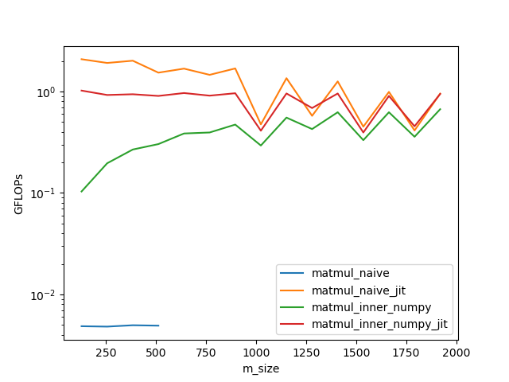

baseline : 27.510066747665405
baseline with jit : 0.061835289001464844
inner_loop numpy : 0.48038816452026367
inner_loop numpy with jit : 0.13032007217407227

export OMP_NUM_THREADS=1
export OPENBLAS_NUM_THREADS=1
gcc matmul.c -o matmul -lopenblas -lm